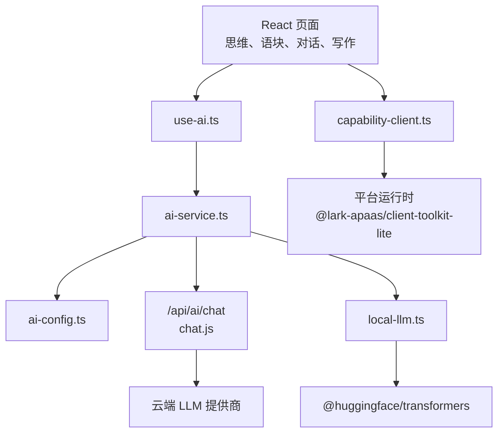
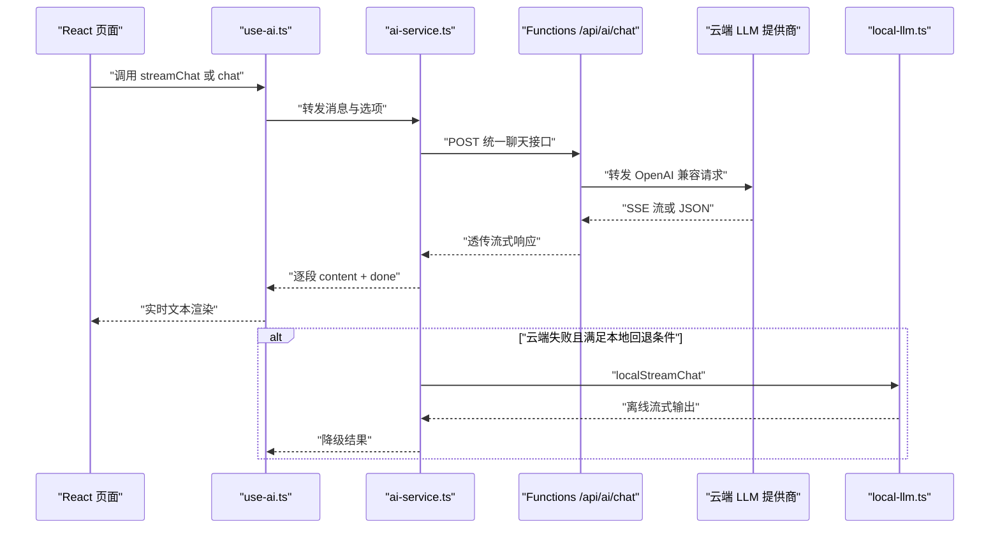
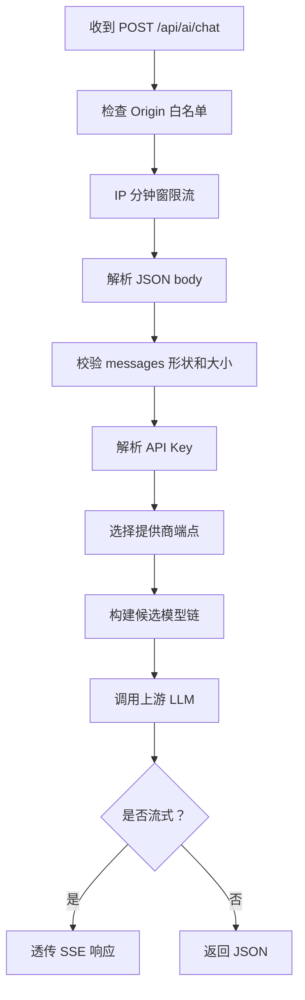
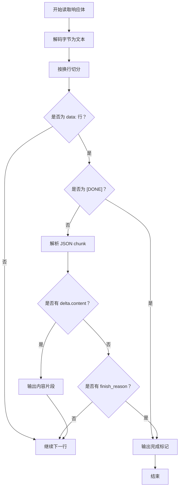
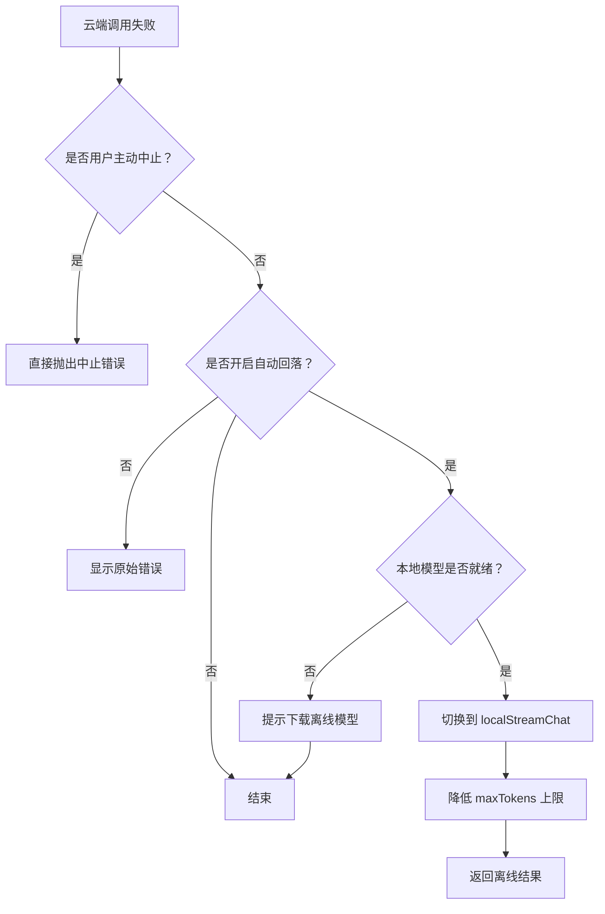
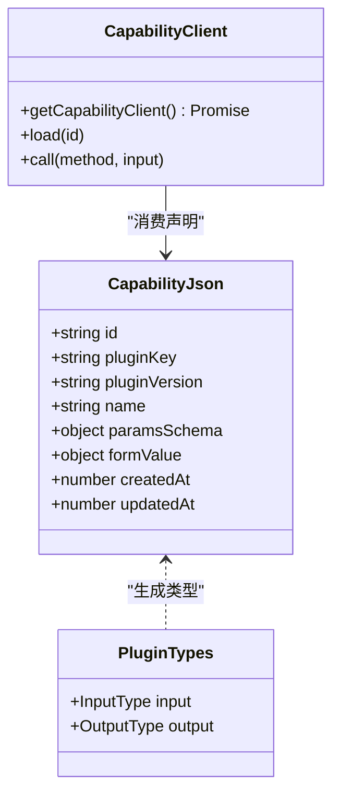
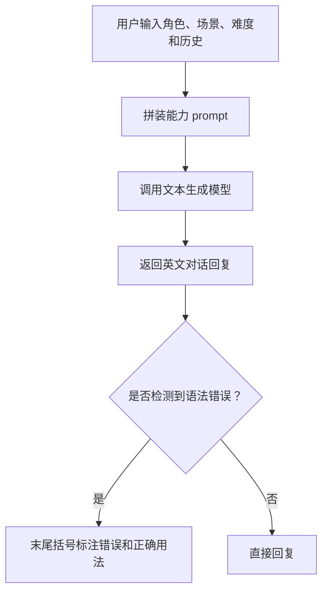
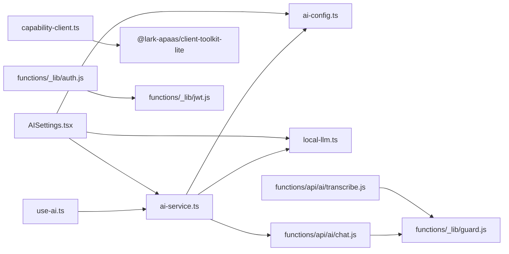

# AI 服务与智能功能

<cite>
**本文引用的文件**
- [ai-service.ts](file://src/services/ai-service.ts)
- [ai-config.ts](file://src/services/ai-config.ts)
- [use-ai.ts](file://src/hooks/use-ai.ts)
- [capability-client.ts](file://src/lib/capability-client.ts)
- [local-llm.ts](file://src/lib/local-llm.ts)
- [chat.js](file://functions/api/ai/chat.js)
- [transcribe.js](file://functions/api/ai/transcribe.js)
- [guard.js](file://functions/_lib/guard.js)
- [auth.js](file://functions/_lib/auth.js)
- [jwt.js](file://functions/_lib/jwt.js)
- [kv.js](file://functions/_lib/kv.js)
- [plugin-types.ts](file://shared/plugin-types.ts)
- [README.md](file://shared/capabilities/README.md)
- [ai_role_play_english_conversation_1.json](file://shared/capabilities/ai_role_play_english_conversation_1.json)
- [dialogue_naturalness_analysis_1.json](file://shared/capabilities/dialogue_naturalness_analysis_1.json)
- [english_thought_translation_feedback_1.json](file://shared/capabilities/english_thought_translation_feedback_1.json)
- [AISettings.tsx](file://src/components/AISettings.tsx)
- [ai-services.md](file://docs/modules/ai-services.md)
</cite>

## 目录

1. [引言](#引言)
2. [项目结构](#项目结构)
3. [核心组件](#核心组件)
4. [架构总览](#架构总览)
5. [详细组件分析](#详细组件分析)
6. [依赖关系分析](#依赖关系分析)
7. [性能考虑](#性能考虑)
8. [故障排查指南](#故障排查指南)
9. [结论](#结论)
10. [附录：能力声明与运行时契约](#附录能力声明与运行时契约)

## 引言

NativeThink 的 AI 服务系统围绕三条主线构建：**用户自配 Key 的云端大模型调用**、**Cloudflare Pages Functions 统一代理**，以及**端侧离线小模型兜底**。系统设计目标是让“母语思维训练、语块练习、对话、写作”等页面以统一接口使用 AI，同时保证安全、可降级、可扩展。

本说明重点覆盖以下内容：

- 云端 LLM 调用和本地 LLM 集成的双轨设计。
- 多提供商（DeepSeek、豆包、通义千问、智谱 GLM、SiliconFlow、Moonshot、Groq 及出厂免费档）的统一配置抽象。
- 流式响应处理，包括实时文本渲染、中断恢复和错误处理。
- 基于 JSON 的能力声明文件与运行时能力客户端的设计理念。
- 角色扮演、对话自然度分析、英语思维翻译反馈等具体能力的实现方式。
- 安全配置、密钥管理、请求限流和错误处理的最佳实践。

## 项目结构

AI 相关代码分布在四个主要区域：

| 区域 | 职责 | 关键文件 |
|---|---|---|
| 前端服务层 | 封装聊天、流式调用、模型选择、本地回退 | `src/services/ai-service.ts`、`src/services/ai-config.ts` |
| React Hook 层 | 把服务暴露为页面可用的状态化接口 | `src/hooks/use-ai.ts` |
| 平台能力层 | 动态加载平台内置 AI 插件客户端 | `src/lib/capability-client.ts` |
| 本地模型层 | 离线 Qwen2.5-0.5B 推理与下载进度管理 | `src/lib/local-llm.ts` |
| 服务端函数 | 统一转发 OpenAI 兼容请求、限流、鉴权、转写 | `functions/api/ai/chat.js`、`functions/api/ai/transcribe.js` |
| 守卫与中间件 | Origin 白名单、IP 限流、消息校验、用量监控 | `functions/_lib/guard.js`、`auth.js`、`jwt.js`、`kv.js` |
| 共享能力定义 | 能力 JSON 声明与类型契约 | `shared/capabilities/*.json`、`shared/plugin-types.ts` |
| 设置界面 | 提供商 Key 管理、连接测试、本地模型下载 | `src/components/AISettings.tsx` |

**图表来源**
- [ai-service.ts:1-120](file://src/services/ai-service.ts#L1-L120)
- [ai-config.ts:1-80](file://src/services/ai-config.ts#L1-L80)
- [use-ai.ts:1-101](file://src/hooks/use-ai.ts#L1-L101)
- [capability-client.ts:1-23](file://src/lib/capability-client.ts#L1-L23)
- [local-llm.ts:1-40](file://src/lib/local-llm.ts#L1-L40)
- [chat.js:1-32](file://functions/api/ai/chat.js#L1-L32)

**章节来源**
- [ai-services.md:1-107](file://docs/modules/ai-services.md#L1-L107)

## 核心组件

### 统一 AI 服务

`ai-service.ts` 提供统一的聊天和流式聊天接口。它屏蔽了不同 OpenAI 兼容提供商的差异，并通过服务端代理保护 API Key。核心要点：

- 输入是标准化消息数组，角色包含 system、user、assistant。
- 支持显式指定 provider、model、任务类型、最大 token、温度、中止信号和静默模式。
- 任务类型用于在免费模型中区分“对话要快”和“翻译要准”。
- 所有请求都通过 `/api/ai/chat` 路由，避免前端直接持有上游凭证。
- SSE 流按 `data:` 行解析，支持 `[DONE]`、finish reason 和内容增量。
- 当服务端返回 503 时，会抛出带配置指引的错误，而不是只报 HTTP 状态码。

**章节来源**
- [ai-service.ts:1-120](file://src/services/ai-service.ts#L1-L120)
- [ai-service.ts:120-200](file://src/services/ai-service.ts#L120-L200)

### 提供商配置与密钥管理

`ai-config.ts` 是所有 AI 提供商的统一注册表。它负责：

- 声明支持的提供商列表。
- 保存每个提供商的名称、描述、API 端点、默认模型、免费模型、注册地址和是否支持流式。
- 从 `localStorage` 读取和写入用户 Key，键名为 `ai_key_<provider>`。
- 维护当前活跃提供商，键名为 `ai_active_provider`。
- 处理出厂免费 Key 和用户自建 Key 的优先级。
- 在 Key 或活跃提供商变更时广播事件，让页面重新计算可用状态。

Key 优先级规则如下：

1. 用户为某个 provider 配置的 Key。
2. 出厂内置 Key（仅对 factory 和默认出厂 provider 生效）。
3. 如果用户没有配置任何 Key，则视为未配置。

**章节来源**
- [ai-config.ts:1-120](file://src/services/ai-config.ts#L1-L120)
- [ai-config.ts:120-206](file://src/services/ai-config.ts#L120-L206)

### React Hook 封装

`use-ai.ts` 把底层服务包装成页面更容易使用的 Hook，暴露以下能力：

- 是否至少有一个提供商已配置。
- 已配置提供商列表。
- 流式聊天异步生成器。
- 非流式完整回复。
- 构建系统提示和用户消息。
- 向已有消息追加用户消息。

Hook 还负责错误展示：正常失败会弹出 toast；被主动中止的请求不会弹错误；静默模式由调用方自行控制提示。

**章节来源**
- [use-ai.ts:1-101](file://src/hooks/use-ai.ts#L1-L101)

### 平台能力客户端

`capability-client.ts` 的设计原则是“只在真正需要时才加载”。平台内置 AI 插件客户端体积较大，静态引入会显著增加首屏体积，因此模块采用懒加载：

- 首次调用才执行动态 import。
- 加载失败后清空 pending，允许后续重试。
- 在非平台环境或加载失败时返回 null。
- 调用方继续使用原有的 try-catch 和“AI 服务暂不可用”逻辑。

这种设计避免给默认走出厂免费额度的页面带来不必要的体积负担。

**章节来源**
- [capability-client.ts:1-23](file://src/lib/capability-client.ts#L1-L23)

### 本地离线 LLM

`local-llm.ts` 提供断网或云端限流时的离线兜底。它使用 transformers.js 加载 Qwen2.5-0.5B-Instruct 量化模型，目标不是替代云端大模型，而是保证“可用”。

关键点：

- 模型约 780MB，首次下载后通过浏览器 Cache API 持久化。
- 加载是惰性的，不会自动触发下载。
- 支持检测安装包是否同源内置模型。
- 中文环境和安卓设备优先尝试 hf-mirror，再尝试 huggingface.co。
- 下载过程有 45 秒无进度看门狗，防止卡死。
- 就绪后可通过 async generator 流式输出 token。
- 支持自动回落开关，保存在 `__nativethink_local_llm_auto`。

**章节来源**
- [local-llm.ts:1-100](file://src/lib/local-llm.ts#L1-L100)
- [local-llm.ts:100-204](file://src/lib/local-llm.ts#L100-L204)

## 架构总览

AI 请求的典型路径如下：

**图表来源**
- [ai-service.ts:1-200](file://src/services/ai-service.ts#L1-L200)
- [chat.js:1-192](file://functions/api/ai/chat.js#L1-L192)
- [local-llm.ts:120-204](file://src/lib/local-llm.ts#L120-L204)

## 详细组件分析

### 云端聊天代理与服务端回退链

`functions/api/ai/chat.js` 是统一入口。它接收前端发来的 provider、model、messages、max_tokens、temperature、stream、task 和可选 apiKey，然后：

1. 校验请求方法。
2. 检查 Origin 白名单。
3. 进行 IP 分钟窗限流。
4. 解析并校验 JSON body。
5. 校验 messages 形状和大小。
6. 选择 API Key：客户端传入优先，否则取环境变量中的 provider Key 或全局 Key。
7. 根据 provider 选择上游端点和默认模型。
8. 对智谱系 provider 关闭思考模式以提升免费档速度。
9. 构建候选模型链，并在 429/500/502/503/504 时自动降级。
10. 如果是流式请求，直接透传上游响应体作为 SSE。

**图表来源**
- [chat.js:1-192](file://functions/api/ai/chat.js#L1-L192)

**章节来源**
- [chat.js:1-192](file://functions/api/ai/chat.js#L1-L192)

### 流式响应处理

前端流式处理的核心流程是：

1. 发送 POST 请求到 `/api/ai/chat`。
2. 获取响应体的 reader。
3. 使用 TextDecoder 解码字节流。
4. 按换行符切分行，保留不完整行缓冲。
5. 跳过空行和非 `data:` 行。
6. 遇到 `[DONE]` 时输出完成标记。
7. 解析 JSON chunk，提取 delta.content。
8. 遇到 finish_reason 时也输出完成标记。
9. finally 中释放 reader lock。

**图表来源**
- [ai-service.ts:100-200](file://src/services/ai-service.ts#L100-L200)

**章节来源**
- [ai-service.ts:100-200](file://src/services/ai-service.ts#L100-L200)

### 本地离线回退机制

本地回退不是无条件启用，而是遵循严格条件：

**图表来源**
- [ai-service.ts:300-368](file://src/services/ai-service.ts#L300-L368)
- [local-llm.ts:120-204](file://src/lib/local-llm.ts#L120-L204)

**章节来源**
- [ai-service.ts:300-368](file://src/services/ai-service.ts#L300-L368)
- [local-llm.ts:120-204](file://src/lib/local-llm.ts#L120-L204)

### 能力客户端与 JSON 能力声明

能力系统有两层：

1. **声明层**：`shared/capabilities/*.json` 描述能力 ID、插件名称、参数 schema、表单值、模型参数和 prompt。
2. **类型层**：`shared/plugin-types.ts` 自动生成对应输入输出 TypeScript 类型。
3. **运行层**：`capability-client.ts` 在平台环境中动态加载 `@lark-apaas/client-toolkit-lite`，然后通过 capabilityClient 调用插件。

**图表来源**
- [ai_role_play_english_conversation_1.json:1-50](file://shared/capabilities/ai_role_play_english_conversation_1.json#L1-L50)
- [dialogue_naturalness_analysis_1.json:1-36](file://shared/capabilities/dialogue_naturalness_analysis_1.json#L1-L36)
- [english_thought_translation_feedback_1.json:1-36](file://shared/capabilities/english_thought_translation_feedback_1.json#L1-L36)
- [plugin-types.ts:1-107](file://shared/plugin-types.ts#L1-L107)
- [capability-client.ts:1-23](file://src/lib/capability-client.ts#L1-L23)

**章节来源**
- [capability-client.ts:1-23](file://src/lib/capability-client.ts#L1-L23)
- [plugin-types.ts:1-107](file://shared/plugin-types.ts#L1-L107)
- [README.md:1-5](file://shared/capabilities/README.md#L1-L5)

### 角色扮演英文对话能力

能力 ID 为 `ai_role_play_english_conversation_1`，参数包括：

- role_setting：对话角色设定。
- scene_description：场景描述。
- user_message：用户上一轮输入。
- conversation_history：历史对话。
- difficulty_level：难度等级。

该能力通过 `@official-plugins/ai-text-generate` 插件调用，prompt 要求完全使用英文回复，并根据难度调整词汇和句式复杂度，同时保持对话引导性。

**图表来源**
- [ai_role_play_english_conversation_1.json:1-50](file://shared/capabilities/ai_role_play_english_conversation_1.json#L1-L50)
- [plugin-types.ts:60-107](file://shared/plugin-types.ts#L60-L107)

**章节来源**
- [ai_role_play_english_conversation_1.json:1-50](file://shared/capabilities/ai_role_play_english_conversation_1.json#L1-L50)
- [plugin-types.ts:60-107](file://shared/plugin-types.ts#L60-L107)

### 对话自然度分析能力

能力 ID 为 `dialogue_naturalness_analysis_1`，参数包括用户对话内容和对话场景。该能力用于对话结束后对用户表达的地道程度进行分析，输出结构包含评分、亮点、改进建议、优化建议和延伸学习示例。

**章节来源**
- [dialogue_naturalness_analysis_1.json:1-36](file://shared/capabilities/dialogue_naturalness_analysis_1.json#L1-L36)
- [plugin-types.ts:1-60](file://shared/plugin-types.ts#L1-L60)

### 英语思维翻译反馈能力

能力 ID 为 `english_thought_translation_feedback_1`，对比用户英语表达和母语者标准表达，输出差异对比、思维误区分析、转译指导、改进建议和举一反三示例。这是“母语思维训练”页面的重要反馈能力。

**章节来源**
- [english_thought_translation_feedback_1.json:1-36](file://shared/capabilities/english_thought_translation_feedback_1.json#L1-L36)
- [plugin-types.ts:28-60](file://shared/plugin-types.ts#L28-L60)

### 音频转写服务

`functions/api/ai/transcribe.js` 支持两种输入方式：

1. multipart/form-data：影子跟读录音上传，字段包括 audio、provider、apiKey、language。
2. application/json：B站字幕转写，支持 bvid/cid/page 或 audioUrl。

它统一归一化为 text 和 segments，并对不同上游返回格式做兼容处理。上传音频上限为 8MB，服务端不持久化音频。

**章节来源**
- [transcribe.js:1-200](file://functions/api/ai/transcribe.js#L1-L200)

### 安全与鉴权中间件

项目的安全机制分为两层：

#### 公共 AI 接口

公共 AI 接口使用 Origin 白名单和 IP 限流：

| 防护项 | 行为 |
|---|---|
| Origin 白名单 | 仅允许 nativethink.pages.dev、localhost、127.0.0.1 及其端口变体 |
| IP 限流 | 每 IP 每分钟最多 30 次请求 |
| messages 校验 | 数组非空、不超过 80 条、每条 role/content 为字符串、总长度不超过 64k |
| 出厂 Key 用量监控 | 未携带客户端 Key 的请求记录结构化日志 |

#### 认证接口

认证接口使用 JWT：

- 登录和注册接口签发令牌。
- 令牌有效期 30 天。
- 验证接口从 Authorization 头提取 Bearer token。
- 无效 token 返回 null。

**章节来源**
- [guard.js:1-89](file://functions/_lib/guard.js#L1-L89)
- [auth.js:1-8](file://functions/_lib/auth.js#L1-L8)
- [jwt.js:1-26](file://functions/_lib/jwt.js#L1-L26)
- [kv.js:1-6](file://functions/_lib/kv.js#L1-L6)

## 依赖关系分析

**图表来源**
- [ai-service.ts:1-40](file://src/services/ai-service.ts#L1-L40)
- [use-ai.ts:1-30](file://src/hooks/use-ai.ts#L1-L30)
- [AISettings.tsx:1-40](file://src/components/AISettings.tsx#L1-L40)
- [capability-client.ts:1-23](file://src/lib/capability-client.ts#L1-L23)
- [chat.js:1-20](file://functions/api/ai/chat.js#L1-L20)
- [transcribe.js:1-10](file://functions/api/ai/transcribe.js#L1-L10)
- [guard.js:1-20](file://functions/_lib/guard.js#L1-L20)
- [auth.js:1-8](file://functions/_lib/auth.js#L1-L8)
- [jwt.js:1-26](file://functions/_lib/jwt.js#L1-L26)

**章节来源**
- [ai-service.ts:1-40](file://src/services/ai-service.ts#L1-L40)
- [use-ai.ts:1-30](file://src/hooks/use-ai.ts#L1-L30)
- [AISettings.tsx:1-40](file://src/components/AISettings.tsx#L1-L40)
- [capability-client.ts:1-23](file://src/lib/capability-client.ts#L1-L23)
- [chat.js:1-20](file://functions/api/ai/chat.js#L1-L20)
- [transcribe.js:1-10](file://functions/api/ai/transcribe.js#L1-L10)
- [guard.js:1-20](file://functions/_lib/guard.js#L1-L20)
- [auth.js:1-8](file://functions/_lib/auth.js#L1-L8)
- [jwt.js:1-26](file://functions/_lib/jwt.js#L1-L26)

## 性能考虑

### 首屏体积控制

能力客户端采用动态导入，避免把 507KB raw、160KB gzip 的平台插件库带入默认路由。本地模型也通过懒加载和浏览器缓存控制体积影响。

### 流式渲染

流式响应减少首字延迟，适合对话、翻译讲解和批改场景。前端按 token 增量渲染，提升交互体验。

### 本地模型加载策略

本地模型不会自动下载，只有用户主动下载或自动回落首次触发时才加载。下载过程支持远程源切换和看门狗，避免长时间阻塞。

### 服务端回退链

智谱免费档在高并发时容易 429，服务端自动在多个模型之间降级，提高可用性而不增加客户端复杂度。

**章节来源**
- [capability-client.ts:1-23](file://src/lib/capability-client.ts#L1-L23)
- [local-llm.ts:1-100](file://src/lib/local-llm.ts#L1-L100)
- [ai-service.ts:100-200](file://src/services/ai-service.ts#L100-L200)
- [chat.js:38-133](file://functions/api/ai/chat.js#L38-L133)

## 故障排查指南

### 常见问题与定位

| 现象 | 可能原因 | 排查位置 |
|---|---|---|
| 前端报“服务端 AI Key 未配置” | 服务端未设置对应 provider 的 Key | `functions/api/ai/chat.js` |
| 503 但本地能工作 | 用户未配置 Key 且出厂 Key 不可用或未配置 | `ai-config.ts`、`ai-service.ts` |
| 流式输出中断 | 网络断开、服务端超时、上游限流、用户主动中止 | `ai-service.ts`、`chat.js` |
| 本地模型无法下载 | 直连 huggingface.co 不通、镜像不可用、磁盘或缓存异常 | `local-llm.ts` |
| APK 中跨域失败 | 新函数忘记挂载 CORS 中间件 | `functions/_lib/cors.js` |
| 第三方网页滥用 AI 接口 | Origin 不在白名单 | `functions/_lib/guard.js` |
| 频繁 429 | IP 超过每分钟 30 次限制 | `functions/_lib/guard.js` |
| 消息被拒绝 | messages 为空、超长或结构不正确 | `functions/_lib/guard.js` |

### 调试建议

1. 先在 AI 设置中点击“测试连接”，确认所选 provider 可连通。
2. 查看 Cloudflare Workers 控制台 Real-time Logs，搜索 `ai_factory_usage`。
3. 使用 GET `/api/ai/chat` 查看当日出厂 Key 用量快照。
4. 本地开发时可分别验证 http://localhost 和 http://127.0.0.1。
5. 打包版需区分 APK 和桌面版模型可得性，不要直接用网页版结论推断。
6. 修改 guard 参数后，手工验证 403、429、400、200 四种响应。

**章节来源**
- [AISettings.tsx:1-200](file://src/components/AISettings.tsx#L1-L200)
- [guard.js:1-89](file://functions/_lib/guard.js#L1-L89)
- [ai-services.md:70-107](file://docs/modules/ai-services.md#L70-L107)

## 结论

NativeThink 的 AI 服务系统以“统一接口、多后端、可降级”为核心设计思想：

- 前端通过 `ai-service.ts` 和 `use-ai.ts` 获得一致的聊天和流式接口。
- 服务端通过 `chat.js` 统一管理多提供商，并提供限流、校验和回退链。
- 本地模型作为离线兜底，保障极端场景下的基础可用性。
- 能力系统通过 JSON 声明和类型契约解耦业务语义与模型实现。
- 安全方面结合 Origin 白名单、IP 限流、消息校验和 JWT 鉴权。

最佳实践建议：

- 新增提供商时同步更新前端 `PROVIDER_CONFIGS` 和服务端端点映射。
- 不要在公共函数中遗漏 CORS 中间件。
- 不要把 `scripts/.apikey` 提交到仓库。
- 不要把 models-bundled 放入 git 跟踪。
- 修改限流阈值和 Origin 白名单时必须手工验证四类响应。
- 使用能力声明而非硬编码 prompt 来扩展 AI 行为。
- 对长耗时 AI 操作始终支持中止信号和流式渲染。

## 附录：能力声明与运行时契约

### 能力声明文件约定

每个能力文件包含：

- id：能力唯一标识。
- pluginKey：插件包名。
- pluginVersion：插件版本。
- name：人类可读名称。
- description：用途说明。
- paramsSchema：运行时参数校验结构。
- formValue：平台表单值，含 modelID、modelParams 和 prompt。
- createdAt、updatedAt、createdBy：元数据。

### 类型生成约定

`shared/plugin-types.ts` 中的类型由工具自动生成，输入输出接口命名遵循 `<PluginId>OneInput` 和 `<PluginId>OneOutput` 的模式。调用方应直接使用这些类型，而不是手写字符串字段。

**章节来源**
- [README.md:1-5](file://shared/capabilities/README.md#L1-L5)
- [plugin-types.ts:1-107](file://shared/plugin-types.ts#L1-L107)
- [ai_role_play_english_conversation_1.json:1-50](file://shared/capabilities/ai_role_play_english_conversation_1.json#L1-L50)
- [dialogue_naturalness_analysis_1.json:1-36](file://shared/capabilities/dialogue_naturalness_analysis_1.json#L1-L36)
- [english_thought_translation_feedback_1.json:1-36](file://shared/capabilities/english_thought_translation_feedback_1.json#L1-L36)