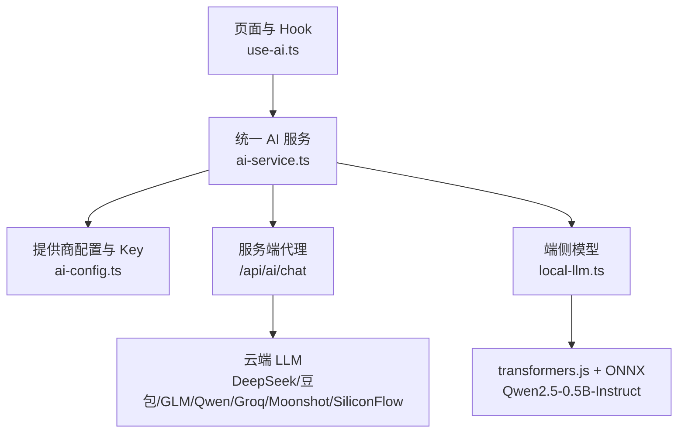
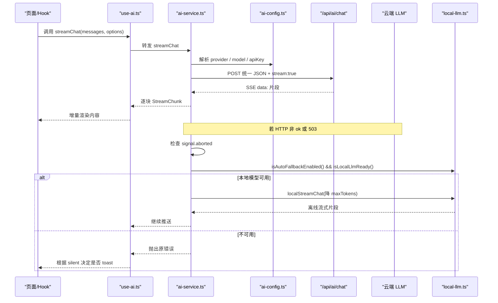
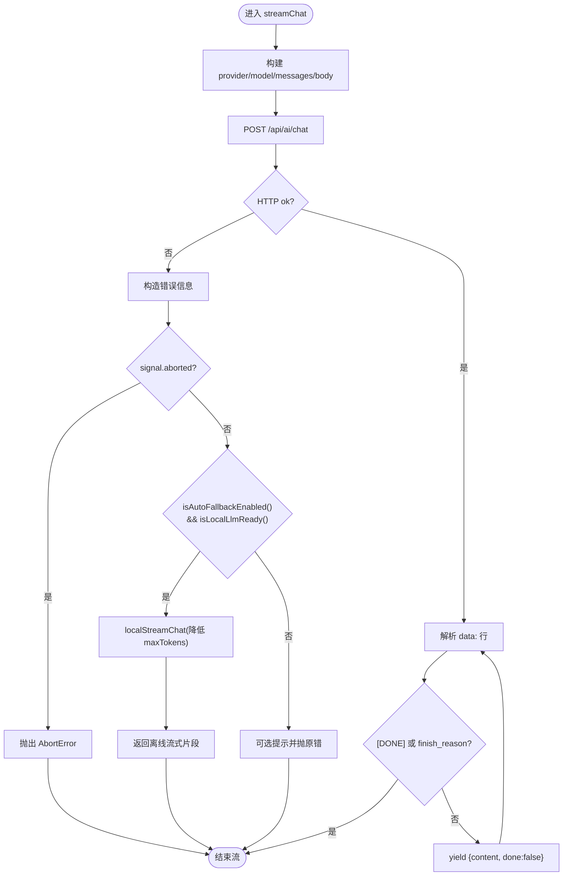
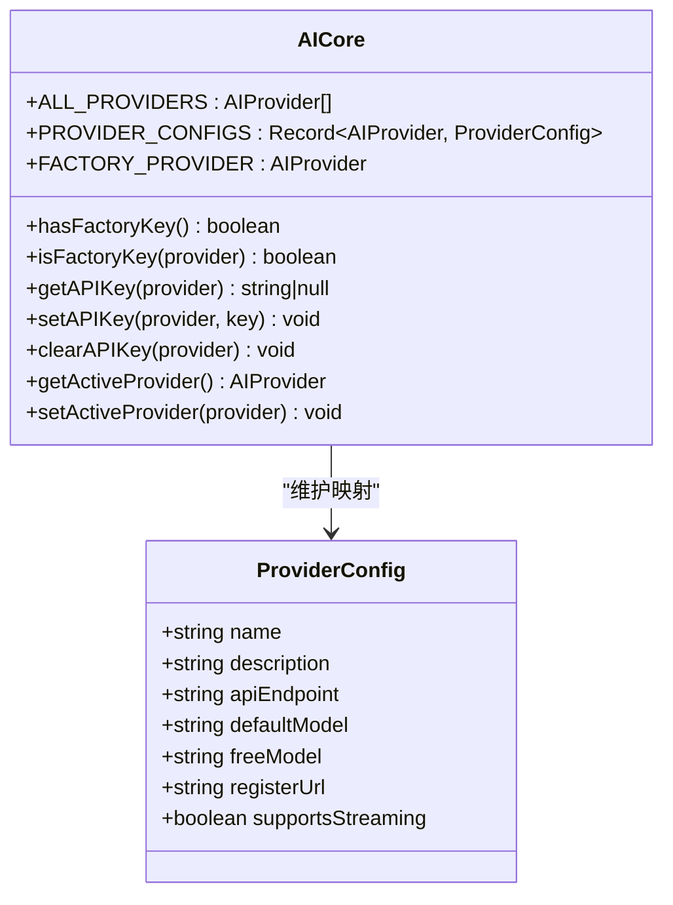
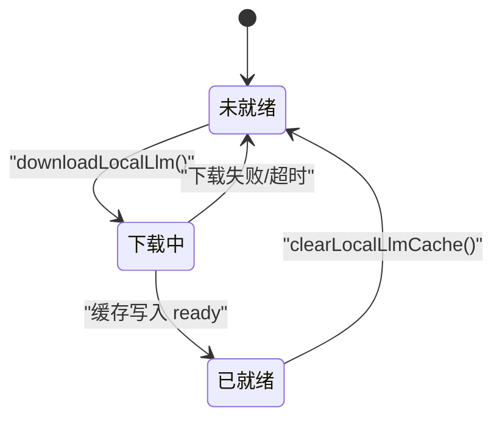
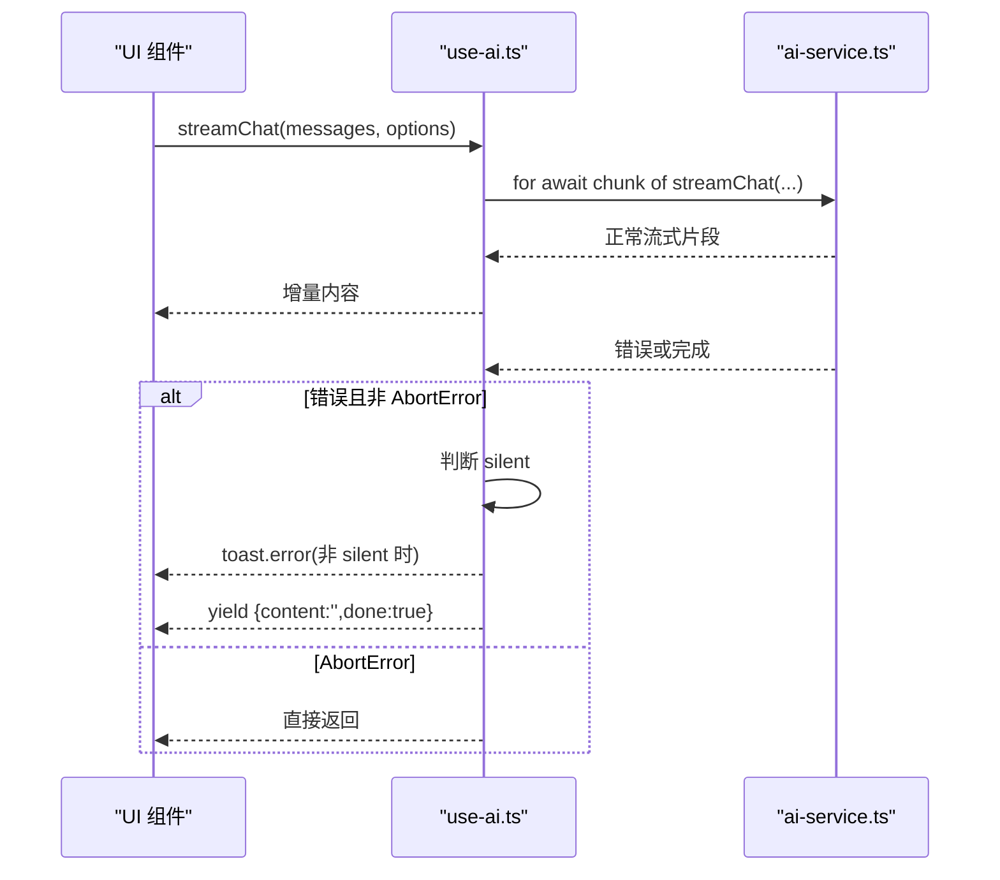
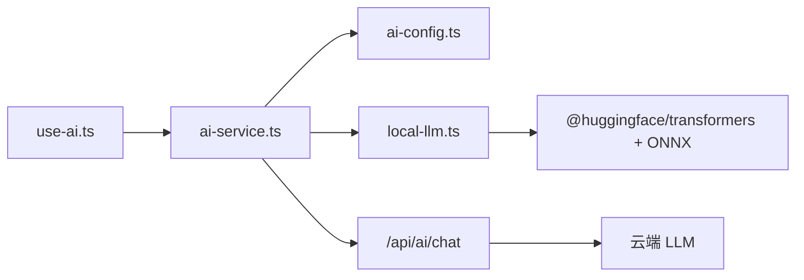

# AI 服务架构设计

<cite>
**本文引用的文件**   
- [ai-service.ts](file://src/services/ai-service.ts)
- [ai-config.ts](file://src/services/ai-config.ts)
- [local-llm.ts](file://src/lib/local-llm.ts)
- [use-ai.ts](file://src/hooks/use-ai.ts)
- [ai-services.md](file://docs/modules/ai-services.md)
</cite>

## 目录
1. [引言](#引言)
2. [项目结构](#项目结构)
3. [核心组件](#核心组件)
4. [架构总览](#架构总览)
5. [详细组件分析](#详细组件分析)
6. [依赖关系分析](#依赖关系分析)
7. [性能与体积特性](#性能与体积特性)
8. [故障排查指南](#故障排查指南)
9. [结论](#结论)

## 引言
本文件面向 NativeThink 的 AI 服务层，系统性解释其“双轨”设计：云端 LLM 调用和本地端侧推理通过统一抽象对外暴露。上层业务（思维、对话、翻译、写作等）只关心消息流和错误语义，无需感知底层是 Cloudflare Pages Functions 代理的 OpenAI 兼容接口，还是浏览器内基于 onnxruntime-node / transformers.js 的离线小模型。

关键目标：
- 统一抽象：`ai-service.ts` 提供统一的流式与非流式聊天接口。
- 多提供商配置：`ai-config.ts` 管理云端提供商、Key、活跃服务商和免费模型策略。
- 端侧兜底：`local-llm.ts` 在限流或断网时自动回退到 Qwen2.5-0.5B-Instruct ONNX 模型。
- 可观测与可配置：Key 变更事件、下载进度、自动回落开关、内置模型探测等能力贯穿三层。

## 项目结构
AI 相关代码集中在以下路径：
- `src/services/ai-service.ts`：统一 AI 服务入口，封装请求构建、SSE 流解析、云端失败后的本地兜底。
- `src/services/ai-config.ts`：提供商元数据、API Key 读写、活跃服务商切换、出厂 Key 机制。
- `src/lib/local-llm.ts`：离线模型下载、状态机、基于 transformers.js + ONNX 的流式生成。
- `src/hooks/use-ai.ts`：React Hook，把 AI 服务包装成 UI 友好的 API，并处理错误提示与 provider 刷新。
- `docs/modules/ai-services.md`：官方模块文档，汇总实现要点、安全守卫、模型体积与打包差异。

图表来源
- [ai-service.ts:1-200](file://src/services/ai-service.ts#L1-L200)
- [ai-config.ts:1-206](file://src/services/ai-config.ts#L1-L206)
- [local-llm.ts:1-204](file://src/lib/local-llm.ts#L1-L204)
- [use-ai.ts:1-101](file://src/hooks/use-ai.ts#L1-L101)
- [ai-services.md:1-107](file://docs/modules/ai-services.md#L1-L107)

章节来源
- [ai-service.ts:1-200](file://src/services/ai-service.ts#L1-L200)
- [ai-config.ts:1-206](file://src/services/ai-config.ts#L1-L206)
- [local-llm.ts:1-204](file://src/lib/local-llm.ts#L1-L204)
- [use-ai.ts:1-101](file://src/hooks/use-ai.ts#L1-L101)
- [ai-services.md:1-107](file://docs/modules/ai-services.md#L1-L107)

## 核心组件
- 统一 AI 服务类与函数：定义 `ChatMessage`、`StreamCallOptions`、`StreamChunk`、`AITask`，并提供 `streamChat`、`chat`、`buildMessages`、`appendUserMessage` 等能力。
- 提供商配置中心：维护 `ALL_PROVIDERS`、`PROVIDER_CONFIGS`、`FACTORY_PROVIDER`，以及 `getAPIKey`、`setAPIKey`、`clearAPIKey`、`getActiveProvider`、`setActiveProvider`。
- 端侧 LLM：负责模型下载、就绪状态、自动回落开关、流式文本生成。
- React Hook：聚合上述能力，屏蔽 AbortError、统一 toast、监听配置变更。

章节来源
- [ai-service.ts:1-200](file://src/services/ai-service.ts#L1-L200)
- [ai-config.ts:1-206](file://src/services/ai-config.ts#L1-L206)
- [local-llm.ts:1-204](file://src/lib/local-llm.ts#L1-L204)
- [use-ai.ts:1-101](file://src/hooks/use-ai.ts#L1-L101)

## 架构总览
双轨架构的核心思想是“上层不变、底层可插拔”。

图表来源
- [ai-service.ts:1-200](file://src/services/ai-service.ts#L1-L200)
- [ai-config.ts:1-206](file://src/services/ai-config.ts#L1-L206)
- [local-llm.ts:1-204](file://src/lib/local-llm.ts#L1-L204)
- [use-ai.ts:1-101](file://src/hooks/use-ai.ts#L1-L101)
- [ai-services.md:23-43](file://docs/modules/ai-services.md#L23-L43)

## 详细组件分析

### 统一 AI 服务：ai-service.ts
该文件承担三类职责：
1. 请求构建：选择 provider、model、temperature、maxTokens、task、apiKey，并以 JSON 发送到 `/api/ai/chat`。
2. SSE 响应解析：按行切分 `data:` 片段，提取 `choices[0].delta.content`，识别 `[DONE]` 和 `finish_reason`。
3. 错误处理与本地兜底：区分用户取消、服务端未配置、普通网络/业务错误；在满足条件时切换到 `localStreamChat`。

关键点：
- 任务模型分工：`translate` 倾向更准模型，`chat` 倾向更快模型；显式 `model` 优先于任务分工，再回退到提供商默认免费模型。
- 服务端代理保护：即使注释强调“始终走服务端代理”，实际实现仍会把 `apiKey` 放入请求体；因此不要把客户端发送 Key 视为安全边界。
- 本地兜底触发条件：仅在非用户主动取消、且开启自动回落、且本地模型已就绪时生效；兜底时 `maxTokens` 被限制为不超过 600，缺省 400。
- 静默模式：当 `options.silent` 为真时，Hook 层不弹全局 toast，由页面自行展示降级结果。

图表来源
- [ai-service.ts:1-200](file://src/services/ai-service.ts#L1-L200)
- [ai-services.md:31-43](file://docs/modules/ai-services.md#L31-L43)

章节来源
- [ai-service.ts:1-200](file://src/services/ai-service.ts#L1-L200)
- [ai-services.md:23-43](file://docs/modules/ai-services.md#L23-L43)

### 提供商配置：ai-config.ts
该文件是 AI 能力的“配置中心”，职责包括：
- 定义所有支持的提供商枚举与配置表，涵盖名称、描述、API 端点、默认模型、免费模型、注册链接、是否支持流式。
- 管理出厂 Key：通过构建时注入变量提供 GLM 免费 Key，供 `factory` 选项使用；用户无法覆盖 `factory` 的 Key。
- 管理用户 Key：以 `ai_key_<provider>` 形式存储在 `localStorage`，并提供获取、设置、清除方法。
- 管理活跃提供商：`ai_active_provider` 决定默认使用的提供商；老版本迁移逻辑会把旧默认 `glm` 且无自有 Key 的用户迁移到 `factory`。
- 配置变更事件：通过 `AI_CONFIG_CHANGED_EVENT` 广播，使 Hook 和其他 UI 能刷新可用提供商列表。

图表来源
- [ai-config.ts:1-206](file://src/services/ai-config.ts#L1-L206)

章节来源
- [ai-config.ts:1-206](file://src/services/ai-config.ts#L1-L206)
- [ai-services.md:14-22](file://docs/modules/ai-services.md#L14-L22)

### 端侧 LLM：local-llm.ts
该文件实现离线兜底推理，主要能力如下：
- 模型标识与状态键：使用 `onnx-community/Qwen2.5-0.5B-Instruct`，状态保存在 `__nativethink_local_llm_state`。
- 下载流程：动态 import `@huggingface/transformers`，启用本地模型路径 `/models/`，远程源按语言/UA 优先 hf-mirror，具备 45 秒无进度看门狗。
- 设备适配：有 GPU 时使用 WebGPU，否则回退到 WASM；量化模型 q4。
- 就绪检测：`isLocalLlmReady()` 基于 localStorage 状态；`hasBundledModel()` 探测同源 `/models/<id>/config.json`。
- 流式生成：基于 `TextStreamer` 回调将 token 推入队列，以异步生成器方式向外推送 `{content, done}`。
- 自动回落开关：`__nativethink_local_llm_auto` 控制是否在云端失败后自动尝试本地模型。

图表来源
- [local-llm.ts:1-204](file://src/lib/local-llm.ts#L1-L204)

章节来源
- [local-llm.ts:1-204](file://src/lib/local-llm.ts#L1-L204)
- [ai-services.md:45-70](file://docs/modules/ai-services.md#L45-L70)

### React Hook：use-ai.ts
Hook 把 AI 服务封装成更易用的 React API：
- 暴露 `isConfigured`、`configuredProviders`、`streamChat`、`chat`、`buildMessages`、`appendUserMessage`。
- 监听 `AI_CONFIG_CHANGED_EVENT` 与窗口 `focus`，重新计算当前已配置的提供商，避免用户在设置页改 Key 后页面不刷新按钮状态。
- 对 `AbortError` 做静默处理，对其他错误在非 `silent` 模式下弹出 toast，并保证流式场景最终 yield 一个完成标记。

图表来源
- [use-ai.ts:1-101](file://src/hooks/use-ai.ts#L1-L101)
- [ai-service.ts:1-200](file://src/services/ai-service.ts#L1-L200)

章节来源
- [use-ai.ts:1-101](file://src/hooks/use-ai.ts#L1-L101)

## 依赖关系分析
AI 服务层的依赖方向清晰：UI/Hook → 统一服务 → 配置中心 → 服务端代理或本地模型。

图表来源
- [use-ai.ts:1-101](file://src/hooks/use-ai.ts#L1-L101)
- [ai-service.ts:1-200](file://src/services/ai-service.ts#L1-L200)
- [ai-config.ts:1-206](file://src/services/ai-config.ts#L1-L206)
- [local-llm.ts:1-204](file://src/lib/local-llm.ts#L1-L204)

章节来源
- [ai-service.ts:1-200](file://src/services/ai-service.ts#L1-L200)
- [ai-config.ts:1-206](file://src/services/ai-config.ts#L1-L206)
- [local-llm.ts:1-204](file://src/lib/local-llm.ts#L1-L204)
- [use-ai.ts:1-101](file://src/hooks/use-ai.ts#L1-L101)

## 性能与体积特性
- 云端流式响应：SSE 逐段解析，适合长输出实时渲染。
- 本地模型体积：Qwen2.5-0.5B-Instruct 量化模型磁盘约 780MB；运行时还会引入 transformers.js 与 onnxruntime wasm 二进制，首次加载开销较大。
- 动态加载：本地模型通过动态 import 避免首屏阻塞；但 `ai-service.ts` 静态引用了 `local-llm.ts`，因此任何向 `local-llm.ts` 顶部添加静态 import 的行为都可能增加入口依赖。
- 打包差异：APK/桌面可通过同源 `/models/` 直接加载模型，网页版则依赖远程镜像下载。
- 限流与回退：云端 429/5xx 时，服务端免费档内部会换模型；客户端侧则在兜底开关开启时切换到本地模型。

章节来源
- [ai-services.md:45-107](file://docs/modules/ai-services.md#L45-L107)

## 故障排查指南

### 常见问题与定位步骤
1. 服务端未配置 API Key
   - 现象：收到 503，错误信息包含配置指引。
   - 原因：服务端代理找不到有效 Key。
   - 处理：在服务端配置对应提供商的 Key；或使用已配置的厂商 Key。

2. 用户 Key 缺失或未生效
   - 现象：活跃提供商没有可用 Key，UI 显示不可用。
   - 检查：`localStorage` 中的 `ai_key_<provider>` 与 `ai_active_provider`。
   - 处理：在设置页重新输入 Key，并确保活跃提供商正确。

3. 本地模型未就绪
   - 现象：云端失败后没有自动回退。
   - 检查：`isLocalLlmReady()` 是否为真；`__nativethink_local_llm_state` 是否为 `ready`。
   - 处理：手动触发下载，等待状态变为 `ready`；确认自动回落开关 `__nativethink_local_llm_auto` 已开启。

4. 本地模型下载卡住
   - 现象：下载长时间无进度或失败。
   - 原因：远程源不可达、网络波动、WASM 加载慢。
   - 处理：查看下载进度；中文环境优先 hf-mirror；必要时清除缓存并重试。

5. 页面错误提示不符合预期
   - 现象：练习界面不应弹全局 toast，但其他页面弹出了。
   - 原因：`options.silent` 设置不同。
   - 处理：在需要内联错误展示的调用处传入 `silent: true`。

6. 移动端与网页行为不一致
   - 现象：APK 中本地模型秒出，网页却需要下载。
   - 原因：APK/桌面自带 `/models/` 资源，网页依赖远程镜像。
   - 处理：测试环境需分别验证网页与打包产物。

章节来源
- [ai-service.ts:1-200](file://src/services/ai-service.ts#L1-L200)
- [ai-config.ts:1-206](file://src/services/ai-config.ts#L1-L206)
- [local-llm.ts:1-204](file://src/lib/local-llm.ts#L1-L204)
- [use-ai.ts:1-101](file://src/hooks/use-ai.ts#L1-L101)
- [ai-services.md:23-107](file://docs/modules/ai-services.md#L23-L107)

## 结论
NativeThink 的 AI 服务层通过 `ai-service.ts` 提供了统一的双轨抽象：云端通过 `/api/ai/chat` 代理多个 OpenAI 兼容提供商，本地通过 `local-llm.ts` 提供离线兜底。`ai-config.ts` 集中管理提供商元数据、Key 与活跃偏好，`use-ai.ts` 把复杂的状态、错误与事件通知封装成简洁的 React Hook。

最佳实践建议：
- 新增云端提供商时，同步更新前端 `PROVIDER_CONFIGS` 与服务端路由表。
- 不要在 `local-llm.ts` 顶部添加静态 import，以免增大首屏体积。
- 在练习、批注等不需要全局 toast 的场景使用 `silent: true`。
- 测试端侧兜底时，分别验证网页与 APK/桌面，因为模型可得性完全不同。
- 谨慎修改服务端守卫与限流参数，并通过手工验证 403、429、400、200 四种响应。