# 安全配置与密钥管理

<cite>
**本文引用的文件**   
- [ai-config.ts](file://src/services/ai-config.ts)
- [safe-storage.ts](file://src/lib/safe-storage.ts)
- [app-env.ts](file://src/lib/app-env.ts)
- [crypto.js](file://functions/_lib/crypto.js)
- [auth.js](file://functions/_lib/auth.js)
- [jwt.js](file://functions/_lib/jwt.js)
- [cors.js](file://functions/_lib/cors.js)
- [guard.js](file://functions/_lib/guard.js)
- [chat.js](file://functions/api/ai/chat.js)
- [transcribe.js](file://functions/api/ai/transcribe.js)
- [passage.js](file://functions/api/ai/passage.js)
- [wrangler.toml](file://wrangler.toml)
</cite>

## 目录
1. [引言](#引言)
2. [项目结构与边界](#项目结构与边界)
3. [核心安全组件](#核心安全组件)
4. [架构总览](#架构总览)
5. [详细组件分析](#详细组件分析)
6. [依赖关系分析](#依赖关系分析)
7. [性能与安全特性](#性能与安全特性)
8. [常见问题排查](#常见问题排查)
9. [结论](#结论)
10. [附录：环境变量与配置清单](#附录环境变量与配置清单)

## 引言
本文面向 NativeThink 的 AI 服务安全配置，重点解释以下方面：
- 前端如何管理 AI 提供商、出厂内置 Key、用户自定义 Key。
- 敏感信息在浏览器中的本地存储方案。
- Cloudflare Functions 后端如何处理跨域、来源白名单、IP 限流、消息校验和 API Key 注入。
- 认证、JWT、密码哈希等基础安全能力。
- 多环境部署、环境变量注入方式以及可落地的安全最佳实践。

该文档既帮助开发者理解现有实现，也给出扩展方向（如密钥轮换、更严格的访问控制、请求签名等）。

## 项目结构与边界
NativeThink 的安全相关代码分为两层：
- 前端层：负责 UI 配置、AI Provider 选择、用户 Key 本地存储、运行平台识别。
- 服务端层：Cloudflare Workers / Pages Functions，负责代理调用第三方 AI 接口、防护滥用、认证与会话。

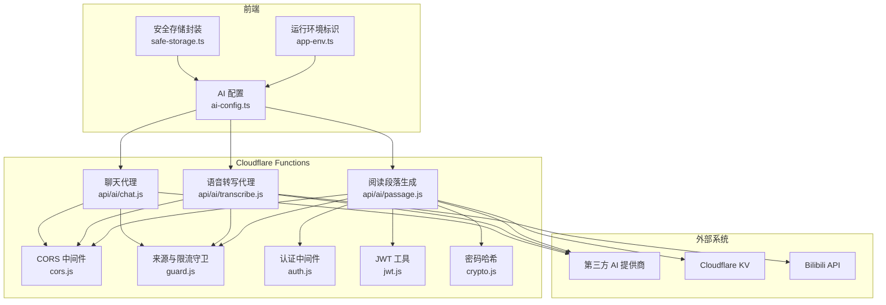

**图示来源**
- [ai-config.ts:1-206](file://src/services/ai-config.ts#L1-L206)
- [safe-storage.ts:1-216](file://src/lib/safe-storage.ts#L1-L216)
- [app-env.ts:1-29](file://src/lib/app-env.ts#L1-L29)
- [cors.js:1-29](file://functions/_lib/cors.js#L1-L29)
- [guard.js:1-89](file://functions/_lib/guard.js#L1-L89)
- [auth.js:1-8](file://functions/_lib/auth.js#L1-L8)
- [jwt.js:1-26](file://functions/_lib/jwt.js#L1-L26)
- [crypto.js:1-26](file://functions/_lib/crypto.js#L1-L26)
- [chat.js:1-192](file://functions/api/ai/chat.js#L1-L192)
- [transcribe.js:1-345](file://functions/api/ai/transcribe.js#L1-L345)
- [passage.js:1-77](file://functions/api/ai/passage.js#L1-L77)

**章节来源**
- [ai-config.ts:1-206](file://src/services/ai-config.ts#L1-L206)
- [safe-storage.ts:1-216](file://src/lib/safe-storage.ts#L1-L216)
- [app-env.ts:1-29](file://src/lib/app-env.ts#L1-L29)
- [wrangler.toml:1-9](file://wrangler.toml#L1-L9)

## 核心安全组件
本节汇总与“密钥、存储、传输、鉴权、限流”直接相关的模块职责。

| 组件 | 主要职责 | 关键安全点 |
|---|---|---|
| ai-config.ts | 定义 AI 提供商、默认模型、出厂 Key、用户 Key 读写、活跃 Provider | 出厂 Key 不暴露给客户端；用户 Key 仅存本地；Provider 白名单枚举 |
| safe-storage.ts | 为本地存储提供带应用与用户隔离的前缀键名、迁移、云同步回调 | 避免不同用户数据互相污染；失败返回布尔值供调用方判断 |
| app-env.ts | 判断 Android、iOS、桌面、Web 运行平台 | 防止错误平台误判导致行为异常 |
| cors.js | 统一 CORS 头、OPTIONS 预检、短路非浏览器预检 | 允许 Capacitor APK 从 `https://localhost` 调用 |
| guard.js | Origin 白名单、IP 分钟窗限流、出厂 Key 用量监控、消息体形状校验 | 防第三方网页滥用、防超大上下文、记录结构化日志 |
| auth.js | 从请求提取并校验 Bearer Token | 未携带或格式错误时返回空会话 |
| jwt.js | HS256 JWT 签发与验证，依赖 `JWT_SECRET` | 缺少环境变量时报错；过期/非法 token 返回空会话 |
| crypto.js | PBKDF2 加盐哈希密码 | 使用 Web Crypto，迭代次数固定，盐随机 |
| chat.js | 代理聊天请求、选择上游端点、重试降级、SSE 流式响应 | 优先使用客户端 apiKey，否则回退到服务端环境变量 |
| transcribe.js | 音频上传、Bilibili 字幕、Whisper 类转写、WBI 签名辅助 | 限制上传大小、校验 provider、规范化输出 |
| passage.js | 词汇段落生成、可选 KV 持久化 | 支持客户端 key 与服务端 key 双路径 |

**章节来源**
- [ai-config.ts:1-206](file://src/services/ai-config.ts#L1-L206)
- [safe-storage.ts:1-216](file://src/lib/safe-storage.ts#L1-L216)
- [app-env.ts:1-29](file://src/lib/app-env.ts#L1-L29)
- [cors.js:1-29](file://functions/_lib/cors.js#L1-L29)
- [guard.js:1-89](file://functions/_lib/guard.js#L1-L89)
- [auth.js:1-8](file://functions/_lib/auth.js#L1-L8)
- [jwt.js:1-26](file://functions/_lib/jwt.js#L1-L26)
- [crypto.js:1-26](file://functions/_lib/crypto.js#L1-L26)
- [chat.js:1-192](file://functions/api/ai/chat.js#L1-L192)
- [transcribe.js:1-345](file://functions/api/ai/transcribe.js#L1-L345)
- [passage.js:1-77](file://functions/api/ai/passage.js#L1-L77)

## 架构总览
下图展示一次典型“AI 聊天”请求的安全路径：

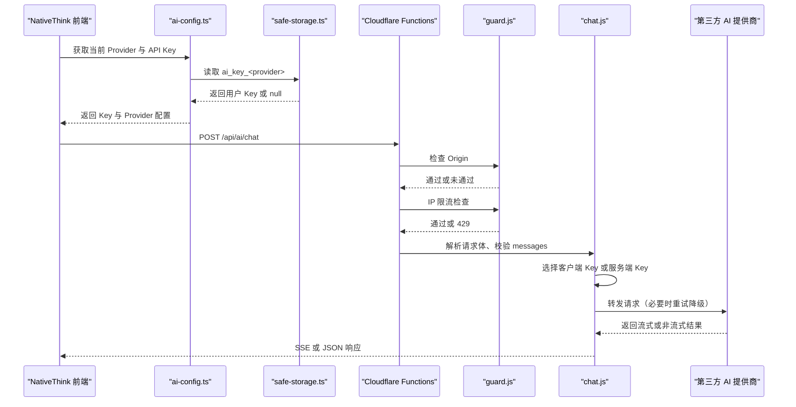

**图示来源**
- [ai-config.ts:120-206](file://src/services/ai-config.ts#L120-L206)
- [safe-storage.ts:1-216](file://src/lib/safe-storage.ts#L1-L216)
- [guard.js:1-89](file://functions/_lib/guard.js#L1-L89)
- [chat.js:1-192](file://functions/api/ai/chat.js#L1-L192)

## 详细组件分析

### AI 配置与密钥来源
`ai-config.ts` 定义了 AI Provider 列表、各厂商端点、默认模型与免费模型，并提供三类密钥来源：
1. **出厂内置 Key**：由构建阶段注入的常量提供，用于 `factory` Provider 与默认服务商回退。
2. **用户自定义 Key**：以 `ai_key_<provider>` 形式存储在本地存储中。
3. **服务端 Key**：运行时由 Cloudflare Functions 的环境变量提供，不在前端可见。

Key 获取优先级如下：
- `factory` Provider 始终使用出厂内置 Key。
- 其他 Provider 优先读本地存储中的用户 Key。
- 若用户未配置且当前 Provider 是出厂默认，则回退到出厂内置 Key。

此外，当用户修改、设置或删除 Key 时，会触发全局事件，供 UI 刷新状态。

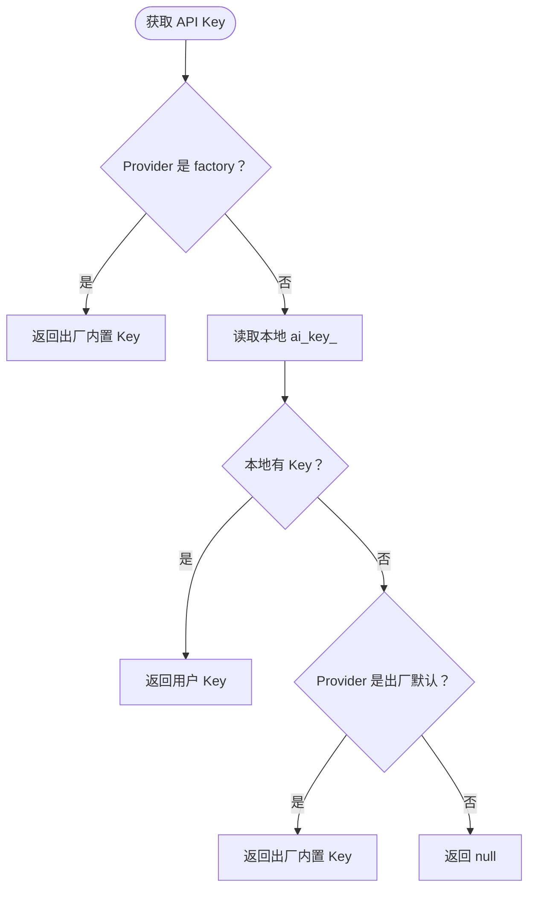

**图示来源**
- [ai-config.ts:12-26](file://src/services/ai-config.ts#L12-L26)
- [ai-config.ts:120-170](file://src/services/ai-config.ts#L120-L170)

**章节来源**
- [ai-config.ts:1-206](file://src/services/ai-config.ts#L1-L206)

### 本地安全存储方案
`safe-storage.ts` 不是传统意义上的“加密存储”，而是一个**命名空间与隔离层**，解决三个问题：
- **应用隔离**：键名前缀包含 appId，避免同域名下多个应用共享数据。
- **用户隔离**：键名前缀包含 userId 或匿名 ID，避免同一应用内不同用户数据串扰。
- **历史兼容**：保留旧前缀迁移逻辑，并在引导键丢失时尝试从既有键恢复匿名 ID。

它还提供：
- `getItem`、`setItem`、`removeItem`。
- `setItem` 返回布尔值，区分“写入成功”和“因配额或隐私模式失败”。
- 可选的云同步回调，删除操作也会通知云侧，避免脏数据复活。

需要特别注意：**当前实现并未对存储内容进行加密**。如果未来要存放真正敏感的凭证，应增加应用级加密层，并使用设备或平台提供的安全密钥库。

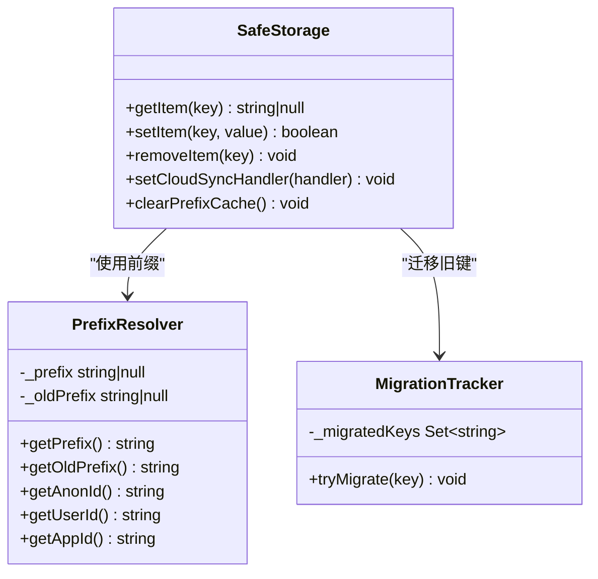

**图示来源**
- [safe-storage.ts:1-216](file://src/lib/safe-storage.ts#L1-L216)

**章节来源**
- [safe-storage.ts:1-216](file://src/lib/safe-storage.ts#L1-L216)

### 运行环境与多环境配置
`app-env.ts` 提供单一的运行平台判断逻辑，优先使用 Capacitor 原生桥，其次根据 UA 判断 Electron 桌面端，最后归为 Web。

多环境配置主要通过以下方式实现：
- 前端构建期常量：例如出厂 AI Key 由构建脚本注入，不会进入仓库。
- Cloudflare Functions 环境变量：例如 `JWT_SECRET`、`SERVER_AI_KEY`、`AI_KEY_<PROVIDER>`、`SERVER_AI_ENDPOINT`、`SERVER_AI_MODEL`。
- Cloudflare KV：用于用户级数据，如 passage 持久化。
- Wrangler 配置：声明 Workers/Pages Functions 名称、兼容性日期与 KV 绑定。

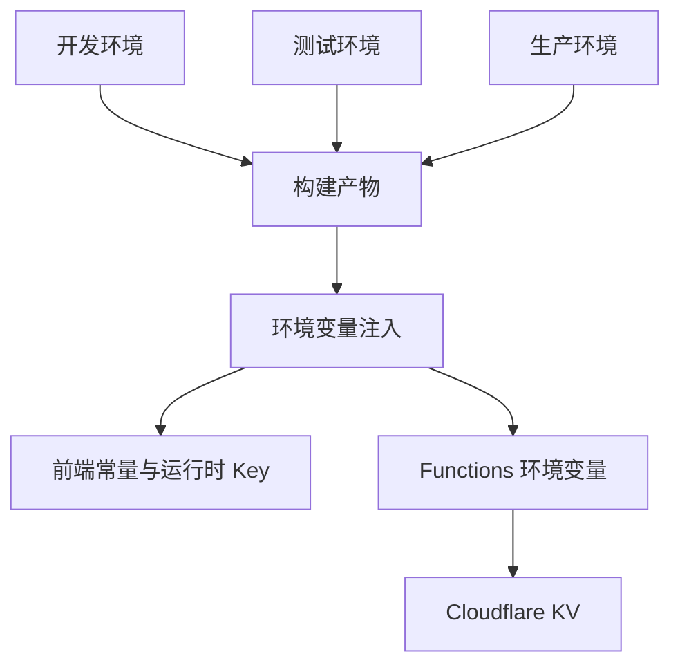

**图示来源**
- [app-env.ts:1-29](file://src/lib/app-env.ts#L1-L29)
- [wrangler.toml:1-9](file://wrangler.toml#L1-L9)
- [jwt.js:1-26](file://functions/_lib/jwt.js#L1-L26)
- [passage.js:1-77](file://functions/api/ai/passage.js#L1-L77)

**章节来源**
- [app-env.ts:1-29](file://src/lib/app-env.ts#L1-L29)
- [wrangler.toml:1-9](file://wrangler.toml#L1-L9)

### 请求来源与限流
`guard.js` 是 `/api/ai/*` 的主要防护层：
- **Origin 白名单**：允许 `nativethink.pages.dev`、`localhost`、`127.0.0.1` 及端口变体。
- **IP 限流**：基于 Worker isolate 内存的每分钟窗口计数，单 IP 最多 30 次，超过返回 429。
- **出厂 Key 用量监控**：每次使用服务端 Key 都记录结构化日志，并通过 GET 接口返回当日快照。
- **消息校验**：messages 必须是非空数组，条目数不超过 80，每条 role/content 必须是字符串，总字符数不超过 64k。

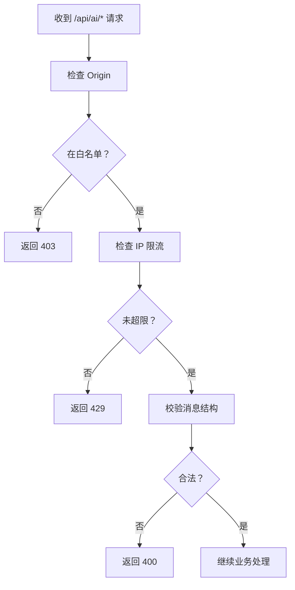

**图示来源**
- [guard.js:1-89](file://functions/_lib/guard.js#L1-L89)
- [chat.js:28-73](file://functions/api/ai/chat.js#L28-L73)

**章节来源**
- [guard.js:1-89](file://functions/_lib/guard.js#L1-L89)
- [chat.js:1-192](file://functions/api/ai/chat.js#L1-L192)

### 聊天代理与上游重试
`chat.js` 将前端请求代理到第三方 AI 提供商，核心流程如下：
1. GET 请求返回工厂 Key 用量快照。
2. POST 请求先做 Origin 与 IP 限流检查。
3. 解析请求体，校验 messages。
4. 选择 API Key：客户端传入优先，否则使用服务端环境变量。
5. 选择上游端点与模型。
6. 对智谱 Provider 进行模型链降级重试，应对 429 与部分 5xx。
7. 流式响应通过 SSE 返回，非流式返回 JSON。

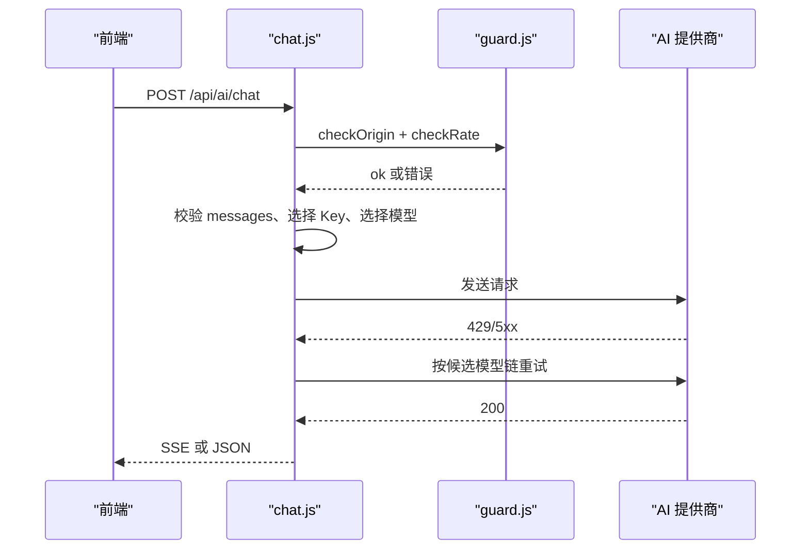

**图示来源**
- [chat.js:1-192](file://functions/api/ai/chat.js#L1-L192)
- [guard.js:1-89](file://functions/_lib/guard.js#L1-L89)

**章节来源**
- [chat.js:1-192](file://functions/api/ai/chat.js#L1-L192)

### 认证、JWT 与密码哈希
认证相关代码位于 Functions 层：
- `auth.js` 从 Authorization 头提取 Bearer Token。
- `jwt.js` 使用 HS256 签发 30 天有效 JWT，载荷包含用户 ID 与邮箱。
- `crypto.js` 使用 PBKDF2 + SHA-256 + 随机盐对用户密码进行哈希，适合注册登录场景。

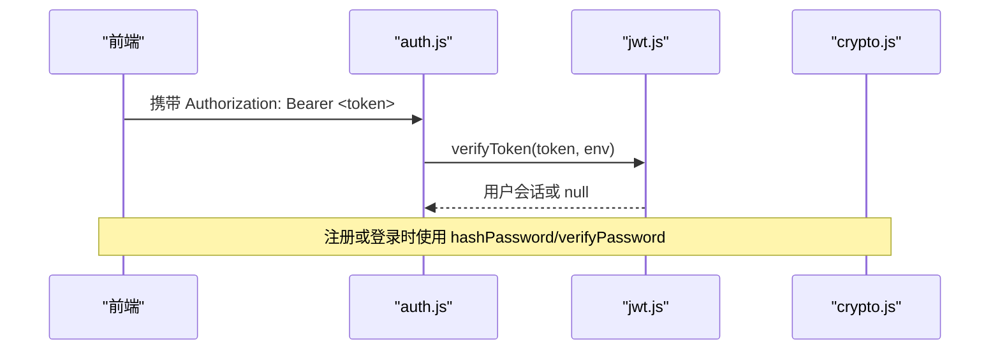

**图示来源**
- [auth.js:1-8](file://functions/_lib/auth.js#L1-L8)
- [jwt.js:1-26](file://functions/_lib/jwt.js#L1-L26)
- [crypto.js:1-26](file://functions/_lib/crypto.js#L1-L26)

**章节来源**
- [auth.js:1-8](file://functions/_lib/auth.js#L1-L8)
- [jwt.js:1-26](file://functions/_lib/jwt.js#L1-L26)
- [crypto.js:1-26](file://functions/_lib/crypto.js#L1-L26)

### 跨域与 OPTIONS 预检
`cors.js` 提供统一 CORS 头、预检响应和短路逻辑。由于 Capacitor APK 内源是 `https://localhost`，若没有正确的跨域头，移动端所有 AI、TTS 等请求都会被拦截。

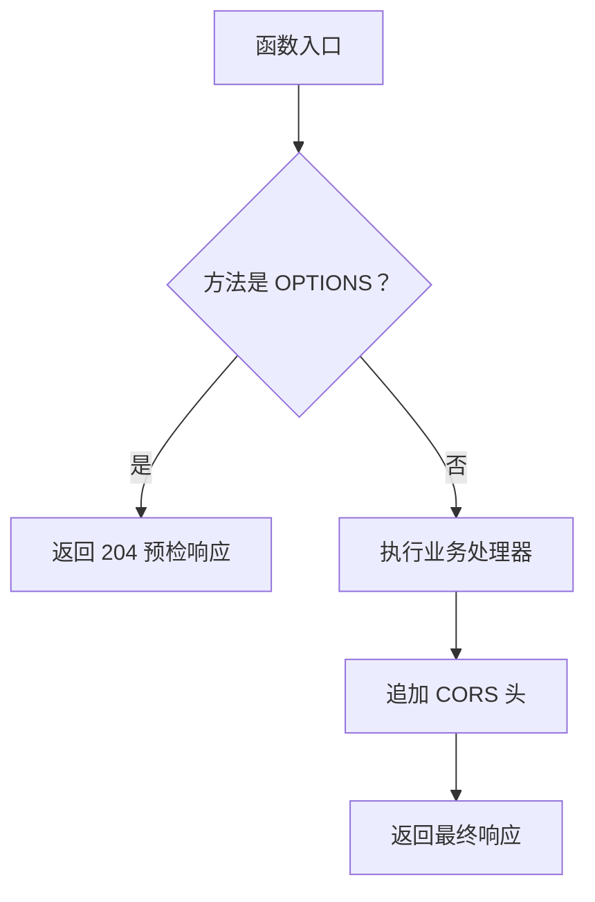

**图示来源**
- [cors.js:1-29](file://functions/_lib/cors.js#L1-L29)
- [chat.js:184-192](file://functions/api/ai/chat.js#L184-L192)
- [passage.js:69-77](file://functions/api/ai/passage.js#L69-L77)

**章节来源**
- [cors.js:1-29](file://functions/_lib/cors.js#L1-L29)
- [chat.js:184-192](file://functions/api/ai/chat.js#L184-L192)
- [passage.js:69-77](file://functions/api/ai/passage.js#L69-L77)

### 语音转写与 Bilibili WBI 签名
`transcribe.js` 支持两种输入：
- multipart/form-data：上传录音文件。
- application/json：调用 Bilibili 字幕接口。

它还实现了 Bilibili 的 WBI 签名辅助逻辑，包括获取导航接口、计算 mixin key、排序参数、添加时间戳和 MD5 签名。

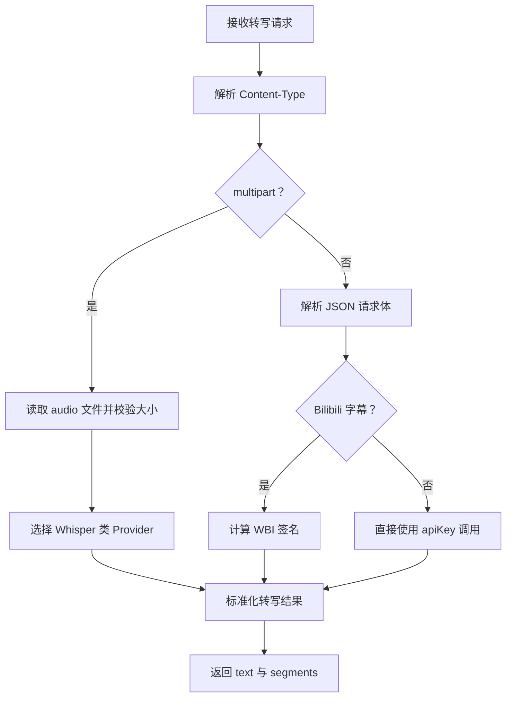

**图示来源**
- [transcribe.js:1-345](file://functions/api/ai/transcribe.js#L1-L345)

**章节来源**
- [transcribe.js:1-345](file://functions/api/ai/transcribe.js#L1-L345)

## 依赖关系分析
AI 安全相关依赖呈现“前端轻量、后端集中”的特点：
- 前端只持有少量配置和用户 Key，不直接访问第三方 AI。
- 后端集中处理跨域、来源校验、限流、Key 注入、上游重试。
- 认证仅在需要用户态功能的接口中使用，如 passage 可写入 KV。

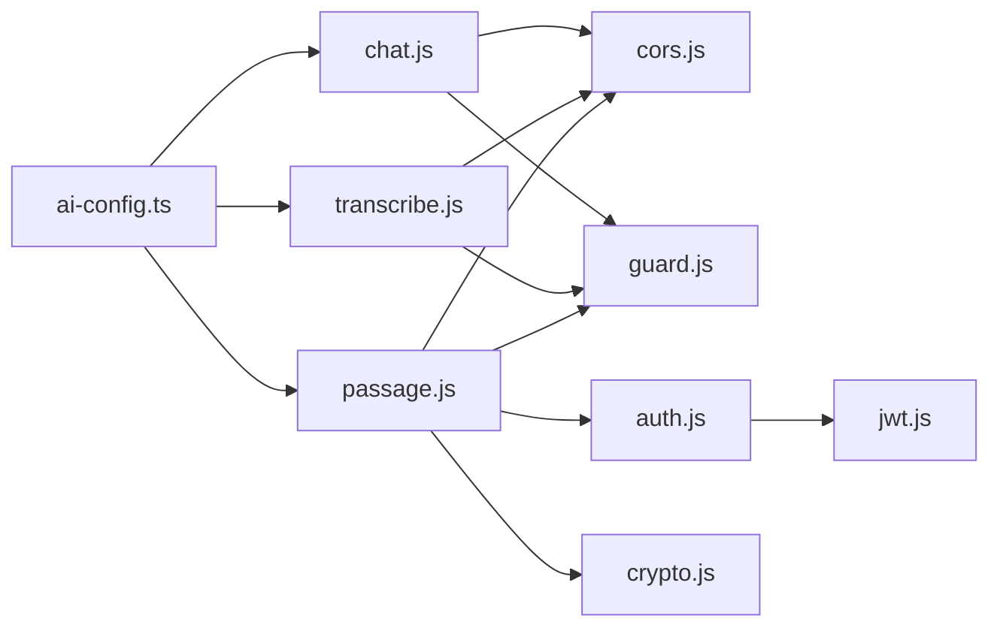

**图示来源**
- [ai-config.ts:1-206](file://src/services/ai-config.ts#L1-L206)
- [cors.js:1-29](file://functions/_lib/cors.js#L1-L29)
- [guard.js:1-89](file://functions/_lib/guard.js#L1-L89)
- [auth.js:1-8](file://functions/_lib/auth.js#L1-L8)
- [jwt.js:1-26](file://functions/_lib/jwt.js#L1-L26)
- [crypto.js:1-26](file://functions/_lib/crypto.js#L1-L26)
- [chat.js:1-192](file://functions/api/ai/chat.js#L1-L192)
- [transcribe.js:1-345](file://functions/api/ai/transcribe.js#L1-L345)
- [passage.js:1-77](file://functions/api/ai/passage.js#L1-L77)

**章节来源**
- [ai-config.ts:1-206](file://src/services/ai-config.ts#L1-L206)
- [cors.js:1-29](file://functions/_lib/cors.js#L1-L29)
- [guard.js:1-89](file://functions/_lib/guard.js#L1-L89)
- [auth.js:1-8](file://functions/_lib/auth.js#L1-L8)
- [jwt.js:1-26](file://functions/_lib/jwt.js#L1-L26)
- [crypto.js:1-26](file://functions/_lib/crypto.js#L1-L26)
- [chat.js:1-192](file://functions/api/ai/chat.js#L1-L192)
- [transcribe.js:1-345](file://functions/api/ai/transcribe.js#L1-L345)
- [passage.js:1-77](file://functions/api/ai/passage.js#L1-L77)

## 性能与安全特性
当前实现已具备若干关键安全能力：
- **API Key 不外泄**：客户端可选择自带 Key，但更多情况下由服务端环境变量注入。
- **来源白名单**：防止任意网页把 Functions 当作免费 AI 中继。
- **IP 限流**：基于内存的简单窗口限流，适合免费档 KV 配额受限场景。
- **消息体校验**：防止超大对话上下文和非预期字段透传。
- **上游降级重试**：对智谱免费模型的限流错误自动切换候选模型。
- **跨域兼容**：为 Capacitor APK 提供预检与 CORS 头。

尚未完全实现的建议增强项：
- **密钥轮换**：当前 Key 是静态字符串，可引入版本化 Key、灰度切换与失效时间。
- **请求签名**：可为重要接口增加 HMAC 签名或一次性 nonce，防止重放。
- **更细粒度访问控制**：对 chat、transcribe、passage 分别设置权限策略。
- **审计日志**：除 console.log 外，可增加结构化审计日志与告警。
- **本地存储加密**：如需长期保存敏感凭证，应在应用层加密并结合平台安全存储。

[本节为通用指导，不直接分析具体代码行]

## 常见问题排查
| 问题 | 可能原因 | 排查方法 | 解决方案 |
|---|---|---|---|
| 移动端 AI/TTS 请求被拦截 | 缺少 CORS 或 OPTIONS 预检 | 检查浏览器控制台跨域错误；确认 Function 入口调用 `isPreflight` 与 `withCors` | 确保每个 onRequest 开头处理预检并追加 CORS 头 |
| 第三方网站能调用 AI 接口 | Origin 白名单过宽或绕过 | 查看 `ALLOWED_ORIGINS` 与实际请求 Origin | 收紧白名单，仅允许自有域名和本地开发地址 |
| 频繁出现 429 | IP 触达每分钟上限 | 查看 limit 日志或使用 wrangler tail 观察 | 降低调用频率、合并请求、增加服务端限流阈值或引入分布式限流 |
| 使用出厂 Key 消耗异常 | 客户端未配置 Key，全部走服务端 Key | 查看工厂用量快照接口与 Real-time Logs | 引导用户配置自有 Key，限制出厂 Key 使用渠道 |
| 大段对话报错 | messages 超长或结构非法 | 检查 `validateMessages` 条件 | 截断历史、清理空内容消息、压缩 prompt |
| 本地数据刷新后丢失 | 隐私模式、存储配额不足 | 检查 `setItem` 返回值是否为 false | 提示用户清理缓存、关闭隐私模式，或改用云同步 |
| 不同用户看到彼此数据 | 前缀隔离失败 | 检查 appId/userId 是否稳定、迁移是否完成 | 重置匿名 ID、重建前缀缓存，修复平台用户注入 |
| JWT 登录失败 | 缺少 `JWT_SECRET` 或 token 过期 | 检查 Functions 环境变量与 token 有效期 | 配置环境变量，重新签发短生命周期 token |
| 密码无法验证 | salt/hash 格式损坏 | 检查哈希字符串是否为 `salt:hash` | 重新注册用户或修复存储格式 |
| Bilibili 转写失败 | WBI 签名或网络异常 | 检查 nav 接口返回、wbi_img/wbi_sub | 更新签名逻辑、增加重试与错误详情 |

**章节来源**
- [cors.js:1-29](file://functions/_lib/cors.js#L1-L29)
- [guard.js:1-89](file://functions/_lib/guard.js#L1-L89)
- [chat.js:28-73](file://functions/api/ai/chat.js#L28-L73)
- [safe-storage.ts:1-216](file://src/lib/safe-storage.ts#L1-L216)
- [jwt.js:1-26](file://functions/_lib/jwt.js#L1-L26)
- [crypto.js:1-26](file://functions/_lib/crypto.js#L1-L26)
- [transcribe.js:1-345](file://functions/api/ai/transcribe.js#L1-L345)

## 结论
NativeThink 的 AI 安全配置采用“前端轻配置、后端强防护”的分层设计：
- 前端负责 Provider 选择、用户 Key 管理与本地存储隔离。
- Cloudflare Functions 负责跨域、来源白名单、IP 限流、消息校验、Key 注入与上游代理。
- 认证与 JWT 为需要用户态能力的功能提供基础保护。
- 密码哈希使用标准算法，适合账户体系。

当前实现已经覆盖大多数常见安全问题，但仍建议逐步引入密钥轮换、请求签名、更严格的访问控制和审计机制，以提升整体安全性与可观测性。

[本节为总结性内容，不直接分析具体代码行]

## 附录：环境变量与配置清单

| 类别 | 名称 | 位置 | 说明 |
|---|---|---|---|
| 前端构建常量 | `__FACTORY_API_KEY__` | 构建期注入 | 出厂内置 AI Key，对应 factory Provider |
| Functions 环境变量 | `JWT_SECRET` | Cloudflare Functions | JWT HS256 签名密钥 |
| Functions 环境变量 | `SERVER_AI_KEY` | Cloudflare Functions | 通用服务端 AI Key 回退 |
| Functions 环境变量 | `AI_KEY_<PROVIDER>` | Cloudflare Functions | 按 Provider 注入的服务端 Key |
| Functions 环境变量 | `SERVER_AI_ENDPOINT` | Cloudflare Functions | 段落生成接口的上游端点 |
| Functions 环境变量 | `SERVER_AI_MODEL` | Cloudflare Functions | 段落生成接口的上游模型 |
| KV 绑定 | `KV` | wrangler.toml | 用于 passages 等用户级数据存储 |
| 前端本地键 | `ai_key_<provider>` | localStorage | 用户自定义 AI Key |
| 前端本地键 | `ai_active_provider` | localStorage | 当前活跃 Provider |
| 安全存储前缀 | `__miaoda_<appId>_<userId>__:<key>` | localStorage | 应用与用户隔离后的本地键 |

**章节来源**
- [ai-config.ts:12-26](file://src/services/ai-config.ts#L12-L26)
- [jwt.js:1-26](file://functions/_lib/jwt.js#L1-L26)
- [chat.js:75-93](file://functions/api/ai/chat.js#L75-L93)
- [passage.js:18-43](file://functions/api/ai/passage.js#L18-L43)
- [wrangler.toml:1-9](file://wrangler.toml#L1-L9)
- [safe-storage.ts:1-216](file://src/lib/safe-storage.ts#L1-L216)