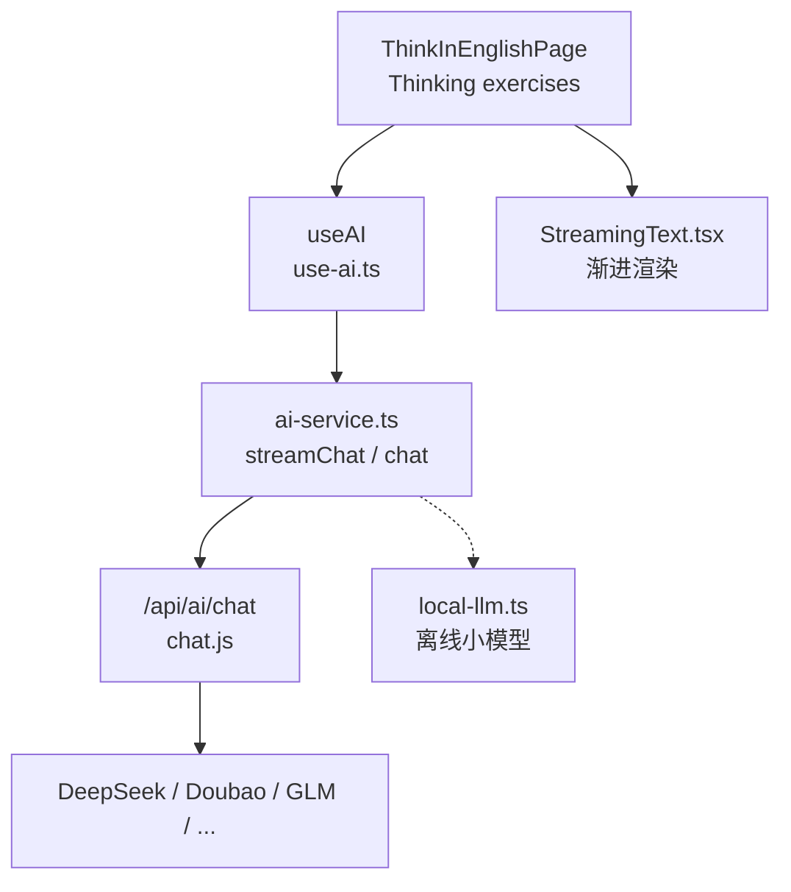
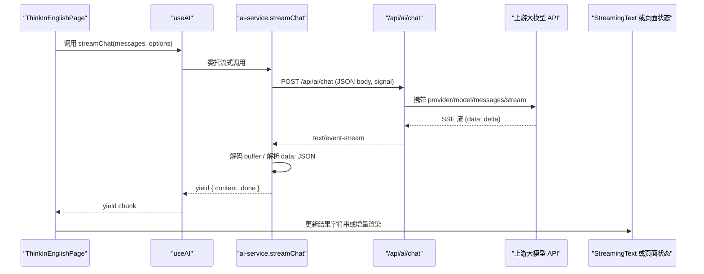
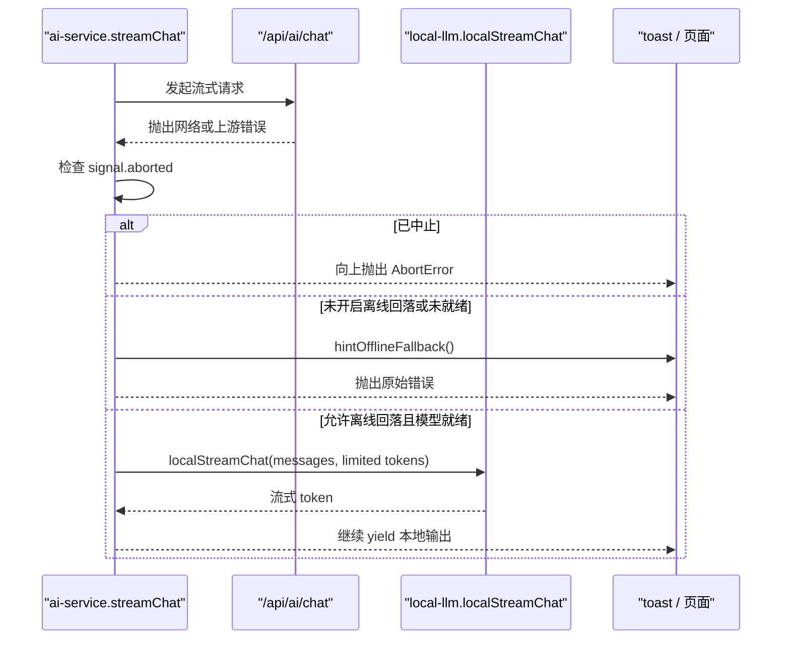
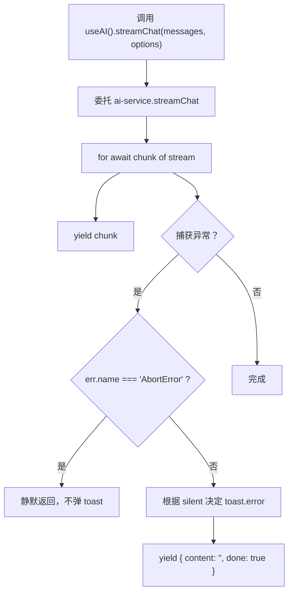
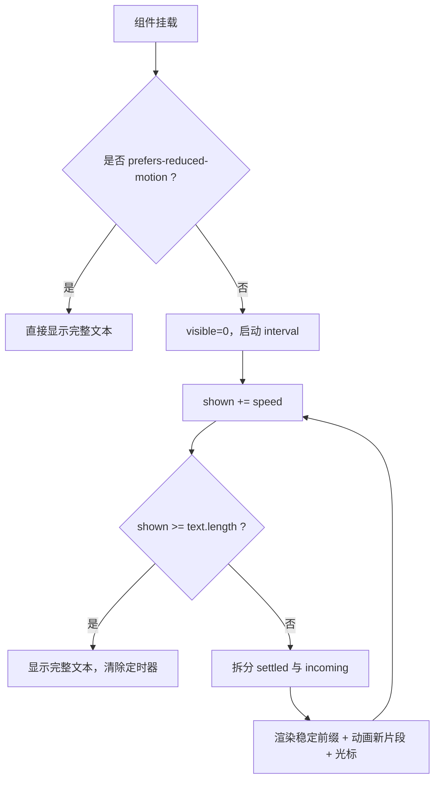
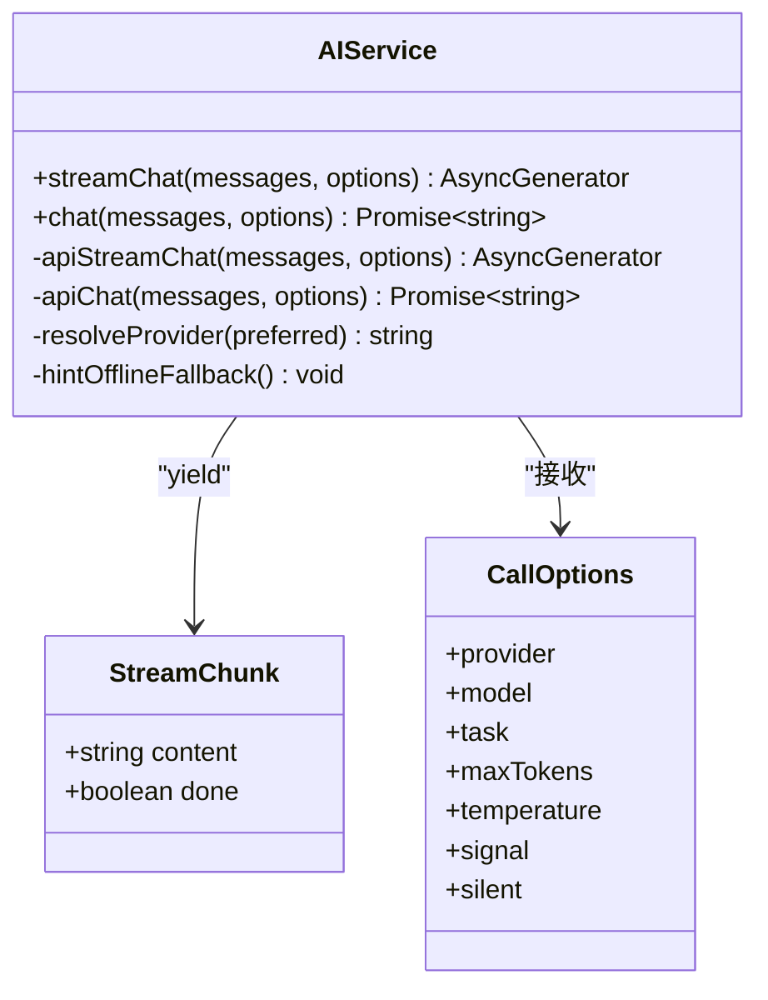
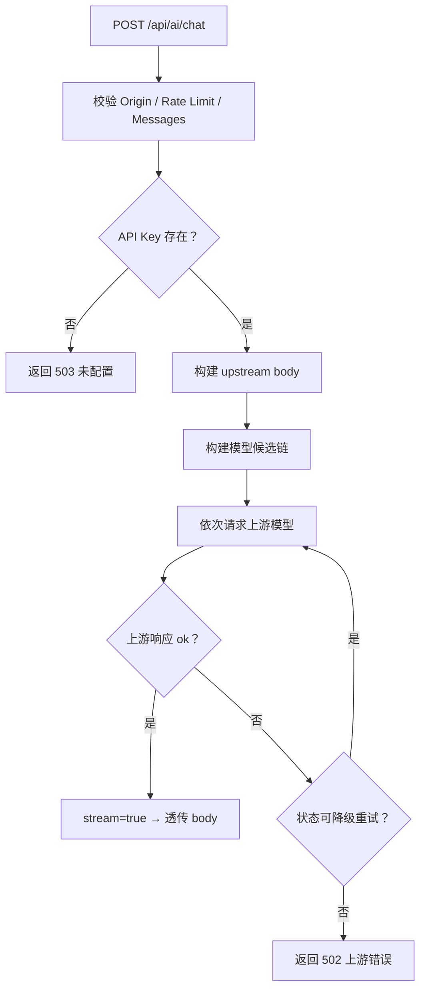
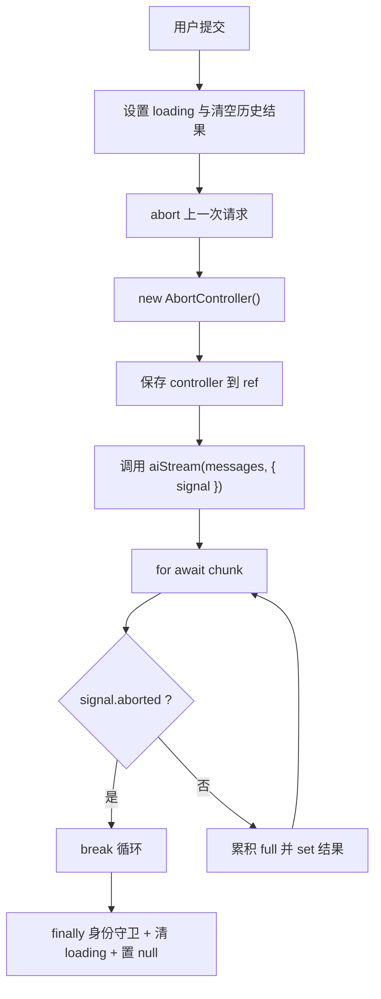
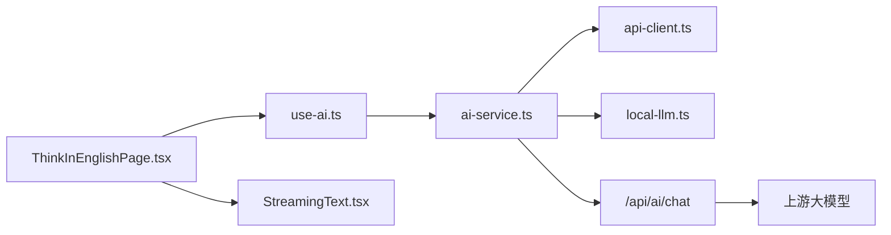

# 流式响应处理

<cite>
**本文引用的文件**   
- [use-ai.ts](file://src/hooks/use-ai.ts)
- [StreamingText.tsx](file://src/components/StreamingText.tsx)
- [ai-service.ts](file://src/services/ai-service.ts)
- [api-client.ts](file://src/lib/api-client.ts)
- [chat.js](file://functions/api/ai/chat.js)
- [local-llm.ts](file://src/lib/local-llm.ts)
- [ThinkInEnglishPage.tsx](file://src/pages/ThinkInEnglishPage/ThinkInEnglishPage.tsx)
- [PatternReviewMode.tsx](file://src/pages/ThinkInEnglishPage/PatternReviewMode.tsx)
- [verify-think-stream-abort.mjs](file://scripts/verify-think-stream-abort.mjs)
- [think-in-english.md](file://docs/modules/think-in-english.md)
</cite>

## 目录
1. [引言](#引言)
2. [项目结构与定位](#项目结构与定位)
3. [核心组件总览](#核心组件总览)
4. [架构与数据流](#架构与数据流)
5. [关键组件详细分析](#关键组件详细分析)
6. [依赖关系分析](#依赖关系分析)
7. [性能与内存特性](#性能与内存特性)
8. [错误恢复、超时与中断](#错误恢复超时与中断)
9. [使用示例与最佳实践](#使用示例与最佳实践)
10. [故障排查](#故障排查)
11. [结论](#结论)

## 引言
本文聚焦 NativeThink 的流式 AI 响应处理体系，围绕以下目标展开：
- 解释 `use-ai.ts` Hook 如何封装流式与非流式调用、状态管理与中断。
- 说明 `StreamingText.tsx` 如何实现渐进文本渲染、增量更新与无障碍降级。
- 描述从浏览器前端到 Cloudflare Functions 代理再到上游大模型 API 的完整流式链路。
- 分析离线自动回落、心跳与断线重连策略（以现有实现为准）、错误恢复、超时控制与内存管理。
- 给出基于真实源码路径的使用示例，包括自定义渲染逻辑与事件监听方式。

## 项目结构与定位
NativeThink 的流式响应处理横跨前端 React Hook、React 组件、服务端函数和可选的本地离线模型模块：
- 前端 Hook：`src/hooks/use-ai.ts` 暴露 `streamChat`、`chat`、消息构造工具与配置感知。
- 服务层：`src/services/ai-service.ts` 提供统一流式与非流式接口、提供商选择、SSE 解析与离线兜底。
- 客户端网络封装：`src/lib/api-client.ts` 提供带超时的认证请求封装（非流式主路径）。
- 服务端代理：`functions/api/ai/chat.js` 校验来源、限流、鉴权、模型回退并透传 SSE。
- 离线模型：`src/lib/local-llm.ts` 在云端不可用时提供端侧小模型流式输出。
- 业务页面：`src/pages/ThinkInEnglishPage/ThinkInEnglishPage.tsx` 展示四类流式练习；`PatternReviewMode.tsx` 演示非流式判定的超时与静默降级。
- 可视化组件：`src/components/StreamingText.tsx` 负责渐进显示新到达文本。

**图表来源**
- [ThinkInEnglishPage.tsx:1-120](file://src/pages/ThinkInEnglishPage/ThinkInEnglishPage.tsx#L1-L120)
- [use-ai.ts:1-101](file://src/hooks/use-ai.ts#L1-L101)
- [ai-service.ts:1-120](file://src/services/ai-service.ts#L1-L120)
- [chat.js:1-80](file://functions/api/ai/chat.js#L1-L80)
- [local-llm.ts:1-60](file://src/lib/local-llm.ts#L1-L60)
- [StreamingText.tsx:1-53](file://src/components/StreamingText.tsx#L1-L53)

**章节来源**
- [use-ai.ts:1-101](file://src/hooks/use-ai.ts#L1-L101)
- [ai-service.ts:1-120](file://src/services/ai-service.ts#L1-L120)
- [chat.js:1-80](file://functions/api/ai/chat.js#L1-L80)
- [local-llm.ts:1-60](file://src/lib/local-llm.ts#L1-L60)
- [StreamingText.tsx:1-53](file://src/components/StreamingText.tsx#L1-L53)
- [ThinkInEnglishPage.tsx:1-120](file://src/pages/ThinkInEnglishPage/ThinkInEnglishPage.tsx#L1-L120)

## 核心组件总览
| 组件 | 职责 | 流式能力 | 关键行为 |
|---|---|---|---|
| `useAI` Hook | 对外暴露流式与非流式 AI 调用、消息构建、配置状态 | 是 | 包装 `streamChat`/`chat`，统一错误 toast，支持 `silent` 与 `AbortSignal` |
| `ai-service.ts` | 统一服务商、SSE 解析、离线回落、非流式 JSON 响应 | 是 | `apiStreamChat` 逐 token 产出；失败时按条件切换本地模型 |
| `/api/ai/chat` | 服务端代理、限流、模型回退链、透传 SSE | 是 | 返回 `text/event-stream`，转发上游流或最终 JSON |
| `local-llm.ts` | 端侧 Qwen2.5-0.5B-Instruct 离线流式生成 | 是 | 惰性加载、进度回调、下载超时保护、中止检测 |
| `StreamingText.tsx` | 渐进显示最新字符、兼容低动效偏好 | 否（消费方渲染） | 每 tick 增加可见长度，对新增片段加动画类名 |
| `ThinkInEnglishPage.tsx` | 四个思维练习 tab 的流式交互 | 是 | 每个提交点维护独立 `AbortController`，循环内判断中止 |
| `PatternReviewMode.tsx` | 模式复习判定流程 | 否（非流式） | 15 秒超时 + `silent: true` + 空串降级自评 |

**章节来源**
- [use-ai.ts:1-101](file://src/hooks/use-ai.ts#L1-L101)
- [ai-service.ts:120-368](file://src/services/ai-service.ts#L120-L368)
- [chat.js:80-192](file://functions/api/ai/chat.js#L80-L192)
- [local-llm.ts:60-204](file://src/lib/local-llm.ts#L60-L204)
- [StreamingText.tsx:1-53](file://src/components/StreamingText.tsx#L1-L53)
- [ThinkInEnglishPage.tsx:1-200](file://src/pages/ThinkInEnglishPage/ThinkInEnglishPage.tsx#L1-L200)
- [PatternReviewMode.tsx:1-120](file://src/pages/ThinkInEnglishPage/PatternReviewMode.tsx#L1-L120)

## 架构与数据流
### 流式聊天请求序列

**图表来源**
- [use-ai.ts:40-90](file://src/hooks/use-ai.ts#L40-L90)
- [ai-service.ts:60-180](file://src/services/ai-service.ts#L60-L180)
- [chat.js:100-170](file://functions/api/ai/chat.js#L100-L170)

### 离线自动回落序列

**图表来源**
- [ai-service.ts:280-368](file://src/services/ai-service.ts#L280-L368)
- [local-llm.ts:140-204](file://src/lib/local-llm.ts#L140-L204)

## 关键组件详细分析

### `use-ai.ts`：流式 Hook、错误与中断
`useAI` 是上层业务组件调用 AI 的主要入口。它不直接做网络请求，而是把 `ai-service.ts` 的能力包装成 React 友好的返回值：
- `isConfigured` 与 `configuredProviders` 来自 `ai-config`，并在窗口焦点变化或配置变更时刷新。
- `streamChat` 是一个异步生成器包装器：遍历底层流、逐项 yield；捕获异常后区分 `AbortError` 与业务错误，并根据 `options.silent` 决定是否弹出全局 toast。
- `chat` 是非流式封装：成功返回字符串，失败同样区分中止与业务错误。
- `buildMessages` 与 `appendUserMessage` 是消息拼装辅助函数。

该 Hook 的关键设计原则：
- 中止信号透传：调用方可传入 `AbortSignal`，Hook 层不吞中止。
- 静默模式：练习界面通过 `silent: true` 避免重复提示，由页面自行降级。
- 错误语义稳定：无论流式或非流式，失败都保证 yield 或返回终止语义，使上层可安全结束渲染。

**图表来源**
- [use-ai.ts:1-101](file://src/hooks/use-ai.ts#L1-L101)

**章节来源**
- [use-ai.ts:1-101](file://src/hooks/use-ai.ts#L1-L101)

### `StreamingText.tsx`：渐进渲染与性能优化
`StreamingText` 并不建立网络连接，而是消费已经拼接好的字符串，并以“每次显示若干个字符”的方式模拟打字机效果：
- 使用 `visible` 状态记录已显示字符数。
- 通过 `setInterval` 按 `speed` 和 `interval` 推进可见范围。
- 当用户系统偏好“减少动态效果”时，直接显示完整文本，跳过定时器。
- 将已稳定的前缀与最近两个字符作为“流入片段”，配合 CSS 类 `stream-in` 与光标占位符形成视觉反馈。
- 当全部字符已显示时，直接渲染完整字符串，避免多余节点。

性能要点：
- 增量只更新 `visible`，不重建整段 Markdown。
- 新片段用 `key={visible}` 触发 React diff，但只对末尾少量字符重新渲染。
- 定时器在 effect cleanup 中清理，防止组件卸载后仍执行。

**图表来源**
- [StreamingText.tsx:1-53](file://src/components/StreamingText.tsx#L1-L53)

**章节来源**
- [StreamingText.tsx:1-53](file://src/components/StreamingText.tsx#L1-L53)

### `ai-service.ts`：统一流式接口、SSE 解析与离线兜底
`ai-service.ts` 是整个流式链路的核心协调者：
- `apiStreamChat`：
  - 选择 provider 与 model。
  - 通过 `/api/ai/chat` 发起流式请求。
  - 使用 `TextDecoder` 和字符串 buffer 解析 SSE 行。
  - 遇到 `[DONE]` 或 `finish_reason` 时输出终止块。
  - 释放 reader lock。
- `apiChat`：非流式路径，返回 `choices[0].message.content`。
- `resolveProvider`：优先显式 provider，再取 active/provider 列表，最后回退。
- `streamChat` 与 `chat`：
  - 先尝试云端流。
  - 若失败且满足离线回落条件，则切换到 `localStreamChat`。
  - 对 `signal.aborted` 保持原样抛出，不伪装成普通错误。
  - 对离线回落提示进行去抖，并通过 `silent` 控制是否弹窗。

**图表来源**
- [ai-service.ts:1-120](file://src/services/ai-service.ts#L1-L120)
- [ai-service.ts:200-368](file://src/services/ai-service.ts#L200-L368)

**章节来源**
- [ai-service.ts:1-368](file://src/services/ai-service.ts#L1-L368)

### `/api/ai/chat`：代理、限流与模型回退
服务端函数承担三个职责：
1. 安全代理：不向前端暴露服务端出厂 Key，同时允许客户端通过 `apiKey` 字段传入自有 Key。
2. 访问控制：Origin 白名单、IP 限流、消息格式校验。
3. 流式转发：当上游返回流时，设置 `Content-Type: text/event-stream` 并透传 `aiResp.body`。

模型回退策略集中在智谱免费档：
- 根据 `task` 选择主要模型。
- 构建候选链：任务首选模型 → 显式 model → 固定快速模型 → 4.7-flash。
- 仅对 429、500、502、503、504 等临时错误继续降级重试。

**图表来源**
- [chat.js:1-120](file://functions/api/ai/chat.js#L1-L120)
- [chat.js:120-192](file://functions/api/ai/chat.js#L120-L192)

**章节来源**
- [chat.js:1-192](file://functions/api/ai/chat.js#L1-L192)

### 本地离线模型：`local-llm.ts`
本地模型是云端不可用时的备选路径，不是主连接机制：
- 模型体积约 750 MiB，首次下载后缓存于浏览器 Cache API。
- 支持内置模型探测、下载进度回调、下载超时保护。
- `localStreamChat` 使用 `TextStreamer` 将 token 推入队列，以 async generator 形式输出。
- 支持 `AbortSignal`：检测到中止时清空队列并抛出中止异常。
- 如果流式回调未触发，会回退到完整生成结果。

注意：当前实现没有传统意义上的“心跳检测”。其稳定性保障主要来自：
- 网络层超时：`api-client.ts` 的默认 15 秒超时用于常规 fetch 请求。
- 流式读取：SSE 由浏览器原生流驱动，长时间无数据属于上游行为，代码未单独添加心跳包。
- 离线兜底：云端失败后尝试本地模型。

**章节来源**
- [local-llm.ts:1-204](file://src/lib/local-llm.ts#L1-L204)

### ThinkInEnglishPage：流式练习与中断契约
`ThinkInEnglishPage.tsx` 是流式 AI 的主要业务载体，包含四个旧 tab 的流式交互：
- 每个练习类型维护独立的输入、结果、loading 状态与 `AbortController` ref。
- 提交前先 abort 上一代请求，再创建新的 controller。
- 流循环中首先检查 `controller.signal.aborted`，中止后不再更新 state。
- `catch` 中对中止静默处理，其他错误由 `useAI` 层决定是否 toast。
- `finally` 中使用身份守卫 `ref.current === controller`，避免旧流结束后误清新请求 loading。
- 组件卸载时统一 abort 所有控制器。

文档中还强调一个关键契约：换题或删除当前题必须走同样的 abort 路径，否则旧流的增量内容可能写进新题结果框。脚本 `verify-think-stream-abort.mjs` 通过 AST 检查这些约束。

**图表来源**
- [ThinkInEnglishPage.tsx:120-220](file://src/pages/ThinkInEnglishPage/ThinkInEnglishPage.tsx#L120-L220)
- [verify-think-stream-abort.mjs:1-120](file://scripts/verify-think-stream-abort.mjs#L1-L120)

**章节来源**
- [ThinkInEnglishPage.tsx:1-200](file://src/pages/ThinkInEnglishPage/ThinkInEnglishPage.tsx#L1-L200)
- [verify-think-stream-abort.mjs:1-120](file://scripts/verify-think-stream-abort.mjs#L1-L120)
- [think-in-english.md:60-85](file://docs/modules/think-in-english.md#L60-L85)

### PatternReviewMode：非流式判定的超时与静默降级
模式复习中的 AI 判定不使用流式接口，而是非流式 `aiChat`：
- 最长等待 15 秒。
- 使用 `AbortController` 超时后中止。
- 传入 `silent: true`，避免练习界面弹出全局 AI 错误 toast。
- 空串、非法 JSON、形状不合规均返回 `null`，会话层回落为自评。

这体现了项目中“流式用于即时反馈，非流式用于结构化判定”的分层思路。

**章节来源**
- [PatternReviewMode.tsx:1-120](file://src/pages/ThinkInEnglishPage/PatternReviewMode.tsx#L1-L120)
- [think-in-english.md:40-85](file://docs/modules/think-in-english.md#L40-L85)

## 依赖关系分析

**图表来源**
- [ThinkInEnglishPage.tsx:1-120](file://src/pages/ThinkInEnglishPage/ThinkInEnglishPage.tsx#L1-L120)
- [use-ai.ts:1-40](file://src/hooks/use-ai.ts#L1-L40)
- [ai-service.ts:1-60](file://src/services/ai-service.ts#L1-L60)
- [api-client.ts:1-82](file://src/lib/api-client.ts#L1-L82)
- [local-llm.ts:1-60](file://src/lib/local-llm.ts#L1-L60)
- [chat.js:1-40](file://functions/api/ai/chat.js#L1-L40)
- [StreamingText.tsx:1-20](file://src/components/StreamingText.tsx#L1-L20)

**章节来源**
- [ThinkInEnglishPage.tsx:1-120](file://src/pages/ThinkInEnglishPage/ThinkInEnglishPage.tsx#L1-L120)
- [use-ai.ts:1-40](file://src/hooks/use-ai.ts#L1-L40)
- [ai-service.ts:1-60](file://src/services/ai-service.ts#L1-L60)
- [api-client.ts:1-82](file://src/lib/api-client.ts#L1-L82)
- [local-llm.ts:1-60](file://src/lib/local-llm.ts#L1-L60)
- [chat.js:1-40](file://functions/api/ai/chat.js#L1-L40)
- [StreamingText.tsx:1-20](file://src/components/StreamingText.tsx#L1-L20)

## 性能与内存特性
### 流式渲染性能
- `ai-service.ts` 使用流式读取与逐行 buffer 解析，避免一次性加载完整响应。
- `use-ai.ts` 只做透传，不额外缓存大块文本。
- `StreamingText.tsx` 通过控制 `speed` 与 `interval` 平衡实时性与渲染压力；对减少动效的系统自动关闭动画。
- ThinkInEnglishPage 的流式结果是追加式字符串更新，适合纯文本 Markdown；如果未来改为复杂对象渲染，应引入分片或虚拟滚动。

### 内存管理
- SSE reader 在 `try/finally` 中释放锁，避免响应体占用。
- 本地模型下载有进度状态与失败状态重置，避免残留 promise 导致内存泄漏。
- `capped-cache.ts` 提供 FIFO 封顶、字节裁剪与写入失败提示，适用于“按词累积”的缓存场景；但文档指出 ThinkInEnglishPage 的三个 custom 键没有上限，需要谨慎扩展。
- 组件卸载时统一 abort 所有流控制器，防止后台请求继续更新已卸载组件状态。

### 潜在优化点
- 当前流式文本拼接采用字符串累加，长回复下可能产生中间字符串复制成本；可考虑数组累积或增量 DOM 渲染。
- `StreamingText` 的 `interval` 是固定频率，可结合设备性能与文本长度动态调整。
- 离线模型下载超时与重试逻辑较复杂，可在 UI 层提供更明确的下载阶段状态。

**章节来源**
- [ai-service.ts:120-200](file://src/services/ai-service.ts#L120-L200)
- [local-llm.ts:60-204](file://src/lib/local-llm.ts#L60-L204)
- [capped-cache.ts:1-114](file://src/lib/capped-cache.ts#L1-L114)
- [StreamingText.tsx:1-53](file://src/components/StreamingText.tsx#L1-L53)
- [think-in-english.md:60-85](file://docs/modules/think-in-english.md#L60-L85)

## 错误恢复、超时与中断
### 错误分类与处理层级
| 层级 | 错误类型 | 处理方式 |
|---|---|---|
| 浏览器网络层 | 超时、DNS、网络断开 | `api-client.ts` 抛出明确超时错误；流式路径由浏览器流驱动 |
| 服务端代理 | 未配置 Key、Origin 拒绝、限流、上游 429/5xx | 返回 400/403/429/502/503，上游失败时尝试模型回退 |
| 前端服务层 | 非 JSON 响应、SSE 解析失败、reader 缺失 | 抛出友好错误，跳过不可解析块 |
| Hook 层 | AbortError、业务错误 | 中止静默返回；其他错误按 `silent` 决定是否 toast |
| 页面层 | 旧流覆盖新结果、状态不一致 | 通过 `signal.aborted`、身份守卫、卸载清理修复 |

### 超时机制
- 通用 fetch 超时：`api-client.ts` 默认 15 秒，使用 `AbortController` 实现。
- 模式复习判定超时：`PatternReviewMode.tsx` 中显式 15 秒 `setTimeout` + `AbortController`。
- 流式请求本身没有单条 chunk 超时；整体超时由调用方传入 `signal` 或由网络层超时控制。

### 断线重连策略
当前实现没有自动重连逻辑：
- 流式连接一旦失败，`ai-service.ts` 会进入 catch 分支。
- 若允许离线回落且本地模型就绪，则改用本地模型。
- 若不满足离线回落条件，则向上传播错误。
- 如需断线重连，应在 `apiStreamChat` 或业务层引入指数退避重试，并保证重试不会破坏流顺序。

### 中断机制
中断是流式响应的关键安全机制：
- 调用方创建 `AbortController`。
- 将 `signal` 传给 `streamChat` 或 `chat`。
- 流循环开头检查 `signal.aborted`。
- `catch` 中区分 `AbortError`。
- `finally` 中用 `ref.current === controller` 确保只清理本次请求的状态。
- 组件卸载时统一 abort。

**章节来源**
- [api-client.ts:1-82](file://src/lib/api-client.ts#L1-L82)
- [ai-service.ts:120-368](file://src/services/ai-service.ts#L120-L368)
- [chat.js:80-192](file://functions/api/ai/chat.js#L80-L192)
- [PatternReviewMode.tsx:1-120](file://src/pages/ThinkInEnglishPage/PatternReviewMode.tsx#L1-L120)
- [ThinkInEnglishPage.tsx:120-220](file://src/pages/ThinkInEnglishPage/ThinkInEnglishPage.tsx#L120-L220)
- [verify-think-stream-abort.mjs:1-120](file://scripts/verify-think-stream-abort.mjs#L1-L120)

## 使用示例与最佳实践

### 示例一：基础流式聊天
用途：在一个表单或对话框中实时显示 AI 回复。

参考路径：
- [use-ai.ts:1-101](file://src/hooks/use-ai.ts#L1-L101)
- [ai-service.ts:60-180](file://src/services/ai-service.ts#L60-L180)
- [ThinkInEnglishPage.tsx:120-220](file://src/pages/ThinkInEnglishPage/ThinkInEnglishPage.tsx#L120-L220)

步骤概述：
1. 调用 `useAI()` 获取 `streamChat`。
2. 准备 system 与 user 消息。
3. 创建 `AbortController`，将 `signal` 传入选项。
4. 使用 `for await` 遍历流。
5. 将每个 chunk 的 `content` 追加到结果字符串。
6. 在 `finally` 中清 loading 与 controller。

最佳实践：
- 始终传递 `signal`，以便取消或超时中断。
- 在循环开头检查 `signal.aborted`。
- 对中止错误静默处理，避免误报“AI 服务不可用”。
- 使用 `StreamingText` 包裹最终字符串以获得渐进视觉效果。

### 示例二：自定义渲染逻辑
用途：不在简单文本中直接拼接，而是在流式过程中逐步渲染 Markdown、高亮、代码块或对话气泡。

参考路径：
- [StreamingText.tsx:1-53](file://src/components/StreamingText.tsx#L1-L53)
- [ThinkInEnglishPage.tsx:120-220](file://src/pages/ThinkInEnglishPage/ThinkInEnglishPage.tsx#L120-L220)

建议做法：
- 维护一个可变的结果字符串或增量数组。
- 每次收到 chunk 时追加内容。
- 对 UI 层使用增量 key、虚拟列表或 React.memo 减少重渲染。
- 对长文本使用分段渲染，例如按段落或 token 组渲染。

### 示例三：事件监听与离线提示
用途：在 AI 服务不可用时提示用户，并在本地模型可用时自动降级。

参考路径：
- [ai-service.ts:280-368](file://src/services/ai-service.ts#L280-L368)
- [local-llm.ts:1-120](file://src/lib/local-llm.ts#L1-L120)

建议做法：
- 监听本地模型状态变化，显示下载进度。
- 启用 `isAutoFallbackEnabled()` 后，云端失败自动切换本地模型。
- 使用 `silent: true` 避免练习界面被全局 toast 打扰。
- 在 UI 上区分“云端失败”和“本地模型降级”两种状态。

### 示例四：带超时的非流式判定
用途：需要结构化 JSON 结果的判定场景，例如模式复习评分。

参考路径：
- [PatternReviewMode.tsx:1-120](file://src/pages/ThinkInEnglishPage/PatternReviewMode.tsx#L1-L120)
- [think-in-english.md:40-85](file://docs/modules/think-in-english.md#L40-L85)

建议做法：
- 使用 `AbortController` 设置超时。
- 传入 `silent: true`。
- 对空串和解析失败返回降级值。
- 在 `finally` 中清理定时器与状态。

**章节来源**
- [use-ai.ts:1-101](file://src/hooks/use-ai.ts#L1-L101)
- [ai-service.ts:60-180](file://src/services/ai-service.ts#L60-L180)
- [StreamingText.tsx:1-53](file://src/components/StreamingText.tsx#L1-L53)
- [local-llm.ts:1-120](file://src/lib/local-llm.ts#L1-L120)
- [PatternReviewMode.tsx:1-120](file://src/pages/ThinkInEnglishPage/PatternReviewMode.tsx#L1-L120)
- [ThinkInEnglishPage.tsx:120-220](file://src/pages/ThinkInEnglishPage/ThinkInEnglishPage.tsx#L120-L220)
- [think-in-english.md:40-85](file://docs/modules/think-in-english.md#L40-L85)

## 故障排查
| 现象 | 可能原因 | 排查位置 | 建议处理 |
|---|---|---|---|
| 流式响应一直加载中 | 上游未返回、网络中断、未正确处理 `done` | `ai-service.ts` SSE 解析 | 检查 response.ok、reader、buffer 与 `[DONE]` |
| 切换题目后旧结果写进新题 | 未正确中止旧流或 finally 未做身份守卫 | `ThinkInEnglishPage.tsx` | 确保 abort-before-new、循环中断、finally 身份检查 |
| 中断时报“AI 服务暂不可用” | catch 未区分 `AbortError` | `use-ai.ts` | 对中止错误静默返回 |
| 服务端返回 503 | 未配置服务端 AI Key | `chat.js` | 配置对应 provider 的 API Key |
| 高峰期频繁 429 | 免费模型并发限制 | `chat.js` | 利用自动回退链或启用离线模型 |
| 本地模型下载卡住 | 镜像源不可用或进度停滞 | `local-llm.ts` | 检查 hf-mirror/huggingface 连通性，查看下载超时 |
| 自定义题库刷新后丢失 | localStorage 写入失败或无上限 | `ThinkInEnglishPage.tsx`、`capped-cache.ts` | 检查存储空间、写入失败提示与数据上限 |

**章节来源**
- [ai-service.ts:120-368](file://src/services/ai-service.ts#L120-L368)
- [chat.js:80-192](file://functions/api/ai/chat.js#L80-L192)
- [local-llm.ts:60-204](file://src/lib/local-llm.ts#L60-L204)
- [ThinkInEnglishPage.tsx:120-220](file://src/pages/ThinkInEnglishPage/ThinkInEnglishPage.tsx#L120-L220)
- [capped-cache.ts:1-114](file://src/lib/capped-cache.ts#L1-L114)
- [verify-think-stream-abort.mjs:1-120](file://scripts/verify-think-stream-abort.mjs#L1-L120)

## 结论
NativeThink 的流式响应处理系统以 `use-ai.ts` 为业务入口、`ai-service.ts` 为协议中枢、`/api/ai/chat` 为安全代理、`local-llm.ts` 为离线兜底，形成一条从前端到上游模型的清晰链路。其核心优势在于：
- 流式与 SSE 原生结合，支持实时增量渲染。
- 中断契约严格，避免旧流污染新结果。
- 离线自动回落提供可用性保障。
- 练习界面通过 `silent` 与空串约定实现优雅降级。

需要注意的限制是：当前实现不包含心跳检测与自动断线重连；流式连接的可靠性依赖浏览器原生流与上游稳定性。对于更复杂的流式场景，建议在此基础上补充心跳、重试、背压控制和更细粒度的渲染分片。