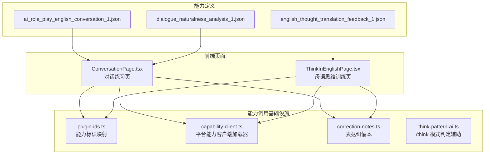
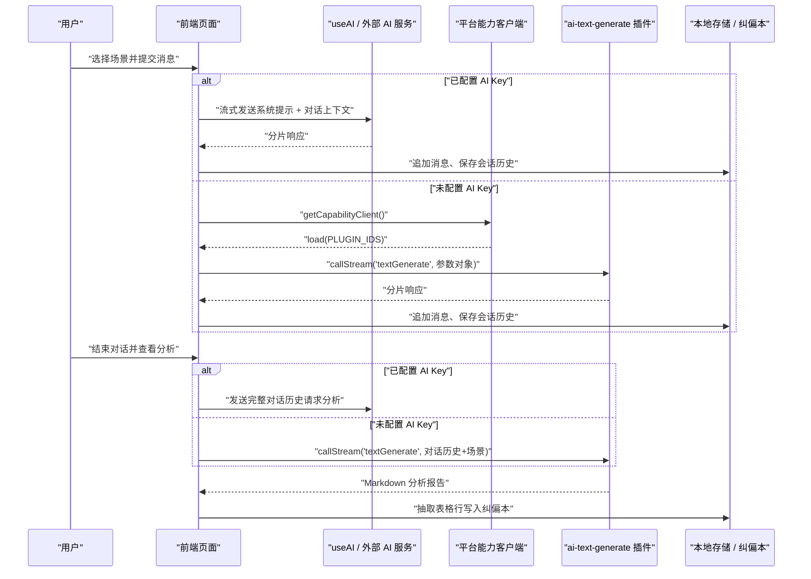
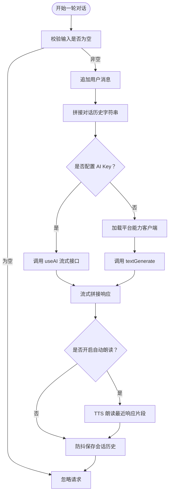
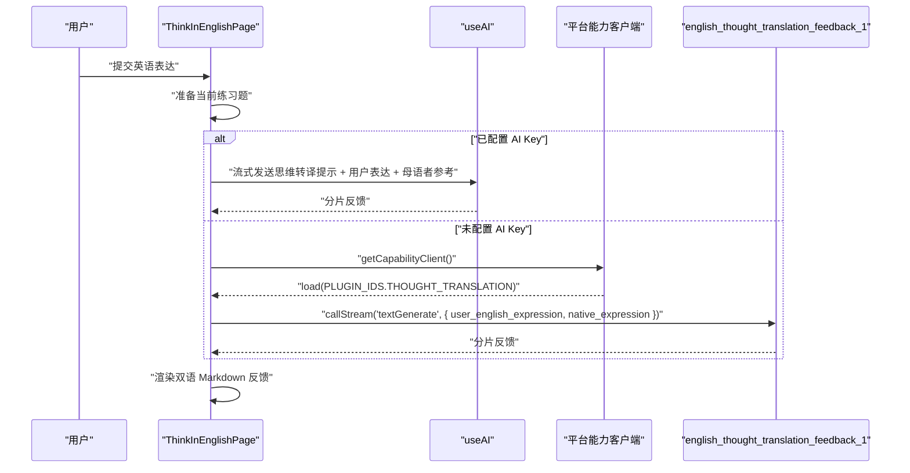
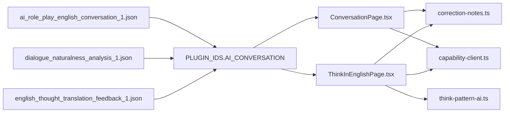

# 内置能力实现

<cite>
**本文引用的文件**   
- [ai_role_play_english_conversation_1.json](file://shared/capabilities/ai_role_play_english_conversation_1.json)
- [dialogue_naturalness_analysis_1.json](file://shared/capabilities/dialogue_naturalness_analysis_1.json)
- [english_thought_translation_feedback_1.json](file://shared/capabilities/english_thought_translation_feedback_1.json)
- [ConversationPage.tsx](file://src/pages/ConversationPage/ConversationPage.tsx)
- [ThinkInEnglishPage.tsx](file://src/pages/ThinkInEnglishPage/ThinkInEnglishPage.tsx)
- [capability-client.ts](file://src/lib/capability-client.ts)
- [plugin-ids.ts](file://src/lib/plugin-ids.ts)
- [correction-notes.ts](file://src/lib/correction-notes.ts)
- [think-pattern-ai.ts](file://src/lib/think-pattern-ai.ts)
</cite>

## 目录
1. [引言](#引言)
2. [项目结构](#项目结构)
3. [核心组件总览](#核心组件总览)
4. [架构总览](#架构总览)
5. [详细能力分析](#详细能力分析)
6. [依赖关系分析](#依赖关系分析)
7. [性能与可靠性](#性能与可靠性)
8. [故障排查指南](#故障排查指南)
9. [结论](#结论)

## 引言
本文围绕 NativeThink 的三个内置 AI 能力，逐项说明其“定义、输入参数、输出格式、业务逻辑、上下文管理、错误处理以及与其它系统的集成方式”，并给出使用示例和最佳实践。三个能力分别是：

| 能力 ID | 名称 | 主要用途 |
|---|---|---|
| `ai_role_play_english_conversation_1` | AI 角色扮演英文对话伙伴 | 基于角色与场景设定，进行多轮英文对话练习 |
| `dialogue_naturalness_analysis_1` | 对话地道度分析 | 对话结束后对用户表达的地道程度进行分析反馈 |
| `english_thought_translation_feedback_1` | 英语思维转译反馈插件 | 对比用户英语表达与母语者表达，输出思维转换指导与改进建议 |

这三个能力在仓库中采用“声明式能力定义 + 页面流式调用”的方式实现：能力本身由 JSON 描述参数、提示词与模型配置；实际调用则由对话页和思维页根据是否配置了外部 AI Key，分别走本地 AI 服务或平台能力客户端两条路径。

## 项目结构
与三个能力直接相关的代码集中在以下位置：

**图表来源**
- [ai_role_play_english_conversation_1.json:1-50](file://shared/capabilities/ai_role_play_english_conversation_1.json#L1-L50)
- [dialogue_naturalness_analysis_1.json:1-36](file://shared/capabilities/dialogue_naturalness_analysis_1.json#L1-L36)
- [english_thought_translation_feedback_1.json:1-36](file://shared/capabilities/english_thought_translation_feedback_1.json#L1-L36)
- [ConversationPage.tsx:1-200](file://src/pages/ConversationPage/ConversationPage.tsx#L1-L200)
- [ThinkInEnglishPage.tsx:1-200](file://src/pages/ThinkInEnglishPage/ThinkInEnglishPage.tsx#L1-L200)
- [plugin-ids.ts:1-15](file://src/lib/plugin-ids.ts#L1-L15)
- [capability-client.ts:1-23](file://src/lib/capability-client.ts#L1-L23)
- [correction-notes.ts:1-200](file://src/lib/correction-notes.ts#L1-L200)
- [think-pattern-ai.ts:1-66](file://src/lib/think-pattern-ai.ts#L1-L66)

**章节来源**
- [ai_role_play_english_conversation_1.json:1-50](file://shared/capabilities/ai_role_play_english_conversation_1.json#L1-L50)
- [dialogue_naturalness_analysis_1.json:1-36](file://shared/capabilities/dialogue_naturalness_analysis_1.json#L1-L36)
- [english_thought_translation_feedback_1.json:1-36](file://shared/capabilities/english_thought_translation_feedback_1.json#L1-L36)
- [ConversationPage.tsx:1-200](file://src/pages/ConversationPage/ConversationPage.tsx#L1-L200)
- [ThinkInEnglishPage.tsx:1-200](file://src/pages/ThinkInEnglishPage/ThinkInEnglishPage.tsx#L1-L200)
- [plugin-ids.ts:1-15](file://src/lib/plugin-ids.ts#L1-L15)
- [capability-client.ts:1-23](file://src/lib/capability-client.ts#L1-L23)
- [correction-notes.ts:1-200](file://src/lib/correction-notes.ts#L1-L200)
- [think-pattern-ai.ts:1-66](file://src/lib/think-pattern-ai.ts#L1-L66)

## 核心组件总览

### 能力定义层
每个能力以 JSON 文件声明：

| 字段 | 含义 |
|---|---|
| `id` | 能力唯一标识，也是平台插件实例 ID |
| `pluginKey` | 底层插件包名，当前均为 `@official-plugins/ai-text-generate` |
| `pluginVersion` | 插件版本，当前为 `1.0.17` |
| `name` | 人类可读名称 |
| `description` | 能力用途说明 |
| `paramsSchema` | 输入参数的 JSON Schema，含属性类型、描述及必填项 |
| `formValue.modelID` | 调用的模型 ID，当前为 `87` |
| `formValue.modelParams` | 模型参数，如 `maxTokens`、`temperature` |
| `formValue.prompt` | 注入到 LLM 的系统提示词模板，使用 `{{input.xxx}}` 引用参数 |

这种设计把“业务语义”（角色、场景、难度）和“LLM 行为”（提示词、温度、最大 token）解耦，便于在不改动前端逻辑的情况下调整 AI 行为。

### 页面调用层
两个页面承担主要业务编排：

- **对话页 `ConversationPage.tsx`**：负责角色扮演对话、对话历史维护、结束后的自然度分析、自动朗读、消息翻译、场景管理与本地历史记录。
- **思维页 `ThinkInEnglishPage.tsx`**：负责中式英语检测、翻译练习、反翻译练习、母语思维还原练习，以及通过能力定义调用 `english_thought_translation_feedback_1`。

### 能力客户端层
`capability-client.ts` 提供一个惰性加载的 `getCapabilityClient()`，仅在真正进入“未配置 AI API Key”的兜底分支时动态引入平台 SDK。加载失败会清空缓存，避免一次网络抖动永久封死该路径。

### 插件标识层
`plugin-ids.ts` 集中维护三个能力的字符串 ID：

| 常量 | 值 |
|---|---|
| `AI_CONVERSATION` | `ai_role_play_english_conversation_1` |
| `NATURALNESS_ANALYSIS` | `dialogue_naturalness_analysis_1` |
| `THOUGHT_TRANSLATION` | `english_thought_translation_feedback_1` |

### 纠偏本与思维判定层
- `correction-notes.ts` 从 AI 返回的 Markdown 表格中抽取“出错表达 → 地道表达”条目，去重入库，供后续复习与纠偏重考使用。
- `think-pattern-ai.ts` 是 `/think` 模式复习的判定辅助模块，虽然不直接属于三个能力，但与“英语思维转译反馈”共享同一学习闭环。

**章节来源**
- [ai_role_play_english_conversation_1.json:1-50](file://shared/capabilities/ai_role_play_english_conversation_1.json#L1-L50)
- [dialogue_naturalness_analysis_1.json:1-36](file://shared/capabilities/dialogue_naturalness_analysis_1.json#L1-L36)
- [english_thought_translation_feedback_1.json:1-36](file://shared/capabilities/english_thought_translation_feedback_1.json#L1-L36)
- [ConversationPage.tsx:1-200](file://src/pages/ConversationPage/ConversationPage.tsx#L1-L200)
- [ThinkInEnglishPage.tsx:1-200](file://src/pages/ThinkInEnglishPage/ThinkInEnglishPage.tsx#L1-L200)
- [capability-client.ts:1-23](file://src/lib/capability-client.ts#L1-L23)
- [plugin-ids.ts:1-15](file://src/lib/plugin-ids.ts#L1-L15)
- [correction-notes.ts:1-200](file://src/lib/correction-notes.ts#L1-L200)
- [think-pattern-ai.ts:1-66](file://src/lib/think-pattern-ai.ts#L1-L66)

## 架构总览

**图表来源**
- [ConversationPage.tsx:201-550](file://src/pages/ConversationPage/ConversationPage.tsx#L201-L550)
- [capability-client.ts:1-23](file://src/lib/capability-client.ts#L1-L23)
- [plugin-ids.ts:1-15](file://src/lib/plugin-ids.ts#L1-L15)
- [correction-notes.ts:1-200](file://src/lib/correction-notes.ts#L1-L200)

## 详细能力分析

### 一、角色扮演英文对话：`ai_role_play_english_conversation_1`

#### 1. 能力定义与输入参数
该能力定义位于 `ai_role_play_english_conversation_1.json`，核心字段如下：

| 参数名 | 类型 | 是否必填 | 含义 |
|---|---|---:|---|
| `role_setting` | string | 是 | 对话角色设定，例如咖啡馆服务员、机场海关人员、商务谈判伙伴等 |
| `scene_description` | string | 否 | 对话场景描述 |
| `user_message` | string | 是 | 用户输入的上一轮对话内容 |
| `conversation_history` | string | 否 | 之前的对话历史记录，用于保持上下文连贯性 |
| `difficulty_level` | string | 是 | 对话难度等级，例如初级、中级、高级 |

模型配置使用模型 ID `87`，`maxTokens` 为 `8192`，`temperature` 为 `0.7`。提示词要求 AI 完全使用英文回复、控制长度、按难度调整词汇和句式复杂度、适当引导对话继续、不暴露 AI 身份，并在发现语法错误时用括号标注。

#### 2. 对话流程控制
对话页在用户选择场景后执行“开场白”流程：

1. 检查是否配置了 AI Key；
2. 创建 `AbortController`，防止切换场景时上一个流继续写入；
3. 构造系统提示，包含场景角色和三条规则：只用英文、每次 2-5 句、保持角色；
4. 调用流式接口接收 AI 开场白；
5. 如果开启自动朗读，则对开场白文本调用 TTS；
6. 若流为空，显示“开场白生成失败”提示；
7. 异常时清空消息并提示“AI 服务暂不可用”。

随后用户每发送一条消息，都会：

1. 将用户消息加入本地消息列表；
2. 构建带 `User:` / `AI:` 前缀的对话历史字符串；
3. 插入一个空的 AI 消息占位；
4. 根据是否配置 AI Key，分别走两条调用路径；
5. 流式拼接 AI 响应；
6. 完成后可自动朗读最近约 500 个字符。

#### 3. 上下文管理
对话上下文由前端自行维护，而不是完全交给后端会话状态：

- 每条消息都带有 `role`、`content`、`timestamp`；
- 发送时把当前 `messages` 序列化为“说话者 + 冒号 + 内容”的多行文本；
- 切换场景时会中止旧流、清空消息、清空分析结果；
- 离开页面或切换场景时，通过 `abortRef` 取消仍在进行的网络流；
- 活跃对话按场景持久化到本地，最多保留最近 100 条消息和最近 20 条会话记录；
- 支持恢复上次对话，包括场景元信息和已有分析结果。

#### 4. 多轮交互逻辑
多轮交互的核心是“用户消息 + 历史上下文 + 场景角色提示”的循环：

**图表来源**
- [ConversationPage.tsx:201-550](file://src/pages/ConversationPage/ConversationPage.tsx#L201-L550)

#### 5. 输出格式
该能力本身不强制结构化输出；提示词要求 AI 用英文进行 2-5 句的自然对话，必要时在末尾用括号标注语法错误。因此输出本质上是自然语言文本，适合直接渲染到聊天界面。

#### 6. 与其他系统集成
- **useAI**：已配置 AI Key 时，使用 `streamChat` 提供流式对话。
- **capability-client**：未配置 AI Key 时，动态加载平台能力客户端并调用 `PLUGIN_IDS.AI_CONVERSATION`。
- **useTTS**：可选自动朗读 AI 回复。
- **study-credit**：每次发送消息按“场景 + 内容”去重记一次学习信用。
- **correction-notes**：对话结束后的自然度分析会把“我的表达 → 更地道的说法”表自动收集进纠偏本。

#### 7. 使用示例与最佳实践

**示例：咖啡店点单对话**
- 角色设定：咖啡店友好咖啡师
- 场景描述：在咖啡店点一杯饮品
- 难度等级：初级
- 用户首轮：Hello, I'd like a latte please.
- AI 应回复简短、符合角色、只使用英文，并可自然提问。

**最佳实践**
- 角色设定要具体，避免泛泛的“你是一个英语老师”；
- 场景描述应包含地点、人物关系、任务目标；
- 难度等级影响词汇和句式复杂度，初学者建议选初级；
- 长会话中不要无限追加历史，当前实现靠前端截断消息；
- 如果需要纠错，优先依赖对话结束后的自然度分析，而不是让每轮都强行纠错；
- 自定义场景时，角色设定建议使用英文，这样更容易让 AI 保持英文回复。

**章节来源**
- [ai_role_play_english_conversation_1.json:1-50](file://shared/capabilities/ai_role_play_english_conversation_1.json#L1-L50)
- [ConversationPage.tsx:201-550](file://src/pages/ConversationPage/ConversationPage.tsx#L201-L550)
- [plugin-ids.ts:1-15](file://src/lib/plugin-ids.ts#L1-L15)
- [capability-client.ts:1-23](file://src/lib/capability-client.ts#L1-L23)
- [correction-notes.ts:1-200](file://src/lib/correction-notes.ts#L1-L200)

---

### 二、对话自然度分析：`dialogue_naturalness_analysis_1`

#### 1. 能力定义与输入参数
该能力定义位于 `dialogue_naturalness_analysis_1.json`，核心字段如下：

| 参数名 | 类型 | 是否必填 | 含义 |
|---|---|---:|---|
| `user_dialogue_content` | string | 是 | 用户在对话练习中输入的所有表达内容 |
| `dialogue_scenario` | string | 是 | 对话练习的场景，例如商务谈判、日常交流、旅游出行等 |

模型配置使用模型 ID `87`，`maxTokens` 为 `8192`，`temperature` 为 `0.5`。提示词要求输出包含整体评分、表达亮点、可改进之处、优化建议和延伸学习。

#### 2. 自然度评估维度
从提示词可以归纳出五个评估维度：

| 维度 | 说明 |
|---|---|
| 整体地道度评分 | 0-10 分，并给出评分依据 |
| 表达亮点 | 肯定用户表达中地道、值得肯定的部分 |
| 可改进之处 | 指出语法错误、用词不当、不符合场景习惯、文化差异等问题 |
| 优化建议 | 针对问题给出具体的地道替换表达和使用说明 |
| 延伸学习 | 提供同场景下的常用地道表达示例 |

#### 3. 评分算法
该能力没有硬编码的数值评分算法；评分由 LLM 根据用户表达与场景语境综合判断。前端也不解析分数，而是直接渲染 AI 返回的 Markdown 报告。因此评分具有较强主观性和灵活性，但稳定性取决于提示词质量。

#### 4. 反馈生成机制
对话页在用户点击“结束对话”后触发分析：

1. 如果对话不足两轮，提示至少完成一轮；
2. 打开分析弹窗并开始流式分析；
3. 拼接完整对话历史，传入场景名称；
4. 已配置 AI Key 时，使用固定中文结构的系统提示，要求输出整体评估、AI 地道表达、我的表达分析、做得好的地方、关键句子翻译、下一步建议；
5. 未配置 AI Key 时，调用 `PLUGIN_IDS.NATURALNESS_ANALYSIS`；
6. 成功完成后，从分析文本中抽取“我的表达 → 更地道的说法”表格行，写入纠偏本；
7. 如果流正常结束但内容为空，视为调用失败，清空弹窗并提示重试。

#### 5. 输出格式
输出为 Markdown 文本，典型结构包括：

| 区块 | 内容 |
|---|---|
| 整体评估 | 评分和总体评价 |
| AI 的地道表达 | 表格形式列出 AI 使用的地道表达、翻译、原因和用法 |
| 我的表达分析 | 表格形式列出用户的不够地道表达、翻译、更地道说法、原因 |
| 我做得好的地方 | 要点式肯定 |
| 对话关键句子翻译 | 原文与中文对照表 |
| 下一步建议 | 可操作的学习建议 |

#### 6. 与其他系统集成
- **useAI**：主路径调用流式对话接口生成分析。
- **capability-client + plugin-ids**：兜底路径调用平台能力。
- **correction-notes**：自动抽取 Markdown 表格中的纠偏条目，来源标记为 `conversation`。
- **useStudyCredit**：分析本身不计信用，但对话发送过程会计信用。

#### 7. 使用示例与最佳实践

**示例：工作面试场景**
- 场景：工作面试
- 用户对话内容：包含若干轮面试问答，其中出现中式表达和语法错误。
- 期望输出：先给出 0-10 分评分，再列出 AI 表达亮点和用户表达问题，最后给出改进建议。

**最佳实践**
- 对话越完整，分析越有代表性；建议至少 3-5 轮后再分析；
- 场景描述应尽量贴合真实语言环境；
- 不要把分析当作单次诊断，应结合纠偏本反复复习；
- 如果 AI 分析为空，优先检查网络与 AI Key，不要静默保留空弹窗；
- 对输出的评分应理解为主观教学反馈，不是标准化考试分数。

**章节来源**
- [dialogue_naturalness_analysis_1.json:1-36](file://shared/capabilities/dialogue_naturalness_analysis_1.json#L1-L36)
- [ConversationPage.tsx:201-550](file://src/pages/ConversationPage/ConversationPage.tsx#L201-L550)
- [plugin-ids.ts:1-15](file://src/lib/plugin-ids.ts#L1-L15)
- [correction-notes.ts:1-200](file://src/lib/correction-notes.ts#L1-L200)

---

### 三、英语思维翻译反馈：`english_thought_translation_feedback_1`

#### 1. 能力定义与输入参数
该能力定义位于 `english_thought_translation_feedback_1.json`，核心字段如下：

| 参数名 | 类型 | 是否必填 | 含义 |
|---|---|---:|---|
| `user_english_expression` | string | 是 | 用户输入的英语描述内容 |
| `native_expression` | string | 是 | 对应的母语者标准表达内容 |

模型配置使用模型 ID `87`，`maxTokens` 为 `8192`，`temperature` 为 `0.5`。提示词要求输出差异对比、思维误区分析、转译指导、改进建议和举一反三示例。

#### 2. 中英思维转换检测
该能力并不执行静态正则匹配或规则引擎式的“中式英语检测”，而是让 LLM 对比用户表达与母语者表达，识别：

- 用词差异；
- 句式结构差异；
- 表达逻辑差异；
- 体现出的母语思维干扰点；
- 不符合英语母语者思维习惯的表达。

这与对话页的“中式英语检测器”不同：检测器侧重找出 Chinglish 并打分，而该能力侧重“从中文思维切换到英语思维”的教学解释。

#### 3. 错误模式识别
错误模式识别由提示词驱动，常见模式包括：

| 模式类别 | 说明 |
|---|---|
| 直译思维 | 逐字对应中文词序，忽略英语惯用搭配 |
| 中式动词偏好 | 使用万能动词加介词短语，而非地道动宾搭配 |
| 句式冗余 | 添加不必要的从句或连接词 |
| 语用不当 | 语法正确但不符合英语母语者在特定场景下的表达习惯 |
| 逻辑衔接差异 | 中文倾向意合，英语倾向形合或固定逻辑连接 |

这些模式不是枚举型分类，而是由 LLM 在生成反馈时自然呈现。

#### 4. 改进建议生成
能力定义中的提示词明确要求输出五类内容：

1. 差异对比：逐句或逐段比较用户表达与母语者表达；
2. 思维误区分析：指出母语思维干扰点；
3. 转译指导：讲解如何从中文思维转换为英语思维；
4. 改进建议：给出可操作的练习建议；
5. 举一反三：提供 2-3 个同类型场景的表达示例。

#### 5. 页面集成与调用路径
思维页 `ThinkInEnglishPage.tsx` 在两种练习中使用该能力：

- **翻译练习**：用户提供中文场景下的英语表达，并与参考母语表达对比；
- **母语思维还原练习**：用户提供对“母语者视角中文”的英译，并与参考英文对比。

调用流程如下：

**图表来源**
- [ThinkInEnglishPage.tsx:201-631](file://src/pages/ThinkInEnglishPage/ThinkInEnglishPage.tsx#L201-L631)
- [english_thought_translation_feedback_1.json:1-36](file://shared/capabilities/english_thought_translation_feedback_1.json#L1-L36)
- [plugin-ids.ts:1-15](file://src/lib/plugin-ids.ts#L1-L15)
- [capability-client.ts:1-23](file://src/lib/capability-client.ts#L1-L23)

#### 6. 输出格式
输出为 Markdown 文本，通常包含：

| 区块 | 内容 |
|---|---|
| 差异对比 | 用户表达与母语者表达的不同点 |
| 思维误区分析 | 哪些地方体现了中文思维干扰 |
| 转译指导 | 如何从中文思维转向英语思维 |
| 改进建议 | 具体练习建议 |
| 举一反三 | 同类型场景的表达示例 |

思维页默认要求“英文在前、中文在后”的双语输出，帮助用户在阅读英语的同时借助中文理解。

#### 7. 与其他系统集成
- **useAI**：主路径流式生成思维转译反馈。
- **capability-client + plugin-ids**：兜底路径调用平台能力。
- **useStudyCredit**：每次提交练习动作记一次学习信用。
- **correction-notes**：当前能力定义主要用于“思维转译反馈”，不直接抽取纠偏表格；对话与自然度分析才明确抽取纠偏行。
- **think-pattern-ai.ts**：虽不属于本能力，但共享“思维模式”理念，用于 `/think` 模式复习中对迁移效果的判定。

#### 8. 使用示例与最佳实践

**示例：翻译练习**
- 用户英语表达：I very like this book.
- 母语者标准表达：I really like this book.
- 期望反馈：指出 very 的位置错误、very/really 的差异，并解释中文“很”与英语副词位置的思维差异。

**示例：母语思维还原**
- 中文母语者视角句子：他今天心情很好。
- 用户英译：He today mood very good.
- 母语者参考：He's in a good mood today.
- 期望反馈：指出主语缺失、语序直译、形容词误用，并讲解英语常用句型与中文“主谓补”差异。

**最佳实践**
- 母语者参考表达应尽量贴近真实口语，而不是词典例句；
- 用户表达越短，反馈越容易聚焦；
- 不要把反馈当作唯一答案，应鼓励用户尝试多种地道表达；
- 对初学者优先关注“可用且自然”，不必一开始就纠正所有细节；
- 长期使用该能力时，建议配合纠偏本和错题回顾。

**章节来源**
- [english_thought_translation_feedback_1.json:1-36](file://shared/capabilities/english_thought_translation_feedback_1.json#L1-L36)
- [ThinkInEnglishPage.tsx:201-631](file://src/pages/ThinkInEnglishPage/ThinkInEnglishPage.tsx#L201-L631)
- [plugin-ids.ts:1-15](file://src/lib/plugin-ids.ts#L1-L15)
- [capability-client.ts:1-23](file://src/lib/capability-client.ts#L1-L23)
- [think-pattern-ai.ts:1-66](file://src/lib/think-pattern-ai.ts#L1-L66)

## 依赖关系分析

**图表来源**
- [ai_role_play_english_conversation_1.json:1-50](file://shared/capabilities/ai_role_play_english_conversation_1.json#L1-L50)
- [dialogue_naturalness_analysis_1.json:1-36](file://shared/capabilities/dialogue_naturalness_analysis_1.json#L1-L36)
- [english_thought_translation_feedback_1.json:1-36](file://shared/capabilities/english_thought_translation_feedback_1.json#L1-L36)
- [plugin-ids.ts:1-15](file://src/lib/plugin-ids.ts#L1-L15)
- [ConversationPage.tsx:201-550](file://src/pages/ConversationPage/ConversationPage.tsx#L201-L550)
- [ThinkInEnglishPage.tsx:201-631](file://src/pages/ThinkInEnglishPage/ThinkInEnglishPage.tsx#L201-L631)
- [capability-client.ts:1-23](file://src/lib/capability-client.ts#L1-L23)
- [correction-notes.ts:1-200](file://src/lib/correction-notes.ts#L1-L200)
- [think-pattern-ai.ts:1-66](file://src/lib/think-pattern-ai.ts#L1-L66)

### 耦合性与内聚性
- **高内聚**：每个能力都有独立 JSON 定义，参数 schema、提示词和模型参数集中管理。
- **低耦合**：页面不直接硬编码能力 ID，而是通过 `plugin-ids.ts` 引用；能力调用统一经过 `capability-client.ts` 的兜底路径。
- **扩展点**：新增能力只需新增 JSON 定义、注册 `PLUGIN_IDS`，并在对应页面增加调用分支。

### 外部依赖
- `@official-plugins/ai-text-generate`：承载能力实现的底层插件包；
- `@lark-apaas/client-toolkit-lite`：平台能力客户端，仅在未配置 AI Key 时动态加载；
- React、useAI、TTS、sonner toast 等 UI 与运行时依赖；
- `safeStorage`、`capped-cache`、`sync-down` 等本地存储与同步基础设施。

**章节来源**
- [plugin-ids.ts:1-15](file://src/lib/plugin-ids.ts#L1-L15)
- [capability-client.ts:1-23](file://src/lib/capability-client.ts#L1-L23)
- [ConversationPage.tsx:201-550](file://src/pages/ConversationPage/ConversationPage.tsx#L201-L550)
- [ThinkInEnglishPage.tsx:201-631](file://src/pages/ThinkInEnglishPage/ThinkInEnglishPage.tsx#L201-L631)

## 性能与可靠性

### 流式响应
三个能力都采用流式响应：

- 对话开场白、用户消息回复、自然度分析、思维转译反馈均使用分片增量渲染；
- 每次收到 `chunk.content` 就追加到当前文本状态；
- 使用 `AbortController` 支持取消正在进行的请求；
- 开发模式下注意 `mountedRef` 的状态重置，避免 StrictMode 下流被提前丢弃。

### 能力客户端懒加载
`capability-client.ts` 明确指出：平台 SDK 单独打包体积较大，只有真正走到“未配置 AI Key”分支时才动态加载。加载失败会清空 `pending`，避免一次网络抖动永久封锁该路径。

### 本地存储与防抖
- 对话历史每 800ms 防抖保存一次；
- 每条场景最多保留最近 100 条消息；
- 会话记录最多保留 20 条；
- 纠偏本上限为 200 条，按“出错表达”归一化去重；
- 写满时拒绝新增，不会裁剪已有用户数据。

### 资源占用建议
- 长对话不宜无限累积上下文，应由前端控制消息窗口；
- 自动朗读建议仅对最近一段 AI 回复启用，避免整篇长文反复播放；
- 自然度分析和思维转译反馈适合在对话或练习结束时调用，不适合高频实时触发。

**章节来源**
- [capability-client.ts:1-23](file://src/lib/capability-client.ts#L1-L23)
- [ConversationPage.tsx:201-550](file://src/pages/ConversationPage/ConversationPage.tsx#L201-L550)
- [correction-notes.ts:1-200](file://src/lib/correction-notes.ts#L1-L200)

## 故障排查指南

### 常见问题与定位

| 现象 | 可能原因 | 排查建议 |
|---|---|---|
| 对话页空白且不报错 | 开发环境下 `mountedRef` 在第二次挂载后恒为 false | 检查组件 effect 是否正确重置 mounted 标志 |
| 切换场景后仍显示上一个场景消息 | 上一个流未中断 | 确认切换场景时调用了 `abortRef.current?.abort()` |
| 未配置 AI Key 时一直提示“AI 插件未加载” | 平台能力客户端加载失败或未进入兜底分支 | 检查 `getCapabilityClient()` 返回值与 `PLUGIN_IDS` |
| 自然度分析弹窗为空 | AI 返回流为空或调用失败 | 检查网络、AI Key，确认流结束但内容为空时的错误提示 |
| 思维转译反馈不更新 | 当前题无练习数据或流被取消 | 检查当前 exercise 是否存在、控制器是否被提前 abort |
| 纠偏本数量不再增长 | 已达 200 条上限或表达已去重 | 查看纠偏本计数，清理无效条目或等待下次扩展 |
| 对话自动朗读异常 | TTS 初始化失败或文本过长 | 检查自动朗读开关、TTS 配置，确认截取的是最近片段 |

### 错误处理策略
- 未配置 AI Key 时优先显示“请先配置 AI API Key”；
- 网络或 AI 服务异常时统一显示“AI 服务暂不可用，请稍后重试”；
- 流被主动取消时不应覆盖为用户错误；
- 分析结果为空时应显式提示失败，不让用户停留在空弹窗；
- 本地存储写失败应提示“存储空间已满”等可见信息。

**章节来源**
- [ConversationPage.tsx:201-550](file://src/pages/ConversationPage/ConversationPage.tsx#L201-L550)
- [ThinkInEnglishPage.tsx:201-631](file://src/pages/ThinkInEnglishPage/ThinkInEnglishPage.tsx#L201-L631)
- [capability-client.ts:1-23](file://src/lib/capability-client.ts#L1-L23)
- [correction-notes.ts:1-200](file://src/lib/correction-notes.ts#L1-L200)

## 结论
NativeThink 的三个内置能力采用“JSON 能力定义 + 页面编排 + 流式 LLM 调用 + 平台能力兜底”的设计：

- `ai_role_play_english_conversation_1` 聚焦多轮角色扮演对话，重点在于角色设定、上下文管理和多轮交互控制；
- `dialogue_naturalness_analysis_1` 聚焦对话结束后的自然度评估，重点在于结构化反馈和纠偏本沉淀；
- `english_thought_translation_feedback_1` 聚焦中英思维转换，重点在于差异对比、思维误区分析与转译指导。

三者共同构成 NativeThink 从“开口说英语”到“分析表达地道程度”再到“训练母语者思维”的学习闭环。未来若需要扩展，推荐继续沿用现有模式：新增能力 JSON、注册插件 ID、在对应页面增加流式调用分支，并把可复用的纠错、记忆、统计能力下沉到共享模块。