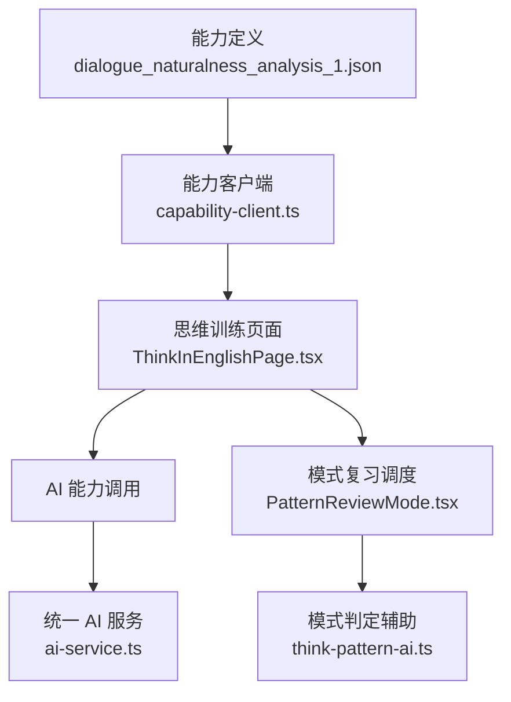
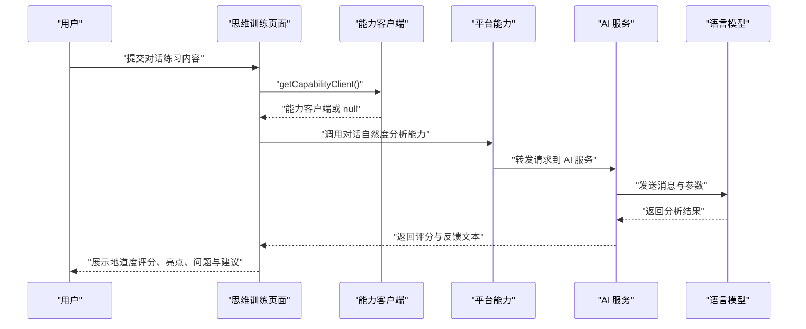
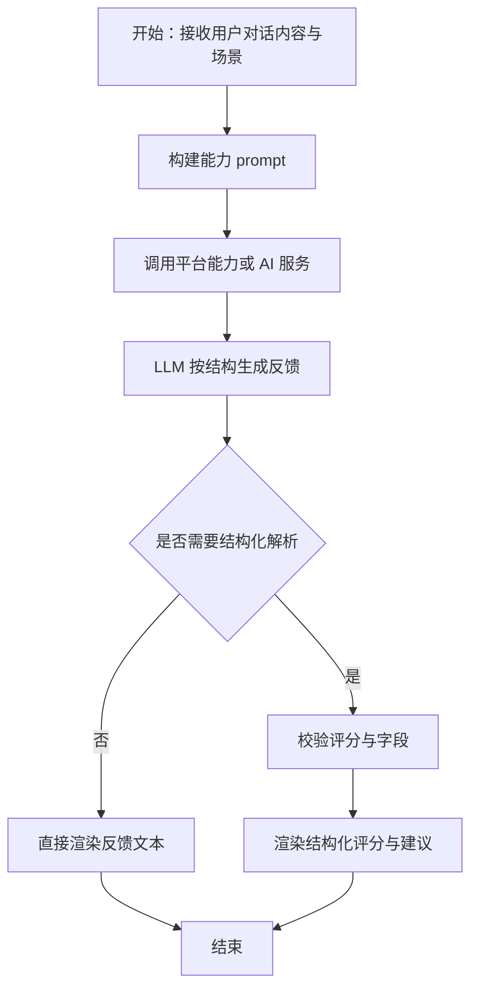
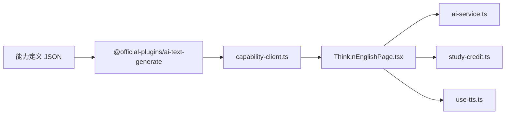

# 对话自然度分析能力

<cite>
**本文引用的文件**   
- [dialogue_naturalness_analysis_1.json](file://shared/capabilities/dialogue_naturalness_analysis_1.json)
- [capability-client.ts](file://src/lib/capability-client.ts)
- [ai-service.ts](file://src/services/ai-service.ts)
- [think-in-english.md](file://docs/modules/think-in-english.md)
- [ThinkInEnglishPage.tsx](file://src/pages/ThinkInEnglishPage/ThinkInEnglishPage.tsx)
- [PatternReviewMode.tsx](file://src/pages/ThinkInEnglishPage/PatternReviewMode.tsx)
- [think-pattern-ai.ts](file://src/lib/think-pattern-ai.ts)
</cite>

## 目录
1. [引言](#引言)
2. [项目结构定位](#项目结构定位)
3. [核心组件：能力定义](#核心组件能力定义)
4. [架构总览](#架构总览)
5. [详细实现分析](#详细实现分析)
6. [依赖关系分析](#依赖关系分析)
7. [性能与可靠性考量](#性能与可靠性考量)
8. [故障排查指南](#故障排查指南)
9. [结论](#结论)
10. [附录：评分维度、反馈模板与分析示例](#附录评分维度反馈模板与分析示例)

## 引言
本文件为 NativeThink 的“对话自然度分析”能力提供完整的技术与使用文档。该能力以 JSON 能力定义为核心，配合平台能力客户端与 AI 服务，对用户在对话练习中的英语表达进行地道程度评估，并生成结构化反馈。它主要服务于“母语思维训练（/think）”模块中的对话练习场景，强调从语法准确性、词汇丰富度、句式多样性、语用恰当性等多个维度给出改进建议，帮助学习者建立更自然的英语表达习惯。

## 项目结构定位
“对话自然度分析”能力由以下三部分协同构成：
- 能力定义：`shared/capabilities/dialogue_naturalness_analysis_1.json`
- 能力调用入口：`src/lib/capability-client.ts`
- 对话与思维训练页面集成：`src/pages/ThinkInEnglishPage/ThinkInEnglishPage.tsx`，以及模式复习相关代码 `PatternReviewMode.tsx`、`think-pattern-ai.ts`

**图表来源**
- [dialogue_naturalness_analysis_1.json:1-36](file://shared/capabilities/dialogue_naturalness_analysis_1.json#L1-L36)
- [capability-client.ts:1-23](file://src/lib/capability-client.ts#L1-L23)
- [ThinkInEnglishPage.tsx:1-200](file://src/pages/ThinkInEnglishPage/ThinkInEnglishPage.tsx#L1-L200)
- [ai-service.ts:1-200](file://src/services/ai-service.ts#L1-L200)
- [PatternReviewMode.tsx:1-200](file://src/pages/ThinkInEnglishPage/PatternReviewMode.tsx#L1-L200)
- [think-pattern-ai.ts:1-66](file://src/lib/think-pattern-ai.ts#L1-L66)

**章节来源**
- [dialogue_naturalness_analysis_1.json:1-36](file://shared/capabilities/dialogue_naturalness_analysis_1.json#L1-L36)
- [capability-client.ts:1-23](file://src/lib/capability-client.ts#L1-L23)
- [think-in-english.md:1-82](file://docs/modules/think-in-english.md#L1-L82)

## 核心组件：能力定义
`dialogue_naturalness_analysis_1.json` 是该能力的元数据与行为契约，包含以下内容：
- 能力标识与插件信息：id、pluginKey、pluginVersion
- 名称与描述：说明用于“对话结束后分析用户表达的地道程度，指出可改进之处并给出建议，用于 AI 对话练习页面的地道度分析功能”
- 参数 schema：
  - user_dialogue_content：用户在对话练习中输入的所有表达内容
  - dialogue_scenario：对话练习的场景，如商务谈判、日常交流、旅游出行等
  - 两个参数均为必填
- formValue：
  - modelID：模型编号
  - modelParams：maxTokens 与 temperature
  - prompt：系统提示词，要求按固定结构输出地道度评分、亮点、可改进之处、优化建议、延伸学习

该能力定义的评分区间为 0-10 分，但并未在 JSON 中硬编码多维分数映射；实际多维度打分、问题定位和改进建议主要由 prompt 结构与 LLM 输出约定驱动。

**章节来源**
- [dialogue_naturalness_analysis_1.json:1-36](file://shared/capabilities/dialogue_naturalness_analysis_1.json#L1-L36)

## 架构总览
能力调用链路如下：
1. 页面侧准备用户输入与场景信息。
2. 通过能力客户端获取平台能力接口。
3. 将能力 id、参数、prompt 等交给平台能力或 AI 服务。
4. AI 服务根据配置选择服务商和模型，返回流式或非流式结果。
5. 页面解析并渲染评分、亮点、问题点、优化建议和延伸学习。

**图表来源**
- [capability-client.ts:1-23](file://src/lib/capability-client.ts#L1-L23)
- [ai-service.ts:1-200](file://src/services/ai-service.ts#L1-L200)
- [dialogue_naturalness_analysis_1.json:1-36](file://shared/capabilities/dialogue_naturalness_analysis_1.json#L1-L36)

## 详细实现分析

### 能力定义与参数契约
- 能力 id：`dialogue_naturalness_analysis_1`
- 插件 key：`@official-plugins/ai-text-generate`
- 插件版本：`1.0.17`
- 必填参数：
  - user_dialogue_content：字符串，承载用户多句表达
  - dialogue_scenario：字符串，承载对话场景上下文
- 模型参数：
  - maxTokens：8192
  - temperature：0.5

这些字段决定了能力如何被注册、如何被前端调用、以及如何限制 LLM 的输出长度与创造性。

**章节来源**
- [dialogue_naturalness_analysis_1.json:1-36](file://shared/capabilities/dialogue_naturalness_analysis_1.json#L1-L36)

### 自然度评估维度
根据能力定义中的 prompt，LLM 需围绕以下维度进行分析：
- 地道度评分：0-10 分整体评价
- 表达亮点：肯定用户表达中地道、值得保留的部分
- 可改进之处：逐句或逐段指出不地道的问题，包括语法错误、用词不当、不符合场景习惯、文化差异等
- 优化建议：针对每个问题给出替换表达和使用说明
- 延伸学习：提供 1-2 个同场景下的常用地道表达示例

因此，该能力并非仅输出一个数字分数，而是以“总分 + 分维度说明 + 改进建议 + 示例”的结构化反馈为主。

**章节来源**
- [dialogue_naturalness_analysis_1.json:1-36](file://shared/capabilities/dialogue_naturalness_analysis_1.json#L1-L36)

### 评分算法与分数映射规则
当前仓库中没有独立的本地评分算法实现。自然度评分由 LLM 根据 prompt 生成，JSON 只约束了输出结构和评分范围：
- 评分范围：0-10
- 评分依据：由 LLM 结合语法准确性、词汇丰富度、句式多样性、语用恰当性等综合判断
- 分数映射规则：未在服务端或前端显式实现；属于 LLM 自由生成的语义判断

这意味着：
- 分数不是基于固定规则引擎计算得出
- 同一输入在不同模型或不同温度下可能略有差异
- 前端应把分数视为“引导性指标”，而非绝对精确度量

**章节来源**
- [dialogue_naturalness_analysis_1.json:1-36](file://shared/capabilities/dialogue_naturalness_analysis_1.json#1-L36)

### 反馈生成机制
反馈生成由 prompt 驱动，核心流程如下：
1. 注入对话场景和用户表达内容。
2. 要求 LLM 输出五部分：评分、亮点、可改进之处、优化建议、延伸学习。
3. 要求分析客观准确、建议实用易懂、语言友好鼓励为主、结构清晰重点突出。
4. 前端负责接收、展示，并不强制校验反馈 JSON；若未来需要结构化消费，可在解析层增加校验逻辑。

**图表来源**
- [dialogue_naturalness_analysis_1.json:1-36](file://shared/capabilities/dialogue_naturalness_analysis_1.json#L1-L36)
- [capability-client.ts:1-23](file://src/lib/capability-client.ts#L1-L23)

### 在思维训练模块中的应用
“母语思维训练”模块包含多个子功能：
- 模式复习
- 中式英语检测
- 思维转译
- 反翻译训练
- 思维还原

对话自然度分析能力明确面向“AI 对话练习页面的地道度分析功能”。它与模式复习中的“模式判定”不同：
- 模式判定关注是否使用了目标思维模式
- 对话自然度分析关注整体表达地道程度与改进空间

两者共享统一的 AI 调用基础设施，但在 prompt、参数和反馈结构上相互独立。

**章节来源**
- [think-in-english.md:1-82](file://docs/modules/think-in-english.md#L1-L82)

### 与其他学习功能的集成方式
- 句子学习模块侧重句型、语法地图、切分练习和跟读评价，其跟读评价走语音分析路径，不直接使用对话自然度分析能力。
- 写作模块通常也有 AI 批改能力，但具体实现取决于对应页面和服务端 API；对话自然度分析能力更适合“对话练习”语境，因为它的参数包含对话场景和多轮表达内容。
- 词汇模块、阅读模块、影子跟读模块更多聚焦词汇记忆、阅读理解、语音模仿，与对话自然度分析的集成通常是间接的：它们可以共同提升用户的英语表达能力，但不一定直接调用该能力。

**章节来源**
- [docs/modules/sentence-lab.md:1-78](file://docs/modules/sentence-lab.md#L1-L78)

## 依赖关系分析
- 能力定义依赖插件系统：pluginKey 指向官方 AI 文本生成插件。
- 能力客户端在平台环境下动态加载 `@lark-apaas/client-toolkit-lite`，非平台环境返回 null，避免无意义的大 chunk 下载。
- AI 服务提供统一流式与非流式聊天接口，支持静默调用、超时中断、服务商切换、免费模型任务分工等。
- 思维训练页面复用 useAI、useTTS、useStudyCredit 等通用能力，保持与中式英语检测、思维转译、反翻译训练等行为一致。

**图表来源**
- [dialogue_naturalness_analysis_1.json:1-36](file://shared/capabilities/dialogue_naturalness_analysis_1.json#L1-L36)
- [capability-client.ts:1-23](file://src/lib/capability-client.ts#L1-L23)
- [ai-service.ts:1-200](file://src/services/ai-service.ts#L1-L200)
- [ThinkInEnglishPage.tsx:1-200](file://src/pages/ThinkInEnglishPage/ThinkInEnglishPage.tsx#L1-L200)

**章节来源**
- [capability-client.ts:1-23](file://src/lib/capability-client.ts#L1-L23)
- [ai-service.ts:1-200](file://src/services/ai-service.ts#L1-L200)
- [think-in-english.md:1-82](file://docs/modules/think-in-english.md#L1-L82)

## 性能与可靠性考量
- 模型参数限制：maxTokens 8192，temperature 0.5，有助于控制输出长度并保持相对稳定的反馈风格。
- 能力客户端懒加载：仅在真正需要平台能力时才动态 import，避免默认路由进入时加载 507KB raw 的大包。
- AI 服务静默模式：练习界面可通过 silent 参数避免全局错误 toast，使降级逻辑更平滑。
- 超时与中断：思维训练模块在其他 AI 调用处使用 AbortController 和超时保护；对话自然度分析能力可沿用相同模式，防止请求长期挂起。
- 空串降级：当 AI 服务不可用时，前端应先判空再解析，避免把异常当成正常结果。

**章节来源**
- [capability-client.ts:1-23](file://src/lib/capability-client.ts#L1-L23)
- [ai-service.ts:1-200](file://src/services/ai-service.ts#L1-L200)
- [think-in-english.md:1-82](file://docs/modules/think-in-english.md#L1-L82)

## 故障排查指南
常见问题及处理建议：
1. **能力返回为空或失败**
   - 检查能力客户端是否成功加载。
   - 检查 AI Key 是否在服务端配置。
   - 检查 prompt 中 user_dialogue_content 与 dialogue_scenario 是否为非空字符串。
2. **分数不合理或波动较大**
   - 确认 temperature 未被调高；当前能力定义 temperature 为 0.5。
   - 确认用户输入足够长且场景明确；过短输入会导致 LLM 难以给出稳定评分。
3. **反馈无法结构化消费**
   - 当前实现以文本结构为主；如需结构化字段，应在前端或后端增加解析与校验逻辑。
   - 参考模式复习判定的 validatePatternJudgeResult 思路，先判空再解析 JSON。
4. **请求长时间等待**
   - 加入 AbortController 与超时控制。
   - 确保卸载页面或切换题目时中止旧请求。

**章节来源**
- [capability-client.ts:1-23](file://src/lib/capability-client.ts#L1-L23)
- [ai-service.ts:1-200](file://src/services/ai-service.ts#L1-L200)
- [think-pattern-ai.ts:1-66](file://src/lib/think-pattern-ai.ts#L1-L66)
- [think-in-english.md:1-82](file://docs/modules/think-in-english.md#L1-L82)

## 结论
“对话自然度分析”能力是一个以 LLM 为核心的对话表达质量评估工具。它通过能力定义声明参数与 prompt，借助平台能力客户端与统一 AI 服务完成调用，最终为用户生成包含总分、亮点、问题点、优化建议和延伸学习的结构化反馈。其优势在于灵活、贴近真实语言表达场景；风险在于分数不具备确定性算法保证，需要前端做好空值、异常、超时和降级处理。该能力最适合嵌入对话练习场景，并与思维训练、句子学习、写作等功能形成互补，共同推动用户从“能写对”走向“说得地道”。

## 附录：评分维度、反馈模板与分析示例

### 评分维度
- 语法准确性：是否存在语法错误、主谓不一致、时态误用等问题。
- 词汇丰富度：用词是否单一、重复、生硬，是否具备更地道的搭配。
- 句式多样性：是否长期使用简单句，能否使用复合句、倒装、强调等结构。
- 语用恰当性：是否符合对话场景、语气、礼貌程度和文化习惯。

### 分数映射规则
当前实现没有硬编码映射表，LLM 自行给出 0-10 分。可参考如下解释口径：
- 0-3：表达存在较多语法或用词问题，语用不够自然
- 4-6：基本可理解，但有明显中式英语或不地道表达
- 7-8：表达较自然，仍有少量可优化空间
- 9-10：表达接近母语者，仅在细节或语用上可微调

### 反馈模板
建议 LLM 输出以下结构：
1. 地道度评分（0-10）
2. 表达亮点
3. 可改进之处
4. 优化建议
5. 延伸学习

### 实际分析示例
假设用户在一个“旅游出行”场景中表达：
- 用户输入：“I want to go the airport, but I don't know how to get there.”
- 场景：机场出行
- 预期反馈要点：
  - 语法层面：to 后缺少方向介词，应为 “go to the airport”
  - 词汇层面：表达直白，可补充更自然的问路或求助句式
  - 句式层面：并列句可用，但可尝试更简洁或更口语化的表达
  - 语用层面：语气中性，适合向陌生人问路
  - 优化建议：提供更地道问路句式、指路回应示例
  - 延伸学习：提供常见机场出行短语

**章节来源**
- [dialogue_naturalness_analysis_1.json:1-36](file://shared/capabilities/dialogue_naturalness_analysis_1.json#L1-L36)