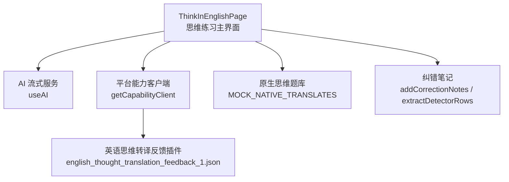
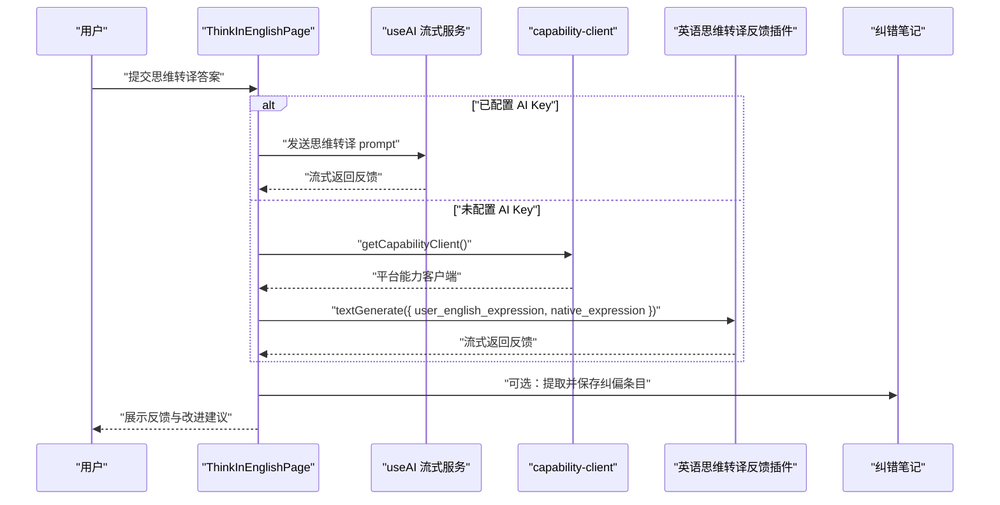
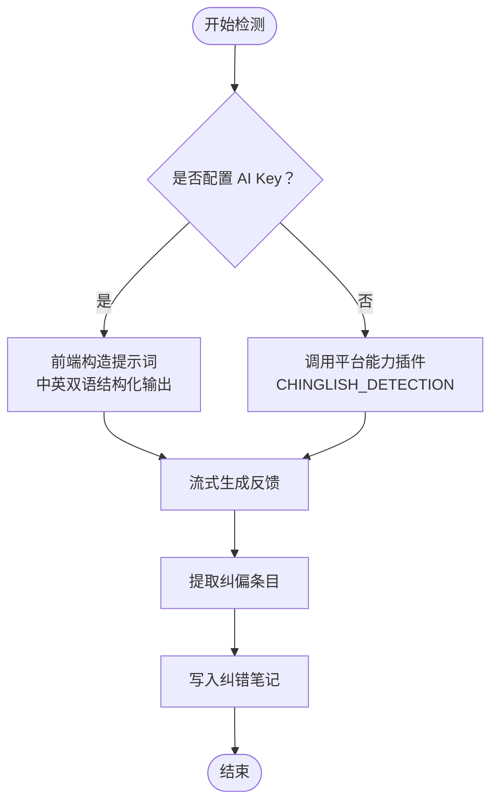
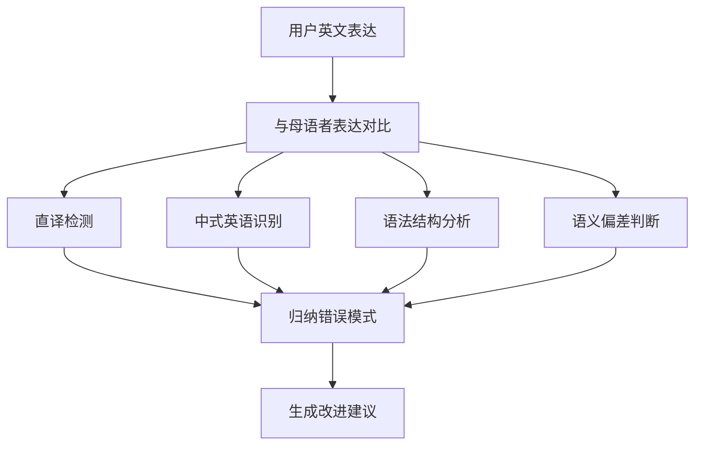
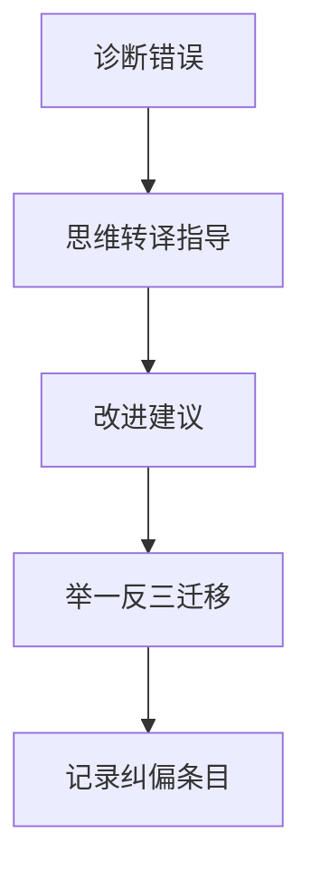
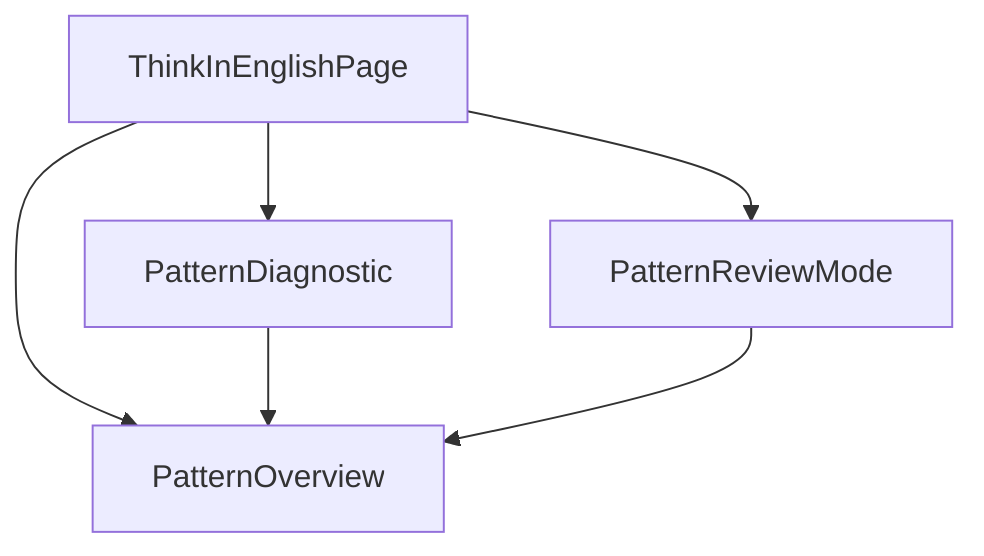
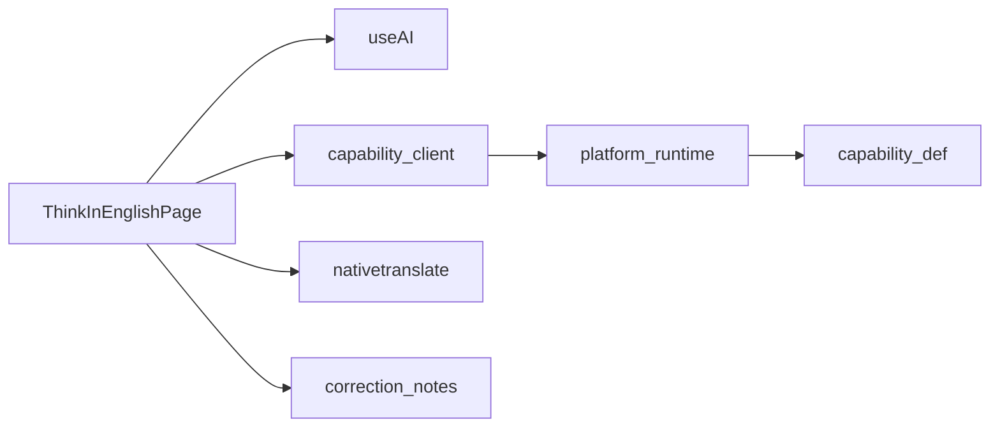

# 英语思维翻译反馈能力

<cite>
**本文引用的文件**   
- [english_thought_translation_feedback_1.json](file://shared/capabilities/english_thought_translation_feedback_1.json)
- [ThinkInEnglishPage.tsx](file://src/pages/ThinkInEnglishPage/ThinkInEnglishPage.tsx)
- [capability-client.ts](file://src/lib/capability-client.ts)
- [README.md](file://shared/capabilities/README.md)
- [nativetranslate.ts](file://src/data/nativetranslate.ts)
- [PatternDiagnostic.tsx](file://src/pages/ThinkInEnglishPage/PatternDiagnostic.tsx)
- [PatternOverview.tsx](file://src/pages/ThinkInEnglishPage/PatternOverview.tsx)
- [PatternReviewMode.tsx](file://src/pages/ThinkInEnglishPage/PatternReviewMode.tsx)
</cite>

## 目录
1. [引言](#引言)
2. [项目结构](#项目结构)
3. [核心组件](#核心组件)
4. [架构总览](#架构总览)
5. [详细组件分析](#详细组件分析)
6. [依赖关系分析](#依赖关系分析)
7. [性能考量](#性能考量)
8. [故障排查指南](#故障排查指南)
9. [结论](#结论)

## 引言
本文件聚焦 NativeThink 的“英语思维翻译反馈能力”，以 `english_thought_translation_feedback_1.json` 的能力定义为核心，解释该能力如何识别用户的母语思维干扰、检测直译与中式英语、分析语法结构与语义偏差，并生成改进建议。同时说明该能力在 `ThinkInEnglishPage` 中的集成方式：当用户未配置独立 AI Key 时，页面通过平台能力客户端调用插件；当已配置 AI Key 时，则走内嵌流式提示词路径。文档还给出错误分类体系、反馈策略、改进路径、学习建议及最佳实践，帮助用户建立英语思维习惯。

## 项目结构
围绕该能力的代码分布在以下位置：
- 能力声明：`shared/capabilities/english_thought_translation_feedback_1.json`
- 运行时入口：`src/pages/ThinkInEnglishPage/ThinkInEnglishPage.tsx`
- 平台能力客户端：`src/lib/capability-client.ts`
- 原生思维语料：`src/data/nativetranslate.ts`
- 模式复习相关 UI：`PatternDiagnostic.tsx`、`PatternOverview.tsx`、`PatternReviewMode.tsx`

**图表来源**
- [ThinkInEnglishPage.tsx:201-520](file://src/pages/ThinkInEnglishPage/ThinkInEnglishPage.tsx#L201-L520)
- [capability-client.ts:1-23](file://src/lib/capability-client.ts#L1-L23)
- [english_thought_translation_feedback_1.json:1-36](file://shared/capabilities/english_thought_translation_feedback_1.json#L1-L36)
- [nativetranslate.ts:1-40](file://src/data/nativetranslate.ts#L1-L40)

**章节来源**
- [english_thought_translation_feedback_1.json:1-36](file://shared/capabilities/english_thought_translation_feedback_1.json#L1-L36)
- [capability-client.ts:1-23](file://src/lib/capability-client.ts#L1-L23)
- [README.md:1-5](file://shared/capabilities/README.md#L1-L5)
- [ThinkInEnglishPage.tsx:201-520](file://src/pages/ThinkInEnglishPage/ThinkInEnglishPage.tsx#L201-L520)
- [nativetranslate.ts:1-40](file://src/data/nativetranslate.ts#L1-L40)

## 核心组件
### 能力定义：english_thought_translation_feedback_1.json
该能力定义了“英语思维转译反馈插件”的元数据、参数 Schema 和系统提示词。其关键要点如下：
- 名称与用途：用于母语思维训练页面的思维转译练习，对比用户英语表达与母语者标准表达，输出思维转译指导与改进建议。
- 输入参数：
  - `user_english_expression`：用户输入的英语描述内容。
  - `native_expression`：对应的母语者标准表达内容。
- 模型与参数：默认模型 ID 为 87，最大令牌数 8192，温度 0.5。
- 提示词职责：
  - 差异对比：逐句或逐段比较用词、句式结构和表达逻辑。
  - 思维误区分析：指出母语思维干扰点，解释为何不符合英语母语者习惯。
  - 转译指导：讲解从中文思维到英语思维的转换方法。
  - 改进建议：提供可操作的练习建议。
  - 举一反三：给出同类型场景示例，帮助迁移学习。

这些字段共同构成该能力的“错误分类体系 + 反馈策略 + 改进路径”的基础。

**章节来源**
- [english_thought_translation_feedback_1.json:1-36](file://shared/capabilities/english_thought_translation_feedback_1.json#L1-L36)

### 运行时入口：ThinkInEnglishPage
`ThinkInEnglishPage` 是思维练习的主界面，承担三类主要任务：
- 中式英语检测器：对单句进行直译与中式思维痕迹检测。
- 思维转译练习：将中文场景直接转为英文，并与母语者参考对比。
- 回译与原生思维翻译：基于关键词造句，以及把“母语者视角的中文句子”翻译成英文。

在“思维转译练习”中，页面根据是否配置 AI Key 选择两条路径：
- 已配置 AI Key：使用内嵌流式提示词，由前端直接组织 prompt 并流式渲染结果。
- 未配置 AI Key：通过 `getCapabilityClient()` 动态加载平台能力客户端，调用 `THOUGHT_TRANSLATION` 插件，传入 `user_english_expression` 与 `native_expression`。

在“中式英语检测器”中，同样存在两条路径：
- 已配置 AI Key：使用内嵌 system prompt 输出双语结构化报告（包含 Chinglish Score、问题列表、自然替代、思维模式分析与关键要点）。
- 未配置 AI Key：调用 `CHINGLISH_DETECTION` 插件。

此外，检测结果会通过 `extractDetectorRows` 提取表格行，并写入 `correction-notes`，形成“表达纠偏本”。

**章节来源**
- [ThinkInEnglishPage.tsx:201-520](file://src/pages/ThinkInEnglishPage/ThinkInEnglishPage.tsx#L201-L520)

### 平台能力客户端：capability-client.ts
`getCapabilityClient()` 仅在真正需要时才动态加载 `@lark-apaas/client-toolkit-lite`，避免非平台环境下的静态引入开销。加载失败会清空缓存，防止网络抖动导致后续请求永久失败。该客户端返回 null 时，调用方沿用原有的 try-catch 与“AI 服务暂不可用”提示。

**章节来源**
- [capability-client.ts:1-23](file://src/lib/capability-client.ts#L1-L23)

### 原生思维题库：nativetranslate.ts
`MOCK_NATIVE_TRANSLATES` 提供“从英语母语者思维角度写成的中文句子”，配合 `INativeTranslate` 接口，包括：
- `chineseText`：母语者视角的中文文本。
- `nativeEnglish`：地道英语表达。
- `thinkingPattern`：思维模式差异说明。
- `difficulty` 与 `category`：难度与类别标签。

该数据作为“原生思维翻译”练习的核心素材，驱动用户发现中英文思维差异。

**章节来源**
- [nativetranslate.ts:1-40](file://src/data/nativetranslate.ts#L1-L40)

## 架构总览
下图展示“英语思维翻译反馈能力”在 ThinkInEnglishPage 中的调用流程，包括 AI Key 存在与否时的分支、能力插件的参数传递、流式输出与本地记录。

**图表来源**
- [ThinkInEnglishPage.tsx:201-520](file://src/pages/ThinkInEnglishPage/ThinkInEnglishPage.tsx#L201-L520)
- [capability-client.ts:1-23](file://src/lib/capability-client.ts#L1-L23)
- [english_thought_translation_feedback_1.json:1-36](file://shared/capabilities/english_thought_translation_feedback_1.json#L1-L36)

## 详细组件分析

### 中英思维转换检测机制
该能力在中英思维转换检测方面，主要通过两种方式实现：
- 中式英语检测器：
  - 已配置 AI Key：前端构建 system prompt，要求输出双语结构化报告，包括“Chinglish Score”“问题清单”“自然替代表”“思维模式分析”“关键要点”。
  - 未配置 AI Key：调用 `CHINGLISH_DETECTION` 插件，由后端能力插件完成检测与报告生成。
- 思维转译练习：
  - 将用户英文表达与母语者参考对照，输出差异对比、思维误区分析、转译指导、改进建议和举一反三示例。
  - 未配置 AI Key 时，通过 `THOUGHT_TRANSLATION` 插件，使用 `user_english_expression` 与 `native_expression` 参数驱动。

**图表来源**
- [ThinkInEnglishPage.tsx:201-520](file://src/pages/ThinkInEnglishPage/ThinkInEnglishPage.tsx#L201-L520)

**章节来源**
- [ThinkInEnglishPage.tsx:201-520](file://src/pages/ThinkInEnglishPage/ThinkInEnglishPage.tsx#L201-L520)

### 错误模式识别算法
虽然具体识别算法主要由 AI 模型在服务端执行，但能力定义与前端提示词明确了识别维度：
- 直译检测：对比用户表达与母语者表达，识别逐词直译导致的生硬表达。
- 中式英语识别：标注“为什么听起来像中文”，例如语序、修饰语位置、动词选择、连接词使用等。
- 语法结构分析：关注句式结构差异，如主语缺失、冗余从句、被动/主动误用。
- 语义偏差判断：比较语义重心、语气强弱、语域正式度、礼貌策略。

这些维度对应能力定义中的“差异对比”“思维误区分析”“转译指导”“改进建议”“举一反三”。

**图表来源**
- [english_thought_translation_feedback_1.json:1-36](file://shared/capabilities/english_thought_translation_feedback_1.json#L1-L36)

**章节来源**
- [english_thought_translation_feedback_1.json:1-36](file://shared/capabilities/english_thought_translation_feedback_1.json#L1-L36)

### 改进建议生成系统
能力定义的提示词明确要求：
- 给出具体可操作的练习建议。
- 用通俗易懂的语言解释，避免过于专业的语法术语。
- 语气友好鼓励，增强学习者信心。
- 提供 2-3 个同类型场景示例，便于迁移学习。

在 ThinkInEnglishPage 中，不同练习路径都有对应的 system prompt，确保反馈始终围绕“思维转译”“母语者视角”“地道表达”展开。

**章节来源**
- [english_thought_translation_feedback_1.json:1-36](file://shared/capabilities/english_thought_translation_feedback_1.json#L1-L36)
- [ThinkInEnglishPage.tsx:201-520](file://src/pages/ThinkInEnglishPage/ThinkInEnglishPage.tsx#L201-L520)

### 错误分类体系
基于能力定义与前端提示词，可将错误分为以下类别：
- 词汇层错误：选词不当、搭配不地道、近义词误用。
- 句法层错误：语序错误、从句冗余、主谓不一致、冠词/介词误用。
- 语用层错误：语气过强或过弱、正式度不匹配、礼貌策略缺失。
- 思维层错误：直译中文思维、中文话题优先而非英语主语优先、过度解释或省略必要信息。

每个类别都可对应“问题清单 + 自然替代 + 思维模式解读 + 关键要点”的反馈结构。

**章节来源**
- [english_thought_translation_feedback_1.json:1-36](file://shared/capabilities/english_thought_translation_feedback_1.json#L1-L36)
- [ThinkInEnglishPage.tsx:201-520](file://src/pages/ThinkInEnglishPage/ThinkInEnglishPage.tsx#L201-L520)

### 反馈策略
反馈策略遵循“先诊断、后指导、再练习”的顺序：
1. 诊断：明确指出用户表达中的问题与中式思维痕迹。
2. 指导：解释中文思维与英语思维差异，给出转译思路。
3. 建议：提供可操作练习建议。
4. 迁移：给出同类型场景示例，帮助举一反三。
5. 纠偏：将典型“中式表达 → 地道表达”写入纠错笔记，形成学习资产。

**图表来源**
- [english_thought_translation_feedback_1.json:1-36](file://shared/capabilities/english_thought_translation_feedback_1.json#L1-L36)
- [ThinkInEnglishPage.tsx:201-520](file://src/pages/ThinkInEnglishPage/ThinkInEnglishPage.tsx#L201-L520)

**章节来源**
- [english_thought_translation_feedback_1.json:1-36](file://shared/capabilities/english_thought_translation_feedback_1.json#L1-L36)
- [ThinkInEnglishPage.tsx:201-520](file://src/pages/ThinkInEnglishPage/ThinkInEnglishPage.tsx#L201-L520)

### 改进路径与学习建议
该能力支持三种练习路径：
- 中式英语检测：适合快速定位高频直译与中式思维模式。
- 思维转译练习：适合场景化训练，强调“直接英语思维”而非逐词翻译。
- 原生思维翻译：通过“母语者视角的中文句子”，反向训练英语思维。

学习建议包括：
- 每次练习聚焦一个思维模式，不要贪多。
- 重视“自然替代表”，积累地道搭配。
- 将纠错笔记纳入日常复习。
- 结合 PatternReviewMode 的模式复习，强化薄弱思维模式。

**章节来源**
- [ThinkInEnglishPage.tsx:201-520](file://src/pages/ThinkInEnglishPage/ThinkInEnglishPage.tsx#L201-L520)
- [nativetranslate.ts:1-40](file://src/data/nativetranslate.ts#L1-L40)

### 在 ThinkInEnglishPage 中的应用
ThinkInEnglishPage 将该能力嵌入三个关键交互：
- 检测器：提交句子后，流式输出双语结构化报告，并自动收集纠偏条目。
- 思维转译：对比用户英文与母语者参考，输出思维差异解读与改进建议。
- 原生思维翻译：基于 `MOCK_NATIVE_TRANSLATES`，引导用户理解英语母语者的表达方式。

页面还维护本地历史、收藏、计时积分和 AbortController 取消机制，保证体验稳定。

**章节来源**
- [ThinkInEnglishPage.tsx:201-520](file://src/pages/ThinkInEnglishPage/ThinkInEnglishPage.tsx#L201-L520)
- [nativetranslate.ts:1-40](file://src/data/nativetranslate.ts#L1-L40)

### 与模式复习系统的协作
虽然“英语思维翻译反馈能力”本身不负责模式进度管理，但它与模式复习系统协同工作：
- `PatternDiagnostic` 负责思维体检，产出四层概况与建议。
- `PatternOverview` 展示模式地图、薄弱项与到期队列。
- `PatternReviewMode` 编排会话状态，决定是否使用 AI 判定或回落自评。

这种协作有助于用户从“单次翻译反馈”走向“长期思维模式训练”。

**图表来源**
- [PatternDiagnostic.tsx:1-80](file://src/pages/ThinkInEnglishPage/PatternDiagnostic.tsx#L1-L80)
- [PatternOverview.tsx:1-120](file://src/pages/ThinkInEnglishPage/PatternOverview.tsx#L1-L120)
- [PatternReviewMode.tsx:1-120](file://src/pages/ThinkInEnglishPage/PatternReviewMode.tsx#L1-L120)

**章节来源**
- [PatternDiagnostic.tsx:1-80](file://src/pages/ThinkInEnglishPage/PatternDiagnostic.tsx#L1-L80)
- [PatternOverview.tsx:1-120](file://src/pages/ThinkInEnglishPage/PatternOverview.tsx#L1-L120)
- [PatternReviewMode.tsx:1-120](file://src/pages/ThinkInEnglishPage/PatternReviewMode.tsx#L1-L120)

## 依赖关系分析
该能力的主要依赖如下：
- ThinkInEnglishPage 依赖 useAI 与 capability-client。
- capability-client 依赖平台运行时提供的 `@lark-apaas/client-toolkit-lite`。
- english_thought_translation_feedback_1.json 被平台运行时消费，定义能力行为。
- nativetranslate.ts 提供原生思维练习数据。
- correction-notes 与 detector history 提供本地学习资产。

**图表来源**
- [ThinkInEnglishPage.tsx:201-520](file://src/pages/ThinkInEnglishPage/ThinkInEnglishPage.tsx#L201-L520)
- [capability-client.ts:1-23](file://src/lib/capability-client.ts#L1-L23)
- [english_thought_translation_feedback_1.json:1-36](file://shared/capabilities/english_thought_translation_feedback_1.json#L1-L36)
- [nativetranslate.ts:1-40](file://src/data/nativetranslate.ts#L1-L40)

**章节来源**
- [ThinkInEnglishPage.tsx:201-520](file://src/pages/ThinkInEnglishPage/ThinkInEnglishPage.tsx#L201-L520)
- [capability-client.ts:1-23](file://src/lib/capability-client.ts#L1-L23)
- [english_thought_translation_feedback_1.json:1-36](file://shared/capabilities/english_thought_translation_feedback_1.json#L1-L36)
- [nativetranslate.ts:1-40](file://src/data/nativetranslate.ts#L1-L40)

## 性能考量
- 能力客户端采用动态 import，避免在非平台环境下引入 500KB+ 的模块。
- 流式输出减少首屏等待时间，提升用户体验。
- AbortController 支持中断长耗时请求，避免悬挂状态。
- 本地历史限制最多 8 条展示、50 条存储，控制内存与存储空间占用。
- 未配置 AI Key 时，降级到平台能力插件，避免空指针与白屏。

**章节来源**
- [capability-client.ts:1-23](file://src/lib/capability-client.ts#L1-L23)
- [ThinkInEnglishPage.tsx:201-520](file://src/pages/ThinkInEnglishPage/ThinkInEnglishPage.tsx#L201-L520)

## 故障排查指南
常见问题与处理建议：
- “AI 服务暂不可用”：检查网络、AI Key 配置或平台运行时能力。
- 流式输出不完整：检查 AbortController 是否被提前中止。
- 能力客户端加载失败：确认是否运行在平台环境中，或重试加载逻辑。
- 纠偏条目未保存：检查 `extractDetectorRows` 是否能从反馈中提取表格行。
- 原生思维练习无数据：确认 `MOCK_NATIVE_TRANSLATES` 是否正确加载。

**章节来源**
- [ThinkInEnglishPage.tsx:201-520](file://src/pages/ThinkInEnglishPage/ThinkInEnglishPage.tsx#L201-L520)
- [capability-client.ts:1-23](file://src/lib/capability-client.ts#L1-L23)

## 结论
“英语思维翻译反馈能力”通过能力定义与 ThinkInEnglishPage 的双路径集成，既能在有 AI Key 时提供灵活的前端提示词控制，也能在无 Key 时借助平台能力插件完成检测与反馈。它以“直译检测、中式英语识别、语法结构分析、语义偏差判断”为基础，形成“错误分类体系 + 反馈策略 + 改进路径 + 学习建议”的完整闭环，并借助模式复习系统推动长期思维习惯养成。