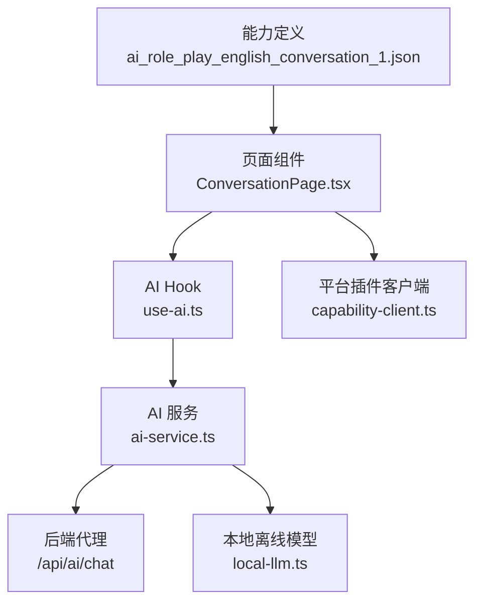
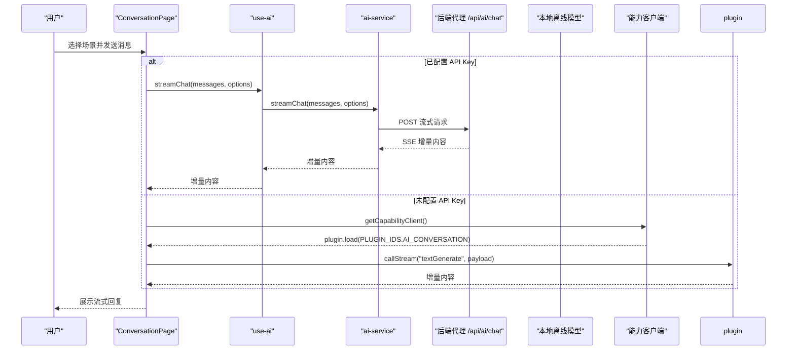
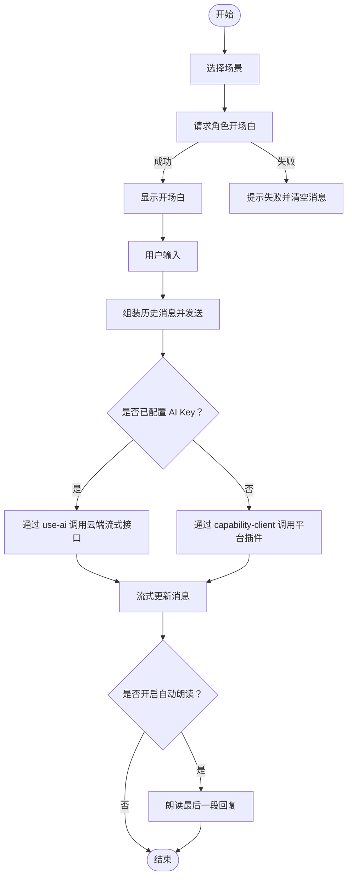
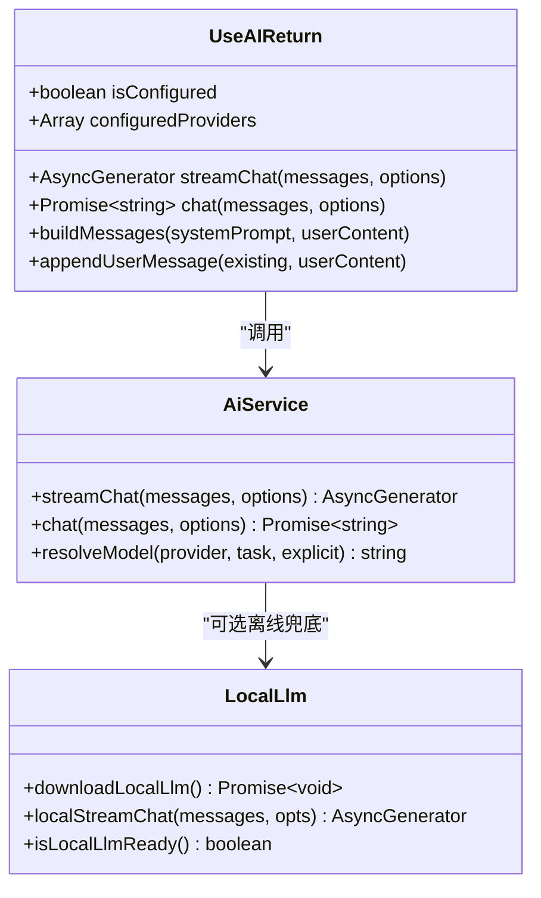
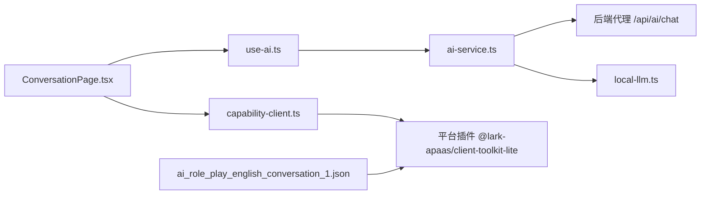

# 角色扮演对话能力

<cite>
**本文引用的文件**
- [ai_role_play_english_conversation_1.json](file://shared/capabilities/ai_role_play_english_conversation_1.json)
- [ConversationPage.tsx](file://src/pages/ConversationPage/ConversationPage.tsx)
- [use-ai.ts](file://src/hooks/use-ai.ts)
- [ai-service.ts](file://src/services/ai-service.ts)
- [capability-client.ts](file://src/lib/capability-client.ts)
- [local-llm.ts](file://src/lib/local-llm.ts)
- [README.md](file://shared/capabilities/README.md)
</cite>

## 目录
1. [引言](#引言)
2. [项目结构](#项目结构)
3. [核心组件](#核心组件)
4. [架构总览](#架构总览)
5. [详细组件分析](#详细组件分析)
6. [依赖关系分析](#依赖关系分析)
7. [性能考虑](#性能考虑)
8. [故障排查指南](#故障排查指南)
9. [结论](#结论)
10. [附录：输入输出规范与使用示例](#附录输入输出规范与使用示例)

## 引言
本文件围绕 NativeThink 的“角色扮演英文对话”能力展开，聚焦以下目标：
- 解读能力定义文件 `ai_role_play_english_conversation_1.json` 的角色设定、参数模型与系统提示。
- 说明 ConversationPage 如何发起角色对话、维护多轮上下文、处理流式响应、并持久化对话历史。
- 解释该能力与 AI 服务（云端 OpenAI 兼容接口）及平台插件能力客户端的集成方式。
- 给出输入输出规范、错误处理策略、性能优化建议与实际使用路径。

## 项目结构
与角色扮演对话能力直接相关的代码主要分布在三层：
- 能力定义层：`shared/capabilities/ai_role_play_english_conversation_1.json` 描述对外暴露的 AI 能力元数据、参数 schema 和默认 prompt。
- 页面交互层：`src/pages/ConversationPage/ConversationPage.tsx` 实现场景选择、消息流、用户输入、分析与翻译等 UI 逻辑。
- AI 服务层：`src/services/ai-service.ts`、`src/hooks/use-ai.ts`、`src/lib/local-llm.ts`、`src/lib/capability-client.ts` 提供统一流式聊天、本地离线兜底与平台插件调用。

**图表来源**
- [ai_role_play_english_conversation_1.json:1-50](file://shared/capabilities/ai_role_play_english_conversation_1.json#L1-L50)
- [ConversationPage.tsx:200-500](file://src/pages/ConversationPage/ConversationPage.tsx#L200-L500)
- [use-ai.ts:1-101](file://src/hooks/use-ai.ts#L1-L101)
- [ai-service.ts:1-200](file://src/services/ai-service.ts#L1-L200)
- [capability-client.ts:1-23](file://src/lib/capability-client.ts#L1-L23)
- [local-llm.ts:1-200](file://src/lib/local-llm.ts#L1-L200)

**章节来源**
- [ai_role_play_english_conversation_1.json:1-50](file://shared/capabilities/ai_role_play_english_conversation_1.json#L1-L50)
- [ConversationPage.tsx:200-500](file://src/pages/ConversationPage/ConversationPage.tsx#L200-L500)

## 核心组件
- 能力定义：描述一个英文角色扮演对话插件的能力标识、插件键、参数 schema 与默认 prompt，用于在平台插件体系下被加载。
- 对话页面：负责场景管理、消息渲染、流式请求、自动朗读、对话保存与分析。
- AI Hook：封装统一的流式与非流式聊天方法，并处理配置状态、错误与静默模式。
- AI 服务：将消息转发到服务端 `/api/ai/chat`，解析 SSE 流，支持任务类型、温度、最大 token 与取消信号。
- 能力客户端：惰性动态加载平台插件客户端，作为未配置 API Key 时的兜底路径。
- 本地离线模型：当云端不可用且启用自动回落时，通过浏览器端小模型继续生成。

**章节来源**
- [ai_role_play_english_conversation_1.json:1-50](file://shared/capabilities/ai_role_play_english_conversation_1.json#L1-L50)
- [ConversationPage.tsx:200-500](file://src/pages/ConversationPage/ConversationPage.tsx#L200-L500)
- [use-ai.ts:1-101](file://src/hooks/use-ai.ts#L1-L101)
- [ai-service.ts:1-200](file://src/services/ai-service.ts#L1-L200)
- [capability-client.ts:1-23](file://src/lib/capability-client.ts#L1-L23)
- [local-llm.ts:1-200](file://src/lib/local-llm.ts#L1-L200)

## 架构总览
角色扮演对话能力在运行时存在两条主路径：
1. 已配置 AI API Key：ConversationPage 通过 use-ai 调用 ai-service，最终走 `/api/ai/chat` 流式返回。
2. 未配置 API Key：ConversationPage 尝试通过 capability-client 动态加载平台插件客户端，并使用 `textGenerate` 能力进行流式对话。

**图表来源**
- [ConversationPage.tsx:200-500](file://src/pages/ConversationPage/ConversationPage.tsx#L200-L500)
- [use-ai.ts:1-101](file://src/hooks/use-ai.ts#L1-L101)
- [ai-service.ts:1-200](file://src/services/ai-service.ts#L1-L200)
- [capability-client.ts:1-23](file://src/lib/capability-client.ts#L1-L23)

## 详细组件分析

### 能力定义：ai_role_play_english_conversation_1.json
该文件定义了角色扮演英文对话能力的元数据与默认行为：
- 能力标识：`ai_role_play_english_conversation_1`
- 插件键与版本：`@official-plugins/ai-text-generate`，版本 `1.0.17`
- 名称与描述：面向英语对话练习的多轮角色扮演。
- 参数 schema：
  - `role_setting`：对话角色设定，如咖啡馆服务员、面试官等。
  - `scene_description`：对话场景描述。
  - `user_message`：用户上一轮输入。
  - `conversation_history`：之前的对话历史，保持上下文连贯性。
  - `difficulty_level`：难度等级（初级、中级、高级）。
- 必填字段：`role_setting`、`scene_description`、`user_message`、`difficulty_level`。
- 默认表单值：包含 modelID、modelParams（maxTokens、temperature）、以及一段完整系统提示，要求完全使用英文、控制长度、按难度调整语言复杂度、引导对话继续、不暴露 AI 身份、必要时标注语法错误。

该定义文件是平台插件体系的“能力契约”，但当前 ConversationPage 的主要运行路径并不直接使用该 JSON；它更侧重于在“未配置 API Key”的兜底场景中由平台侧消费。

**章节来源**
- [ai_role_play_english_conversation_1.json:1-50](file://shared/capabilities/ai_role_play_english_conversation_1.json#L1-L50)
- [README.md:1-5](file://shared/capabilities/README.md#L1-L5)

### 对话页面：ConversationPage.tsx
ConversationPage 是角色扮演对话的核心交互入口，职责包括：
- 场景管理：内置咖啡店点单、工作面试、日常聊天、观点辩论四个预设场景，同时支持自定义场景创建与删除。
- 开场白流程：进入场景后，立即以 system prompt + user prompt 的方式让 AI 角色先开口，生成简短开场白。
- 用户输入处理：构造历史消息串，发送给 AI 或平台插件，并以流式方式更新界面。
- 对话状态维护：
  - 每个场景的消息列表、分析结果、自动朗读开关、翻译缓存等。
  - 使用防抖保存到本地存储，最多保留最近 20 条历史记录，每条记录最多保留 100 条消息。
- 错误处理：开场白失败、发送失败、分析失败都会给用户明确 toast 提示，避免空态或卡死。
- 其他功能：逐句翻译、TTS 朗读、学习信用计数、中断当前流。

关键交互流程如下：

**图表来源**
- [ConversationPage.tsx:200-500](file://src/pages/ConversationPage/ConversationPage.tsx#L200-L500)

#### 角色设定系统与对话流程控制
- 角色设定来源于所选场景的 `role` 字段，例如“友好咖啡师”“专业 HR 面试官”等。
- 系统提示会追加三条规则：仅英文回复、回复 2-5 句、保持角色不打破第四面墙；发送阶段还会追加“如有语法错误，请在末尾括号中简要标注”。
- 开场白使用较高温度（0.9），增强自然度；普通对话使用 0.8；分析阶段使用较低温度（0.4），提高稳定性。
- 对话历史在每次发送前被拼接成 `User/AI: 内容` 形式的字符串，作为用户消息传给 AI 服务。

#### 上下文管理策略
- 会话内上下文：使用 React state 中的 `messages` 数组维护当前场景的完整对话。
- 跨会话持久化：使用 `safeStorage` 保存 `ISavedConversation[]`，每条记录包含场景信息、消息、分析与时间戳。
- 防抖保存：消息变化时 800ms 防抖保存，避免流式更新导致频繁写入。
- 历史上限：最多保留 20 条场景记录，每条记录最多保留 100 条消息，防止存储膨胀。
- 恢复机制：从历史中恢复场景与消息，重新进入对话。

#### 多轮交互逻辑
- 开场白：进入场景后立即触发，失败则清空消息并提示重试。
- 发送消息：用户提交后，先将用户消息加入消息列表，再异步请求 AI，成功后追加 AI 流式内容。
- 中断机制：切换场景、返回首页或发送新消息时，会 abort 上一个流，避免旧流覆盖新界面。
- 自动朗读：根据开关对最后一段回复进行 TTS 朗读，超长回复只取尾部片段。
- 对话分析：至少完成一轮对话后可触发分析，分析结果会被收集为纠偏笔记。

**章节来源**
- [ConversationPage.tsx:200-500](file://src/pages/ConversationPage/ConversationPage.tsx#L200-L500)
- [ConversationPage.tsx:500-843](file://src/pages/ConversationPage/ConversationPage.tsx#L500-L843)

### AI 服务集成：use-ai.ts 与 ai-service.ts
- use-ai 暴露 `isConfigured`、`streamChat`、`chat` 等方法，内部委托给 ai-service。
- ai-service 统一封装 DeepSeek 与豆包的 OpenAI 兼容接口：
  - 通过服务端代理 `/api/ai/chat` 保护 API Key。
  - 解析 SSE 流，将增量内容转为 `StreamChunk`。
  - 支持任务类型、模型覆盖、温度、最大 token、取消信号与静默模式。
  - 对 503 未配置 API Key 的情况抛出明确错误。
  - 对非 2xx 响应解析错误消息。

**图表来源**
- [use-ai.ts:1-101](file://src/hooks/use-ai.ts#L1-L101)
- [ai-service.ts:1-200](file://src/services/ai-service.ts#L1-L200)
- [local-llm.ts:1-200](file://src/lib/local-llm.ts#L1-L200)

**章节来源**
- [use-ai.ts:1-101](file://src/hooks/use-ai.ts#L1-L101)
- [ai-service.ts:1-200](file://src/services/ai-service.ts#L1-L200)

### 平台插件能力客户端：capability-client.ts
- 惰性动态加载 `@lark-apaas/client-toolkit-lite`，仅在真正需要兜底路径时才引入。
- 若加载失败或不在平台环境，返回 null，调用方沿用原有 try-catch 与“AI 服务暂不可用”提示。
- ConversationPage 在未配置 API Key 时使用 `PLUGIN_IDS.AI_CONVERSATION` 加载插件，并通过 `callStream('textGenerate', payload)` 获取流式回复。
- 能力定义文件中的参数 schema 与该调用 payload 存在语义对应，但当前页面实际传入的是 `scenario`、`role_setting`、`conversation_history`、`user_message`，并未直接传入 `difficulty_level`。

**章节来源**
- [capability-client.ts:1-23](file://src/lib/capability-client.ts#L1-L23)
- [ConversationPage.tsx:200-500](file://src/pages/ConversationPage/ConversationPage.tsx#L200-L500)
- [ai_role_play_english_conversation_1.json:1-50](file://shared/capabilities/ai_role_play_english_conversation_1.json#L1-L50)

### 本地离线模型兜底：local-llm.ts
- 当云端限流或断网时，可在手机端启用本地小模型作为兜底。
- 首次下载约 750MiB 的 ONNX 模型，之后通过浏览器 Cache API 持久化，完全离线可用。
- 提供 `localStreamChat`，以 async generator 形式推送文本片段。
- 在 ai-service 中可被接入作为离线回退链的一部分。

**章节来源**
- [local-llm.ts:1-200](file://src/lib/local-llm.ts#L1-L200)
- [ai-service.ts:1-200](file://src/services/ai-service.ts#L1-L200)

## 依赖关系分析
- ConversationPage 依赖 use-ai 提供的统一聊天接口，并在未配置 API Key 时依赖 capability-client 的平台插件能力。
- use-ai 依赖 ai-service 的统一流式实现。
- ai-service 依赖后端代理 `/api/ai/chat`，并可结合 local-llm 做离线兜底。
- 能力定义文件是平台插件体系的静态契约，但不直接参与 ConversationPage 的主流程。

**图表来源**
- [ConversationPage.tsx:200-500](file://src/pages/ConversationPage/ConversationPage.tsx#L200-L500)
- [use-ai.ts:1-101](file://src/hooks/use-ai.ts#L1-L101)
- [ai-service.ts:1-200](file://src/services/ai-service.ts#L1-L200)
- [capability-client.ts:1-23](file://src/lib/capability-client.ts#L1-L23)
- [ai_role_play_english_conversation_1.json:1-50](file://shared/capabilities/ai_role_play_english_conversation_1.json#L1-L50)

**章节来源**
- [ConversationPage.tsx:200-500](file://src/pages/ConversationPage/ConversationPage.tsx#L200-L500)
- [use-ai.ts:1-101](file://src/hooks/use-ai.ts#L1-L101)
- [ai-service.ts:1-200](file://src/services/ai-service.ts#L1-L200)
- [capability-client.ts:1-23](file://src/lib/capability-client.ts#L1-L23)
- [ai_role_play_english_conversation_1.json:1-50](file://shared/capabilities/ai_role_play_english_conversation_1.json#L1-L50)

## 性能考虑
- 流式渲染：ConversationPage 对每条增量内容都更新消息状态，可能导致频繁重渲染。可考虑批合并增量或使用虚拟滚动优化长对话。
- 本地存储防抖：已有 800ms 防抖，避免流式更新导致的频繁写入；建议同时限制单条记录大小与总记录数，当前已实现。
- 自动朗读：只对最后一段回复朗读，并对超长回复截取尾部，避免一次性朗读过长内容。
- 能力客户端惰性加载：避免在未使用路径下载 500KB+ 的 chunk，降低首屏开销。
- 模型温度：开场白与对话使用较高温度以提升自然度，分析使用较低温度提升稳定性，符合不同任务的性能与质量权衡。
- 历史消息长度：每次发送前拼接完整历史为字符串，长对话会增加请求体大小；建议限制历史长度或采用摘要压缩策略。

[本节为通用性能建议，不直接分析具体文件]

## 故障排查指南
- 开场白生成失败：
  - 现象：进入场景后无开场白，消息区为空。
  - 原因：AI 服务不可用、网络异常或返回空内容。
  - 处理：页面会清空消息并提示“开场白生成失败，请点击换一个场景或重试”。
- 发送消息失败：
  - 现象：点击发送后出现“AI 服务暂不可用”提示。
  - 原因：云端 API 返回错误、超时或被取消。
  - 处理：检查 API Key 配置、网络状态；确认是否触发了 AbortSignal。
- 分析服务失败：
  - 现象：分析弹窗中出现连接失败提示。
  - 原因：分析请求失败或返回空内容。
  - 处理：提示“分析服务暂不可用”，并清空分析状态。
- 平台插件未加载：
  - 现象：未配置 API Key 时提示“AI 插件未加载”。
  - 原因：不在平台环境或动态加载失败。
  - 处理：检查 capability-client 动态加载是否成功；确保 PLUGIN_IDS 正确。
- 本地离线模型问题：
  - 现象：离线模式下无法生成回复。
  - 原因：模型未下载或下载失败。
  - 处理：检查本地模型状态、存储空间与网络镜像源。

**章节来源**
- [ConversationPage.tsx:200-500](file://src/pages/ConversationPage/ConversationPage.tsx#L200-L500)
- [ai-service.ts:1-200](file://src/services/ai-service.ts#L1-L200)
- [capability-client.ts:1-23](file://src/lib/capability-client.ts#L1-L23)
- [local-llm.ts:1-200](file://src/lib/local-llm.ts#L1-L200)

## 结论
NativeThink 的角色扮演对话能力以 ConversationPage 为核心交互入口，通过 use-ai 与 ai-service 对接云端 OpenAI 兼容接口，并在未配置 API Key 时回退到平台插件能力客户端。能力定义文件提供了标准的能力契约与默认 prompt，便于平台侧复用。页面实现了完整的角色设定、多轮上下文、流式响应、持久化与错误提示，整体具备较好的用户体验与容错能力。未来可在历史消息压缩、流式渲染批处理与能力参数对齐方面进一步优化。

[本节为总结性内容，不直接分析具体文件]

## 附录：输入输出规范与使用示例

### 能力定义输入规范
- 能力 ID：`ai_role_play_english_conversation_1`
- 必填参数：
  - `role_setting`：角色设定字符串。
  - `scene_description`：场景描述字符串。
  - `user_message`：用户最新输入字符串。
  - `difficulty_level`：难度等级字符串。
- 可选参数：
  - `conversation_history`：历史对话字符串。
- 默认模型参数：
  - `maxTokens`：8192
  - `temperature`：0.7

**章节来源**
- [ai_role_play_english_conversation_1.json:1-50](file://shared/capabilities/ai_role_play_english_conversation_1.json#L1-L50)

### 页面调用输入规范
- 场景选择：从预设或自定义场景中选择一个 IScenario。
- 开场白请求：system prompt 包含角色设定与三条规则；user prompt 要求角色自然开场并最多提出一个问题。
- 用户消息发送：
  - 已配置 API Key：调用 `aiStream`，传入 system prompt 与历史消息串。
  - 未配置 API Key：调用 `plugin.callStream('textGenerate', payload)`，payload 包含 `scenario`、`role_setting`、`conversation_history`、`user_message`。

**章节来源**
- [ConversationPage.tsx:200-500](file://src/pages/ConversationPage/ConversationPage.tsx#L200-L500)

### 输出规范
- 流式输出：增量文本片段，逐步拼接到 AI 消息中。
- 非流式输出：翻译与分析请求返回完整文本。
- 错误输出：toast 提示错误信息，必要时清空消息或分析状态。

**章节来源**
- [use-ai.ts:1-101](file://src/hooks/use-ai.ts#L1-L101)
- [ai-service.ts:1-200](file://src/services/ai-service.ts#L1-L200)
- [ConversationPage.tsx:200-500](file://src/pages/ConversationPage/ConversationPage.tsx#L200-L500)

### 实际使用示例
- 选择“咖啡店点单”场景：
  - 页面自动请求角色开场白。
  - 用户输入：“I'd like a latte, please.”
  - AI 返回一句符合咖啡师角色的英文回复。
- 选择“工作面试”场景：
  - 页面自动请求角色开场白。
  - 用户输入自我介绍。
  - AI 以 HR 身份提问并给予简短反馈。
- 未配置 API Key：
  - 页面尝试加载平台插件。
  - 若插件可用，则通过 `textGenerate` 能力获得流式回复。
  - 若插件不可用，则提示“AI 插件未加载”。

[本节为概念性使用示例，不直接分析具体文件]