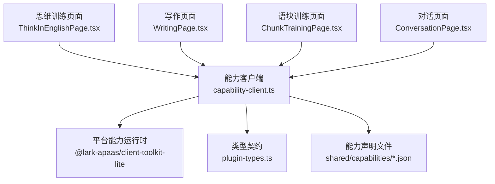
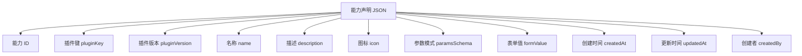
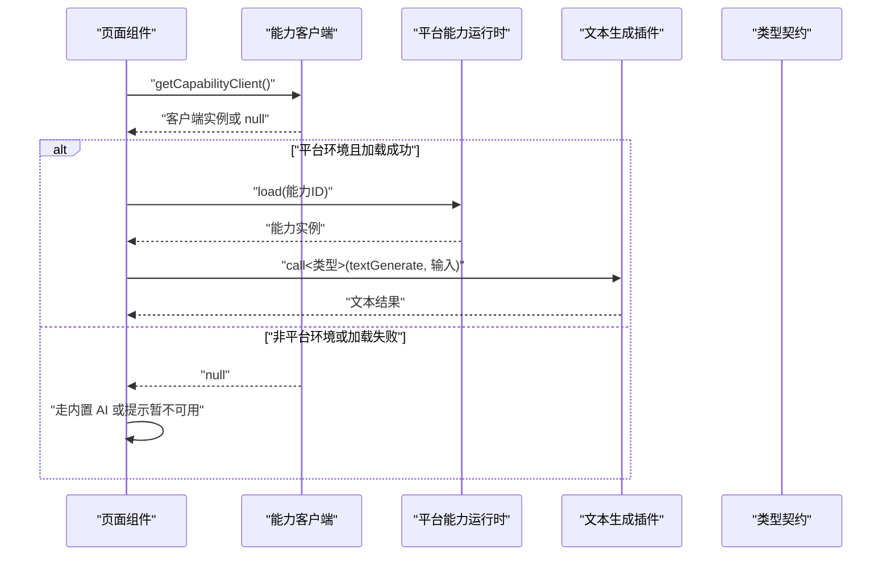
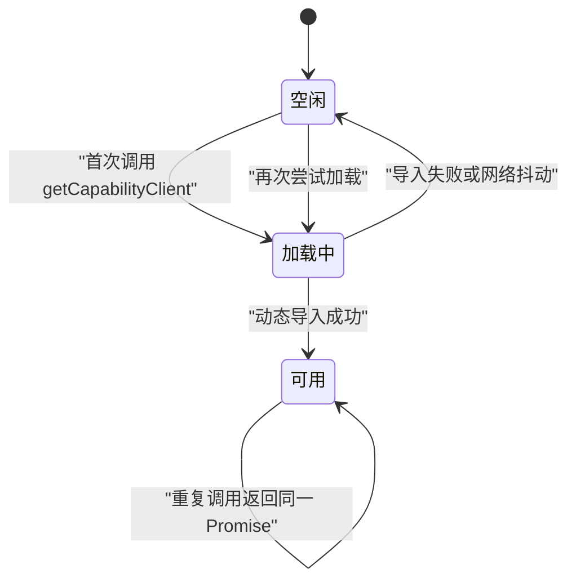
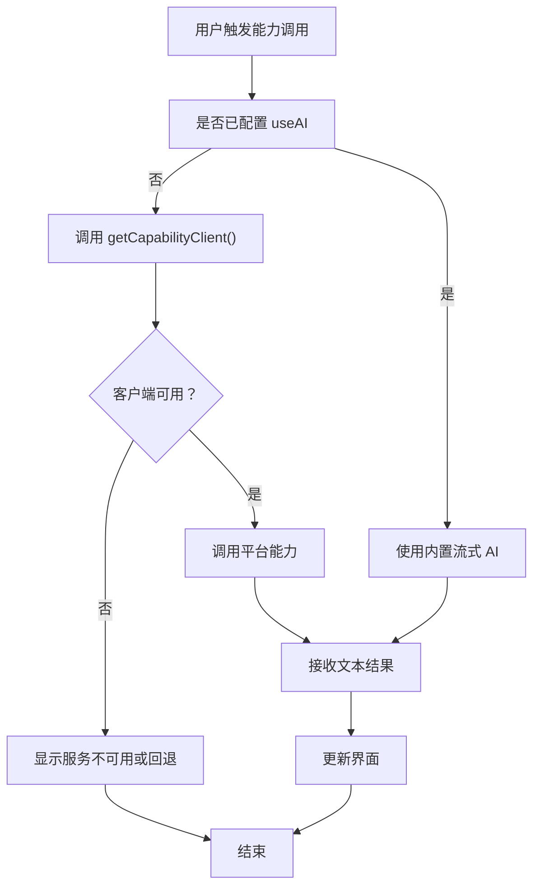
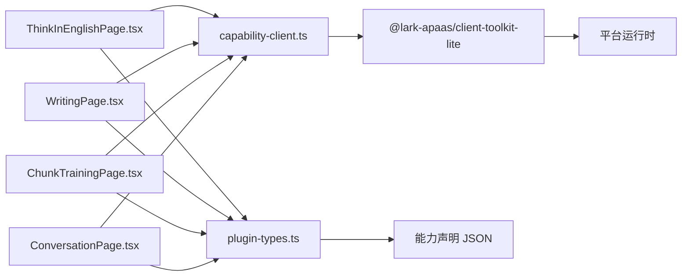
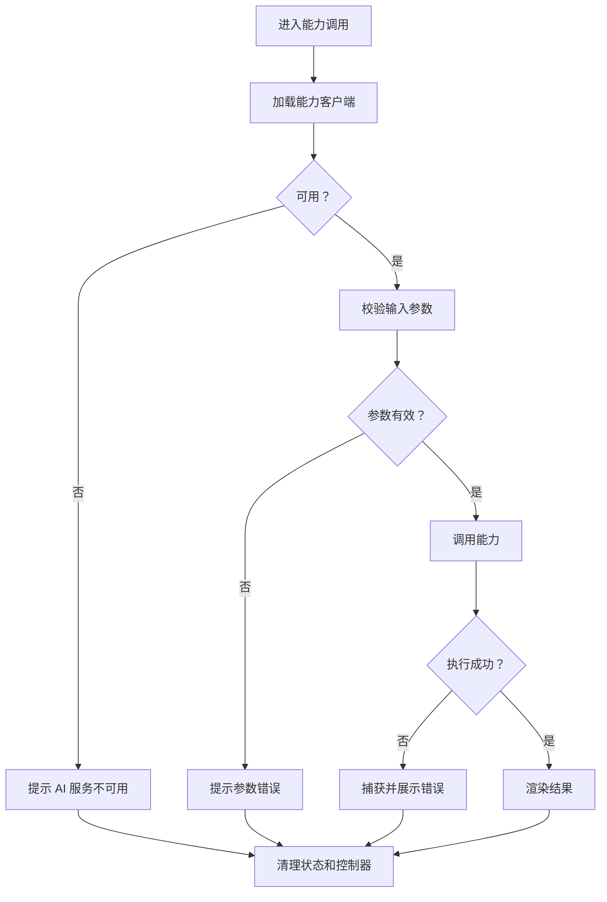

# 能力框架与客户端

<cite>
**本文引用的文件**
- [capability-client.ts](file://src/lib/capability-client.ts)
- [plugin-types.ts](file://shared/plugin-types.ts)
- [README.md](file://shared/capabilities/README.md)
- [ai_role_play_english_conversation_1.json](file://shared/capabilities/ai_role_play_english_conversation_1.json)
- [dialogue_naturalness_analysis_1.json](file://shared/capabilities/dialogue_naturalness_analysis_1.json)
- [english_thought_translation_feedback_1.json](file://shared/capabilities/english_thought_translation_feedback_1.json)
- [ThinkInEnglishPage.tsx](file://src/pages/ThinkInEnglishPage/ThinkInEnglishPage.tsx)
- [WritingPage.tsx](file://src/pages/WritingPage/WritingPage.tsx)
- [ChunkTrainingPage.tsx](file://src/pages/ChunkTrainingPage/ChunkTrainingPage.tsx)
- [ConversationPage.tsx](file://src/pages/ConversationPage/ConversationPage.tsx)
</cite>

## 目录

1. [引言](#引言)
2. [项目结构](#项目结构)
3. [核心组件](#核心组件)
4. [架构总览](#架构总览)
5. [详细组件分析](#详细组件分析)
6. [依赖关系分析](#依赖关系分析)
7. [性能考量](#性能考量)
8. [故障排查指南](#故障排查指南)
9. [结论](#结论)
10. [附录：能力开发指南](#附录能力开发指南)

## 引言

NativeThink 的能力框架围绕“平台 AI 能力”这一概念构建。它把应用中的 AI 功能拆成两类路径：

1. **直接通过 `useAI` 调用内置流式 AI 接口**。这是默认、轻量且可配置的主路径。
2. **通过平台能力客户端动态加载外部 AI 插件**。这是一个兜底路径，只在确实需要调用平台侧已注册能力时才加载对应的运行时库。

本文件聚焦以下目标：

- 解释 `src/lib/capability-client.ts` 中的能力发现与执行入口。
- 描述 `shared/capabilities/*.json` 能力声明文件的结构与语义。
- 说明 `shared/plugin-types.ts` 如何作为类型契约桥接平台能力与应用页面。
- 梳理能力的加载、缓存、调用和销毁生命周期。
- 给出新增能力声明文件和处理器实现的方法论与实践建议。
- 提供面向生产环境的错误处理、异步中断和资源回收策略。

## 项目结构

当前仓库中与能力框架直接相关的代码分布在三个层次：

| 层次 | 路径 | 职责 |
|---|---|---|
| 客户端层 | `src/lib/capability-client.ts` | 延迟加载平台能力客户端，暴露统一的 `getCapabilityClient()` 入口 |
| 类型契约层 | `shared/plugin-types.ts` | 为平台插件生成 TypeScript 输入输出类型，供调用方进行参数校验 |
| 能力声明层 | `shared/capabilities/*.json` | 描述能力 ID、插件键、版本、参数 schema、表单值、元数据和时间戳 |
| 页面消费层 | `src/pages/*/...tsx` | 在思维训练、写作、语块、对话等页面中按需调用能力客户端 |

**图示来源**
- [capability-client.ts:1-23](file://src/lib/capability-client.ts#L1-L23)
- [plugin-types.ts:1-107](file://shared/plugin-types.ts#L1-L107)
- [ai_role_play_english_conversation_1.json:1-50](file://shared/capabilities/ai_role_play_english_conversation_1.json#L1-L50)
- [dialogue_naturalness_analysis_1.json:1-36](file://shared/capabilities/dialogue_naturalness_analysis_1.json#L1-L36)
- [english_thought_translation_feedback_1.json:1-36](file://shared/capabilities/english_thought_translation_feedback_1.json#L1-L36)

**章节来源**
- [capability-client.ts:1-23](file://src/lib/capability-client.ts#L1-L23)
- [plugin-types.ts:1-107](file://shared/plugin-types.ts#L1-L107)
- [README.md:1-5](file://shared/capabilities/README.md#L1-L5)

## 核心组件

### 能力客户端

`capability-client.ts` 是一个极简的延迟加载器。它的核心职责不是实现完整的能力发现算法，而是保证：

- 不会在应用启动时静态引入平台 SDK。
- 只有在真正进入“未配置 AI Key”的兜底分支时才会尝试动态加载。
- 如果加载失败，会把待加载 Promise 重置为 `null`，避免一次网络抖动导致后续请求永久失败。
- 在非平台环境或模块不可用时返回 `null`，让调用方继续使用原有降级逻辑。

该模块导出的唯一函数是 `getCapabilityClient()`，返回值为 `Promise<any | null>`。调用方应把它当作一个可选的运行时能力检查器，而不是同步 API。

#### 关键行为总结

| 行为 | 说明 |
|---|---|
| 延迟加载 | 首次调用才执行动态 import |
| 单次挂起 | 使用模块级 `pending` 变量避免重复发起加载 |
| 失败恢复 | 捕获异常后清空 `pending`，允许下一次重试 |
| 空值语义 | 非平台环境或加载失败返回 `null` |
| 无全局状态 | 没有能力注册表、缓存表或实例池 |

**章节来源**
- [capability-client.ts:1-23](file://src/lib/capability-client.ts#L1-L23)

### 能力声明文件

能力声明位于 `shared/capabilities/` 目录下，每个 `.json` 文件代表一个对外暴露的平台能力。以现有三个文件为例，它们都指向同一个底层插件键 `@official-plugins/ai-text-generate`，但通过不同的 `id`、`paramsSchema` 和 `formValue.prompt` 表达不同业务场景。

**图示来源**
- [ai_role_play_english_conversation_1.json:1-50](file://shared/capabilities/ai_role_play_english_conversation_1.json#L1-L50)
- [dialogue_naturalness_analysis_1.json:1-36](file://shared/capabilities/dialogue_naturalness_analysis_1.json#L1-L36)
- [english_thought_translation_feedback_1.json:1-36](file://shared/capabilities/english_thought_translation_feedback_1.json#L1-L36)

**章节来源**
- [README.md:1-5](file://shared/capabilities/README.md#L1-L5)
- [ai_role_play_english_conversation_1.json:1-50](file://shared/capabilities/ai_role_play_english_conversation_1.json#L1-L50)
- [dialogue_naturalness_analysis_1.json:1-36](file://shared/capabilities/dialogue_naturalness_analysis_1.json#L1-L36)
- [english_thought_translation_feedback_1.json:1-36](file://shared/capabilities/english_thought_translation_feedback_1.json#L1-L36)

### 类型契约

`shared/plugin-types.ts` 由工具链从能力声明中生成，负责把 JSON 参数映射为 TypeScript 接口。例如：

- `AiRolePlayEnglishConversationOneInput` / `AiRolePlayEnglishConversationOneOutput`
- `BackTranslationFeedbackOneInput` / `BackTranslationFeedbackOneOutput`
- `EnglishThoughtTranslationFeedbackOneInput` / `EnglishThoughtTranslationFeedbackOneOutput`
- `ChinglishDetectionTrainerOneInput` / `ChinglishDetectionTrainerOneOutput`

这些类型的注释明确描述了调用方式：通过 `capabilityClient.load('...').call<Type>('textGenerate', input)` 获取结果，并指出返回值没有 `.data` 包装，可直接解构。

| 字段 | 含义 |
|---|---|
| Input 接口 | 能力所需的结构化输入参数 |
| Output 接口 | 平台返回的业务数据，通常包含 `content` 和可选 `response` |
| 插件键 | 与 JSON 声明中的 `id` 对应 |
| 方法名 | 示例中使用 `textGenerate`，表示文本生成类能力 |

**章节来源**
- [plugin-types.ts:1-107](file://shared/plugin-types.ts#L1-L107)

## 架构总览

能力框架的整体调用链如下：

**图示来源**
- [capability-client.ts:1-23](file://src/lib/capability-client.ts#L1-L23)
- [plugin-types.ts:1-107](file://shared/plugin-types.ts#L1-L107)

该图反映的是当前仓库中能力框架的实际边界：

- 能力发现不是由 `capability-client.ts` 自己完成，而是由平台侧 `@lark-apaas/client-toolkit-lite` 提供。
- 当前仓库只暴露了客户端懒加载入口；具体的 `load`、`call` 等方法属于平台 SDK 的职责范围。
- 页面层同时维护两条路径：优先使用 `useAI`，兜底时使用能力客户端。

**章节来源**
- [capability-client.ts:1-23](file://src/lib/capability-client.ts#L1-L23)
- [plugin-types.ts:1-107](file://shared/plugin-types.ts#L1-L107)

## 详细组件分析

### 能力客户端实现分析

#### 模块级挂起状态

**图示来源**
- [capability-client.ts:1-23](file://src/lib/capability-client.ts#L1-L23)

#### 执行管道

1. 页面调用 `getCapabilityClient()`。
2. 若 `pending` 为空，则创建动态 import Promise。
3. 成功时取模块导出对象中的 `capabilityClient`；不存在则返回 `null`。
4. 失败时清空 `pending`，并返回 `null`。
5. 调用方根据返回值决定是否继续调用平台能力。

这个管道非常轻量，但它解决了两个实际问题：

- **包体积问题**：避免把 507KB raw / 160KB gzip 的平台 SDK 放进主包。
- **稳定性问题**：一次失败不会永久钉死这条路径。

#### 复杂度分析

| 操作 | 时间复杂度 | 空间复杂度 | 说明 |
|---|---:|---:|---|
| 首次调用 | O(1) + 网络开销 | O(1) | 仅创建 Promise |
| 重复调用 | O(1) | O(1) | 复用 `pending` |
| 加载失败 | O(1) | O(1) | 捕获异常并重置状态 |
| 成功返回 | O(1) | O(1) | 返回已有 Promise |

**章节来源**
- [capability-client.ts:1-23](file://src/lib/capability-client.ts#L1-L23)

### 能力声明 JSON Schema 分析

#### 顶层字段

| 字段 | 类型 | 是否必需 | 含义 |
|---|---|---:|---|
| `id` | 字符串 | 是 | 能力唯一标识，也是 `capabilityClient.load` 使用的键 |
| `pluginKey` | 字符串 | 是 | 平台侧插件键，例如 `@official-plugins/ai-text-generate` |
| `pluginVersion` | 字符串 | 是 | 插件版本 |
| `name` | 字符串 | 是 | 人类可读的名称 |
| `description` | 字符串 | 是 | 能力用途说明 |
| `icon` | 字符串 | 否 | 图标占位字段，当前为空白 |
| `paramsSchema` | 对象 | 是 | 基于 JSON Schema 的参数定义 |
| `formValue` | 对象 | 是 | 平台表单值，包含模型、参数和提示词 |
| `createdAt` | 数字 | 是 | 创建时间戳 |
| `updatedAt` | 数字 | 是 | 更新时间戳 |
| `createdBy` | 数字 | 是 | 创建者标识 |

#### 参数模式

所有三个示例能力都使用 `type: "object"`，并通过 `properties` 定义字段类型和描述，再通过 `required` 指定必填字段。

| 能力 | 必填参数 | 可选参数 |
|---|---|---|
| 英语思维转译反馈 | `user_english_expression`、`native_expression` | 无 |
| 对话地道度分析 | `user_dialogue_content`、`dialogue_scenario` | 无 |
| AI 角色扮演英文对话伙伴 | `role_setting`、`scene_description`、`user_message`、`difficulty_level` | `conversation_history` |

#### 表单值

`formValue` 是当前平台运行时的关键部分：

| 字段 | 含义 |
|---|---|
| `modelID` | 模型标识 |
| `modelParams` | 模型参数，如 `maxTokens`、`temperature` |
| `prompt` | 注入 `input` 参数的系统提示词模板 |

提示词中使用 `{{input.xxx}}` 形式引用 `paramsSchema` 中的字段，这意味着能力声明不仅描述数据结构，还直接参与运行时推理过程。

**章节来源**
- [english_thought_translation_feedback_1.json:1-36](file://shared/capabilities/english_thought_translation_feedback_1.json#L1-L36)
- [dialogue_naturalness_analysis_1.json:1-36](file://shared/capabilities/dialogue_naturalness_analysis_1.json#L1-L36)
- [ai_role_play_english_conversation_1.json:1-50](file://shared/capabilities/ai_role_play_english_conversation_1.json#L1-L50)

### 类型契约与调用约定

`plugin-types.ts` 中每个插件都遵循相同结构：

```mermaid
classDiagram
    class ChinglishDetectionTrainerOneInput {
        +string english_sentence
    }
    class ChinglishDetectionTrainerOneOutput {
        +string content
        +string response
    }

    class BackTranslationFeedbackOneInput {
        +string original_sentence
        +string target_meaning
    }
    class BackTranslationFeedbackOneOutput {
        +string content
        +string response
    }

    class EnglishThoughtTranslationFeedbackOneInput {
        +string user_english_expression
        +string native_expression
    }
    class EnglishThoughtTranslationFeedbackOneOutput {
        +string content
        +string response
    }

    class AiRolePlayEnglishConversationOneInput {
        +string role_setting
        +string scene_description
        +string user_message
        +string conversation_history
        +string difficulty_level
    }
    class AiRolePlayEnglishConversationOneOutput {
        +string content
        +string response
    }
```

**图示来源**
- [plugin-types.ts:1-107](file://shared/plugin-types.ts#L1-L107)

调用约定要点：

1. 使用 `capabilityClient.load(能力ID)` 获取能力实例。
2. 使用 `call<输出类型>('textGenerate', 输入对象)` 执行。
3. 返回值是输出类型本身，不需要再解包 `.data`。
4. 输入必须满足对应 Input 接口的字段约束。
5. 输出通常至少包含 `content`，可能包含额外 `response`。

**章节来源**
- [plugin-types.ts:1-107](file://shared/plugin-types.ts#L1-L107)

### 页面集成模式

四个主要页面都采用相同的集成模式：

| 页面 | 能力用途 | 降级路径 |
|---|---|---|
| 思维训练 | 中式英语检测、翻译反馈、母语思维对照 | `useAI` 流式对话 |
| 写作 | 写作辅助、语法和风格反馈 | `useAI` 流式对话 |
| 语块训练 | 语块例句、翻译、解析等扩展能力 | `useAI` 流式对话 |
| 对话 | 多轮对话、对话分析 | `useAI` 流式对话 |

这些页面会：

- 动态导入 `getCapabilityClient`。
- 先判断是否已配置 `useAI`。
- 如果未配置，则尝试获取平台能力客户端。
- 如果仍不可用，则显示“AI 服务暂不可用”等用户提示。
- 使用 `AbortController` 支持取消长时间运行的 AI 任务。

**图示来源**
- [capability-client.ts:1-23](file://src/lib/capability-client.ts#L1-L23)
- [ThinkInEnglishPage.tsx:1-200](file://src/pages/ThinkInEnglishPage/ThinkInEnglishPage.tsx#L1-L200)
- [WritingPage.tsx:1-200](file://src/pages/WritingPage/WritingPage.tsx#L1-L200)
- [ChunkTrainingPage.tsx:1-200](file://src/pages/ChunkTrainingPage/ChunkTrainingPage.tsx#L1-L200)
- [ConversationPage.tsx:1-200](file://src/pages/ConversationPage/ConversationPage.tsx#L1-L200)

**章节来源**
- [ThinkInEnglishPage.tsx:1-200](file://src/pages/ThinkInEnglishPage/ThinkInEnglishPage.tsx#L1-L200)
- [WritingPage.tsx:1-200](file://src/pages/WritingPage/WritingPage.tsx#L1-L200)
- [ChunkTrainingPage.tsx:1-200](file://src/pages/ChunkTrainingPage/ChunkTrainingPage.tsx#L1-L200)
- [ConversationPage.tsx:1-200](file://src/pages/ConversationPage/ConversationPage.tsx#L1-L200)

## 依赖关系分析

**图示来源**
- [capability-client.ts:1-23](file://src/lib/capability-client.ts#L1-L23)
- [plugin-types.ts:1-107](file://shared/plugin-types.ts#L1-L107)
- [ThinkInEnglishPage.tsx:1-200](file://src/pages/ThinkInEnglishPage/ThinkInEnglishPage.tsx#L1-L200)
- [WritingPage.tsx:1-200](file://src/pages/WritingPage/WritingPage.tsx#L1-L200)
- [ChunkTrainingPage.tsx:1-200](file://src/pages/ChunkTrainingPage/ChunkTrainingPage.tsx#L1-L200)
- [ConversationPage.tsx:1-200](file://src/pages/ConversationPage/ConversationPage.tsx#L1-L200)

### 耦合性分析

| 组件 | 耦合程度 | 说明 |
|---|---:|---|
| 页面 → 能力客户端 | 低 | 只依赖单一异步函数 |
| 能力客户端 → 平台 SDK | 高 | 强依赖第三方运行时 |
| 页面 → 类型契约 | 低 | 仅用于类型推断 |
| 类型契约 → 能力声明 | 工具链耦合 | 由生成工具维护一致性 |
| 能力声明 → 平台运行时 | 运行时耦合 | JSON 被平台侧消费 |

### 潜在风险

- 类型契约和能力声明之间的不一致可能由生成工具修复，但若手动修改声明而未重新生成类型，会导致运行时参数错误或编译期类型不匹配。
- 能力客户端只负责懒加载，不负责能力注册表；因此无法在当前模块内枚举全部可用能力。
- 如果平台 SDK 的导出结构变化（例如不再导出 `capabilityClient`），`getCapabilityClient()` 会安全地返回 `null`，但上层页面仍需正确降级。

**章节来源**
- [capability-client.ts:1-23](file://src/lib/capability-client.ts#L1-L23)
- [plugin-types.ts:1-107](file://shared/plugin-types.ts#L1-L107)

## 性能考量

### 包体积优化

能力客户端的设计明确服务于包体积控制。文档注释中指出，平台 SDK 的 chunk 约为 507KB raw / 160KB gzip，而四条产品线默认走出厂免费额度，因此该路径在实际运行中很少被命中。延迟加载避免了每次进入相关路由都下载该 chunk。

### 内存占用

- 模块级 `pending` 只保存一个 Promise 引用。
- 成功时保留对 SDK 模块的引用，属于正常运行时依赖。
- 失败时立即清空引用，有利于垃圾回收。

### 并发调用

多次并发调用 `getCapabilityClient()` 会共享同一个 `pending` Promise，不会产生重复的网络请求。这是典型的 Promise 去重模式。

### 建议优化方向

1. **能力注册表**：如果需要枚举或按条件筛选能力，可在能力客户端之上增加一层轻量的本地注册表。
2. **能力预热**：对于高频能力，可在用户进入相关页面前提前调用一次 `getCapabilityClient()`。
3. **超时控制**：当前实现没有显式超时，可在外层封装 `AbortSignal` 或 `Promise.race`。
4. **指标上报**：记录懒加载成功、失败、耗时和调用次数，便于监控平台 SDK 可用性。

[本节为通用性能建议，不直接分析具体代码行]

## 故障排查指南

### 能力客户端返回 null

**可能原因**

- 不在平台环境中。
- 动态导入失败。
- 平台 SDK 没有导出 `capabilityClient`。
- 网络抖动或资源加载失败。

**排查步骤**

1. 确认当前运行环境是否为平台环境。
2. 检查浏览器控制台是否有模块加载错误。
3. 确认平台 SDK 是否安装并可被动态 import。
4. 验证平台 SDK 是否导出 `capabilityClient`。
5. 再次触发调用，因为失败后会清空缓存并允许重试。

**章节来源**
- [capability-client.ts:1-23](file://src/lib/capability-client.ts#L1-L23)

### 能力调用无响应

**可能原因**

- 能力 ID 与 JSON 声明不一致。
- 输入参数不符合 `paramsSchema`。
- 插件键或版本不支持当前平台。
- 平台端模型不可用或提示词渲染失败。

**排查步骤**

1. 核对能力 ID 是否与 `shared/capabilities/*.json` 中的 `id` 一致。
2. 核对输入对象字段是否与 `plugin-types.ts` 中对应 Input 接口一致。
3. 检查 `formValue.modelID` 和 `modelParams` 是否符合平台要求。
4. 查看平台侧日志或调试面板。
5. 临时改用 `useAI` 路径确认基础 AI 能力是否正常。

**章节来源**
- [plugin-types.ts:1-107](file://shared/plugin-types.ts#L1-L107)
- [ai_role_play_english_conversation_1.json:1-50](file://shared/capabilities/ai_role_play_english_conversation_1.json#L1-L50)

### 异步任务无法取消

**现状**

当前能力客户端本身不包含取消语义。取消逻辑由页面层通过 `AbortController` 管理，主要用于 `useAI` 流式调用。如果未来直接使用平台能力客户端的长任务，需要在调用处自行传入信号或维护取消状态。

**建议**

- 在页面层维护 `AbortController`。
- 在组件卸载或切换场景时调用 `abort()`。
- 在能力客户端或平台 SDK 支持信号时，将信号透传到 `call` 调用。

**章节来源**
- [ThinkInEnglishPage.tsx:1-200](file://src/pages/ThinkInEnglishPage/ThinkInEnglishPage.tsx#L1-L200)
- [WritingPage.tsx:1-200](file://src/pages/WritingPage/WritingPage.tsx#L1-L200)
- [ChunkTrainingPage.tsx:1-200](file://src/pages/ChunkTrainingPage/ChunkTrainingPage.tsx#L1-L200)
- [ConversationPage.tsx:1-200](file://src/pages/ConversationPage/ConversationPage.tsx#L1-L200)

## 结论

NativeThink 的能力框架目前采取“轻量客户端 + 平台运行时”的分层设计：

- `capability-client.ts` 负责延迟加载平台 SDK，避免主包膨胀，并提供失败的快速恢复。
- 能力声明文件集中描述能力元数据、参数模式和平台表单值。
- 类型契约文件将 JSON 能力映射为 TypeScript 接口，提升类型安全。
- 页面层统一通过 `useAI` 主路径和 `getCapabilityClient` 兜底路径组合使用 AI 能力。
- 当前仓库没有实现完整的能力发现、注册表和生命周期管理器；这部分职责落在平台 SDK 和外部工具链上。

这种设计的优点是简单、包体积小、出错面可控；缺点是能力枚举、版本管理和跨能力协调需要在上层补充。

[本节为总结性内容，不直接分析具体代码行]

## 附录：能力开发指南

### 新增能力声明文件

1. 在 `shared/capabilities/` 下新增 `<能力ID>_<版本号>.json`。
2. 填写 `id`、`pluginKey`、`pluginVersion`、`name`、`description`。
3. 在 `paramsSchema.properties` 中定义输入字段。
4. 在 `paramsSchema.required` 中标记必填字段。
5. 在 `formValue.modelID` 和 `modelParams` 中配置模型。
6. 在 `formValue.prompt` 中编写提示词模板，使用 `{{input.字段名}}` 引用参数。
7. 填充 `createdAt`、`updatedAt`、`createdBy`。

### 生成类型契约

运行生成工具以从能力声明生成 `shared/plugin-types.ts` 中的类型接口。确保：

- 能力 ID 与生成的类型命名一致。
- 输入字段与 JSON Schema 完全对应。
- 输出类型与平台返回结构一致。
- 注释清晰说明调用方式和返回值结构。

### 实现能力处理器

当前仓库中能力处理器主要由平台侧插件和提示词承担。应用侧需要：

1. 在页面中导入 `getCapabilityClient`。
2. 在用户触发时调用 `getCapabilityClient()`。
3. 如果返回 `null`，走 `useAI` 或显示服务不可用。
4. 如果返回实例，调用 `load(能力ID).call<输出类型>('textGenerate', 输入)`。
5. 将返回的 `content` 渲染到界面。
6. 使用 `AbortController` 支持中断。
7. 捕获并展示错误，避免静默失败。

### 异步执行与错误恢复

推荐流程：

**图示来源**
- [capability-client.ts:1-23](file://src/lib/capability-client.ts#L1-L23)
- [plugin-types.ts:1-107](file://shared/plugin-types.ts#L1-L107)

### 最佳实践清单

| 类别 | 建议 |
|---|---|
| 声明文件 | 保持 `id` 稳定，版本递增，描述清晰 |
| 参数定义 | 最小化必填字段，使用描述字段帮助生成 UI |
| 提示词 | 结构化、可测试、可回滚 |
| 类型契约 | 不要手工维护，始终由生成工具产出 |
| 客户端调用 | 始终处理 `null` 返回值 |
| 异步任务 | 支持取消、超时、重试 |
| 错误处理 | 区分网络错误、参数错误、平台错误和业务错误 |
| 用户体验 | 加载态、错误态、空结果态都要有明确反馈 |

[本节为方法论指导，不直接分析具体代码行]