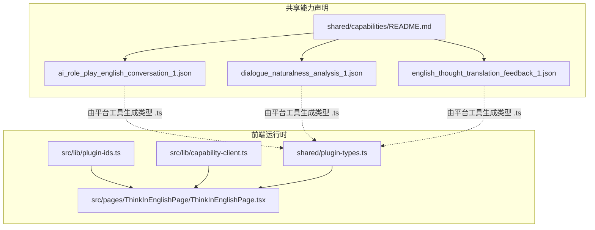
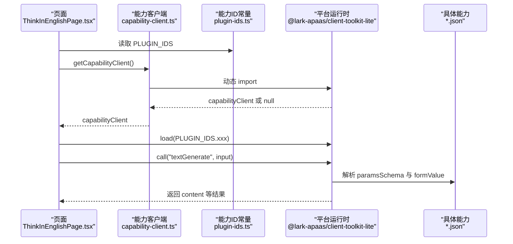
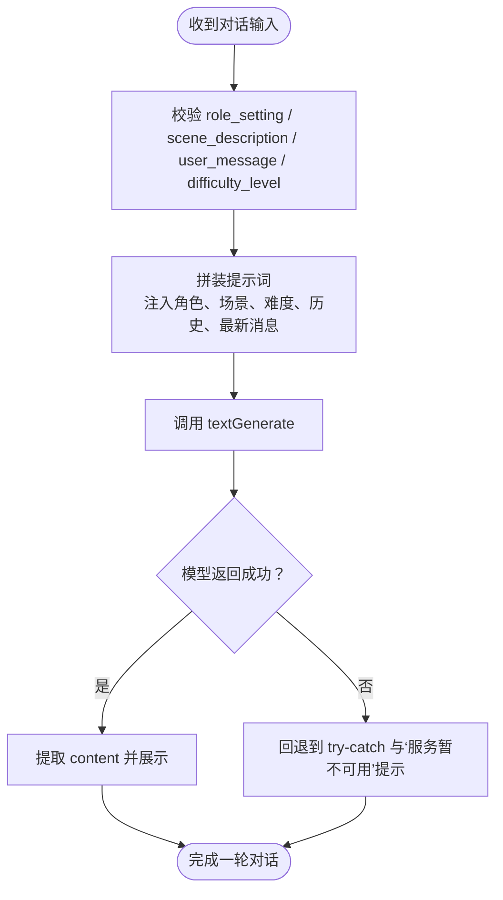
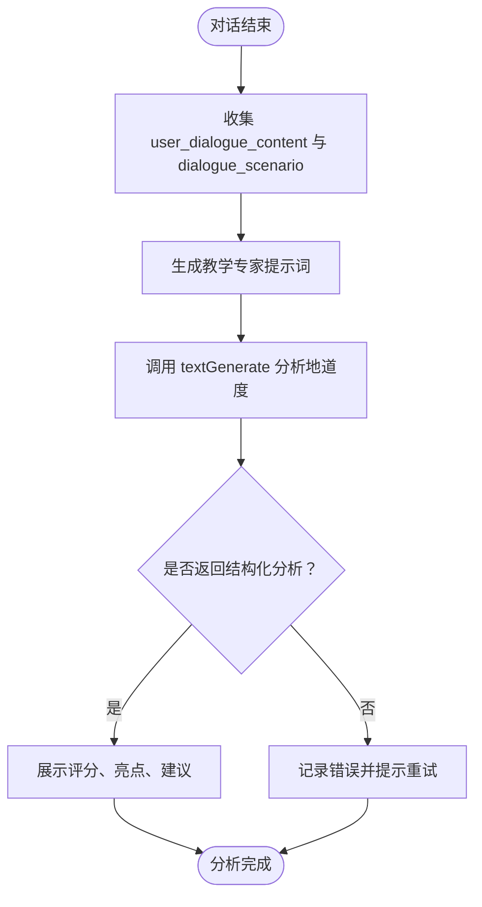
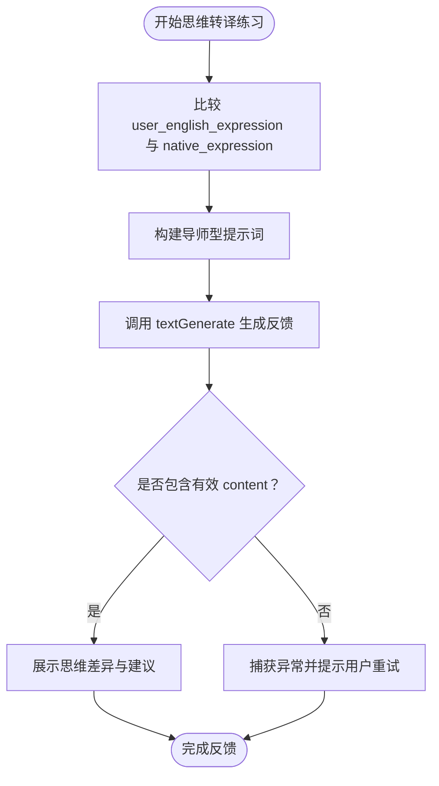
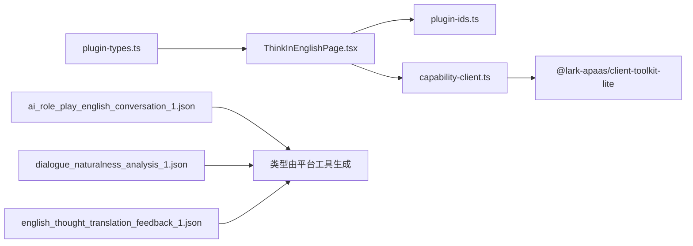

# 能力系统与运行时

<cite>
**本文引用的文件**   
- [capability-client.ts](file://src/lib/capability-client.ts)
- [plugin-ids.ts](file://src/lib/plugin-ids.ts)
- [plugin-types.ts](file://shared/plugin-types.ts)
- [ai_role_play_english_conversation_1.json](file://shared/capabilities/ai_role_play_english_conversation_1.json)
- [dialogue_naturalness_analysis_1.json](file://shared/capabilities/dialogue_naturalness_analysis_1.json)
- [english_thought_translation_feedback_1.json](file://shared/capabilities/english_thought_translation_feedback_1.json)
- [README.md](file://shared/capabilities/README.md)
- [ThinkInEnglishPage.tsx](file://src/pages/ThinkInEnglishPage/ThinkInEnglishPage.tsx)
</cite>

## 目录
1. [引言](#引言)
2. [项目结构](#项目结构)
3. [核心组件](#核心组件)
4. [架构总览](#架构总览)
5. [详细组件分析](#详细组件分析)
6. [依赖关系分析](#依赖关系分析)
7. [性能与运行特征](#性能与运行特征)
8. [扩展指南：开发自定义能力](#扩展指南开发自定义能力)
9. [故障排查](#故障排查)
10. [结论](#结论)

## 引言
NativeThink 的能力系统围绕“基于 JSON 的声明式能力”和“平台 AI 能力客户端”两部分构建。能力以 `shared/capabilities/*.json` 描述，包含元数据、输入参数 Schema、模型配置与提示词；运行时通过 `src/lib/capability-client.ts` 在真正需要时才动态加载平台 SDK，并调用已注册的能力。当前仓库内置了三个能力：英语角色扮演对话、对话自然度分析、英语思维翻译反馈，并在类型层提供对应的 TypeScript 接口定义。

该设计把“能力契约”（JSON）与“能力实现”（平台侧插件）解耦，让前端只关心输入输出、错误处理与用户体验，而将模型选择、提示词、流式响应等交给平台运行时。

## 项目结构
能力系统的核心文件分布如下：

**图示来源**  
- [README.md:1-5](file://shared/capabilities/README.md#L1-L5)
- [capability-client.ts:1-23](file://src/lib/capability-client.ts#L1-L23)
- [plugin-ids.ts:1-15](file://src/lib/plugin-ids.ts#L1-L15)
- [plugin-types.ts:1-107](file://shared/plugin-types.ts#L1-L107)

**章节来源**  
- [README.md:1-5](file://shared/capabilities/README.md#L1-L5)

## 核心组件
### 能力声明文件
每个 `.json` 文件是一个能力的完整契约，包含：
- **元数据**：`id`、`name`、`description`、`icon`、时间戳、创建者。
- **能力标识**：`pluginKey` 指向平台侧插件包，`pluginVersion` 锁定版本。
- **输入约束**：`paramsSchema` 使用 JSON Schema 描述字段类型、说明和必填项。
- **执行配置**：`formValue` 指定底层模型 ID、模型参数和提示词模板。

这些字段共同决定：
1. 平台如何识别能力。
2. 前端如何校验输入。
3. 平台如何渲染表单。
4. 模型如何接收提示词。

**章节来源**  
- [ai_role_play_english_conversation_1.json:1-50](file://shared/capabilities/ai_role_play_english_conversation_1.json#L1-L50)
- [dialogue_naturalness_analysis_1.json:1-36](file://shared/capabilities/dialogue_naturalness_analysis_1.json#L1-L36)
- [english_thought_translation_feedback_1.json:1-36](file://shared/capabilities/english_thought_translation_feedback_1.json#L1-L36)

### 能力运行时客户端
`getCapabilityClient()` 是能力运行的入口：
- 只在真正进入“兜底路径”时动态导入平台 SDK。
- 返回平台暴露的 `capabilityClient`，若不在平台环境或加载失败则返回 `null`。
- 使用 `pending` 缓存一次加载结果，避免重复网络开销。
- 加载失败会清空缓存，防止单次网络抖动永久封死该分支。

调用方通常这样使用：
1. 获取 `capabilityClient`。
2. 用能力 ID 加载具体能力。
3. 调用 `textGenerate` 或其他方法执行。
4. 处理流式或非流式结果。
5. 在失败时回退到原有 try-catch 和用户提示。

**章节来源**  
- [capability-client.ts:1-23](file://src/lib/capability-client.ts#L1-L23)
- [ThinkInEnglishPage.tsx:24](file://src/pages/ThinkInEnglishPage/ThinkInEnglishPage.tsx#L24)

### 能力 ID 常量
`PLUGIN_IDS` 集中管理所有能力 ID，并提供 TypeScript 类型安全访问：
- `THOUGHT_TRANSLATION` 对应英语思维翻译反馈。
- `AI_CONVERSATION` 对应英语角色扮演对话。
- `NATURALNESS_ANALYSIS` 对应对话自然度分析。
- 同时保留中式英语检测和反翻译反馈等其他能力 ID。

这使页面代码不必硬编码字符串，也便于后续枚举、校验和统计。

**章节来源**  
- [plugin-ids.ts:1-15](file://src/lib/plugin-ids.ts#L1-L15)

### 类型定义
`shared/plugin-types.ts` 由平台工具根据能力声明自动生成 TypeScript 接口，例如：
- `EnglishThoughtTranslationFeedbackOneInput` / `Output`
- `AiRolePlayEnglishConversationOneInput` / `Output`
- 其他相关能力的输入输出接口

这些接口的命名约定与能力 ID 对应，且注释说明了调用方式：通过 `capabilityClient.load(id).call('textGenerate', input)` 直接拿到结果对象，没有额外的 `.data` 包装。

**章节来源**  
- [plugin-types.ts:1-107](file://shared/plugin-types.ts#L1-L107)

## 架构总览
能力系统采用“声明 + 运行时 + 类型”三层结构：

**图示来源**  
- [capability-client.ts:1-23](file://src/lib/capability-client.ts#L1-L23)
- [plugin-ids.ts:1-15](file://src/lib/plugin-ids.ts#L1-L15)
- [plugin-types.ts:1-107](file://shared/plugin-types.ts#L1-L107)

## 详细组件分析

### 英语角色扮演英文对话伙伴：`ai_role_play_english_conversation_1`

#### 能力契约
- **能力 ID**：`ai_role_play_english_conversation_1`
- **插件键**：`@official-plugins/ai-text-generate`
- **插件版本**：`1.0.17`
- **名称**：AI 角色扮演英文对话伙伴
- **描述**：扮演不同场景的对话角色，与用户进行多轮英文对话，用于英语对话练习
- **输入字段**：
  - `role_setting`：对话角色设定
  - `scene_description`：对话场景描述
  - `user_message`：上一轮用户消息
  - `conversation_history`：历史对话上下文
  - `difficulty_level`：难度等级
- **必填字段**：角色设定、场景描述、用户消息、难度等级
- **模型配置**：固定模型 ID `87`，最大 token `8192`，温度 `0.7`
- **提示词要点**：完全英文回复、符合角色身份、长度控制、按难度调整语言复杂度、引导继续对话、不暴露 AI、必要时标注语法错误

**图示来源**  
- [ai_role_play_english_conversation_1.json:1-50](file://shared/capabilities/ai_role_play_english_conversation_1.json#L1-L50)
- [capability-client.ts:1-23](file://src/lib/capability-client.ts#L1-L23)

#### 类型映射
TypeScript 接口要求：
- 输入包含角色设定、场景描述、用户消息、可选历史、难度等级。
- 输出为文本内容，并可携带额外 response。

**章节来源**  
- [ai_role_play_english_conversation_1.json:1-50](file://shared/capabilities/ai_role_play_english_conversation_1.json#L1-L50)
- [plugin-types.ts:61-107](file://shared/plugin-types.ts#L61-L107)

### 对话自然度分析：`dialogue_naturalness_analysis_1`

#### 能力契约
- **能力 ID**：`dialogue_naturalness_analysis_1`
- **插件键**：`@official-plugins/ai-text-generate`
- **插件版本**：`1.0.17`
- **名称**：对话地道度分析
- **描述**：对话结束后分析用户表达的地道程度，指出可改进之处并给出建议
- **输入字段**：
  - `user_dialogue_content`：用户在对话练习中输入的所有表达内容
  - `dialogue_scenario`：对话练习场景
- **必填字段**：用户对话内容、对话场景
- **模型配置**：固定模型 ID `87`，最大 token `8192`，温度 `0.5`
- **提示词要点**：评分、亮点、改进点、优化建议、延伸学习；语气友好、结构清晰

**图示来源**  
- [dialogue_naturalness_analysis_1.json:1-36](file://shared/capabilities/dialogue_naturalness_analysis_1.json#L1-L36)
- [capability-client.ts:1-23](file://src/lib/capability-client.ts#L1-L23)

#### 类型映射
TypeScript 接口中未显式列出 `dialogue_naturalness_analysis_1` 的独立类型片段，但调用模式与其他能力一致：通过 `load(id).call('textGenerate', input)` 获取 `content` 等字段。

**章节来源**  
- [dialogue_naturalness_analysis_1.json:1-36](file://shared/capabilities/dialogue_naturalness_analysis_1.json#L1-L36)
- [plugin-types.ts:1-107](file://shared/plugin-types.ts#L1-L107)

### 英语思维翻译反馈：`english_thought_translation_feedback_1`

#### 能力契约
- **能力 ID**：`english_thought_translation_feedback_1`
- **插件键**：`@official-plugins/ai-text-generate`
- **插件版本**：`1.0.17`
- **名称**：英语思维转译反馈插件
- **描述**：对比用户的英语描述与母语者表达，给出思维转译指导和改进建议
- **输入字段**：
  - `user_english_expression`：用户输入的英语描述
  - `native_expression`：母语者标准表达
- **必填字段**：用户英语表达、母语者表达
- **模型配置**：固定模型 ID `87`，最大 token `8192`，温度 `0.5`
- **提示词要点**：差异对比、母语思维干扰分析、转译指导、改进建议、举一反三示例

**图示来源**  
- [english_thought_translation_feedback_1.json:1-36](file://shared/capabilities/english_thought_translation_feedback_1.json#L1-L36)
- [capability-client.ts:1-23](file://src/lib/capability-client.ts#L1-L23)

#### 类型映射
TypeScript 接口明确定义：
- 输入包含用户英语表达与母语者表达。
- 输出包含 `content` 与可选 `response`。
- 调用方式为 `capabilityClient.load('english_thought_translation_feedback_1').call('textGenerate', input)`。

**章节来源**  
- [english_thought_translation_feedback_1.json:1-36](file://shared/capabilities/english_thought_translation_feedback_1.json#L1-L36)
- [plugin-types.ts:33-60](file://shared/plugin-types.ts#L33-L60)

## 依赖关系分析

**图示来源**  
- [ThinkInEnglishPage.tsx:24](file://src/pages/ThinkInEnglishPage/ThinkInEnglishPage.tsx#L24)
- [capability-client.ts:1-23](file://src/lib/capability-client.ts#L1-L23)
- [plugin-ids.ts:1-15](file://src/lib/plugin-ids.ts#L1-L15)
- [plugin-types.ts:1-107](file://shared/plugin-types.ts#L1-L107)

**章节来源**  
- [plugin-ids.ts:1-15](file://src/lib/plugin-ids.ts#L1-L15)
- [capability-client.ts:1-23](file://src/lib/capability-client.ts#L1-L23)
- [plugin-types.ts:1-107](file://shared/plugin-types.ts#L1-L107)

## 性能与运行特征
- **按需加载**：能力客户端不会在应用启动时静态引入平台 SDK，避免每条路由都承担约 507KB raw / 160KB gzip 的额外体积。
- **单次缓存**：`pending` 保证同一生命周期内只尝试一次动态加载。
- **失败恢复**：动态导入失败会清空缓存，而不是永久阻塞该分支。
- **统一回退**：当 `getCapabilityClient()` 返回 `null` 时，调用方沿用原有的 try-catch 和用户提示逻辑。
- **模型参数稳定**：三个内置能力均使用相同模型 ID `87` 与较大 maxTokens，适合长文本分析与多轮对话；temperature 在对话场景中略高以提升多样性，在分析场景中较低以保证稳定性。

**章节来源**  
- [capability-client.ts:1-23](file://src/lib/capability-client.ts#L1-L23)
- [ai_role_play_english_conversation_1.json:1-50](file://shared/capabilities/ai_role_play_english_conversation_1.json#L1-L50)
- [dialogue_naturalness_analysis_1.json:1-36](file://shared/capabilities/dialogue_naturalness_analysis_1.json#L1-L36)
- [english_thought_translation_feedback_1.json:1-36](file://shared/capabilities/english_thought_translation_feedback_1.json#L1-L36)

## 扩展指南：开发自定义能力

### 步骤一：新增能力声明
在 `shared/capabilities/` 下新增一个 JSON 文件，文件名建议使用语义化 ID，例如 `your_capability_name_1.json`。

建议包含以下字段：
- `id`：能力唯一标识，应与服务端、类型、常量保持一致。
- `pluginKey`：平台插件包名。
- `pluginVersion`：锁定插件版本，避免升级破坏。
- `name`：人类可读名称。
- `description`：能力用途说明。
- `icon`：图标占位。
- `paramsSchema`：使用 JSON Schema 定义输入字段、类型、描述和必填项。
- `formValue`：
  - `modelID`：目标模型。
  - `modelParams`：如 `maxTokens`、`temperature`。
  - `prompt`：使用 `{{input.xxx}}` 引用 `paramsSchema` 中的字段。
- `createdAt`、`updatedAt`、`createdBy`：记录元信息。

**章节来源**  
- [ai_role_play_english_conversation_1.json:1-50](file://shared/capabilities/ai_role_play_english_conversation_1.json#L1-L50)
- [dialogue_naturalness_analysis_1.json:1-36](file://shared/capabilities/dialogue_naturalness_analysis_1.json#L1-L36)
- [english_thought_translation_feedback_1.json:1-36](file://shared/capabilities/english_thought_translation_feedback_1.json#L1-L36)

### 步骤二：更新能力 ID 常量
在 `src/lib/plugin-ids.ts` 中添加新能力的 ID 常量，并维护 `PluginId` 类型，确保页面调用时具备类型检查。

**章节来源**  
- [plugin-ids.ts:1-15](file://src/lib/plugin-ids.ts#L1-L15)

### 步骤三：确认类型生成
平台工具会根据能力声明生成 TypeScript 接口，位于 `shared/plugin-types.ts`。新增能力后应验证：
- 输入接口字段与 `paramsSchema.properties` 对应。
- 输出接口包含 `content` 与可选 `response`。
- 调用方式与现有能力一致。

**章节来源**  
- [plugin-types.ts:1-107](file://shared/plugin-types.ts#L1-L107)

### 步骤四：在页面中使用
页面代码应：
1. 从 `PLUGIN_IDS` 读取能力 ID。
2. 调用 `getCapabilityClient()` 获取客户端。
3. 使用 `load(id).call('textGenerate', input)` 或流式调用。
4. 对 `null` 返回值和异常做回退处理。
5. 将返回的 `content` 渲染到界面。

**章节来源**  
- [capability-client.ts:1-23](file://src/lib/capability-client.ts#L1-L23)
- [ThinkInEnglishPage.tsx:24](file://src/pages/ThinkInEnglishPage/ThinkInEnglishPage.tsx#L24)

### 最佳实践
- **ID 一致性**：能力 ID 在 JSON、TypeScript、常量、页面中必须完全一致。
- **Schema 严谨**：必填字段应在 `paramsSchema.required` 中明确，减少运行时错误。
- **提示词可维护**：将复杂提示词放在 JSON 中，便于非代码人员调整。
- **模型参数可控**：根据任务类型设置 temperature；分析类任务建议偏低，创意类任务可偏高。
- **错误回退**：始终处理 `getCapabilityClient()` 返回 `null` 和调用异常。

## 故障排查

| 现象 | 可能原因 | 排查建议 |
|---|---|---|
| 能力始终不可用 | 非平台环境或平台 SDK 加载失败 | 检查 `getCapabilityClient()` 是否返回 `null`，确认运行环境 |
| 首次失败后一直失败 | 动态导入缓存被污染 | 确认加载失败后 `pending` 被清空 |
| 输入报错 | JSON Schema 与前端传参不一致 | 核对 `paramsSchema` 与 TypeScript 输入接口 |
| 输出为空 | 模型返回异常或提示词问题 | 查看返回对象是否有 `content`，检查 `prompt` 模板 |
| 对话体验不稳定 | temperature 过高或上下文过长 | 调整 `modelParams.temperature`，控制 `conversation_history` |
| 类型缺失 | 平台工具未重新生成类型 | 检查 `shared/plugin-types.ts` 是否包含新能力接口 |

**章节来源**  
- [capability-client.ts:1-23](file://src/lib/capability-client.ts#L1-L23)
- [plugin-types.ts:1-107](file://shared/plugin-types.ts#L1-L107)

## 结论
NativeThink 的能力系统通过 JSON 声明文件固化能力契约，再通过轻量级的能力客户端在运行时动态接入平台 AI 能力。三个内置能力覆盖了英语对话练习、对话质量分析和思维转译训练，形成从“交互”到“评估”再到“指导”的闭环。对于扩展，开发者只需新增声明文件、更新 ID 常量、确认类型生成并在页面中调用，即可将新能力接入现有运行时。