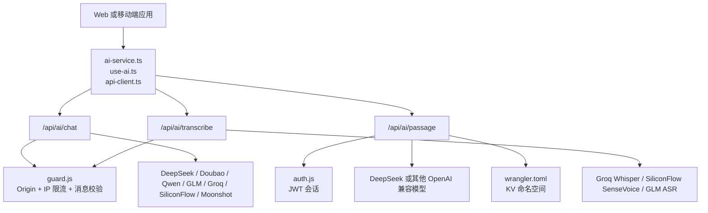
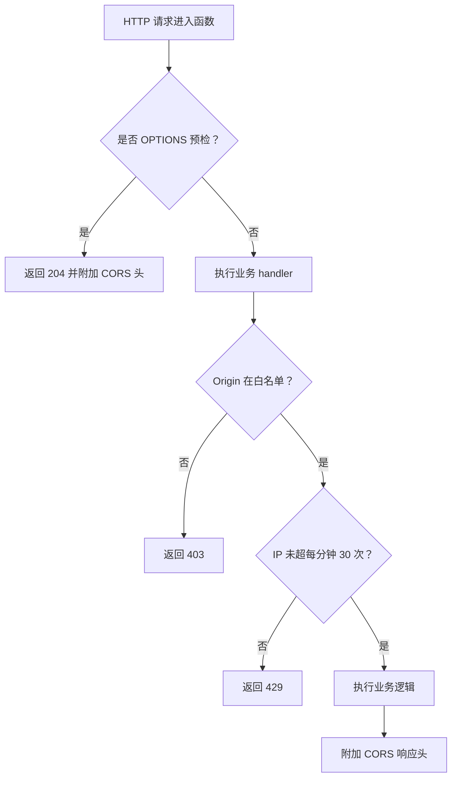
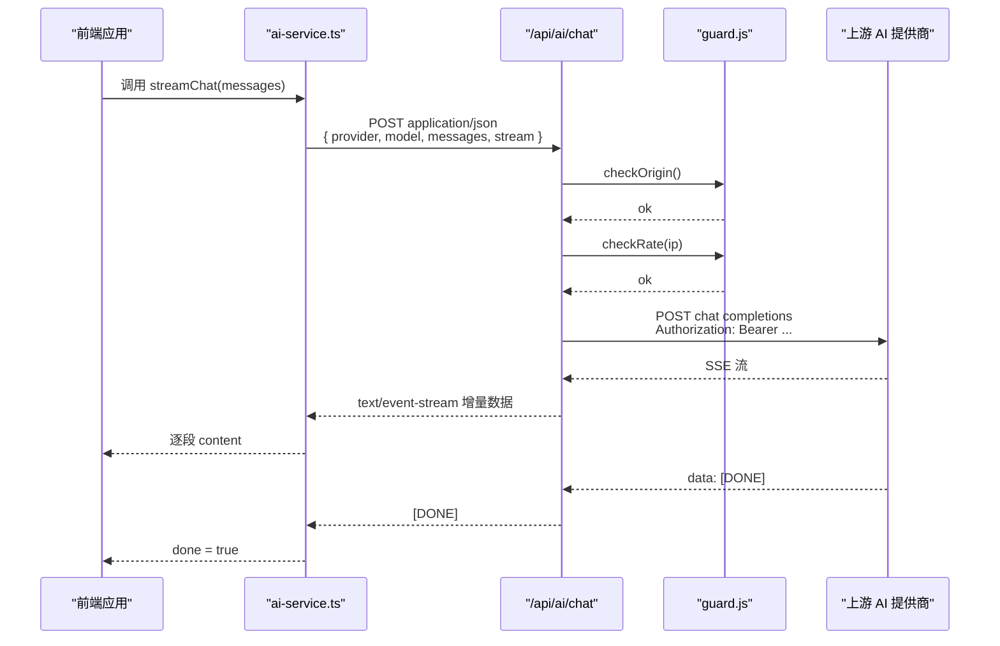
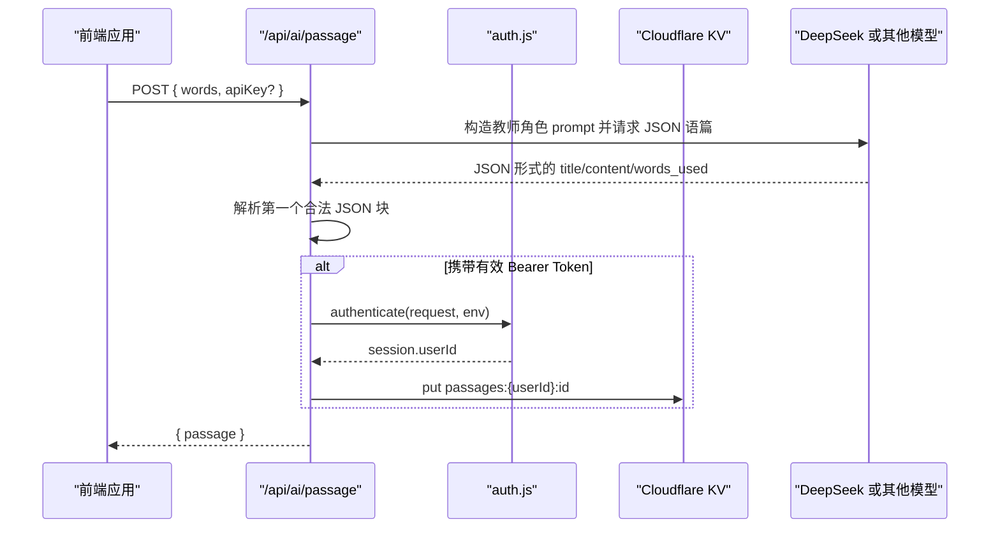
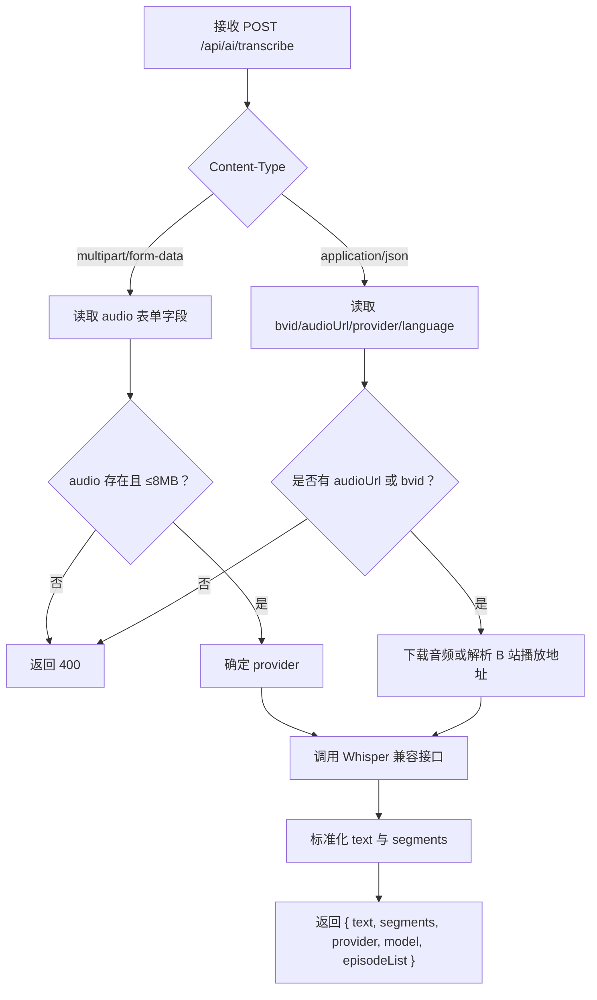
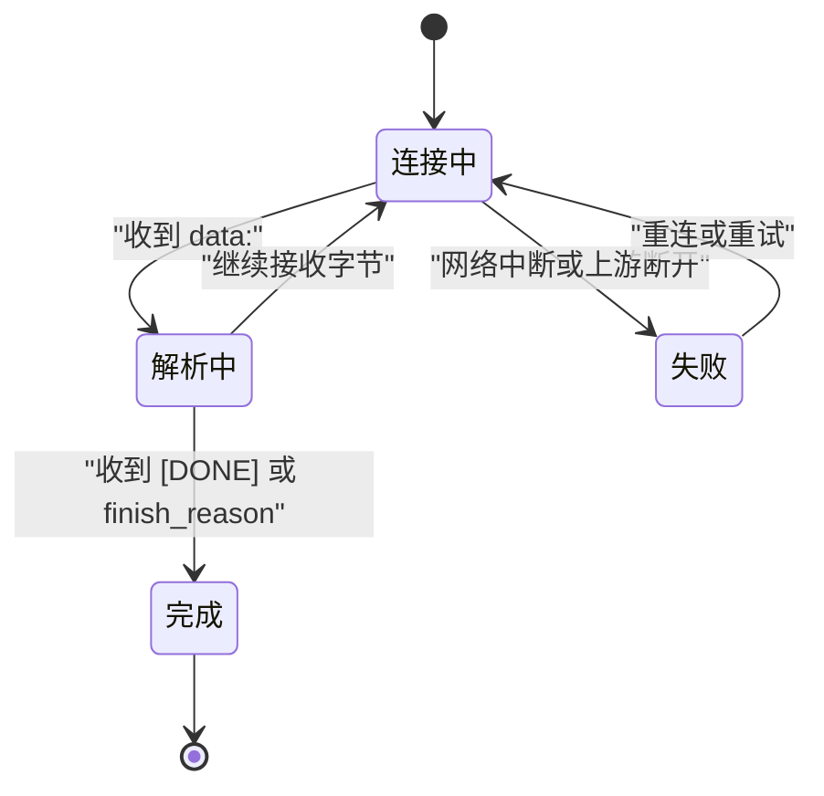
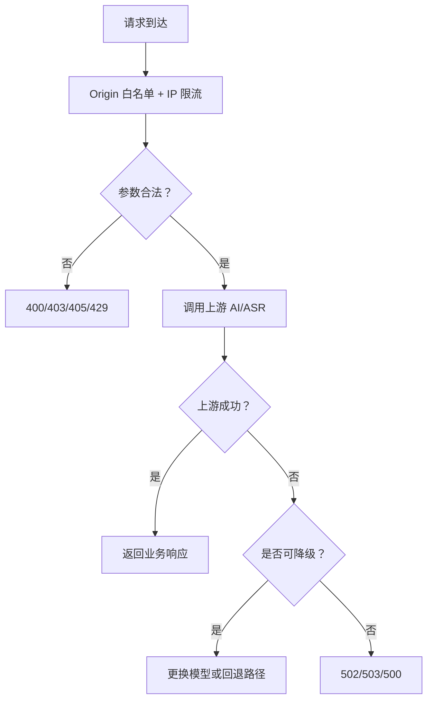
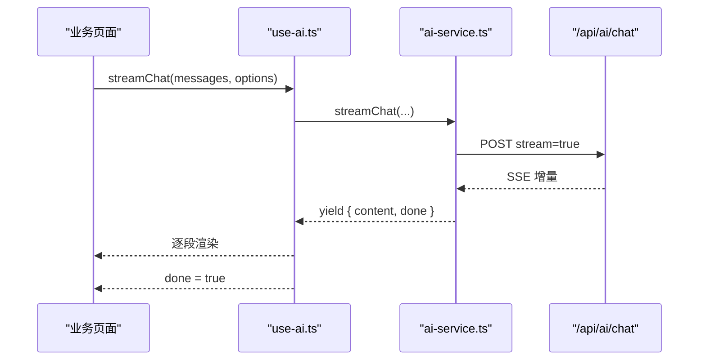

# AI 服务接口

<cite>
**本文引用的文件**   
- [functions/api/ai/chat.js](file://functions/api/ai/chat.js)
- [functions/api/ai/passage.js](file://functions/api/ai/passage.js)
- [functions/api/ai/transcribe.js](file://functions/api/ai/transcribe.js)
- [functions/_lib/guard.js](file://functions/_lib/guard.js)
- [functions/_lib/cors.js](file://functions/_lib/cors.js)
- [functions/_lib/auth.js](file://functions/_lib/auth.js)
- [wrangler.toml](file://wrangler.toml)
- [src/services/ai-service.ts](file://src/services/ai-service.ts)
- [src/lib/api-client.ts](file://src/lib/api-client.ts)
- [src/hooks/use-ai.ts](file://src/hooks/use-ai.ts)
- [docs/modules/ai-services.md](file://docs/modules/ai-services.md)
</cite>

## 目录
1. [简介](#简介)
2. [项目结构与部署位置](#项目结构与部署位置)
3. [统一鉴权、跨域与防护](#统一鉴权跨域与防护)
4. [接口总览](#接口总览)
5. [对话接口：POST /api/ai/chat](#对话接口post-apiai-chat)
6. [语篇分析接口：POST /api/ai/passage](#语篇分析接口post-apiai-passage)
7. [语音转写接口：POST /api/ai/transcribe](#语音转写接口post-apiaitranscribe)
8. [流式响应处理机制](#流式响应处理机制)
9. [错误处理、超时控制与速率限制](#错误处理超时控制与速率限制)
10. [客户端集成指南](#客户端集成指南)
11. [性能与可靠性建议](#性能与可靠性建议)
12. [故障排查清单](#故障排查清单)
13. [结论](#结论)

## 简介
NativeThink 的 AI 服务由 Cloudflare Pages Functions 提供，主要暴露三个面向业务的前端入口：

- `/api/ai/chat`：统一的 AI 对话代理，支持多服务商、SSE 流式输出和免费模型自动降级。
- `/api/ai/passage`：根据词汇列表生成用于复习的英文短语篇，并可选择保存到 KV。
- `/api/ai/transcribe`：音频转写入口，支持本地上传录音与 B 站视频直取音频两种模式，最终返回统一文本与分段结构。

这些接口在前端通过 `ai-service.ts`、`asr-service.ts`、`use-ai.ts` 等模块调用，并通过 `guard.js` 做来源校验、IP 限流与消息体校验，通过 `cors.js` 为 Capacitor APK（源为 `https://localhost`）开放跨域。

**章节来源**
- [docs/modules/ai-services.md:1-20](file://docs/modules/ai-services.md#L1-L20)
- [functions/api/ai/chat.js:1-20](file://functions/api/ai/chat.js#L1-L20)
- [functions/api/ai/passage.js:1-6](file://functions/api/ai/passage.js#L1-L6)
- [functions/api/ai/transcribe.js:1-18](file://functions/api/ai/transcribe.js#L1-L18)

## 项目结构与部署位置
AI 相关服务端代码位于 `functions/api/ai/` 下，公共守卫逻辑位于 `functions/_lib/`；前端调用封装在 `src/services/ai-service.ts`、`src/lib/api-client.ts` 和 `src/hooks/use-ai.ts` 中；Cloudflare Workers/Pages 配置位于 `wrangler.toml`，KV 命名空间绑定用于会话与语篇存储。

**图表来源**
- [functions/api/ai/chat.js:1-20](file://functions/api/ai/chat.js#L1-L20)
- [functions/api/ai/passage.js:1-12](file://functions/api/ai/passage.js#L1-L12)
- [functions/api/ai/transcribe.js:1-20](file://functions/api/ai/transcribe.js#L1-L20)
- [functions/_lib/guard.js:1-20](file://functions/_lib/guard.js#L1-L20)
- [functions/_lib/auth.js:1-8](file://functions/_lib/auth.js#L1-L8)
- [wrangler.toml:1-9](file://wrangler.toml#L1-L9)

**章节来源**
- [wrangler.toml:1-9](file://wrangler.toml#L1-L9)
- [docs/modules/ai-services.md:20-45](file://docs/modules/ai-services.md#L20-L45)

## 统一鉴权、跨域与防护
三个接口共享以下基础机制：

| 能力 | 实现位置 | 行为 |
|---|---|---|
| CORS 头 | `cors.js` | 所有 `/api/ai/*` 响应附加 `Access-Control-Allow-Origin: *`，允许 `Content-Type`、`Authorization`，OPTIONS 预检返回 204 |
| Origin 白名单 | `guard.js` | 仅放行 `https://nativethink.pages.dev`、`https://localhost`、`http://localhost`、`http://127.0.0.1`，以及带端口的本地地址 |
| IP 分钟限流 | `guard.js` | 每个 `CF-Connecting-IP` 每 60 秒最多 30 次请求，超限返回 429 |
| 出厂 Key 用量监控 | `guard.js` | 使用服务器默认 Key 的请求按 provider 统计，可通过 GET `/api/ai/chat` 查看当日快照 |
| 消息体形状校验 | `guard.js` | 对话接口的 `messages` 必须是非空数组、≤80 条、每条 `role`/`content` 均为字符串、总长度 ≤64k 字符 |
| JWT 会话 | `auth.js` | 语篇接口用 `Bearer` Token 解析用户 ID，用于把生成的语篇写入 KV |

**图表来源**
- [functions/_lib/cors.js:1-29](file://functions/_lib/cors.js#L1-L29)
- [functions/_lib/guard.js:17-54](file://functions/_lib/guard.js#L17-L54)
- [functions/api/ai/chat.js:60-75](file://functions/api/ai/chat.js#L60-L75)
- [functions/api/ai/transcribe.js:225-245](file://functions/api/ai/transcribe.js#L225-L245)

**章节来源**
- [functions/_lib/cors.js:1-29](file://functions/_lib/cors.js#L1-L29)
- [functions/_lib/guard.js:1-89](file://functions/_lib/guard.js#L1-L89)
- [functions/_lib/auth.js:1-8](file://functions/_lib/auth.js#L1-L8)

## 接口总览

| 接口 | HTTP 方法 | URL | 认证 | 流式 | 主要用途 |
|---|---|---|---|---|---|
| 对话 | `POST` | `/api/ai/chat` | 可选：可传 `apiKey`；未传时使用服务端出厂 Key | 默认 `stream=true`，SSE | 多服务商对话、翻译、思维推理 |
| 语篇分析 | `POST` | `/api/ai/passage` | 可选：`Authorization: Bearer <token>` 用于保存语篇 | 否 | 根据词汇生成复习语篇 |
| 语音转写 | `POST` | `/api/ai/transcribe` | 可选：`apiKey`；也可用服务端出厂 Key | 否 | 本地录音或 B 站视频音频转写 |

**章节来源**
- [functions/api/ai/chat.js:1-20](file://functions/api/ai/chat.js#L1-L20)
- [functions/api/ai/passage.js:1-12](file://functions/api/ai/passage.js#L1-L12)
- [functions/api/ai/transcribe.js:1-18](file://functions/api/ai/transcribe.js#L1-L18)

## 对话接口：POST /api/ai/chat

### 路由与协议
- 方法：`POST`
- URL：`/api/ai/chat`
- Content-Type：`application/json`
- 返回类型：`text/event-stream`（SSE，默认）或 `application/json`（非流式）
- 额外探活接口：`GET /api/ai/chat` 返回当日出厂 Key 用量快照，不执行对话逻辑

### 请求体字段

| 字段 | 类型 | 必填 | 默认值 | 说明 |
|---|---|---:|---|---|
| `provider` | 字符串 | 否 | `deepseek` | 上游服务商，如 `deepseek`、`doubao`、`qwen`、`factory`、`glm`、`siliconflow`、`moonshot`、`groq` |
| `model` | 字符串 | 否 | 各 provider 默认模型 | 显式指定时优先于任务分工与默认模型 |
| `messages` | 对象数组 | 是 | — | 标准聊天消息，每项含 `role`、`content`，均由字符串组成 |
| `max_tokens` | 数字 | 否 | `4096` | 最大输出 token 数 |
| `temperature` | 数字 | 否 | `0.7` | 采样温度 |
| `stream` | 布尔值 | 否 | `true` | 是否启用 SSE 流式响应 |
| `apiKey` | 字符串 | 否 | — | 客户端自带 Key；不传则使用服务端环境变量 |
| `thinking` | 对象或布尔值 | 否 | 智谱 provider 默认关闭思考 | 仅对 `glm`、`factory` 生效 |
| `task` | 字符串 | 否 | — | 免费档任务分工：`translate` 或 `chat` |

### 消息体约束
- `messages` 必须是数组且至少有一条。
- 每条消息必须有字符串类型的 `role` 和 `content`。
- 消息总数不超过 80。
- 所有 `content` 长度之和不超过 64,000 字符。
- 空内容或无法 trim 的消息会被过滤；全部为空时返回 400。

### 成功响应

#### 流式响应（SSE）
当 `stream=true` 且上游返回流式响应时，服务端直接转发上游 body，并设置：

- `Content-Type: text/event-stream`
- `Cache-Control: no-cache`
- `Connection: keep-alive`

典型帧格式遵循 OpenAI 兼容 SSE：

| 行 | 含义 |
|---|---|
| `data: {JSON}` | 增量片段，通常包含 `choices[0].delta.content` |
| `data: [DONE]` | 流结束标志 |
| 包含 `finish_reason` 的片段 | 表示本次生成完成，客户端应停止拼接 |

#### 非流式响应
当 `stream=false` 时，服务端等待上游完整 JSON 后原样返回。

### 失败响应

| 状态码 | 场景 | 响应体示例 |
|---:|---|---|
| 400 | 无效 JSON、消息校验失败、未知 provider、全部消息内容为空 | `{ error: "..." }` |
| 403 | Origin 不在白名单 | `{ error: "Origin not allowed" }` |
| 405 | 非 POST 且不是 GET 探活 | `{ error: "Method not allowed" }` |
| 429 | IP 限流 | `{ error: "Too many requests, slow down" }` |
| 502 | 上游 AI 提供商全部失败 | `{ error: "AI provider error", detail: "..." }` |
| 503 | 服务端未配置对应 provider 的 AI Key | `{ error: "Server AI key not configured for ..." }` |
| 500 | 请求处理异常 | `{ error: "Request failed: ..." }` |

### 多轮对话流程

**图表来源**
- [src/services/ai-service.ts:100-190](file://src/services/ai-service.ts#L100-L190)
- [functions/api/ai/chat.js:60-170](file://functions/api/ai/chat.js#L60-L170)
- [functions/_lib/guard.js:17-54](file://functions/_lib/guard.js#L17-L54)

### 实际调用示例（文字描述）

- **单轮问答**：发送两条消息——一条 system 提示词、一条 user 提问，开启流式后前端逐字拼接。
- **多轮对话**：前端维护历史消息数组，每次新增 user 消息后重新发送完整上下文；服务端会过滤空消息，但保留角色语义。
- **翻译模式**：传入 `task: "translate"`，服务端对免费 provider 优先选择更准确的翻译模型。
- **思维模式**：对 `glm`、`factory` 可传入 `thinking`，默认关闭以追求速度。

**章节来源**
- [functions/api/ai/chat.js:1-192](file://functions/api/ai/chat.js#L1-L192)
- [functions/_lib/guard.js:57-89](file://functions/_lib/guard.js#L57-L89)
- [src/services/ai-service.ts:100-190](file://src/services/ai-service.ts#L100-L190)

## 语篇分析接口：POST /api/ai/passage

### 路由与协议
- 方法：`POST`
- URL：`/api/ai/passage`
- Content-Type：`application/json`
- 认证：可选 `Authorization: Bearer <token>`，用于将结果存入 KV
- 返回类型：`application/json`

### 请求体字段

| 字段 | 类型 | 必填 | 默认值 | 说明 |
|---|---|---:|---|---|
| `words` | 字符串数组 | 是 | — | 需要自然融入语篇的英语单词 |
| `mode` | 字符串 | 否 | — | 若值为 `"client"`，服务端直接返回 `{ mode: "client" }`，交由客户端自行生成 |
| `apiKey` | 字符串 | 否 | — | 客户端自带 Key；未传则使用 `env.SERVER_AI_KEY` |

### 成功响应

| 字段 | 类型 | 说明 |
|---|---|---|
| `passage` | 对象 | 生成的复习语篇 |
| `passage.id` | 字符串 | UUID |
| `passage.title` | 字符串 | 语篇标题，默认为 `"Review Passage"` |
| `passage.content` | 字符串 | 英语正文 |
| `passage.words` | 字符串数组 | 使用的词汇 |
| `passage.createdAt` | 数字 | 生成时间戳 |

如果附带有效 JWT 会话，服务端会将语篇写入 KV，键形如 `passages:{userId}:{passage.id}`。

### 失败响应

| 状态码 | 场景 | 响应体示例 |
|---:|---|---|
| 400 | 未提供 `words` | `{ error: "No words provided" }` |
| 400 | 无效 JSON | `{ error: "Invalid JSON" }` |
| 502 | 上游 AI 返回错误或非 JSON | `{ error: "...", fallback: "client" }` |
| 503 | 服务端未配置 AI Key | `{ error: "Server AI not configured", fallback: "client" }` |
| 500 | 内部异常 | `{ error: "...", fallback: "client" }` |

### 语篇生成流程

**图表来源**
- [functions/api/ai/passage.js:1-77](file://functions/api/ai/passage.js#L1-L77)
- [functions/_lib/auth.js:1-8](file://functions/_lib/auth.js#L1-L8)
- [wrangler.toml:4-9](file://wrangler.toml#L4-L9)

### 实际调用示例（文字描述）

- **复习语篇生成**：前端从词库中选择若干新词，调用 `/api/ai/passage`，得到一段包含这些词的短文，用于阅读训练。
- **客户端兜底**：传入 `mode: "client"`，服务端立即返回 `{ mode: "client" }`，前端可自行使用本地模型或提示用户配置 Key。
- **登录保存**：登录后调用，语篇会自动保存到 KV，便于后续同步或查看。

**章节来源**
- [functions/api/ai/passage.js:1-77](file://functions/api/ai/passage.js#L1-L77)
- [functions/_lib/auth.js:1-8](file://functions/_lib/auth.js#L1-L8)

## 语音转写接口：POST /api/ai/transcribe

### 路由与协议
- 方法：`POST`
- URL：`/api/ai/transcribe`
- Content-Type：`multipart/form-data` 或 `application/json`
- 返回类型：`application/json`
- 支持提供商：`groq`、`siliconflow`、`glm`

### 输入模式一：上传音频文件
适合影子跟读录音或用户选择的本地音频。

| 表单字段 | 类型 | 必填 | 默认值 | 说明 |
|---|---|---:|---|---|
| `audio` | 文件 | 是 | — | 音频文件，最大 8 MB |
| `provider` | 字符串 | 否 | `glm` | 转写提供商 |
| `apiKey` | 字符串 | 否 | — | 客户端 Key；未传则使用服务端出厂 Key |
| `language` | 字符串 | 否 | `en` | 目标语言，最多取前 8 个字符 |

### 输入模式二：B 站视频音频转写
适合直接解析 B 站视频的分集音频。

| 字段 | 类型 | 必填 | 默认值 | 说明 |
|---|---|---:|---|---|
| `apiKey` | 字符串 | 否 | — | 客户端 Key |
| `provider` | 字符串 | 否 | `groq` | JSON 模式下默认 groq |
| `bvid` | 字符串 | 条件必填 | — | 视频 BV 号，未传 `audioUrl` 时必须 |
| `cid` | 字符串 | 否 | — | 分集 cid |
| `page` | 数字 | 否 | `1` | 分集序号 |
| `audioUrl` | 字符串 | 条件必填 | — | 直接提供音频下载地址 |

### 成功响应

| 字段 | 类型 | 说明 |
|---|---|---|
| `text` | 字符串 | 完整转写文本 |
| `segments` | 对象数组 | 分段结果，每项含 `start`、`end`、`en`、`zh`、`keywords` |
| `provider` | 字符串 | 实际使用的提供商 |
| `model` | 字符串 | 实际使用的 Whisper 类模型 |
| `source` | 字符串 | 固定为 `whisper` 或 `none` |
| `error` | 字符串或空 | 成功时为 null |
| `episodeList` | 对象数组 | B 站模式返回分集信息 |
| `totalEpisodes` | 数字 | 分集数量 |

分段项结构：

| 字段 | 类型 | 说明 |
|---|---|---|
| `start` | 数字 | 起始时间戳 |
| `end` | 数字 | 结束时间戳 |
| `en` | 字符串 | 英文转写文本 |
| `zh` | 字符串 | 中文释义，当前由客户端或后端扩展填充 |
| `keywords` | 对象数组 | 提取的高频英文关键词，每项含 `word`、`meaning` |

### 失败响应

| 状态码 | 场景 | 响应体示例 |
|---:|---|---|
| 400 | 缺少 audio、音频过大、Content-Type 不支持、不支持的 provider | `{ error: "...", text: "", segments: [] }` |
| 403 | Origin 不在白名单 | `{ error: "Origin not allowed" }` |
| 405 | 非 POST | `{ error: "Method not allowed" }` |
| 429 | IP 限流 | `{ error: "Too many requests, slow down" }` |
| 502 | 上游 ASR 失败或音频不可用 | `{ error: "...", text: "", segments: [], source: "none" }` |
| 503 | 未配置语音转写 Key | `{ error: "未配置语音转写 Key", text: "", segments: [] }` |

### 转写流程

**图表来源**
- [functions/api/ai/transcribe.js:180-345](file://functions/api/ai/transcribe.js#L180-L345)

### 实际调用示例（文字描述）

- **本地录音转写**：前端采集麦克风或录制音频文件，使用 `FormData` 上传 `audio`，服务端按 provider 调用 Whisper 兼容接口，返回整段文本与分段。
- **B 站视频转写**：传入 `bvid` 与 `page`，服务端先获取视频页面、签名播放地址、选取合适音轨，再交给 ASR 提供商。
- **多分集转写**：返回 `episodeList` 与 `totalEpisodes`，前端可展示分集列表供用户选择。

**章节来源**
- [functions/api/ai/transcribe.js:1-345](file://functions/api/ai/transcribe.js#L1-L345)

## 流式响应处理机制

### 连接建立
- 客户端向 `/api/ai/chat` 发起 `POST`，body 中 `stream=true`。
- 服务端判断上游返回流式响应后，新建 `Response(aiResp.body)`，设置 `text/event-stream`。
- 客户端使用 `fetch` 的 `response.body.getReader()` 读取二进制流，并用 `TextDecoder` 解码为文本。

### 消息帧定义
SSE 帧由换行分隔，客户端需处理：

1. 跳过空行和非 `data:` 开头行。
2. 遇到 `data: [DONE]` 时结束流。
3. 解析 `data:` 后的 JSON。
4. 从 `choices[0].delta.content` 提取增量文本。
5. 若响应中包含 `choices[0].finish_reason`，视为本轮完成。

### 流式消费状态机

**图表来源**
- [src/services/ai-service.ts:120-190](file://src/services/ai-service.ts#L120-L190)
- [functions/api/ai/chat.js:140-160](file://functions/api/ai/chat.js#L140-L160)

### 进度展示建议
- 每收到一个增量片段即追加到界面，避免一次性渲染长文本。
- 在连接建立后立即显示“正在思考”或加载动画。
- 收到 `[DONE]` 或 `finish_reason` 后移除动画。
- 对空白片段不做 UI 更新，减少重排。
- 对不可解析片段进行忽略，而不是中断整个流。

**章节来源**
- [src/services/ai-service.ts:120-190](file://src/services/ai-service.ts#L120-L190)
- [src/hooks/use-ai.ts:33-60](file://src/hooks/use-ai.ts#L33-L60)

## 错误处理、超时控制与速率限制

### 服务端错误处理
- 无效 JSON：返回 400。
- Origin 不在白名单：返回 403。
- IP 超过每分钟 30 次：返回 429。
- 消息体不符合约束：返回 400。
- 上游 AI 全部失败：返回 502，并附带上游错误摘要。
- 未配置 AI Key：返回 503。
- 通用异常：返回 500。

### 客户端超时控制
`api-client.ts` 提供 15 秒默认超时：

- 使用 `AbortController` 在超时后主动中止请求。
- 超时错误包装为清晰中文消息：“请求超时，请检查网络连接后重试”。
- 对 Cloudflare 错误码 HTML 响应和一般服务器异常分别给出友好提示。

### 速率限制
- 基于 isolate 内存中的 Map 记录 IP 请求计数。
- 窗口为 60 秒。
- 上限为 30 次/分钟。
- 当 Map 条目超过 5000 时清理过期项，防止内存无限增长。
- 这不是持久硬额度：不同 Worker isolate 各自计数，冷启动后重置。

### 安全过滤
- Origin 白名单阻止任意第三方网页把 Functions 当作免费 AI 中继。
- 非浏览器脚本可伪造 Origin，但会被 IP 限流兜底。
- 转写错误响应中会对 `apiKey` 做脱敏替换，避免泄露密钥。
- 消息体校验防止超大 payload 和白烧上游 Key。

**图表来源**
- [functions/_lib/guard.js:17-89](file://functions/_lib/guard.js#L17-L89)
- [functions/api/ai/chat.js:60-170](file://functions/api/ai/chat.js#L60-L170)
- [functions/api/ai/transcribe.js:225-345](file://functions/api/ai/transcribe.js#L225-L345)
- [src/lib/api-client.ts:1-82](file://src/lib/api-client.ts#L1-L82)

**章节来源**
- [functions/_lib/guard.js:17-89](file://functions/_lib/guard.js#L17-L89)
- [src/lib/api-client.ts:1-82](file://src/lib/api-client.ts#L1-L82)

## 客户端集成指南

### 对话集成
推荐通过 `ai-service.ts` 提供的 `streamChat` 与 `chat` 调用，而不是直接拼 `/api/ai/chat`。

关键点：

- 始终通过服务端代理调用，避免在前端直接暴露上游 Key。
- 流式调用返回异步生成器，逐段产出 `{ content, done }`。
- 非流式调用返回完整文本。
- 当服务端返回 503 时，会抛出包含配置指引的错误。
- 可传入 `signal` 取消流式请求。
- `use-ai.ts` 在捕获异常时对非 AbortError 弹出 toast，并在静默模式下由调用方自行展示。

**图表来源**
- [src/hooks/use-ai.ts:33-60](file://src/hooks/use-ai.ts#L33-L60)
- [src/services/ai-service.ts:100-190](file://src/services/ai-service.ts#L100-L190)

### 语篇集成
- 普通模式：传入 `words`，服务端生成语篇并可保存到 KV。
- 客户端模式：传入 `mode: "client"`，服务端直接返回客户端兜底信号。
- 若未配置服务端 AI Key，返回 503 并带 `fallback: "client"`。

### 语音转写集成
- 本地录音：构建 `FormData`，放入 `audio`、`provider`、`apiKey`、`language`。
- B 站视频：传入 `bvid`、`page` 或直接传 `audioUrl`。
- 解析响应：优先使用 `text`；如需高亮或时间轴，使用 `segments`。
- 错误处理：区分 400、403、429、502、503，并向用户展示中文提示。

### 连接重连策略
建议实现：

1. 首次连接失败时等待指数退避，例如 1 秒、2 秒、4 秒。
2. 最大重试次数控制在 2~3 次，避免无限重试消耗配额。
3. 对 429 明确提示“请求过于频繁，请稍后再试”。
4. 对 502/503 尝试切换 provider 或 fallback 到本地模型。
5. 对 SSE 中途断开，只丢弃当前片段，不丢弃已拼接文本。
6. 对 AbortError 不视为服务故障，不弹全局错误。

### 进度展示
- 对话：首字节延迟 >1s 时显示加载中。
- 流式文本：逐段追加，禁止整段覆盖。
- 转写：开始下载或识别时显示进度；完成后展示完整文本。
- 失败：展示可操作提示，如“重试”“切换提供商”“配置 API Key”。

**章节来源**
- [src/services/ai-service.ts:100-190](file://src/services/ai-service.ts#L100-L190)
- [src/hooks/use-ai.ts:33-101](file://src/hooks/use-ai.ts#L33-L101)
- [src/lib/api-client.ts:1-82](file://src/lib/api-client.ts#L1-L82)

## 性能与可靠性建议

| 维度 | 现状与建议 |
|---|---|
| 流式延迟 | 对话默认 SSE，首字节由上游决定；建议在客户端尽早渲染增量，降低感知延迟 |
| 上下文大小 | 消息体总长度限制 64k，超长对话应截断历史或使用摘要 |
| 并发与限流 | IP 每分钟 30 次为突发保护；高频批量任务应在客户端合并请求 |
| 模型降级 | GLM 免费档在 429/5xx 时自动轮换候选模型，无需客户端干预 |
| 离线兜底 | 云端失败且本地模型就绪时可回落本地 LLM，但 token 上限更小 |
| 缓存 | SSE 响应不缓存；语篇可保存在 KV；转写结果可由业务层缓存 |
| 资源体积 | 本地模型较大，APK/桌面可同源加载，网页版需远程下载 |

**章节来源**
- [docs/modules/ai-services.md:45-107](file://docs/modules/ai-services.md#L45-L107)

## 故障排查清单

| 现象 | 可能原因 | 排查步骤 |
|---|---|---|
| 手机端 AI/TTS 请求被拦截 | 缺少 CORS 头或 OPTIONS 预检 | 确认函数出口调用 `withCors` 与 `isPreflight` |
| 第三方网页能滥用接口 | Origin 白名单缺失 | 检查 `guard.js` 中 `ALLOWED_ORIGINS` |
| 频繁触发限流 | IP 请求过多 | 检查客户端是否重复发起请求或批量调用 |
| 对话返回 400 | `messages` 非法或全空 | 检查每条消息 role/content 是否为字符串，总量是否 ≤80 |
| 对话返回 503 | 未配置服务端 AI Key | 检查环境变量 `AI_KEY_<PROVIDER>` 或 `SERVER_AI_KEY` |
| 转写返回 502 | 上游 ASR 失败或音频不可用 | 检查 provider、apiKey、音频格式与大小 |
| 语篇返回 503 | 未配置服务端 AI | 检查 `SERVER_AI_KEY`，或改用 `mode: "client"` |
| 流式对话无输出 | 上游未返回 SSE 或客户端未正确解析 | 检查响应头、`data:` 行、`[DONE]` 与 `finish_reason` |
| 超时错误 | 网络慢或上游响应过慢 | 检查 `DEFAULT_TIMEOUT` 与上游负载 |

**章节来源**
- [functions/_lib/cors.js:1-29](file://functions/_lib/cors.js#L1-L29)
- [functions/_lib/guard.js:17-89](file://functions/_lib/guard.js#L17-L89)
- [functions/api/ai/chat.js:60-170](file://functions/api/ai/chat.js#L60-L170)
- [functions/api/ai/transcribe.js:225-345](file://functions/api/ai/transcribe.js#L225-L345)
- [src/lib/api-client.ts:1-82](file://src/lib/api-client.ts#L1-L82)

## 结论
NativeThink 的 AI 服务通过 `/api/ai/chat`、`/api/ai/passage`、`/api/ai/transcribe` 三个接口，分别承担对话代理、语篇生成和语音转写职责。其设计重点包括：

- 统一通过服务端代理隐藏上游 Key。
- 对话默认走 SSE 流式，提升交互体验。
- 对免费 provider 内置模型降级链，缓解高峰期限流。
- 使用 Origin 白名单与 IP 分钟限流防止滥用。
- 语篇接口支持 JWT 会话写入 KV。
- 转写接口同时支持本地音频上传与 B 站视频音频抓取，并统一归一化输出。

客户端应优先使用 `ai-service.ts` 和 `use-ai.ts` 提供的封装，正确处理流式数据、超时、错误与重连，并在关键路径上加入进度展示与用户提示。