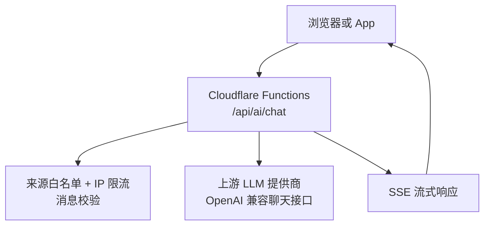
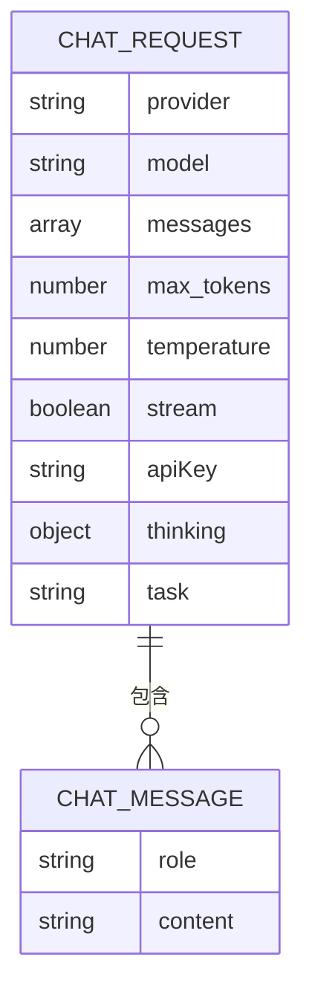
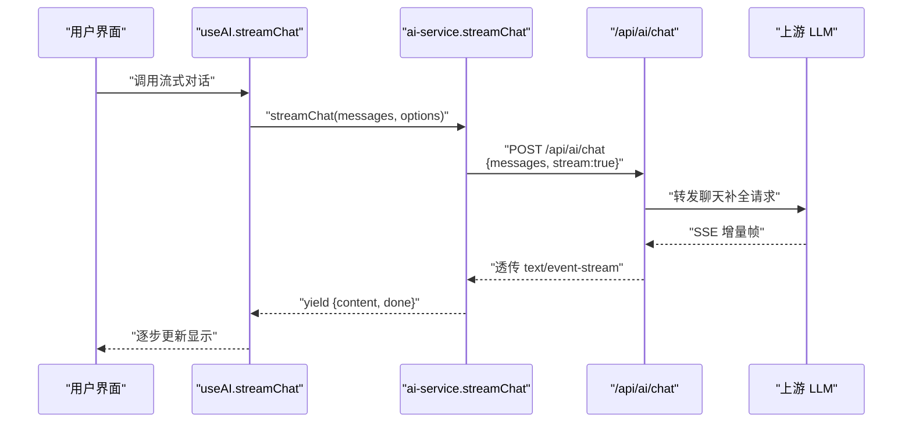
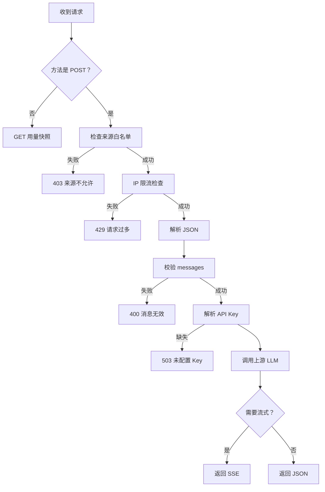
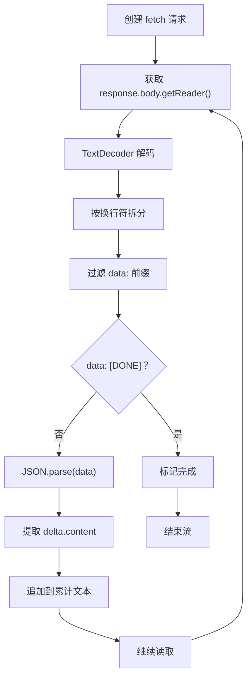
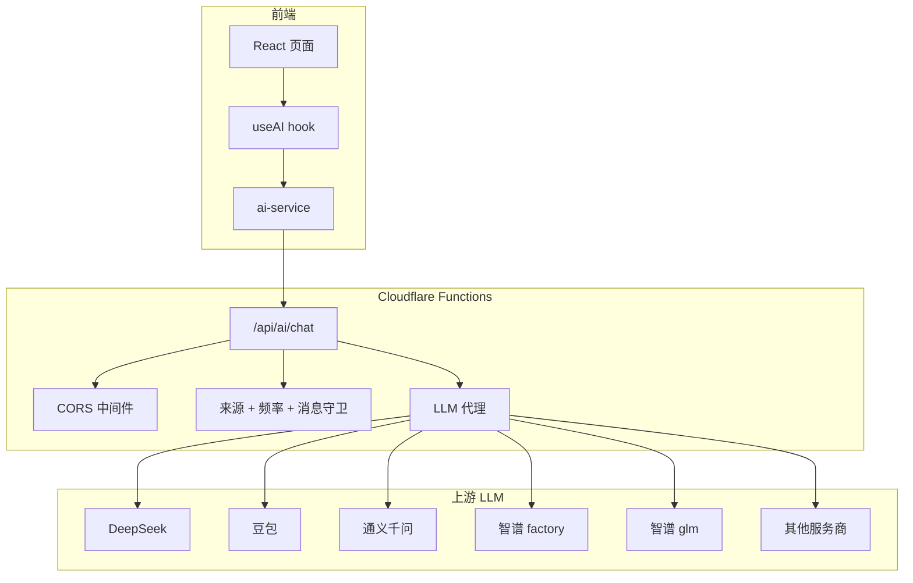

# 对话接口 /api/ai/chat

<cite>
**本文引用的文件**   
- [functions/api/ai/chat.js](file://functions/api/ai/chat.js)
- [functions/_lib/cors.js](file://functions/_lib/cors.js)
- [functions/_lib/guard.js](file://functions/_lib/guard.js)
- [src/services/ai-service.ts](file://src/services/ai-service.ts)
- [src/hooks/use-ai.ts](file://src/hooks/use-ai.ts)
- [src/components/StreamingText.tsx](file://src/components/StreamingText.tsx)
- [wrangler.toml](file://wrangler.toml)
</cite>

## 目录
1. [简介](#简介)
2. [接口总览](#接口总览)
3. [请求规范](#请求规范)
4. [响应规范与流式协议](#响应规范与流式协议)
5. [多轮对话示例](#多轮对话示例)
6. [错误处理与重试机制](#错误处理与重试机制)
7. [客户端集成指南](#客户端集成指南)
8. [架构与依赖关系](#架构与依赖关系)
9. [性能与稳定性建议](#性能与稳定性建议)
10. [故障排查](#故障排查)
11. [结论](#结论)

## 简介
`/api/ai/chat` 是 NativeThink 应用的 AI 对话代理接口，位于 Cloudflare Workers Functions 中。它的主要职责是：
- 接收前端发送的对话消息；
- 验证来源、频率和消息结构；
- 选择后端 LLM 服务商与模型；
- 将请求转发到上游 OpenAI 兼容的聊天补全接口；
- 以 Server-Sent Events（SSE）形式向客户端逐步返回增量文本；
- 对免费智谱模型提供自动模型降级与重试。

该接口既支持流式响应，也支持一次性 JSON 响应，但应用内主要使用流式模式实现“打字机”体验。

## 接口总览
- **HTTP 方法**：`POST`
- **URL 路径**：`/api/ai/chat`
- **作用域**：Cloudflare Pages Functions，部署在 `nativethink.pages.dev` 对应的 Workers 环境中
- **跨域**：通过统一的 CORS helper 允许浏览器、Capacitor APK 和 Electron 本地源访问
- **认证方式**：本接口本身不强制要求 `Authorization` 头；API Key 由请求体中的 `apiKey` 字段或服务器环境变量提供
- **CORS 允许的请求头**：`Content-Type`、`Authorization`



**图表来源**
- [functions/api/ai/chat.js:1-40](file://functions/api/ai/chat.js#L1-L40)
- [functions/_lib/guard.js:1-20](file://functions/_lib/guard.js#L1-L20)
- [functions/_lib/cors.js:1-29](file://functions/_lib/cors.js#L1-L29)

**章节来源**
- [functions/api/ai/chat.js:1-40](file://functions/api/ai/chat.js#L1-L40)
- [wrangler.toml:1-9](file://wrangler.toml#L1-L9)

## 请求规范

### HTTP 方法与 URL
| 项目 | 值 |
|---|---|
| 方法 | `POST` |
| URL | `/api/ai/chat` |
| Content-Type | `application/json` |
| Authorization | 可选；本接口默认不校验该头，但服务端已定义通用鉴权辅助函数 |

GET 请求用于查看出厂 Key 用量快照，不是对话接口。

### 请求体结构
请求体是一个 JSON 对象，核心字段如下：

| 字段 | 类型 | 必填 | 默认值 | 说明 |
|---|---|---:|---|---|
| `provider` | 字符串 | 否 | `"deepseek"` | 上游 LLM 服务商名称，例如 `deepseek`、`doubao`、`qwen`、`factory`、`glm`、`siliconflow`、`moonshot`、`groq` |
| `model` | 字符串 | 否 | 各服务商默认模型 | 显式指定模型；若未传，则按服务商默认模型或任务分工模型选择 |
| `messages` | 数组 | 是 | 无 | 多轮对话上下文，见下方消息结构 |
| `max_tokens` | 数字 | 否 | `4096` | 最大输出 token 数 |
| `temperature` | 数字 | 否 | `0.7` | 采样温度 |
| `stream` | 布尔值 | 否 | `true` | 是否启用 SSE 流式响应 |
| `apiKey` | 字符串 | 否 | 从服务端环境变量读取 | 客户端可传入自有 API Key；未传时回退到服务端出厂 Key |
| `thinking` | 对象或布尔值 | 否 | 智谱相关服务商默认为关闭思考模式 | 控制某些模型的“思维链”行为 |
| `task` | 字符串 | 否 | 无 | 任务类型，如 `"chat"` 或 `"translate"`，影响免费档模型选择 |

#### 消息数组结构
`messages` 是 `ChatMessage` 数组，每个元素为：

| 字段 | 类型 | 必填 | 说明 |
|---|---|---:|---|
| `role` | 字符串 | 是 | 取值：`system`、`user`、`assistant` |
| `content` | 字符串 | 是 | 角色内容；会被过滤空字符串、非字符串及空白内容 |

服务端对消息进行严格校验：
- 必须是数组；
- 不能为空；
- 最多 80 条；
- 每条必须包含字符串类型的 `role` 和 `content`；
- 所有 `content` 总长度不超过约 64,000 字符。



**图表来源**
- [functions/api/ai/chat.js:15-36](file://functions/api/ai/chat.js#L15-L36)
- [functions/_lib/guard.js:60-89](file://functions/_lib/guard.js#L60-L89)
- [src/services/ai-service.ts:24-37](file://src/services/ai-service.ts#L24-L37)

**章节来源**
- [functions/api/ai/chat.js:15-36](file://functions/api/ai/chat.js#L15-L36)
- [functions/_lib/guard.js:60-89](file://functions/_lib/guard.js#L60-L89)
- [src/services/ai-service.ts:24-37](file://src/services/ai-service.ts#L24-L37)

## 响应规范与流式协议

### 非流式响应
当 `stream=false` 或上游返回非流式数据时，服务端返回标准 JSON，通常包含 LLM 原始响应结构，例如 `choices[0].message.content`。

### 流式响应（SSE）
当 `stream=true`（默认）且上游响应包含 body 时，服务端直接透传上游流，并设置：

| 响应头 | 值 | 含义 |
|---|---|---|
| `Content-Type` | `text/event-stream` | 标识 SSE 流 |
| `Cache-Control` | `no-cache` | 禁止缓存增量文本 |
| `Connection` | `keep-alive` | 保持长连接 |

#### SSE 消息帧格式
SSE 数据行以 `data:` 开头，典型事件包括：

| 事件片段 | 结构特征 | 客户端行为 |
|---|---|---|
| 增量文本 | `data: {"choices":[{"delta":{"content":"..."},"finish_reason":null}]}` | 拼接 `delta.content` |
| 完成标记 | `data: [DONE]` | 停止渲染，标记完成 |
| 显式结束 | `{"choices":[{"finish_reason":"stop"}]}` | 提前结束流 |
| 错误响应 | JSON `{error:"..."}` | 终止流并展示错误 |

#### 增量字段语义
- `delta.content`：本次新增的文本片段；客户端应追加到当前回复末尾。
- `finish_reason`：上游可能返回 `stop` 等结束原因；客户端据此判断本轮对话结束。
- `[DONE]`：上游流结束标记；客户端应清理状态并释放资源。



**图表来源**
- [src/services/ai-service.ts:60-190](file://src/services/ai-service.ts#L60-L190)
- [functions/api/ai/chat.js:120-170](file://functions/api/ai/chat.js#L120-L170)
- [src/hooks/use-ai.ts:34-66](file://src/hooks/use-ai.ts#L34-L66)

**章节来源**
- [functions/api/ai/chat.js:120-170](file://functions/api/ai/chat.js#L120-L170)
- [src/services/ai-service.ts:60-190](file://src/services/ai-service.ts#L60-L190)

## 多轮对话示例

### 第一轮：系统提示词 + 用户输入
请求体示例（字段说明见上文表格）：

```json
{
  "provider": "deepseek",
  "messages": [
    {
      "role": "system",
      "content": "你是一个英语思维训练助手，帮助用户用英语思考，并在必要时给出简洁纠正和建议。"
    },
    {
      "role": "user",
      "content": "I go to school yesterday."
    }
  ],
  "max_tokens": 4096,
  "temperature": 0.7,
  "stream": true
}
```

可能的流式响应片段顺序：

```text
data: {"choices":[{"delta":{"content":"这句话"}}]}
data: {"choices":[{"delta":{"content":"可以改"}}]}
data: {"choices":[{"delta":{"content":"为"}}]}
data: {"choices":[{"delta":{"content":","}}]}
data: {"choices":[{"delta":{"content":"I went to school yesterday"}}]}
data: {"choices":[{"delta":{"content":"。"}}]}
data: {"choices":[{"delta":{"content":"因为"}}]}
data: {"choices":[{"delta":{"content":"yesterday"}}]}
data: {"choices":[{"delta":{"content":"表示过去"}}]}
data: {"choices":[{"delta":{"content":"，"}}]}
data: {"choices":[{"delta":{"content":"动词要用"}}]}
data: {"choices":[{"delta":{"content":"过去式"}}]}
data: {"choices":[{"delta":{"content":"。"}}]}
data: [DONE]
```

### 第二轮：延续上下文
请求体中的 `messages` 应包含历史对话：

```json
{
  "provider": "deepseek",
  "messages": [
    {
      "role": "system",
      "content": "你是一个英语思维训练助手，帮助用户用英语思考，并在必要时给出简洁纠正和建议。"
    },
    {
      "role": "user",
      "content": "I go to school yesterday."
    },
    {
      "role": "assistant",
      "content": "这句话可以改为 I went to school yesterday。因为 yesterday 表示过去，动词要用过去式。"
    },
    {
      "role": "user",
      "content": "那如果我想表达经常去学校呢？"
    }
  ],
  "max_tokens": 4096,
  "temperature": 0.7,
  "stream": true
}
```

服务端会保留完整上下文，并基于 `messages` 数组生成下一轮回复。

**章节来源**
- [functions/api/ai/chat.js:15-36](file://functions/api/ai/chat.js#L15-L36)
- [functions/_lib/guard.js:60-89](file://functions/_lib/guard.js#L60-L89)
- [src/services/ai-service.ts:24-37](file://src/services/ai-service.ts#L24-L37)

## 错误处理与重试机制

### 请求阶段错误
| 场景 | 状态码 | 响应体 | 说明 |
|---|---:|---|---|
| 不支持的方法 | `405` | `{error:"Method not allowed"}` | 仅 `POST` 可用；`GET` 用于用量快照 |
| 来源不在白名单 | `403` | `{error:"Origin not allowed"}` | 拦截第三方网页滥用 |
| 频率超限 | `429` | `{error:"Too many requests, slow down"}` | 按 IP 分钟窗限流 |
| JSON 解析失败 | `400` | `{error:"Invalid JSON"}` | 请求体不是合法 JSON |
| 消息校验失败 | `400` | `{error:"Messages array is required ..."}` | 消息数组为空、超长、结构非法或总内容过大 |
| 所有消息内容为空 | `400` | `{error:"All messages have empty content"}` | 空字符串和非字符串内容被过滤后无有效消息 |
| 未知服务商 | `400` | `{error:"Unknown provider: ..."}` | `provider` 不在白名单映射中 |
| 服务端未配置 API Key | `503` | `{error:"Server AI key not configured for ..."}` | 环境变量中没有对应服务商 Key |
| 上游服务不可用 | `502` | `{error:"AI provider error", detail:"..."}` | 上游多次降级仍失败 |
| 网络或代理异常 | `500` | `{error:"Request failed: ..."}` | 请求过程中抛出异常 |

### 上游模型降级与重试
对于智谱相关服务商（`glm`、`factory`），服务端会构造候选模型链并依次尝试：
1. 根据 `task` 选择的优先模型；
2. 客户端显式指定的 `model`；
3. 固定降级链：`glm-4-flash-250414` → `glm-4-flash` → `glm-4v-flash` → `glm-4.7-flash`。

仅对以下上游状态码继续降级重试：
- `429`
- `500`
- `502`
- `503`
- `504`

鉴权类错误（如 `401`、`403`）不会继续重试。

### 客户端侧错误处理
前端 `useAI` hook 会对流式与非流式调用统一处理：
- `AbortError` 视为取消操作，不弹全局 toast；
- 其他错误提取 `err.message`，默认弹出全局错误提示；
- 流式模式下最终 yield 一个 `done: true` 的结束片段；
- 非流式模式下返回空字符串。

此外，`ai-service` 还提供离线兜底能力：当启用“离线自动回落”且本地小模型可用时，可在云端 API 失败后切换至端侧模型继续输出。



**图表来源**
- [functions/api/ai/chat.js:41-170](file://functions/api/ai/chat.js#L41-L170)
- [functions/_lib/guard.js:21-89](file://functions/_lib/guard.js#L21-L89)
- [src/hooks/use-ai.ts:34-66](file://src/hooks/use-ai.ts#L34-L66)

**章节来源**
- [functions/api/ai/chat.js:41-170](file://functions/api/ai/chat.js#L41-L170)
- [functions/_lib/guard.js:21-89](file://functions/_lib/guard.js#L21-L89)
- [src/hooks/use-ai.ts:34-66](file://src/hooks/use-ai.ts#L34-L66)
- [src/services/ai-service.ts:250-368](file://src/services/ai-service.ts#L250-L368)

## 客户端集成指南

### 推荐方案：使用应用内封装
NativeThink 已提供较完整的客户端封装，推荐使用：

- `streamChat`：异步生成器，逐块产出 `{content, done}`；
- `chat`：一次性返回完整文本；
- `buildMessages`：构建系统提示词与用户消息；
- `appendUserMessage`：向已有上下文追加用户输入；
- `useAI` React hook：封装状态、错误提示与配置刷新。

这种方式会自动：
- 选择当前配置的 LLM 服务商；
- 保护 API Key，不暴露给浏览器；
- 处理 503 配置缺失提示；
- 解析 SSE 增量文本；
- 在启用离线兜底时自动切换本地小模型。

### 手动集成：自定义流式解析器
如果需要绕过封装自行对接 `/api/ai/chat`，可按以下步骤实现：

1. 发起 `POST /api/ai/chat`，携带 `Content-Type: application/json`。
2. 请求体中包含 `messages`、`stream: true`。
3. 读取 `response.body` 的 `ReadableStream`。
4. 使用 `TextDecoder` 解码字节流。
5. 按 `\n` 切分行，保留不完整行缓冲。
6. 跳过空行和不以 `data: ` 开头的行。
7. 遇到 `data: [DONE]` 时标记完成。
8. 解析 JSON 数据，提取 `choices[0].delta.content`。
9. 将增量文本追加到当前回复缓冲区。
10. 遇到 `finish_reason` 或流结束时清理 reader。



**图表来源**
- [src/services/ai-service.ts:60-190](file://src/services/ai-service.ts#L60-L190)

### 在 UI 中实现打字机效果
应用内 `StreamingText` 组件实现了渐进式文字显示：
- 每次 tick 显示若干字符；
- 新字符带有淡入动画；
- 末尾显示光标占位；
- 尊重操作系统“减少动态效果”偏好；
- 文本完全显示后恢复普通渲染。

集成建议：
- 维护一个累计文本状态；
- 每次流式增量到来时追加；
- 将累计文本传给 `StreamingText`；
- 流结束时移除光标并固定最终文本；
- 用户取消请求时中断生成器并停止 UI 更新。

**章节来源**
- [src/services/ai-service.ts:60-190](file://src/services/ai-service.ts#L60-L190)
- [src/hooks/use-ai.ts:34-101](file://src/hooks/use-ai.ts#L34-L101)
- [src/components/StreamingText.tsx:1-53](file://src/components/StreamingText.tsx#L1-L53)

## 架构与依赖关系

### 服务端入口
`/api/ai/chat` 的 `onRequest` 统一走 CORS 包装：
- 如果是 `OPTIONS` 预检请求，直接返回 204；
- 否则调用业务 handler；
- 最终响应附加跨域头。

### 安全守卫
- 来源白名单限制 Web、Capacitor、Electron 和本地开发地址；
- IP 每分钟最多 30 次请求；
- 消息数组做结构和体积防护；
- 出厂 Key 用量记录到内存中，可通过 GET 接口查看当日快照。

### 上游代理
- 将请求转发到所选服务商的 OpenAI 兼容聊天接口；
- 使用 Bearer Token 认证；
- 透传流式 body；
- 对智谱模型额外注入 `thinking` 参数；
- 对免费模型进行候选链降级。



**图表来源**
- [functions/api/ai/chat.js:1-40](file://functions/api/ai/chat.js#L1-L40)
- [functions/_lib/cors.js:1-29](file://functions/_lib/cors.js#L1-L29)
- [functions/_lib/guard.js:1-59](file://functions/_lib/guard.js#L1-L59)
- [src/services/ai-service.ts:1-60](file://src/services/ai-service.ts#L1-L60)

**章节来源**
- [functions/api/ai/chat.js:1-40](file://functions/api/ai/chat.js#L1-L40)
- [functions/_lib/cors.js:1-29](file://functions/_lib/cors.js#L1-L29)
- [functions/_lib/guard.js:1-59](file://functions/_lib/guard.js#L1-L59)
- [src/services/ai-service.ts:1-60](file://src/services/ai-service.ts#L1-L60)

## 性能与稳定性建议

### 合理控制上下文长度
- 消息总数上限为 80；
- 所有 `content` 总长度约 64,000 字符；
- 长对话应裁剪历史，只保留最近几轮关键上下文；
- 系统提示词应精简，避免占用过多 token。

### 流式渲染优化
- 增量文本应按字或词粒度追加，避免整段替换；
- 流式完成后立即停止定时器；
- 用户主动取消时应中止 `AbortSignal`；
- 长文本渲染时可考虑虚拟滚动或分页。

### 错误与降级
- 捕获 `AbortError` 与普通错误；
- 非静默模式展示全局 toast；
- 启用离线兜底时优先使用本地小模型；
- 对 429、500、502、503、504 允许服务端自动降级重试；
- 客户端不应无限重试，应结合指数退避与用户反馈。

### 成本与速率
- 默认 `max_tokens=4096`，可根据场景调低；
- `temperature` 默认 0.7，翻译场景可更低；
- 注意上游服务商配额与并发限制；
- 利用免费智谱模型的快速模型优先策略，降低高峰期失败概率。

**章节来源**
- [functions/_lib/guard.js:60-89](file://functions/_lib/guard.js#L60-L89)
- [functions/api/ai/chat.js:100-170](file://functions/api/ai/chat.js#L100-L170)
- [src/services/ai-service.ts:250-368](file://src/services/ai-service.ts#L250-L368)

## 故障排查

| 现象 | 可能原因 | 处理方式 |
|---|---|---|
| 浏览器报跨域错误 | Capacitor 或 Web 环境缺少 CORS 支持 | 确认服务端已添加 CORS 头，并使用 `/api/ai/chat` 代理 |
| 返回 `403 Origin not allowed` | 请求来源不在白名单 | 使用受支持的域名或本地开发地址 |
| 返回 `429 Too many requests` | IP 频率超限 | 降低请求频率，避免重复触发对话 |
| 返回 `400 Messages array is required` | 消息为空、结构错误或超长 | 检查 `messages` 是否为字符串数组，总量是否超过限制 |
| 返回 `503 Server AI key not configured` | 服务端未配置对应服务商 API Key | 配置环境变量 `AI_KEY_<PROVIDER>` 或 `SERVER_AI_KEY` |
| 返回 `502 AI provider error` | 上游服务不可用或多次降级失败 | 检查服务商状态、模型名称、网络连通性 |
| 流式输出中途停止 | 网络中断、上游断开、客户端取消 | 捕获流错误，展示友好提示，必要时重新发起 |
| 流式输出不显示 | 未正确解析 `data:` 行或 `delta.content` | 检查 TextDecoder、缓冲区和 JSON 解析逻辑 |
| 打字机效果卡顿 | 文本过长频繁重渲染 | 合并增量、减少 React 重渲染范围 |
| 离线兜底未生效 | 未启用自动回落或未下载本地小模型 | 检查离线开关和本地模型就绪状态 |

**章节来源**
- [functions/_lib/cors.js:1-29](file://functions/_lib/cors.js#L1-L29)
- [functions/_lib/guard.js:21-59](file://functions/_lib/guard.js#L21-L59)
- [functions/api/ai/chat.js:41-170](file://functions/api/ai/chat.js#L41-L170)
- [src/services/ai-service.ts:250-368](file://src/services/ai-service.ts#L250-L368)
- [src/hooks/use-ai.ts:34-101](file://src/hooks/use-ai.ts#L34-L101)

## 结论
`/api/ai/chat` 是 NativeThink 对话能力的核心入口：它屏蔽了上游 LLM 差异，统一了消息格式，提供了安全的 API Key 代理，并以 SSE 流式响应支撑即时交互体验。客户端通过 `ai-service` 和 `useAI` 获得稳定的流式 API、错误处理和离线兜底；UI 层通过 `StreamingText` 实现流畅的打字机效果。

集成该接口时，应重点关注：
- 正确的 `messages` 结构与长度控制；
- 正确处理 `data:` 行、`delta.content` 和 `[DONE]`；
- 区分 `AbortError` 与普通错误；
- 在 UI 中增量渲染而非整段替换；
- 合理使用免费模型降级和离线兜底；
- 在服务端正确配置 API Key 与 CORS。