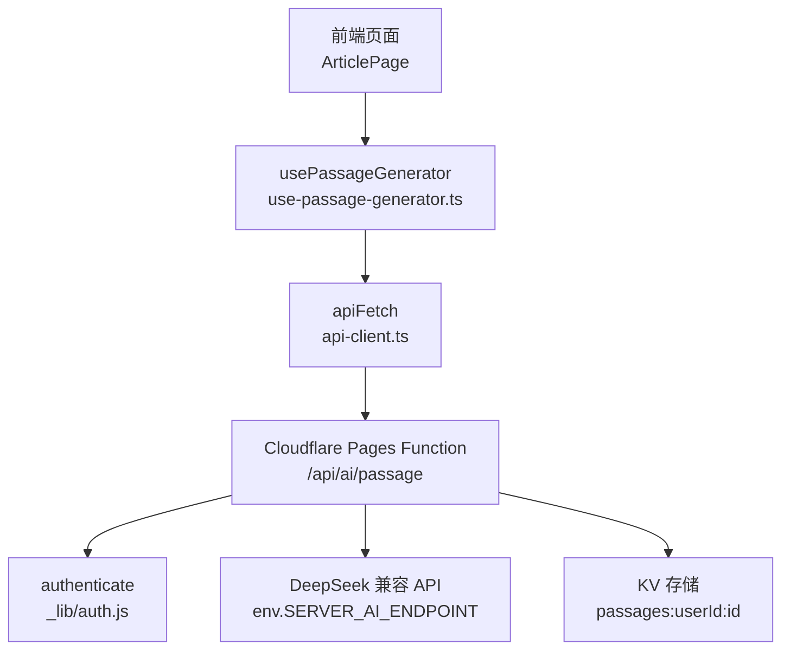
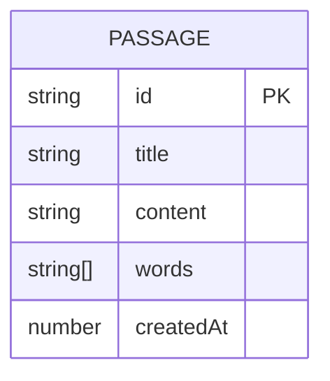
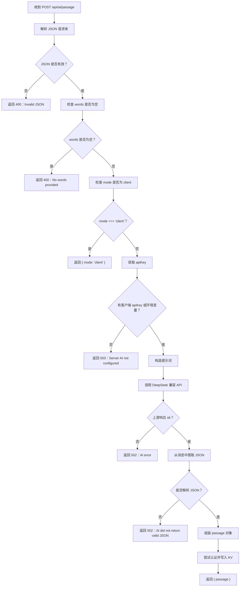
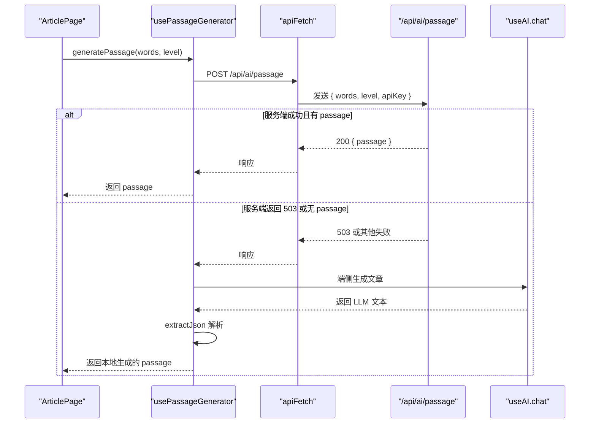

# 语篇分析接口 /api/ai/passage

<cite>
**本文引用的文件**   
- [functions/api/ai/passage.js](file://functions/api/ai/passage.js)
- [src/hooks/use-passage-generator.ts](file://src/hooks/use-passage-generator.ts)
- [src/lib/api-client.ts](file://src/lib/api-client.ts)
- [docs/modules/ai-services.md](file://docs/modules/ai-services.md)
</cite>

## 目录
1. [简介](#简介)
2. [项目结构定位](#项目结构定位)
3. [接口定义](#接口定义)
4. [请求体结构](#请求体结构)
5. [响应数据模型](#响应数据模型)
6. [实际调用流程与错误处理](#实际调用流程与错误处理)
7. [客户端使用示例](#客户端使用示例)
8. [可视化渲染建议](#可视化渲染建议)
9. [性能与限制](#性能与限制)
10. [故障排查](#故障排查)
11. [结论](#结论)

## 简介
本文件说明 NativeThink 应用中与“语篇”相关的 Cloudflare Pages Function `/api/ai/passage`。需要特别明确：**当前仓库中的 `/api/ai/passage` 并不是通用的“英文文章语篇分析接口”，而是“复习词汇文章生成接口”**。它接收一组目标词汇，调用后端大语言模型生成一篇包含这些词汇的短文，而不是对已有英文文章做段落划分、语法复杂度、词汇难度或母语思维偏差检测。

因此，文档中关于“语篇结构分析结果（段落划分、主题识别、逻辑关系）、语法复杂度评估、词汇难度标注、母语思维偏差检测”的内容属于业务期望形态；当前实现尚未提供这些字段，而是返回一篇由 AI 生成的阅读文章对象。

## 项目结构定位
该接口位于 Cloudflare Pages Functions 中，路由为 `POST /api/ai/passage`，并由通用 CORS 和预检处理包装。前端在已认证情况下优先调用服务端端点；若服务端不可用或返回回退标记，则回退到端侧 AI 对话能力直接生成文章。



**图表来源**
- [functions/api/ai/passage.js:1-77](file://functions/api/ai/passage.js#L1-L77)
- [src/hooks/use-passage-generator.ts:1-91](file://src/hooks/use-passage-generator.ts#L1-L91)
- [src/lib/api-client.ts:1-82](file://src/lib/api-client.ts#L1-L82)

**章节来源**
- [functions/api/ai/passage.js:1-77](file://functions/api/ai/passage.js#L1-L77)
- [docs/modules/ai-services.md:1-107](file://docs/modules/ai-services.md#L1-L107)

## 接口定义

| 项目 | 值 |
|---|---|
| HTTP 方法 | `POST` |
| URL 路径 | `/api/ai/passage` |
| 内容类型 | `application/json` |
| 鉴权方式 | 可选；通过请求头 `Authorization: Bearer <token>` 携带登录令牌 |
| Key 传递方式 | 请求体字段 `apiKey`，用于代理转发给上游大模型 |
| 默认行为 | 使用服务器环境变量配置的 AI 端点和模型 |
| 回退机制 | 未配置服务端 AI Key 时返回状态码 `503`，并带 `fallback: "client"` |

该端点目前不区分“文本内容、分析维度、目标语言”。它的输入是“要在一篇文章中自然使用的词汇列表”，输出是“AI 生成的一篇英文短文及其元信息”。

**章节来源**
- [functions/api/ai/passage.js:1-77](file://functions/api/ai/passage.js#L1-L77)
- [src/hooks/use-passage-generator.ts:19-44](file://src/hooks/use-passage-generator.ts#L19-L44)

## 请求体结构

### 字段定义

| 字段 | 类型 | 必填 | 默认值 | 说明 |
|---|---|---:|---|---|
| `words` | `string[]` | 是 | 无 | 要在文章中自然嵌入的目标词汇数组；为空会直接返回 `400` |
| `level` | `string` | 否 | 无 | 当前实现未在服务端解析该字段；仅随请求体透传 |
| `mode` | `string` | 否 | 无 | 若值为 `"client"`，服务端立即返回 `{ mode: "client" }`，不调用 LLM |
| `apiKey` | `string` | 否 | 无 | 上游大模型的 API Key；优先使用客户端传入，否则回退到环境变量 |

### 请求体约束
- `words` 必须是非空数组。
- `body` 必须是合法 JSON；否则返回 `400`。
- `apiKey` 不是登录凭据，而是上游 LLM 提供商的访问密钥。
- 当前版本没有对 `words` 总数、总字符数、重复词、长度进行显式校验。

### 典型请求示例

```json
{
  "words": ["adaptability", "automation", "workplace"],
  "level": "intermediate",
  "apiKey": "sk-example-key"
}
```

该请求表示：请生成一篇适合中级英语学习者的英文短文，并在文中自然使用 `adaptability`、`automation`、`workplace` 三个词汇。

**章节来源**
- [functions/api/ai/passage.js:12-29](file://functions/api/ai/passage.js#L12-L29)
- [src/hooks/use-passage-generator.ts:28-37](file://src/hooks/use-passage-generator.ts#L28-L37)

## 响应数据模型

### 成功响应

成功时返回状态码 `200`，主体为：

| 字段 | 类型 | 说明 |
|---|---|---|
| `passage` | 对象 | 生成的阅读文章对象 |
| `passage.id` | `string` | 服务端随机生成的文章标识 |
| `passage.title` | `string` | 文章标题；若 LLM 未返回则使用 `"Review Passage"` |
| `passage.content` | `string` | 文章正文；若 LLM 未返回结构化内容则使用原始返回文本 |
| `passage.words` | `string[]` | 认为已被使用的词汇列表；优先取 LLM 返回的 `words_used` |
| `passage.createdAt` | `number` | 毫秒时间戳 |



**图表来源**
- [functions/api/ai/passage.js:49-64](file://functions/api/ai/passage.js#L49-L64)
- [src/hooks/use-passage-generator.ts:66-75](file://src/hooks/use-passage-generator.ts#L66-L75)

### 失败响应

| 场景 | 状态码 | 响应体关键字段 | 含义 |
|---|---:|---|---|
| 请求体不是合法 JSON | `400` | `error` | 无法解析请求体 |
| 未提供词汇 | `400` | `error` | `words` 为空 |
| 未配置服务端 AI Key | `503` | `error`, `fallback: "client"` | 应回退到客户端模式 |
| 上游 LLM 调用失败 | `502` | `error`, `fallback: "client"` | 上游返回非 `ok` |
| LLM 未返回有效 JSON | `502` | `error`, `fallback: "client"` | 正则无法提取 JSON |
| 其他异常 | `500` | `error`, `fallback: "client"` | 服务端内部错误 |

注意：当前实现中，所有服务端异常均封装为 `{ error, fallback: "client" }`，但并非所有分支都设置 `fallback` 字段。例如未配置 Key 的响应体只写明了 `Server AI not configured`，并未显式写入 `fallback`。客户端主要根据状态码 `503` 判断是否回退。

**章节来源**
- [functions/api/ai/passage.js:12-29](file://functions/api/ai/passage.js#L12-L29)
- [functions/api/ai/passage.js:31-76](file://functions/api/ai/passage.js#L31-L76)

## 实际调用流程与错误处理

### 服务端处理流程



**图表来源**
- [functions/api/ai/passage.js:12-76](file://functions/api/ai/passage.js#L12-L76)

### 关键处理逻辑说明

1. **请求体验证**  
   - 非 JSON 请求体 → `400`。
   - `words` 为空数组 → `400`。

2. **快速回退探测**  
   - 当 `mode === "client"` 时，服务端直接返回模式标识，不执行任何 LLM 调用。这是客户端用来探测服务端可用性的轻量路径。

3. **API Key 优先级**  
   - 优先使用客户端请求体中的 `apiKey`。
   - 否则使用环境变量 `SERVER_AI_KEY`。
   - 两者都没有 → `503`，提示客户端回退。

4. **上游 LLM 调用**  
   - 默认端点：`https://api.deepseek.com/v1/chat/completions`。
   - 默认模型：`deepseek-chat`。
   - 可通过环境变量 `SERVER_AI_ENDPOINT`、`SERVER_AI_MODEL` 覆盖。
   - 请求体采用 OpenAI 兼容格式，包括 `model`、`messages`、`max_tokens`、`temperature`。

5. **JSON 抽取**  
   - 服务端使用正则匹配第一个 `{...}` 块，再 `JSON.parse`。
   - 如果无法匹配或解析失败 → `502`。

6. **持久化**  
   - 若用户已认证，将文章存入 KV，键形如 `passages:${userId}:${id}`。
   - 认证失败不影响文章生成结果。

**章节来源**
- [functions/api/ai/passage.js:12-76](file://functions/api/ai/passage.js#L12-L76)

### 客户端回退流程



**图表来源**
- [src/hooks/use-passage-generator.ts:22-88](file://src/hooks/use-passage-generator.ts#L22-L88)

**章节来源**
- [src/hooks/use-passage-generator.ts:19-91](file://src/hooks/use-passage-generator.ts#L19-L91)

## 客户端使用示例

### 基本调用步骤

1. 准备词汇数组。
2. 调用 `usePassageGenerator` 暴露的 `generatePassage`。
3. 传入词汇和可选难度级别。
4. 如果已登录，前端优先走 `/api/ai/passage`。
5. 如果服务端不可用，前端自动回退到端侧 `useAI.chat`。
6. 成功后得到 `GeneratedPassage` 对象。

### GeneratedPassage 类型

| 字段 | 类型 | 说明 |
|---|---|---|
| `id` | `string` | 文章唯一标识 |
| `title` | `string` | 文章标题 |
| `content` | `string` | 完整英文文章内容 |
| `words` | `string[]` | 被认为已使用的词汇 |
| `createdAt` | `number` | 创建时间戳 |

### 推荐调用伪代码

```text
调用 usePassageGenerator().generatePassage(["adaptability", "automation"])
等待生成完成
读取 lastPassage
渲染 title、content、words、createdAt
```

前端当前实现会在服务端返回 `fallback: "client"` 或无 `passage` 时自动尝试客户端模式，并在客户端解析失败时返回 `null`。

**章节来源**
- [src/hooks/use-passage-generator.ts:11-16](file://src/hooks/use-passage-generator.ts#L11-L16)
- [src/hooks/use-passage-generator.ts:19-91](file://src/hooks/use-passage-generator.ts#L19-L91)

## 可视化渲染建议

虽然当前接口不返回结构化语篇分析字段，但仍可基于现有字段构建有用界面：

| 展示区域 | 数据来源 | 渲染建议 |
|---|---|---|
| 文章标题 | `passage.title` | 作为卡片或页面标题 |
| 正文 | `passage.content` | 按段落拆分后逐段显示；支持高亮、翻译、TTS |
| 目标词汇 | `passage.words` | 以标签形式列出，并可反向高亮正文中出现位置 |
| 生成时间 | `passage.createdAt` | 显示相对时间，如“刚刚”“X 分钟前” |
| 生成状态 | `generating` | 加载动画 + 取消提示 |
| 错误信息 | 网络错误、LLM 错误、解析错误 | 使用统一 toast 或错误卡片 |

如果需要更丰富的分析视图，可以在客户端对 `passage.content` 做简单预处理：
- 按句号、换行符拆分为句子或段落。
- 对 `passage.words` 中的词在正文中进行简单字符串匹配高亮。
- 对长文分页展示，避免一次性渲染过长 HTML。

当前仓库未实现语义级段落划分、语法复杂度评分、词汇难度等级、母语思维偏差检测等字段，因此上述可视化不应假设存在对应字段。

**章节来源**
- [src/hooks/use-passage-generator.ts:11-16](file://src/hooks/use-passage-generator.ts#L11-L16)
- [src/hooks/use-passage-generator.ts:66-75](file://src/hooks/use-passage-generator.ts#L66-L75)

## 性能与限制

### 已知限制

| 类别 | 当前行为 | 影响 |
|---|---|---|
| 请求体大小 | 无显式 `words` 数量或总字符限制 | 大量词汇可能导致提示词过大，增加 LLM 成本与失败概率 |
| 超时 | 前端 `apiFetch` 默认超时 `15000` 毫秒 | 长文生成可能触发“请求超时” |
| LLM 响应大小 | 服务端请求 `max_tokens: 1024` | 过长的文章可能被截断 |
| 并发 | 每个隔离环境独立计数 | 限流效果有限，突发流量可能打满上游配额 |
| 存储 | 已登录用户写入 KV | 频繁生成会增加 KV 写入量 |

### 性能建议

1. **控制词汇数量**  
   建议单次生成不超过 10–20 个核心词汇，避免提示词膨胀。

2. **重试与退避**  
   遇到 `502`、`503` 或超时，应做指数退避重试，最多 2–3 次。

3. **缓存最近结果**  
   相同词汇组合可短期缓存，避免重复调用。

4. **分段生成**  
   对于超长词汇表，可按主题分批次生成多篇短文，而不是一次性塞入一个 prompt。

5. **前端超时保护**  
   可根据内容长度动态调整超时，例如长文请求延长至 30 秒。

**章节来源**
- [src/lib/api-client.ts:6-27](file://src/lib/api-client.ts#L6-L27)
- [functions/api/ai/passage.js:33-47](file://functions/api/ai/passage.js#L33-L47)

## 故障排查

### 常见错误与处理方法

| 现象 | 可能原因 | 处理方式 |
|---|---|---|
| 返回 `400 Invalid JSON` | 请求体不是合法 JSON | 检查 `JSON.stringify` 和请求头 |
| 返回 `400 No words provided` | `words` 为空或未传 | 确保至少传入一个目标词汇 |
| 返回 `503 Server AI not configured` | 服务端未配置 `SERVER_AI_KEY`，且客户端未传 `apiKey` | 配置环境变量或在前端传入 `apiKey` |
| 返回 `502 AI error` | 上游 LLM 返回非 `ok` | 检查 `apiKey`、服务商配额、模型名称 |
| 返回 `502 AI did not return valid JSON` | LLM 未返回可解析的 JSON | 改用更严格的 prompt，或在客户端再次解析 |
| 前端报错“请求超时” | 超过 15 秒未完成 | 增加超时、减少词汇量、启用重试 |
| 前端报错“服务暂时不可用” | 返回 HTML 或非 JSON 响应 | 检查代理层、CORS、域名部署状态 |
| 前端报错“服务器返回异常” | 响应体不是合法 JSON | 打印原始响应以便调试 |

### 安全与守卫注意事项

- `/api/ai/passage` 使用通用 CORS 包装，适配 Capacitor APK 的 `https://localhost` 跨域场景。
- 该函数本身没有复用 `/api/ai/chat` 的 Origin 白名单、IP 限流、messages 形状校验等守卫逻辑。
- 如需增强防滥用保护，应参考 `/api/ai/chat` 的守卫实现，为 `/api/ai/passage` 单独添加限流、来源校验和请求体积限制。

**章节来源**
- [src/lib/api-client.ts:29-82](file://src/lib/api-client.ts#L29-L82)
- [functions/api/ai/passage.js:1-11](file://functions/api/ai/passage.js#L1-L11)
- [docs/modules/ai-services.md:60-107](file://docs/modules/ai-services.md#L60-L107)

## 结论

NativeThink 当前的 `/api/ai/passage` 是一个**词汇驱动的阅读文章生成接口**，而不是通用的英文文章语篇分析接口。它接受目标词汇，调用上游大语言模型生成一篇短文，并可选择保存至 KV。

如果你希望扩展为真正的“语篇分析接口”，建议在保留现有生成能力的基础上新增以下能力：

1. **新路由或新字段**  
   新增类似 `/api/ai/passage/analyze` 的路由，或使用 `mode: "analyze"` 区分生成与分析两种任务。

2. **明确的分析维度配置**  
   允许客户端选择启用：
   - 段落划分
   - 主题识别
   - 逻辑关系标注
   - 语法复杂度评估
   - 词汇难度标注
   - 母语思维偏差检测

3. **结构化响应模型**  
   为每项分析结果定义固定字段，例如：
   - `structure.paragraphs`
   - `themes`
   - `relations`
   - `grammar.complexityScore`
   - `vocabulary.difficultyLevel`
   - `thinking.nativeBiasSignals`

4. **更强健壮性**  
   - 对输入文本长度、字符集、语言进行检测。
   - 对 LLM 输出做严格 schema 校验。
   - 对超时、限流、部分分析失败做局部降级。

在当前实现下，客户端应把 `/api/ai/passage` 视为“生成复习文章”的能力，而不是“对任意英文文章做深度语言学分析”的能力。