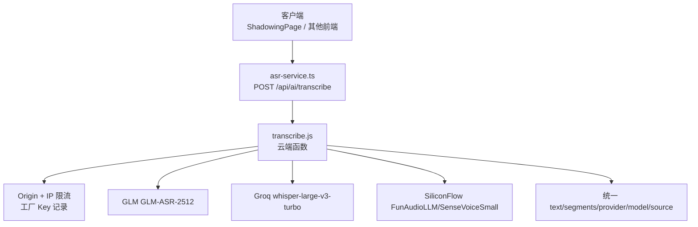
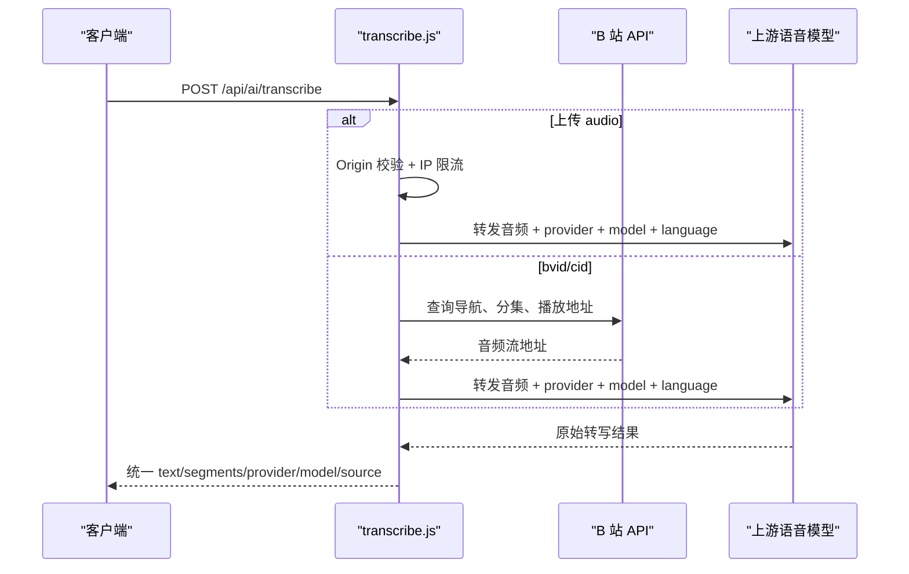
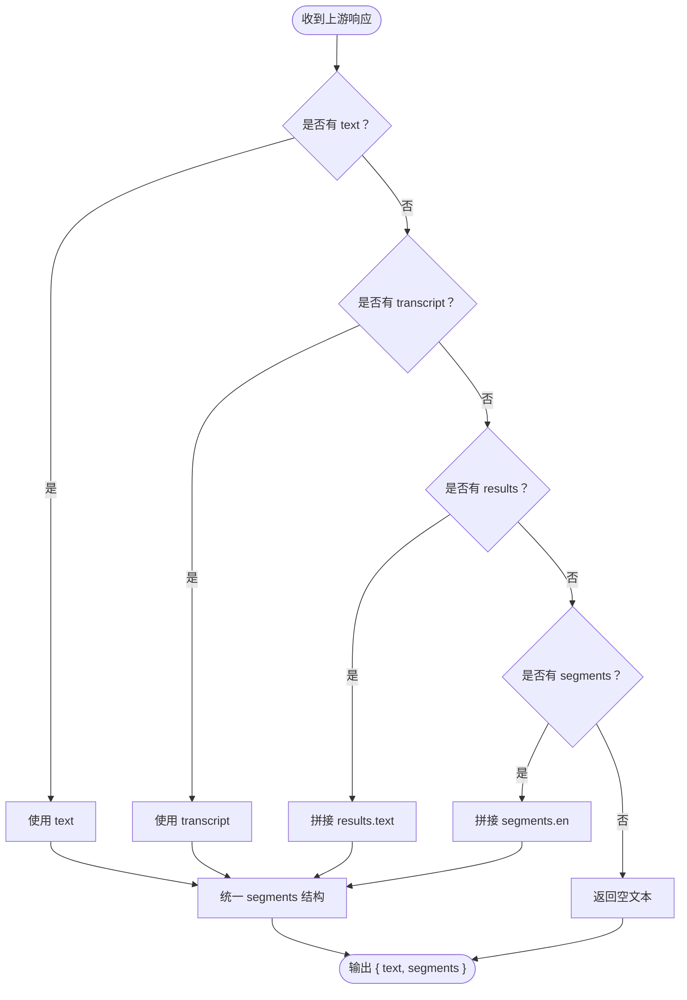
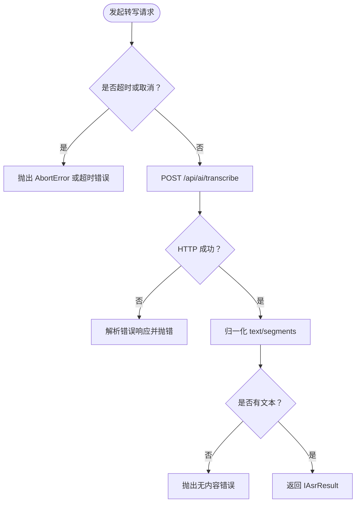
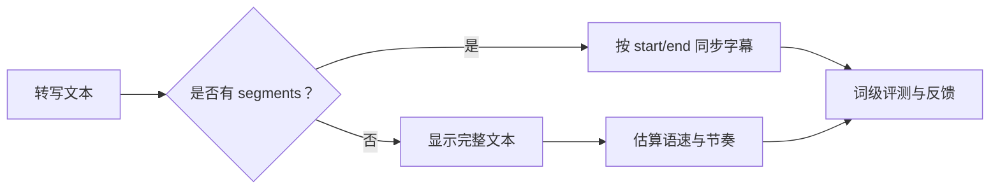
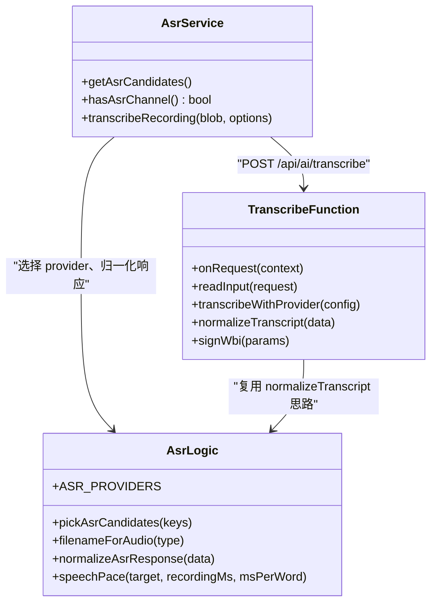
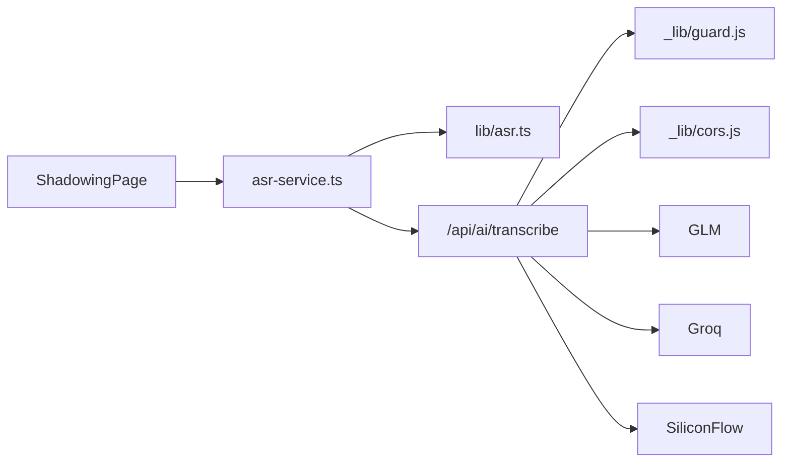

# 语音转写接口 /api/ai/transcribe

<cite>
**本文引用的文件**   
- [functions/api/ai/transcribe.js](file://functions/api/ai/transcribe.js)
- [src/services/asr-service.ts](file://src/services/asr-service.ts)
- [src/lib/asr.ts](file://src/lib/asr.ts)
- [docs/modules/ai-services.md](file://docs/modules/ai-services.md)
- [docs/modules/shadowing.md](file://docs/modules/shadowing.md)
- [scripts/probe-shadowing-asr.mjs](file://scripts/probe-shadowing-asr.mjs)
</cite>

## 目录

1. [简介](#简介)
2. [项目结构中的定位](#项目结构中的定位)
3. [接口总览](#接口总览)
4. [请求格式](#请求格式)
5. [响应格式](#响应格式)
6. [音频格式与质量要求](#音频格式与质量要求)
7. [错误处理策略](#错误处理策略)
8. [完整调用流程示例](#完整调用流程示例)
9. [前端集成指南](#前端集成指南)
10. [与视频字幕同步](#与视频字幕同步)
11. [架构与依赖关系](#架构与依赖关系)
12. [性能与限制](#性能与限制)
13. [常见问题排查](#常见问题排查)
14. [结论](#结论)

## 简介

`/api/ai/transcribe` 是 NativeThink 应用的语音转写入口，负责把音频数据交给后端服务进行语音识别，并返回统一的文本和分段结果。它同时支持两种典型使用场景：

- **影子跟读录音**：客户端上传录制的音频，服务端转写为英文文本和时间戳分段。
- **B 站视频转写**：传入 B 站 `bvid`、`cid` 或现成 `audioUrl`，服务端拉取视频音频流后再转写。

该接口在 Cloudflare Workers 环境下运行，路由映射由本地开发服务器与构建配置共同完成；实际函数实现位于 `functions/api/ai/transcribe.js`。

## 项目结构中的定位

| 层级 | 文件 | 职责 |
|---|---|---|
| 前端网络层 | [src/services/asr-service.ts](file://src/services/asr-service.ts) | 构造 `FormData`，调用 `/api/ai/transcribe`，处理超时、取消、失败重试 |
| ASR 纯逻辑 | [src/lib/asr.ts](file://src/lib/asr.ts) | Provider 优先级、文件名映射、响应归一化、语速估算 |
| 云端函数 | [functions/api/ai/transcribe.js](file://functions/api/ai/transcribe.js) | 鉴权、限流、输入校验、上游 ASR 转发、统一响应 |
| 文档 | [docs/modules/ai-services.md](file://docs/modules/ai-services.md)、[docs/modules/shadowing.md](file://docs/modules/shadowing.md) | 接口路线、来源说明、端到端录音链路 |
| 验证脚本 | [scripts/probe-shadowing-asr.mjs](file://scripts/probe-shadowing-asr.mjs) | 真链路探针，支持走本地函数或直接连上游模型 |



**图示来源**
- [src/services/asr-service.ts:58-99](file://src/services/asr-service.ts#L58-L99)
- [functions/api/ai/transcribe.js:197-345](file://functions/api/ai/transcribe.js#L197-L345)

**章节来源**
- [docs/modules/ai-services.md:42-77](file://docs/modules/ai-services.md#L42-L77)
- [docs/modules/shadowing.md:37-119](file://docs/modules/shadowing.md#L37-L119)

## 接口总览

| 属性 | 值 |
|---|---|
| HTTP 方法 | `POST` |
| URL | `/api/ai/transcribe` |
| Content-Type | `multipart/form-data`（推荐）或 `application/json` |
| 认证方式 | 通过 `apiKey` 字段传递上游提供商密钥，或由服务端环境变量注入出厂 Key |
| 默认 Provider | multipart 上传时默认为 `glm`；JSON 路径默认为 `groq` |
| 默认语言 | `en` |
| 主要用途 | 录音转写、B 站视频音频转写 |

### 支持的 Provider

| Provider | 模型 | 特点 |
|---|---|---|
| `glm` | `GLM-ASR-2512` | 只返回 `text`，不返回 `segments`；作为出厂优先通道 |
| `groq` | `whisper-large-v3-turbo` | Whisper 兼容接口，可能返回 `segments` |
| `siliconflow` | `FunAudioLLM/SenseVoiceSmall` | Whisper 兼容接口，可能返回 `segments` |

Provider 顺序由前端固定为 `glm → groq → siliconflow`，任一失败自动尝试下一个已配置 Key。

**章节来源**
- [functions/api/ai/transcribe.js:138-165](file://functions/api/ai/transcribe.js#L138-L165)
- [src/lib/asr.ts:1-40](file://src/lib/asr.ts#L1-L40)
- [src/services/asr-service.ts:16-35](file://src/services/asr-service.ts#L16-L35)

## 请求格式

### 模式一：`multipart/form-data`（推荐）

这是影子跟读录音的标准上传方式。表单字段如下：

| 字段 | 类型 | 是否必填 | 默认值 | 说明 |
|---|---|---:|---|---|
| `audio` | 文件 | 是 | — | 音频二进制数据 |
| `provider` | 字符串 | 否 | `glm` | 可选 `glm`、`groq`、`siliconflow` |
| `apiKey` | 字符串 | 否 | 使用服务端环境变量 | 若未传且服务端有出厂 Key，则记录工厂用量 |
| `language` | 字符串 | 否 | `en` | 目标语言，截断至 8 个字符 |

服务端会读取 `audio.type` 判断 MIME，再推导扩展名传给上游。如果 `audio.type` 缺失，默认按 `audio/webm` 处理。

### 模式二：`application/json`

这是历史兼容路径，主要用于 B 站视频转写。请求体可以是以下两种之一：

#### 通过 `audioUrl`

| 字段 | 类型 | 是否必填 | 默认值 | 说明 |
|---|---|---:|---|---|
| `audioUrl` | 字符串 | 条件必填 | — | 可直接访问的音频地址 |
| `provider` | 字符串 | 否 | `groq` | JSON 模式下默认 Groq |
| `apiKey` | 字符串 | 否 | 使用服务端环境变量 | 同上 |
| `language` | 字符串 | 否 | `en` | 同上 |

#### 通过 `bvid` 与 `cid`

| 字段 | 类型 | 是否必填 | 默认值 | 说明 |
|---|---|---:|---|---|
| `bvid` | 字符串 | 条件必填 | — | B 站视频编号 |
| `cid` | 字符串 | 否 | 从分集列表推断 | 当前分集 ID |
| `page` | 数字 | 否 | `1` | 分集序号 |
| `provider` | 字符串 | 否 | `groq` | 同上 |
| `apiKey` | 字符串 | 否 | 使用服务端环境变量 | 同上 |
| `language` | 字符串 | 否 | `en` | 同上 |

当提供 `bvid` 但未提供 `audioUrl` 时，服务端会调用 B 站接口获取播放地址，并从中选择带宽不大于 64kbps 的高质量音频流。



**图示来源**
- [functions/api/ai/transcribe.js:201-345](file://functions/api/ai/transcribe.js#L201-L345)

**章节来源**
- [functions/api/ai/transcribe.js:166-200](file://functions/api/ai/transcribe.js#L166-L200)
- [functions/api/ai/transcribe.js:230-315](file://functions/api/ai/transcribe.js#L230-L315)

## 响应格式

成功响应是一个 JSON 对象，核心字段如下：

| 字段 | 类型 | 含义 |
|---|---|---|
| `text` | 字符串 | 完整转写文本；多个上游返回结构的兜底拼接结果 |
| `segments` | 数组 | 带时间戳的分段结果；某些模型为空数组 |
| `provider` | 字符串 | 使用的 provider，如 `glm`、`groq`、`siliconflow` |
| `model` | 字符串 | 具体模型名称 |
| `source` | 字符串 | 固定为 `whisper` |
| `error` | 空值 | 成功时为空 |
| `episodeList` | 数组 | B 站模式下可用的分集信息 |
| `totalEpisodes` | 数字 | B 站模式下的分集总数 |

### 分段数据结构

`segments` 中每个元素包含：

| 字段 | 类型 | 含义 |
|---|---|---|
| `start` | 数字 | 段落开始时间（秒） |
| `end` | 数字 | 段落结束时间（秒） |
| `en` | 字符串 | 英文转写内容 |
| `zh` | 字符串 | 中文翻译；当前实现为空字符串 |
| `keywords` | 数组 | 简单关键词提取；当前实现不包含真实词义 |

注意：GLM 的 `GLM-ASR-2512` 只返回 `text`，因此 `segments` 通常为 `[]`。Groq 与 SiliconFlow 的 Whisper 兼容接口更可能返回带 `start`、`end` 的分段。

### 服务端与客户端双重归一化

服务端 `normalizeTranscript` 会把不同上游的结构统一为 `{ text, segments }`；客户端 `normalizeAsrResponse` 再次做数值化和空段过滤。两者都遵循同一降级顺序：

1. 优先使用 `text`。
2. 其次使用 `transcript`。
3. 其次拼接 `results[].text`。
4. 最后拼接 `segments[].en`。



**图示来源**
- [functions/api/ai/transcribe.js:146-165](file://functions/api/ai/transcribe.js#L146-L165)
- [src/lib/asr.ts:49-80](file://src/lib/asr.ts#L49-L80)

**章节来源**
- [functions/api/ai/transcribe.js:146-165](file://functions/api/ai/transcribe.js#L146-L165)
- [functions/api/ai/transcribe.js:316-345](file://functions/api/ai/transcribe.js#L316-L345)
- [src/lib/asr.ts:49-80](file://src/lib/asr.ts#L49-L80)

## 音频格式与质量要求

### 支持的音频容器

服务端根据 MIME 类型推导扩展名，从而决定上游接受的容器格式：

| 客户端 MIME | 推导扩展名 | 说明 |
|---|---|---|
| `audio/wav` | `wav` | 影子跟读标准格式 |
| `audio/mp4`、`audio/m4a` | `m4a` | 常见移动端音频 |
| `audio/ogg` | `ogg` | OGG Vorbis |
| `audio/mpeg`、`audio/mp3` | `mp3` | MP3 |
| 其他或未知 | `webm` | 兜底 WebM |

### 采样率与声道

影子跟读链路在前端将录音编码为 **16kHz 单声道 PCM WAV**。这是当前应用内推荐的录音规格，也是 `blobToWav16k` 的输出目标。

### 文件大小限制

服务端对 multipart 上传的音频大小设置硬上限：**8MB**。超过该限制会直接拒绝请求。

### 噪声过滤与音频质量评估

当前实现没有在后端执行显式降噪或信噪比检测。音频质量主要由前端录制阶段和上游模型决定。需要关注的点包括：

- 尽量靠近麦克风，避免环境噪音过大。
- 录音时长不宜过长；影子跟读建议单句不超过 20 秒。
- 保持说话清晰、语速适中，有利于词级评测和语速估算。
- 如果上游返回空文本，客户端会提示“没有识别到英文内容，请靠近麦克风再试一次”。

**章节来源**
- [functions/api/ai/transcribe.js:138-145](file://functions/api/ai/transcribe.js#L138-L145)
- [functions/api/ai/transcribe.js:166-195](file://functions/api/ai/transcribe.js#L166-L195)
- [docs/modules/shadowing.md:37-119](file://docs/modules/shadowing.md#L37-L119)
- [src/services/asr-service.ts:70-99](file://src/services/asr-service.ts#L70-L99)

## 错误处理策略

### 请求阶段错误

| 错误场景 | HTTP 状态 | 行为 |
|---|---:|---|
| 非 `POST` 请求 | `405` | 返回 `Method not allowed` |
| Origin 不在白名单 | `403` | 返回 `Origin not allowed` |
| IP 触发限流 | `429` | 返回 `Too many requests, slow down` |
| 缺少 `audio` 字段 | `400` | 返回解析错误消息 |
| 音频超过 8MB | `400` | 返回具体 MB 数及上限 |
| 不支持的 Content-Type | `400` | 提示必须为 JSON 或 multipart |
| 不支持的 provider | `400` | 返回不支持的 provider 名称 |
| 未配置 apiKey | `503` | 返回未配置语音转写 Key |

### 上游与服务端错误

| 错误场景 | HTTP 状态 | 行为 |
|---|---|---|
| 上游模型返回错误 | `502` | 返回脱敏后的错误消息，`text` 与 `segments` 为空 |
| 下载 B 站音频失败 | `502` | 返回“无法获取音频 URL”或“下载音频失败”等消息 |
| 上游非 JSON 响应 | 内部处理 | 保留原始文本前 240 字符用于调试，并屏蔽 apiKey |

### 前端超时与取消

前端默认超时时间为 **30 秒**，可通过选项覆盖。外部 `AbortSignal` 也会中止请求。

| 情况 | 抛出错误 |
|---|---|
| 前端超时 | “转写超时，请重试” |
| 外部主动取消 | “转写已取消” |
| 所有 provider 都失败 | 最后一次异常或“转写失败” |
| 没有配置任何 provider | `ASR_NOT_CONFIGURED` |



**图示来源**
- [src/services/asr-service.ts:36-99](file://src/services/asr-service.ts#L36-L99)

**章节来源**
- [functions/api/ai/transcribe.js:201-229](file://functions/api/ai/transcribe.js#L201-L229)
- [functions/api/ai/transcribe.js:230-345](file://functions/api/ai/transcribe.js#L230-L345)
- [src/services/asr-service.ts:36-99](file://src/services/asr-service.ts#L36-L99)

## 完整调用流程示例

以下示例描述一个完整的影子跟读转写过程，不涉及具体代码片段。

### 步骤一：录制音频

1. 使用浏览器原生录音能力录制一句话。
2. 将录音转为 16kHz 单声道 WAV 的 Blob。
3. 控制录音时长，通常建议不超过 20 秒。

### 步骤二：构造请求

1. 创建 `FormData`。
2. 添加 `audio` 字段，值为上一步的 Blob。
3. 添加 `provider`，默认使用 `glm`。
4. 添加 `apiKey`；若留空，服务端会使用环境变量中的出厂 Key。
5. 添加 `language`，默认 `en`。

### 步骤三：发送请求

调用 `/api/ai/transcribe`，使用 `POST` 方法，Content-Type 由浏览器自动设置为 `multipart/form-data`。

### 步骤四：处理响应

成功时得到：

```json
{
  "text": "I think in English every day.",
  "segments": [],
  "provider": "glm",
  "model": "GLM-ASR-2512",
  "source": "whisper",
  "error": null,
  "episodeList": [],
  "totalEpisodes": 0
}
```

如果后续改用 Groq 或 SiliconFlow，`segments` 可能包含带 `start`、`end`、`en` 的分段。

### 步骤五：继续业务逻辑

- 显示转写文本。
- 如果有 `segments`，可用于词级评测、语速分析或与字幕对齐。
- 如果没有文本，提示用户重新录音。

**章节来源**
- [docs/modules/shadowing.md:37-119](file://docs/modules/shadowing.md#L37-L119)
- [src/services/asr-service.ts:58-99](file://src/services/asr-service.ts#L58-L99)
- [functions/api/ai/transcribe.js:316-345](file://functions/api/ai/transcribe.js#L316-L345)

## 前端集成指南

### 录音并调用转写接口

推荐流程如下：

1. 使用 `MediaRecorder` 或平台录音能力采集音频。
2. 将录音数据转换为适合上游处理的音频 Blob。
3. 调用 `transcribeRecording(blob, options)`，它会：
   - 自动选择可用的 provider。
   - 构造 `FormData`。
   - 设置 30 秒默认超时。
   - 在多个 provider 之间依次重试。
   - 归一化响应并检查是否识别到内容。

关键注意事项：

- 如果没有任何 provider 配置，应提示用户先配置 AI Key。
- 如果用户手动取消录音，应捕获取消错误并友好提示。
- 如果返回文本为空，应引导用户靠近麦克风重新录音。
- 不建议一次性上传超长音频；影子跟读以短句为主。

### Provider 选择策略

前端按固定顺序挑选可用 provider：

1. `glm`
2. `groq`
3. `siliconflow`

只有配置了 `apiKey` 的 provider 才会进入候选列表。某个 provider 失败后，不会立即报错，而是继续尝试下一个。

**章节来源**
- [src/services/asr-service.ts:1-35](file://src/services/asr-service.ts#L1-L35)
- [src/services/asr-service.ts:58-99](file://src/services/asr-service.ts#L58-L99)
- [src/lib/asr.ts:1-48](file://src/lib/asr.ts#L1-L48)

## 与视频字幕同步

### 使用 segments 做时间轴对齐

当上游返回 `segments` 时，每个分段包含：

- `start`：起始时间（秒）。
- `end`：结束时间（秒）。
- `en`：对应时间段内的英文文本。

可以将这些分段渲染为字幕轨道，例如：

- 在视频播放器中，根据当前播放时间高亮对应 segment。
- 点击某行字幕跳转到对应时间点。
- 用 `start`、`end` 计算每行字幕显示时长。

### 如果只有 text

GLM 目前只返回 `text`，不提供精确时间戳。此时可以：

- 仅显示整段转写文本。
- 使用前端分句器把长文本拆成多行。
- 基于播放进度估算高亮位置，但精度不如服务端 `segments`。
- 如需高精度时间戳，可切换 Groq 或 SiliconFlow。

### 与影子跟读结合

影子跟读链路最终会将转写结果交给词级评分和语速分析模块。即使没有精确分段，只要拿到 `text`，仍可估算语速和停顿特征。



**图示来源**
- [src/lib/asr.ts:49-101](file://src/lib/asr.ts#L49-L101)

**章节来源**
- [src/lib/asr.ts:49-101](file://src/lib/asr.ts#L49-L101)
- [docs/modules/shadowing.md:117-119](file://docs/modules/shadowing.md#L117-L119)

## 架构与依赖关系

### 组件职责图



**图示来源**
- [src/services/asr-service.ts:1-99](file://src/services/asr-service.ts#L1-L99)
- [src/lib/asr.ts:1-101](file://src/lib/asr.ts#L1-L101)
- [functions/api/ai/transcribe.js:146-345](file://functions/api/ai/transcribe.js#L146-L345)

### 依赖关系图



**图示来源**
- [src/services/asr-service.ts:1-99](file://src/services/asr-service.ts#L1-L99)
- [functions/api/ai/transcribe.js:1-20](file://functions/api/ai/transcribe.js#L1-L20)

**章节来源**
- [src/services/asr-service.ts:1-99](file://src/services/asr-service.ts#L1-L99)
- [src/lib/asr.ts:1-101](file://src/lib/asr.ts#L1-L101)
- [functions/api/ai/transcribe.js:1-20](file://functions/api/ai/transcribe.js#L1-L20)

## 性能与限制

| 项目 | 限制或特性 |
|---|---|
| 最大上传大小 | 8MB |
| 默认超时 | 30 秒 |
| Provider 数量 | 最多 3 个，逐个尝试 |
| 默认语言长度 | 最多 8 个字符 |
| 上游重试策略 | 仅在部分上游出现 400/422 且 provider 不是 Groq 时，退一步重试 |
| 日志与审计 | 使用出厂 Key 时记录工厂用量 |
| 音频落盘 | 服务端转发后即弃，不落盘 |

性能优化建议：

- 前端尽量压缩音频体积，避免接近 8MB。
- 短录音更适合实时评测；长音频建议分段处理。
- 首次失败时不要立即展示错误，让前端自动重试下一个 provider。
- 对频繁调用的场景，可在客户端做去重或缓存，但不要缓存敏感音频数据。

**章节来源**
- [functions/api/ai/transcribe.js:138-165](file://functions/api/ai/transcribe.js#L138-L165)
- [functions/api/ai/transcribe.js:201-229](file://functions/api/ai/transcribe.js#L201-L229)
- [functions/api/ai/transcribe.js:201-240](file://functions/api/ai/transcribe.js#L201-L240)
- [src/services/asr-service.ts:16-35](file://src/services/asr-service.ts#L16-L35)

## 常见问题排查

| 现象 | 可能原因 | 处理方式 |
|---|---|---|
| 返回 `Origin not allowed` | 前端域名不在白名单 | 检查部署域名与 Origin 配置 |
| 返回 `Too many requests, slow down` | IP 触发限流 | 降低调用频率或增加重试间隔 |
| 返回 `未配置语音转写 Key` | 环境变量中没有 provider Key | 配置 `AI_KEY_GLM`、`AI_KEY_GROQ` 或 `AI_KEY_SILICONFLOW` |
| 始终只有 `text`，没有 `segments` | 使用了 GLM | 切换到 Groq 或 SiliconFlow |
| 返回空文本 | 录音太轻、噪音太大、距离太远 | 重新录制，靠近麦克风 |
| 报 `转写超时` | 上游响应慢或网络差 | 增加超时时间或检查网络 |
| B 站转写失败 | Cookie、CID、分集或播放地址不可用 | 检查 `BILIBILI_COOKIE`、`bvid`、`cid`、`page` |
| 本地测试失败 | 函数模块加载或端口不一致 | 使用探针脚本验证本地函数链路 |

**章节来源**
- [functions/api/ai/transcribe.js:201-345](file://functions/api/ai/transcribe.js#L201-L345)
- [src/services/asr-service.ts:36-99](file://src/services/asr-service.ts#L36-L99)
- [scripts/probe-shadowing-asr.mjs:267-302](file://scripts/probe-shadowing-asr.mjs#L267-L302)

## 结论

`/api/ai/transcribe` 是一个面向语音转写的统一入口。它通过 `multipart/form-data` 接收录音，通过 `application/json` 兼容历史 B 站转写路径，并把不同上游的结果归一化为 `text` 与 `segments`。

对于 NativeThink 的影子跟读功能，推荐采用：

- 前端录制 16kHz 单声道 WAV。
- 使用 `transcribeRecording` 调用 `/api/ai/transcribe`。
- 默认使用 GLM 作为首选 provider。
- 失败时自动回退 Groq、SiliconFlow。
- 有 `segments` 时做字幕对齐，没有时显示完整文本并结合语速估算。

该接口本身不做复杂音频增强，也不持久化音频；安全性和稳定性主要通过 Origin 白名单、IP 限流、8MB 上传上限、超时控制和上游错误脱敏来保障。