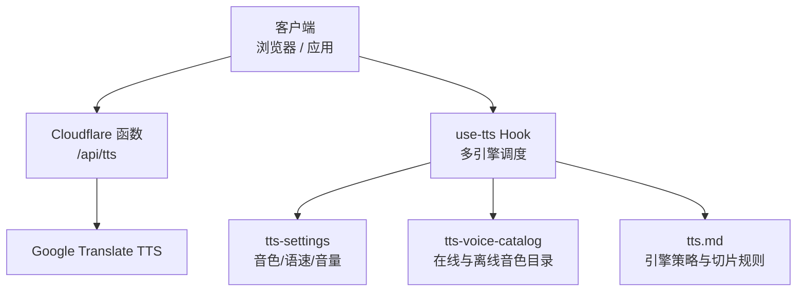
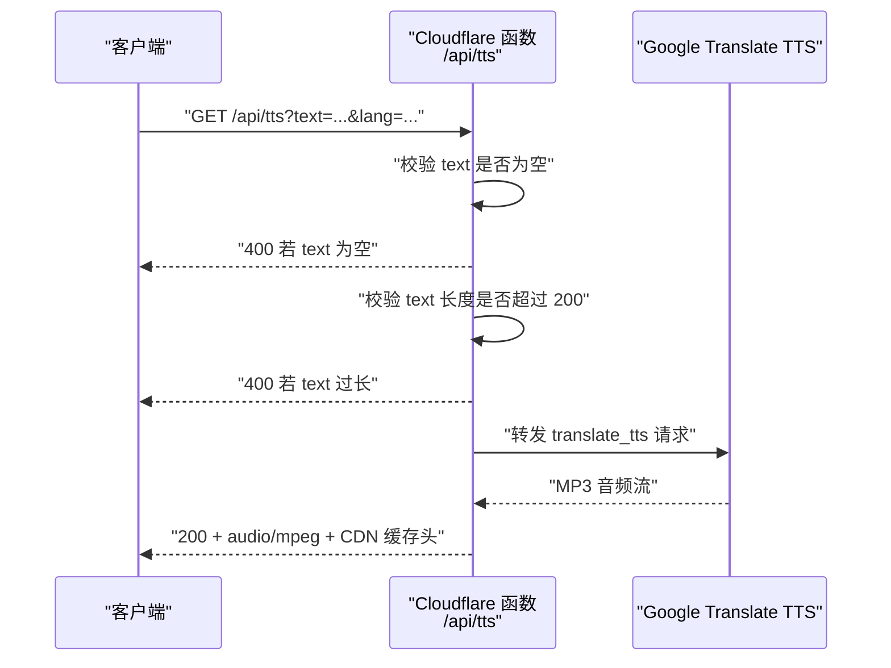
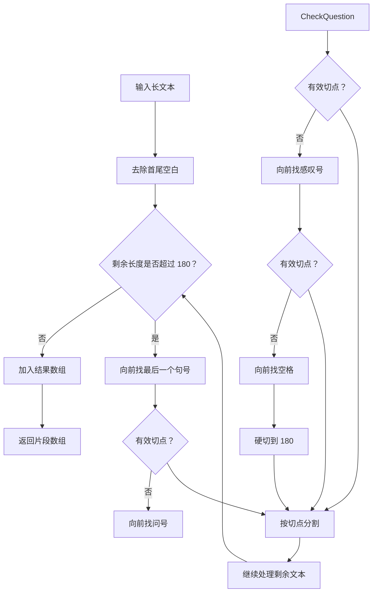
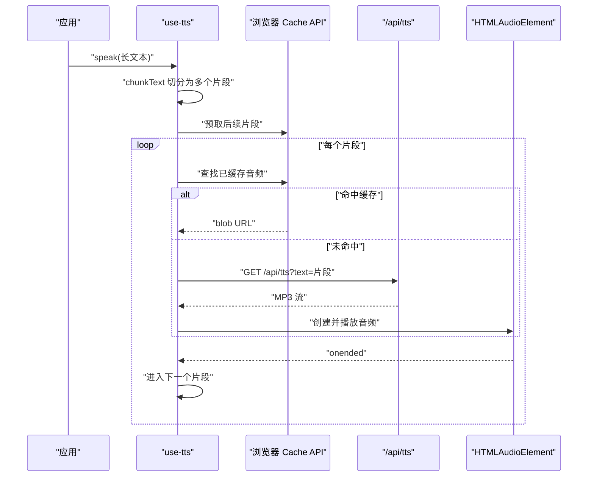
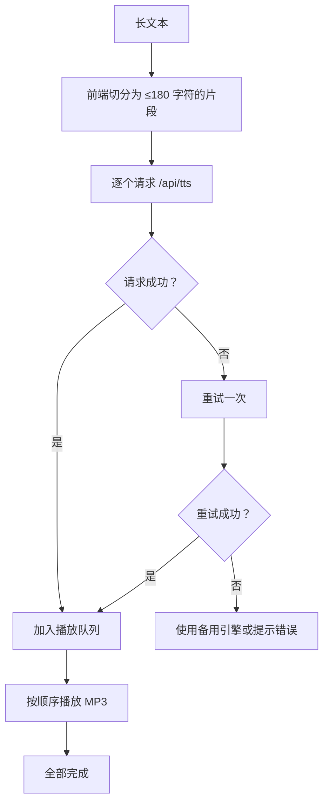

# TTS 合成接口

<cite>
**本文引用的文件**   
- [functions/api/tts.js](file://functions/api/tts.js)
- [src/lib/use-tts.ts](file://src/lib/use-tts.ts)
- [src/lib/tts-settings.ts](file://src/lib/tts-settings.ts)
- [src/lib/tts-voice-catalog.ts](file://src/lib/tts-voice-catalog.ts)
- [docs/modules/tts.md](file://docs/modules/tts.md)
- [scripts/check-tts-voices.cjs](file://scripts/check-tts-voices.cjs)
</cite>

## 目录

1. [简介](#简介)
2. [项目结构中的 TTS 位置](#项目结构中的-tts-位置)
3. [/api/tts 接口规范](#apitts-接口规范)
4. [支持的语音引擎与音色体系](#支持的语音引擎与音色体系)
5. [请求参数详解](#请求参数详解)
6. [响应格式与音频属性](#响应格式与音频属性)
7. [文本分块与长文处理](#文本分块与长文处理)
8. [客户端集成指南](#客户端集成指南)
9. [错误码与故障排查](#错误码与故障排查)
10. [性能与缓存特性](#性能与缓存特性)
11. [结论](#结论)

## 简介

`/api/tts` 是 NativeThink 应用的云端文字转语音代理接口。它部署在 Cloudflare Pages Function 上，把浏览器请求转发给 Google Translate TTS，并把合成的 MP3 音频直接返回给客户端。

该接口的核心价值有三点：

- 浏览器不直接访问 Google，而是通过 Cloudflare 边缘网络发起请求，从而规避部分网络环境对上游服务的限制。
- 响应带有永久 CDN 缓存头，相同文本的音频可以在边缘缓存中秒级返回。
- 它是应用内多引擎降级链中的一环，通常作为 Android 和桌面端的首选在线通道。

需要注意：**该接口本身只支持最基础的文本转音频能力**。语速、音色等高级控制主要在上层 `use-tts` Hook 里完成，由调用方拼接 URL 或走 Edge-TTS WebSocket；接口层不做完整的多格式编码、采样率选择、比特率配置等复杂音频管道。

**章节来源**
- [functions/api/tts.js:1-69](file://functions/api/tts.js#L1-L69)
- [src/lib/use-tts.ts:1-200](file://src/lib/use-tts.ts#L1-L200)
- [docs/modules/tts.md:1-60](file://docs/modules/tts.md#L1-L60)

## 项目结构中的 TTS 位置

TTS 相关代码分布在服务端函数、前端 Hook、音色目录、设置持久化以及文档中：

**图表来源**
- [functions/api/tts.js:1-69](file://functions/api/tts.js#L1-L69)
- [src/lib/use-tts.ts:1-200](file://src/lib/use-tts.ts#L1-L200)
- [src/lib/tts-settings.ts:1-140](file://src/lib/tts-settings.ts#L1-L140)
- [src/lib/tts-voice-catalog.ts:1-162](file://src/lib/tts-voice-catalog.ts#L1-L162)
- [docs/modules/tts.md:1-60](file://docs/modules/tts.md#L1-L60)

| 层级 | 主要职责 | 关键文件 |
|---|---|---|
| 云端代理层 | 接收 `/api/tts` 请求，校验文本长度，转发到 Google TTS，返回 MP3 | [functions/api/tts.js](file://functions/api/tts.js) |
| 前端调度层 | 决定用哪个引擎、如何分片、如何降级、如何缓存 | [src/lib/use-tts.ts](file://src/lib/use-tts.ts) |
| 音色目录层 | 定义 Edge 在线音色、Kokoro/Piper 离线音色、默认兜底音色 | [src/lib/tts-voice-catalog.ts](file://src/lib/tts-voice-catalog.ts) |
| 设置层 | 持久化用户选择的音色、语速、音高、音量 | [src/lib/tts-settings.ts](file://src/lib/tts-settings.ts) |
| 文档与验证 | 记录引擎顺序、切片上限、降级策略、性能边界 | [docs/modules/tts.md](file://docs/modules/tts.md) |
| 打包校验脚本 | 检查离线音色 speakerId 是否越界、是否与模型元数据一致 | [scripts/check-tts-voices.cjs](file://scripts/check-tts-voices.cjs) |

**章节来源**
- [functions/api/tts.js:1-69](file://functions/api/tts.js#L1-L69)
- [src/lib/use-tts.ts:1-200](file://src/lib/use-tts.ts#L1-L200)
- [src/lib/tts-settings.ts:1-140](file://src/lib/tts-settings.ts#L1-L140)
- [src/lib/tts-voice-catalog.ts:1-162](file://src/lib/tts-voice-catalog.ts#L1-L162)
- [docs/modules/tts.md:1-60](file://docs/modules/tts.md#L1-L60)
- [scripts/check-tts-voices.cjs:1-200](file://scripts/check-tts-voices.cjs#L1-L200)

## /api/tts 接口规范

### 基本行为

| 项目 | 说明 |
|---|---|
| 协议 | HTTP GET |
| 路径 | `/api/tts` |
| 内容类型 | `audio/mpeg` |
| 成功状态码 | 200（由上游 Google TTS 返回音频） |
| 文本缺失 | 400 |
| 文本超长 | 400 |
| 上游失败 | 502 |
| 代理异常 | 500 |
| 跨域 | 允许所有来源 |

### 核心流程

**图表来源**
- [functions/api/tts.js:12-69](file://functions/api/tts.js#L12-L69)

### 接口限制

1. **必须提供 `text` 参数。**
2. **文本不能只包含空白字符。**
3. **文本长度不能超过 200 个字符。**
4. **该函数没有实现 `OPTIONS` 预检处理，但外层 CORS 包装会放行跨域请求。**
5. **该函数不会解析二进制音频体，直接把上游响应体透传。**
6. **该函数不会根据语言自动切换音色名称，只通过 `tl` 参数影响 Google TTS 的语言变体。**

**章节来源**
- [functions/api/tts.js:12-69](file://functions/api/tts.js#L12-L69)

## 支持的语音引擎与音色体系

`/api/tts` 本身只连接 Google Translate TTS，但应用整体 TTS 能力由多层引擎构成。理解这一点很重要：

- **Google Translate TTS**：通过 `/api/tts` 获取，返回 MP3。
- **Edge-TTS WebSocket**：绕过 `/api/tts`，直接通过 Bing Edge 服务生成 MP3 Blob。
- **系统 SpeechSynthesis**：浏览器内置引擎，适合桌面端快速朗读。
- **原生系统 TTS**：Android 上的系统语音引擎，零延迟但无法精确控制音色。
- **Piper / Kokoro 离线引擎**：设备内合成，不需要网络，但长句可能跟不上播放速度。

### 引擎优先级

不同平台下的默认优先级不同：

| 场景 | 首选引擎 | 说明 |
|---|---|---|
| Android 默认 | 云端 → 内置离线 → 系统 → Edge → Google | 短单词联网优先，避免离线小模型发音缺陷 |
| 显式选择在线音色 | 云端 → 内置离线 → 系统 → Edge → Google | 尊重用户对在线神经音色的选择 |
| 仅使用系统引擎 | 仅系统引擎 | 完全避开内置离线引擎 |
| 非 Android | 云端 → Edge → Google | 网页、桌面、iOS 不走系统原生 TTS 主链路 |

### 音色分类

| 类别 | 标识前缀 | 示例 | 特点 |
|---|---|---|---|
| Edge 在线神经音色 | `srv:edge:` | `srv:edge:en-US-AvaNeural` | 高质量、需联网 |
| Kokoro 离线音色 | `kokoro:` | `kokoro:af_bella` | 设备内合成、音质好但合成慢 |
| Piper 离线兜底音色 | `piper:` | `piper:lessac` | 默认离线音色、RTF 低、长文连续 |
| 系统语音 | `SpeechSynthesisVoice.voiceURI` | 由浏览器提供 | 依赖系统安装 |
| 本地服务器音色 | `srv:` | 桌面端 SAPI/OneCore | 仅桌面本地服务可用 |

**章节来源**
- [src/lib/use-tts.ts:400-550](file://src/lib/use-tts.ts#L400-L550)
- [src/lib/tts-voice-catalog.ts:1-162](file://src/lib/tts-voice-catalog.ts#L1-L162)
- [docs/modules/tts.md:1-60](file://docs/modules/tts.md#L1-L60)

## 请求参数详解

### 基础参数

| 参数 | 类型 | 必填 | 默认值 | 说明 |
|---|---|---:|---|---|
| `text` | 字符串 | 是 | 无 | 要朗读的英文文本，最多 200 字符 |
| `lang` | 字符串 | 否 | `en` | Google TTS 语言代码，通常为 `en`、`en-GB`、`en-AU` |
| `rate` | 数字 | 否 | 由上层决定 | 由 `use-tts` 传入，用于 Edge 或本地服务器；本函数未读取 |
| `voice` | 字符串 | 否 | 无 | 由上层传入，用于本地服务器或 Edge 通道映射；本函数未读取 |

### 重要约束

- `text` 会被 `encodeURIComponent` 后再拼接到查询串，但函数内部还会做一次 `trim()`。
- `lang` 缺省时固定为 `en`。
- 当前函数实现没有读取 `rate`、`voice`、`format`、`sampleRate`、`bitrate` 等参数。这些字段如果出现在 URL 中，会被忽略。
- 真正控制语速的是上层 `cfTtsUrl` 和 `edgeTTSBlob`：前者把 `rate` 写入 URL，后者通过 SSML `<prosody rate="...">` 控制 Edge 合成速率。

### 推荐用法

如果你只需要把一段不超过 200 字符的英文文本转成 MP3，可以这样构造请求：

| 场景 | 推荐方式 |
|---|---|
| 普通英语 | `/api/tts?text=Hello+world&lang=en` |
| 英音口音 | `/api/tts?text=Hello+world&lang=en-GB` |
| 澳音口音 | `/api/tts?text=Hello+world&lang=en-AU` |
| 中文环境直连失败 | 不要直接改函数，应通过应用内 `use-tts` 走 Cloudflare 代理 |

**章节来源**
- [functions/api/tts.js:12-48](file://functions/api/tts.js#L12-L48)
- [src/lib/use-tts.ts:201-270](file://src/lib/use-tts.ts#L201-L270)

## 响应格式与音频属性

### 成功响应

| 头部 | 值 | 含义 |
|---|---|---|
| `Content-Type` | `audio/mpeg` | MP3 音频 |
| `Cache-Control` | `public, max-age=31536000, immutable` | CDN 永久缓存 |
| `CDN-Cache-Control` | `public, max-age=31536000, immutable` | Cloudflare 边缘缓存 |
| `Access-Control-Allow-Origin` | `*` | 允许任意来源跨域访问 |

响应体是 Google Translate TTS 返回的二进制 MP3 数据。函数没有做二次解码、重采样、比特率转换或格式封装。

### 音频属性

| 属性 | 实际值 | 说明 |
|---|---:|---|
| 编码格式 | MP3 | MIME 类型为 `audio/mpeg` |
| 采样率 | 未声明 | 由上游 Google TTS 决定，函数未暴露配置 |
| 比特率 | 未声明 | 函数未配置编码器 |
| 声道数 | 通常为单声道 | 由上游决定 |
| 时长信息 | 不包含在响应头 | 需要客户端自行解码音频后获取 |

### 不含时长信息的处理方式

因为 `/api/tts` 只返回原始音频流，没有附带时长元数据，客户端通常需要以下两种方式之一：

1. **解码音频后读取时长**：例如把 Blob 交给 HTMLAudioElement 或 Web Audio API，等待 `loadedmetadata` 事件。
2. **按词估算**：应用内进度上报基于 `countWords` 和约 `400ms/词` 的经验值，但这只是估计值，不是真实音频时长。

**章节来源**
- [functions/api/tts.js:33-69](file://functions/api/tts.js#L33-L69)
- [src/lib/use-tts.ts:201-240](file://src/lib/use-tts.ts#L201-L240)

## 文本分块与长文处理

### 为什么需要分块

Google Translate TTS 的上限是 200 字符。函数层明确拒绝超过 200 字符的请求，以避免上游返回难以排查的 400 错误被包装成 502。

因此，应用前端使用 `chunkText` 把长文本切分成多个片段，再逐个调用 `/api/tts`。

### 分块策略

**图表来源**
- [src/lib/use-tts.ts:330-370](file://src/lib/use-tts.ts#L330-L370)

### 分块规则要点

| 规则 | 说明 |
|---|---|
| 最大片段长度 | 180 字符 |
| 首选切点 | 句号后空格 |
| 次选切点 | 问号后空格 |
| 再次切点 | 感叹号后空格 |
| 最后手段 | 空格或硬切 |
| 切点后保留标点 | 尽量保持句子语义完整 |
| 空片段过滤 | 最终结果会过滤空字符串 |
| 词数统计口径 | 按空白分隔的非空片段计数 |

### 长文播放流水线

**图表来源**
- [src/lib/use-tts.ts:330-370](file://src/lib/use-tts.ts#L330-L370)
- [src/lib/use-tts.ts:400-550](file://src/lib/use-tts.ts#L400-L550)

**章节来源**
- [functions/api/tts.js:24-36](file://functions/api/tts.js#L24-L36)
- [src/lib/use-tts.ts:330-370](file://src/lib/use-tts.ts#L330-L370)
- [docs/modules/tts.md:60-120](file://docs/modules/tts.md#L60-L120)

## 客户端集成指南

### 最小集成步骤

1. 确保文本不超过 200 字符。
2. 将文本进行 URL 编码。
3. 发起 GET 请求到 `/api/tts`。
4. 将响应体当作 MP3 二进制数据使用。
5. 如果需要播放，交给 HTMLAudioElement、Web Audio API 或原生播放器。
6. 如需下载，把响应 Blob 保存为 `.mp3` 文件。

### 音频播放控制

| 需求 | 建议方案 |
|---|---|
| 立即播放 | 使用 `new Audio(url)` 并调用 `play()` |
| 暂停 | 调用 `pause()` |
| 恢复 | 调用 `play()` |
| 停止 | 销毁 Audio 对象或清空 `src` |
| 循环播放 | 设置 `loop = true` |
| 音量控制 | 设置 `volume`，范围 0.0–1.0 |
| 语速控制 | 设置 `playbackRate`，范围 0.5–2.0 |
| 获取时长 | 监听 `loadedmetadata` 后读取 `duration` |
| 播放进度 | 监听 `timeupdate`，比较 `currentTime` 与 `duration` |

### 缓存策略

应用已经实现了三层缓存：

| 层级 | 存储位置 | 容量 | 生命周期 |
|---|---|---|---|
| JS Map | 内存 | 120 条 | 页面生命周期 |
| 原生文件缓存 | 设备文件系统 | 由插件管理 | 按 sha1 键持久 |
| 浏览器 Cache API | 源配额 | 约 400 条 | FIFO 淘汰最旧条目 |

对于直接调用 `/api/tts` 的外部客户端，建议使用 HTTP 缓存策略：

- 利用 `immutable` 缓存头，避免重复校验。
- 使用浏览器或反向代理缓存相同 URL。
- 对大段文本先在前端分块，再分别缓存每个片段。
- 注意源配额限制，不要无限缓存音频。

### 错误重试机制

| 错误类型 | 建议重试策略 |
|---|---|
| 400 文本为空 | 不调用，直接报错 |
| 400 文本过长 | 在前端拆分文本后重试 |
| 502 上游失败 | 可重试 1–2 次，然后降级到 Edge-TTS 或系统引擎 |
| 500 代理异常 | 可重试 1 次，仍失败则提示用户 |
| 网络超时 | 指数退避重试，总重试次数不超过 3 次 |
| 音频解码失败 | 尝试重新拉取，或换用其他引擎 |

### 大段文本处理模板

不建议一次性发送超过 200 字符的请求。推荐流程：

1. 前端按 180 字符切分。
2. 并行或串行拉取每个片段。
3. 按顺序播放。
4. 失败片段单独重试。
5. 全部完成后回调。

**图表来源**
- [functions/api/tts.js:24-36](file://functions/api/tts.js#L24-L36)
- [src/lib/use-tts.ts:330-370](file://src/lib/use-tts.ts#L330-L370)

**章节来源**
- [src/lib/use-tts.ts:240-370](file://src/lib/use-tts.ts#L240-L370)
- [src/lib/use-tts.ts:400-550](file://src/lib/use-tts.ts#L400-L550)

## 错误码与故障排查

### 状态码对照表

| 状态码 | 含义 | 常见原因 | 处理方式 |
|---|---|---|---|
| 200 | 成功 | 正常返回 MP3 | 播放或下载 |
| 400 | 请求错误 | `text` 为空或超过 200 字符 | 校验文本、拆分长文本 |
| 502 | 上游错误 | Google TTS 返回非 2xx | 重试或降级到其他引擎 |
| 500 | 代理异常 | 函数执行抛错 | 重试一次，仍失败则提示 |

### 典型问题

| 现象 | 原因 | 解决方案 |
|---|---|---|
| 点击朗读没声音 | 文本超过 200 字符被拒 | 使用 `chunkText` 分块 |
| 中文环境下无法访问 | 直连 Google 受限 | 使用应用内 `use-tts` 走 Cloudflare 代理 |
| 重复播放很快 | CDN 缓存命中 | 这是预期行为 |
| 播放卡顿 | 网络不可达或上游失败 | 触发 Edge-TTS 或系统引擎降级 |
| 移动端首次播放失败 | 浏览器要求用户手势解锁音频 | 由 `prime()` 在点击时提前解锁 |
| 自检卡住 | 原生桥无响应 | 已有 3 秒超时保护 |

### 调试建议

1. 先用短文本测试 `/api/tts` 是否可达。
2. 检查 `text` 是否包含不可见字符或超长内容。
3. 查看响应头是否包含 `audio/mpeg`。
4. 在设置页中使用“朗读自检”功能，区分是系统引擎、云端、Edge 还是浏览器引擎的问题。
5. 如果是离线音色异常，运行 `node scripts/check-tts-voices.cjs` 检查音色目录与模型资产。

**章节来源**
- [functions/api/tts.js:24-69](file://functions/api/tts.js#L24-L69)
- [src/lib/use-tts.ts:750-1138](file://src/lib/use-tts.ts#L750-L1138)
- [scripts/check-tts-voices.cjs:1-200](file://scripts/check-tts-voices.cjs#L1-L200)

## 性能与缓存特性

### CDN 缓存

响应头 `Cache-Control` 设置为一年且标记为 `immutable`，意味着：

- 相同文本的 MP3 会在 Cloudflare 边缘缓存。
- 第二次播放通常只需约 10ms。
- 不需要 ETag 或 Last-Modified 校验。
- 不适合频繁变化的动态音频。

### 前端缓存

前端还维护了名为 `nativethink-tts-v1` 的 Cache Storage，上限约为 400 条。当缓存占用过多时，会删除最早的一条。

### 合成性能边界

文档记录了离线引擎的性能特征：

- Piper lessac 的 RTF 很低，长文能跟上播放。
- Kokoro int8 的 RTF 接近或超过 1.0，长文可能出现停顿。
- 增加线程数只能带来次线性收益，不能解决实时合成追不上播放的问题。
- 默认离线音色是 Piper lessac，而不是 Kokoro。

### 优化建议

| 目标 | 建议 |
|---|---|
| 减少首包延迟 | 使用应用内 `prewarm` 预热下一句 |
| 提高长文连续性 | 优先使用 Piper lessac 或在线音色 |
| 降低带宽 | 复用 CD 缓存，避免重复请求相同文本 |
| 提升移动端体验 | 让用户手势触发首次播放，避免自动播放拦截 |
| 降低 CPU 占用 | 避免同时合成过多片段，使用有序队列 |

**章节来源**
- [functions/api/tts.js:43-69](file://functions/api/tts.js#L43-L69)
- [src/lib/use-tts.ts:240-330](file://src/lib/use-tts.ts#L240-L330)
- [docs/modules/tts.md:1-120](file://docs/modules/tts.md#L1-L120)
- [src/lib/tts-voice-catalog.ts:120-162](file://src/lib/tts-voice-catalog.ts#L120-L162)

## 结论

`/api/tts` 是一个轻量、稳定、面向边缘缓存的文字转语音代理接口。它承担的职责很清晰：接收文本，转发到 Google Translate TTS，返回 MP3，并提供长期 CDN 缓存。

它并不是一个完整的音频合成 SDK。真正的语音引擎选择、音色管理、语速控制、分块策略、降级逻辑、缓存拼装和播放管线都在 `use-tts` 中实现。对外部集成者而言，最直接的做法是：

- 短期需求：直接调用 `/api/tts`，负责文本切分和播放。
- 长期需求：接入 `use-tts`，获得多引擎降级、离线合成、进度上报和完整错误处理。
- 移动端或强离线场景：优先使用 Piper lessac，谨慎选择 Kokoro。
- 在线高质量场景：优先使用 Edge 或云端代理。
- 生产环境：务必实现分块、重试、缓存和错误回退，不要把 200 字符限制当成可选优化。