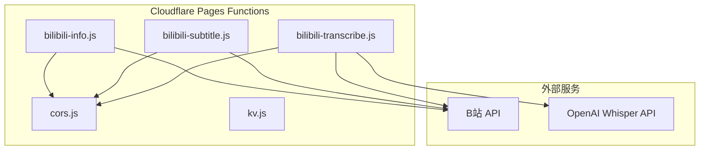
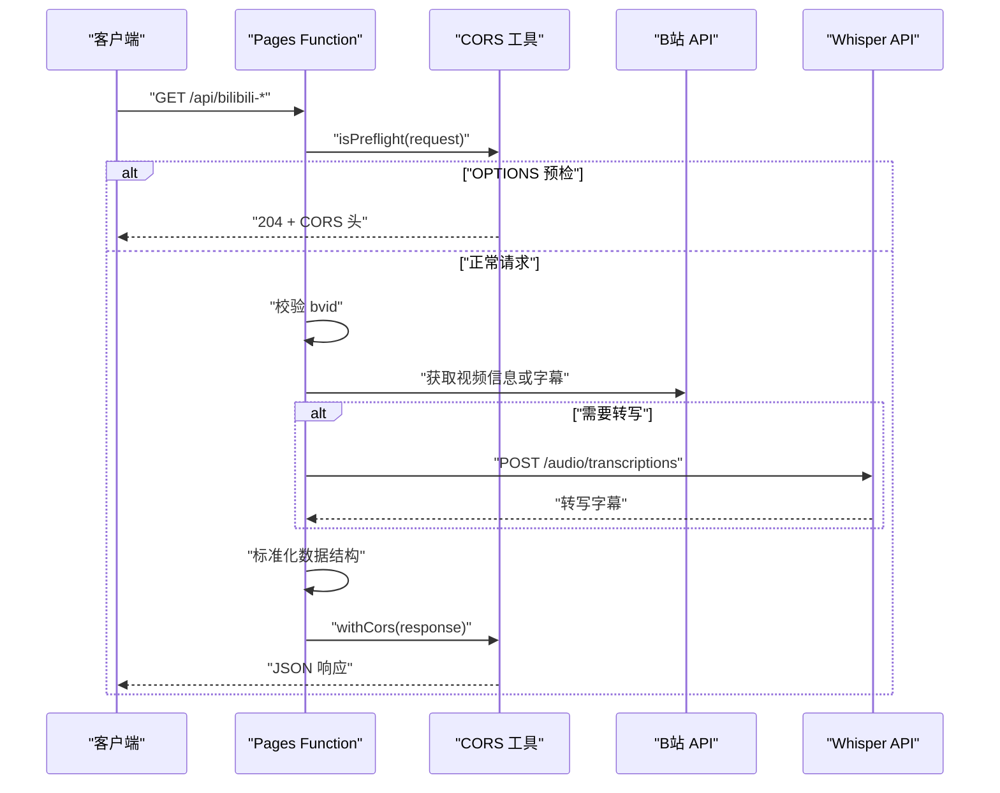
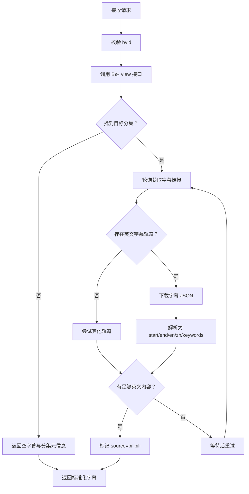
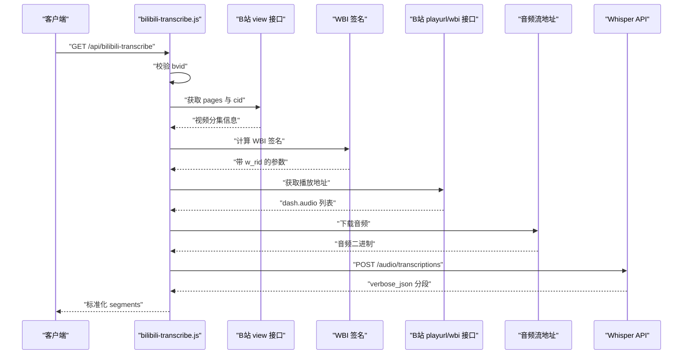
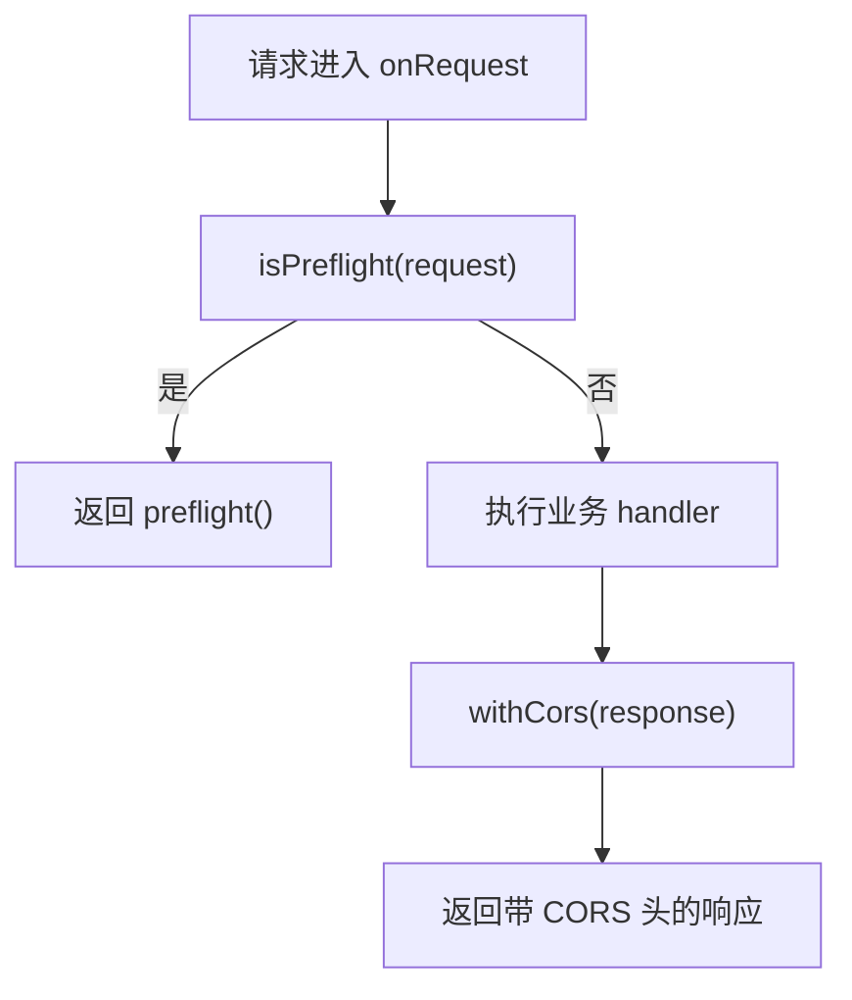
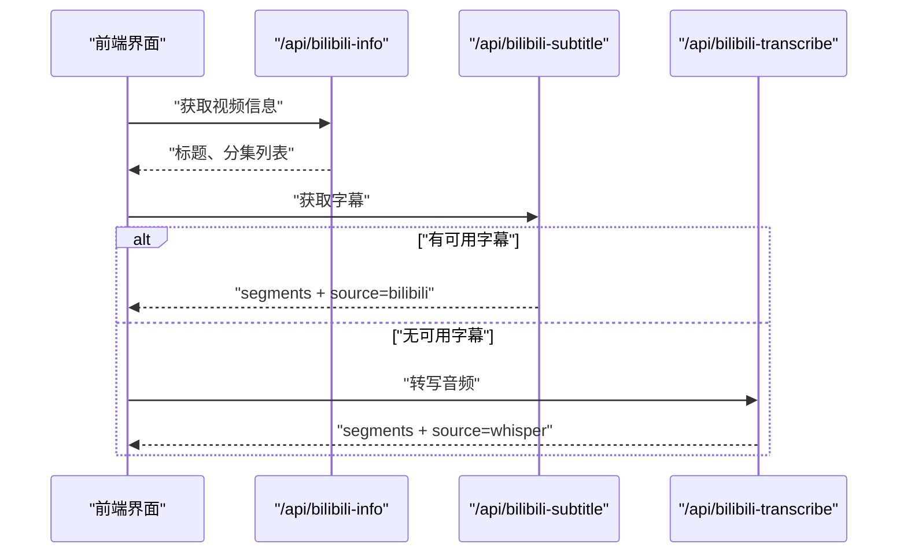

# B站相关接口

<cite>
**本文引用的文件**   
- [bilibili-info.js](file://functions/api/bilibili-info.js)
- [bilibili-subtitle.js](file://functions/api/bilibili-subtitle.js)
- [bilibili-transcribe.js](file://functions/api/bilibili-transcribe.js)
- [cors.js](file://functions/_lib/cors.js)
- [kv.js](file://functions/_lib/kv.js)
- [wrangler.toml](file://wrangler.toml)
</cite>

## 目录
1. [简介](#简介)
2. [项目结构](#项目结构)
3. [核心接口总览](#核心接口总览)
4. [架构概览](#架构概览)
5. [接口详细规范](#接口详细规范)
6. [代理层行为分析](#代理层行为分析)
7. [依赖与运行环境](#依赖与运行环境)
8. [性能与缓存策略](#性能与缓存策略)
9. [客户端集成指南](#客户端集成指南)
10. [故障排查](#故障排查)
11. [结论](#结论)

## 简介
本文件为 NativeThink 应用中 B站相关代理接口的完整技术文档，覆盖以下三个 Cloudflare Pages Function：
- `/api/bilibili-info`：获取 B站视频基本信息。
- `/api/bilibili-subtitle`：获取或生成 B站视频字幕，并转换为统一分段结构。
- `/api/bilibili-transcribe`：从 B站音频流转写英文语音，返回带时间戳的字幕分段。

这些接口位于 `functions/api/` 下，使用 Cloudflare Workers 运行时，通过代理调用 B站公开 API，并对跨域、错误、B站数据格式进行标准化处理。

## 项目结构
与 B站接口直接相关的代码集中在以下位置：
- `functions/api/bilibili-info.js`
- `functions/api/bilibili-subtitle.js`
- `functions/api/bilibili-transcribe.js`
- `functions/_lib/cors.js`
- `functions/_lib/kv.js`
- `wrangler.toml`

**图表来源**
- [bilibili-info.js:1-68](file://functions/api/bilibili-info.js#L1-L68)
- [bilibili-subtitle.js:1-158](file://functions/api/bilibili-subtitle.js#L1-L158)
- [bilibili-transcribe.js:1-296](file://functions/api/bilibili-transcribe.js#L1-L296)
- [cors.js:1-29](file://functions/_lib/cors.js#L1-L29)

**章节来源**
- [bilibili-info.js:1-68](file://functions/api/bilibili-info.js#L1-L68)
- [bilibili-subtitle.js:1-158](file://functions/api/bilibili-subtitle.js#L1-L158)
- [bilibili-transcribe.js:1-296](file://functions/api/bilibili-transcribe.js#L1-L296)
- [cors.js:1-29](file://functions/_lib/cors.js#L1-L29)

## 核心接口总览
| 接口 | 方法 | 用途 | 关键参数 | 主要输出字段 |
|---|---|---|---|---|
| `/api/bilibili-info` | GET | 获取视频标题、时长、频道、分集列表 | `bvid` | `title`、`episodes`、`duration`、`channel`、`pages` |
| `/api/bilibili-subtitle` | GET | 获取 B站字幕或回退到空结果，供前端 AI 补充 | `bvid`、`page` | `segments`、`source`、`episodeList`、`totalEpisodes` |
| `/api/bilibili-transcribe` | GET | 下载 B站音频并通过 Whisper 转写英文字幕 | `bvid`、`page` | `segments`、`source`、`episodeList`、`totalEpisodes` |

所有接口均返回 JSON，并在响应头中设置跨域允许头；失败时仍尽量返回结构化错误信息。

**章节来源**
- [bilibili-info.js:1-68](file://functions/api/bilibili-info.js#L1-L68)
- [bilibili-subtitle.js:1-158](file://functions/api/bilibili-subtitle.js#L1-L158)
- [bilibili-transcribe.js:1-296](file://functions/api/bilibili-transcribe.js#L1-L296)

## 架构概览
这三个接口遵循同一模式：
1. 接收浏览器或客户端请求。
2. 解析查询参数。
3. 校验 BVID。
4. 调用 B站 API 或 OpenAI Whisper API。
5. 将 B站原始数据转换为应用内统一结构。
6. 通过 CORS 工具函数添加跨域响应头。
7. 返回 JSON。

**图表来源**
- [bilibili-info.js:1-68](file://functions/api/bilibili-info.js#L1-L68)
- [bilibili-subtitle.js:1-158](file://functions/api/bilibili-subtitle.js#L1-L158)
- [bilibili-transcribe.js:1-296](file://functions/api/bilibili-transcribe.js#L1-L296)
- [cors.js:1-29](file://functions/_lib/cors.js#L1-L29)

## 接口详细规范

### `/api/bilibili-info`：获取视频信息

#### 用途
该接口用于快速拿到一个 B站视频的标题、总时长、频道名和分集列表，适合在视频卡片、详情页或导入流程中使用。

#### 请求
- 方法：GET
- URL 示例：`/api/bilibili-info?bvid=BV1xxx`

| 参数 | 类型 | 是否必填 | 说明 |
|---|---|---|---|
| `bvid` | 字符串 | 是 | B站视频编号，需符合 `BV` 开头加至少 10 位字母数字的规则 |

注意：实现中对传入的 `bvid` 先转为大写再校验，因此大小写不敏感；但在其他两个接口中明确强调 B站 API 对 `bvid` 大小写敏感，客户端应优先保留原始大小写。

#### 成功响应
状态码：`200`  
Content-Type：`application/json`

| 字段 | 类型 | 含义 |
|---|---|---|
| `title` | 字符串 | 视频标题 |
| `episodes` | 数字 | 分集数量 |
| `duration` | 数字 | 视频时长，单位为秒 |
| `channel` | 字符串 | UP 主名称 |
| `pages` | 数组 | 分集列表，每项包含 `page`、`part`、`duration` |

#### 错误响应
- 无效 `bvid`：状态码 `400`，返回 `{ error }`。
- B站 API 返回业务错误：状态码 `400`，返回 `{ error, code, message }`。
- 网络或 JSON 解析异常：状态码 `500`，返回 `{ error }`。

#### 数据转换逻辑
后端将 B站 `/x/web-interface/view` 返回中的：
- `data.title` → `title`
- `data.videos` → `episodes`
- `data.duration` → `duration`
- `data.owner.name` → `channel`
- `data.pages[].{page, part, duration}` → `pages[]`

**章节来源**
- [bilibili-info.js:1-68](file://functions/api/bilibili-info.js#L1-L68)

---

### `/api/bilibili-subtitle`：获取字幕

#### 用途
该接口尝试从 B站获取已有字幕，尤其是 B站 AI 生成的双语字幕；如果无法获取可用字幕，则返回空分段列表，由前端通过 AI 能力补充。

#### 请求
- 方法：GET
- URL 示例：`/api/bilibili-subtitle?bvid=BV1xxx&page=1`

| 参数 | 类型 | 是否必填 | 默认值 | 说明 |
|---|---|---|---|---|
| `bvid` | 字符串 | 是 | 无 | B站视频编号，严格保留大小写 |
| `page` | 整数 | 否 | `1` | 分集序号，从 1 开始 |

服务端会读取环境变量 `BILIBILI_COOKIE`，以携带登录态访问可能受限的 B站资源。

#### 处理流程

**图表来源**
- [bilibili-subtitle.js:1-158](file://functions/api/bilibili-subtitle.js#L1-L158)

#### 成功响应
状态码始终为 `200`，即使字幕为空也返回结构化数据，便于前端降级。

| 字段 | 类型 | 含义 |
|---|---|---|
| `bvid` | 字符串 | 输入的视频编号 |
| `page` | 数字 | 当前分集页码 |
| `cid` | 数字 | 视频分集 CID |
| `part` | 字符串 | 分集标题 |
| `segments` | 数组 | 字幕分段 |
| `source` | 字符串 | 数据来源，如 `bilibili`、`none` |
| `error` | 字符串或空 | 当前实现通常为空，错误可通过 `segments` 为空判断 |
| `totalEpisodes` | 数字 | 总分集数 |
| `episodeList` | 数组 | 分集列表，每项含 `page`、`part`、`duration` |

每个 `segments[i]` 包含：
| 字段 | 类型 | 含义 |
|---|---|---|
| `start` | 数字 | 起始时间，单位通常为秒 |
| `end` | 数字 | 结束时间 |
| `en` | 字符串 | 英文字幕 |
| `zh` | 字符串 | 中文字幕 |
| `keywords` | 数组 | 从英文句中提取的高频关键词 |

#### 关键字提取规则
- 按空白字符切分句子。
- 仅保留纯英文字母组成的单词。
- 小写化。
- 长度大于 4。
- 去重。
- 最多取前几个词作为关键词。

#### 错误与降级策略
- 如果 B站字幕接口不可达、返回空轨道、或英文内容不足，服务端会重试最多约 6 秒。
- 最终无法获取有效英文字幕时，返回空 `segments` 和 `source=none`，前端可触发 AI 字幕补充。
- 如果 B站 AI 字幕只有中文轨道，不会把中文误标为英文字幕。

**章节来源**
- [bilibili-subtitle.js:1-158](file://functions/api/bilibili-subtitle.js#L1-L158)

---

### `/api/bilibili-transcribe`：转写音频

#### 用途
该接口从 B站获取音视频地址，下载音频，再通过 OpenAI 兼容的 Whisper API 转写英文语音，返回带时间戳的字幕分段。它适用于没有现成英文字幕、但希望获得自动英文转写的场景。

#### 前置条件
- 必须配置环境变量：
  - `OPENAI_API_KEY`：Whisper 模型 API Key。
  - `OPENAI_BASE_URL`：可选，默认 `https://api.openai.com/v1`。
- 支持 B站 WBI 签名，用于获取受保护的播放地址。

#### 请求
- 方法：GET
- URL 示例：`/api/bilibili-transcribe?bvid=BV1xxx&cid=123456&page=1`

| 参数 | 类型 | 是否必填 | 默认值 | 说明 |
|---|---|---|---|---|
| `bvid` | 字符串 | 是 | 无 | B站视频编号 |
| `page` | 整数 | 否 | `1` | 分集序号 |
| `cid` | 数字或字符串 | 否 | 由服务端根据 page 推导 | 视频分集 ID，若缺失则由服务端重新获取 |

#### 处理流程

**图表来源**
- [bilibili-transcribe.js:1-296](file://functions/api/bilibili-transcribe.js#L1-L296)

#### 成功响应
状态码：`200`

| 字段 | 类型 | 含义 |
|---|---|---|
| `bvid` | 字符串 | 输入视频编号 |
| `page` | 数字 | 分集页码 |
| `cid` | 数字 | 视频分集 CID |
| `part` | 字符串 | 分集标题 |
| `segments` | 数组 | Whisper 转写后的字幕分段 |
| `source` | 字符串 | 固定为 `whisper` |
| `error` | 空 | 成功时为空 |
| `totalEpisodes` | 数字 | 总分集数 |
| `episodeList` | 数组 | 分集列表 |

每个 `segments[i]` 包含：
| 字段 | 类型 | 含义 |
|---|---|---|
| `start` | 数字 | 起始时间 |
| `end` | 数字 | 结束时间 |
| `en` | 字符串 | 英文转写文本 |
| `zh` | 字符串 | 空字符串 |
| `keywords` | 数组 | 从英文文本中提取的高频关键词 |

#### 错误响应
未配置 `OPENAI_API_KEY` 时，返回：
- `error`：提示未配置 API Key。
- `segments`：空数组。
- `source`：`none`。

其他异常（如未找到音频、Whisper 报错）会被捕获，返回结构化错误对象，其中 `segments` 为空、`source` 为 `none`。

#### 音频选择逻辑
- 从 DASH audio 列表中按带宽降序排序。
- 优先选择不超过 64kbps 的最高质量音频。
- 若无符合条件项，回退到第一个可用音频。

#### Whisper 调用参数
- 模型：`whisper-1`
- 响应格式：`verbose_json`
- 语言：`en`
- 请求体：表单中包含音频文件和上述参数。

**章节来源**
- [bilibili-transcribe.js:1-296](file://functions/api/bilibili-transcribe.js#L1-L296)

## 代理层行为分析

### 跨域处理
所有接口都通过 `cors.js` 提供的工具函数处理跨域：
- `withCors`：向 Response 追加允许的跨域响应头。
- `preflight`：返回 `204` 预检响应。
- `isPreflight`：判断是否为 OPTIONS 请求。

这使 Capacitor APK 等移动端源 `https://localhost` 能够调用云端函数。

**图表来源**
- [cors.js:1-29](file://functions/_lib/cors.js#L1-L29)
- [bilibili-info.js:60-68](file://functions/api/bilibili-info.js#L60-L68)
- [bilibili-subtitle.js:150-158](file://functions/api/bilibili-subtitle.js#L150-L158)
- [bilibili-transcribe.js:288-296](file://functions/api/bilibili-transcribe.js#L288-L296)

**章节来源**
- [cors.js:1-29](file://functions/_lib/cors.js#L1-L29)

### B站 API 调用方式
- 使用 `fetch` 调用 B站公开接口。
- 设置 `User-Agent` 模拟浏览器。
- 部分接口附加 `Referer: https://www.bilibili.com`。
- 可携带 `Cookie`，用于访问登录后可用资源，例如 AI 字幕。
- 转写接口使用 WBI 签名机制获取播放地址。

### 数据标准化
三个接口都把 B站原始数据转换为应用内部更易使用的结构：
- 视频信息接口标准化标题、频道、分集。
- 字幕接口标准化时间轴、中英文文本和关键词。
- 转写接口标准化 Whisper 分段为统一的字幕结构。

### 错误处理机制
- 参数校验失败：返回 `400` 或带 `error` 的 200 响应。
- B站 API 业务错误：尽量透传 `code`、`message`。
- 网络或 JSON 解析异常：包装为 `{ error }`。
- Whisper 调用失败：返回结构化错误，避免前端崩溃。

**章节来源**
- [bilibili-info.js:1-68](file://functions/api/bilibili-info.js#L1-L68)
- [bilibili-subtitle.js:1-158](file://functions/api/bilibili-subtitle.js#L1-L158)
- [bilibili-transcribe.js:1-296](file://functions/api/bilibili-transcribe.js#L1-L296)
- [cors.js:1-29](file://functions/_lib/cors.js#L1-L29)

## 依赖与运行环境

### Cloudflare Pages Functions
- 入口文件：`functions/api/*.js`。
- 每个 B站接口导出 `onRequest`，由 Cloudflare Pages 自动路由。

### CORS 工具
- 提供跨域响应头、预检响应和便捷封装。
- 适用于 Capacitor APK 的本地源跨域需求。

### KV 存储
- `functions/_lib/kv.js` 提供用户数据键生成辅助。
- `wrangler.toml` 定义了名为 `KV` 的 KV namespace binding。
- 当前 B站接口未直接使用 KV，但项目整体具备云存储能力。

### 环境变量
| 变量 | 是否必需 | 说明 |
|---|---|---|
| `BILIBILI_COOKIE` | 推荐 | 提升 B站 AI 字幕等受限资源的访问成功率 |
| `OPENAI_API_KEY` | 必需（仅转写接口） | Whisper 模型 API Key |
| `OPENAI_BASE_URL` | 可选 | Whisper 兼容 API 基础地址 |

**章节来源**
- [cors.js:1-29](file://functions/_lib/cors.js#L1-L29)
- [kv.js:1-6](file://functions/_lib/kv.js#L1-L6)
- [wrangler.toml:1-9](file://wrangler.toml#L1-L9)
- [bilibili-transcribe.js:1-296](file://functions/api/bilibili-transcribe.js#L1-L296)

## 性能与缓存策略

### 当前实现特点
- 三个接口均为无状态代理，未实现服务端内存缓存。
- 每次请求都会重新调用 B站 API；转写接口还会下载音频并调用 Whisper。
- 字幕接口对 B站 AI 字幕做了多次轮询重试，以减少空结果概率。

### 性能影响
- `/api/bilibili-info`：轻量，主要是一次 B站 HTTP 请求。
- `/api/bilibili-subtitle`：可能多次请求 B站字幕接口和字幕 JSON，延迟较高。
- `/api/bilibili-transcribe`：最重，包括 B站视频信息查询、WBI 签名、播放地址获取、音频下载、Whisper 转写。

### 优化建议
- 对稳定数据做短期缓存：例如视频信息可按 `bvid` 缓存几秒到几分钟。
- 对字幕接口增加结果缓存：相同 `bvid+page` 的结果可在一段时间内复用。
- 对转写接口增加异步任务队列：避免长请求阻塞前端。
- 限制并发：对 B站 API 和 Whisper API 设置限流，防止被限流或封禁。
- 压缩响应：对大体积字幕或 episodeList 启用 gzip。
- 前端缓存：客户端可对只读接口做短时内存缓存和磁盘缓存。

[本节为通用性能建议，不直接分析具体代码行]

## 客户端集成指南

### 基本调用顺序
1. 调用 `/api/bilibili-info` 获取标题、频道、分集列表。
2. 优先调用 `/api/bilibili-subtitle` 获取 B站字幕。
3. 如果字幕为空或质量不足，调用 `/api/bilibili-transcribe` 获取 Whisper 转写字幕。
4. 前端合并两段字幕，优先显示 B站英文字幕，其次显示 Whisper 英文字幕。

**图表来源**
- [bilibili-info.js:1-68](file://functions/api/bilibili-info.js#L1-L68)
- [bilibili-subtitle.js:1-158](file://functions/api/bilibili-subtitle.js#L1-L158)
- [bilibili-transcribe.js:1-296](file://functions/api/bilibili-transcribe.js#L1-L296)

### 参数处理建议
- 保留 BVID 原始大小写，除非明确调用 `/api/bilibili-info`。
- `page` 从 1 开始，对应 B站分集索引。
- 若已知道 `cid`，可直接传给转写接口，减少一次 B站视图查询。

### 错误重试
- 首次失败后等待随机抖动后重试。
- 对网络超时建议使用指数退避。
- 最多重试次数建议控制在 2 到 3 次，避免无限重试。

### 降级策略
- 若 B站 API 不可达，跳过 B站字幕，直接走 Whisper。
- 若 Whisper 失败，显示“字幕暂不可用”，并提供手动粘贴或重新加载按钮。
- 若所有后端失败，前端可展示占位内容，不阻断主流程。

### 性能优化建议
- 对视频信息做短缓存，避免重复拉取。
- 对字幕接口做去重：相同 `bvid+page` 的请求合并。
- 对转写接口增加进度反馈，因为音频下载和 Whisper 可能耗时较长。
- 使用分页或懒加载渲染字幕，避免一次性渲染大量 DOM。

[本节为通用集成建议，不直接分析具体代码行]

## 故障排查

### 常见问题
| 现象 | 可能原因 | 处理方法 |
|---|---|---|
| 返回“无效的 BVID” | `bvid` 不符合规则 | 检查是否以 `BV` 开头且长度足够 |
| 返回“B站 API 返回错误” | B站接口业务错误 | 查看返回的 `code` 和 `message` |
| 字幕为空 | B站 AI 字幕尚未生成或只有中文轨道 | 等待后重试，或改用 Whisper |
| 转写返回“未配置 OPENAI_API_KEY” | 环境变量未设置 | 部署时配置 `OPENAI_API_KEY` |
| 转写失败 | Whisper API 报错或音频不可下载 | 检查网络、API Key、B站播放地址 |
| 移动端跨域失败 | 缺少 CORS 头或预检未通过 | 确认使用了 `cors.js` 的 `onRequest` 封装 |

### 调试建议
- 打开浏览器开发者工具，查看请求 URL、参数和响应体。
- 单独测试 B站 view 接口，确认 `bvid` 和 `cid` 有效。
- 单独测试 Whisper API，确认 API Key 和基础地址正确。
- 检查 Cloudflare Pages Function 日志，定位 B站或 Whisper 错误。

**章节来源**
- [bilibili-info.js:1-68](file://functions/api/bilibili-info.js#L1-L68)
- [bilibili-subtitle.js:1-158](file://functions/api/bilibili-subtitle.js#L1-L158)
- [bilibili-transcribe.js:1-296](file://functions/api/bilibili-transcribe.js#L1-L296)
- [cors.js:1-29](file://functions/_lib/cors.js#L1-L29)

## 结论
NativeThink 的 B站相关接口通过 Cloudflare Pages Function 实现了三层能力：
- 快速获取视频信息。
- 获取并标准化 B站字幕。
- 基于 Whisper 的英文音频转写。

它们共同解决了跨域、B站数据格式差异、字幕可用性不确定、以及外部 API 失败等问题。未来建议在保持现有健壮性的基础上，引入服务端缓存、限流、异步任务和更完善的监控指标，以提升稳定性和可扩展性。