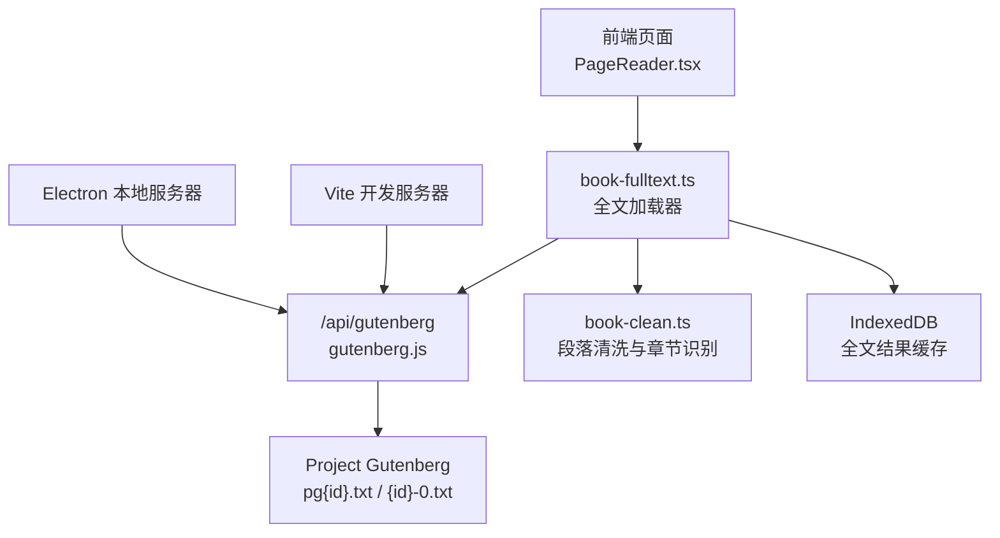
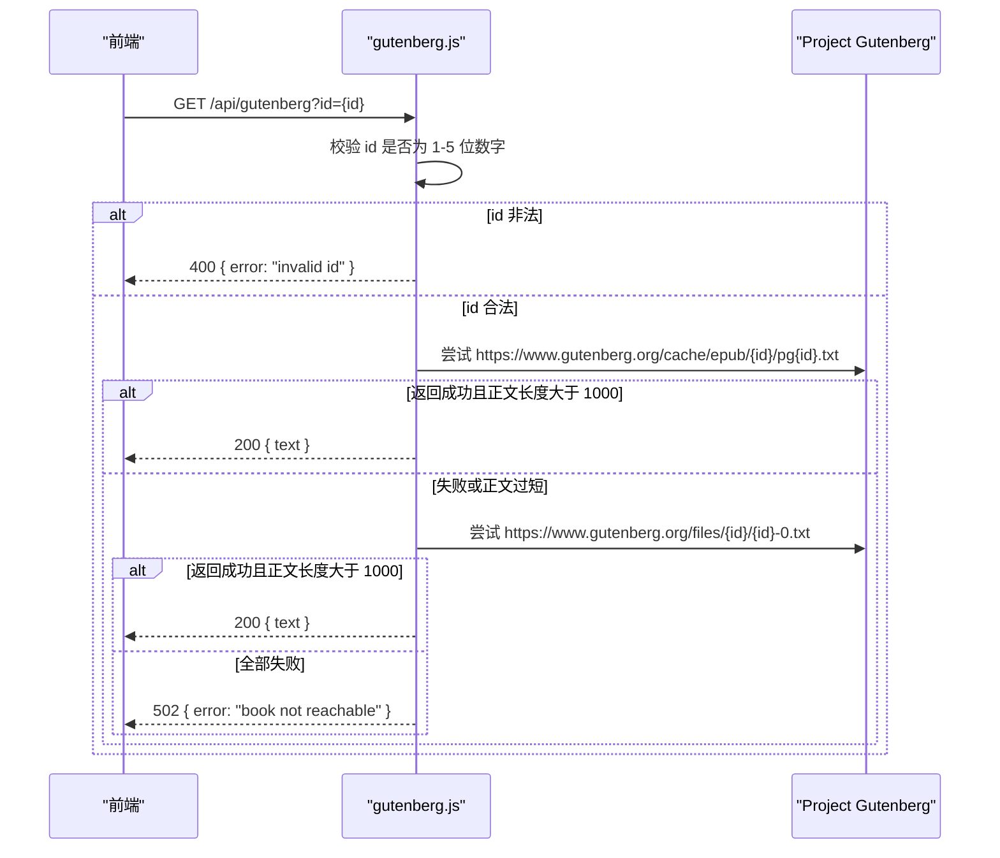
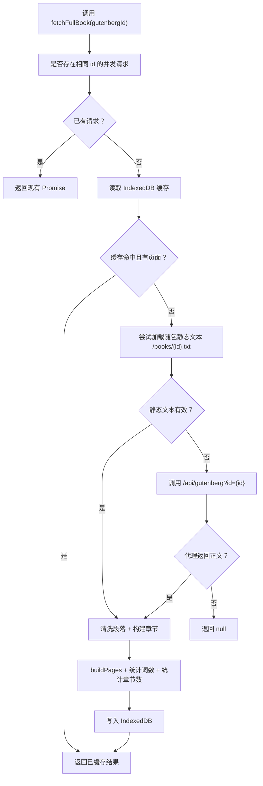
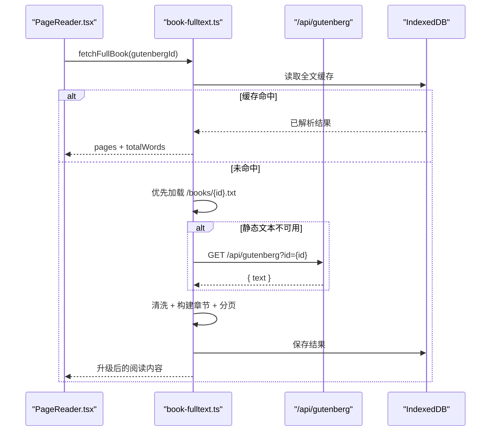
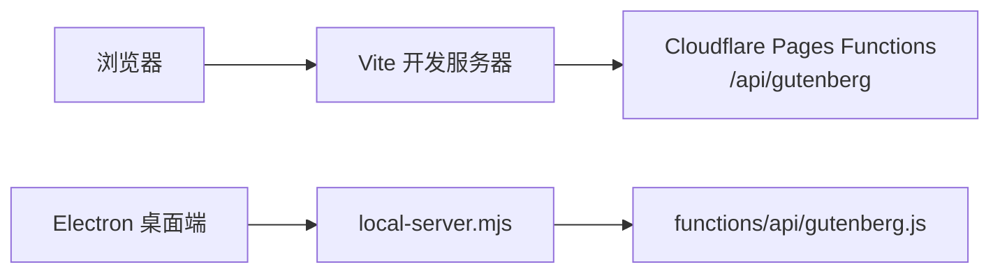

# Gutenberg 书籍接口

<cite>
**本文引用的文件**   
- [functions/api/gutenberg.js](file://functions/api/gutenberg.js)
- [src/data/book-fulltext.ts](file://src/data/book-fulltext.ts)
- [src/data/book-clean.ts](file://src/data/book-clean.ts)
- [vite.config.ts](file://vite.config.ts)
- [server/local-server.mjs](file://server/local-server.mjs)
- [wrangler.toml](file://wrangler.toml)
- [package.json](file://package.json)
- [src/pages/ArticlePage/components/PageReader.tsx](file://src/pages/ArticlePage/components/PageReader.tsx)
</cite>

## 目录
1. [简介](#简介)
2. [项目结构中的位置](#项目结构中的位置)
3. [API 规范](#api-规范)
4. [请求处理流程](#请求处理流程)
5. [文本预处理与章节识别](#文本预处理与章节识别)
6. [客户端集成路径](#客户端集成路径)
7. [错误、超时与速率限制](#错误超时与速率限制)
8. [性能与缓存](#性能与缓存)
9. [部署与本地开发](#部署与本地开发)
10. [故障排查](#故障排查)
11. [结论](#结论)

## 简介
`/api/gutenberg` 是 NativeThink 应用提供的 **Project Gutenberg 英文公版书全文代理接口**。它的主要职责是：

- 接收浏览器或客户端传入的书籍 ID。
- 向 Project Gutenberg 获取对应电子书的纯文本内容。
- 绕过 gutenberg.org 不返回 CORS 响应头的问题，让浏览器可以直接调用。
- 返回一个包含 `text` 字段的 JSON 对象；失败时返回带 `error` 字段的 JSON。

该接口主要服务于“书籍全文升级”能力：应用内置的是压缩节选，打开书籍后运行时再拉取完整原文，从而得到真实章节目录和更完整的阅读体验。

## 项目结构中的位置
Gutenberg 代理功能由以下部分组成：



**图示来源**
- [src/pages/ArticlePage/components/PageReader.tsx:327-360](file://src/pages/ArticlePage/components/PageReader.tsx#L327-L360)
- [src/data/book-fulltext.ts:37-67](file://src/data/book-fulltext.ts#L37-L67)
- [functions/api/gutenberg.js:1-45](file://functions/api/gutenberg.js#L1-L45)

**本节来源**
- [functions/api/gutenberg.js:1-45](file://functions/api/gutenberg.js#L1-L45)
- [src/data/book-fulltext.ts:1-106](file://src/data/book-fulltext.ts#L1-L106)
- [src/data/book-clean.ts:1-194](file://src/data/book-clean.ts#L1-L194)

## API 规范

### 端点
- 方法：`GET`
- URL：`/api/gutenberg`
- 认证：无
- 跨域：服务端通过封装函数添加 CORS 响应头并处理 `OPTIONS` 预检请求。

### 请求参数

| 参数 | 类型 | 必填 | 说明 |
| --- | --- | --- | --- |
| `id` | 字符串 | 是 | Project Gutenberg 书籍编号，仅允许 1 到 5 位数字，例如 `1342`。 |

请求示例：

```
GET /api/gutenberg?id=1342
```

如果缺少 `id` 或 `id` 不是合法的 1 到 5 位数字，接口直接返回 400。

### 成功响应

状态码：`200`  
`Content-Type`：`application/json`

| 字段 | 类型 | 说明 |
| --- | --- | --- |
| `text` | 字符串 | Project Gutenberg 返回的原始纯文本内容。 |

成功响应示例（字段结构示意）：

```json
{
  "text": "..."
}
```

### 失败响应

| 场景 | 状态码 | 响应体结构 |
| --- | --- | --- |
| `id` 非法 | `400` | `{ "error": "invalid id" }` |
| 无法从任意备用地址拿到有效正文 | `502` | `{ "error": "book not reachable" }` |

注意：当前实现没有区分网络错误、超时、HTTP 非成功状态、以及空内容等具体原因，统一以 `book not reachable` 表示后端未能取得可用正文。

### 字符编码
Project Gutenberg 的 `.txt` 文件是字节流，当前实现使用 JavaScript 的 `res.text()` 将其作为 UTF-8 字符串解析。若源文件实际编码不是 UTF-8，可能出现乱码；接口层没有显式编码检测与转换逻辑。

**本节来源**
- [functions/api/gutenberg.js:10-45](file://functions/api/gutenberg.js#L10-L45)

## 请求处理流程



**图示来源**
- [functions/api/gutenberg.js:12-40](file://functions/api/gutenberg.js#L12-L40)

关键行为如下：

1. 解析 URL 查询参数 `id`，去除首尾空白。
2. 使用正则校验 `id` 是否只包含 1 到 5 位数字。
3. 按顺序尝试两个 Gutenberg 地址：
   - `https://www.gutenberg.org/cache/epub/{id}/pg{id}.txt`
   - `https://www.gutenberg.org/files/{id}/{id}-0.txt`
4. 对每个地址发起 `fetch`，设置 `User-Agent`，允许重定向。
5. 如果 HTTP 成功且文本长度超过 1000，立即返回 `{ text }`。
6. 任一地址抛错会进入下一个地址；全部失败则返回 502。

**本节来源**
- [functions/api/gutenberg.js:12-40](file://functions/api/gutenberg.js#L12-L40)

## 文本预处理与章节识别

`/api/gutenberg` 本身只做网络代理，不做 HTML 解析、HTML 清理或复杂文本清洗。真正对 Gutenberg 文本进行结构化处理的是前端的 `book-fulltext.ts` 和 `book-clean.ts`。

### 前端全文加载流程



**图示来源**
- [src/data/book-fulltext.ts:37-106](file://src/data/book-fulltext.ts#L37-L106)

### 文本分段
前端将 Gutenberg 纯文本按空行拆分为段落，并把段落内部的硬换行合并为空格，同时去除多余空白。

### 章节识别
`cleanBookParagraphs` 支持多种章节标题格式，包括：

- `CHAPTER I.`、`CHAPTER 1.`、`Chapter Twenty`
- `BOOK THE FIRST`、`PART II`、`VOLUME ONE`
- `LETTER 1`、`SECTION 3`
- `第 1 章`
- 罗马数字单独一行
- 全大写小节名启发式（在明确章节标记不足时启用）

当某本书几乎没有可识别的章节标记且篇幅较长时，系统会插入合成章节标记，避免整本书被归入一两个章节。

### Gutenberg 样板内容过滤
清洗模块会跳过 Gutenberg 的版权页、许可证声明、志愿者致谢等样板段落，并尝试识别 `*** START OF THE PROJECT GUTENBERG EBOOK ***` 与 `*** END OF THE PROJECT GUTENBERG EBOOK ***` 边界。

**本节来源**
- [src/data/book-fulltext.ts:16-106](file://src/data/book-fulltext.ts#L16-L106)
- [src/data/book-clean.ts:1-194](file://src/data/book-clean.ts#L1-L194)

## 客户端集成路径

### 组件如何触发
文章页阅读器在检测到书籍元数据中存在 `gutenbergId` 时，会调用 `fetchFullBook`，从而触发全文加载。



**图示来源**
- [src/pages/ArticlePage/components/PageReader.tsx:327-360](file://src/pages/ArticlePage/components/PageReader.tsx#L327-L360)
- [src/data/book-fulltext.ts:61-106](file://src/data/book-fulltext.ts#L61-L106)

### 推荐客户端策略

| 需求 | 建议 |
| --- | --- |
| 分页加载 | 不要一次性渲染全书。按 `book-fulltext.ts` 返回的 `pages` 分页展示，结合滚动或点击加载更多。 |
| 缓存策略 | 利用现有的 IndexedDB 缓存键 `book-full-v2-{gutenbergId}`。同一会话中相同书籍只需拉取一次。 |
| 并发控制 | 依赖 `inFlight` Map 的 Promise 去重，避免重复请求。 |
| 离线优先 | 优先使用 `/books/{gutenbergId}.txt` 静态资源；只有缺失时才走 `/api/gutenberg`。 |
| 错误重试 | 对 502 或网络异常进行有限次数重试，配合指数退避，避免频繁打满 Gutenberg。 |
| 进度反馈 | 复用 `onStatus('fetching' | 'parsing' | 'done')`，给用户显示“正在拉取”“正在解析”“已完成”。 |
| 失败降级 | 如果全文加载失败，保持内置压缩节选，不要静默清空阅读内容。 |

**本节来源**
- [src/data/book-fulltext.ts:16-106](file://src/data/book-fulltext.ts#L16-L106)
- [src/pages/ArticlePage/components/PageReader.tsx:327-360](file://src/pages/ArticlePage/components/PageReader.tsx#L327-L360)

## 错误、超时与速率限制

### 当前实现的健壮性特点

| 方面 | 当前行为 |
| --- | --- |
| 输入校验 | 拒绝非 1 到 5 位数字的 `id`。 |
| 多地址回退 | 先试 `cache/epub`，失败再试 `files`。 |
| 最小正文长度 | 要求文本长度大于 1000，避免返回极短或空内容。 |
| 错误分类 | 不区分超时、DNS 失败、HTTP 404、5xx、CORS 失败，统一返回 `book not reachable`。 |
| 速率限制 | 未实现令牌桶、限流队列、重试上限或退避策略。 |
| 超时控制 | 未设置 fetch 超时，依赖底层网络栈默认行为。 |
| 缓存 | 接口层无缓存；客户端有 IndexedDB 缓存。 |

### 建议增强方案

1. **速率限制**
   - 在函数层增加基于 IP 或全局计数器的限速。
   - 对连续失败或高频访问的请求返回 `429 Too Many Requests`。
   - 客户端侧实施指数退避重试，最大重试次数建议不超过 3 次。

2. **超时控制**
   - 为外部 `fetch` 设置合理超时，例如 5 到 10 秒。
   - 对第一个地址超时后，应继续尝试第二个地址。

3. **错误语义化**
   - 将 `invalid id`、`network error`、`timeout`、`http non-ok`、`empty response`、`too short` 等分别映射为不同错误码或错误信息。
   - 客户端可根据错误类型决定重试还是直接降级。

4. **Gutenberg 可用性监控**
   - 记录失败率，用于判断是否临时屏蔽 Gutenberg 源，切换为预置文本或其他公版书库。

**本节来源**
- [functions/api/gutenberg.js:12-40](file://functions/api/gutenberg.js#L12-L40)

## 性能与缓存

### 接口层性能
- 每次请求最多发起两次外部 HTTP 请求。
- 成功后立即返回 JSON，不解析 HTML。
- 没有内存缓存、KV 缓存或 CDN 层缓存。

### 客户端层性能
- 同 ID 并发请求去重，避免重复网络调用。
- 解析结果持久化到 IndexedDB，刷新后可复用。
- 首选本地静态 `/books/{id}.txt`，避免远程延迟。
- 解析完成后才计算总词数和章节数，减少主线程压力。

### 建议优化
- 在服务端或 Cloudflare 层对 `/api/gutenberg?id={id}` 做短期缓存，例如几分钟级 TTL。
- 对 Gutenberg 的热门书籍提前预热缓存。
- 对静态 `/books/{id}.txt` 开启 CDN 缓存。
- 客户端可按章节懒加载，而不是整本解析后立即渲染。

**本节来源**
- [functions/api/gutenberg.js:12-40](file://functions/api/gutenberg.js#L12-L40)
- [src/data/book-fulltext.ts:37-106](file://src/data/book-fulltext.ts#L37-L106)

## 部署与本地开发

### 生产环境
- 函数部署目标由 `wrangler.toml` 指定，名称为 `nativethink`，输出目录为 `dist/client`。
- KV 命名空间绑定名为 `KV`，ID 已在配置文件中定义。
- 生产环境函数运行在 Cloudflare Pages Functions 上，因此可直接使用 `fetch` 访问外部网站。

### 开发环境
- Vite 开发服务器将 `/api/gutenberg` 反向代理到 `https://nativethink.pages.dev`。
- Electron 本地服务器也路由 `/api/gutenberg` 到 `functions/api/gutenberg.js`，使桌面端可在无云端依赖的情况下运行。



**图示来源**
- [vite.config.ts:164-170](file://vite.config.ts#L164-L170)
- [server/local-server.mjs:110-110](file://server/local-server.mjs#L110-L110)
- [wrangler.toml:1-9](file://wrangler.toml#L1-L9)

**本节来源**
- [wrangler.toml:1-9](file://wrangler.toml#L1-L9)
- [vite.config.ts:164-170](file://vite.config.ts#L164-L170)
- [server/local-server.mjs:100-120](file://server/local-server.mjs#L100-L120)

## 故障排查

| 现象 | 可能原因 | 排查步骤 |
| --- | --- | --- |
| 返回 400 | `id` 为空或非 1 到 5 位数字 | 检查调用方传入的 `gutenbergId` 是否为整数。 |
| 返回 502 | Gutenberg 两个地址均不可达 | 检查网络连通性、防火墙、代理设置；确认书籍 ID 是否正确。 |
| 正文乱码 | Gutenberg 文本非 UTF-8 | 检查源文件编码；如需严格兼容，应在接口层增加编码检测与转换。 |
| 正文很短 | 返回的不是完整书籍文本 | 检查 Gutenberg 链接是否返回了摘要、错误页或缩略文本。 |
| 前端解析不出章节 | Gutenberg 版本差异或缺少标准章节标记 | 检查 `book-clean.ts` 的正则模式是否需要补充新样式。 |
| 本地开发无法访问 | Vite 代理未生效或云端函数未部署 | 检查 `vite.config.ts` 中 `/api/gutenberg` 代理配置。 |
| 桌面端无法访问 | Electron 路由未注册 | 检查 `server/local-server.mjs` 中 `/api/gutenberg` 路由映射。 |

**本节来源**
- [functions/api/gutenberg.js:12-40](file://functions/api/gutenberg.js#L12-L40)
- [src/data/book-clean.ts:60-194](file://src/data/book-clean.ts#L60-L194)
- [vite.config.ts:164-170](file://vite.config.ts#L164-L170)
- [server/local-server.mjs:100-120](file://server/local-server.mjs#L100-L120)

## 结论
`/api/gutenberg` 是一个轻量、明确的代理服务：它负责绕过 CORS、校验参数、回退多个 Gutenberg 地址，并返回纯文本。真正的书籍结构化工作落在前端的 `book-fulltext.ts` 与 `book-clean.ts`，包括段落清洗、章节识别、分页构建和 IndexedDB 缓存。

对于生产环境，建议重点增强以下内容：

- 接口层速率限制与超时控制。
- 更细粒度的错误分类。
- 服务端或 CDN 层缓存。
- 对 Gutenberg 文本编码的健壮处理。
- 客户端重试与失败降级策略。

这些改进可以让 NativeThink 在阅读公版英文书籍时更稳定、更可预测，同时减少对上游服务的冲击。