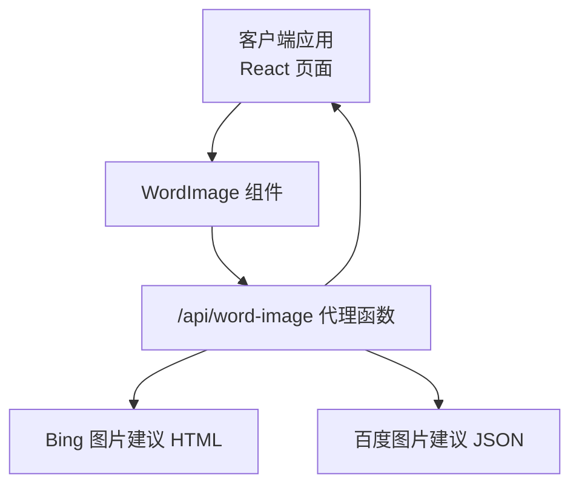
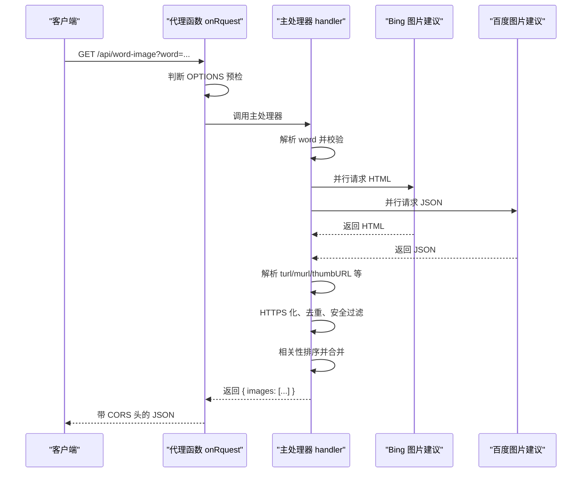
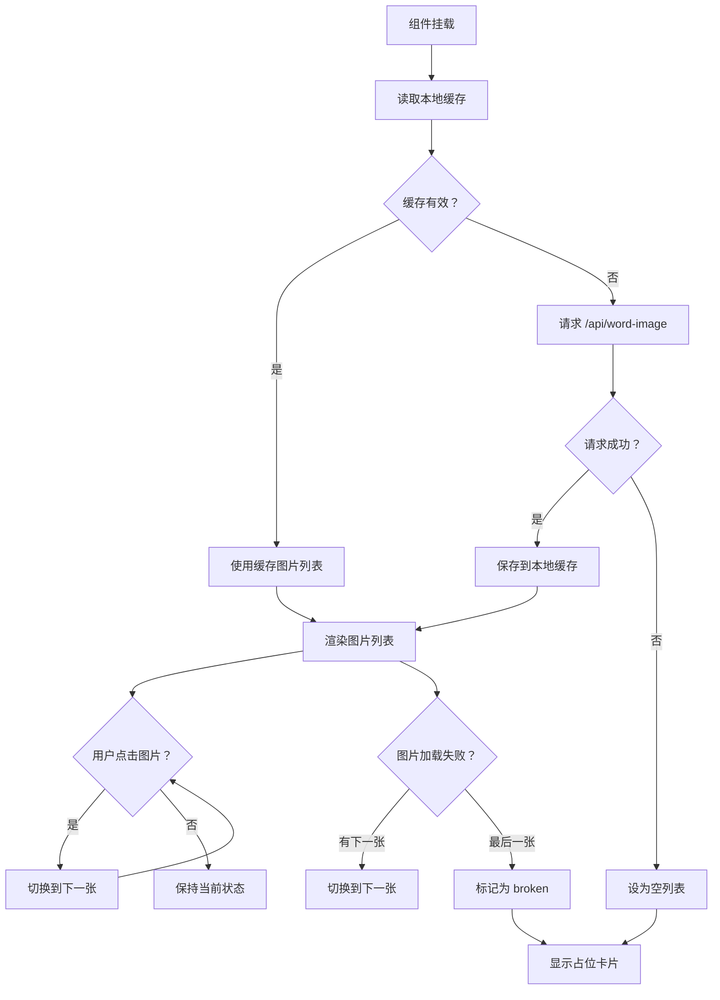
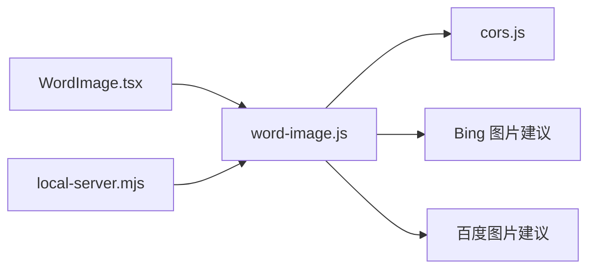

# 单词图片接口

<cite>
**本文引用的文件**
- [functions/api/word-image.js](file://functions/api/word-image.js)
- [src/components/WordImage.tsx](file://src/components/WordImage.tsx)
- [server/local-server.mjs](file://server/local-server.mjs)
- [functions/_lib/cors.js](file://functions/_lib/cors.js)
</cite>

## 目录
1. [简介](#简介)
2. [项目结构定位](#项目结构定位)
3. [接口规范](#接口规范)
4. [架构总览](#架构总览)
5. [详细组件分析](#详细组件分析)
6. [依赖关系分析](#依赖关系分析)
7. [性能与缓存特性](#性能与缓存特性)
8. [故障排查指南](#故障排查指南)
9. [客户端集成指南](#客户端集成指南)
10. [结论](#结论)

## 简介
本文件为 NativeThink 应用中“单词图片生成代理”的完整技术文档。该能力通过 `/api/word-image` 接口，根据用户输入的英文单词，从 Bing 和百度图片建议源并行检索相关缩略图与原图链接，返回一组已去重、HTTPS 化且经过安全过滤的图片 URL；客户端负责本地缓存、懒加载、点击换图和错误回退。

需要特别说明的是：当前实现并不在服务器端渲染 Base64 图片，也不进行字体绘制或 Canvas 合成；它返回的是外部图片地址列表。因此“字体缺失、渲染失败、图片尺寸优化”等问题的处理主体主要在客户端侧。

## 项目结构定位
- 服务端函数位于 `functions/api/word-image.js`，使用 Cloudflare Pages Functions 风格导出 `onRequest`。
- 本地开发时，Electron 内置 Node 服务器将 `/api/word-image` 路由映射到同一模块，以便桌面端零网络依赖运行后端逻辑。
- 前端 React 组件 `src/components/WordImage.tsx` 是调用方，负责 UI 展示、本地缓存、请求超时与图片切换。
- CORS 公共工具位于 `functions/_lib/cors.js`，用于跨域响应头与 OPTIONS 预检短路。



**图示来源**
- [src/components/WordImage.tsx:1-129](file://src/components/WordImage.tsx#L1-L129)
- [functions/api/word-image.js:1-112](file://functions/api/word-image.js#L1-L112)
- [server/local-server.mjs:1-200](file://server/local-server.mjs#L1-L200)

**章节来源**
- [functions/api/word-image.js:1-112](file://functions/api/word-image.js#L1-L112)
- [server/local-server.mjs:1-200](file://server/local-server.mjs#L1-L200)

## 接口规范

### 基本信息
- 路径：`/api/word-image`
- 方法：GET（支持浏览器预检）
- 内容类型：`application/json`
- 用途：根据单词查询相关真实照片 URL 列表，供前端动态展示单词配图。

### 请求参数
| 参数 | 位置 | 类型 | 必填 | 默认值 | 说明 |
|---|---|---|---|---|---|
| `word` | Query | 字符串 | 否 | 空串 | 待配图单词；会被转小写并去除首尾空白后校验 |

校验规则：
- 若为空，直接返回空结果。
- 仅允许由小写字母、单引号、连字符和空格组成的单词，最大长度约 31 个字符。
- 不匹配时返回 `{ images: [] }`，不会报错。

示例请求：
- `GET /api/word-image?word=apple`
- `GET /api/word-image?word=tea%20cup`

### 响应格式
成功响应体始终为对象：
```json
{
  "images": ["https://...thumb1.jpg", "https://...original1.jpg", "..."]
}
```

约束：
- `images` 是字符串数组，最多包含 8 项。
- 所有 URL 均为 HTTPS。
- 已去重。
- 长 URL（超过 500 字符）会被丢弃。
- 命中不安全词白名单的 URL 会被过滤。
- 优先保留“更可能相关”的结果，例如 URL 中包含单词字母片段的结果排在前面。

异常与边界：
- 未提供单词、单词非法：返回 `{ images: [] }`。
- 上游请求失败：对应源被忽略，最终仍返回聚合后的结果数组，可能为空。
- 非 JSON 响应：服务会尝试截取首个 `{` 解析；解析失败则视为无数据。

### 状态码
- 正常请求：HTTP 200，JSON 响应。
- 预检请求：HTTP 204，无响应体。
- 其他异常：由运行时抛出；按常规 Cloudflare/Node 错误响应处理。

**章节来源**
- [functions/api/word-image.js:1-112](file://functions/api/word-image.js#L1-L112)

## 架构总览
该接口采用“双源并行 + 统一聚合”的设计：

1. **请求入口**：`onRequest` 接收请求，先判断是否为 OPTIONS 预检；不是则进入主处理器。
2. **参数校验**：提取 `word`，做小写、去空白和正则校验。
3. **并行抓取**：
   - 向 Bing 图片建议页面发起 HTML 请求，用正则提取缩略图 `turl` 与原图 `murl`。
   - 向百度图片建议接口发起 JSON 请求，读取 `thumbURL`、`middleURL`、`hoverURL`。
4. **清洗与安全过滤**：
   - 全部转为 HTTPS。
   - 去重。
   - 丢弃过长 URL。
   - 使用黑名单正则过滤敏感或不适合学习场景的 URL。
5. **相关性排序**：对短词不做强排序；对较长词，把 URL 中包含单词字母片段的项排在前面。
6. **合并与截断**：先放 Bing 结果，再放百度结果，最后取前 8 项。
7. **CORS 包装**：返回 Response 时统一追加跨域响应头。



**图示来源**
- [functions/api/word-image.js:1-112](file://functions/api/word-image.js#L1-L112)
- [functions/_lib/cors.js:1-29](file://functions/_lib/cors.js#L1-L29)

**章节来源**
- [functions/api/word-image.js:1-112](file://functions/api/word-image.js#L1-L112)
- [functions/_lib/cors.js:1-29](file://functions/_lib/cors.js#L1-L29)

## 详细组件分析

### 代理函数 `functions/api/word-image.js`
该模块是核心后端逻辑。

#### 关键行为
- **UA 伪装**：使用 Chrome UA 访问 Bing 和百度，降低被拒绝概率。
- **Bing 解析**：
  - 目标 URL 构造为 Bing 图片异步接口。
  - 支持两种 HTML 转义形式：`&quot;` 和普通引号。
  - 同时收集缩略图 `turl` 和原图 `murl`。
- **百度解析**：
  - 目标 URL 构造为百度图片建议接口。
  - 读取 `data` 数组中的 `thumbURL`、`middleURL`、`hoverURL`。
- **安全性**：
  - 使用黑名单正则过滤成人、性感、裸露等相关词汇。
  - 强制 HTTPS。
  - 限制 URL 最大长度。
- **并发控制**：使用 `Promise.allSettled`，任一源失败不影响另一源结果。
- **相关性排序**：
  - 对长度小于 3 的单词不进行额外排序。
  - 对更长单词，比较 URL 是否包含单词字母片段。
- **结果上限**：最多返回 8 张图片。

#### 数据结构与复杂度
- 输入：单个单词字符串。
- 输出：最多 8 个 HTTPS URL 的数组。
- 时间复杂度近似线性于两个上游响应的文本长度，因为主要操作是正则扫描、字符串替换和一次排序。
- 空间复杂度主要由 HTML 文本、JSON 文本以及去重集合决定。

#### 错误处理
- 上游请求失败：对应分支 `.catch(() => {})`，静默忽略。
- JSON 解析失败：跳过。
- 参数非法：返回空图片列表。

**章节来源**
- [functions/api/word-image.js:1-112](file://functions/api/word-image.js#L1-L112)

### 前端组件 `src/components/WordImage.tsx`
该组件封装了图片获取、缓存、展示和交互逻辑。

#### 关键行为
- **本地缓存键**：以 `__nativethink_word_img_v2_` 加小写单词作为 localStorage key。
- **缓存有效期**：30 天。
- **首次加载流程**：
  1. 清空上一次状态。
  2. 读取本地缓存。
  3. 若缓存有效，直接使用。
  4. 否则发起 `/api/word-image?word=...` 请求。
  5. 设置 8 秒超时控制器。
  6. 成功后保存缓存并设置图片列表。
  7. 失败或超时返回空列表。
- **点击换图**：循环显示不同图片。
- **图片加载失败回退**：
  - 如果还有下一张图，自动切换到下一张。
  - 如果最后一张也失败，显示“暂无插图”占位卡。
- **沉浸模式**：当 `hideOnEmpty=true` 时，无图或加载中不渲染占位区域，避免打断学习流。

#### 状态模型
- `urls`：图片 URL 数组或 null（表示未加载）。
- `idx`：当前显示图片索引。
- `broken`：是否已经尝试过所有图片但仍失败。

#### 渲染策略
- 加载中：显示淡入脉冲占位图标。
- 有图：全屏覆盖图片，底部渐隐条和可选角标提示“第几张/共几张”。
- 无图或失败：显示首字母大卡片，并标注“暂无插图”。



**图示来源**
- [src/components/WordImage.tsx:1-129](file://src/components/WordImage.tsx#L1-L129)

**章节来源**
- [src/components/WordImage.tsx:1-129](file://src/components/WordImage.tsx#L1-L129)

### 本地服务器路由映射 `server/local-server.mjs`
Electron 本地服务器将 `/api/word-image` 映射到 `functions/api/word-image.js`，使桌面端可以复用同一后端逻辑。

关键点：
- 路由表明确包含 `/api/word-image`。
- 通过动态 import 加载函数模块。
- 可配置系统代理转发出站请求，辅助 Wikipedia 等需要代理的网络环境；但 word-image 本身直接 fetch 外部站点。

**章节来源**
- [server/local-server.mjs:1-200](file://server/local-server.mjs#L1-L200)

### CORS 工具 `functions/_lib/cors.js`
- 定义统一跨域响应头。
- 提供 `withCors` 给每个函数追加响应头。
- 提供 `preflight` 返回 204 预检响应。
- 提供 `isPreflight` 判断是否 OPTIONS 请求。

这保证了 Capacitor APK 内源 `https://localhost` 能够跨域调用云端函数。

**章节来源**
- [functions/_lib/cors.js:1-29](file://functions/_lib/cors.js#L1-L29)

## 依赖关系分析



**图示来源**
- [src/components/WordImage.tsx:1-129](file://src/components/WordImage.tsx#L1-L129)
- [functions/api/word-image.js:1-112](file://functions/api/word-image.js#L1-L112)
- [functions/_lib/cors.js:1-29](file://functions/_lib/cors.js#L1-L29)
- [server/local-server.mjs:1-200](file://server/local-server.mjs#L1-L200)

耦合性说明：
- 前端组件依赖后端 JSON 结构 `{ images: string[] }`。
- 后端依赖 Bing 和百度两个外部图片搜索源。
- 后端依赖 CORS 工具库。
- 本地服务器依赖路由表，新增接口需同步维护。

潜在风险：
- 外部图片源变更 HTML/JSON 结构可能导致解析失败。
- 外部图片链接失效率高，客户端必须具备重试和回退能力。
- 本地服务器缺少对 word-image 的特殊降级逻辑，一旦上游不可用，只能返回空图片列表。

**章节来源**
- [functions/api/word-image.js:1-112](file://functions/api/word-image.js#L1-L112)
- [src/components/WordImage.tsx:1-129](file://src/components/WordImage.tsx#L1-L129)
- [server/local-server.mjs:1-200](file://server/local-server.mjs#L1-L200)
- [functions/_lib/cors.js:1-29](file://functions/_lib/cors.js#L1-L29)

## 性能与缓存特性

### 服务端性能
- 并行请求 Bing 和百度，减少最慢源带来的整体延迟。
- 正则解析 HTML 和 JSON，属于轻量级文本处理。
- 结果限制为 8 条，避免过大响应。
- 不使用数据库或 KV 存储，无持久化缓存。

### 客户端缓存
- 使用 localStorage 缓存图片 URL 列表。
- 缓存有效期 30 天。
- 同一单词第二次查看可直接命中缓存，避免重复请求。
- 写入失败时捕获异常，防止因配额不足导致崩溃。

### 请求超时
- 客户端对图片请求设置 8 秒超时，避免界面长时间等待。
- 使用 AbortController 取消未完成请求。

### 图片加载体验
- 使用 `loading="lazy"` 实现懒加载。
- 图片失败时自动切换到下一张。
- 全部失败时显示首字母占位卡片，减少失败感。

**章节来源**
- [functions/api/word-image.js:1-112](file://functions/api/word-image.js#L1-L112)
- [src/components/WordImage.tsx:1-129](file://src/components/WordImage.tsx#L1-L129)

## 故障排查指南

### 问题：接口返回空图片列表
可能原因：
- 单词为空或不符合校验规则。
- Bing 或百度图片建议接口不可用。
- 返回 HTML/JSON 结构与预期不一致。
- 所有图片 URL 被安全过滤或过长。
- 客户端 8 秒超时或网络异常。

排查步骤：
1. 检查请求参数是否包含合法单词。
2. 在浏览器控制台观察 `/api/word-image` 响应。
3. 检查网络面板中 Bing 和百度请求是否成功。
4. 确认客户端是否命中本地缓存。
5. 检查设备是否处于弱网或代理环境。

**章节来源**
- [functions/api/word-image.js:1-112](file://functions/api/word-image.js#L1-L112)
- [src/components/WordImage.tsx:1-129](file://src/components/WordImage.tsx#L1-L129)

### 问题：图片显示失败
可能原因：
- 外链图片防盗链。
- 外链图片已失效。
- 图片跨域加载受限。
- 图片体积过大导致加载缓慢。

解决建议：
- 让组件自动切换到下一张图。
- 清除本地缓存后重试。
- 在客户端增加图片尺寸限制或降级策略。
- 如需长期稳定图片，应在自有 CDN 上托管图片资源。

**章节来源**
- [src/components/WordImage.tsx:1-129](file://src/components/WordImage.tsx#L1-L129)

### 问题：移动端跨域请求失败
可能原因：
- Capacitor APK 内源为 `https://localhost`，云端函数未正确返回 CORS 头。
- 浏览器发起预检请求但未得到 204 响应。

解决建议：
- 确保函数通过 `withCors` 返回响应。
- 确保 `onRequest` 对 OPTIONS 请求短路返回预检响应。
- 检查部署环境的跨域策略是否拦截了自定义头。

**章节来源**
- [functions/_lib/cors.js:1-29](file://functions/_lib/cors.js#L1-L29)
- [functions/api/word-image.js:1-112](file://functions/api/word-image.js#L1-L112)

### 问题：桌面端无法访问接口
可能原因：
- Electron 本地服务器未将 `/api/word-image` 映射到函数模块。
- 函数模块导入失败。

解决建议：
- 检查 `server/local-server.mjs` 的路由表是否包含该路径。
- 检查函数模块是否存在并可被动态 import。

**章节来源**
- [server/local-server.mjs:1-200](file://server/local-server.mjs#L1-L200)

## 客户端集成指南

### 基础用法
在任意 React 页面中引入 `WordImage` 组件，传入 `word` 即可：
- 普通场景：显示图片卡片，支持点击换图。
- 沉浸场景：传入 `hideOnEmpty=true`，无图时不渲染占位区域。

### 图片缓存策略
- 默认使用 30 天 localStorage 缓存。
- 建议不要频繁手动清理该缓存，除非需要强制刷新图片。
- 可在设置页提供“清除图片缓存”功能，删除以 `__nativethink_word_img_v2_` 开头的键。

### 懒加载策略
- 组件内部使用浏览器原生懒加载。
- 在长列表中建议使用虚拟滚动，避免一次性加载过多图片。

### 错误回退方案
推荐三层回退：
1. 第一层：组件自动切换到下一张图。
2. 第二层：全部失败后显示首字母占位卡片。
3. 第三层：业务层可记录失败统计，并在后台触发重试或上报。

### 超时与重试
- 组件默认 8 秒超时。
- 若业务对稳定性要求更高，可在外层增加重试逻辑，例如最多重试一次。
- 注意避免短时间内重复请求相同单词，应配合本地缓存使用。

### 图片尺寸优化建议
当前接口不生成图片，只返回外链 URL，因此尺寸优化应由客户端完成：
- 使用 CSS `object-fit: cover` 裁剪图片。
- 在容器中使用固定宽高比，避免布局抖动。
- 如需压缩，可在自有后端增加图片缩放服务。
- 对于低带宽设备，可考虑禁用大图或降低缓存 TTL。

### 字体处理说明
当前实现不在服务器端绘制文字，因此不存在“字体缺失”导致的服务器端渲染失败。  
若未来扩展为服务器端绘制单词卡片，建议：
- 在服务端注册备用字体。
- 检测字体可用性，失败时回退到系统默认字体。
- 将字体文件随应用分发，避免依赖系统字体。
- 在客户端仍然保留 fallback 文案，避免完全空白。

### 渲染失败处理
若未来改为服务器端生成图片：
- 服务器端应返回结构化错误，例如 `{ error: "render_failed", reason: "font_missing" }`。
- 客户端应根据错误类型选择回退：
  - 临时失败：重试。
  - 资源缺失：显示占位图。
  - 持续失败：降级为静态图片或纯文本。

**章节来源**
- [src/components/WordImage.tsx:1-129](file://src/components/WordImage.tsx#L1-L129)
- [functions/api/word-image.js:1-112](file://functions/api/word-image.js#L1-L112)

## 结论
`/api/word-image` 是一个简洁实用的单词配图代理接口：它通过并行抓取 Bing 和百度图片建议，返回一组安全的 HTTPS 图片 URL；前端组件负责缓存、懒加载、点击换图和错误回退。当前实现不包含服务器端图片绘制，因此“字体缺失、渲染失败、图片尺寸优化”的实际责任落在客户端和业务层。

在生产环境中，建议：
- 监控上游图片源可用性。
- 加强外链图片失效回退。
- 在自有 CDN 上托管常用单词图片以提升稳定性。
- 如需更强的视觉一致性，可扩展为服务端图片生成服务，并补充字体容错、尺寸裁剪、质量压缩等能力。