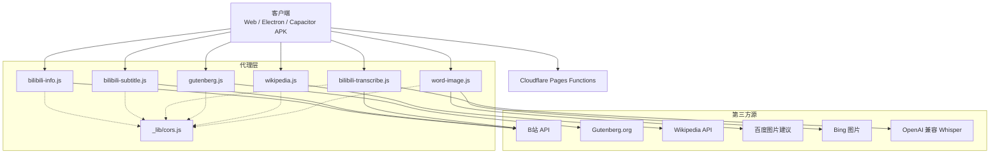
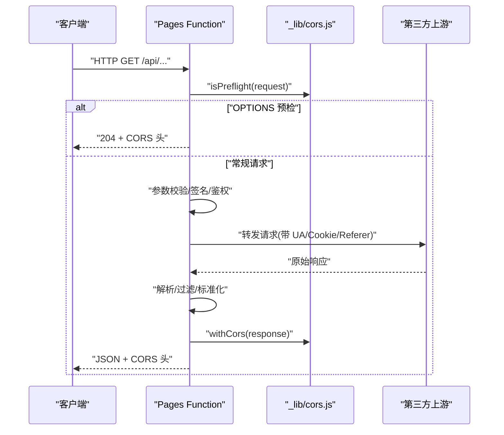
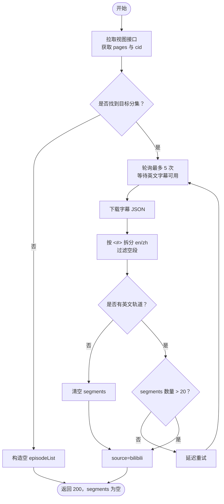

# 外部资源代理接口

<cite>
**本文引用的文件**
- [bilibili-info.js](file://functions/api/bilibili-info.js)
- [bilibili-subtitle.js](file://functions/api/bilibili-subtitle.js)
- [bilibili-transcribe.js](file://functions/api/bilibili-transcribe.js)
- [gutenberg.js](file://functions/api/gutenberg.js)
- [wikipedia.js](file://functions/api/wikipedia.js)
- [word-image.js](file://functions/api/word-image.js)
- [cors.js](file://functions/_lib/cors.js)
- [kv.js](file://functions/_lib/kv.js)
- [types.ts](file://functions/_lib/types.ts)
</cite>

## 目录
1. [引言](#引言)
2. [项目结构](#项目结构)
3. [核心组件](#核心组件)
4. [架构总览](#架构总览)
5. [详细接口规范](#详细接口规范)
6. [依赖与集成分析](#依赖与集成分析)
7. [性能与可靠性](#性能与可靠性)
8. [故障排查指南](#故障排查指南)
9. [结论](#结论)

## 引言
本文件为 NativeThink 应用的外部资源代理 API 提供完整的技术文档。这些 Cloudflare Pages Function 作为统一代理层，屏蔽 B站、古腾堡计划、维基百科、百度/Bing 图片等第三方服务差异，向客户端暴露简洁、稳定、可跨域访问的 JSON 接口。重点覆盖以下端点：
- B站信息：`/api/bilibili-info`
- B站字幕：`/api/bilibili-subtitle`
- B站音频转写：`/api/bilibili-transcribe`
- 古腾堡书籍全文：`/api/gutenberg`
- 维基百科搜索与页面：`/api/wikipedia`
- 单词插图：`/api/word-image`

## 项目结构
代理接口位于 `functions/api` 下，每个端点对应一个函数；共享能力集中在 `functions/_lib`：
- `cors.js`：统一的跨域响应头、OPTIONS 预检处理。
- `kv.js`：KV 键名生成辅助（当前未直接用于外部资源代理）。
- `types.ts`：用户与会话相关类型（不直接参与外部资源代理）。

**图表来源**
- [bilibili-info.js:1-68](file://functions/api/bilibili-info.js#L1-L68)
- [bilibili-subtitle.js:1-158](file://functions/api/bilibili-subtitle.js#L1-L158)
- [bilibili-transcribe.js:1-200](file://functions/api/bilibili-transcribe.js#L1-L200)
- [gutenberg.js:1-45](file://functions/api/gutenberg.js#L1-L45)
- [wikipedia.js:1-107](file://functions/api/wikipedia.js#L1-L107)
- [word-image.js:1-112](file://functions/api/word-image.js#L1-L112)
- [cors.js:1-29](file://functions/_lib/cors.js#L1-L29)

**章节来源**
- [bilibili-info.js:1-68](file://functions/api/bilibili-info.js#L1-L68)
- [bilibili-subtitle.js:1-158](file://functions/api/bilibili-subtitle.js#L1-L158)
- [bilibili-transcribe.js:1-200](file://functions/api/bilibili-transcribe.js#L1-L200)
- [gutenberg.js:1-45](file://functions/api/gutenberg.js#L1-L45)
- [wikipedia.js:1-107](file://functions/api/wikipedia.js#L1-L107)
- [word-image.js:1-112](file://functions/api/word-image.js#L1-L112)
- [cors.js:1-29](file://functions/_lib/cors.js#L1-L29)

## 核心组件
- 跨域与安全：所有代理入口均通过 `_lib/cors.js` 注入 `Access-Control-Allow-Origin: *`，并支持 OPTIONS 预检，满足 Capacitor APK 内 `https://localhost` 的跨域需求。
- 输入校验：各端点对关键参数进行白名单或正则校验，避免无效请求进入上游。
- 错误隔离：对上游不可达、非法参数、业务错误返回结构化 JSON，客户端据此做降级。
- 标准化输出：将不同第三方格式统一为内部一致字段，便于前端复用。

**章节来源**
- [cors.js:1-29](file://functions/_lib/cors.js#L1-L29)

## 架构总览
代理层承担以下职责：
- 协议转换：将浏览器受限环境下的直连失败，转换为服务器端聚合调用。
- 安全过滤：对敏感参数、URL、关键词做基础清洗与过滤。
- 数据归一：把 B站、维基百科、古腾堡、图片服务等异构数据转为统一结构。
- 错误透传：保留必要错误码和消息，同时对外保持稳定的 2xx/4xx/5xx 语义。

**图表来源**
- [cors.js:1-29](file://functions/_lib/cors.js#L1-L29)
- [bilibili-info.js:1-68](file://functions/api/bilibili-info.js#L1-L68)
- [wikipedia.js:1-107](file://functions/api/wikipedia.js#L1-L107)
- [gutenberg.js:1-45](file://functions/api/gutenberg.js#L1-L45)

## 详细接口规范

### B站视频信息 `/api/bilibili-info`
- 用途：获取 B站视频的标题、频道、时长、分集列表。
- 方法：GET
- 查询参数
  - `bvid`：必填，B站视频编号，格式为 `BV` 开头后跟至少 10 位字母数字。
- 成功响应字段
  - `title`：字符串
  - `episodes`：整数，表示集数
  - `duration`：整数，单位秒
  - `channel`：字符串，UP主名称
  - `pages`：数组，每项含 `page`、`part`、`duration`
- 错误响应
  - 参数非法：400，包含 `error`
  - B站 API 异常：400，包含 `error`、`code`、`message`
  - 网络或解析异常：500，包含 `error`
- 数据转换逻辑
  - 从 B站视图接口取 `data.title/duration/videos/owner.name/pages`，映射为上述字段。
- 示例
  - 请求：`GET /api/bilibili-info?bvid=BV1xxx`
  - 成功：`{ title, episodes, duration, channel, pages: [...] }`
  - 失败：`{ error: "无效的 BVID" }` 或 `{ error: "B站 API 返回错误", code, message }`

**章节来源**
- [bilibili-info.js:1-68](file://functions/api/bilibili-info.js#L1-L68)

### B站字幕 `/api/bilibili-subtitle`
- 用途：根据 BVID 与页码，拉取 B站 AI 字幕，解析为中英双语分段，并提取关键词。
- 方法：GET
- 查询参数
  - `bvid`：必填，B站视频编号。
  - `page`：可选，默认 1，指定分集序号。
- 成功响应字段
  - `bvid`：字符串
  - `page`：整数
  - `cid`：整数
  - `part`：字符串
  - `segments`：数组，每项含 `start`、`end`、`en`、`zh`、`keywords`
  - `source`：字符串，如 `bilibili` 或 `none`
  - `totalEpisodes`：整数
  - `episodeList`：数组，每项含 `page`、`part`、`duration`
  - `error`：空字符串或 null（该接口始终返回 200）
- 数据转换逻辑
  - 先拉取视图接口得到 pages 与 cid。
  - 轮询最多 5 次，等待 B站 AI 字幕可用，优先选择英文轨道（`lan` 匹配 `en`）。
  - 下载字幕 JSON，按 `<#>` 分隔符切分为 en/zh，过滤空片段。
  - 从英文文本中提取长度大于 4 的英文词作为 keywords。
- 重试与降级
  - 若未拿到足够英文字幕，最终仍返回空 segments 与 `source=none`，由前端使用 AI 补充。
- 示例
  - 请求：`GET /api/bilibili-subtitle?bvid=BV1xxx&page=1`
  - 成功：`{ bvid, page, cid, part, segments: [...], source: "bilibili", totalEpisodes, episodeList, error: null }`
  - 无字幕：`{ ..., segments: [], source: "none" }`

**图表来源**
- [bilibili-subtitle.js:1-158](file://functions/api/bilibili-subtitle.js#L1-L158)

**章节来源**
- [bilibili-subtitle.js:1-158](file://functions/api/bilibili-subtitle.js#L1-L158)

### B站音频转写 `/api/bilibili-transcribe`
- 用途：根据 BVID 与分集，拉取音频并通过 OpenAI 兼容 Whisper 接口转写为带时间戳的字幕。
- 方法：GET
- 查询参数
  - `bvid`：必填，B站视频编号。
  - `page`：可选，默认 1，指定分集序号。
- 环境变量
  - `OPENAI_API_KEY`：必填，Whisper 接入密钥。
  - `OPENAI_BASE_URL`：可选，默认 `https://api.openai.com/v1`。
- 成功响应字段
  - `segments`：数组，每项含起止时间与文本（具体字段以 Whisper 返回为准）。
  - `source`：字符串，如 `whisper` 或 `none`。
  - `episodeList`：分集列表。
  - `error`：空字符串或错误描述。
- 错误响应
  - 参数非法：400，`error`
  - 未配置密钥：返回空 segments 与提示 `未配置 OPENAI_API_KEY`。
  - 上游错误：500 或业务错误，携带 `error`。
- 数据转换逻辑
  - 拉取视图接口得到 cid 与 episodeList。
  - 使用 WBI 签名机制构造播放地址，拉取音频 URL。
  - 上传音频至 OpenAI 兼容 Whisper 接口，获得分段字幕。
- 注意事项
  - WBI 签名依赖 B站导航接口返回的 imgKey/subKey。
  - 需要配置 `OPENAI_API_KEY`，否则无法转写。

**章节来源**
- [bilibili-transcribe.js:1-200](file://functions/api/bilibili-transcribe.js#L1-L200)

### 古腾堡书籍全文 `/api/gutenberg`
- 用途：代理 gutenberg.org 公版书全文，解决浏览器直连无 CORS 的问题。
- 方法：GET
- 查询参数
  - `id`：必填，纯数字，1~5 位。
- 成功响应字段
  - `text`：字符串，正文全文。
- 错误响应
  - 参数非法：400，`error`
  - 书不可达：502，`error`
- 数据转换逻辑
  - 依次尝试两个备用地址，返回长度超过 1000 字符的第一个有效结果。

**章节来源**
- [gutenberg.js:1-45](file://functions/api/gutenberg.js#L1-L45)

### 维基百科接口 `/api/wikipedia`
- 用途：代理 English Wikipedia API，支持搜索与页面内容读取。
- 方法：GET
- 查询参数
  - `action=search`：搜索
    - `q`：必填，搜索词
    - `limit`：可选，默认 20，最大 50
  - `action=page`：页面
    - `title`：必填，条目标题
- 成功响应字段
  - search：`{ results: [{ title, wordCount }] }`
  - page：`{ title, paragraphs: string[] }`，段落中 `[SECTION] 标题` 标识一级节标题。
- 错误响应
  - 缺少 title：400，`error`
  - 条目不存在：404，`error`
  - 其他异常：502，`error`
- 数据转换逻辑
  - 搜索返回精简结果（标题与字数）。
  - 页面提取纯文本，按双换行切分为段落，标记一级节标题，丢弃二级及以下模板噪声。

**章节来源**
- [wikipedia.js:1-107](file://functions/api/wikipedia.js#L1-L107)

### 单词图片 `/api/word-image`
- 用途：为学习场景提供与单词匹配的缩略图与原图，优先展示安全、相关的真实照片。
- 方法：GET
- 查询参数
  - `word`：必填，仅允许小写字母、单引号、连字符、空格，长度不超过 31。
- 成功响应字段
  - `images`：字符串数组，最多 8 个 HTTPS 缩略图或原图链接，已去重并按相关性排序。
- 数据转换逻辑
  - 并行抓取 Bing 与百度图片建议结果。
  - 过滤不安全 URL、重复项、超长链接。
  - 相关性排序：URL 中包含单词本身的链接优先。
- 安全策略
  - 严格校验单词形态，防止注入与滥用。
  - 基于关键词黑名单过滤不适宜图像。

**章节来源**
- [word-image.js:1-112](file://functions/api/word-image.js#L1-L112)

## 依赖与集成分析

### 跨域与预检
- 所有代理入口在 `onRequest` 中检测 OPTIONS 预检，直接返回 204。
- 正常响应通过 `withCors` 注入：
  - `Access-Control-Allow-Origin: *`
  - `Access-Control-Allow-Methods: GET, POST, PUT, DELETE, OPTIONS`
  - `Access-Control-Allow-Headers: Content-Type, Authorization`
  - `Access-Control-Max-Age: 86400`
- 这确保 Capacitor APK 内 `https://localhost` 能跨域访问云端函数。

**章节来源**
- [cors.js:1-29](file://functions/_lib/cors.js#L1-L29)
- [bilibili-info.js:1-68](file://functions/api/bilibili-info.js#L1-L68)
- [bilibili-subtitle.js:1-158](file://functions/api/bilibili-subtitle.js#L1-L158)
- [bilibili-transcribe.js:1-200](file://functions/api/bilibili-transcribe.js#L1-L200)
- [gutenberg.js:1-45](file://functions/api/gutenberg.js#L1-L45)
- [wikipedia.js:1-107](file://functions/api/wikipedia.js#L1-L107)
- [word-image.js:1-112](file://functions/api/word-image.js#L1-L112)

### 缓存策略
- 当前外部资源代理接口未实现服务端缓存。
- 建议在客户端侧实现短期缓存：
  - B站信息：分钟级缓存，避免频繁刷新。
  - Gutenberg 全文：小时级或更长缓存。
  - Wikipedia 搜索结果：分钟级缓存。
  - 单词图片：长缓存，但需考虑外链失效与安全性更新。

[本节为通用指导，不涉及具体代码文件]

### 错误处理机制
- 参数校验失败：返回 400 与明确 `error`。
- 上游业务异常：尽量透传上游错误码与消息，例如 B站 API 的 `code`、`message`。
- 网络/解析异常：返回 500 或 502，并附带错误描述。
- 关键字段缺失：返回空数组或空对象，而非抛出异常，使前端可优雅降级。

**章节来源**
- [bilibili-info.js:1-68](file://functions/api/bilibili-info.js#L1-L68)
- [wikipedia.js:1-107](file://functions/api/wikipedia.js#L1-L107)
- [gutenberg.js:1-45](file://functions/api/gutenberg.js#L1-L45)

## 性能与可靠性

### 并发与超时
- 单词图片采用并行抓取 Bing 与百度，提升命中率与速度。
- B站字幕采用轮询重试，适应 AI 字幕异步生成特性。
- 建议客户端设置合理超时（例如 10~30 秒），并在 UI 上显示加载中状态。

### 带宽与体积
- 单词图片只返回缩略图，减少移动端流量。
- Gutenberg 全文可能较大，建议分页或按需加载。

### 限流与降级
- B站 API 可能受网络限制，字幕接口会回退到空结果，由前端 AI 补充。
- Wikipedia/Gutenberg 不可达时返回结构化错误，前端可切换本地缓存或离线模式。
- Whisper 转写需要外部 API Key，未配置时立即返回空结果，避免阻塞。

**章节来源**
- [bilibili-subtitle.js:1-158](file://functions/api/bilibili-subtitle.js#L1-L158)
- [word-image.js:1-112](file://functions/api/word-image.js#L1-L112)
- [bilibili-transcribe.js:1-200](file://functions/api/bilibili-transcribe.js#L1-L200)

## 故障排查指南

### 常见问题
- 客户端报跨域错误
  - 确认已通过代理接口访问，而不是直连第三方。
  - 检查是否触发了 OPTIONS 预检并被正确返回 204。
- B站字幕为空
  - 可能是 AI 字幕尚未生成完成，稍后重试。
  - 若无英文轨道，接口会清空英文字幕，前端应启用 AI 补充。
- 单词图片为空
  - 检查单词是否符合白名单规则。
  - 某些词可能被安全过滤策略丢弃。
- Gutenberg 返回 502
  - 目标书可能暂时不可用，稍后重试。
- Wikipedia 返回 404
  - 标题不存在或拼写有误，请修正 `title`。

### 调试建议
- 查看返回的 `error` 字段与 HTTP 状态码。
- 对于 B站转写，确认已配置 `OPENAI_API_KEY`。
- 对于 B站字幕，检查 `source` 是否为 `bilibili`。
- 对于单词图片，观察 `images` 数组长度与 URL 是否 HTTPS。

**章节来源**
- [bilibili-subtitle.js:1-158](file://functions/api/bilibili-subtitle.js#L1-L158)
- [bilibili-transcribe.js:1-200](file://functions/api/bilibili-transcribe.js#L1-L200)
- [gutenberg.js:1-45](file://functions/api/gutenberg.js#L1-L45)
- [wikipedia.js:1-107](file://functions/api/wikipedia.js#L1-L107)
- [word-image.js:1-112](file://functions/api/word-image.js#L1-L112)

## 结论
这些代理接口为 NativeThink 提供了统一的外部资源访问面：屏蔽跨域、简化数据结构、集中安全过滤与错误处理。客户端只需调用统一的 JSON 接口，即可获取 B站信息、字幕、音频转写、公版书全文、百科内容与单词配图。为保证稳定性，建议在客户端实现短期缓存、重试与降级策略，并根据业务场景选择合适的超时与并发策略。