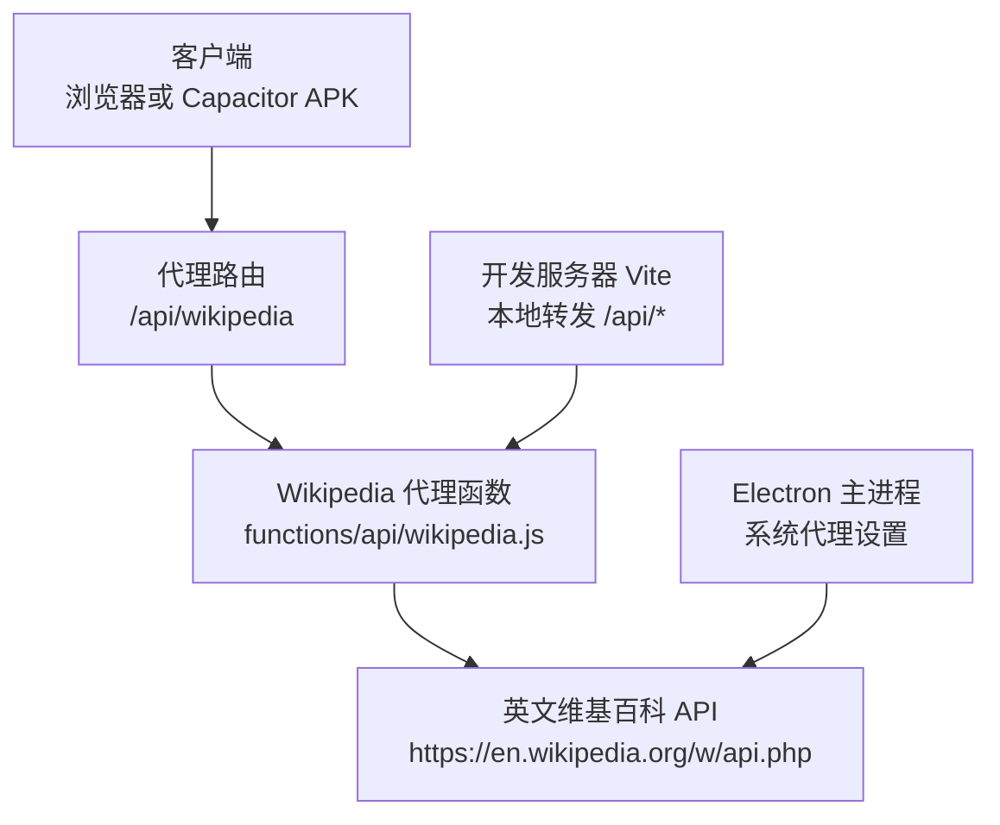
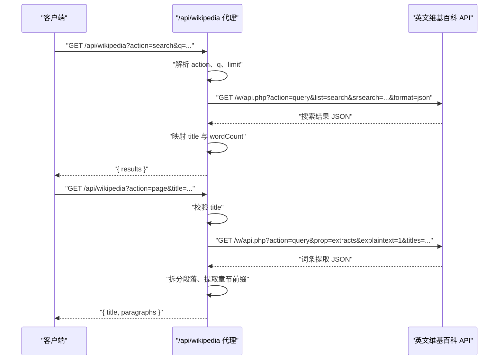
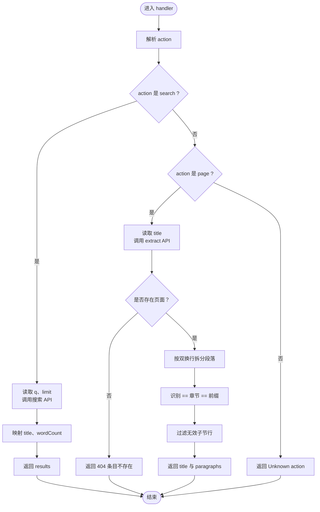
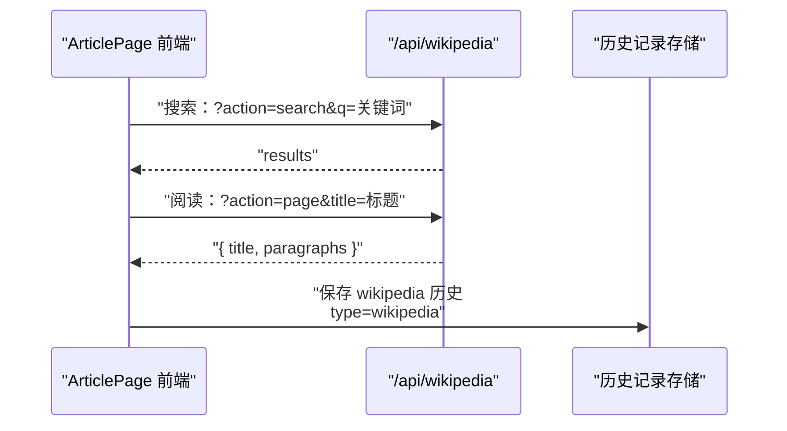

# 维基百科接口

<cite>
**本文引用的文件**
- [wikipedia.js](file://functions/api/wikipedia.js)
- [cors.js](file://functions/_lib/cors.js)
- [ArticlePage.tsx](file://src/pages/ArticlePage/ArticlePage.tsx)
- [vite.config.ts](file://vite.config.ts)
- [local-server.mjs](file://server/local-server.mjs)
- [electron/main.mjs](file://electron/main.mjs)
</cite>

## 目录
1. [简介](#简介)
2. [项目结构与定位](#项目结构与定位)
3. [API 规范总览](#api-规范总览)
4. [请求与响应格式](#请求与响应格式)
5. [代理层实现分析](#代理层实现分析)
6. [客户端集成流程](#客户端集成流程)
7. [多语言、Markdown 与图片处理现状](#多语言markdown-与图片处理现状)
8. [错误码与异常处理](#错误码与异常处理)
9. [性能与稳定性建议](#性能与稳定性建议)
10. [客户端集成指南](#客户端集成指南)
11. [故障排查](#故障排查)
12. [结论](#结论)

## 简介
本文件为 NativeThink 应用中的“维基百科代理 API”提供完整技术文档。该接口位于 `/api/wikipedia`，用于在受网络限制的环境中访问英文维基百科的词条信息，包括：

- 词条搜索：根据关键词返回标题与字数等摘要信息；
- 词条正文：按段落拆分的纯文本内容，并将一级章节标记为可识别的前缀。

代理层由 Cloudflare Workers 风格的 `onRequest` 入口暴露，前端通过相对路径调用，避免跨域和直接访问 Wikipedia 的问题。

## 项目结构与定位
维基百科功能涉及服务端代理、前端页面、开发服务器转发以及 Electron 代理配置：



**图表来源**
- [wikipedia.js:1-107](file://functions/api/wikipedia.js#L1-L107)
- [vite.config.ts:168-168](file://vite.config.ts#L168-L168)
- [local-server.mjs:108-108](file://server/local-server.mjs#L108-L108)
- [electron/main.mjs:93-97](file://electron/main.mjs#L93-L97)

**章节来源**
- [wikipedia.js:1-107](file://functions/api/wikipedia.js#L1-L107)
- [vite.config.ts:168-168](file://vite.config.ts#L168-L168)
- [local-server.mjs:108-108](file://server/local-server.mjs#L108-L108)
- [electron/main.mjs:93-97](file://electron/main.mjs#L93-L97)

## API 规范总览
接口基地址为 `/api/wikipedia`，支持两种行为，由查询参数 `action` 决定：

| action | 用途 | 关键参数 | 主要响应字段 | 状态码 |
|---|---|---|---|---|
| `search` | 全文搜索词条 | `q`、可选 `limit` | `results[]`，每项含 `title`、`wordCount` | 200 |
| `page` | 获取词条正文 | `title` | `title`、`paragraphs[]` | 200 / 400 / 404 / 502 |

默认 `action` 为 `search`。所有响应均使用 `application/json`，并通过 CORS 允许跨域。

**章节来源**
- [wikipedia.js:1-107](file://functions/api/wikipedia.js#L1-L107)

## 请求与响应格式

### 搜索接口
- URL：`GET /api/wikipedia?action=search&q=关键词&limit=条数`
- 参数：
  - `q`：必填（空值时返回空结果）；
  - `limit`：可选，默认 20，最大上限 50。
- 成功响应体：
  ```json
  {
    "results": [
      {
        "title": "词条标题",
        "wordCount": 字数
      }
    ]
  }
  ```
- 空搜索响应：
  ```json
  {
    "results": []
  }
  ```

### 词条正文接口
- URL：`GET /api/wikipedia?action=page&title=词条标题`
- 参数：
  - `title`：必填；
- 成功响应体：
  ```json
  {
    "title": "词条标题",
    "paragraphs": [
      "第一段正文",
      "[SECTION] 章节标题",
      "第二段正文"
    ]
  }
  ```
- 缺失词条响应：
  ```json
  {
    "error": "条目不存在"
  }
  ```

### 参数校验与错误响应
- 缺少 `title`：
  ```json
  {
    "error": "Missing \"title\" parameter"
  }
  ```
- 未知 `action`：
  ```json
  {
    "error": "Unknown action"
  }
  ```
- 网络或服务端异常：
  ```json
  {
    "error": "维基百科加载失败：<错误信息>"
  }
  ```

**章节来源**
- [wikipedia.js:1-107](file://functions/api/wikipedia.js#L1-L107)

## 代理层实现分析

### 整体流程
代理层接收前端请求后，解析 `action`，构造 Wikipedia API 查询参数，再通过 Node 环境的 `fetch` 发起真实请求，最后将数据转换为更稳定的 JSON 结构返回给前端。



**图表来源**
- [wikipedia.js:1-107](file://functions/api/wikipedia.js#L1-L107)

### 核心实现要点
- **Wikipedia 地址**：固定为英文维基百科 API。
- **User-Agent**：自定义 UA，标识 NativeThink 教育类应用。
- **CORS**：统一返回 `Access-Control-Allow-Origin: *`，并处理 OPTIONS 预检请求。
- **搜索逻辑**：
  - 空 `q` 直接返回空结果数组；
  - `limit` 默认 20，上限 50；
  - 仅保留 `title` 和 `wordCount`。
- **词条正文逻辑**：
  - 使用 `explaintext` 获取纯文本；
  - 启用重定向；
  - 按两个换行符拆分为段落；
  - 将形如 `== 章节 ==` 的一级章节转为 `[SECTION] 章节标题`；
  - 过滤掉仍残留的三级子节模板行。



**图表来源**
- [wikipedia.js:1-107](file://functions/api/wikipedia.js#L1-L107)

**章节来源**
- [wikipedia.js:1-107](file://functions/api/wikipedia.js#L1-L107)

## 客户端集成流程
前端 ArticlePage 将维基百科作为独立内容类型，通过相对路径调用 `/api/wikipedia`：

- 内容类型枚举包含 `wikipedia`；
- 主标签页中包含“维基百科”入口；
- 搜索时调用 `action=search`；
- 阅读时调用 `action=page`，并以 `title` 参数传入词条名；
- 成功后写入历史记录，记录 `topic` 为 `wikipedia`，并携带 `wikiId`。



**图表来源**
- [ArticlePage.tsx:330-381](file://src/pages/ArticlePage/ArticlePage.tsx#L330-L381)
- [ArticlePage.tsx:395-414](file://src/pages/ArticlePage/ArticlePage.tsx#L395-L414)

**章节来源**
- [ArticlePage.tsx:330-381](file://src/pages/ArticlePage/ArticlePage.tsx#L330-L381)
- [ArticlePage.tsx:395-414](file://src/pages/ArticlePage/ArticlePage.tsx#L395-L414)

## 多语言、Markdown 与图片处理现状

### 多语言支持
当前代理层固定使用英文维基百科 API，没有根据语言代码选择不同站点。因此：

- 不支持动态切换中文、日文等其他语言版本；
- 若需多语言，应扩展 `WIKI_API` 构建逻辑，例如根据语言参数选择 `zh.wikipedia.org`、`ja.wikipedia.org` 等域名；
- 同时需要调整 `User-Agent` 和可能的地区策略。

### Markdown 格式化
当前接口返回的是**纯文本段落**，而不是 Markdown：

- 搜索接口只返回标题和字数；
- 词条正文使用 `explaintext`，不保留 wiki markup；
- 一级章节被转换为 `[SECTION]` 前缀，便于前端渲染目录或分节；
- 二级及以下小节模板未被结构化输出。

若需要 Markdown 或 HTML，应在代理层改用 `exhtml` 或 `prop=wikitext`，并在后端做安全清洗与转义。

### 图片链接处理
当前接口不专门处理图片：

- 正文中可能包含原始图片链接；
- 没有统一的图片缩略图、CDN 替换或防盗链处理；
- 前端展示图片时应考虑跨域、直连不可用和网络限制场景。

**章节来源**
- [wikipedia.js:1-107](file://functions/api/wikipedia.js#L1-L107)

## 错误码与异常处理

| 场景 | 状态码 | 响应特征 | 客户端建议 |
|---|---:|---|---|
| 空搜索 | 200 | `results` 为空数组 | 显示无结果提示 |
| 缺少 `title` | 400 | `error` 包含参数缺失信息 | 阻止无效请求 |
| 未知 `action` | 400 | `error` 为 `Unknown action` | 校验前端路由或参数 |
| 词条不存在 | 404 | `error` 为 `条目不存在` | 提示用户词条无效 |
| Wikipedia 返回非 2xx | 502 | `error` 以“维基百科加载失败”开头 | 重试或降级到缓存 |
| 网络超时、DNS 失败、代理异常 | 502 | `error` 包含底层错误消息 | 指数退避重试 + 用户提示 |

### 错误分类建议
客户端可按以下规则分类错误：

- 客户端参数错误：400；
- 资源不存在：404；
- 外部服务不可用：502；
- 速率限制：目前未单独返回 429，应由客户端观察 502 频率并结合重试策略处理；
- 网络中断：由运行时异常捕获，最终也落入 502。

**章节来源**
- [wikipedia.js:1-107](file://functions/api/wikipedia.js#L1-L107)

## 性能与稳定性建议

### 当前实现的性能特征
- 每次请求都会新建 URL 查询参数并调用 Wikipedia API；
- 搜索默认返回最多 20 条，上限 50；
- 正文按段落拆分，时间复杂度与段落数量线性相关；
- 没有服务端缓存；
- 没有显式超时控制；
- User-Agent 较稳定，但未见请求去重或合并。

### 优化建议
- **服务端缓存**：对相同 `action=title` 的结果进行短期缓存，降低重复阅读压力；
- **限流与防刷**：对同一 IP 或会话限制单位时间内请求次数；
- **超时控制**：为 Wikipedia 请求设置合理超时；
- **分页与增量加载**：搜索列表支持分页，避免一次性拉取大量结果；
- **段落懒加载**：长词条分段加载，减少首屏体积；
- **压缩传输**：启用 gzip 或 br；
- **可观测性**：记录 Wikipedia API 延迟、错误率、热门词条。

[本节为通用性能建议，不直接分析具体代码片段]

## 客户端集成指南

### 基础调用步骤
1. 调用 `/api/wikipedia?action=search&q=关键词`；
2. 从 `results` 中展示标题；
3. 用户点击后调用 `/api/wikipedia?action=page&title=标题`；
4. 渲染 `title` 和 `paragraphs`；
5. 将词条保存到本地历史或收藏。

### 搜索建议
- 使用防抖输入，避免频繁触发搜索；
- 限制最小输入长度；
- 对空结果给出友好提示；
- 对 `wordCount` 可用于排序或热度提示。

### 缓存策略
推荐采用多层缓存：

| 层级 | 内容 | 过期策略 |
|---|---|---|
| 内存缓存 | 最近搜索结果 | 短生命周期，例如几分钟 |
| 本地缓存 | 已读词条正文 | 较长生命周期，例如 7 天 |
| 服务端缓存 | 热点词条 | 分钟级或小时级 |

### 错误处理最佳实践
- 区分参数错误、资源不存在和外部错误；
- 对 502 做有限次重试，配合指数退避；
- 重试失败后回退到本地缓存；
- 向用户显示可读错误，而非原始堆栈；
- 在网络受限环境下提示用户尝试其他网络。

### 前端渲染建议
- 遇到 `[SECTION]` 前缀时，将其视为章节标题；
- 普通段落作为正文；
- 图片链接应添加 `referrerPolicy` 和安全属性；
- 长文章支持滚动加载或分页；
- 禁用自动执行外部脚本。

**章节来源**
- [ArticlePage.tsx:330-381](file://src/pages/ArticlePage/ArticlePage.tsx#L330-L381)
- [ArticlePage.tsx:395-414](file://src/pages/ArticlePage/ArticlePage.tsx#L395-L414)

## 故障排查

### 常见问题
- **请求被拦截或无法连接**：
  - 检查代理是否可达；
  - 确认开发环境 Vite 转发 `/api/wikipedia`；
  - 在 Electron 环境中检查系统代理配置。
- **CORS 错误**：
  - 代理已设置 `Access-Control-Allow-Origin: *`；
  - 确认未绕过代理直接访问 Wikipedia；
  - 检查 Capacitor APK 的 `localhost` 跨域预检。
- **搜索无结果**：
  - 检查 `q` 是否为空；
  - 检查 limit 是否过小；
  - 确认关键词拼写。
- **词条 404**：
  - 检查 `title` 是否准确；
  - 注意大小写和空格；
  - 确认英文维基百科确实存在该词条。
- **正文空白或排版异常**：
  - 检查段落拆分逻辑；
  - 确认 `[SECTION]` 是否被正确识别；
  - 检查前端是否误把段落当作 HTML 或 Markdown 渲染。

### 调试建议
- 使用浏览器开发者工具查看 `/api/wikipedia` 请求；
- 对比 Wikipedia 官方 API 返回；
- 在本地服务器模式下验证转发逻辑；
- 在 Electron 环境中检查 PAC 或系统代理。

**章节来源**
- [wikipedia.js:1-107](file://functions/api/wikipedia.js#L1-L107)
- [vite.config.ts:168-168](file://vite.config.ts#L168-L168)
- [local-server.mjs:108-108](file://server/local-server.mjs#L108-L108)
- [electron/main.mjs:93-97](file://electron/main.mjs#L93-L97)

## 结论
`/api/wikipedia` 是一个轻量、明确的维基百科英文词条代理接口，适合在受限网络环境中提供搜索与阅读能力。其优势在于实现简单、响应结构清晰、错误语义明确；局限在于固定英文站点、不支持多语言、不返回 Markdown 和图片规范化处理。后续可扩展方向包括多语言站点选择、服务端缓存、限流、超时控制、图片处理和更完善的错误分类。

[本节为总结性内容，不直接分析具体代码片段]