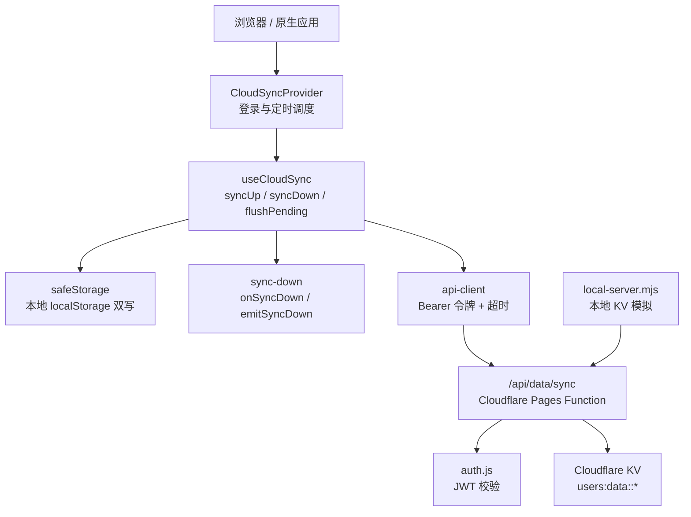
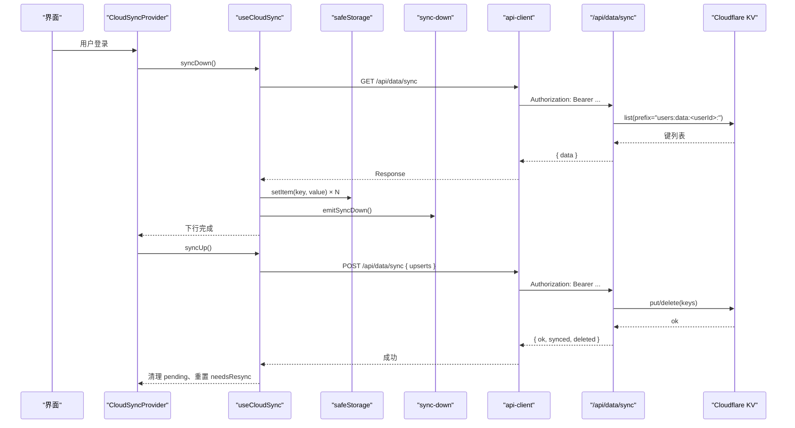
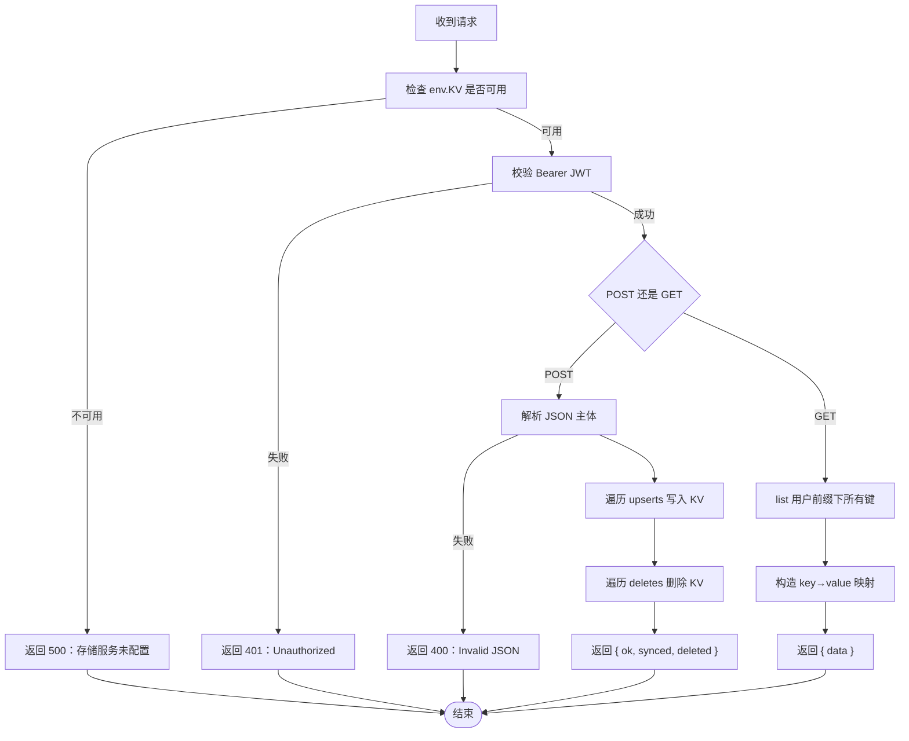
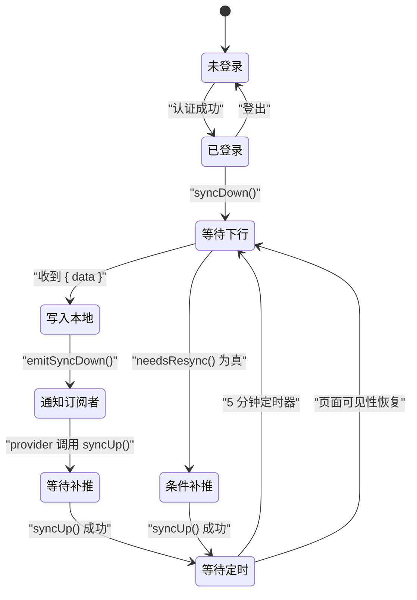
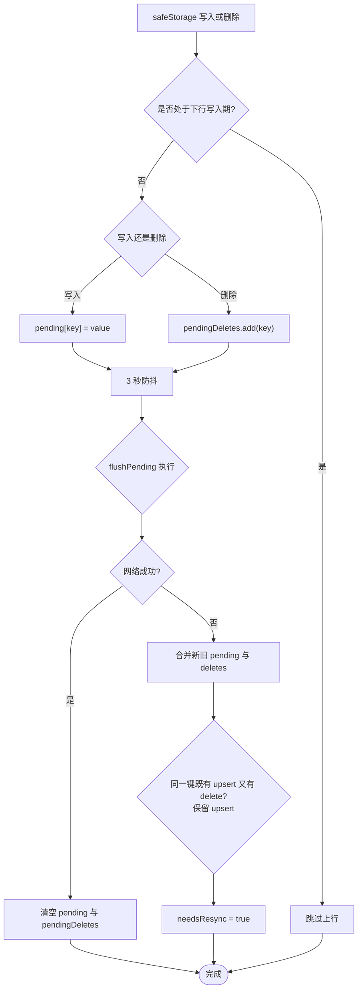
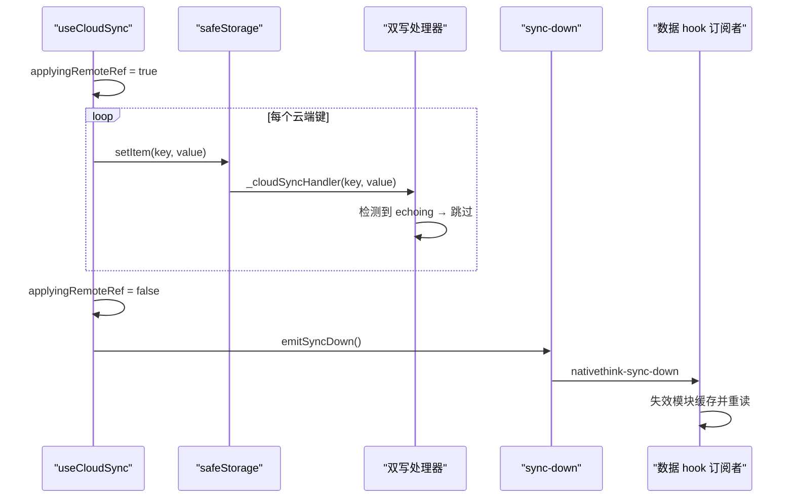
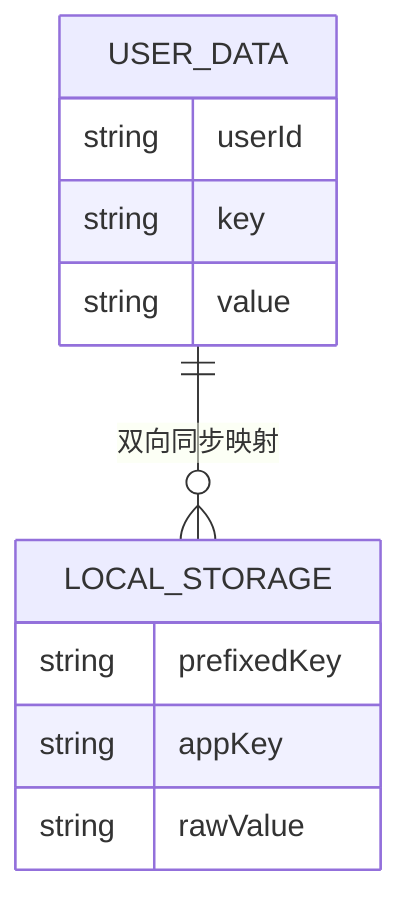
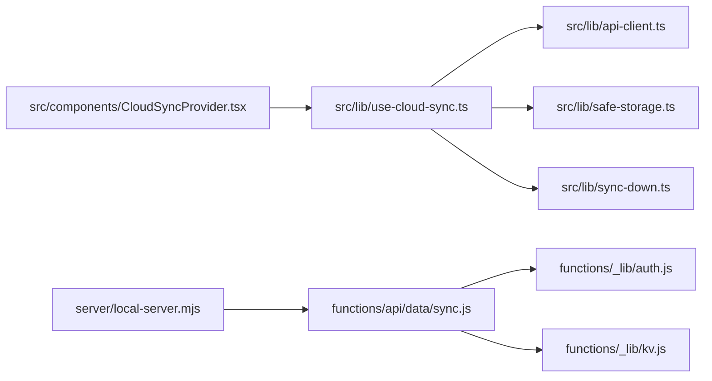

# 数据同步接口

<cite>
**本文引用的文件**   
- [functions/api/data/sync.js](file://functions/api/data/sync.js)
- [functions/_lib/auth.js](file://functions/_lib/auth.js)
- [functions/_lib/kv.js](file://functions/_lib/kv.js)
- [src/lib/use-cloud-sync.ts](file://src/lib/use-cloud-sync.ts)
- [src/components/CloudSyncProvider.tsx](file://src/components/CloudSyncProvider.tsx)
- [src/lib/safe-storage.ts](file://src/lib/safe-storage.ts)
- [src/lib/sync-down.ts](file://src/lib/sync-down.ts)
- [src/lib/api-client.ts](file://src/lib/api-client.ts)
- [server/local-server.mjs](file://server/local-server.mjs)
- [docs/modules/cloud-sync.md](file://docs/modules/cloud-sync.md)
</cite>

## 目录
1. [简介](#简介)
2. [项目结构](#项目结构)
3. [核心组件](#核心组件)
4. [架构总览](#架构总览)
5. [详细组件分析](#详细组件分析)
6. [依赖关系分析](#依赖关系分析)
7. [性能与一致性](#性能与一致性)
8. [故障排查](#故障排查)
9. [结论](#结论)
10. [附录：客户端实现指南](#附录客户端实现指南)

## 简介
本文件为 NativeThink 应用的“数据同步接口”技术文档，聚焦 `/api/data/sync` 的双向同步协议。当前实现是**全量上传/下载 + 本地增量缓冲合并**，并非基于云端版本号的增量同步。需要特别注意：

- 上行（POST）：客户端把 `upserts`、`deletes` 批量写入 Cloudflare KV。
- 下行（GET）：服务端列出用户前缀下的全部键值并返回给客户端。
- 不存在增量版本号、变更集或冲突检测；KV 是**最后写入者胜**的覆盖式存储。
- 回声抑制、缓存作废、重试合并等逻辑主要位于前端，而非 API 本身。

## 项目结构
与数据同步相关的代码分布在以下位置：

| 层级 | 文件 | 职责 |
|---|---|---|
| 服务端函数 | `functions/api/data/sync.js` | 认证、路由 POST/GET、KV 读写 |
| 服务端辅助 | `functions/_lib/auth.js` | 校验 Bearer JWT |
| 服务端辅助 | `functions/_lib/kv.js` | 生成用户隔离键前缀 |
| 前端钩子 | `src/lib/use-cloud-sync.ts` | 上行、下行、双写缓冲、失败重试 |
| 前端提供者 | `src/components/CloudSyncProvider.tsx` | 登录态驱动同步、定时轮询、可见性触发 |
| 本地存储封装 | `src/lib/safe-storage.ts` | 用户前缀键、双写处理器注册 |
| 下行事件总线 | `src/lib/sync-down.ts` | 下行落地后的订阅/广播 |
| HTTP 客户端 | `src/lib/api-client.ts` | 鉴权头、超时、JSON 错误包装 |
| 本地开发服务 | `server/local-server.mjs` | 在 Electron 中模拟 KV 和路由 |
| 设计说明 | `docs/modules/cloud-sync.md` | 同步行为、限制与已知陷阱 |

**图表来源**
- [src/components/CloudSyncProvider.tsx:1-61](file://src/components/CloudSyncProvider.tsx#L1-L61)
- [src/lib/use-cloud-sync.ts:1-191](file://src/lib/use-cloud-sync.ts#L1-L191)
- [src/lib/safe-storage.ts:120-216](file://src/lib/safe-storage.ts#L120-L216)
- [src/lib/sync-down.ts:1-49](file://src/lib/sync-down.ts#L1-L49)
- [src/lib/api-client.ts:1-82](file://src/lib/api-client.ts#L1-L82)
- [functions/api/data/sync.js:1-63](file://functions/api/data/sync.js#L1-L63)
- [functions/_lib/auth.js:1-8](file://functions/_lib/auth.js#L1-L8)
- [functions/_lib/kv.js:1-6](file://functions/_lib/kv.js#L1-L6)
- [server/local-server.mjs:1-120](file://server/local-server.mjs#L1-L120)

**章节来源**
- [functions/api/data/sync.js:1-63](file://functions/api/data/sync.js#L1-L63)
- [src/lib/use-cloud-sync.ts:1-191](file://src/lib/use-cloud-sync.ts#L1-L191)
- [src/components/CloudSyncProvider.tsx:1-61](file://src/components/CloudSyncProvider.tsx#L1-L61)
- [docs/modules/cloud-sync.md:1-64](file://docs/modules/cloud-sync.md#L1-L64)

## 核心组件
- **服务端同步函数**：统一处理 GET 与 POST，先做 KV 配置检查与 JWT 认证，再分别执行全量拉取或批量写入。
- **前端同步钩子**：维护上行待发送队列、删除集合、防抖定时器、回声抑制标记、失败重推标志。
- **提供者组件**：将同步绑定到认证生命周期、5 分钟周期任务、页面可见性恢复。
- **安全存储封装**：负责用户级键前缀、迁移旧键名、注册/注销云端双写处理器。
- **下行事件系统**：统一派发 `nativethink-sync-down`，让各数据 hook 失效并重新读取。
- **HTTP 客户端**：自动注入 Bearer 令牌、设置 15 秒超时、把非 JSON 或内部错误包装成友好异常。

**章节来源**
- [functions/api/data/sync.js:1-63](file://functions/api/data/sync.js#L1-L63)
- [src/lib/use-cloud-sync.ts:1-191](file://src/lib/use-cloud-sync.ts#L1-L191)
- [src/components/CloudSyncProvider.tsx:1-61](file://src/components/CloudSyncProvider.tsx#L1-L61)
- [src/lib/safe-storage.ts:120-216](file://src/lib/safe-storage.ts#L120-L216)
- [src/lib/sync-down.ts:1-49](file://src/lib/sync-down.ts#L1-L49)
- [src/lib/api-client.ts:1-82](file://src/lib/api-client.ts#L1-L82)

## 架构总览
下图展示一次完整的双向同步流程：登录后先拉取云端数据，再补推本地缺失数据；之后每 5 分钟只在下行成功后按需补推。

**图表来源**
- [src/components/CloudSyncProvider.tsx:10-40](file://src/components/CloudSyncProvider.tsx#L10-L40)
- [src/lib/use-cloud-sync.ts:68-140](file://src/lib/use-cloud-sync.ts#L68-L140)
- [functions/api/data/sync.js:22-61](file://functions/api/data/sync.js#L22-L61)

## 详细组件分析

### 接口定义：`/api/data/sync`

#### 请求与响应总表

| 方向 | 方法 | 路径 | 认证 | 主体字段 | 成功响应 | 典型错误 |
|---|---|---|---|---|---|---|
| 上行 | POST | `/api/data/sync` | Bearer JWT | `upserts`: 对象；`deletes`: 字符串数组 | `{ ok, synced, deleted }` | 400、401、500 |
| 下行 | GET | `/api/data/sync` | Bearer JWT | 无 | `{ data: Record<string,string> }` | 401、500 |

#### 上行请求体
- `upserts`：键到字符串值的映射，表示要创建或覆盖的键。
- `deletes`：要删除的键数组；服务端会忽略非数组类型。
- 两者都是可选字段；如果都没有有效写入，服务端仍返回成功。

#### 上行响应
- `ok`：布尔值，表示本次请求被接受。
- `synced`：实际写入 KV 的上行数。
- `deleted`：实际删除的键数。

#### 下行响应
- `data`：键到字符串值的映射，包含该用户在 KV 中的全部同步数据。

#### 错误语义
- 未配置 KV：500，消息提示存储服务未配置。
- JWT 无效或缺失：401。
- JSON 解析失败：400。
- 其他异常：500，消息提示同步失败。

**图表来源**
- [functions/api/data/sync.js:1-63](file://functions/api/data/sync.js#L1-L63)
- [functions/_lib/auth.js:1-8](file://functions/_lib/auth.js#L1-L8)
- [functions/_lib/kv.js:1-6](file://functions/_lib/kv.js#L1-L6)

**章节来源**
- [functions/api/data/sync.js:1-63](file://functions/api/data/sync.js#L1-L63)
- [functions/_lib/auth.js:1-8](file://functions/_lib/auth.js#L1-L8)
- [functions/_lib/kv.js:1-6](file://functions/_lib/kv.js#L1-L6)

### 前端同步状态机

**图表来源**
- [src/components/CloudSyncProvider.tsx:10-61](file://src/components/CloudSyncProvider.tsx#L10-L61)
- [src/lib/use-cloud-sync.ts:44-191](file://src/lib/use-cloud-sync.ts#L44-L191)

**章节来源**
- [src/components/CloudSyncProvider.tsx:1-61](file://src/components/CloudSyncProvider.tsx#L1-L61)
- [src/lib/use-cloud-sync.ts:1-191](file://src/lib/use-cloud-sync.ts#L1-L191)

### 上行增量缓冲与合并策略

前端并不使用云端版本号进行增量同步，而是通过本地缓冲实现“准增量”：

1. 每次经 `safeStorage.setItem` 写入时，若已注册双写处理器，则把键值加入 `pendingRef`。
2. 每次 `removeItem` 时，把键加入 `pendingDeletesRef`。
3. 写入操作后启动 3 秒防抖；防抖结束后一次性 POST `{ upserts, deletes }`。
4. 如果网络失败：
   - 新 pending 覆盖旧 pending，保证“最近写入优先”。
   - 删除集合合并，但同一键既存在上屏又出现在删除集合时，以 `upsert` 为准，抵消重复删除。
   - 保留 `needsResync = true`，下次全量补推时会扫描 `localStorage`。

**图表来源**
- [src/lib/use-cloud-sync.ts:44-79](file://src/lib/use-cloud-sync.ts#L44-L79)
- [src/lib/safe-storage.ts:150-216](file://src/lib/safe-storage.ts#L150-L216)

**章节来源**
- [src/lib/use-cloud-sync.ts:44-79](file://src/lib/use-cloud-sync.ts#L44-L79)
- [src/lib/safe-storage.ts:150-216](file://src/lib/safe-storage.ts#L150-L216)

### 下行回声抑制与缓存作废

#### 回声抑制
下行会把云端数据逐键写入 `safeStorage`，而 `safeStorage.setItem` 会同步调用已注册的双写处理器。为防止刚下载的云端数据再次被推回云端，`useCloudSync` 在执行下行写入循环时设置 `applyingRemoteRef = true`，双写处理器检测到该标记直接跳过。

#### 缓存作废
下行完成后调用 `emitSyncDown()`，由 `sync-down.ts` 统一派发事件。现有多个数据 hook 订阅该事件，并在回调中失效模块级缓存、重新从 storage 读取最新值。这是解决“陈旧内存态覆盖云端新值”的关键机制。

**图表来源**
- [src/lib/use-cloud-sync.ts:106-135](file://src/lib/use-cloud-sync.ts#L106-L135)
- [src/lib/safe-storage.ts:150-216](file://src/lib/safe-storage.ts#L150-L216)
- [src/lib/sync-down.ts:1-49](file://src/lib/sync-down.ts#L1-L49)

**章节来源**
- [src/lib/use-cloud-sync.ts:100-140](file://src/lib/use-cloud-sync.ts#L100-L140)
- [src/lib/sync-down.ts:1-49](file://src/lib/sync-down.ts#L1-L49)
- [src/lib/safe-storage.ts:150-216](file://src/lib/safe-storage.ts#L150-L216)

### 全量补推与键过滤

当存在失败或未落云的本地写入时，`syncUp` 会扫描 `localStorage`：

1. 获取 `safeStorage` 生成的用户前缀。
2. 只处理以该前缀开头的键。
3. 去掉前缀后，只处理以 `__nativethink_` 开头的业务键。
4. 把有效键值打包为 `upserts` 后 POST。

注意：文档明确说明，“只有经 `safeStorage` 写入的数据才会走双写处理器”，而不是“只要键名带 `__nativethink_` 就一定会同步”。

**章节来源**
- [src/lib/use-cloud-sync.ts:80-104](file://src/lib/use-cloud-sync.ts#L80-L104)
- [docs/modules/cloud-sync.md:12-30](file://docs/modules/cloud-sync.md#L12-L30)

### 认证与存储键空间

- 服务端通过 `Authorization: Bearer <token>` 校验 JWT。
- KV 键按用户隔离：`users:data:<userId>:<key>`。
- 本地键由 `safeStorage` 生成用户级前缀，支持平台 user_id 与匿名 id 兜底。

**图表来源**
- [functions/_lib/kv.js:1-6](file://functions/_lib/kv.js#L1-L6)
- [functions/_lib/auth.js:1-8](file://functions/_lib/auth.js#L1-L8)
- [src/lib/safe-storage.ts:1-120](file://src/lib/safe-storage.ts#L1-L120)

**章节来源**
- [functions/_lib/auth.js:1-8](file://functions/_lib/auth.js#L1-L8)
- [functions/_lib/kv.js:1-6](file://functions/_lib/kv.js#L1-L6)
- [src/lib/safe-storage.ts:1-120](file://src/lib/safe-storage.ts#L1-L120)

## 依赖关系分析

**图表来源**
- [src/components/CloudSyncProvider.tsx:1-61](file://src/components/CloudSyncProvider.tsx#L1-L61)
- [src/lib/use-cloud-sync.ts:1-191](file://src/lib/use-cloud-sync.ts#L1-L191)
- [src/lib/safe-storage.ts:120-216](file://src/lib/safe-storage.ts#L120-L216)
- [src/lib/sync-down.ts:1-49](file://src/lib/sync-down.ts#L1-L49)
- [src/lib/api-client.ts:1-82](file://src/lib/api-client.ts#L1-L82)
- [functions/api/data/sync.js:1-63](file://functions/api/data/sync.js#L1-L63)
- [functions/_lib/auth.js:1-8](file://functions/_lib/auth.js#L1-L8)
- [functions/_lib/kv.js:1-6](file://functions/_lib/kv.js#L1-L6)
- [server/local-server.mjs:80-120](file://server/local-server.mjs#L80-L120)

**章节来源**
- [src/components/CloudSyncProvider.tsx:1-61](file://src/components/CloudSyncProvider.tsx#L1-L61)
- [src/lib/use-cloud-sync.ts:1-191](file://src/lib/use-cloud-sync.ts#L1-L191)
- [functions/api/data/sync.js:1-63](file://functions/api/data/sync.js#L1-L63)
- [server/local-server.mjs:80-120](file://server/local-server.mjs#L80-L120)

## 性能与一致性

### 性能特征
- 上行采用 3 秒防抖批量提交，减少频繁网络请求。
- 下行按键逐个写入 `safeStorage`，单项失败仅记录丢弃数量，不中断其余键写入。
- 周期同步改为“下行成功后按需补推”，避免无条件全量 POST。
- 本地开发服务器对 KV 写入做了 200ms 写节流，避免频繁磁盘 IO。

### 一致性模型
- 最终一致性，不是强一致。
- 服务端没有事务、没有并发锁、没有版本号。
- 多设备并行编辑可能丢失一方修改，属于“后写者覆盖先写者”的全量覆盖语义。
- 本地去重依靠 `pendingRef` 覆盖同键、`pendingDeletesRef` 与 upsert 抵消。

### 数据一致性保证点
- 登录时先下行再上行，避免双写覆盖云端较新数据。
- 下行期间禁止双写处理器上报。
- 下行完成后统一派发事件，让订阅者失效缓存并重读。
- 上行失败保留 pending 数据，下次重试时新值覆盖旧值。

**章节来源**
- [src/lib/use-cloud-sync.ts:44-140](file://src/lib/use-cloud-sync.ts#L44-L140)
- [docs/modules/cloud-sync.md:31-64](file://docs/modules/cloud-sync.md#L31-L64)
- [server/local-server.mjs:40-75](file://server/local-server.mjs#L40-L75)

## 故障排查

| 现象 | 可能原因 | 处理建议 |
|---|---|---|
| 登录后立即反复上传全量数据 | 回声抑制失效或双写处理器未正确跳过下行写入 | 确认 `applyingRemoteRef` 在 `syncDown` 的写入循环中生效 |
| 下拉云端数据后本地未刷新 | 订阅者未失效模块缓存或未监听 `nativethink-sync-down` | 检查各数据 hook 是否调用 `useSyncDown` 并清空模块级缓存 |
| 同步失败但用户无感知 | 过去有空 catch 吞掉异常 | 当前实现已改为抖动警告；确认 toast 未被全局拦截 |
| 某项云端数据未写入本机 | 存储空间不足或配额满 | 查看“未能写入本机”的抖动提示，并释放存储空间 |
| 换设备后学习进度不同步 | 未登录、数据不在 `safeStorage`、或键名不符合同步范围 | 确认用户已登录且数据经 `safeStorage` 写入 |
| 本地开发环境同步不生效 | KV 绑定未配置或本地服务器未加载路由 | 检查 `env.KV`、`local-server.mjs` 的路由映射与 `kv.json` |
| 5 分钟轮询不触发 | `needsResync` 引用不稳定导致 `setInterval` 重建 | 确认 `needsResync` 使用稳定引用并由 provider 管理定时器 |

**章节来源**
- [src/lib/use-cloud-sync.ts:44-191](file://src/lib/use-cloud-sync.ts#L44-L191)
- [src/components/CloudSyncProvider.tsx:10-61](file://src/components/CloudSyncProvider.tsx#L10-L61)
- [src/lib/sync-down.ts:1-49](file://src/lib/sync-down.ts#L1-L49)
- [docs/modules/cloud-sync.md:31-64](file://docs/modules/cloud-sync.md#L31-L64)

## 结论
`/api/data/sync` 是一个简洁的双向数据通道：服务端负责身份验证与 KV 全量读写，前端负责本地键前缀、上行缓冲、回声抑制、下行事件广播以及失败重试。它适合“换设备或重装后恢复学习进度”的场景，但不适合高并发多端实时协作。若未来需要更强的增量与冲突能力，应在服务端引入版本号、变更集、乐观锁或冲突标记，并在客户端扩展增量合并算法。

[本节为总结性内容，不直接分析具体文件]

## 附录：客户端实现指南

### 最小同步流程
1. 用户登录后调用 `syncDown`。
2. 接收 `{ data }`，逐项写入 `safeStorage`。
3. 写入完成后调用 `emitSyncDown` 通知订阅者。
4. 随后调用 `syncUp` 补推本地缺失数据。
5. 后续每 5 分钟重复“下行 + 按需补推”。
6. 页面重新可见时触发一次节流后的下行。

### 网络中断与重试
- 上行失败时保留 `pendingRef` 与 `pendingDeletesRef`。
- 下一次 `flushPending` 会合并新旧 pending，并以最新写入为准。
- 同时设置 `needsResync = true`，以便下次全量补推。
- 上行失败会显示去抖警告，不会无限弹窗。

### 增量数据合并逻辑
当前实现中，“增量”是前端概念：
- 短间隔写入通过防抖合并为一次 POST。
- 删除与重写的同一键会被抵消为 upsert。
- 服务端没有增量标识符，也不比较版本。
- 全量补推会重新扫描本地 `localStorage` 中符合前缀的业务键。

### 冲突解决策略
- 服务端：**无冲突检测**，KV 最后写入者胜。
- 客户端：**无冲突标记**，不提示用户选择哪一方。
- 因此跨设备并行修改可能导致一方数据丢失。

### 错误处理方案
- 认证失败：返回 401，客户端应视为未登录。
- JSON 解析失败：返回 400，客户端应拒绝非法主体。
- KV 未配置：返回 500，客户端应提示服务不可用。
- 通用异常：返回 500，客户端应提示稍后重试。
- 前端 `apiFetch` 会把超时、HTML 响应、Cloudflare 内部错误包装为可读异常。

### 关键实现要点
- 不要在 `syncDown` 写入期间允许双写处理器上报。
- 不要在订阅者中使用陈旧模块缓存。
- 不要把 AI Key 等非同步数据误放入 `safeStorage`。
- 不要假设 IndexedDB 数据会同步。
- 不要把“键名前缀”当作唯一同步判定依据，应以是否经过 `safeStorage` 为准。

**章节来源**
- [src/lib/use-cloud-sync.ts:44-191](file://src/lib/use-cloud-sync.ts#L44-L191)
- [src/lib/api-client.ts:1-82](file://src/lib/api-client.ts#L1-L82)
- [src/lib/sync-down.ts:1-49](file://src/lib/sync-down.ts#L1-L49)
- [src/lib/safe-storage.ts:120-216](file://src/lib/safe-storage.ts#L120-L216)
- [docs/modules/cloud-sync.md:1-64](file://docs/modules/cloud-sync.md#L1-L64)