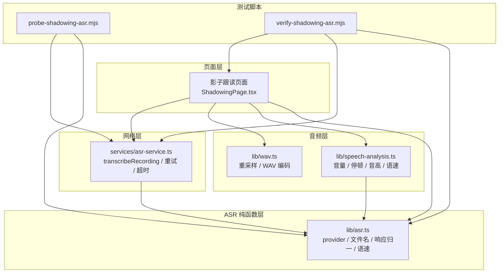
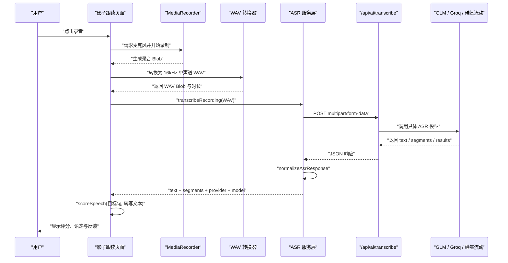
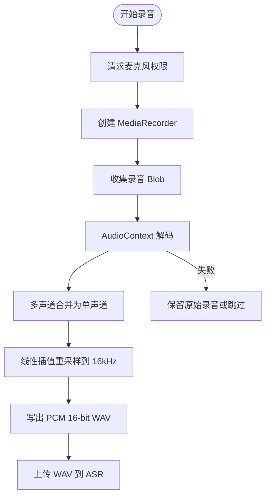
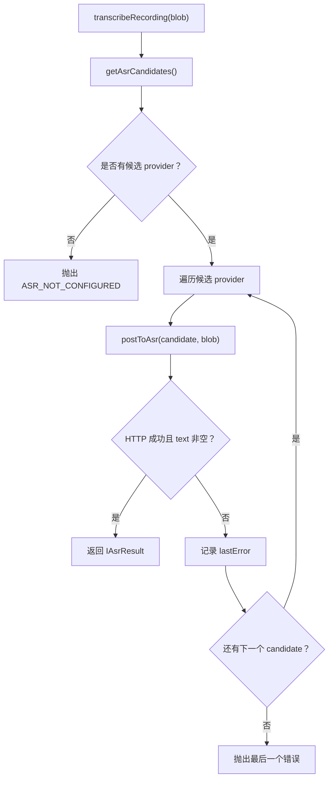
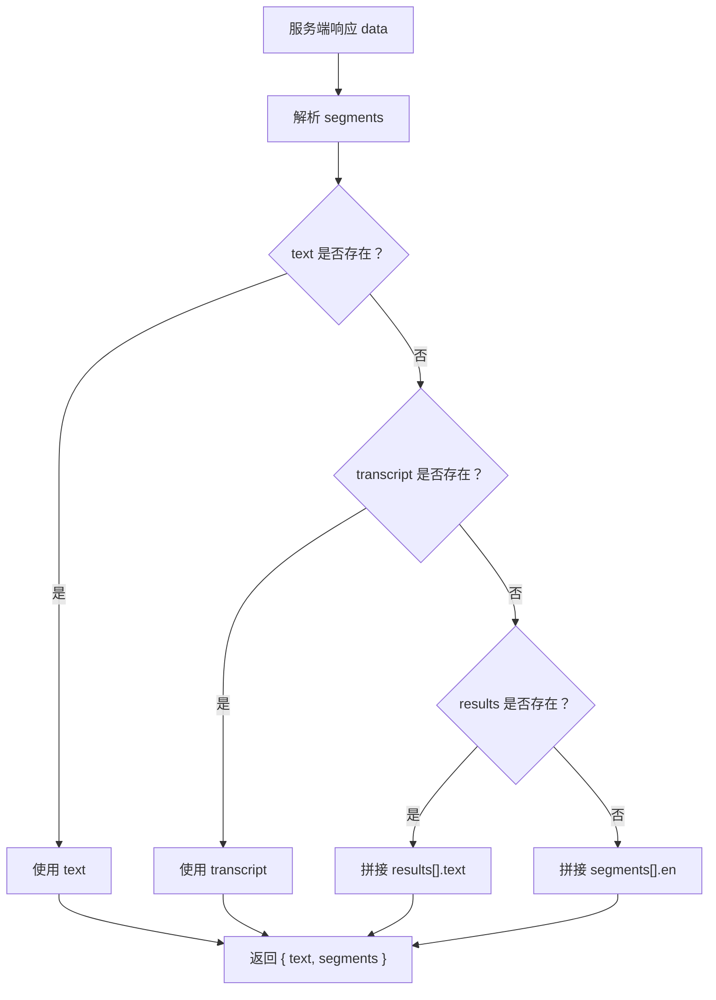
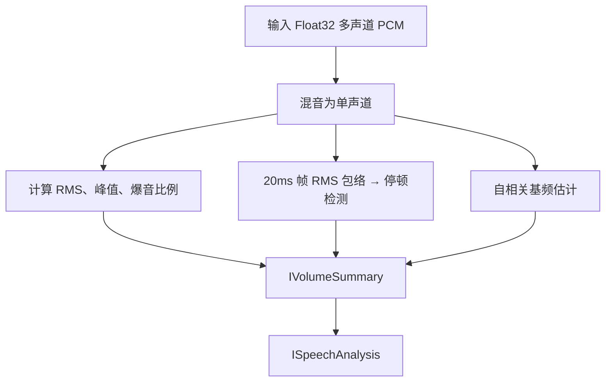
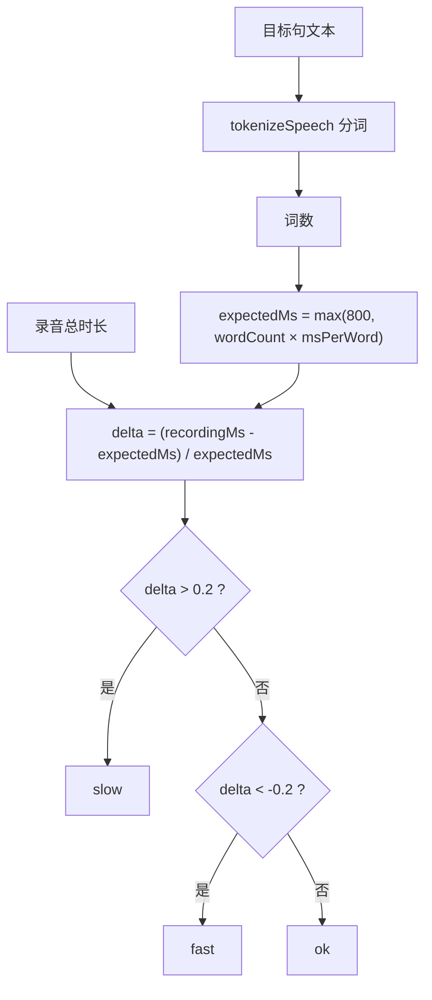
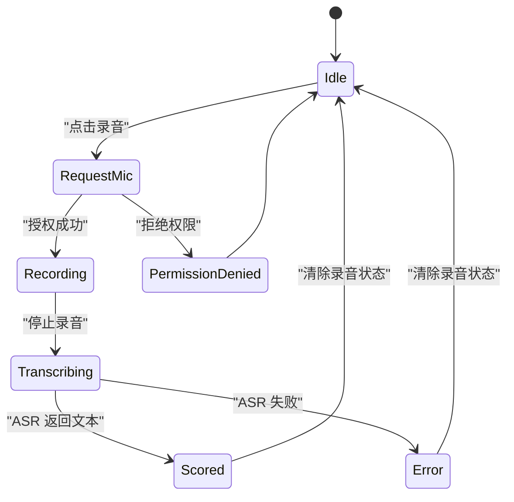

# ASR 自动语音识别与录音评分

<cite>
**本文引用的文件**   
- [src/lib/asr.ts](file://src/lib/asr.ts)
- [src/services/asr-service.ts](file://src/services/asr-service.ts)
- [src/lib/wav.ts](file://src/lib/wav.ts)
- [src/lib/speech-analysis.ts](file://src/lib/speech-analysis.ts)
- [src/pages/ShadowingPage/ShadowingPage.tsx](file://src/pages/ShadowingPage/ShadowingPage.tsx)
- [scripts/probe-shadowing-asr.mjs](file://scripts/probe-shadowing-asr.mjs)
- [scripts/verify-shadowing-asr.mjs](file://scripts/verify-shadowing-asr.mjs)
</cite>

## 目录
1. [简介](#简介)
2. [项目结构与定位](#项目结构与定位)
3. [核心组件总览](#核心组件总览)
4. [系统架构](#系统架构)
5. [录音与音频处理链路](#录音与音频处理链路)
6. [ASR 服务集成与错误重试](#asr-服务集成与错误重试)
7. [语音转文本流程](#语音转文本流程)
8. [录音质量、停顿与音高分析](#录音质量停顿与音高分析)
9. [录音评分与语速指标](#录音评分与语速指标)
10. [配置、权限与隐私](#配置权限与隐私)
11. [性能特征与优化建议](#性能特征与优化建议)
12. [故障排查指南](#故障排查指南)
13. [结论](#结论)

## 简介
本文面向 NativeThink 应用中的自动语音识别（ASR）与录音评分子系统，重点解释：
- 浏览器端 Web Audio API 录音、MediaRecorder 实时采集与流式控制。
- 本地音频格式标准化：多声道合并、采样率重采样、WAV 编码。
- 云端 ASR 服务集成：GLM-ASR、Groq Whisper、硅基流动 SenseVoiceSmall。
- 响应归一化、provider 优先级、超时与取消、失败重试。
- 离线语音分析：音量、爆音、停顿检测、意群边界、基频趋势。
- 录音评分：词级对齐、发音准确度、流利度与完整性量化思路。
- 权限、隐私保护与性能优化建议。

该文档以现有源码为依据，不虚构未实现的算法；对于“发音准确度”等依赖外部口语评测能力的部分，明确说明当前实现边界。

## 项目结构与定位
ASR 相关能力分布在以下层次：
- 纯函数层：provider 选择、文件名映射、响应归一、语速估算。
- 网络层：FormData 上传、超时控制、AbortSignal、候选 provider 重试。
- 音频层：Web Audio API 解码、单声道混合、线性插值重采样、WAV 编码。
- 页面层：麦克风权限、MediaRecorder 录制、录音后处理、转写调用、评分展示。
- 脚本层：端到端探针与契约守卫，验证 provider 选择、WAV 编码、服务端响应归一、页面接线。

**图表来源**
- [src/pages/ShadowingPage/ShadowingPage.tsx:48-52](file://src/pages/ShadowingPage/ShadowingPage.tsx#L48-L52)
- [src/lib/asr.ts:1-101](file://src/lib/asr.ts#L1-L101)
- [src/services/asr-service.ts:1-99](file://src/services/asr-service.ts#L1-L99)
- [src/lib/wav.ts:1-102](file://src/lib/wav.ts#L1-L102)
- [src/lib/speech-analysis.ts:1-325](file://src/lib/speech-analysis.ts#L1-L325)
- [scripts/probe-shadowing-asr.mjs](file://scripts/probe-shadowing-asr.mjs)
- [scripts/verify-shadowing-asr.mjs](file://scripts/verify-shadowing-asr.mjs)

**章节来源**
- [src/lib/asr.ts:1-101](file://src/lib/asr.ts#L1-L101)
- [src/services/asr-service.ts:1-99](file://src/services/asr-service.ts#L1-L99)
- [src/lib/wav.ts:1-102](file://src/lib/wav.ts#L1-L102)
- [src/lib/speech-analysis.ts:1-325](file://src/lib/speech-analysis.ts#L1-L325)
- [src/pages/ShadowingPage/ShadowingPage.tsx:48-52](file://src/pages/ShadowingPage/ShadowingPage.tsx#L48-L52)
- [scripts/verify-shadowing-asr.mjs](file://scripts/verify-shadowing-asr.mjs)

## 核心组件总览
- `lib/asr.ts`：定义 ASR provider 列表、模型映射、候选 provider 筛选、录音文件名映射、服务端响应归一、语速估算。
- `services/asr-service.ts`：封装 `/api/ai/transcribe` 的 FormData 上传、超时、AbortSignal、按 provider 顺序重试。
- `lib/wav.ts`：Float32 多声道 → 单声道、线性插值重采样到 16kHz、写出 PCM 16-bit WAV。
- `lib/speech-analysis.ts`：离线波形分析，包括音量、爆音、停顿检测、意群边界匹配、自相关基频估计、整体摘要。
- `pages/ShadowingPage/ShadowingPage.tsx`：用户交互入口，负责麦克风权限、MediaRecorder 录音、WAV 转换、ASR 调用、词级评分、语速提示和隐私说明。
- `scripts/probe-shadowing-asr.mjs`：端到端探针，生成或读取音频，走 provider 或本地 function 转写，并复用真实打分逻辑。
- `scripts/verify-shadowing-asr.mjs`：契约守卫，断言 provider 优先级、响应归一、WAV 编码、页面接线和服务端行为。

**章节来源**
- [src/lib/asr.ts:1-101](file://src/lib/asr.ts#L1-L101)
- [src/services/asr-service.ts:1-99](file://src/services/asr-service.ts#L1-L99)
- [src/lib/wav.ts:1-102](file://src/lib/wav.ts#L1-L102)
- [src/lib/speech-analysis.ts:1-325](file://src/lib/speech-analysis.ts#L1-L325)
- [src/pages/ShadowingPage/ShadowingPage.tsx:770-896](file://src/pages/ShadowingPage/ShadowingPage.tsx#L770-L896)
- [scripts/probe-shadowing-asr.mjs](file://scripts/probe-shadowing-asr.mjs)
- [scripts/verify-shadowing-asr.mjs](file://scripts/verify-shadowing-asr.mjs)

## 系统架构
ASR 子系统采用“页面驱动 + 纯函数可测 + 网络可替换”的分层设计：
- 页面只关心“开始录音、停止录音、上传、显示评分”，不直接操作 fetch。
- ASR 纯函数与网络服务解耦，便于 Node 环境真跑测试。
- WAV 编码和波形分析是纯计算，可与浏览器 API 隔离。
- 云端 provider 通过统一接口抽象，失败时自动降级到下一个已配置的 Key。

**图表来源**
- [src/pages/ShadowingPage/ShadowingPage.tsx:778-805](file://src/pages/ShadowingPage/ShadowingPage.tsx#L778-L805)
- [src/services/asr-service.ts:30-99](file://src/services/asr-service.ts#L30-L99)
- [src/lib/wav.ts:73-102](file://src/lib/wav.ts#L73-L102)
- [src/lib/asr.ts:47-80](file://src/lib/asr.ts#L47-L80)

## 录音与音频处理链路
### 录音采集
- 页面优先选择 `audio/webm;codecs=opus`、`audio/webm`、`audio/mp4`、`audio/ogg;codecs=opus`，根据浏览器支持情况决定实际 MIME。
- 使用 `navigator.mediaDevices.getUserMedia({ audio: true })` 申请麦克风权限。
- 使用 `new MediaRecorder(stream, { mimeType })` 创建录音器，并设置最长录音时长上限与字节上限。
- 录音结束时收集 Blob，随后进入本地转换阶段。

### 音频格式标准化
- 浏览器侧通过 `AudioContext.decodeAudioData` 解码任意录音 Blob。
- 多声道数据先合并为单声道，再使用线性插值重采样到 16kHz。
- 最终写出 PCM 16-bit WAV：RIFF/WAVE/fmt/data 头结构，单声道、16kHz、16-bit。
- 如果解码失败或重采样结果为空，页面保留原 Blob 或跳过上传，避免半截文件。

**图表来源**
- [src/pages/ShadowingPage/ShadowingPage.tsx:85-87](file://src/pages/ShadowingPage/ShadowingPage.tsx#L85-L87)
- [src/pages/ShadowingPage/ShadowingPage.tsx:852-859](file://src/pages/ShadowingPage/ShadowingPage.tsx#L852-L859)
- [src/lib/wav.ts:13-41](file://src/lib/wav.ts#L13-L41)
- [src/lib/wav.ts:43-71](file://src/lib/wav.ts#L43-L71)
- [src/lib/wav.ts:73-102](file://src/lib/wav.ts#L73-L102)

**章节来源**
- [src/pages/ShadowingPage/ShadowingPage.tsx:85-87](file://src/pages/ShadowingPage/ShadowingPage.tsx#L85-L87)
- [src/pages/ShadowingPage/ShadowingPage.tsx:852-859](file://src/pages/ShadowingPage/ShadowingPage.tsx#L852-L859)
- [src/lib/wav.ts:1-102](file://src/lib/wav.ts#L1-L102)

## ASR 服务集成与错误重试
### Provider 选择
- 支持的 provider 固定为 `glm`、`groq`、`siliconflow`。
- 对应模型分别为 `GLM-ASR-2512`、`whisper-large-v3-turbo`、`FunAudioLLM/SenseVoiceSmall`。
- `pickAsrCandidates` 按固定顺序检查 API Key，空白/null 值会被过滤，不会发起无效请求。

### 上传与超时
- 使用 `FormData` 上传 `audio`、`provider`、`apiKey`、`language`。
- 默认超时 30 秒，同时支持外部 `AbortSignal` 取消。
- 非成功 HTTP 状态会抛出错误；空响应会转为 null 再报错。

### 失败重试
- `transcribeRecording` 依次尝试所有候选 provider。
- 捕获异常时记录最后错误；若所有候选都失败则抛出聚合后的错误。
- 外部取消时直接抛出取消错误，不继续重试。

**图表来源**
- [src/services/asr-service.ts:13-29](file://src/services/asr-service.ts#L13-L29)
- [src/services/asr-service.ts:30-69](file://src/services/asr-service.ts#L30-L69)
- [src/services/asr-service.ts:71-99](file://src/services/asr-service.ts#L71-L99)
- [src/lib/asr.ts:13-25](file://src/lib/asr.ts#L13-L25)
- [src/lib/asr.ts:27-45](file://src/lib/asr.ts#L27-L45)

**章节来源**
- [src/lib/asr.ts:1-45](file://src/lib/asr.ts#L1-L45)
- [src/services/asr-service.ts:1-99](file://src/services/asr-service.ts#L1-L99)
- [scripts/verify-shadowing-asr.mjs](file://scripts/verify-shadowing-asr.mjs)

## 语音转文本流程
### 响应归一化
不同 ASR 服务返回结构不同：
- GLM：可能只返回 `text`。
- Groq/SiliconFlow：可能返回 `segments`，其中包含时间片段和英文内容。
- 其他兼容接口：可能返回 `results` 数组。

`normalizeAsrResponse` 的统一规则：
1. 解析 `segments`，将 `start`、`end`、`en`/`text` 转为标准段。
2. 优先从 `text` 或 `transcript` 取整句文本。
3. 否则拼接 `results[].text`。
4. 再回退到拼接有效 `segments[].en`。
5. 始终返回 `{ text, segments }`，保证上层逻辑不需要判断多种形状。

**图表来源**
- [src/lib/asr.ts:47-80](file://src/lib/asr.ts#L47-L80)

### VAD、端点检测与转录后处理
- 当前代码中并未实现前端独立 VAD（语音活动检测）或专用端点检测模块。
- 停顿检测位于离线分析层，用于评估录音节奏，而不是控制 ASR 端点。
- ASR 端点由云端 provider 模型内部处理；前端主要做录音时长限制、WAV 标准化和结果后处理。

**章节来源**
- [src/lib/asr.ts:47-80](file://src/lib/asr.ts#L47-L80)
- [src/services/asr-service.ts:30-69](file://src/services/asr-service.ts#L30-L69)

## 录音质量、停顿与音高分析
### 音量与爆音
- 计算 RMS 能量、峰值、接近满幅样本比例。
- 输出分贝量化的 `rmsDbfs`、`peakDbfs`。
- 标记是否过安静或存在爆音。

### 停顿检测
- 使用 20ms 帧长计算 RMS 能量包络。
- 自适应阈值：基于峰值的一定比例，避免把整个录音当成一处超长停顿。
- 要求连续静音帧数达到最小停顿长度，排除首尾静音。
- 返回每个停顿的中点位置比例和毫秒时长。

### 基频趋势
- 使用自相关方法估计基频，仅在能量足够高的帧上计算。
- 输出中位频率、P10/P90 范围、趋势（上升/下降/平稳）、尾部是否上升。
- 对周期倍频进行修正，避免高频误判成低频。

**图表来源**
- [src/lib/speech-analysis.ts:17-49](file://src/lib/speech-analysis.ts#L17-L49)
- [src/lib/speech-analysis.ts:75-107](file://src/lib/speech-analysis.ts#L75-L107)
- [src/lib/speech-analysis.ts:109-179](file://src/lib/speech-analysis.ts#L109-L179)
- [src/lib/speech-analysis.ts:181-260](file://src/lib/speech-analysis.ts#L181-L260)
- [src/lib/speech-analysis.ts:262-325](file://src/lib/speech-analysis.ts#L262-L325)

**章节来源**
- [src/lib/speech-analysis.ts:1-325](file://src/lib/speech-analysis.ts#L1-L325)

## 录音评分与语速指标
### 词级评分
- 页面使用 `scoreSpeech(currentSentence.text, result.text)` 计算词级评分。
- 该评分依赖 `speech-score.ts`，当前仓库路径未在可用读取范围内，但脚本验证确认影子跟读页面确实使用该函数进行词级命中计算。
- 评分基于转写文本与目标句的词序列对齐，不评价音素级发音。

### 语速指标
- `speechPace` 用 `tokenizeSpeech` 统计目标句词数。
- 参考时长 = 词数 × 每词毫秒数，默认 260ms/词，下限 800ms。
- 比较录音总时长与参考时长，得到 delta 和标签：slow、fast、ok。
- 即使没有逐词时间戳，只要知道录音总时长就能给出语速反馈。

**图表来源**
- [src/lib/asr.ts:82-101](file://src/lib/asr.ts#L82-L101)
- [src/pages/ShadowingPage/ShadowingPage.tsx:798](file://src/pages/ShadowingPage/ShadowingPage.tsx#L798)
- [src/pages/ShadowingPage/ShadowingPage.tsx:896](file://src/pages/ShadowingPage/ShadowingPage.tsx#L896)

### 完整性与准确度量化
- 准确度：由 `scoreSpeech` 的词级对齐提供命中数与总数。
- 流利度：由 `speechPace` 的语速标签与 `analyzePcm` 的停顿分布共同反映。
- 完整性：可通过停顿数量、意群边界命中率、以及转写文本是否为空来判断。

**章节来源**
- [src/lib/asr.ts:82-101](file://src/lib/asr.ts#L82-L101)
- [src/lib/speech-analysis.ts:262-325](file://src/lib/speech-analysis.ts#L262-L325)
- [src/pages/ShadowingPage/ShadowingPage.tsx:798](file://src/pages/ShadowingPage/ShadowingPage.tsx#L798)
- [src/pages/ShadowingPage/ShadowingPage.tsx:896](file://src/pages/ShadowingPage/ShadowingPage.tsx#L896)
- [scripts/verify-shadowing-asr.mjs](file://scripts/verify-shadowing-asr.mjs)

## 配置、权限与隐私
### ASR 配置
- provider 配置来自 AI 配置层，按 `glm`、`groq`、`siliconflow` 读取 API Key。
- 无 Key 时，`getAsrCandidates` 为空，`transcribeRecording` 抛出 `ASR_NOT_CONFIGURED`。
- 页面在无 ASR Key 时会给出明确失败提示，不阻塞用户继续使用其他功能。

### 录音权限
- 使用 `navigator.mediaDevices.getUserMedia({ audio: true })`。
- 不支持 MediaRecorder 或 getUserMedia 的环境会跳过录音流程。

### 隐私保护
- 页面文案明确说明：录音上传到 ASR 服务仅用于本次评分，不保存音频。
- 评分基于转写文本，不评音素发音。
- 录音结束后应释放媒体流、清理 Blob URL、取消自动前进定时器。

**图表来源**
- [src/pages/ShadowingPage/ShadowingPage.tsx:827](file://src/pages/ShadowingPage/ShadowingPage.tsx#L827)
- [src/pages/ShadowingPage/ShadowingPage.tsx:852-859](file://src/pages/ShadowingPage/ShadowingPage.tsx#L852-L859)
- [src/pages/ShadowingPage/ShadowingPage.tsx:794-805](file://src/pages/ShadowingPage/ShadowingPage.tsx#L794-L805)
- [src/pages/ShadowingPage/ShadowingPage.tsx:1373](file://src/pages/ShadowingPage/ShadowingPage.tsx#L1373)

**章节来源**
- [src/services/asr-service.ts:13-29](file://src/services/asr-service.ts#L13-L29)
- [src/services/asr-service.ts:71-99](file://src/services/asr-service.ts#L71-L99)
- [src/pages/ShadowingPage/ShadowingPage.tsx:827](file://src/pages/ShadowingPage/ShadowingPage.tsx#L827)
- [src/pages/ShadowingPage/ShadowingPage.tsx:1373](file://src/pages/ShadowingPage/ShadowingPage.tsx#L1373)

## 性能特征与优化建议
### 已有优化
- 录音统一转换为 16kHz 单声道 WAV，避免浏览器原生 WebM/Opus 不被某些 ASR 服务接受。
- 重采样使用线性插值，计算简单稳定。
- ASR 请求有默认 30 秒超时，支持外部取消信号。
- provider 失败自动重试，避免单个服务限流导致整次体验卡死。
- 离线分析可脱离 ASR 运行，提升弱网场景可用性。

### 可进一步优化
- 前端 VAD：在上传前剔除明显静音段，减少无效音频上传。
- 分段上传：长录音切分为短片段并行或串行上传，结合端点检测降低延迟。
- 音频压缩：在保持 16kHz mono 的前提下使用更高效的容器，但需兼顾各 provider 兼容性。
- 缓存与降级：首次失败后短暂缓存 provider 不可用状态，避免频繁重试同一服务。
- 内存优化：大录音解码后可及时释放 AudioBuffer，避免长时间持有波形数据。

[本节为通用性能建议，不直接分析具体代码行]

## 故障排查指南
### 常见错误与定位
- **ASR_NOT_CONFIGURED**：未配置任何 provider API Key。检查 AI 配置层是否传入 glm/groq/siliconflow 的 Key。
- **转写超时**：默认 30 秒未完成。检查网络、provider 配额、模型负载。
- **没有识别到英文内容**：ASR 返回文本为空。检查录音质量、噪声、距离麦克风的远近。
- **WAV 编码失败**：浏览器解码失败或输入为空。检查 MediaRecorder 输出、AudioContext 解码能力。
- **旧 Web Speech 路径残留**：脚本校验确保影子跟读不再依赖 `webkitSpeechRecognition` 或 `SpeechRecognition`。

### 诊断工具
- `scripts/probe-shadowing-asr.mjs`：端到端验证 provider、multipart 上传、scoreSpeech。
- `scripts/verify-shadowing-asr.mjs`：断言 provider 优先级、响应归一、WAV 编码、页面接线、服务端行为。

**章节来源**
- [src/services/asr-service.ts:30-99](file://src/services/asr-service.ts#L30-L99)
- [src/lib/wav.ts:73-102](file://src/lib/wav.ts#L73-L102)
- [scripts/verify-shadowing-asr.mjs](file://scripts/verify-shadowing-asr.mjs)

## 结论
NativeThink 的 ASR 子系统以“轻量前端 + 可靠后端”为核心：前端专注录音采集、音频标准化、离线分析与用户体验；后端负责多 provider 适配、响应归一与容错。当前实现已覆盖：
- 本地 ASR 推理：以 WAV 标准化和离线语音分析为主，不依赖云端即可给出音量、停顿、语速等反馈。
- 云端 ASR 集成：GLM、Groq、SiliconFlow 统一接入，具备超时、取消、失败重试与明确配置缺失提示。
- 录音评分：词级对齐基于转写文本，语速与停顿提供流利度参考，但不实现音素级发音评测。

未来可在 VAD、端点检测、分段上传和 provider 智能选择方面进一步增强，以提升低噪声、弱网和长录音场景下的稳定性与体验。