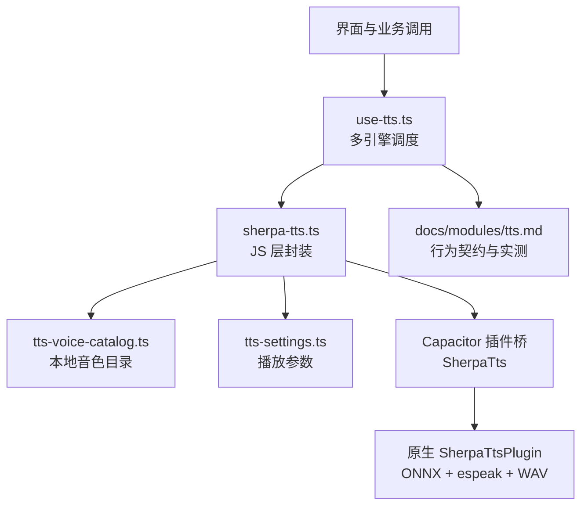
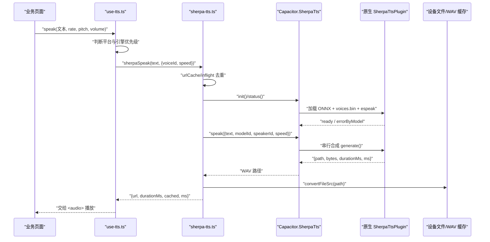
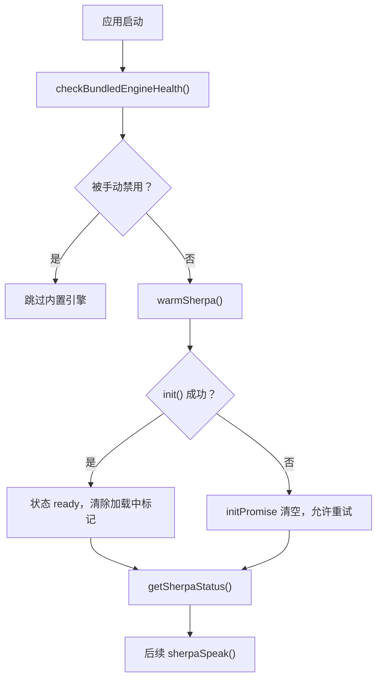
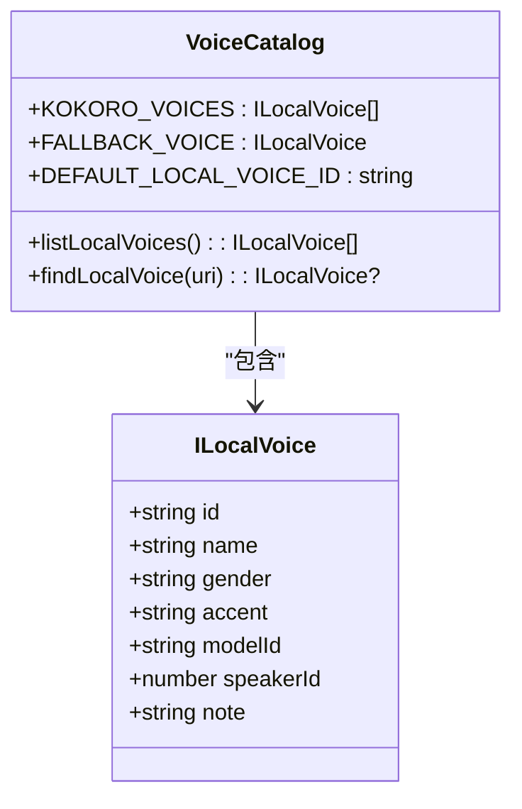
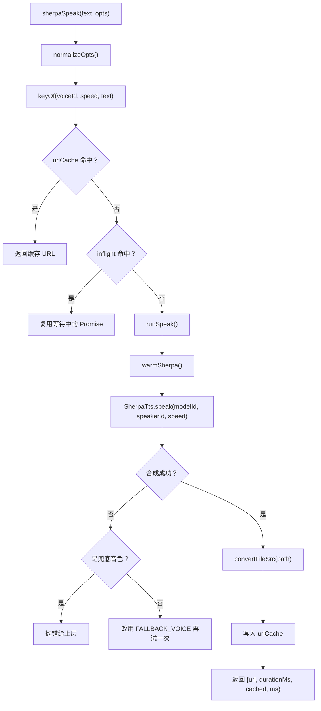
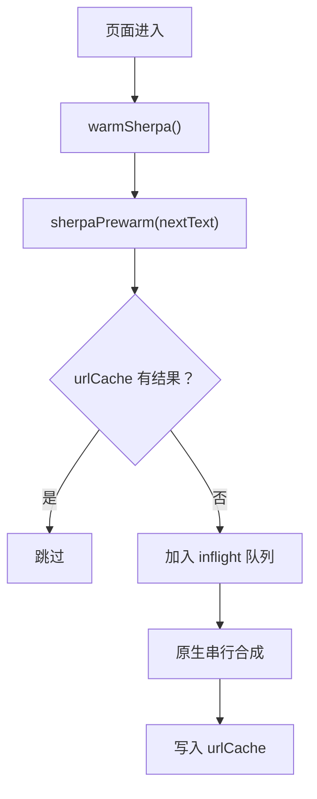
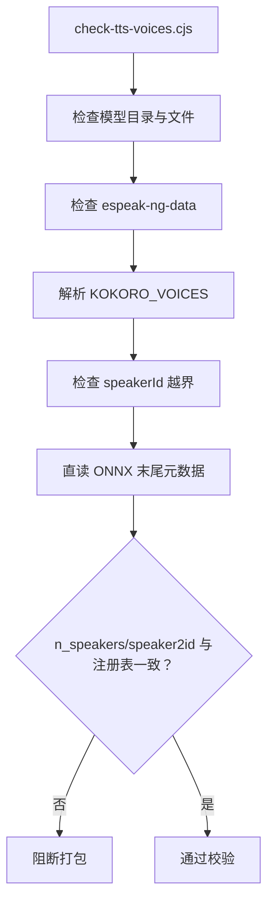
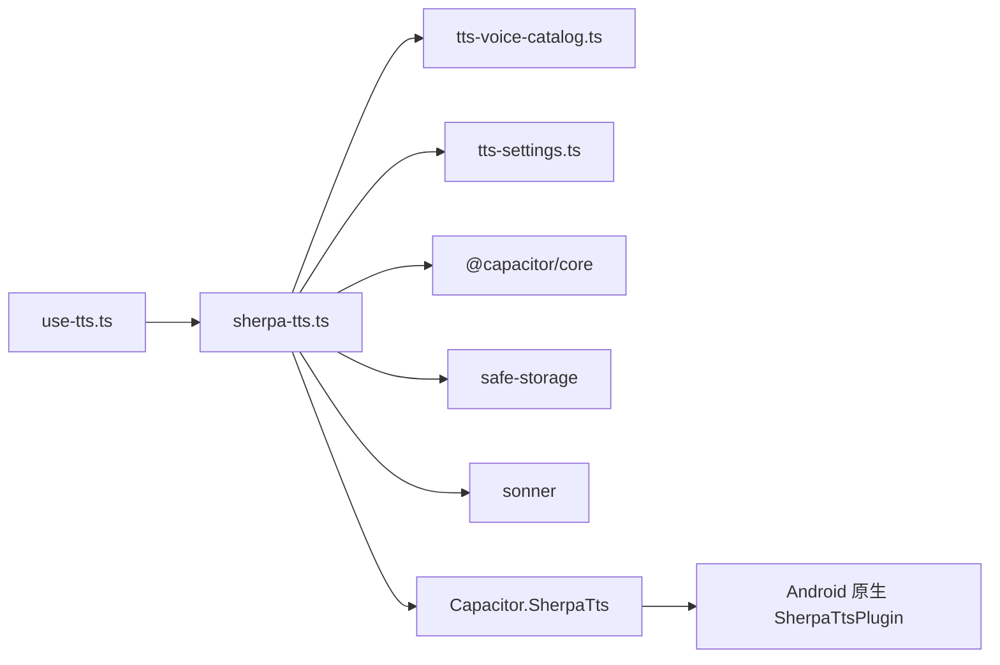
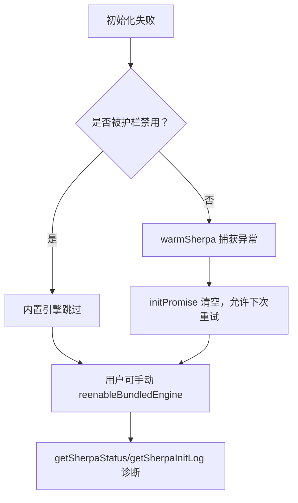

# Sherpa-onnx 离线语音合成引擎

<cite>
**本文引用的文件**   
- [sherpa-tts.ts](file://src/lib/sherpa-tts.ts)
- [tts-voice-catalog.ts](file://src/lib/tts-voice-catalog.ts)
- [use-tts.ts](file://src/lib/use-tts.ts)
- [tts-settings.ts](file://src/lib/tts-settings.ts)
- [tts.md](file://docs/modules/tts.md)
- [check-tts-voices.cjs](file://scripts/check-tts-voices.cjs)
</cite>

## 目录
1. [引言](#引言)
2. [项目结构定位](#项目结构定位)
3. [核心组件](#核心组件)
4. [架构总览](#架构总览)
5. [详细组件分析](#详细组件分析)
6. [依赖关系分析](#依赖关系分析)
7. [性能特征与优化建议](#性能特征与优化建议)
8. [错误处理与故障排查](#错误处理与故障排查)
9. [结论](#结论)

## 引言
本技术文档聚焦 NativeThink 应用中的 sherpa-onnx 离线 TTS 引擎。该引擎用于在 Android APK 中直接合成英文语音，绕过系统 TTS 或云端网络通道，实现“设备内、离线、可多音色”的朗读能力。文档从模型加载机制、音色目录结构、参数配置、音频流生成流程、预加载策略、错误处理、性能监控到资源打包优化进行全面说明，帮助开发者理解现有实现边界并安全扩展。

## 项目结构定位
sherpa-onnx 离线 TTS 并非单文件模块，而是由前端 JS 层与原生插件共同构成：
- 前端 JS 负责音色目录、参数归一化、请求去重、URL 缓存、健康检查与预热。
- 原生插件（Capacitor 桥接）负责 ONNX 模型初始化、内存分配、espeak 数据读取、音频合成与 WAV 落盘。
- 上层 use-tts 统一调度多引擎降级路径，把 sherpa-onnx 作为安卓默认优先的离线引擎之一。
- tts-voice-catalog 集中定义本地音色、默认音色和兜底音色。
- tts-settings 持久化用户设置的语速、音调、音量等播放参数。
- docs/modules/tts.md 记录产品决策、实测 RTF、切片与降级规则。
- scripts/check-tts-voices.cjs 在打包前校验模型资产、音色表与 ONNX 内嵌元数据的自洽性。

**图示来源**
- [sherpa-tts.ts:1-278](file://src/lib/sherpa-tts.ts#L1-L278)
- [tts-voice-catalog.ts:1-162](file://src/lib/tts-voice-catalog.ts#L1-L162)
- [use-tts.ts:1-200](file://src/lib/use-tts.ts#L1-L200)
- [tts-settings.ts:1-140](file://src/lib/tts-settings.ts#L1-L140)
- [tts.md:1-137](file://docs/modules/tts.md#L1-L137)

**章节来源**
- [sherpa-tts.ts:1-278](file://src/lib/sherpa-tts.ts#L1-L278)
- [tts-voice-catalog.ts:1-162](file://src/lib/tts-voice-catalog.ts#L1-L162)
- [use-tts.ts:1-200](file://src/lib/use-tts.ts#L1-L200)
- [tts-settings.ts:1-140](file://src/lib/tts-settings.ts#L1-L140)
- [tts.md:1-137](file://docs/modules/tts.md#L1-L137)

## 核心组件
本节梳理 sherpa-onnx 相关的前端关键类型与职责。

| 组件 | 主要职责 | 关键接口/常量 |
|---|---|---|
| sherpa-tts.ts | 注册 Capacitor 插件、健康检查、预热、状态查询、日志读取、缓存清理、文本转 PCM URL 的合成入口 | `isSherpaAvailable`、`warmSherpa`、`getSherpaStatus`、`sherpaSpeak`、`sherpaPrewarm`、`sherpaInFlightCount` |
| tts-voice-catalog.ts | 定义本地离线音色、默认音色、兜底音色、枚举与查找函数 | `KOKORO_VOICES`、`FALLBACK_VOICE`、`DEFAULT_LOCAL_VOICE_ID`、`listLocalVoices`、`findLocalVoice` |
| tts-settings.ts | 持久化用户选择的 voiceURI、nativeVoiceIndex、preferNative、rate/pitch/volume | `TTSSettings`、`useTTSSettings` |
| use-tts.ts | 平台感知的主 TTS Hook，决定 sherpa-onnx 是否参与候选、如何降级、如何上报进度 | 多引擎排序、看门狗、切片、onChunk |
| check-tts-voices.cjs | 打包前静态校验模型资产、espeak 目录、音色 id/speakerId/模型内嵌元数据一致性 | MODELS 注册表、n_speakers/speaker2id 核对 |

**章节来源**
- [sherpa-tts.ts:1-278](file://src/lib/sherpa-tts.ts#L1-L278)
- [tts-voice-catalog.ts:1-162](file://src/lib/tts-voice-catalog.ts#L1-L162)
- [tts-settings.ts:1-140](file://src/lib/tts-settings.ts#L1-L140)
- [use-tts.ts:1-200](file://src/lib/use-tts.ts#L1-L200)
- [check-tts-voices.cjs:1-200](file://scripts/check-tts-voices.cjs#L1-L200)

## 架构总览
sherpa-onnx 离线 TTS 的数据与控制流如下：

**图示来源**
- [sherpa-tts.ts:120-278](file://src/lib/sherpa-tts.ts#L120-L278)
- [use-tts.ts:1-200](file://src/lib/use-tts.ts#L1-L200)

## 详细组件分析

### 模型加载机制：ONNX 初始化、内存分配与生命周期
sherpa-onnx 模型的生命周期在前端表现为“健康检查 → 预热 → 状态查询”，真正加载发生在 Capacitor 桥调用的原生插件中。

- **健康检查**  
  启动时通过 `checkBundledEngineHealth` 检查上次是否成功完成加载；若上次留下“加载中”标记但未到达 ready，则认为原生进程可能崩溃，自动停用内置引擎并写入禁用标记，避免反复闪退。用户可通过 `reenableBundledEngine` 手动恢复。
- **预热**  
  `warmSherpa` 是幂等预热方法：首次调用触发 `SherpaTts.init()`，成功后清除加载中标记；失败则清空 initPromise 允许下次重试。该方法应在进入阅读/学习页前调用，降低首句合成延迟。
- **状态与诊断**  
  `getSherpaStatus` 返回当前状态 idle/loading/ready/error、sampleRate、已缓存数、路由、模型字节数、espeak 文件数以及按模型划分的失败原因。`getSherpaInitLog` 可读取原生初始化日志，是定位“原生崩溃卡在哪一步”的关键线索。
- **清理**  
  `purgeSherpaCache` 调用原生 `purge()`，删除插件侧的文件级缓存。

**图示来源**
- [sherpa-tts.ts:17-119](file://src/lib/sherpa-tts.ts#L17-L119)

**章节来源**
- [sherpa-tts.ts:17-119](file://src/lib/sherpa-tts.ts#L17-L119)

### 音色目录结构、多音色切换与参数配置
本地音色集中在 tts-voice-catalog.ts，分为两类：
- Kokoro int8 多语言模型下的 11 个英语音色，每个音色携带 id、modelId、speakerId、性别、口音与听感 note。
- Piper lessac 兜底音色，作为 Kokoro 不可用时的回退方案。

默认音色为 `piper:lessac`，因为真机实测其 RTF 约 0.076，能稳定跟上长文播放；Kokoro 音色音质更好，但 RTF 接近或超过 1，长文可能出现句间停顿。

**图示来源**
- [tts-voice-catalog.ts:63-162](file://src/lib/tts-voice-catalog.ts#L63-L162)

音色切换逻辑在 sherpa-tts.ts 中体现为“请求音色失败时回退到 FALLBACK_VOICE”；如果兜底音色也失败，则向上抛出错误，交由 use-tts 继续降级到系统 TTS 或云端通道。

播放参数方面：
- sherpa-tts.ts 的 `ISherpaSpeakOptions` 支持 voiceId 与 speed；speed 与全站 rate 语义一致，大于 1 更快。
- tts-settings.ts 持久化全局播放参数 rate（0.5–1.5）、pitch（0.5–2.0）、volume（0.0–1.0），并在更新时进行范围钳制。
- use-tts.ts 将 user 选择与引擎选择解耦：当用户显式选择本地离线音色时，sherpa-onnx 使用该音色；当用户选择在线 Edge 音色或系统语音时，sherpa-onnx 使用默认本地音色，仅作为离线兜底。

**章节来源**
- [tts-voice-catalog.ts:63-162](file://src/lib/tts-voice-catalog.ts#L63-L162)
- [sherpa-tts.ts:120-278](file://src/lib/sherpa-tts.ts#L120-L278)
- [tts-settings.ts:1-140](file://src/lib/tts-settings.ts#L1-L140)
- [use-tts.ts:1-200](file://src/lib/use-tts.ts#L1-L200)

### 音频流生成：从文本到 PCM/WAV 数据
sherpa-onnx 的音频输出路径如下：

1. 业务调用 `sherpaSpeak(text, opts)`。
2. 对 text 做 trim 并规范化选项：voiceId 省略时使用 DEFAULT_LOCAL_VOICE_ID；第二参数兼容旧数字写法作为 speed。
3. 计算缓存 key：包含 voiceId、speed 与 clean text，防止换音色或变速后命中旧缓存。
4. 先查 urlCache，命中则直接返回 `{url, durationMs, cached: true, ms: 0}`。
5. 再查 inflight Map，相同 (voiceId, text, speed) 的并发请求复用同一个 Promise，避免原生串行队列堆积导致线程耗尽。
6. 实际合成走 runSpeak：先 warmSherpa，再调用 `SherpaTts.speak({text, modelId, speakerId, speed})`。
7. 原生插件返回 path、bytes、durationMs、ms；JS 层通过 `Capacitor.convertFileSrc` 转为可播放 URL。
8. 将结果写入 urlCache，容量超过 MAX_CACHE 时淘汰最老条目。

**图示来源**
- [sherpa-tts.ts:120-278](file://src/lib/sherpa-tts.ts#L120-L278)

采样率与音频格式：
- 模型注册表中 kokoro sampleRate 为 24000，piper-lessac 为 22050。
- 原生插件侧返回的是设备文件路径，JS 层通过 convertFileSrc 转为浏览器可播放地址；文档中未明确 PCM 帧格式细节，但注释指出插件负责“合成并把音频落成 WAV 文件”。

**章节来源**
- [sherpa-tts.ts:120-278](file://src/lib/sherpa-tts.ts#L120-L278)
- [check-tts-voices.cjs:21-44](file://scripts/check-tts-voices.cjs#L21-L44)

### 模型预加载策略与并发控制
- **预加载时机**：建议在进入阅读或学习页时调用 `warmSherpa()`，利用冷启动 1~2 秒时间提前加载约 60MB 模型。
- **幂等性**：initPromise 存在时重复调用不会重复初始化。
- **并发去重**：inflight Map 以 `(voiceId, speed, text)` 为键，确保相同请求只发起一次原生合成。
- **预合成**：`sherpaPrewarm` 不播放，只为下一段文本提前入队合成；若已命中 urlCache 则跳过。
- **飞行任务计数**：`sherpaInFlightCount()` 暴露当前在途合成数，供调用方判断是否需要继续预取。

**图示来源**
- [sherpa-tts.ts:17-119](file://src/lib/sherpa-tts.ts#L17-L119)
- [sherpa-tts.ts:201-278](file://src/lib/sherpa-tts.ts#L201-L278)

**章节来源**
- [sherpa-tts.ts:17-119](file://src/lib/sherpa-tts.ts#L17-L119)
- [sherpa-tts.ts:201-278](file://src/lib/sherpa-tts.ts#L201-L278)

### 音色目录与模型注册的打包校验
check-tts-voices.cjs 在打包前执行多项强校验，避免“声音读错人”或“模型路径缺失”这类只在真机才能发现的缺陷：

- 校验 MODELS 注册表中每个模型的 dir、files、dataDir、sampleRate、numSpeakers 是否存在且非空。
- 校验 espeak-ng-data 目录是否存在且条目数量合理。
- 解析 tts-voice-catalog.ts 中的 KOKORO_VOICES，检查 id 唯一性、modelId 是否在 MODELS 中、speakerId 是否越界。
- 直读 ONNX 文件尾部约 64KB，解析 ModelProto.metadata_props，提取 n_speakers 与 speaker2id，并与注册表逐项比对。
- 校验默认音色、兜底音色与设置页渲染 listLocalVoices 的一致性。

**图示来源**
- [check-tts-voices.cjs:1-200](file://scripts/check-tts-voices.cjs#L1-L200)
- [tts-voice-catalog.ts:63-162](file://src/lib/tts-voice-catalog.ts#L63-L162)

**章节来源**
- [check-tts-voices.cjs:1-200](file://scripts/check-tts-voices.cjs#L1-L200)
- [tts-voice-catalog.ts:63-162](file://src/lib/tts-voice-catalog.ts#L63-L162)

## 依赖关系分析
sherpa-onnx 离线 TTS 的依赖关系呈现“前端 JS 薄封装 + 原生插件重实现”的特点：

**图示来源**
- [sherpa-tts.ts:1-40](file://src/lib/sherpa-tts.ts#L1-L40)
- [use-tts.ts:1-60](file://src/lib/use-tts.ts#L1-L60)

耦合点与风险：
- JS 层依赖 Capacitor 插件对象；插件初始化失败、原生崩溃、方法未实现都会影响调用链。
- JS 层缓存与原生文件缓存并存：urlCache 是进程内 Map，MAX_CACHE=120；原生侧另有 sha1 文件缓存。
- 音色目录与原生 MODEL_* 常量必须保持一致，否则 speakerId 会指向错误音色。
- use-tts 的多引擎降级逻辑依赖 sherpa-onnx 的状态与超时行为，不能孤立修改。

**章节来源**
- [sherpa-tts.ts:1-119](file://src/lib/sherpa-tts.ts#L1-L119)
- [use-tts.ts:1-200](file://src/lib/use-tts.ts#L1-L200)

## 性能特征与优化建议

### 已有性能事实
根据 docs/modules/tts.md 与 tts-voice-catalog.ts 的实测记录：
- piper lessac 的 RTF 约 0.076，适合长文连续朗读。
- Kokoro int8 的 RTF 约 1.0~1.75，长文可能出现句间停顿；增加 numThreads 只能次线性改善，无法突破 1.0。
- 首包延迟优化重点不是改切片长度，而是调整预取顺序：让“本片先入队，预取排在后面”，首包延迟可从近似两倍单片合成缩短至单片量级。
- 播放层每片创建 `<audio>` 的延迟约 32ms，不是主瓶颈。

### 优化建议
- **按需加载**：仅在确认进入需要朗读的页面时调用 `warmSherpa()`，避免首页冷启动浪费 60MB 模型加载时间。
- **资源压缩**：kokoro-int8 模型已采用 int8 量化，voices.bin 按 style_dim 与固定字节布局存储；保持现有构建产物，不要重新引入浮点版本。
- **缓存策略**：
  - JS 层 urlCache 保留最近 120 条合成结果，适合短词/短句快速回放。
  - 原生层文件缓存适合跨会话复用相同文本与音色。
  - 对于高频重复句，可在业务层避免重复 speak，或结合 `sherpaInFlightCount` 控制预取深度。
- **线程与队列**：不要盲目增大 numThreads；原生 synthLock 串行化 generate，重复提交同样文本只会堆队列，曾导致线程耗尽闪退。
- **默认音色选择**：长文场景默认 lessac，显式选择 Kokoro 时需向用户提示“长文可能断续”。

[本节为通用性能讨论，不直接分析具体代码行]

## 错误处理与故障排查

### 常见初始化失败场景
| 场景 | 现象 | 排查方式 |
|---|---|---|
| 上次加载导致原生崩溃 | 启动即被禁用，内置引擎不可用 | 检查 OFF_KEY 与 TRY_KEY，点击“重新启用” |
| ONNX 或 voices.bin 缺失 | init 失败，errorByModel 出现 | 运行 check-tts-voices.cjs，查看缺文件报错 |
| espeak-ng-data 不完整 | 音素数据不足，合成异常 | 检查 dataDir/espeak-ng-data 条目数量 |
| speakerId 越界或映射错误 | 读出错误音色或原生拒绝 | 检查 tts-voice-catalog.ts 与 ONNX 内嵌 speaker2id |
| 原生方法未响应 | 长时间 pending 或无输出 | 读取 getSherpaInitLog，观察原生日志 |
| 网络不可达导致上层降级 | sherpa-onnx 可用但仍走云端 | 检查 use-tts 引擎排序与 preferNative 设置 |

### 调试与自愈机制
- **健康护栏**：`checkBundledEngineHealth` 检测上次是否未完成加载，自动停用内置引擎。
- **手动恢复**：`reenableBundledEngine` 清除禁用标记与尝试标记。
- **状态查询**：`getSherpaStatus` 返回 status、route、modelBytes、espeakFiles、loadedModels、errorByModel。
- **日志读取**：`getSherpaInitLog` 获取原生初始化日志，是唯一能定位原生崩溃阶段的入口。
- **缓存清理**：`purgeSherpaCache` 清理插件侧文件缓存，适合修复脏缓存后的回归测试。
- **音色回退提示**：当请求音色失败并回退到 lessac 时，会通过 toast 提示用户，且 5 秒内去抖。

**图示来源**
- [sherpa-tts.ts:17-119](file://src/lib/sherpa-tts.ts#L17-L119)

**章节来源**
- [sherpa-tts.ts:17-119](file://src/lib/sherpa-tts.ts#L17-L119)
- [sherpa-tts.ts:120-278](file://src/lib/sherpa-tts.ts#L120-L278)
- [tts.md:1-137](file://docs/modules/tts.md#L1-L137)

## 结论
sherpa-onnx 离线 TTS 在 NativeThink 应用中承担安卓端的本地语音合成职责，其设计重点在于：
- 通过健康检查与禁用标记避免原生崩溃拖垮整个应用。
- 通过 urlCache 与 inflight 去重减少重复合成与队列堆积。
- 通过 tts-voice-catalog 集中管理 Kokoro 与 Piper 音色，并以 lessac 作为默认兜底。
- 通过 check-tts-voices.cjs 在打包前锁定音色与模型元数据一致性。
- 通过 use-tts 的多引擎降级保证朗读可用性，同时保持产品体验可控。

在实际使用中，应优先保障默认 lessac 的长文连续性；如需更高音质，应显式选择 Kokoro 音色并告知用户可能的停顿代价。遇到初始化失败时，优先检查健康标记、模型资产、espeak 目录、speakerId 映射与原生日志。