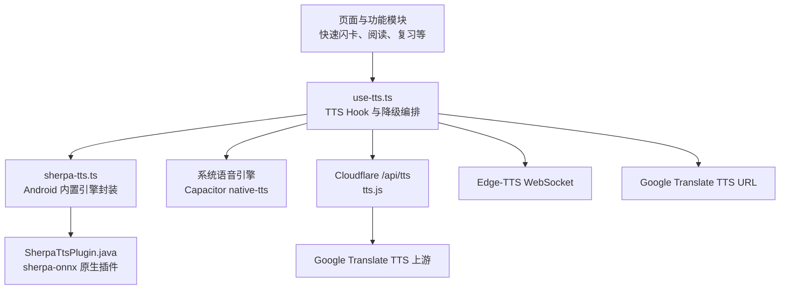
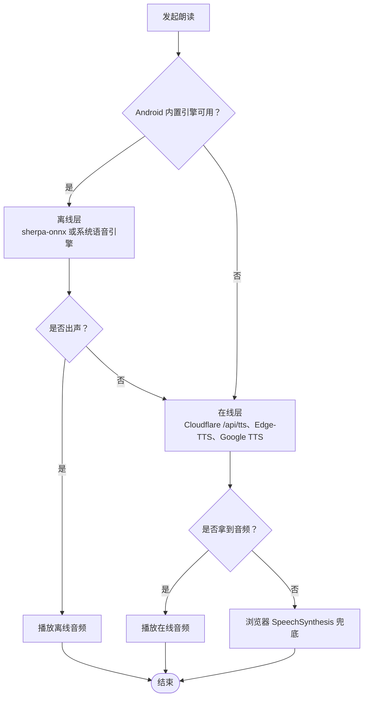
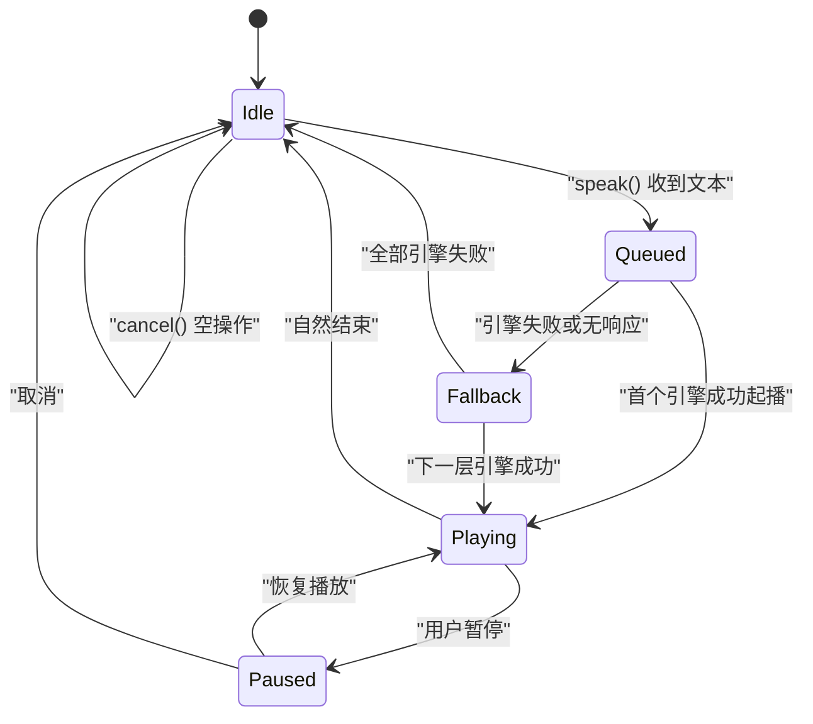
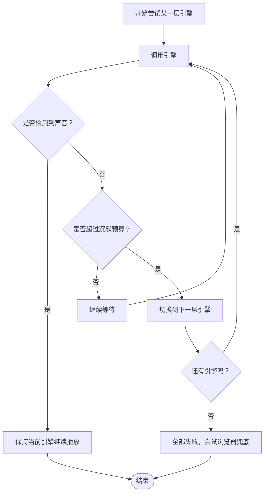
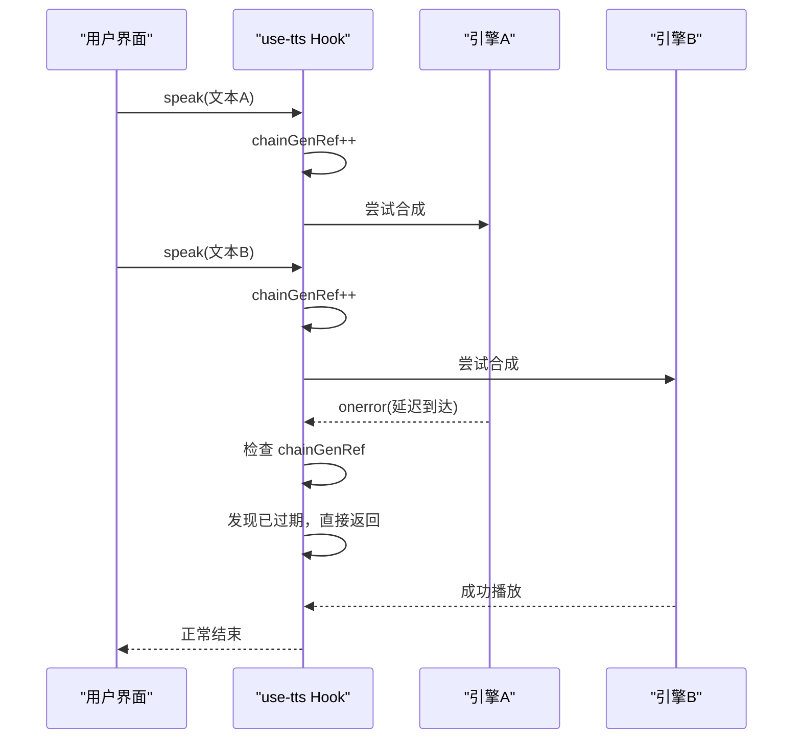
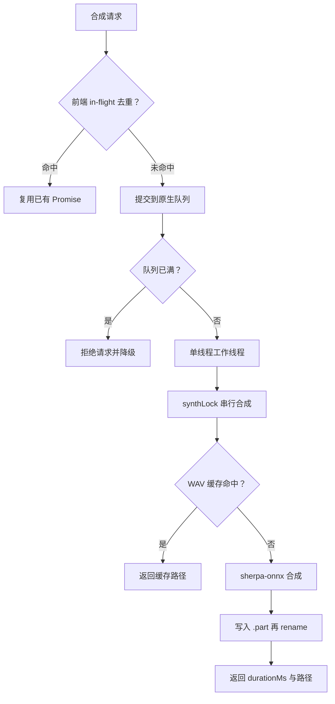
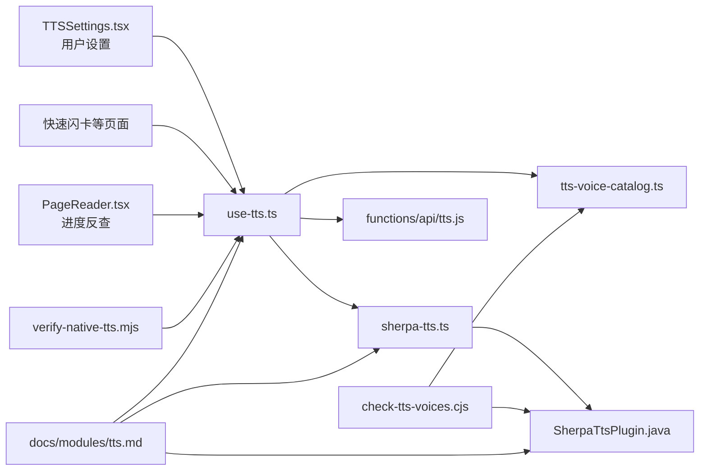
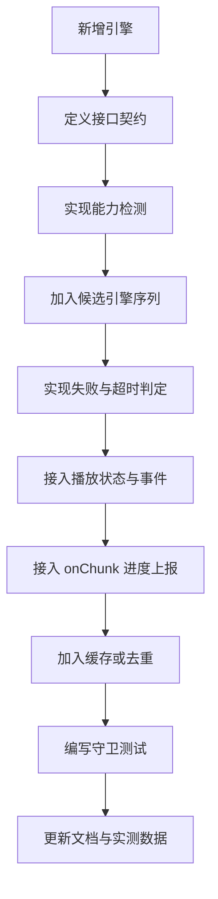

# TTS 多级降级链与状态管理

<cite>
**本文引用的文件**   
- [use-tts.ts](file://src/lib/use-tts.ts)
- [sherpa-tts.ts](file://src/lib/sherpa-tts.ts)
- [tts-voice-catalog.ts](file://src/lib/tts-voice-catalog.ts)
- [tts.js](file://functions/api/tts.js)
- [SherpaTtsPlugin.java](file://android/app/src/main/java/com/nativethink/app/SherpaTtsPlugin.java)
- [check-tts-voices.cjs](file://scripts/check-tts-voices.cjs)
- [verify-native-tts.mjs](file://scripts/verify-native-tts.mjs)
- [tts.md](file://docs/modules/tts.md)
</cite>

## 目录

1. [引言](#引言)
2. [项目结构](#项目结构)
3. [核心组件](#核心组件)
4. [架构总览](#架构总览)
5. [详细组件分析](#详细组件分析)
6. [依赖关系分析](#依赖关系分析)
7. [性能特征与优化建议](#性能特征与优化建议)
8. [故障排查指南](#故障排查指南)
9. [结论](#结论)
10. [附录：配置项与自定义策略](#附录配置项与自定义策略)

## 引言

NativeThink 应用的朗读能力围绕一个统一入口 `src/lib/use-tts.ts` 构建。它不是简单地调用浏览器 `speechSynthesis`，而是把平台离线引擎、系统语音引擎、云端代理、在线神经语音和 Google TTS URL 串成一条自动降级链，并在 Android APK 内通过 Capacitor 插件调用 sherpa-onnx 完成零网络合成的本地播放。

三级（更准确说是五层）降级链的设计目标是：

- 优先使用设备内合成或系统离线引擎，保证离线可用；
- 当离线链路不可用时，自动切换到云端代理或在线神经语音；
- 所有网络路径都有超时、缓存和切片保护；
- 任何一层“挂住”都不能让整条链永久等待；
- 用户选择的音色必须可预期，不能静默替换为另一个声音；
- 长文本按句边界切分，进度通过 `onChunk` 上报给阅读器；
- Android 内置引擎崩溃后能自愈，而不是反复闪退。

本文不复制源码，而是用架构图、流程图、时序图和表格把实现逻辑拆清楚，方便维护者理解当前行为、评估修改影响，以及扩展新的降级策略。

## 项目结构

与 TTS 多级降级链直接相关的代码分布在五个层次：

| 层次 | 主要文件 | 职责 |
|---|---|---|
| 应用层 Hook | [use-tts.ts](file://src/lib/use-tts.ts) | 对外暴露 `speak`、`pause`、`resume`、`cancel`、`prewarm`；组织切片、降级、播放状态、进度上报和自检 |
| Android 内置引擎封装 | [sherpa-tts.ts](file://src/lib/sherpa-tts.ts) | 预热、在途去重、URL 缓存、音色回退、本地模型选择 |
| Android 原生插件 | [SherpaTtsPlugin.java](file://android/app/src/main/java/com/nativethink/app/SherpaTtsPlugin.java) | sherpa-onnx 模型加载、多音色合成、WAV 落盘、线程池与队列上限 |
| 云端 TTS 代理 | [tts.js](file://functions/api/tts.js) | Cloudflare Pages Function 代理 Google Translate TTS，CDN 缓存 MP3 |
| 音色目录与校验 | [tts-voice-catalog.ts](file://src/lib/tts-voice-catalog.ts)、[check-tts-voices.cjs](file://scripts/check-tts-voices.cjs) | Edge 在线音色、本地 Kokoro/Piper 音色、默认音色、打包前校验 |
| 文档与守卫 | [tts.md](file://docs/modules/tts.md)、[verify-native-tts.mjs](file://scripts/verify-native-tts.mjs) | 设计说明、RTF 实测、降级规则、原生插件边界验证 |

**图表来源**   
- [use-tts.ts:201-750](file://src/lib/use-tts.ts#L201-L750)
- [sherpa-tts.ts:201-278](file://src/lib/sherpa-tts.ts#L201-L278)
- [SherpaTtsPlugin.java:201-522](file://android/app/src/main/java/com/nativethink/app/SherpaTtsPlugin.java#L201-L522)
- [tts.js:1-69](file://functions/api/tts.js#L1-L69)

**章节来源**   
- [use-tts.ts:1-200](file://src/lib/use-tts.ts#L1-L200)
- [tts.md:1-50](file://docs/modules/tts.md#L1-L50)

## 核心组件

### 1. use-tts.ts：降级编排器与播放状态机

这个文件是全站唯一的朗读入口。它不负责某个具体音频格式的合成，而是决定：

- 文本如何切成不超过 180 字符的片段；
- 每个片段从哪个引擎开始尝试；
- 什么时候判定失败并换下一层；
- 如何管理 `<audio>`、`SpeechSynthesisUtterance` 和原生停止命令；
- 如何通过 `onChunk` 向阅读器上报“读到哪”。

关键类型包括：

| 类型 | 含义 |
|---|---|
| `UseTTSOptions` | 外部回调：`onStart`、`onEnd`、`onError`、`onBoundary`、`onChunk` |
| `SpeakOptions` | 每次朗读的参数：语言、语速、音高、音量 |
| `TTSHandle` | 暴露给页面的方法：`speak`、`prewarm`、`pause`、`resume`、`cancel` |
| `ITtsPlaybackReport` | 上次朗读报告：引擎、首包耗时、是否降级、起播证据时间戳 |

该 Hook 内部还维护以下关键引用：

| 引用 | 作用 |
|---|---|
| `audioRef` | 当前 HTML `<audio>` 元素 |
| `currentBlobUrlRef` | 当前 Blob URL，用于释放内存 |
| `ssUtteranceRef` | 浏览器语音合成实例 |
| `chainGenRef` | 单调递增的“代际号”，防止旧链回调误杀新朗读 |
| `abortedRef` | 同步取消标记 |
| `nativeActiveRef`、`nativePausedRef` | Android 系统 TTS 播放状态 |
| `nativeReplayRef` | 原生暂停恢复后的重播回调 |

**章节来源**   
- [use-tts.ts:21-100](file://src/lib/use-tts.ts#L21-L100)
- [use-tts.ts:201-330](file://src/lib/use-tts.ts#L201-L330)

### 2. sherpa-tts.ts：Android 内置离线引擎封装

这个模块只负责 Android APK 内的 sherpa-onnx 合成。它的职责是：

- 判断当前是否为 Android 平台；
- 幂等预热 Kokoro 模型；
- 检测上一次启动是否因原生加载崩溃而被护栏停用；
- 对相同音色、文本、语速的请求做 Promise 去重；
- 将原生返回的 WAV 文件路径转成可播放 URL；
- 在请求音色失败时回退到 lessac 兜底音色；
- 提供本地音色列表导出。

重要常量与策略：

| 名称 | 值或行为 | 原因 |
|---|---|---|
| 默认本地音色 | `piper:lessac` | RTF≈0.076，长文唯一能跟上播放的离线音色 |
| 兜底本地音色 | `FALLBACK_VOICE`（也是 lessac） | Kokoro 不可用时自动回退 |
| URL 缓存上限 | 120 条 FIFO | 避免重复跨端调用 |
| 在途去重 Map | key = `voiceId|speed|text` | 防止同文本并发堆满原生串行队列 |
| 最大待处理任务 | 8 | 原生侧 `MAX_PENDING_TTS`，超限拒绝 |

**章节来源**   
- [sherpa-tts.ts:1-200](file://src/lib/sherpa-tts.ts#L1-L200)
- [sherpa-tts.ts:201-278](file://src/lib/sherpa-tts.ts#L201-L278)

### 3. tts-voice-catalog.ts：音色目录

该文件维护三类音色：

| 类别 | 标识前缀 | 数量 | 用途 |
|---|---|---:|---|
| Edge 在线神经音色 | `srv:edge:` | 12 个 | 走 Cloudflare `/api/tts` 或 Edge WebSocket |
| Kokoro 本地多音色 | `kokoro:` | 11 个 | Android 内置 kokoro-int8 模型 |
| Piper 兜底本地音色 | `piper:` | 1 个 | lessac，默认首选 |

此外它还定义：

- `DEFAULT_LOCAL_VOICE_ID`：未选择本地音色时的默认值；
- `listLocalVoices()`：设置页展示顺序，lessac 排第一；
- `isLocalVoiceId()`、`findLocalVoice()`：前端查找本地音色；
- `googleLangOf()`、`edgeVoiceNameOf()`：在线通道与兜底语言映射。

**章节来源**   
- [tts-voice-catalog.ts:1-162](file://src/lib/tts-voice-catalog.ts#L1-L162)

### 4. functions/api/tts.js：云端 TTS 代理

这是 Cloudflare Pages Function，作为 Google Translate TTS 的中间层：

- 接收 `text`、`lang`、可选 `voice`、`rate`；
- 校验文本为空或超过 200 字符；
- 转发到 `https://translate.google.com/translate_tts`；
- 以 `audio/mpeg` 返回，并设置一年不变缓存；
- 支持 CORS 与预检请求。

它的关键限制来自上游 Google TTS：文本长度硬上限约 200 字符。因此前端必须切短，不能把长段落直接发到云端。

**章节来源**   
- [tts.js:1-69](file://functions/api/tts.js#L1-L69)

### 5. SherpaTtsPlugin.java：原生合成与资源管理

这是 Android 端的真实执行层。它负责：

- 注册 `kokoro` 与 `piper-lessac` 两个模型；
- 首次使用时把 assets 摊到内部存储；
- 创建 sherpa-onnx `OfflineTts` 引擎；
- 用单线程工作线程和独立加载线程运行合成；
- 限制最大待处理任务数为 8；
- 按 `(modelId, speakerId, speed, text)` 哈希生成 WAV 缓存；
- 写初始化日志到 `sherpa-init.log`；
- 暴露 `init`、`status`、`speak`、`purge`、`readLog` 等桥接方法。

原生层的线程模型非常关键：合成本身串行化，但提交任务需要有限队列；模型加载单独线程；任务上限被硬性切断，而不是无限排队导致进程线程耗尽。

**章节来源**   
- [SherpaTtsPlugin.java:1-200](file://android/app/src/main/java/com/nativethink/app/SherpaTtsPlugin.java#L1-L200)
- [SherpaTtsPlugin.java:201-522](file://android/app/src/main/java/com/nativethink/app/SherpaTtsPlugin.java#L201-L522)

## 架构总览

TTS 多级降级链不是简单的“如果 A 不行就 B”，而是按平台、用户设置、文本长度和音色类型动态排列候选引擎。

### 引擎候选顺序

| 条件 | 候选顺序 |
|---|---|
| Android 默认 | piper → native → cf → edge → google |
| 显式选择在线 Edge 音色 | cf → piper → native → edge → google |
| 打开“只用系统引擎” | 仅 native |
| 内置引擎被闪退护栏停用 | 从候选中剔除 piper |
| 非 Android（网页、桌面、iOS） | cf → edge → google |
| 单词级短文本且联网 | 云端优先，其余不变 |

这里的“piper”代表 Android 内置 sherpa-onnx，“native”代表 Android 系统语音引擎，“cf”代表 Cloudflare `/api/tts`，“edge”代表 Edge-TTS WebSocket，“google”代表 Google Translate TTS URL。

### 三级主降级链

虽然候选最多有五层，但产品语义上可以理解为三个主层级：

1. **离线层**：Android 内置 sherpa-onnx + 系统语音引擎；
2. **在线神经层**：Cloudflare 代理的 Edge-TTS 或 Google TTS；
3. **浏览器兜底层**：浏览器 `SpeechSynthesis`。

**图表来源**   
- [use-tts.ts:485-596](file://src/lib/use-tts.ts#L485-L596)
- [tts.md:138-170](file://docs/modules/tts.md#L138-L170)

### 播放状态机

从业务语义看，播放状态机包含以下状态：

| 状态 | 含义 | 典型进入条件 |
|---|---|---|
| Idle | 空闲 | 初始、取消后、播放完成后 |
| Queued | 已入队 | `speak()` 刚收到文本，尚未真正起播 |
| Playing | 正在播放 | 音频元素或原生引擎开始输出 |
| Paused | 暂停 | 用户主动暂停，或原生引擎暂停后准备恢复 |
| Fallback | 降级中 | 当前引擎失败或沉默超预算，切换到下一层 |
| Error | 错误 | 全部引擎都失败，且无法继续降级 |

**图表来源**   
- [use-tts.ts:350-420](file://src/lib/use-tts.ts#L350-L420)
- [use-tts.ts:540-750](file://src/lib/use-tts.ts#L540-L750)

实际实现中，状态不是用一个枚举变量表达，而是由多个引用共同描述：

- `isSpeaking`：Hook 暴露的状态；
- `isPaused`：Hook 暴露的暂停状态；
- `nativeActiveRef`、`nativePausedRef`：Android 系统引擎的内部状态；
- `chainGenRef`：当前活跃链的代际号；
- `abortedRef`：同步取消信号；
- `keepAliveRef`、`safetyRef`：看门狗定时器；
- `primedRef`、`audioUnlockedRef`：移动端首次交互解锁。

**章节来源**   
- [use-tts.ts:350-420](file://src/lib/use-tts.ts#L350-L420)
- [use-tts.ts:540-750](file://src/lib/use-tts.ts#L540-L750)

## 详细组件分析

### 降级检测机制

降级检测分为三层：能力检测、运行时错误捕获、自动回退策略。

#### 能力检测

能力检测包括：

- 平台检测：`Capacitor.isNativePlatform()`、`Capacitor.getPlatform()`；
- Electron 检测：UA 中包含 Electron；
- iOS 检测：UA 中包含 iPad/iPhone/iPod；
- 内置引擎可用性：`isSherpaAvailable()`；
- 内置引擎是否被停用：`isBundledEngineDisabled()`；
- 系统引擎是否有英语音色：`hasEnglishVoice()`；
- 用户是否选择了在线音色：`isEdgeCatalogVoice(settings.selectedVoiceURI)`；
- 是否为单词级短朗读：`navigator.onLine !== false && 文本 ≤ 24 字符`。

这些判断决定候选引擎的顺序，而不是简单“行/不行”。例如，即使内置引擎可用，用户选了在线音色时，云端会排在最前。

#### 错误捕获

错误捕获覆盖以下路径：

- Edge-TTS WebSocket：连接超时 1.5 秒、消息解析失败、WebSocket 关闭；
- Cloudflare `/api/tts`：上游 400/502/500；
- Google TTS URL：fetch 超时 10 秒；
- Android 原生插件：未知模型、speakerId 越界、队列已满、原生异常；
- 浏览器 `SpeechSynthesis`：没有英文语音、`onstart` 不触发；
- 原生系统引擎：`speak()` 整句才 resolve，从不派发 `onRangeStart`。

#### 自动回退策略

自动回退的核心原则是：**同一句已经出声就不再换引擎重试**。

这意味着：

- 如果 piper 先读出了第一个字，即使后面断掉也不会再试 cloud；
- 如果 cloud 拿到了 Blob URL 并开始播放，edge/google 不会同时发声；
- 原生分支有独立的 `spokeAtLeastOnce` 标志；
- 看门狗只在“没出过声”的前提下触发；
- 全部引擎失败时才 toast 一次，并且 5 秒内去抖。

**图表来源**   
- [use-tts.ts:544-596](file://src/lib/use-tts.ts#L544-L596)
- [tts.md:140-160](file://docs/modules/tts.md#L140-L160)

**章节来源**   
- [use-tts.ts:201-330](file://src/lib/use-tts.ts#L201-L330)
- [use-tts.ts:544-750](file://src/lib/use-tts.ts#L544-L750)
- [tts.md:138-170](file://docs/modules/tts.md#L138-L170)

### 播放状态机与代际令牌

为了避免“取消后旧链复活”的问题，实现使用了代际令牌 `chainGenRef`。

每当 `speak()` 或 `cancel()` 被调用，代际号递增。链体内部第一件事就是检查当前代际号是否仍等于最新值；如果不是，立即返回，不再执行 `stopAudio()`、切换引擎或播放新音频。

这条机制解决了一个关键竞态：

1. 第一次 `speak()` 发起；
2. 第二次 `speak()` 或 `cancel()` 把 `abortedRef` 设为 true；
3. 第一次链的 `onerror` 异步触发；
4. 此时 `abortedRef` 已经变回 false；
5. 旧链以为本引擎失败，继续降级；
6. 降级后立即 `playUrl → stopAudio()`；
7. 把新朗读掐死。

代际令牌让旧链在“自己已经不是当前链”时就退出，而不是依赖可能被异步事件改写的布尔变量。

**图表来源**   
- [use-tts.ts:350-420](file://src/lib/use-tts.ts#L350-L420)
- [use-tts.ts:540-750](file://src/lib/use-tts.ts#L540-L750)

**章节来源**   
- [use-tts.ts:350-420](file://src/lib/use-tts.ts#L350-L420)
- [tts.md:170-204](file://docs/modules/tts.md#L170-L204)

### 音色目录管理与跨平台兼容

音色目录是 TTS 体验一致性的关键。不同平台有不同的“系统语音”能力：

| 平台 | 系统语音能力 | 推荐策略 |
|---|---|---|
| Android WebView | 几乎无本地英文语音 | 优先内置 sherpa-onnx，其次云端 |
| 桌面 Chrome/Edge/Firefox | 可能只有中文语音 | 优先云端，其次 Edge/Google |
| iOS | `SpeechSynthesis` 不可靠 | 云端优先 |
| Electron | SAPI 可能无声 | 网络引擎更可靠 |
| Android APK | 系统引擎存在但不稳定 | 内置引擎优先，系统引擎兜底 |

音色体系分为：

1. **在线 Edge 音色**：`srv:edge:*`，不依赖系统安装，走 Edge-TTS 通道；
2. **本地 Kokoro 音色**：`kokoro:*`，Android 内置模型，音质较好但长文可能断续；
3. **本地 Piper lessac 音色**：`piper:lessac`，默认音色，RTF 低、长文连续；
4. **系统语音**：浏览器或 Capacitor 原生插件提供的 `speechSynthesis` 音色。

默认音色选择遵循：

- 用户显式选本地音色 → 用它；
- 用户选在线音色 → 内置引擎用默认音色，在线通道负责目标声音；
- 未选择 → `DEFAULT_LOCAL_VOICE_ID`，即 `piper:lessac`。

**章节来源**   
- [tts-voice-catalog.ts:1-162](file://src/lib/tts-voice-catalog.ts#L1-L162)
- [use-tts.ts:100-200](file://src/lib/use-tts.ts#L100-L200)

### 队列管理与并发控制

并发控制发生在两个层面：

#### 前端 sherpa-tts.ts

- `inflight` Map 对相同 `voiceId|speed|text` 的去重；
- `urlCache` Map 对合成结果 URL 的 FIFO 缓存，上限 120；
- `sherpaPrewarm` 提前合成下一段，失败静默忽略；
- 音色失败时自动回退 lessac，且只提示一次。

#### 原生 SherpaTtsPlugin.java

- `synthLock` 串行化 `generate()`；
- `ttsWorker` 单线程工作线程；
- `loadWorker` 独立加载线程；
- `pendingTts` 原子计数；
- `MAX_PENDING_TTS = 8`；
- 超出上限直接拒绝，前端快速降级。

**图表来源**   
- [sherpa-tts.ts:150-278](file://src/lib/sherpa-tts.ts#L150-L278)
- [SherpaTtsPlugin.java:90-140](file://android/app/src/main/java/com/nativethink/app/SherpaTtsPlugin.java#L90-L140)
- [SherpaTtsPlugin.java:460-522](file://android/app/src/main/java/com/nativethink/app/SherpaTtsPlugin.java#L460-L522)

**章节来源**   
- [sherpa-tts.ts:150-278](file://src/lib/sherpa-tts.ts#L150-L278)
- [SherpaTtsPlugin.java:90-140](file://android/app/src/main/java/com/nativethink/app/SherpaTtsPlugin.java#L90-L140)
- [SherpaTtsPlugin.java:460-522](file://android/app/src/main/java/com/nativethink/app/SherpaTtsPlugin.java#L460-L522)
- [tts.md:188-204](file://docs/modules/tts.md#L188-L204)

### 播放优先级与预取流水线

播放优先级不是静态的，而是根据上下文变化：

| 场景 | 优先级逻辑 |
|---|---|
| Android 默认 | 内置离线引擎优先 |
| 用户选了在线音色 | 云端优先，内置引擎保留为网络不可用时的后备 |
| “只用系统引擎” | 完全绕过内置引擎 |
| 单词级短文本且联网 | 云端优先，因为小模型单词发音质量不足 |
| 长文本 | 离线优先，因为往返时延和流式稳定性更重要 |
| 非 Android | 云端 → Edge → Google |

预取流水线遵循“本片先入队，下一片预热排在后面”的原则。这样首包不再被预取阻塞，而两轮总时长保持不变。

**章节来源**   
- [use-tts.ts:485-596](file://src/lib/use-tts.ts#L485-L596)
- [tts.md:50-137](file://docs/modules/tts.md#L50-L137)

## 依赖关系分析

**图表来源**   
- [use-tts.ts:1-100](file://src/lib/use-tts.ts#L1-L100)
- [sherpa-tts.ts:1-100](file://src/lib/sherpa-tts.ts#L1-L100)
- [tts-voice-catalog.ts:1-162](file://src/lib/tts-voice-catalog.ts#L1-L162)
- [tts.js:1-69](file://functions/api/tts.js#L1-L69)
- [SherpaTtsPlugin.java:1-100](file://android/app/src/main/java/com/nativethink/app/SherpaTtsPlugin.java#L1-L100)
- [check-tts-voices.cjs:1-100](file://scripts/check-tts-voices.cjs#L1-L100)
- [verify-native-tts.mjs:1-80](file://scripts/verify-native-tts.mjs#L1-L80)
- [tts.md:1-50](file://docs/modules/tts.md#L1-L50)

组件耦合关系总结：

- `use-tts.ts` 是中心枢纽，耦合最少的是页面组件，最多的是各引擎抽象；
- `sherpa-tts.ts` 只依赖 `tts-voice-catalog.ts` 和本地模型选择逻辑；
- `SherpaTtsPlugin.java` 不关心前端音色表，只认 `modelId` 和 `speakerId`；
- `check-tts-voices.cjs` 是打包前静态校验，把前端目录、Java 注册表和 ONNX 元数据绑定在一起；
- `verify-native-tts.mjs` 通过替身复现 Capacitor 插件 Proxy 行为，验证原生边界契约；
- `docs/modules/tts.md` 既是设计文档，也是实现约束，很多注释直接引用行号。

**章节来源**   
- [tts.md:188-204](file://docs/modules/tts.md#L188-L204)

## 性能特征与优化建议

### RTF 与长文连续性

实测数据表明：

| 音色 | 音频时长 | 合成时长 | RTF | 长文表现 |
|---|---:|---:|---:|---|
| Piper lessac | 5789ms | 428ms | 0.076 | 连续，适合长文 |
| Kokoro int8 | 6819ms | 6867ms | 1.008 | 合成追不上播放，长文每句之间停顿 |

RTF > 1 意味着合成永远赶不上播放，加大预取深度也无法解决，只会让队列积压。因此默认音色选择 lessac，Kokoro 可作为高质量但可能断续的可选音色。

### 首包优化

原实现先预取下一片，再合成当前片，导致原生 `synthLock` 串行化后，当前片排在第二位。改为“本片先入队、预取排在后面”后：

- lessac 首包从约 1466ms 降到约 772ms；
- Kokoro 首包从约 22680ms 降到约 11612ms；
- 两轮总时长基本不变；
- 真机复现了“砍半而总量不变”的结论。

### 线程数优化

增加 sherpa-onnx 合成线程数的效果是次线性的：

| numThreads | RTF 范围 |
|---:|---:|
| cores/2 | 1.44–1.75 |
| cores-1 | 1.38–1.45 |
| cores | 1.23–1.34 |

吃满核数还会跟 UI/音频线程抢 CPU，所以官方决策是不把 `numThreads` 当作长文流畅度的优化项。

### 缓存层级

| 层级 | 键 | 上限 | 特点 |
|---|---|---:|---|
| JS Map | `voiceId|speed|text` | 120 | 内存缓存，避免重复跨端调用 |
| 原生文件 | `sha1(modelId|speakerId|speed|text).wav` | cacheDir | 持久缓存，`.part` + rename 防损坏 |
| 云端 Cache API | 完整 URL | 400 | 浏览器端永久缓存，FIFO 裁剪 |
| Cloudflare CDN | 完整 URL | 1 年 immutable | 边缘缓存，重复朗读约 10ms |

**章节来源**   
- [tts.md:50-137](file://docs/modules/tts.md#L50-L137)
- [tts.md:188-204](file://docs/modules/tts.md#L188-L204)
- [sherpa-tts.ts:150-278](file://src/lib/sherpa-tts.ts#L150-L278)

## 故障排查指南

### 1. 内置引擎启动闪退或一直加载中

**现象**：

- 应用启动后内置引擎状态为 loading；
- 设置页显示“读取中…”；
- 下次启动被自动停用；
- 点击“重新启用内置引擎”后才恢复。

**根因**：

- 原生加载过程中崩溃，JS 侧留下 `__nativethink_sherpa_try` 标记；
- 启动时检测到标记未完成，自动写入 `__nativethink_sherpa_off`；
- 不能用标记时间判断，因为每次加载都会刷新时间。

**排查步骤**：

1. 调用 `getSherpaInitLog()` 查看原生初始化日志；
2. 检查 assets 下 kokoro/piper 资产是否齐全；
3. 运行 `npm run check:tts-voices`；
4. 确认 Java 层 `assetManager` 传 null；
5. 若确认为偶发崩溃，手动调用 `reenableBundledEngine()`。

**章节来源**   
- [sherpa-tts.ts:20-132](file://src/lib/sherpa-tts.ts#L20-L132)
- [SherpaTtsPlugin.java:201-260](file://android/app/src/main/java/com/nativethink/app/SherpaTtsPlugin.java#L201-L260)
- [tts.md:196-204](file://docs/modules/tts.md#L196-L204)

### 2. 朗读不出声且没有降级

**现象**：

- 系统语音引擎始终“读取中…”；
- 点自检也停不下来；
- 控制台出现 `TextToSpeech.then() is not implemented on android`。

**根因**：

- Capacitor 插件对象穿过 Promise 边界；
- 插件是 Proxy，`typeof plugin.then === 'function'`；
- `async` 函数直接返回插件对象会被 Promise 同化；
- 原生没有 `then` 方法，resolve/reject 永不调用；
- 结果缓存在模块级变量里，拖死整个会话。

**修复约束**：

- 不得直接返回插件对象；
- 必须解构持有者 `{ plugin }`；
- 所有调用点都必须解构；
- 取语音列表必须有超时；
- `hasEnglishVoice` 空列表不能钉死缓存。

**章节来源**   
- [verify-native-tts.mjs:1-80](file://scripts/verify-native-tts.mjs#L1-L80)
- [tts.md:198-204](file://docs/modules/tts.md#L198-L204)

### 3. 快速闪卡部分单词无法朗读

**现象**：

- 点喇叭有时没声；
- 自动朗读每隔几张死一张；
- 控制台出现 `AbortError`。

**根因**：

- 旧链的 `onerror` 在 `speak()` 同步走完后再触发；
- 此时 `abortedRef` 已变回 false；
- 旧链继续降级并调用 `stopAudio()`；
- 新朗读被刚起播又被掐死。

**修复要点**：

- 代际令牌必须单调递增；
- 链体开头检查代际号；
- `stopAudio()` 先摘回调再 `pause(); src=''`；
- 原生恢复重播也必须带代际号。

**章节来源**   
- [use-tts.ts:350-420](file://src/lib/use-tts.ts#L350-L420)
- [tts.md:170-188](file://docs/modules/tts.md#L170-L188)

### 4. 长文朗读断续

**现象**：

- 选择 Kokoro 音色时，长文每句之间有停顿；
- 第一句要等较长时间；
- 提高预取深度无效。

**根因**：

- Kokoro RTF≈1.0~1.25，合成慢于播放；
- 预取只能提前首包，不能改变整体吞吐；
- 设置页应明确告知代价，不能静默换音色。

**建议**：

- 长文优先使用 lessac；
- 用户显式选择 Kokoro 时，界面应说明长文停顿风险；
- 不要通过缩小切片来“掩盖”合成慢的问题。

**章节来源**   
- [tts.md:50-137](file://docs/modules/tts.md#L50-L137)
- [tts-voice-catalog.ts:120-162](file://src/lib/tts-voice-catalog.ts#L120-L162)

### 5. 云端朗读失败

**现象**：

- `/api/tts` 返回 400 或 502；
- 网页直连 Google TTS 失败；
- 国内网络环境下 Edge WebSocket 不可达。

**排查步骤**：

1. 检查文本长度是否超过 200 字符；
2. 确认前端已按 180 字符切分；
3. 检查 Cloudflare Functions 是否可达；
4. 检查 Edge-TTS WebSocket 是否被网络阻断；
5. 观察是否自动降级到下一层。

**章节来源**   
- [tts.js:1-69](file://functions/api/tts.js#L1-L69)
- [use-tts.ts:250-330](file://src/lib/use-tts.ts#L250-L330)
- [tts.md:140-160](file://docs/modules/tts.md#L140-L160)

## 结论

NativeThink 的 TTS 多级降级链是一个面向真实设备和复杂网络环境的工程化方案。它没有追求“单一最优引擎”，而是通过以下设计保证可用性：

- 用平台感知和上下文感知动态排列候选引擎；
- 用切片、超时、去重和缓存降低失败概率；
- 用代际令牌和回调清理避免竞态导致的互相掐断；
- 用两档沉默预算区分“引擎装死”和“真实朗读较长”；
- 用本地默认音色 lessac 保障长文连续性；
- 用原生线程上限和队列拒绝防止 OutOfMemoryError；
- 用打包前脚本核对音色 id、speakerId 和模型元数据；
- 用守卫脚本验证原生边界、降级行为和进度恒等式。

如果要扩展新的降级策略，应该优先考虑以下位置：

1. 在 `use-tts.ts` 中调整候选引擎顺序；
2. 在 `sherpa-tts.ts` 中增加新的本地模型封装；
3. 在 `tts-voice-catalog.ts` 中新增音色条目；
4. 在 `SherpaTtsPlugin.java` 中注册新模型；
5. 在 `check-tts-voices.cjs` 中加入打包前校验；
6. 在 `verify-native-tts.mjs` 或 `verify-tts-hardening.mjs` 中加入行为断言。

所有改动都应回答同一个问题：**用户看到的声音和听到的声音是否一致，以及在离线、弱网、崩溃、快速切换等边界条件下，系统是否会优雅降级而不是静默失败。**

## 附录：配置项与自定义策略

### 降级链配置选项

| 选项 | 位置 | 含义 | 默认行为 |
|---|---|---|---|
| `settings.preferNative` | `use-tts.ts` | 是否只使用系统引擎 | 否 |
| `settings.selectedVoiceURI` | `use-tts.ts` | 用户选择的音色 URI | 影响候选顺序和本地音色选择 |
| `isShortWordRead(text)` | `use-tts.ts` | 是否走云端优先的短文本路径 | 联网且 ≤24 字符 |
| `MAX_PENDING_TTS` | `SherpaTtsPlugin.java` | 原生合成队列上限 | 8 |
| `MAX_CACHE` | `sherpa-tts.ts` | 前端 URL 缓存上限 | 120 |
| `MAX_TTS_CACHE_ENTRIES` | `use-tts.ts` | 浏览器 Cache API 上限 | 400 |
| `NATIVE_ALIVE_MIN_MS` | `use-tts.ts` | 原生引擎自证存活的最小预算 | 12000ms |
| `NATIVE_AUDIO_EVIDENCE_MS` | `use-tts.ts` | 原生引擎无英语音色时的快速降级阈值 | 5000ms |
| `EDGE_WSS` | `use-tts.ts` | Edge-TTS WebSocket 地址 | 固定 Bing/Edge 地址 |
| `GOOGLE_TTS_URL` | `tts.js` | Google Translate TTS 上游 | translate.google.com |

### 自定义降级策略的实现方法

如果需要引入新的引擎或调整现有策略，建议按以下步骤：

1. **定义新引擎接口**：明确输入、输出、错误语义和生命周期；
2. **实现能力检测**：判断平台、网络、资源、权限是否满足；
3. **加入候选序列**：放在 `use-tts.ts` 的引擎排序逻辑中；
4. **实现失败判定**：区分“失败”和“挂住”，并为“挂住”设置超时；
5. **接入播放状态机**：确保新引擎能触发 `onstart`、`onended`、`onerror`、`onpause`；
6. **接入进度上报**：如果是离线引擎，补充 `onChunk` 上报；
7. **加入缓存或去重**：避免重复合成和网络请求；
8. **加入守卫测试**：至少覆盖成功、失败、超时、并发、取消五种路径；
9. **更新文档**：在 `docs/modules/tts.md` 中记录行为变化和实测数据。

**图表来源**   
- [use-tts.ts:485-596](file://src/lib/use-tts.ts#L485-L596)
- [sherpa-tts.ts:201-278](file://src/lib/sherpa-tts.ts#L201-L278)
- [tts.md:188-204](file://docs/modules/tts.md#L188-L204)

**章节来源**   
- [use-tts.ts:485-596](file://src/lib/use-tts.ts#L485-L596)
- [sherpa-tts.ts:201-278](file://src/lib/sherpa-tts.ts#L201-L278)
- [tts.md:188-204](file://docs/modules/tts.md#L188-L204)