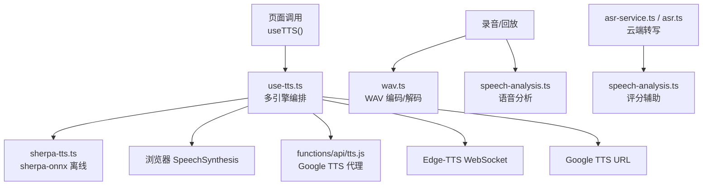
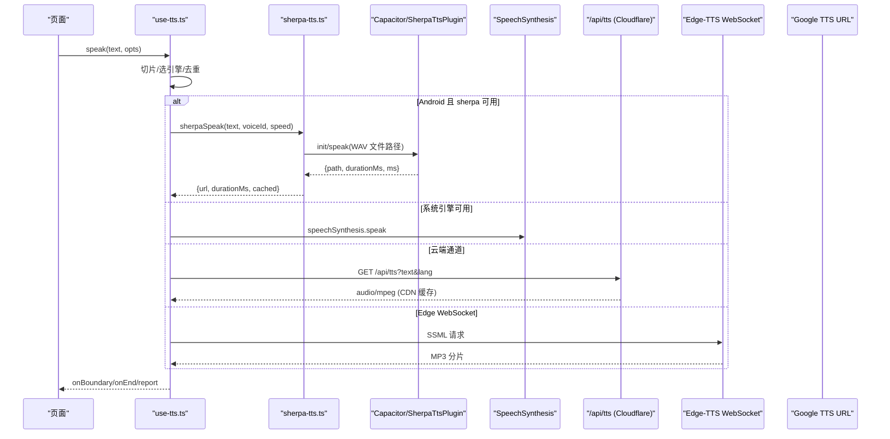
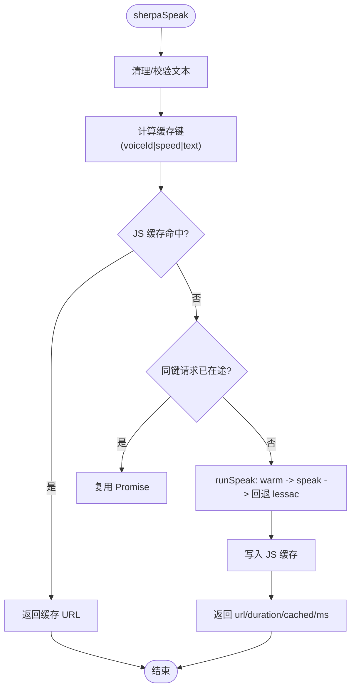
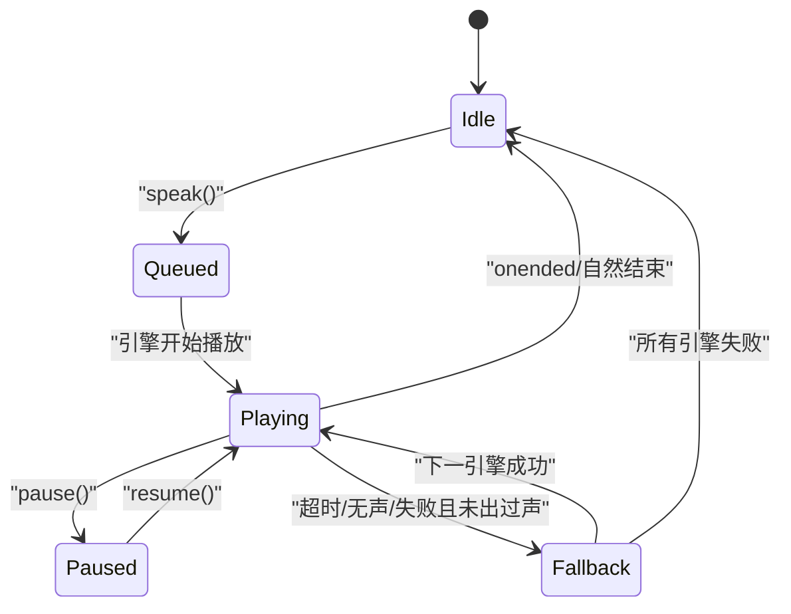
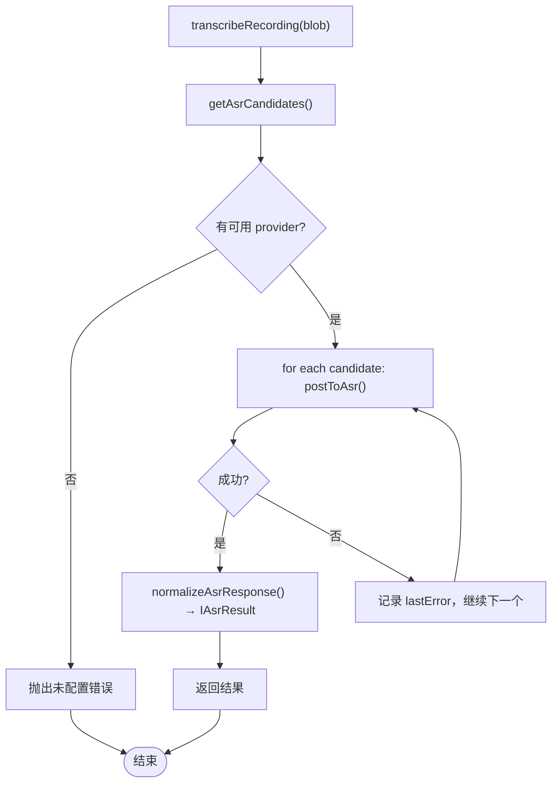
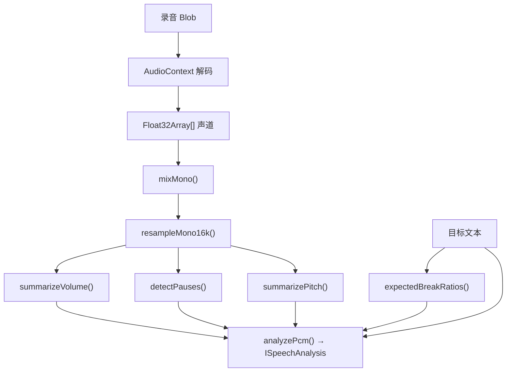
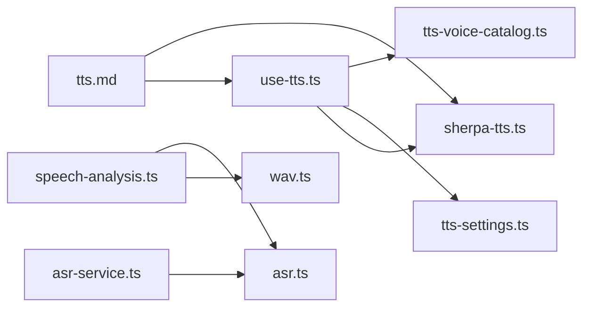

# TTS 语音合成与音频处理

<cite>
**本文引用的文件**   
- [sherpa-tts.ts](file://src/lib/sherpa-tts.ts)
- [use-tts.ts](file://src/lib/use-tts.ts)
- [tts-settings.ts](file://src/lib/tts-settings.ts)
- [tts-voice-catalog.ts](file://src/lib/tts-voice-catalog.ts)
- [asr.ts](file://src/lib/asr.ts)
- [asr-service.ts](file://src/services/asr-service.ts)
- [speech-analysis.ts](file://src/lib/speech-analysis.ts)
- [wav.ts](file://src/lib/wav.ts)
- [tts.js](file://functions/api/tts.js)
- [tts.md](file://docs/modules/tts.md)
</cite>

## 目录
1. [引言](#引言)
2. [项目结构](#项目结构)
3. [核心组件](#核心组件)
4. [架构总览](#架构总览)
5. [详细组件分析](#详细组件分析)
6. [依赖关系分析](#依赖关系分析)
7. [性能考量](#性能考量)
8. [故障排查指南](#故障排查指南)
9. [结论](#结论)

## 引言
本文件为 NativeThink 应用的 TTS（文本转语音）与音频处理子系统提供技术文档，覆盖以下主题：
- sherpa-onnx 离线 TTS 引擎的集成、模型加载、音色选择与播放控制；
- 多级降级链设计：sherpa-onnx → 系统 SpeechSynthesis → 云端 TTS API → Edge-TTS WebSocket → Google TTS URL；
- TTS 播放状态机与“读到哪”进度上报机制；
- ASR（自动语音识别）本地/云端实现、录音评分算法与语音分析工具；
- 音频格式处理、WAV 操作与实时流处理细节；
- 模型预加载、音频缓存策略与内存管理最佳实践。

## 项目结构
TTS/ASR 相关代码集中在前端 `src/lib`、服务层 `src/services`、云端函数 `functions/api` 与模块文档 `docs/modules`：
- `src/lib/sherpa-tts.ts`：sherpa-onnx 插件封装、预热、合成、URL 缓存与在途请求去重；
- `src/lib/use-tts.ts`：多引擎编排、切片、降级、看门狗、状态机与进度上报；
- `src/lib/tts-settings.ts`：持久化设置（音色、语速、音高、音量、是否优先系统引擎）；
- `src/lib/tts-voice-catalog.ts`：在线 Edge 音色目录与本地 Kokoro/Piper 离线音色表；
- `src/lib/asr.ts`：ASR provider 选择、文件名映射、响应归一与语速估算；
- `src/services/asr-service.ts`：ASR 网络层，按 provider 优先级重试；
- `src/lib/speech-analysis.ts`：离线语音分析（音量、停顿、基频、意群边界、语速）；
- `src/lib/wav.ts`：多声道混音、16kHz 单声道重采样、WAV 编码与 Blob 转换；
- `functions/api/tts.js`：Cloudflare Pages Function，代理 Google Translate TTS 并做 CDN 缓存；
- `docs/modules/tts.md`：TTS 模块设计与实测约束说明。

图表来源
- [use-tts.ts:201-400](file://src/lib/use-tts.ts#L201-L400)
- [sherpa-tts.ts:1-278](file://src/lib/sherpa-tts.ts#L1-L278)
- [tts.js:1-69](file://functions/api/tts.js#L1-L69)
- [wav.ts:1-102](file://src/lib/wav.ts#L1-L102)
- [speech-analysis.ts:1-325](file://src/lib/speech-analysis.ts#L1-L325)

章节来源
- [tts.md:1-204](file://docs/modules/tts.md#L1-L204)

## 核心组件
- sherpa-onnx 离线引擎封装：负责插件注册、健康检查、模型预热、音色回退、合成结果缓存与并发去重。
- TTS Hook：统一入口，按平台与设置决定引擎顺序，负责切片、降级、看门狗、暂停/恢复/取消与进度上报。
- 音色体系：在线 Edge 音色目录 + 本地 Kokoro/Piper 离线音色表，支持默认音色与用户显式选择。
- ASR 逻辑与服务：provider 选择、文件命名、响应归一、超时与取消、多 provider 重试。
- 语音分析与 WAV：离线 PCM 分析（音量、停顿、基频、意群边界、语速），以及 WebM/Opus→WAV 转换。

章节来源
- [sherpa-tts.ts:1-278](file://src/lib/sherpa-tts.ts#L1-L278)
- [use-tts.ts:1-400](file://src/lib/use-tts.ts#L1-L400)
- [tts-settings.ts:1-140](file://src/lib/tts-settings.ts#L1-L140)
- [tts-voice-catalog.ts:1-162](file://src/lib/tts-voice-catalog.ts#L1-L162)
- [asr.ts:1-101](file://src/lib/asr.ts#L1-L101)
- [asr-service.ts:1-99](file://src/services/asr-service.ts#L1-L99)
- [speech-analysis.ts:1-325](file://src/lib/speech-analysis.ts#L1-L325)
- [wav.ts:1-102](file://src/lib/wav.ts#L1-L102)

## 架构总览
TTS 采用“主引擎 + 多层回退”的设计，确保不同平台（桌面/Android/iOS/Electron）和不同网络条件下都能朗读；ASR 则通过后端聚合多个 provider，保证一个不可用时继续尝试下一个。

图表来源
- [use-tts.ts:201-400](file://src/lib/use-tts.ts#L201-L400)
- [sherpa-tts.ts:201-278](file://src/lib/sherpa-tts.ts#L201-L278)
- [tts.js:1-69](file://functions/api/tts.js#L1-L69)

## 详细组件分析

### sherpa-onnx 离线 TTS 引擎
- 能力检测与健康护栏：仅在 Android 原生平台启用；启动前打标记，若上次加载未完成则自动停用内置引擎，避免反复闪退；提供手动重新启用入口。
- 模型预热：幂等 `warmSherpa()`，首次加载约 1–2 秒，建议在阅读/学习页提前调用。
- 音色选择与回退：优先使用用户选择的本地音色；失败时自动回退到 lessac 兜底音色；两者均失败才向上抛错，由上层走系统/云端降级。
- 并发与缓存：相同 (voiceId, text, speed) 的并发请求共用 Promise；JS 侧 Map 缓存最多 120 条 URL，原生插件另有文件级缓存。
- 播放控制：合成后返回可播放 URL，实际播放仍走 `<audio>`，复用暂停/续读/队列/语速微调逻辑。

图表来源
- [sherpa-tts.ts:1-278](file://src/lib/sherpa-tts.ts#L1-L278)

章节来源
- [sherpa-tts.ts:1-278](file://src/lib/sherpa-tts.ts#L1-L278)

### TTS Hook 与多级降级链
- 引擎候选顺序（安卓默认）：sherpa-onnx → 系统 SpeechSynthesis → 云端 `/api/tts` → Edge-TTS WebSocket → Google TTS URL。
- 单词短文本优化：联网且 ≤24 字符时，云端优先；prewarm 与 speak 共享同一判据，避免预热错位。
- 切片：按句末 `. ? !` 或空格切至 180 字以内，与云端上游 200 字符限制对齐。
- “读到哪”进度：原生引擎无词级回调，通过 `onChunk(chunkIndex, wordsBefore)` 上报；反查表依赖“各段词数之和 = 各切片词数之和”。
- 看门狗与双触发防护：每段音频有安全定时器；新引擎接棒前清除旧看门狗；取消采用单调递增的代际号，避免旧链复活掐死新朗读。
- 状态机：Idle → Queued → Playing → Paused → Fallback → Idle。状态变化由 `isSpeaking`、`isPaused`、`chainGenRef`、`nativeActiveRef` 等共同维护；失败时仅在没有真正出声的情况下降级，避免重复朗读。

图表来源
- [use-tts.ts:201-400](file://src/lib/use-tts.ts#L201-L400)
- [tts.md:1-204](file://docs/modules/tts.md#L1-L204)

章节来源
- [use-tts.ts:1-400](file://src/lib/use-tts.ts#L1-L400)
- [tts.md:1-204](file://docs/modules/tts.md#L1-L204)

### 音色体系与设置
- 在线 Edge 音色目录：`srv:edge:*`，含美/英/澳口音与性别标签；当 Edge 不可达时用 Google TTS 语言变体保留口音差异。
- 本地离线音色：Kokoro int8 11 个英文音色 + Piper lessac 兜底；默认 lessac 因 RTF 更优适合长文连续朗读。
- 设置项：`selectedVoiceURI`、`nativeVoiceIndex`、`preferNative`、`rate`、`pitch`、`volume`；数值范围被 clamp 保护，支持云同步下行刷新。

章节来源
- [tts-voice-catalog.ts:1-162](file://src/lib/tts-voice-catalog.ts#L1-L162)
- [tts-settings.ts:1-140](file://src/lib/tts-settings.ts#L1-L140)

### ASR：provider 选择、重试与评分
- Provider 选择：按固定优先级挑选已配置 Key 的 provider（GLM、Groq、SiliconFlow）。
- 文件命名：根据 MIME 映射上传文件名，确保上游容器类型稳定。
- 响应归一：兼容 GLM/Groq/SiliconFlow 多种返回结构，提取文本与分段。
- 网络层：`transcribeRecording` 按 candidate 列表依次尝试，超时/取消错误透传，其他错误记录最后异常。
- 语速评分：按目标文本词数 × 基准时长估算期望时长，对比录音时长给出偏慢/偏快/正常。

图表来源
- [asr-service.ts:1-99](file://src/services/asr-service.ts#L1-L99)
- [asr.ts:1-101](file://src/lib/asr.ts#L1-L101)

章节来源
- [asr-service.ts:1-99](file://src/services/asr-service.ts#L1-L99)
- [asr.ts:1-101](file://src/lib/asr.ts#L1-L101)

### 语音分析与 WAV 处理
- WAV 编解码：将 MediaRecorder 产出的 WebM/Opus 转为 16kHz 单声道 16-bit WAV，便于三个 ASR provider 稳定消费；同时提供 PCM→WAV 纯函数用于守卫测试。
- 语音分析：对 PCM 进行 RMS/峰值音量、爆音比例、停顿检测、自相关基频估计与趋势判断；基于标点/连词推断意群边界并与实际停顿匹配；结合目标文本估算语速。
- 输入输出：`analyzeBlob` 接受任意录音 Blob，解码失败返回 null；`analyzePcm` 直接接受 Float32Array 声道数据。

图表来源
- [wav.ts:1-102](file://src/lib/wav.ts#L1-L102)
- [speech-analysis.ts:1-325](file://src/lib/speech-analysis.ts#L1-L325)

章节来源
- [wav.ts:1-102](file://src/lib/wav.ts#L1-L102)
- [speech-analysis.ts:1-325](file://src/lib/speech-analysis.ts#L1-L325)

### 云端 TTS 代理
- Cloudflare Pages Function `/api/tts` 代理 Google Translate TTS，从边缘节点发起请求，避免客户端直连受限问题；对相同文本做一年期 CDN 不可变缓存。
- 参数校验：拒绝空文本与超过 200 字符的文本，防止上游返回误导性 502。

章节来源
- [tts.js:1-69](file://functions/api/tts.js#L1-L69)

## 依赖关系分析
- use-tts.ts 依赖：sherpa-tts.ts、tts-settings.ts、tts-voice-catalog.ts、utils、sonner、@capacitor/core。
- sherpa-tts.ts 依赖：safe-storage、sonner、tts-voice-catalog.ts、Capacitor/SherpaTtsPlugin。
- asr-service.ts 依赖：ai-config、lib/asr.ts。
- speech-analysis.ts 依赖：wav.ts、asr.ts。
- tts.md 汇总了模块级约束（切片上限、RTF 实测、取消代际号等），贯穿以上实现。

图表来源
- [use-tts.ts:1-400](file://src/lib/use-tts.ts#L1-L400)
- [sherpa-tts.ts:1-278](file://src/lib/sherpa-tts.ts#L1-L278)
- [asr-service.ts:1-99](file://src/services/asr-service.ts#L1-L99)
- [asr.ts:1-101](file://src/lib/asr.ts#L1-L101)
- [speech-analysis.ts:1-325](file://src/lib/speech-analysis.ts#L1-L325)
- [wav.ts:1-102](file://src/lib/wav.ts#L1-L102)
- [tts.md:1-204](file://docs/modules/tts.md#L1-L204)

章节来源
- [use-tts.ts:1-400](file://src/lib/use-tts.ts#L1-L400)
- [sherpa-tts.ts:1-278](file://src/lib/sherpa-tts.ts#L1-L278)
- [asr-service.ts:1-99](file://src/services/asr-service.ts#L1-L99)
- [asr.ts:1-101](file://src/lib/asr.ts#L1-L101)
- [speech-analysis.ts:1-325](file://src/lib/speech-analysis.ts#L1-L325)
- [wav.ts:1-102](file://src/lib/wav.ts#L1-L102)
- [tts.md:1-204](file://docs/modules/tts.md#L1-L204)

## 性能考量
- 模型预加载：进入阅读/学习页前调用 `warmSherpa()`，避免首包延迟；Android 上内置引擎冷启动约 1–2 秒。
- 音频缓存策略：三层缓存——JS Map（120 条）、原生文件缓存（sha1）、Cloudflare CDN（1 年不可变）。
- 并发控制：sherpa-onnx 合成串行，必须通过 in-flight Promise 去重，防止线程耗尽导致闪退。
- 切片与流水线：180 字切片既满足云端上限，又让首段更早合成；长文连贯性取决于 RTF，lessac 更适合长文。
- 内存管理：每片音频生成 Object URL，播放结束后释放；Cache Storage 设置 FIFO 上限（400 条），避免配额挤占 IndexedDB。
- 线程与 RTF：Kokoro RTF≈1.0+，增加线程仅次线性改善，无法越界 1.0；默认 lessac 以流畅度优先。

[本节为通用指导，不直接分析具体文件]

## 故障排查指南
- 内置引擎闪退：检查健康标记与日志，必要时手动重新启用；查看初始化日志定位原生崩溃点。
- 朗读不出声：确认是否走了“无声挂住”分支，核对 nativeSilenceBudgetMs 与是否有英语音色；检查看门狗是否误杀。
- 快速切换卡片无声音：确认取消逻辑使用了代际号，避免旧链复活；验证 `stopAudio()` 先摘回调再清空 src。
- 单词发音不准：短词联网优先走云端，失败落回离线链；如持续出错，检查是否选择了低质量离线音色。
- ASR 失败：检查 provider Key 配置、网络超时、上游返回结构；必要时切换 provider。
- 语音分析为空：确认录音非几乎无声；若解码失败，`analyzeBlob` 会返回 null，调用方应保留原 Blob 回放。

章节来源
- [sherpa-tts.ts:1-278](file://src/lib/sherpa-tts.ts#L1-L278)
- [use-tts.ts:201-400](file://src/lib/use-tts.ts#L201-L400)
- [asr-service.ts:1-99](file://src/services/asr-service.ts#L1-L99)
- [speech-analysis.ts:1-325](file://src/lib/speech-analysis.ts#L1-L325)

## 结论
NativeThink 的 TTS/ASR 子系统通过“sherpa-onnx 离线优先 + 系统/云端回退”的多级链，兼顾离线可用性与跨平台稳定性；配合严格的切片、并发去重、看门狗与代际取消，确保长文朗读与交互体验可靠。ASR 与语音分析则提供离线反馈与云端转写互补，形成完整的语音闭环。实践中应遵循模块文档中的切片上限、RTF 约束与缓存策略，并在 Android 平台上优先利用内置引擎的健康护栏与预热机制。