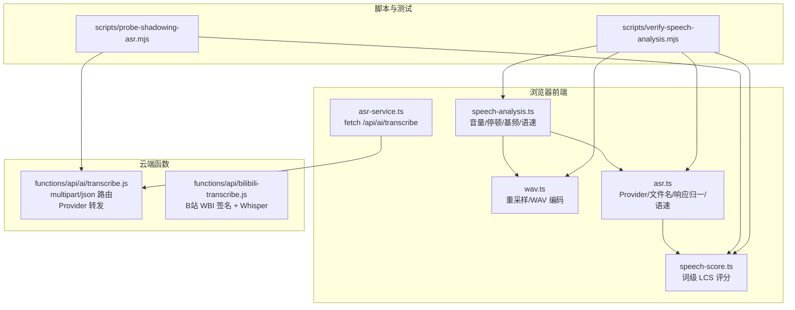
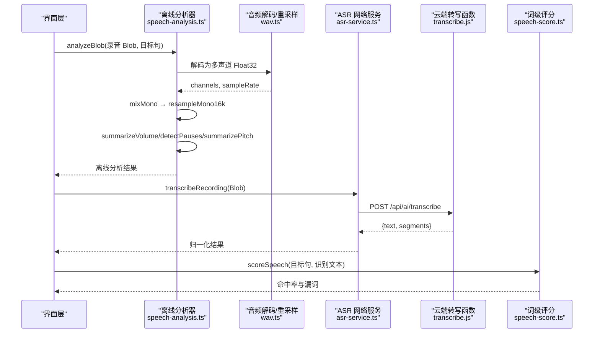
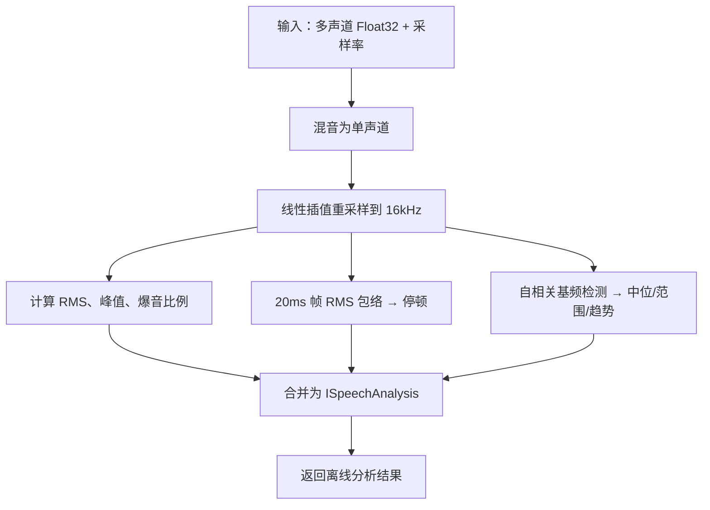
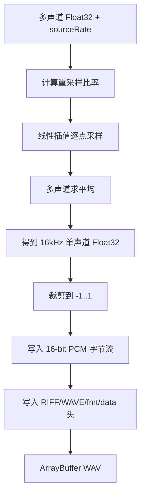
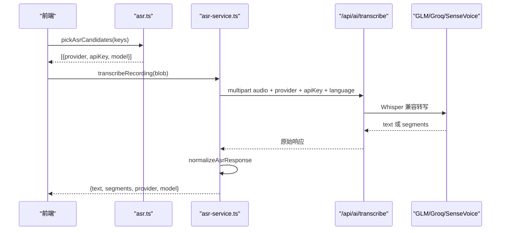
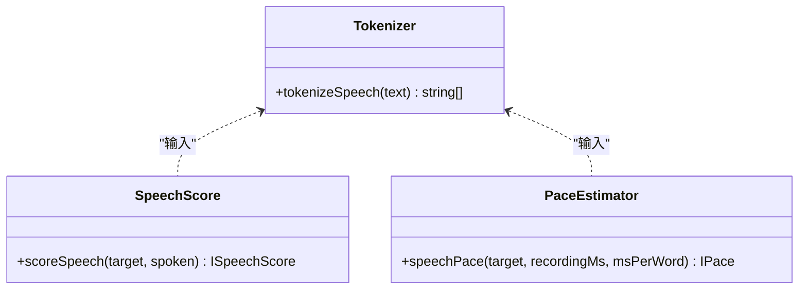
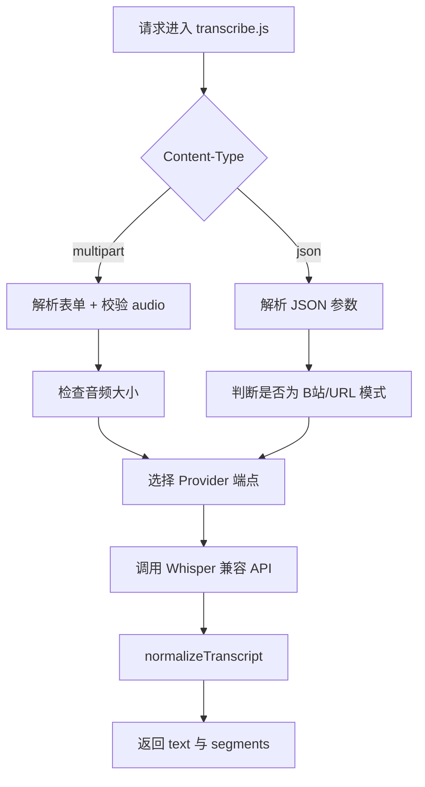
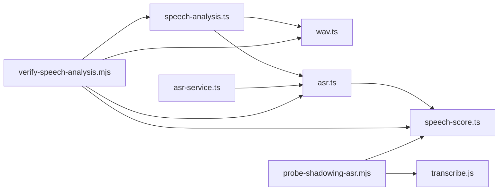

# 语音分析工具与音频处理

<cite>
**本文引用的文件**   
- [speech-analysis.ts](file://src/lib/speech-analysis.ts)
- [wav.ts](file://src/lib/wav.ts)
- [asr.ts](file://src/lib/asr.ts)
- [asr-service.ts](file://src/services/asr-service.ts)
- [speech-score.ts](file://src/lib/speech-score.ts)
- [transcribe.js](file://functions/api/ai/transcribe.js)
- [bilibili-transcribe.js](file://functions/api/bilibili-transcribe.js)
- [verify-speech-analysis.mjs](file://scripts/verify-speech-analysis.mjs)
- [probe-shadowing-asr.mjs](file://scripts/probe-shadowing-asr.mjs)
</cite>

## 目录
1. [引言](#引言)
2. [项目结构](#项目结构)
3. [核心组件](#核心组件)
4. [架构总览](#架构总览)
5. [详细组件分析](#详细组件分析)
6. [依赖关系分析](#依赖关系分析)
7. [性能与内存特性](#性能与内存特性)
8. [故障排查指南](#故障排查指南)
9. [结论](#结论)

## 引言
本文面向 NativeThink 应用中的“语音分析工具”和“音频处理模块”，围绕以下目标展开：
- 解释本地语音信号分析算法：能量检测、停顿检测、基频检测、意群边界匹配与语速估计。
- 说明 WAV 文件格式处理流程：浏览器解码、多声道混音、线性插值重采样、PCM 编码。
- 梳理语音转写链路：客户端上传、服务端分发到不同 ASR Provider，以及响应归一化。
- 明确当前实现的能力边界：本仓库未包含 MFCC、梅尔频谱图、信噪比、失真度或客观音质评分等高级声学特征；文档会指出这些能力的位置与扩展建议。
- 给出缓冲区管理、实时处理路径、调试脚本集成及最佳实践。

## 项目结构
与语音分析相关的代码主要分布在以下位置：
- 浏览器端离线分析：`src/lib/speech-analysis.ts`
- 音频格式与重采样：`src/lib/wav.ts`
- 纯逻辑 ASR 配置与语速：`src/lib/asr.ts`
- 网络层 ASR 调用：`src/services/asr-service.ts`
- 词级评分（LCS）：`src/lib/speech-score.ts`
- Cloudflare Functions 转写入口：`functions/api/ai/transcribe.js`
- B站音视频转写函数：`functions/api/bilibili-transcribe.js`
- 离线分析契约测试：`scripts/verify-speech-analysis.mjs`
- ASR 端到端探测脚本：`scripts/probe-shadowing-asr.mjs`

**图表来源**
- [speech-analysis.ts:1-325](file://src/lib/speech-analysis.ts#L1-L325)
- [wav.ts:1-102](file://src/lib/wav.ts#L1-L102)
- [asr.ts:1-101](file://src/lib/asr.ts#L1-L101)
- [asr-service.ts:1-99](file://src/services/asr-service.ts#L1-L99)
- [speech-score.ts:1-51](file://src/lib/speech-score.ts#L1-L51)
- [transcribe.js:1-200](file://functions/api/ai/transcribe.js#L1-L200)
- [bilibili-transcribe.js:1-200](file://functions/api/bilibili-transcribe.js#L1-L200)
- [verify-speech-analysis.mjs:1-186](file://scripts/verify-speech-analysis.mjs#L1-L186)
- [probe-shadowing-asr.mjs:1-200](file://scripts/probe-shadowing-asr.mjs#L1-L200)

**章节来源**
- [speech-analysis.ts:1-325](file://src/lib/speech-analysis.ts#L1-L325)
- [wav.ts:1-102](file://src/lib/wav.ts#L1-L102)
- [asr.ts:1-101](file://src/lib/asr.ts#L1-L101)
- [asr-service.ts:1-99](file://src/services/asr-service.ts#L1-L99)
- [speech-score.ts:1-51](file://src/lib/speech-score.ts#L1-L51)
- [transcribe.js:1-200](file://functions/api/ai/transcribe.js#L1-L200)
- [bilibili-transcribe.js:1-200](file://functions/api/bilibili-transcribe.js#L1-L200)
- [verify-speech-analysis.mjs:1-186](file://scripts/verify-speech-analysis.mjs#L1-L186)
- [probe-shadowing-asr.mjs:1-200](file://scripts/probe-shadowing-asr.mjs#L1-L200)

## 核心组件
- 离线语音分析器：负责从 PCM 波形中提取 RMS 能量、峰值、爆音比例、停顿位置、基频中位与趋势，并与预期意群边界匹配，输出统一分析结果。
- 音频编解码器：将浏览器解码后的多声道 Float32 数据转换为 16kHz 单声道，并编码为 16-bit PCM WAV。
- ASR 纯逻辑层：选择 Provider、构造上传文件名、统一不同 Provider 的响应结构、计算参考语速。
- ASR 网络服务：封装 `fetch`、超时控制、异常分类与 Provider 重试。
- 词级评分模块：对目标句与识别文本进行归一分词，并用最长公共子序列计算命中率与漏词。
- 云端转写函数：接收 multipart 或 JSON 请求，校验输入、限制大小、转发到 GLM/Groq/SiliconFlow Whisper 兼容接口。
- 验证脚本：用合成正弦波和静音段真跑离线分析断言，并静态检查页面是否复用共享分析逻辑。

**章节来源**
- [speech-analysis.ts:1-325](file://src/lib/speech-analysis.ts#L1-L325)
- [wav.ts:1-102](file://src/lib/wav.ts#L1-L102)
- [asr.ts:1-101](file://src/lib/asr.ts#L1-L101)
- [asr-service.ts:1-99](file://src/services/asr-service.ts#L1-L99)
- [speech-score.ts:1-51](file://src/lib/speech-score.ts#L1-L51)
- [transcribe.js:1-200](file://functions/api/ai/transcribe.js#L1-L200)
- [verify-speech-analysis.mjs:1-186](file://scripts/verify-speech-analysis.mjs#L1-L186)

## 架构总览
NativeThink 的语音处理采用“本地可离线兜底 + 云端可选增强”的双层设计：
1. 录音结束后，浏览器立即把 Blob 交给离线分析器，得到音量、停顿、基频和语速。
2. 如果已配置 ASR Key，则并行发起云端转写，得到文本、分段和词级评分。
3. 即使云端失败，用户仍能看到本地离线分析结果。

**图表来源**
- [speech-analysis.ts:201-325](file://src/lib/speech-analysis.ts#L201-L325)
- [wav.ts:1-102](file://src/lib/wav.ts#L1-L102)
- [asr-service.ts:1-99](file://src/services/asr-service.ts#L1-L99)
- [transcribe.js:1-200](file://functions/api/ai/transcribe.js#L1-L200)
- [speech-score.ts:1-51](file://src/lib/speech-score.ts#L1-L51)

## 详细组件分析

### 离线语音信号分析
该模块是语音质量反馈的核心，但不做音素级发音判定；它只处理能从波形客观量出的信息。

#### 关键数据结构
- 音量摘要：RMS dBFS、峰值 dBFS、爆音样本比例、过低音量标记、爆音标记。
- 停顿列表：每个停顿包含相对位置和毫秒时长。
- 基频摘要：中位 Hz、百分位范围、整体趋势、句尾是否上扬、有声帧数。
- 综合分析：时长、音量、停顿、预期边界、命中数、基频、语速。

**图表来源**
- [speech-analysis.ts:1-200](file://src/lib/speech-analysis.ts#L1-L200)
- [speech-analysis.ts:201-325](file://src/lib/speech-analysis.ts#L201-L325)

#### 算法要点
- **能量检测**：遍历样本累加平方和，计算 RMS 与峰值，并统计接近满幅样本的比例作为爆音启发式。
- **停顿检测**：以固定帧长计算 RMS 包络，取整段峰值比例阈值；连续低于阈值的帧构成停顿，首尾靠近边界的停顿会被过滤。
- **基频检测**：在每帧内先去均值、算能量地板，再对多个滞后长度计算归一化自相关；若强峰足够高，则估算基频，并对周期整数倍进行校正。
- **意群边界匹配**：从标点或连词推导预期边界比例，与检测到的停顿比例比较，统计命中。
- **语速估计**：按目标句词数和每词参考时长估算期望时长，与录音时长比较得出偏快/偏慢标签。

**章节来源**
- [speech-analysis.ts:1-200](file://src/lib/speech-analysis.ts#L1-L200)
- [speech-analysis.ts:201-325](file://src/lib/speech-analysis.ts#L201-L325)

### WAV 文件格式处理与重采样
该模块承担两个职责：
1. 将浏览器解码得到的多声道 Float32 数据重采样为 16kHz 单声道。
2. 将该 Float32 数组编码为标准 RIFF/WAV PCM 文件。

**图表来源**
- [wav.ts:1-102](file://src/lib/wav.ts#L1-L102)

#### 支持范围
- 多声道输入：通过通道间平均混音。
- 线性插值重采样：目标采样率默认 16kHz。
- 标准 WAV 头：RIFF、WAVE、fmt chunk size=16、PCM、单声道、16-bit。
- Blob 转换：浏览器侧使用 `AudioContext.decodeAudioData` 解码任意录音 Blob，再转为 WAV Blob。

**章节来源**
- [wav.ts:1-102](file://src/lib/wav.ts#L1-L102)

### 语音转写链路
ASR 链路分为纯逻辑层和网络层：
- 纯逻辑层负责 Provider 优先级、文件名映射、响应归一化和语速估计。
- 网络层负责构建 FormData、设置超时、捕获取消和超时错误，并按顺序尝试已配置的 Provider。

**图表来源**
- [asr.ts:1-101](file://src/lib/asr.ts#L1-L101)
- [asr-service.ts:1-99](file://src/services/asr-service.ts#L1-L99)
- [transcribe.js:1-200](file://functions/api/ai/transcribe.js#L1-L200)

#### Provider 与模型
- GLM：`GLM-ASR-2512`
- Groq：`whisper-large-v3-turbo`
- SiliconFlow：`FunAudioLLM/SenseVoiceSmall`

#### 响应归一化
不同 Provider 可能返回 `text`、`transcript`、`results` 或带时间戳的 `segments`。归一化逻辑会优先提取完整文本，再拼接分段英文内容，保证前端拿到一致结构。

**章节来源**
- [asr.ts:1-101](file://src/lib/asr.ts#L1-L101)
- [asr-service.ts:1-99](file://src/services/asr-service.ts#L1-L99)

### 词级评分与节奏反馈
词级评分不依赖 ASR 网络：
- 先对目标句和识别文本进行归一分词。
- 使用动态规划计算最长公共子序列长度。
- 回溯 DP 表确定哪些目标词被匹配，并生成去重保序的漏词列表。
- 准确率等于匹配词数除以目标词数。

节奏反馈同时使用本地离线分析和云端识别结果：
- 本地分析直接基于录音时长和目标句词数估算语速。
- 云端识别成功后，可结合词级命中率展示漏词和节奏标签。

**图表来源**
- [speech-score.ts:1-51](file://src/lib/speech-score.ts#L1-L51)
- [asr.ts:60-101](file://src/lib/asr.ts#L60-L101)

**章节来源**
- [speech-score.ts:1-51](file://src/lib/speech-score.ts#L1-L51)
- [asr.ts:60-101](file://src/lib/asr.ts#L60-L101)

### 云端转写函数
Cloudflare Functions 的转写入口支持两种请求体：
1. `multipart/form-data`：影子跟读录音上传，字段包括 `audio`、`provider`、`apiKey`、`language`。
2. `application/json`：用于 B站字幕或其他 URL 类场景。

函数内部完成：
- Content-Type 路由。
- 文件大小上限校验。
- MIME 到文件扩展名映射。
- 根据 Provider 选择 Whisper 兼容端点和模型。
- 标准化转录结果，并为分段提取关键词候选。

**图表来源**
- [transcribe.js:1-200](file://functions/api/ai/transcribe.js#L1-L200)

**章节来源**
- [transcribe.js:1-200](file://functions/api/ai/transcribe.js#L1-L200)
- [bilibili-transcribe.js:1-200](file://functions/api/bilibili-transcribe.js#L1-L200)

## 依赖关系分析
- `speech-analysis.ts` 依赖 `wav.ts` 的重采样函数和 `asr.ts` 的语速函数。
- `asr-service.ts` 依赖 `asr.ts` 的 Provider、文件名和响应归一逻辑。
- `asr.ts` 依赖 `speech-score.ts` 的分词函数。
- 验证脚本 `verify-speech-analysis.mjs` 通过 TypeScript 编译链把四个模块拼接为可执行模块，用合成波形断言行为。
- 探测脚本 `probe-shadowing-asr.mjs` 可走本地 Function 或直接 URL 调用云端 ASR，并通过 AST 抽取真实 `scoreSpeech` 做词级对齐。

**图表来源**
- [speech-analysis.ts:1-325](file://src/lib/speech-analysis.ts#L1-L325)
- [wav.ts:1-102](file://src/lib/wav.ts#L1-L102)
- [asr.ts:1-101](file://src/lib/asr.ts#L1-L101)
- [asr-service.ts:1-99](file://src/services/asr-service.ts#L1-L99)
- [speech-score.ts:1-51](file://src/lib/speech-score.ts#L1-L51)
- [verify-speech-analysis.mjs:1-186](file://scripts/verify-speech-analysis.mjs#L1-L186)
- [probe-shadowing-asr.mjs:1-200](file://scripts/probe-shadowing-asr.mjs#L1-L200)

**章节来源**
- [verify-speech-analysis.mjs:1-186](file://scripts/verify-speech-analysis.mjs#L1-L186)
- [probe-shadowing-asr.mjs:1-200](file://scripts/probe-shadowing-asr.mjs#L1-L200)

## 性能与内存特性
当前实现的音频处理具有以下特点：

- **时间复杂度**
  - 能量与停顿：线性扫描样本，帧长固定，整体近似 O(N)。
  - 基频检测：每帧对多个滞后长度计算自相关，复杂度约为 O(N × L)，其中 L 为最大滞后窗口。
  - 词级评分：DP 表大小为 O(M×K)，M、K 为目标句词数与识别文本词数。
  - WAV 编码：O(N) 逐样本写入。

- **空间复杂度**
  - 在线程中使用 `Float32Array` 存储单声道采样，额外分配每帧自相关数组。
  - 重采样过程需要输出数组，但不保留中间多声道副本。
  - DP 评分矩阵随词数增长，但通常远小于音频样本数。

- **内存优化建议**
  - 对超长录音，可在离线分析前分块计算能量包络，避免一次性持有全部自相关结果。
  - 对大数据集批处理，建议按分钟切分录音，串行或并发有限数量任务。
  - 避免在循环中频繁创建新数组；当前实现已在关键路径尽量复用 TypedArray。

- **实时音频流处理能力**
  - 当前实现主要针对“录制完成后批量分析”；没有独立的实时流式分析管线。
  - 可通过 `resampleMono16k` 和 `detectPauses` 增量处理音频帧，但需要自行维护滑动窗口状态。
  - 如需实时 VAD、流式 ASR 或流式 MFCC，应引入 WebAssembly 音频库或原生扩展。

[本节为通用性能讨论，不直接分析具体文件]

## 故障排查指南

### 常见错误与定位
- **无 ASR Key**：前端抛出未配置错误，应检查 Provider Key 是否可用。
- **转写超时**：默认 30 秒超时，可调整选项或检查网络与 Provider 限流。
- **无识别文本**：云端返回空文本时，提示靠近麦克风重试。
- **WAV 编码失败**：空声道、无效采样率或空 Buffer 会返回 null，调用方应降级为原 Blob。
- **离线分析失败**：浏览器解码失败时返回 null，界面应保留回放并提示可继续自听对比。

### 调试与验证方法
- 使用 `scripts/verify-speech-analysis.mjs` 运行离线分析契约测试，覆盖标点边界、音量阈值、停顿检测、基频趋势和重采样。
- 使用 `scripts/probe-shadowing-asr.mjs` 验证“音频 → ASR → 词级评分”完整链路，支持本地 Function、URL 模式和 dry-run。
- 检查云端函数日志，确认 multipart 字段是否正确、音频大小是否超限、Provider 返回结构是否符合预期。

**章节来源**
- [asr-service.ts:1-99](file://src/services/asr-service.ts#L1-L99)
- [wav.ts:1-102](file://src/lib/wav.ts#L1-L102)
- [verify-speech-analysis.mjs:1-186](file://scripts/verify-speech-analysis.mjs#L1-L186)
- [probe-shadowing-asr.mjs:1-200](file://scripts/probe-shadowing-asr.mjs#L1-L200)

## 结论
NativeThink 的语音分析工具以“本地可离线、云端可选增强”为核心策略：
- 本地提供稳健的音量、停顿、基频和语速反馈，即使 ASR 不可用也能给用户节奏与发声质量建议。
- 云端通过统一的 Whisper 兼容接口聚合多个 Provider，提高转写可用性。
- WAV 处理链路清晰：浏览器解码、多声道混音、线性插值重采样、标准 PCM 编码。
- 当前仓库未实现 MFCC、梅尔频谱图、信噪比、失真度或客观音质评分；这些属于更深层声学特征工程，可作为后续扩展方向。
- 对于实时处理和大规模数据集，建议引入分块处理、流式缓冲和 WASM/Native 加速，以降低主线程压力并提升吞吐。

[本节为总结性内容，不直接分析具体文件]