# UI 组件系统

<cite>
**本文引用的文件**   
- [src/app.tsx](file://src/app.tsx)
- [src/components/Layout.tsx](file://src/components/Layout.tsx)
- [src/components/Header.tsx](file://src/components/Header.tsx)
- [src/components/AppSidebar.tsx](file://src/components/AppSidebar.tsx)
- [src/components/MobileBottomNav.tsx](file://src/components/MobileBottomNav.tsx)
- [src/components/ui/sidebar.tsx](file://src/components/ui/sidebar.tsx)
- [src/components/ui/button.tsx](file://src/components/ui/button.tsx)
- [src/components/ui/dialog.tsx](file://src/components/ui/dialog.tsx)
- [src/components/ui/sonner.tsx](file://src/components/ui/sonner.tsx)
- [src/lib/lazy-framer-motion.tsx](file://src/lib/lazy-framer-motion.tsx)
- [src/components/CelebrateLayer.tsx](file://src/components/CelebrateLayer.tsx)
- [src/lib/ui-theme.ts](file://src/lib/ui-theme.ts)
- [src/lib/use-theme.ts](file://src/lib/use-theme.ts)
- [src/index.css](file://src/index.css)
- [src/tailwind-theme.css](file://src/tailwind-theme.css)
- [src/lib/utils.ts](file://src/lib/utils.ts)
- [components.json](file://components.json)
- [package.json](file://package.json)
</cite>

## 目录
1. [简介](#简介)
2. [项目结构](#项目结构)
3. [核心组件](#核心组件)
4. [架构总览](#架构总览)
5. [详细组件分析](#详细组件分析)
6. [依赖关系分析](#依赖关系分析)
7. [性能与动画](#性能与动画)
8. [主题系统与定制](#主题系统与定制)
9. [响应式、无障碍与兼容性](#响应式无碍与兼容性)
10. [最佳实践](#最佳实践)
11. [故障排查](#故障排查)
12. [结语](#结语)

## 简介
NativeThink 的 UI 组件系统以 shadcn/ui + Radix UI 为原子层，使用 Tailwind CSS v4 作为样式语言；业务侧通过 Layout、Header、AppSidebar 等组合组件组织页面骨架；动画层用 framer-motion 延迟加载、CSS 动画和原生 Canvas 庆祝效果共同实现。主题系统分为两个正交维度：明暗主题（light/dark）与应用外观主题（classic / porcelain / graphite / lime / sand / berry）。

本项目约含 50+ 个 shadcn/ui 原子组件（如 Accordion、Alert、Badge、Button、Card、Dialog、Drawer、DropdownMenu、Form、Input、Pagination、Popover、Progress、Select、Separator、Sheet、Sidebar、Skeleton、Slider、Switch、Table、Tabs、Textarea、Toggle、Tooltip 等），全部位于 `src/components/ui`，由 `components.json` 注册到 `@/components/ui` 别名下。

**章节来源**
- [components.json:1-21](file://components.json#L1-L21)
- [package.json:63-108](file://package.json#L63-L108)

## 项目结构
UI 相关代码主要分布在以下位置：
- 原子 UI 组件：`src/components/ui/*`
- 业务布局组件：`src/components/Layout.tsx`、`src/components/Header.tsx`、`src/components/AppSidebar.tsx`、`src/components/MobileBottomNav.tsx`
- 动画与交互：`src/lib/lazy-framer-motion.tsx`、`src/components/CelebrateLayer.tsx`、`src/index.css`
- 主题：`src/lib/ui-theme.ts`、`src/lib/use-theme.ts`、`src/tailwind-theme.css`、`src/index.css`
- 路由与懒加载入口：`src/app.tsx`

```mermaid
graph TB
  App["应用入口<br/>src/app.tsx"] --> Layout["布局容器<br/>src/components/Layout.tsx"]
  Layout --> Sidebar["侧边栏<br/>src/components/AppSidebar.tsx"]
  Layout --> Header["顶栏<br/>src/components/Header.tsx"]
  Layout --> MobileNav["移动端底部导航<br/>src/components/MobileBottomNav.tsx"]
  Sidebar --> UiSidebar["Radix 风格侧边栏<br/>src/components/ui/sidebar.tsx"]
  Header --> Button["按钮原子组件<br/>src/components/ui/button.tsx"]
  App --> LazyFramer["framer-motion 延迟加载<br/>src/lib/lazy-framer-motion.tsx"]
  App --> Celebrate["庆祝粒子层<br/>src/components/CelebrateLayer.tsx"]
  Celebrate --> CssAnimations["全局 CSS 动画<br/>src/index.css"]
  ThemeUi["外观主题<br/>src/lib/ui-theme.ts"] --> Sidebar
  ThemeDark["明暗主题<br/>src/lib/use-theme.ts"] --> CssTheme["Tailwind 主题变量<br/>src/tailwind-theme.css"]
```

**图表来源**
- [src/app.tsx:1-66](file://src/app.tsx#L1-L66)
- [src/components/Layout.tsx:1-155](file://src/components/Layout.tsx#L1-L155)
- [src/components/AppSidebar.tsx:1-179](file://src/components/AppSidebar.tsx#L1-L179)
- [src/components/ui/sidebar.tsx:1-200](file://src/components/ui/sidebar.tsx#L1-L200)
- [src/components/ui/button.tsx:1-82](file://src/components/ui/button.tsx#L1-L82)
- [src/lib/lazy-framer-motion.tsx:1-99](file://src/lib/lazy-framer-motion.tsx#L1-L99)
- [src/components/CelebrateLayer.tsx:1-72](file://src/components/CelebrateLayer.tsx#L1-L72)
- [src/lib/ui-theme.ts:1-84](file://src/lib/ui-theme.ts#L1-L84)
- [src/lib/use-theme.ts:1-45](file://src/lib/use-theme.ts#L1-L45)
- [src/tailwind-theme.css:1-200](file://src/tailwind-theme.css#L1-L200)
- [src/index.css:1-200](file://src/index.css#L1-L200)

**章节来源**
- [src/app.tsx:1-66](file://src/app.tsx#L1-L66)
- [components.json:1-21](file://components.json#L1-L21)

## 核心组件
### 原子组件库（shadcn/ui + Radix UI）
- 组件存放路径：`src/components/ui`，每个 Radix 功能对应一个封装文件。
- 样式策略：使用 Tailwind CSS + class-variance-authority（cva）定义变体；通用工具类来自 `src/lib/utils.ts` 的 `cn`。
- 可复用示例：
  - 按钮：支持 `variant`、`size`、`asChild`、`fx` 压感档位。
  - 对话框：基于 `@radix-ui/react-dialog`，包含 Overlay、Content、Header、Footer、Title、Description。
  - 通知：基于 sonner，统一图标与主题变量。
  - 侧边栏：提供 Provider、Context、Mobile Sheet 适配。
- 扩展方式：新增组件时遵循现有命名、`data-slot` 标记与 cva 变体约定，并在 `components.json` 中确认别名映射。

**章节来源**
- [src/components/ui/button.tsx:1-82](file://src/components/ui/button.tsx#L1-L82)
- [src/components/ui/dialog.tsx:1-143](file://src/components/ui/dialog.tsx#L1-L143)
- [src/components/ui/sonner.tsx:1-67](file://src/components/ui/sonner.tsx#L1-L67)
- [src/components/ui/sidebar.tsx:1-200](file://src/components/ui/sidebar.tsx#L1-L200)
- [src/lib/utils.ts:1-87](file://src/lib/utils.ts#L1-L87)
- [components.json:1-21](file://components.json#L1-L21)

### 业务布局组件
- Layout：页面外壳，负责模块强调色注入、滚动回顶、Android 本地 TTS 引导、安全区域、侧边栏与底部导航显隐、页面进入动画以及错误边界。
- Header：固定顶栏，显示时间、日期、周几、全局单词搜索、设置按钮与用户菜单。
- AppSidebar：桌面端主导航，维护路由高亮、预取逻辑、词汇待复习角标、外观主题选择器。
- MobileBottomNav：移动端底部悬浮导航，精简高频入口，同样具备触达预取。

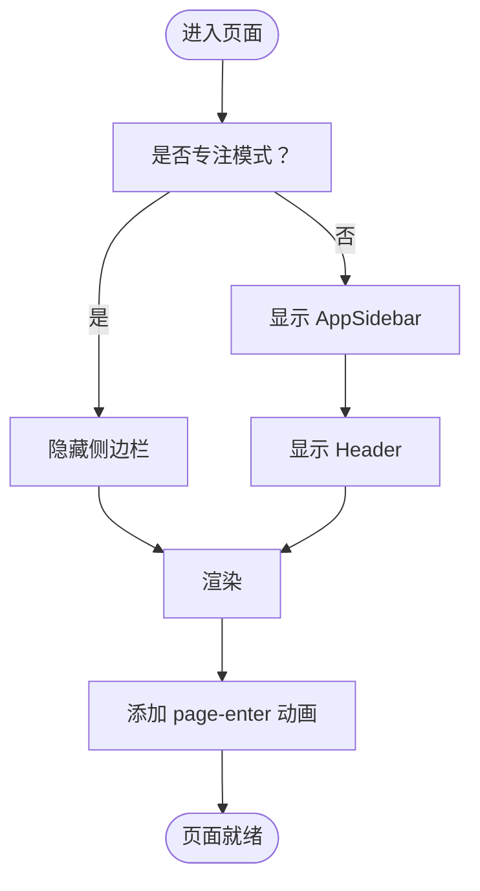

**图表来源**
- [src/components/Layout.tsx:1-155](file://src/components/Layout.tsx#L1-L155)
- [src/components/Header.tsx:1-62](file://src/components/Header.tsx#L1-L62)
- [src/components/AppSidebar.tsx:1-179](file://src/components/AppSidebar.tsx#L1-L179)
- [src/components/MobileBottomNav.tsx:1-73](file://src/components/MobileBottomNav.tsx#L1-L73)

**章节来源**
- [src/components/Layout.tsx:1-155](file://src/components/Layout.tsx#L1-L155)
- [src/components/Header.tsx:1-62](file://src/components/Header.tsx#L1-L62)
- [src/components/AppSidebar.tsx:1-179](file://src/components/AppSidebar.tsx#L1-L179)
- [src/components/MobileBottomNav.tsx:1-73](file://src/components/MobileBottomNav.tsx#L1-L73)

## 架构总览
应用根组件使用 react-router-dom 进行路由划分，所有页面被包裹在 Layout 内；各页面通过 React.lazy + Suspense 懒加载，并由 ErrorBoundary 兜底。动画层由 LazyFramerProvider 动态加载 framer-motion，CelebrateLayer 提供全屏 canvas 庆祝粒子。

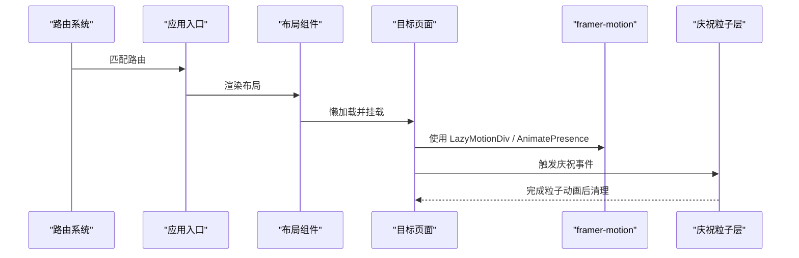

**图表来源**
- [src/app.tsx:1-66](file://src/app.tsx#L1-L66)
- [src/components/Layout.tsx:1-155](file://src/components/Layout.tsx#L1-L155)
- [src/lib/lazy-framer-motion.tsx:1-99](file://src/lib/lazy-framer-motion.tsx#L1-L99)
- [src/components/CelebrateLayer.tsx:1-72](file://src/components/CelebrateLayer.tsx#L1-L72)

## 详细组件分析

### 布局组件 Layout
职责：
- 根据当前路由注入模块强调色 CSS 变量。
- 切换路由时滚动到顶部并记录最近访问模块。
- Android 首次启动检查英语语音包，必要时提示安装。
- 管理 SidebarProvider、SidebarInset、Header、MobileBottomNav 的可见性。
- 通过 key 与 page-enter 动画实现“每次进入页面都重新触发入场”。

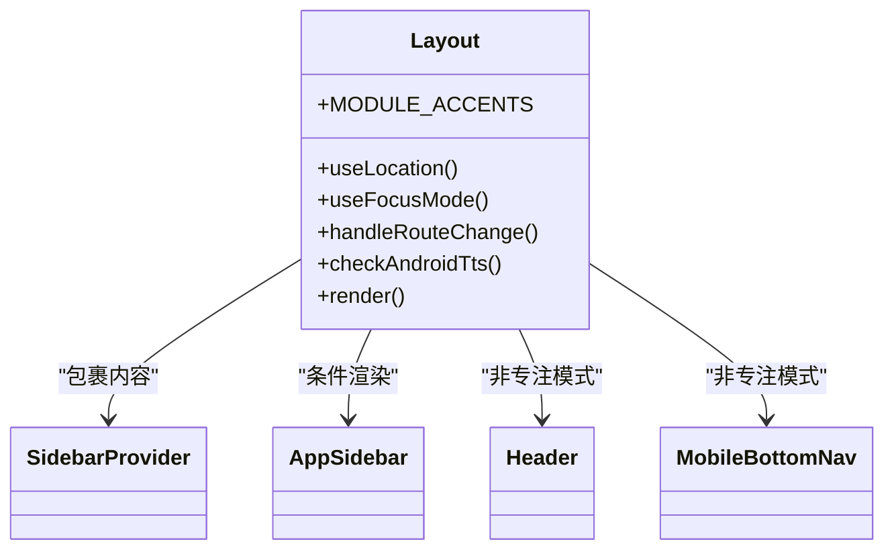

**图表来源**
- [src/components/Layout.tsx:1-155](file://src/components/Layout.tsx#L1-L155)

**章节来源**
- [src/components/Layout.tsx:1-155](file://src/components/Layout.tsx#L1-L155)

### 顶栏 Header
职责：
- 展示格式化后的日期、时间与星期。
- 提供全局单词搜索入口。
- 跳转设置页与打开用户菜单。
- 保持 sticky 置顶，带毛玻璃背景与边框。

使用建议：
- 若需自定义左侧或右侧区域，可在不破坏三列布局的前提下插入新元素。
- 避免放入过多图标；更多操作收进设置页以保持窄屏体验。

**章节来源**
- [src/components/Header.tsx:1-62](file://src/components/Header.tsx#L1-L62)

### 侧边栏 AppSidebar
职责：
- 渲染主导航项，维护激活状态。
- 鼠标悬停或触摸时预取对应路由 chunk。
- 对“词汇”模块显示待复习数量角标。
- 在 Footer 中提供外观主题选择器。

扩展机制：
- 新增路由需在 NAV_ITEMS 与 ROUTE_PREFETCH 同步。
- 可通过 useGlobalDueCount 接入其他提醒数据。

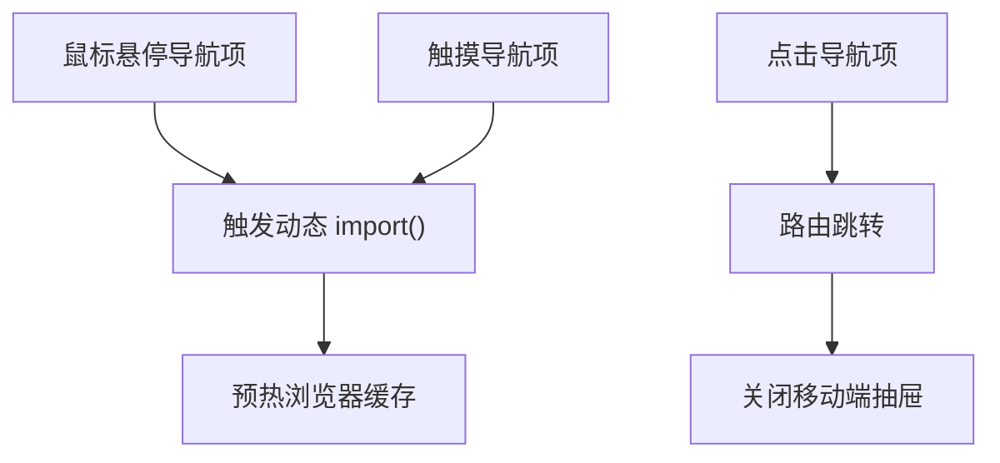

**图表来源**
- [src/components/AppSidebar.tsx:1-179](file://src/components/AppSidebar.tsx#L1-L179)
- [src/components/MobileBottomNav.tsx:1-73](file://src/components/MobileBottomNav.tsx#L1-L73)

**章节来源**
- [src/components/AppSidebar.tsx:1-179](file://src/components/AppSidebar.tsx#L1-L179)
- [src/components/MobileBottomNav.tsx:1-73](file://src/components/MobileBottomNav.tsx#L1-L73)

### 原子组件 Button
设计要点：
- 使用 cva 定义 default、destructive、outline、secondary、ghost 等变体。
- 尺寸支持 default、sm、lg、icon。
- `asChild` 模式下将涟漪宿主抑制，仅保留缩放反馈。
- `fx` 参数控制压感档位：strong、soft、none。

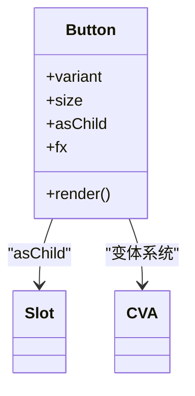

**图表来源**
- [src/components/ui/button.tsx:1-82](file://src/components/ui/button.tsx#L1-L82)

**章节来源**
- [src/components/ui/button.tsx:1-82](file://src/components/ui/button.tsx#L1-L82)

### 原子组件 Dialog
设计要点：
- 基于 Radix Dialog，提供 Root、Trigger、Portal、Close、Overlay、Content、Header、Footer、Title、Description。
- Content 自动居中、圆角大卡片、阴影、移动端全宽适配与滚动约束。
- 默认显示关闭按钮，并提供无障碍 sr-only 文本。

使用建议：
- 弹窗内容较多时使用外层 ScrollArea 或直接依赖 Content 的 overflow-y-auto。
- 需要自定义遮罩透明度或层级时覆盖 Overlay 的 z-index 与背景变量。

**章节来源**
- [src/components/ui/dialog.tsx:1-143](file://src/components/ui/dialog.tsx#L1-L143)

### 通知 Toaster
设计要点：
- 基于 sonner，采用 top-center 定位。
- 图标由 lucide-react 提供，颜色继承主题变量。
- 与 useTheme 联动，支持 system/light/dark。

**章节来源**
- [src/components/ui/sonner.tsx:1-67](file://src/components/ui/sonner.tsx#L1-L67)
- [src/lib/use-theme.ts:1-45](file://src/lib/use-theme.ts#L1-L45)

### 侧边栏原子组件 Sidebar
设计要点：
- 提供 SidebarProvider 与 useSidebar Context。
- 桌面端展开/折叠，移动端使用 Sheet 弹出。
- 支持键盘快捷键（Meta/Ctrl+B）、Cookie 记忆状态。
- 通过 CSS 变量控制宽度与图标态宽度。

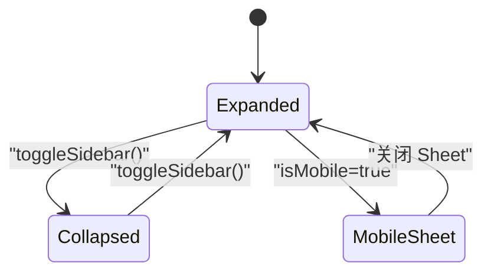

**图表来源**
- [src/components/ui/sidebar.tsx:1-200](file://src/components/ui/sidebar.tsx#L1-L200)

**章节来源**
- [src/components/ui/sidebar.tsx:1-200](file://src/components/ui/sidebar.tsx#L1-L200)

## 依赖关系分析
- 框架与路由：react、react-router-dom。
- UI 基础层：@radix-ui/* 系列、lucide-react、class-variance-authority、clsx、tailwind-merge。
- 动画：framer-motion（延迟加载）、tw-animate-css、原生 CSS @keyframes。
- 通知：sonner。
- 构建与样式：tailwindcss v4、vite。

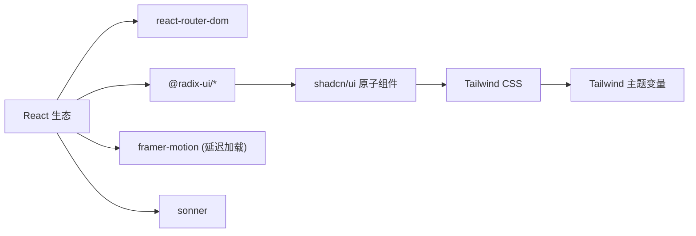

**图表来源**
- [package.json:63-108](file://package.json#L63-L108)
- [components.json:1-21](file://components.json#L1-L21)

**章节来源**
- [package.json:63-108](file://package.json#L63-L108)
- [components.json:1-21](file://components.json#L1-L21)

## 性能与动画

### framer-motion 延迟加载
- LazyFramerProvider 在首次渲染时动态 import('framer-motion')，不污染主 bundle。
- 如果未在 Provider 内使用，useFramerMotion 会降级为无动画渲染，并输出一次性开发警告，避免白屏。
- 提供 LazyMotionDiv 与 LazyAnimatePresence 两套代理组件，调用方无需感知内部实现。

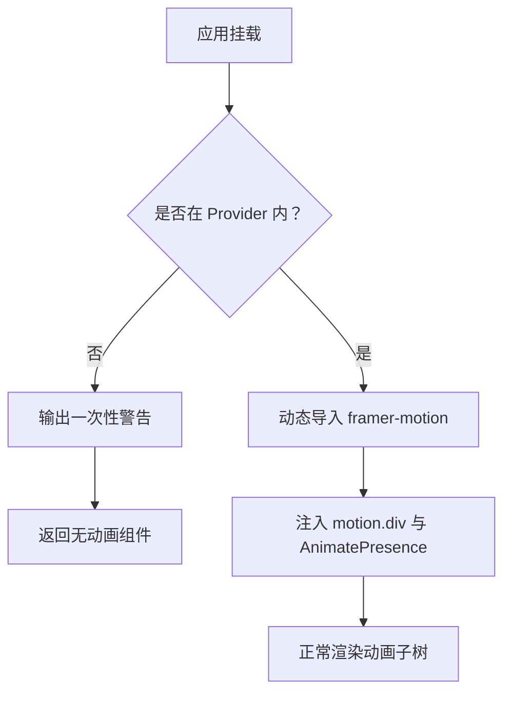

**图表来源**
- [src/lib/lazy-framer-motion.tsx:1-99](file://src/lib/lazy-framer-motion.tsx#L1-L99)

**章节来源**
- [src/lib/lazy-framer-motion.tsx:1-99](file://src/lib/lazy-framer-motion.tsx#L1-L99)

### 涟漪点击效果
- Button 通过 data-press 与 data-fx-ripple 控制压感样式；asChild 时抑制涟漪宿主以避免侵入第三方节点。
- 全局涟漪脉冲动画定义在 index.css 中，用于装饰性视觉反馈。

**章节来源**
- [src/components/ui/button.tsx:1-82](file://src/components/ui/button.tsx#L1-L82)
- [src/index.css:1-200](file://src/index.css#L1-L200)

### 庆祝动画
- CelebrateLayer 提供全局唯一的程序化 canvas 出口，按触发锚点中心发射最多 46 个粒子，生命周期约 0.7 秒。
- 限制 DPR 最大为 2，防止移动端显存占用过高。
- 卸载时取消 requestAnimationFrame 并移除回调 sink，避免路由切换后继续渲染。
- 尊重 prefers-reduced-motion，减少动画偏好下直接跳过。

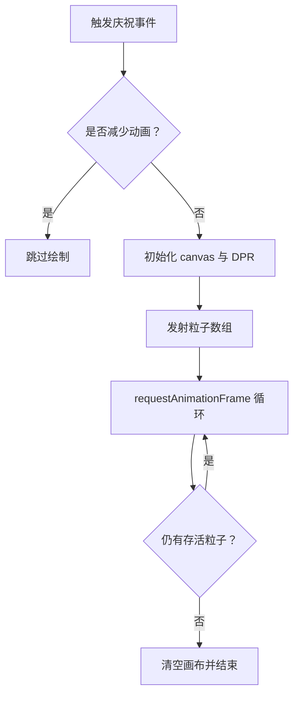

**图表来源**
- [src/components/CelebrateLayer.tsx:1-72](file://src/components/CelebrateLayer.tsx#L1-L72)

**章节来源**
- [src/components/CelebrateLayer.tsx:1-72](file://src/components/CelebrateLayer.tsx#L1-L72)

## 主题系统与定制

### 明暗主题（light/dark）
- useTheme 维护 theme 状态，写入 documentElement 的 dark 类名，并持久化到 safeStorage。
- 切换 toggleTheme 可同时影响全局 CSS 变量与 sonner 主题。

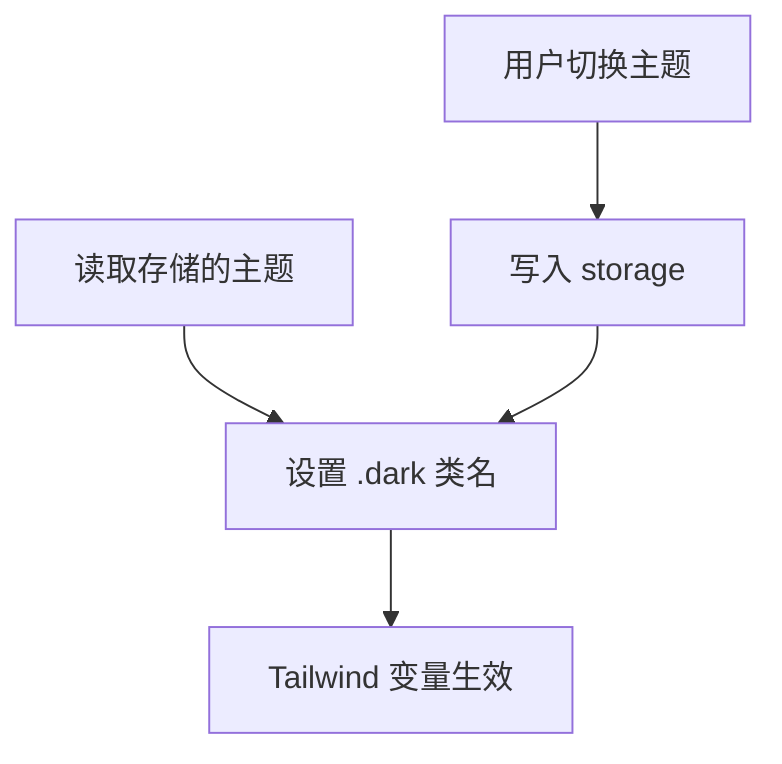

**图表来源**
- [src/lib/use-theme.ts:1-45](file://src/lib/use-theme.ts#L1-L45)
- [src/tailwind-theme.css:1-200](file://src/tailwind-theme.css#L1-L200)

**章节来源**
- [src/lib/use-theme.ts:1-45](file://src/lib/use-theme.ts#L1-L45)
- [src/tailwind-theme.css:1-200](file://src/tailwind-theme.css#L1-L200)

### 外观主题（UI themes）
- ui-theme.ts 定义 classic、porcelain、graphite、lime、sand、berry 六套外观主题。
- classic 不设置 data-ui-theme 属性，等价于“零覆盖”；其余主题通过 documentElement 的 data-ui-theme 启用。
- useUiTheme 提供 state、localStorage 持久化、跨组件事件广播与初始值提前 apply，避免首帧闪烁。
- AppSidebar 底部提供主题色块选择器，点击即切换。

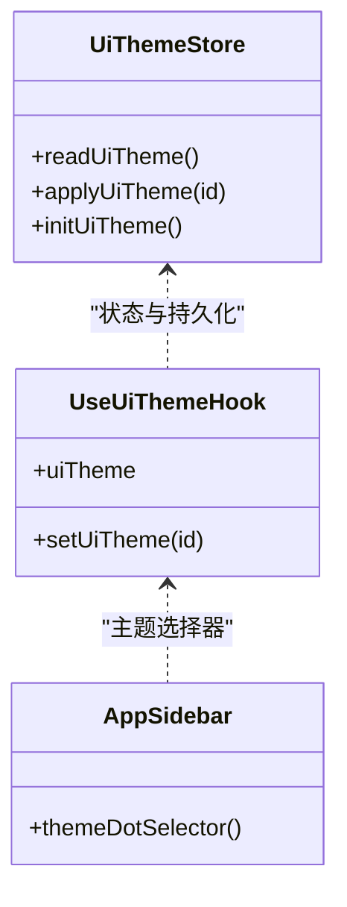

**图表来源**
- [src/lib/ui-theme.ts:1-84](file://src/lib/ui-theme.ts#L1-L84)
- [src/components/AppSidebar.tsx:1-179](file://src/components/AppSidebar.tsx#L1-L179)

**章节来源**
- [src/lib/ui-theme.ts:1-84](file://src/lib/ui-theme.ts#L1-L84)
- [src/components/AppSidebar.tsx:1-179](file://src/components/AppSidebar.tsx#L1-L179)

### Tailwind CSS 变量与字体
- tailwind-theme.css 定义 --background、--foreground、--primary、--card、--border、--ring、--shadow-*、--font-sans、--font-serif、--font-mono 等变量，并分别给出 light 与 .dark 两套值。
- 品牌色与墨面信号色集中在 --ink、--lime、--warm、--on-brand 等变量中。
- 字体栈优先 Noto Sans SC，随后是系统字体与 Emoji 字体，保证中英文与表情显示一致。

**章节来源**
- [src/tailwind-theme.css:1-200](file://src/tailwind-theme.css#L1-L200)
- [src/index.css:1-200](file://src/index.css#L1-L200)

## 响应式、无障碍与兼容性

### 响应式设计原则
- 侧边栏：桌面端常驻或可折叠，移动端转为 Sheet 抽屉。
- 顶栏：sticky 置顶，窄屏隐藏多余信息，只保留时间、搜索与设置。
- 移动端底部导航：fixed 悬浮条，结合 safe-area-inset-bottom 适配刘海屏。
- 布局主区域：max-width 限制在大屏阅读体验，小屏全宽；padding 随断点递增。

**章节来源**
- [src/components/ui/sidebar.tsx:1-200](file://src/components/ui/sidebar.tsx#L1-L200)
- [src/components/Header.tsx:1-62](file://src/components/Header.tsx#L1-L62)
- [src/components/MobileBottomNav.tsx:1-73](file://src/components/MobileBottomNav.tsx#L1-L73)
- [src/components/Layout.tsx:1-155](file://src/components/Layout.tsx#L1-L155)

### 无障碍访问支持
- 全局 :focus-visible 定义绿色轮廓与偏移，保证键盘导航可见。
- Dialog 关闭按钮提供 sr-only 文本。
- 主题选择器按钮提供 aria-label 与 aria-pressed。
- 全局动画尊重 prefers-reduced-motion：页面入场、卡片入场、涟漪、翻页、流式文本、庆祝动画均有关闭或降级处理。

**章节来源**
- [src/index.css:1-200](file://src/index.css#L1-L200)
- [src/components/ui/dialog.tsx:1-143](file://src/components/ui/dialog.tsx#L1-L143)
- [src/components/AppSidebar.tsx:1-179](file://src/components/AppSidebar.tsx#L1-L179)
- [src/components/CelebrateLayer.tsx:1-72](file://src/components/CelebrateLayer.tsx#L1-L72)

### 跨浏览器兼容性处理
- 使用 safe-area-inset-* 适配现代移动浏览器安全区。
- 滚动行为在减少动画偏好下自动回退为 auto。
- 滚动条样式针对 WebKit 浏览器定制，同时通过 CSS 变量与 Tailwind 类保证多端一致性。
- 按钮、卡片等交互增加 hover-elevate / active-elevate-2 等增强反馈，降低不同浏览器默认行为差异。

**章节来源**
- [src/components/Layout.tsx:1-155](file://src/components/Layout.tsx#L1-L155)
- [src/index.css:1-200](file://src/index.css#L1-L200)

## 最佳实践

### 组件组合模式
- 页面级组合：App → Layout → Header/Sidebar/Main → 具体 Page。
- 原子组合：Button、Dialog、Sonner、Sidebar 等原子组件在业务组件中被多次复用，不要复制样式，优先使用 props 与 className 合并。
- 路由懒加载：仅在 src/app.tsx 中对页面使用 lazy + Suspense，避免首屏过大。

### 样式定制
- 优先通过 Tailwind 类与 CSS 变量定制，不要直接覆盖原子组件内部结构。
- 新增主题时，优先修改 tailwind-theme.css 中的变量，再在 ui-theme.ts 中声明外观主题 ID。
- 新增路由时，同步更新 AppSidebar 的 NAV_ITEMS 与 ROUTE_PREFETCH，并考虑 MobileBottomNav 是否需要入口。

### 性能优化
- 使用 LazyFramerProvider 包裹动画子树，确保 framer-motion 不进入主 bundle。
- 导航项悬停/触摸时预取路由 chunk，减少首次跳转等待。
- 庆祝动画限制粒子数量与 DPR，卸载时及时清理 rAF。
- 页面进入动画使用 CSS animation，避免不必要的 JS 动画开销。

## 故障排查

### 页面级错误
- app.tsx 为每个页面包裹 ErrorBoundary，失败时展示友好错误页与刷新按钮。
- Layout 内置类组件 ErrorBoundary，捕获页面加载异常并提示刷新。

**章节来源**
- [src/app.tsx:1-66](file://src/app.tsx#L1-L66)
- [src/components/Layout.tsx:1-155](file://src/components/Layout.tsx#L1-L155)

### framer-motion 未生效
- 若 useFramerMotion 抛出或动画不生效，检查是否在 LazyFramerProvider 内部。
- 查看控制台一次性警告，补上 provider 即可恢复。

**章节来源**
- [src/lib/lazy-framer-motion.tsx:1-99](file://src/lib/lazy-framer-motion.tsx#L1-L99)

### 主题切换闪屏
- 确保在应用启动前调用 initUiTheme，先写 data-ui-theme 再渲染 UI。
- 检查 localStorage 是否可读，不可用时至少保证会话期主题正确。

**章节来源**
- [src/lib/ui-theme.ts:1-84](file://src/lib/ui-theme.ts#L1-L84)

### 移动端底部导航遮挡
- 注意 fixed 定位与 env(safe-area-inset-bottom) 的配合，避免被手势条遮挡。
- 专注模式下应隐藏 MobileBottomNav，由 Layout 控制。

**章节来源**
- [src/components/MobileBottomNav.tsx:1-73](file://src/components/MobileBottomNav.tsx#L1-L73)
- [src/components/Layout.tsx:1-155](file://src/components/Layout.tsx#L1-L155)

## 结语
NativeThink 的 UI 组件系统以 shadcn/ui 原子层为基础，通过 Tailwind CSS 变量与 two-dimensional theme（明暗 + 外观）实现高度可定制的界面；Layout、Header、AppSidebar 构成稳定的业务骨架；framer-motion 延迟加载、CSS 动画与 Canvas 庆祝效果共同提供流畅而克制的交互反馈。建议在新增功能时遵循现有组合模式、主题变量与动画降级策略，以保证一致性、可维护性与性能。