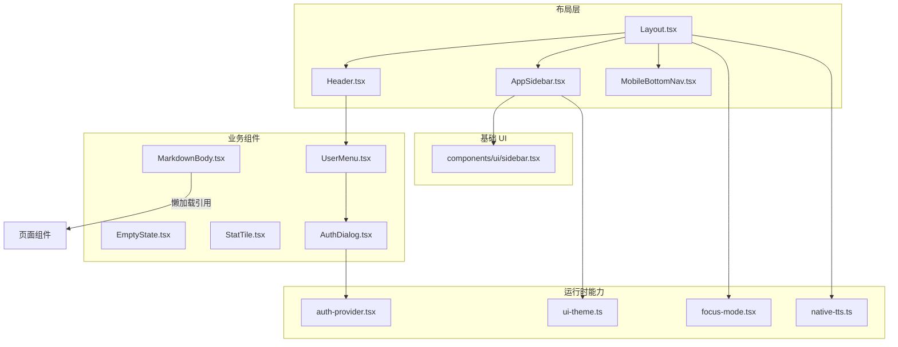
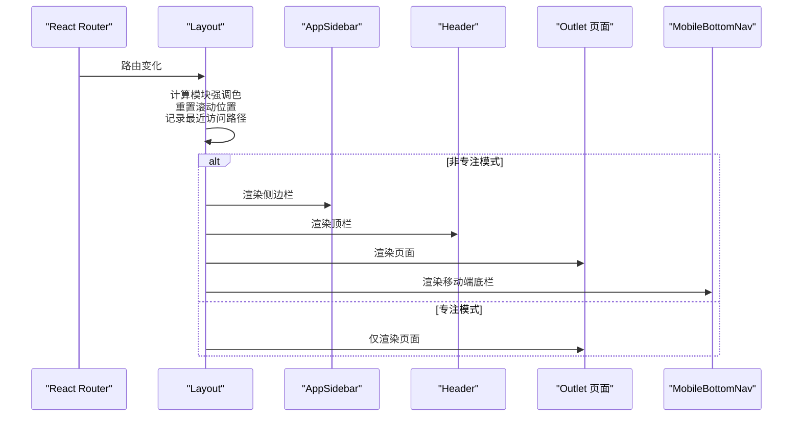
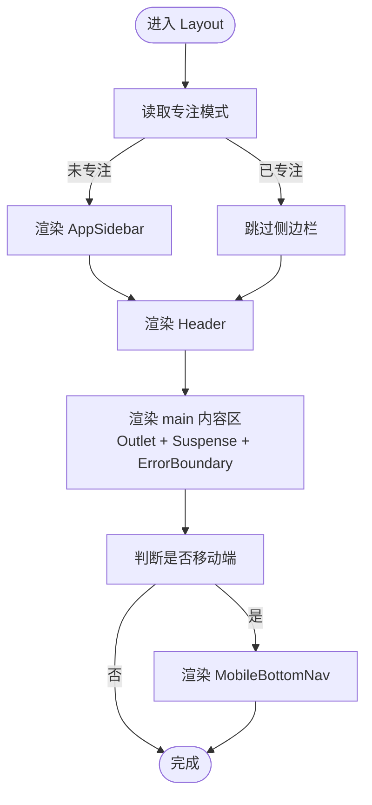
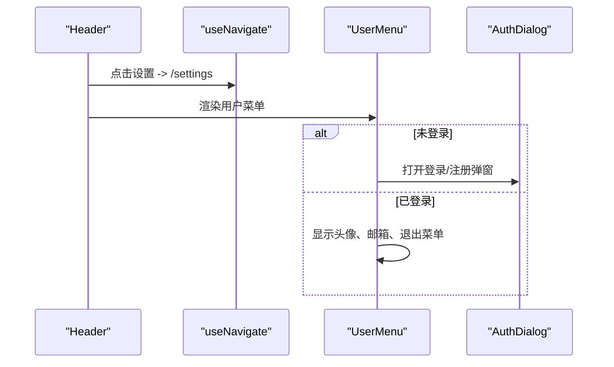
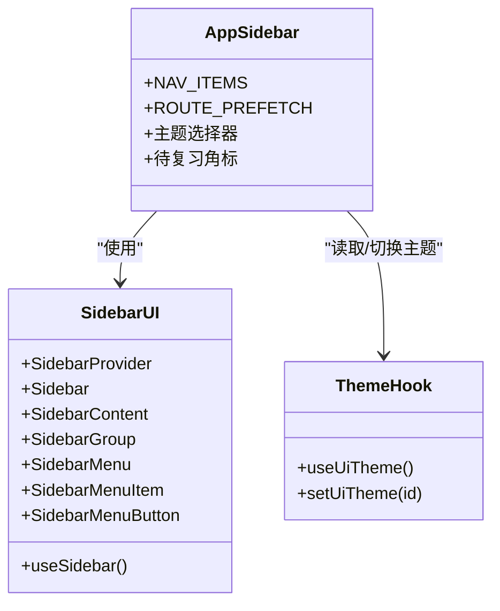
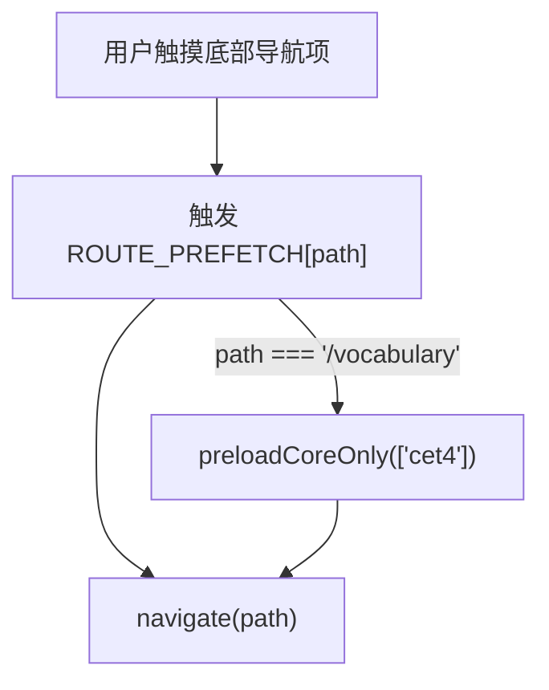
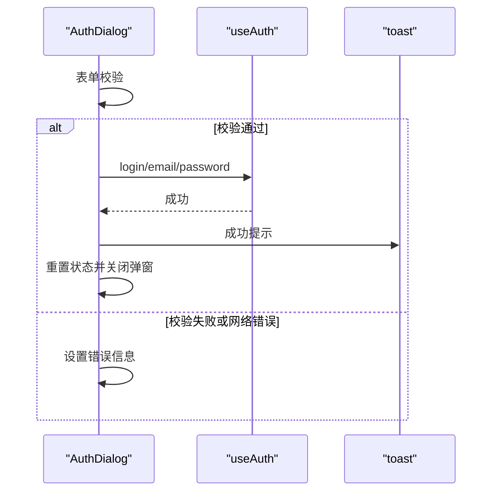
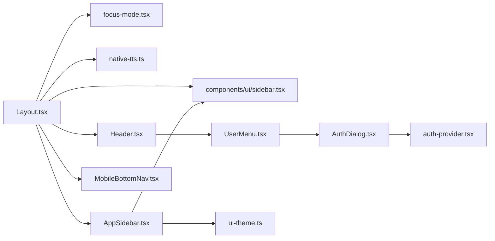

# 业务布局组件

<cite>
**本文引用的文件**   
- [Layout.tsx](file://src/components/Layout.tsx)
- [Header.tsx](file://src/components/Header.tsx)
- [AppSidebar.tsx](file://src/components/AppSidebar.tsx)
- [MobileBottomNav.tsx](file://src/components/MobileBottomNav.tsx)
- [EmptyState.tsx](file://src/components/EmptyState.tsx)
- [StatTile.tsx](file://src/components/StatTile.tsx)
- [MarkdownBody.tsx](file://src/components/MarkdownBody.tsx)
- [AuthDialog.tsx](file://src/components/AuthDialog.tsx)
- [UserMenu.tsx](file://src/components/UserMenu.tsx)
- [sidebar.tsx](file://src/components/ui/sidebar.tsx)
- [focus-mode.tsx](file://src/lib/focus-mode.tsx)
- [auth-provider.tsx](file://src/lib/auth-provider.tsx)
- [ui-theme.ts](file://src/lib/ui-theme.ts)
- [native-tts.ts](file://src/lib/native-tts.ts)
</cite>

## 目录
1. [引言](#引言)
2. [项目结构](#项目结构)
3. [核心组件总览](#核心组件总览)
4. [架构总览](#架构总览)
5. [详细组件分析](#详细组件分析)
6. [依赖关系分析](#依赖关系分析)
7. [性能与体积优化](#性能与体积优化)
8. [主题与响应式适配指南](#主题与响应式适配指南)
9. [故障排查](#故障排查)
10. [结论](#结论)

## 引言
本文件面向 NativeThink 应用的“业务布局层”，围绕 Layout 主容器、Header、AppSidebar、MobileBottomNav，以及 EmptyState、StatTile、MarkdownBody、AuthDialog、UserMenu 等业务组件展开。目标包括：
- 解释桌面侧边栏、顶部 Header、内容区域与移动端底部导航的响应式布局策略；
- 说明路由集成、预取策略、空状态与统计卡片的使用方式；
- 梳理认证对话框与用户菜单的用户流程；
- 给出布局定制、主题适配与性能优化的可操作建议。

## 项目结构
布局相关代码集中在 `src/components` 下，配合 `src/lib` 中的状态与主题工具，以及 `src/components/ui` 的基础 UI 组件。

**图表来源**
- [Layout.tsx:1-155](file://src/components/Layout.tsx#L1-L155)
- [Header.tsx:1-62](file://src/components/Header.tsx#L1-L62)
- [AppSidebar.tsx:1-179](file://src/components/AppSidebar.tsx#L1-L179)
- [MobileBottomNav.tsx:1-73](file://src/components/MobileBottomNav.tsx#L1-L73)
- [EmptyState.tsx:1-66](file://src/components/EmptyState.tsx#L1-L66)
- [StatTile.tsx:1-37](file://src/components/StatTile.tsx#L1-L37)
- [MarkdownBody.tsx:1-14](file://src/components/MarkdownBody.tsx#L1-L14)
- [AuthDialog.tsx:1-127](file://src/components/AuthDialog.tsx#L1-L127)
- [UserMenu.tsx:1-63](file://src/components/UserMenu.tsx#L1-L63)
- [sidebar.tsx:1-120](file://src/components/ui/sidebar.tsx#L1-L120)
- [focus-mode.tsx:1-49](file://src/lib/focus-mode.tsx#L1-L49)
- [auth-provider.tsx:1-86](file://src/lib/auth-provider.tsx#L1-L86)
- [ui-theme.ts:1-84](file://src/lib/ui-theme.ts#L1-L84)
- [native-tts.ts:1-120](file://src/lib/native-tts.ts#L1-L120)

**章节来源**
- [Layout.tsx:1-155](file://src/components/Layout.tsx#L1-L155)
- [AppSidebar.tsx:1-179](file://src/components/AppSidebar.tsx#L1-L179)
- [MobileBottomNav.tsx:1-73](file://src/components/MobileBottomNav.tsx#L1-L73)

## 核心组件总览
- Layout：应用主布局容器，负责安全区、模块强调色、错误边界、Suspense 骨架屏、Android 原生 TTS 引导、专注模式联动、侧边栏与底部导航显隐。
- Header：顶部信息栏，展示时间日期、全局搜索、设置入口和用户菜单。
- AppSidebar：左侧导航，包含功能路由、路由预取、待复习角标、主题选择器。
- MobileBottomNav：移动端底部固定导航，提供常用入口并支持触摸预取。
- EmptyState：统一空状态插画与文案组件，支持尺寸、图标、描述和自定义动作。
- StatTile：紧凑统计卡片，适合仪表盘 KPI。
- MarkdownBody：react-markdown + remark-gfm 的轻量包装，单独成模块以懒加载。
- AuthDialog：登录/注册弹窗，封装表单校验、状态提示与 API 调用。
- UserMenu：根据登录态切换登录按钮或下拉菜单，并触发 AuthDialog。

**章节来源**
- [Layout.tsx:1-155](file://src/components/Layout.tsx#L1-L155)
- [Header.tsx:1-62](file://src/components/Header.tsx#L1-L62)
- [AppSidebar.tsx:1-179](file://src/components/AppSidebar.tsx#L1-L179)
- [MobileBottomNav.tsx:1-73](file://src/components/MobileBottomNav.tsx#L1-L73)
- [EmptyState.tsx:1-66](file://src/components/EmptyState.tsx#L1-L66)
- [StatTile.tsx:1-37](file://src/components/StatTile.tsx#L1-L37)
- [MarkdownBody.tsx:1-14](file://src/components/MarkdownBody.tsx#L1-L14)
- [AuthDialog.tsx:1-127](file://src/components/AuthDialog.tsx#L1-L127)
- [UserMenu.tsx:1-63](file://src/components/UserMenu.tsx#L1-L63)

## 架构总览
Layout 作为根布局，把 SidebarProvider 作为外壳，AppSidebar 在桌面端常驻、移动端为抽屉；Header 显示在内容区上方；Outlet 承载具体页面；MobileBottomNav 固定在移动端底部。专注模式下，Header、Sidebar、MobileBottomNav 均隐藏，仅保留内容区。

**图表来源**
- [Layout.tsx:60-155](file://src/components/Layout.tsx#L60-L155)
- [focus-mode.tsx:1-49](file://src/lib/focus-mode.tsx#L1-L49)

## 详细组件分析

### Layout：主布局容器与安全区策略
Layout 的职责不仅是排列子组件，还承担以下职责：
- 安全区与响应式：使用 SidebarProvider 包裹，给 SidebarInset 加上最小宽度和横向溢出保护；main 区域通过 padding 与最大宽度限制形成内容栅格。
- 模块强调色：按 URL 一级路径映射到 CSS 变量 `--module-accent`，供页面标题、光晕等细节差异化。
- 错误边界与骨架屏：用类组件 ErrorBoundary 捕获子树异常，Suspense fallback 提供 PageFallback 骨架。
- 专注模式：读取 useFocusMode.focused，决定是否渲染 Header、AppSidebar、MobileBottomNav。
- Android 原生 TTS 引导：启动后检查系统英语语音，若缺失则弹出安装提示，并提供去安装动作。
- 路由 UX：每次路由变化时滚动至顶部、保存最近访问路径，便于“继续上次学习”。

**图表来源**
- [Layout.tsx:60-155](file://src/components/Layout.tsx#L60-L155)
- [focus-mode.tsx:1-49](file://src/lib/focus-mode.tsx#L1-L49)

**章节来源**
- [Layout.tsx:1-155](file://src/components/Layout.tsx#L1-L155)
- [native-tts.ts:1-120](file://src/lib/native-tts.ts#L1-L120)
- [focus-mode.tsx:1-49](file://src/lib/focus-mode.tsx#L1-L49)

### Header：时间、搜索、设置与用户菜单
Header 聚焦三类交互：
- 时间与日期：每分钟刷新，中文格式化，窄屏隐藏完整日期。
- 全局搜索：引入 GlobalWordSearch（由上层组合），不阻塞头栏。
- 设置与用户菜单：设置按钮跳转到 `/settings`；用户菜单根据登录态呈现登录按钮或头像下拉菜单。

**图表来源**
- [Header.tsx:1-62](file://src/components/Header.tsx#L1-L62)
- [UserMenu.tsx:1-63](file://src/components/UserMenu.tsx#L1-L63)
- [AuthDialog.tsx:1-127](file://src/components/AuthDialog.tsx#L1-L127)

**章节来源**
- [Header.tsx:1-62](file://src/components/Header.tsx#L1-L62)
- [UserMenu.tsx:1-63](file://src/components/UserMenu.tsx#L1-L63)

### AppSidebar：导航结构、路由集成与移动端适配
AppSidebar 维护完整的导航项列表，并与 React Router 集成：
- 路由匹配：首页精确匹配 `/`，其他路径支持前缀匹配，使子路由仍高亮父级菜单。
- 路由预取：鼠标悬停或触摸时触发动态 import，提前预热页面 chunk。
- 待复习角标：词汇入口根据全局到期数量显示数字角标，增强回访动机。
- 移动端适配：基于 ui/sidebar 的 Drawer/Sidebar 能力，移动端以全屏抽屉形式呈现；点击菜单项关闭抽屉。
- 主题选择：底部色板通过 useUiTheme 切换外观主题，并在文档元素上设置 data-ui-theme。

**图表来源**
- [AppSidebar.tsx:1-179](file://src/components/AppSidebar.tsx#L1-L179)
- [sidebar.tsx:1-120](file://src/components/ui/sidebar.tsx#L1-L120)
- [ui-theme.ts:1-84](file://src/lib/ui-theme.ts#L1-L84)

**章节来源**
- [AppSidebar.tsx:1-179](file://src/components/AppSidebar.tsx#L1-L179)
- [sidebar.tsx:1-120](file://src/components/ui/sidebar.tsx#L1-L120)
- [ui-theme.ts:1-84](file://src/lib/ui-theme.ts#L1-L84)

### MobileBottomNav：移动端导航体验设计
MobileBottomNav 提供六个核心入口，采用固定定位悬浮条，兼顾安全区与触控体验：
- 激活态：当前路径或其子路径对应项高亮。
- 预取：触摸时触发路由预取，减少首次进入页面的白屏等待。
- 词汇特殊处理：额外触发词库核心数据预加载，提升词汇页首屏速度。

**图表来源**
- [MobileBottomNav.tsx:1-73](file://src/components/MobileBottomNav.tsx#L1-L73)

**章节来源**
- [MobileBottomNav.tsx:1-73](file://src/components/MobileBottomNav.tsx#L1-L73)

### EmptyState：空状态组件与扩展方式
EmptyState 用于无数据的场景，提供一致的视觉语言：
- 属性
  - icon：Lucide 图标组件。
  - title：必填标题。
  - description：可选描述，支持 ReactNode。
  - action：可选动作区域，用于放置按钮或其他操作。
  - size：'sm' | 'md'，控制中心图标环尺寸与字号。
  - className：允许外层样式覆盖。
- 视觉结构：涟漪动画环、品牌色光晕、渐变图标圆、标题、描述、动作区。
- 无障碍与动效：遵循 prefers-reduced-motion（通过 CSS 控制 ripple-ring）。

使用示例路径参考：[EmptyState.tsx:1-66](file://src/components/EmptyState.tsx#L1-L66)。

**章节来源**
- [EmptyState.tsx:1-66](file://src/components/EmptyState.tsx#L1-L66)

### StatTile：统计卡片
StatTile 是紧凑型统计单元，适合仪表盘密集信息展示：
- 属性
  - label：大写小字标签。
  - value：主要数值，支持 ReactNode。
  - hint：辅助信息，如趋势、累计、占比。
  - onClick：可选回调，渲染为 button 并带 hover 反馈。
  - className：外部样式覆盖。
- 行为：当提供 onClick 时自动转为可点击元素。

使用示例路径参考：[StatTile.tsx:1-37](file://src/components/StatTile.tsx#L1-L37)。

**章节来源**
- [StatTile.tsx:1-37](file://src/components/StatTile.tsx#L1-L37)

### MarkdownBody：Markdown 内容渲染
MarkdownBody 将 react-markdown 与 remarkGFM 组合，但核心价值在于“单独成模块”以便懒加载，避免 Changelog 等次要功能拖大入口包体。
- 使用方式：在需要渲染 Markdown 的地方使用 lazy(() => import('@/components/MarkdownBody')) 后渲染。
- 输出：基于 remark-gfm 的 GFM 表格、删除线等语法。

使用示例路径参考：[MarkdownBody.tsx:1-14](file://src/components/MarkdownBody.tsx#L1-L14)。

**章节来源**
- [MarkdownBody.tsx:1-14](file://src/components/MarkdownBody.tsx#L1-L14)

### AuthDialog：认证对话框
AuthDialog 提供登录与注册双模式：
- 输入校验：邮箱格式、密码长度至少 6 位。
- 状态管理：loading、error、showPw、mode。
- 交互流程：提交后调用 useAuth.login/register，成功后 toast 提示、清空表单并关闭弹窗；失败时显示错误消息。
- 可访问性：键盘 Enter 提交、可见的加载指示器、明确错误区域。

**图表来源**
- [AuthDialog.tsx:1-127](file://src/components/AuthDialog.tsx#L1-L127)
- [auth-provider.tsx:1-86](file://src/lib/auth-provider.tsx#L1-L86)

**章节来源**
- [AuthDialog.tsx:1-127](file://src/components/AuthDialog.tsx#L1-L127)
- [auth-provider.tsx:1-86](file://src/lib/auth-provider.tsx#L1-L86)

### UserMenu：用户菜单与登录入口
UserMenu 根据登录态切换视图：
- 未登录：显示“登录”按钮，点击打开 AuthDialog。
- 已登录：显示头像首字母、邮箱前缀与下拉菜单，支持退出登录。
- 遮罩：点击背景关闭下拉菜单。

**章节来源**
- [UserMenu.tsx:1-63](file://src/components/UserMenu.tsx#L1-L63)
- [AuthDialog.tsx:1-127](file://src/components/AuthDialog.tsx#L1-L127)

## 依赖关系分析
- Layout 依赖 focus-mode、safeStorage、native-tts、sonner 等运行时能力，但不直接依赖具体页面。
- AppSidebar 依赖路由、词库预加载、主题 Hook、全局到期计数 Hook。
- MobileBottomNav 复用 AppSidebar 的路由预取思路，但对移动端做了更精简的入口集。
- Header 与 UserMenu 依赖 auth-provider，实现统一的登录态与 API 调用。
- MarkdownBody 作为懒加载模块，降低主包体积。

**图表来源**
- [Layout.tsx:1-155](file://src/components/Layout.tsx#L1-L155)
- [Header.tsx:1-62](file://src/components/Header.tsx#L1-L62)
- [AppSidebar.tsx:1-179](file://src/components/AppSidebar.tsx#L1-L179)
- [MobileBottomNav.tsx:1-73](file://src/components/MobileBottomNav.tsx#L1-L73)
- [UserMenu.tsx:1-63](file://src/components/UserMenu.tsx#L1-L63)
- [AuthDialog.tsx:1-127](file://src/components/AuthDialog.tsx#L1-L127)
- [auth-provider.tsx:1-86](file://src/lib/auth-provider.tsx#L1-L86)
- [ui-theme.ts:1-84](file://src/lib/ui-theme.ts#L1-L84)
- [native-tts.ts:1-120](file://src/lib/native-tts.ts#L1-L120)
- [focus-mode.tsx:1-49](file://src/lib/focus-mode.tsx#L1-L49)

**章节来源**
- [Layout.tsx:1-155](file://src/components/Layout.tsx#L1-L155)
- [AppSidebar.tsx:1-179](file://src/components/AppSidebar.tsx#L1-L179)
- [MobileBottomNav.tsx:1-73](file://src/components/MobileBottomNav.tsx#L1-L73)

## 性能与体积优化
- 路由懒加载与预取
  - AppSidebar 与 MobileBottomNav 均维护 ROUTE_PREFETCH 映射，在鼠标悬停或触摸时触发 dynamic import()，预热即将访问的页面 chunk。
  - 词汇入口额外调用 preloadCoreOnly(['cet4'])，优先预加载高频词库核心数据。
- MarkdownBody 懒加载
  - 将 react-markdown 与 remark-gfm 放在独立模块，按需懒加载，避免次要功能拖累入口体积。
- 骨架屏与错误边界
  - Suspense fallback 提供轻量的 PageFallback 骨架；ErrorBoundary 捕获子树异常并提示刷新，防止白屏。
- 滚动与重排优化
  - 路由变化时立即将 main 滚动回顶部，避免历史滚动残留影响新页面首帧。
- Android TTS 超时保护
  - native-tts 对原生插件调用加入超时保护，避免语音列表读取挂死界面。

最佳实践建议：
- 新增页面时，同时更新 AppSidebar 与 MobileBottomNav 的 ROUTE_PREFETCH，确保预取生效。
- 对于大体积第三方渲染器，尽量拆成懒加载模块并通过 lazy 引入。
- 对长列表页面，结合 ErrorBoundary 与 Suspense，保证异常与加载态的用户体验。

**章节来源**
- [AppSidebar.tsx:1-179](file://src/components/AppSidebar.tsx#L1-L179)
- [MobileBottomNav.tsx:1-73](file://src/components/MobileBottomNav.tsx#L1-L73)
- [MarkdownBody.tsx:1-14](file://src/components/MarkdownBody.tsx#L1-L14)
- [Layout.tsx:1-155](file://src/components/Layout.tsx#L1-L155)
- [native-tts.ts:1-120](file://src/lib/native-tts.ts#L1-L120)

## 主题与响应式适配指南
- 主题体系
  - ui-theme.ts 定义多套外观主题，通过 documentElement 的 data-ui-theme 属性切换；classic 主题不覆盖 token，保持默认。
  - AppSidebar 底部提供主题色板，点击即可切换；useUiTheme 暴露 setUiTheme 供任意组件调用。
- 响应式布局
  - 桌面端：SidebarProvider 内嵌 AppSidebar，Header 与内容区纵向排列。
  - 移动端：AppSidebar 以抽屉形式出现；MobileBottomNav 固定在底部，考虑 safe-area-inset-bottom。
  - 专注模式：useFocusMode 控制 Header、AppSidebar、MobileBottomNav 的显隐，让内容占满视口。
- 布局定制建议
  - 新增模块强调色：在 Layout 的 MODULE_ACCENTS 中追加键值，CSS 变量 --module-accent 会被注入到 main 元素。
  - 新增侧边栏入口：在 NAV_ITEMS 中添加 path、label、icon，并确保 ROUTE_PREFETCH 同步。
  - 新增底部导航入口：在 MOBILE_NAV 中补充，保持与核心功能一致的高亮逻辑。

**章节来源**
- [ui-theme.ts:1-84](file://src/lib/ui-theme.ts#L1-L84)
- [AppSidebar.tsx:1-179](file://src/components/AppSidebar.tsx#L1-L179)
- [MobileBottomNav.tsx:1-73](file://src/components/MobileBottomNav.tsx#L1-L73)
- [Layout.tsx:60-155](file://src/components/Layout.tsx#L60-L155)
- [focus-mode.tsx:1-49](file://src/lib/focus-mode.tsx#L1-L49)

## 故障排查
- 页面加载异常
  - 现象：子页面抛错导致白屏。
  - 处理：Layout 内的 ErrorBoundary 会显示“页面加载异常”与刷新按钮；刷新后可恢复。
- 侧边栏状态异常
  - 现象：桌面端侧边栏收起/展开状态丢失。
  - 处理：ui/sidebar 使用 Cookie 持久化状态；检查浏览器是否禁用 Cookie。
- 移动端抽屉无法关闭
  - 现象：点击菜单后抽屉仍在。
  - 处理：AppSidebar 的 NavLink 点击回调中调用 setOpenMobile(false)，确保移动端关闭抽屉。
- 认证失败
  - 现象：登录/注册失败。
  - 处理：AuthDialog 会显示错误信息；检查 api-client 的网络与后端返回；确认邮箱与密码校验规则。
- Android 朗读延迟或无声音
  - 现象：Web Speech API 不可用或延迟高。
  - 处理：Layout 启动后检测系统英语语音，若缺失则引导安装；native-tts 提供 listNativeEnglishVoices 与 openNativeTtsInstall。

**章节来源**
- [Layout.tsx:1-155](file://src/components/Layout.tsx#L1-L155)
- [sidebar.tsx:1-120](file://src/components/ui/sidebar.tsx#L1-L120)
- [AppSidebar.tsx:1-179](file://src/components/AppSidebar.tsx#L1-L179)
- [AuthDialog.tsx:1-127](file://src/components/AuthDialog.tsx#L1-L127)
- [native-tts.ts:1-120](file://src/lib/native-tts.ts#L1-L120)

## 结论
NativeThink 的业务布局以 Layout 为中心，串联 Header、AppSidebar、MobileBottomNav 与 Outlet 内容区，并通过 focus-mode 实现沉浸式学习模式。组件之间职责清晰：Layout 负责布局与健康检查，Header 负责信息与入口，AppSidebar 负责导航与主题，MobileBottomNav 负责移动端快捷入口。业务组件 EmptyState、StatTile、MarkdownBody、AuthDialog、UserMenu 则在各自领域提供稳定、可扩展的能力。配合路由预取、骨架屏与错误边界，整体在保证用户体验的同时控制了包体与运行时开销。