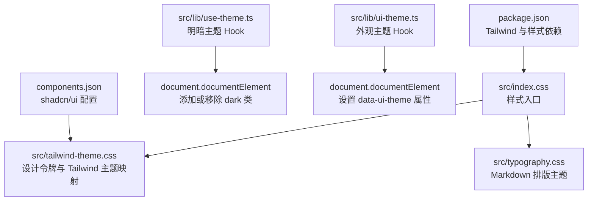
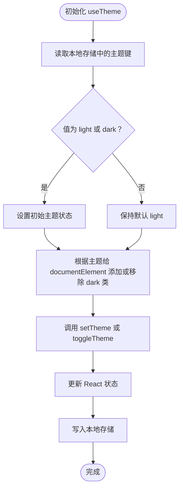
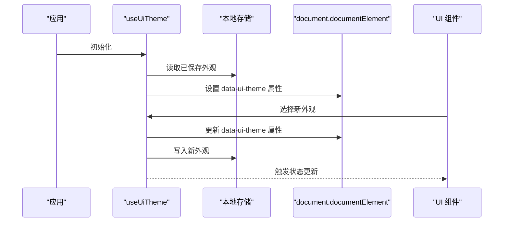
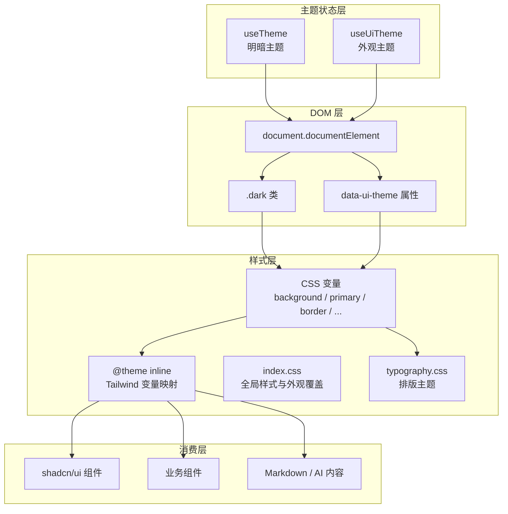
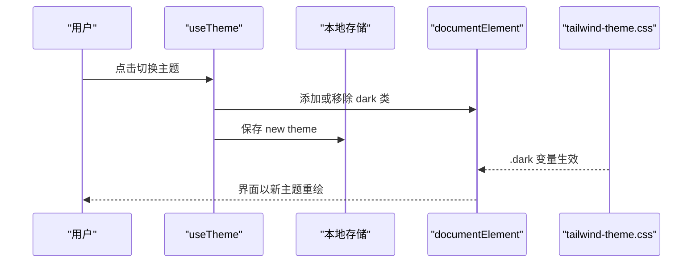
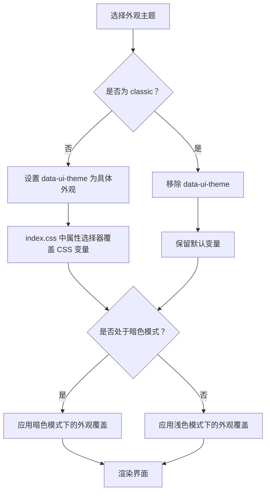
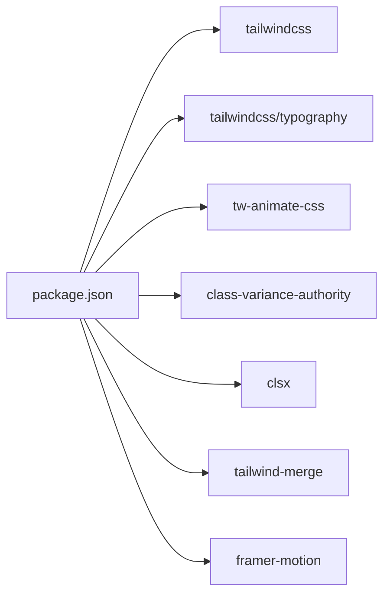

# 主题与样式系统

<cite>
**本文引用的文件**   
- [index.css](file://src/index.css)
- [tailwind-theme.css](file://src/tailwind-theme.css)
- [typography.css](file://src/typography.css)
- [use-theme.ts](file://src/lib/use-theme.ts)
- [ui-theme.ts](file://src/lib/ui-theme.ts)
- [components.json](file://components.json)
- [package.json](file://package.json)
</cite>

## 目录

1. [引言](#引言)
2. [项目结构](#项目结构)
3. [核心组件](#核心组件)
4. [架构总览](#架构总览)
5. [详细组件分析](#详细组件分析)
6. [依赖关系分析](#依赖关系分析)
7. [性能考虑](#性能考虑)
8. [故障排查指南](#故障排查指南)
9. [结论](#结论)
10. [附录：设计令牌清单](#附录设计令牌清单)

## 引言

NativeThink 的主题与样式系统围绕以下目标构建：

- 使用 Tailwind CSS v4 作为基础样式框架，并通过 CSS 变量集中管理设计令牌。
- 同时支持明暗主题切换和可切换外观主题两套正交维度。
- 将全局样式、Tailwind 主题映射、排版样式、组件主题覆盖分层组织。
- 通过 React Hook 管理主题状态，并使用本地存储持久化用户偏好。
- 为 shadcn/ui 组件提供统一的设计语言，包括颜色、字体、圆角、阴影和侧边栏等。
- 在保证可读性和无障碍访问的前提下，控制动效、滚动条、选择区、阅读器模式等细节体验。

这套系统不是简单的“换肤”，而是把品牌色、背景、卡片、边框、阴影、字体栈、交互反馈和组件语义绑定到一组稳定的变量上，让业务页面只关心语义类名，不直接硬编码颜色值。

## 项目结构

主题相关代码主要分布在三个层次：

| 层次 | 文件 | 职责 |
|---|---|---|
| 样式入口 | `src/index.css` | 引入 Tailwind、动画库、主题文件和排版；定义全局行为、动画、滚动条、阅读器主题、交互反馈层和可切换外观主题覆盖。 |
| 设计令牌 | `src/tailwind-theme.css` | 定义 CSS 变量根节点、明暗主题变量、Tailwind `@theme inline` 映射、字体栈、圆角、阴影和悬停提升工具。 |
| 内容排版 | `src/typography.css` | 启用 Tailwind Typography 插件，并把 Markdown 排版的文本、链接、引用、表格、代码块等映射到当前主题变量。 |
| 主题逻辑 | `src/lib/use-theme.ts` | 管理亮色/暗色主题状态、类名切换和本地存储持久化。 |
| 外观主题 | `src/lib/ui-theme.ts` | 管理 classic / porcelain / graphite / lime / sand / berry 六套外观主题。 |
| 组件配置 | `components.json` | 配置 shadcn/ui 的生成方式、CSS 入口、基础色、别名和图标库。 |
| 运行时依赖 | `package.json` | 声明 Tailwind CSS、Tailwind Typography、tw-animate-css 等样式依赖。 |

**图表来源**
- [index.css:1-20](file://src/index.css#L1-L20)
- [tailwind-theme.css:1-40](file://src/tailwind-theme.css#L1-L40)
- [typography.css:1-41](file://src/typography.css#L1-L41)
- [use-theme.ts:1-45](file://src/lib/use-theme.ts#L1-L45)
- [ui-theme.ts:1-84](file://src/lib/ui-theme.ts#L1-L84)
- [components.json:1-21](file://components.json#L1-L21)
- [package.json:1-130](file://package.json#L1-L130)

**章节来源**
- [index.css:1-20](file://src/index.css#L1-L20)
- [tailwind-theme.css:1-40](file://src/tailwind-theme.css#L1-L40)
- [typography.css:1-41](file://src/typography.css#L1-L41)
- [components.json:1-21](file://components.json#L1-L21)
- [package.json:1-130](file://package.json#L1-L130)

## 核心组件

### 样式入口文件：`src/index.css`

`index.css` 是浏览器加载的第一个样式入口，承担以下职责：

1. 引入 Tailwind CSS、暗黑变体、动画库、Tailwind 主题文件和排版主题。
2. 定义文档选择和滚动行为。
3. 定义全局文字渲染参数，包括字体特性设置和抗锯齿。
4. 定义页面进入、卡片入场、拼写光标、流式文本、阅读翻页等关键动画。
5. 尊重操作系统“减少动效”偏好。
6. 定义键盘焦点环、滚动条、阅读器主题、安全区域内边距。
7. 定义统一的按压反馈词汇表，包括缩放、涟漪、弧形进度、抖动和点状反馈。
8. 定义五套可切换外观主题的 CSS 变量覆盖。
9. 维护品牌色的单一来源变量。

它的特点是：**样式层与业务逻辑解耦**。业务组件通常不需要知道某个按钮用了哪个十六进制颜色，而是依赖 shadcn/ui 提供的语义类名和 Tailwind 生成的工具类。

**章节来源**
- [index.css:1-20](file://src/index.css#L1-L20)
- [index.css:201-506](file://src/index.css#L201-L506)
- [index.css:507-643](file://src/index.css#L507-L643)

### 设计令牌与 Tailwind 主题映射：`src/tailwind-theme.css`

该文件是主题系统的“设计词典”。它定义的内容可以划分为四类：

| 类别 | 说明 |
|---|---|
| 基础变量 | 背景、前景、卡片、弹出框、主色、强调色、信息、危险、成功、警告、边框、输入、环等。 |
| 品牌与信号色 | 墨面、次级墨面、青柠、暖色、品牌文字色、品牌反色等。 |
| 视觉常量 | 字体栈、圆角、阴影偏移、模糊半径、阴影层级。 |
| Tailwind 映射 | 通过 `@theme inline` 把 CSS 变量映射到 Tailwind 的 `--color-*`、`--font-sans`、`--radius-*`、`--shadow-*` 等命名空间。 |

该文件还定义了 `.dark` 下的变量覆盖，使 Tailwind 在检测到 `dark` 类后自动使用深色令牌。

**章节来源**
- [tailwind-theme.css:1-200](file://src/tailwind-theme.css#L1-L200)
- [tailwind-theme.css:201-357](file://src/tailwind-theme.css#L201-L357)

### 排版主题：`src/typography.css`

该文件启用 `@tailwindcss/typography` 插件，并重新定义 `prose` 排版令牌，使其跟随当前主题的变量：

- 正文、标题、引导文本、加粗文本、列表符号、分隔线、引用、表格边框、代码块、注释块等全部绑定到 `--foreground`、`--muted-foreground`、`--primary`、`--border`、`--accent` 等变量。
- 同时定义 `invert-*` 系列变量，用于深色容器中的排版适配。

这样，Markdown 内容、AI 回复、帮助文档等内容型界面可以直接复用主题变量，而不需要单独维护一套文章样式。

**章节来源**
- [typography.css:1-41](file://src/typography.css#L1-L41)

### 明暗主题 Hook：`src/lib/use-theme.ts`

该 Hook 负责管理亮色/暗色主题，核心流程如下：

**图表来源**
- [use-theme.ts:1-45](file://src/lib/use-theme.ts#L1-L45)

该 Hook 的关键行为：

- 初始状态来自 `safeStorage`，避免首帧显示错误主题。
- 主题变化时操作 `document.documentElement.classList`，而不是直接修改 CSS 变量。
- 主题值被持久化到本地存储。
- 暴露 `setTheme` 和 `toggleTheme`，供设置页、菜单或其他控件调用。

**章节来源**
- [use-theme.ts:1-45](file://src/lib/use-theme.ts#L1-L45)

### 外观主题 Hook：`src/lib/ui-theme.ts`

外观主题是独立于明暗主题的第二个维度。项目定义了六种外观：

| 外观标识 | 名称 | 风格说明 |
|---|---|---|
| `classic` | 原生青绿 | 默认主题，不覆盖任何变量，保持现有界面。 |
| `porcelain` | 电蓝 | 海军蓝外壳，电蓝色行动色。 |
| `graphite` | 石墨 | 黑白极简。 |
| `lime` | 青柠 | 墨绿外壳，青柠行动色。 |
| `sand` | 暖沙 | 棕墨外壳，暖沙纸面。 |
| `berry` | 莓果 | 深莓外壳，莓果纸面。 |

外观主题的实现方式是：

- 在 `html` 元素上设置 `data-ui-theme` 属性。
- `classic` 直接移除该属性，等价于“没有任何覆盖”。
- 其他主题在 `index.css` 中通过属性选择器覆盖对应的 CSS 变量。
- 状态保存在本地存储中。
- 组件内部通过 `useUiTheme` 返回当前外观和设置函数。
- 组件之间通过自定义事件同步外观状态。

**图表来源**
- [ui-theme.ts:1-84](file://src/lib/ui-theme.ts#L1-L84)
- [index.css:507-643](file://src/index.css#L507-L643)

**章节来源**
- [ui-theme.ts:1-84](file://src/lib/ui-theme.ts#L1-L84)
- [index.css:507-643](file://src/index.css#L507-L643)

### shadcn/ui 配置：`components.json`

`components.json` 是 shadcn/ui 的代码生成配置，决定组件如何生成、如何引用样式以及如何使用别名。

| 配置项 | 当前值 | 含义 |
|---|---|---|
| `style` | `new-york` | 使用 shadcn/ui 的 New York 风格。 |
| `rsc` | `false` | 不使用 React Server Components。 |
| `tsx` | `true` | 生成 TypeScript JSX 组件。 |
| `tailwind.config` | 空字符串 | 不依赖外部 Tailwind 配置文件。 |
| `tailwind.css` | `src/index.css` | 组件样式依赖全局入口样式。 |
| `baseColor` | `neutral` | 使用中性色系作为 shadcn 的基础色。 |
| `cssVariables` | `true` | 使用 CSS 变量驱动主题。 |
| `prefix` | 空字符串 | 不添加类名前缀。 |
| `aliases` | `@/components`、`@/lib/utils`、`@/components/ui` 等 | 定义模块别名。 |
| `iconLibrary` | `lucide` | 使用 Lucide 图标库。 |

这意味着 shadcn/ui 生成的组件会消费 Tailwind 的语义类名和 CSS 变量，而不是自带固定颜色。主题扩展只需要改变量，不需要逐个重写组件。

**章节来源**
- [components.json:1-21](file://components.json#L1-L21)

## 架构总览

主题系统由四个相互协作的部分组成：

1. **CSS 变量层**：定义所有颜色、字体、圆角、阴影和品牌色。
2. **Tailwind 映射层**：把 CSS 变量暴露为 Tailwind 可用的 `--color-*`、`--font-*`、`--radius-*`、`--shadow-*`。
3. **主题状态层**：React Hook 管理 `dark` 类和 `data-ui-theme` 属性。
4. **样式消费层**：Tailwind 类名、shadcn/ui 组件、Markdown 排版和业务组件共同消费变量。

**图表来源**
- [use-theme.ts:1-45](file://src/lib/use-theme.ts#L1-L45)
- [ui-theme.ts:1-84](file://src/lib/ui-theme.ts#L1-L84)
- [tailwind-theme.css:201-357](file://src/tailwind-theme.css#L201-L357)
- [index.css:507-643](file://src/index.css#L507-L643)
- [typography.css:1-41](file://src/typography.css#L1-L41)

## 详细组件分析

### 明暗主题切换机制

明暗主题切换遵循“类名切换 + 变量覆盖”的策略：

1. `useTheme` 从本地存储读取上次选择的主题。
2. 如果主题为 `dark`，给 `document.documentElement` 添加 `dark` 类。
3. `tailwind-theme.css` 中 `.dark` 规则覆盖所有主题变量。
4. Tailwind 生成的类名通过 `@theme inline` 自动消费这些变量。
5. 用户切换主题时，Hook 更新状态、更新类名并持久化。

**图表来源**
- [use-theme.ts:1-45](file://src/lib/use-theme.ts#L1-L45)
- [tailwind-theme.css:1-200](file://src/tailwind-theme.css#L1-L200)

**章节来源**
- [use-theme.ts:1-45](file://src/lib/use-theme.ts#L1-L45)
- [tailwind-theme.css:1-200](file://src/tailwind-theme.css#L1-L200)

### 外观主题切换机制

外观主题与明暗主题正交：

- 明暗主题改变的是整体深浅。
- 外观主题改变的是品牌色、背景、卡片、边框、侧边栏和信号色组合。
- `classic` 不设置 `data-ui-theme`，表示“沿用默认主题”。
- 其他外观通过 `html[data-ui-theme="xxx"]` 覆盖 CSS 变量。
- 暗色模式下，外观主题只覆盖强调色和必要的背景变量，不替换整套深色体系。

**图表来源**
- [ui-theme.ts:1-84](file://src/lib/ui-theme.ts#L1-L84)
- [index.css:507-643](file://src/index.css#L507-L643)

**章节来源**
- [ui-theme.ts:1-84](file://src/lib/ui-theme.ts#L1-L84)
- [index.css:507-643](file://src/index.css#L507-L643)

### 设计令牌体系

设计令牌分为以下几组：

| 令牌组 | 代表变量 | 用途 |
|---|---|---|
| 页面背景与文字 | `--background`、`--foreground` | 页面底色和主体文字。 |
| 表面层 | `--card`、`--popover`、`--sidebar` | 卡片、弹出框、侧边栏等容器。 |
| 语义色 | `--primary`、`--accent`、`--info`、`--destructive`、`--success`、`--warning` | 主操作、强调、提示、危险、成功、警告。 |
| 辅助文字 | `--muted`、`--muted-foreground` | 次要信息和禁用态。 |
| 控件边界 | `--border`、`--input`、`--ring` | 边框、输入框、焦点环。 |
| 图表色 | `--chart-1` 至 `--chart-5` | 数据可视化。 |
| 品牌与信号色 | `--brand`、`--on-brand`、`--ink`、`--lime`、`--warm` | 品牌主色、导航选中、墨面背景和信号色。 |
| 视觉常量 | `--radius`、`--shadow-*`、`--font-sans` | 圆角、阴影、字体栈。 |

新增主题时，应优先扩展变量，而不是在业务组件中新增颜色类名。这样可以保证 shadcn/ui、排版、侧边栏、按钮、图表等组件一致响应。

**章节来源**
- [tailwind-theme.css:1-200](file://src/tailwind-theme.css#L1-L200)
- [index.css:507-643](file://src/index.css#L507-L643)

### 字体配置

项目首选字体栈为中文优先的系统字体族，并在 `tailwind-theme.css` 中定义：

- `--font-sans`：Noto Sans SC 为主，搭配系统字体和常用中文字体回退。
- `--font-serif`：衬线字体栈。
- `--font-mono`：等宽字体栈。

`index.css` 中还启用了字体特性设置，例如连字和字形替代，以提升中英文混排体验。

**章节来源**
- [tailwind-theme.css:1-200](file://src/tailwind-theme.css#L1-L200)
- [index.css:1-20](file://src/index.css#L1-L20)

### 间距系统与布局令牌

项目没有显式定义完整的间距 token 表，但使用了以下约定：

- Tailwind v4 默认间距系统继续可用。
- `--spacing` 变量存在于主题文件中，可用于自定义间距扩展。
- 圆角通过 `--radius` 和派生变量 `--radius-sm`、`--radius-md`、`--radius-lg`、`--radius-xl`、`--radius-2xl`、`--radius-3xl` 统一管理。
- 阴影通过 `--shadow-*` 变量统一表达，避免业务组件直接使用硬编码阴影值。

**章节来源**
- [tailwind-theme.css:201-357](file://src/tailwind-theme.css#L201-L357)

### 响应式设计原则

样式文件中体现的响应式和无障碍原则包括：

- 使用 `prefers-reduced-motion` 关闭页面进入、卡片入场、涟漪、弧形进度等动效。
- 使用 `prefers-reduced-motion` 取消平滑滚动。
- 使用 `hover` 和 `pointer` 媒体查询区分桌面鼠标与触摸设备。
- 移动端抽屉侧边栏通过 `data-mobile="true"` 调整边框和行为。
- 安全区域通过 `env(safe-area-inset-*)` 适配 Android 15+ 的边缘到边缘屏幕。
- 阅读器模式提供“纸面”和“夜间”两种背景方案。

**章节来源**
- [index.css:1-200](file://src/index.css#L1-L200)
- [index.css:201-506](file://src/index.css#L201-L506)
- [index.css:507-643](file://src/index.css#L507-L643)

### 无障碍访问的颜色对比度要求

虽然仓库中没有专门的无障碍自动化测试脚本，但样式系统中体现了若干可访问性实践：

- 明暗主题分别定义高对比度的前景色和背景色。
- 主色、强调色、信息、危险、成功、警告都有对应的反色文字变量。
- 焦点环使用 `focus-visible` 和固定描边颜色，便于键盘导航。
- 减少动效偏好被显式处理。
- 选择区颜色随外观主题变化，保证选中文本可读。
- 阅读器模式为浅色和深色分别定义选择区颜色。

建议后续补充自动化检查，例如对品牌色与背景色的对比度进行校验，尤其是浅色主题下的 `--primary`、`--accent` 与 `--background`、`--card` 的组合。

**章节来源**
- [tailwind-theme.css:1-200](file://src/tailwind-theme.css#L1-L200)
- [index.css:1-200](file://src/index.css#L1-L200)
- [index.css:507-643](file://src/index.css#L507-L643)

### 样式扩展方法

如果要扩展主题，推荐以下顺序：

1. 先在 `tailwind-theme.css` 的 `:root` 或 `.dark` 下新增或修改 CSS 变量。
2. 如需新增外观主题，在 `ui-theme.ts` 中注册外观 ID、名称、描述和预览色板。
3. 在 `index.css` 中添加对应 `html[data-ui-theme="xxx"]` 的变量覆盖。
4. 如果是暗色模式专属的外观变量，使用 `html.dark[data-ui-theme="xxx"]` 覆盖。
5. 确保 shadcn/ui 组件通过 `var(--xxx)` 消费变量，而不是直接写死颜色。
6. 验证 Markdown 排版、侧边栏、按钮、卡片、滚动条和阅读器模式是否一致。

**章节来源**
- [tailwind-theme.css:1-200](file://src/tailwind-theme.css#L1-L200)
- [ui-theme.ts:1-84](file://src/lib/ui-theme.ts#L1-L84)
- [index.css:507-643](file://src/index.css#L507-L643)

### CSS-in-JS 最佳实践

本项目采用“CSS 变量 + Tailwind + React Hook”的模式，而不是传统意义上的 CSS-in-JS 方案。其最佳实践包括：

- 所有颜色、字体、圆角、阴影集中在 CSS 变量中。
- React Hook 只管理状态和 DOM 类名/属性，不负责生成样式。
- 业务组件通过 Tailwind 语义类名和 shadcn/ui 组件消费样式。
- 主题切换不会频繁创建或删除 `<style>` 标签，只更新少量变量和类名。
- 动效统一通过 CSS `@keyframes` 和变量控制，避免在 JS 中计算缓动曲线。

**章节来源**
- [use-theme.ts:1-45](file://src/lib/use-theme.ts#L1-L45)
- [ui-theme.ts:1-84](file://src/lib/ui-theme.ts#L1-L84)
- [tailwind-theme.css:201-357](file://src/tailwind-theme.css#L201-L357)

### 样式性能优化技巧

样式系统中的性能相关设计包括：

- 使用 CSS 变量减少重复颜色和计算值。
- 使用 Tailwind v4 的按需编译，避免手写大量冗余类。
- 使用 `@theme inline` 在构建期生成 Tailwind 变量映射。
- 动效统一通过 CSS，避免 JavaScript 每帧驱动样式。
- 减少动效场景下，通过媒体查询关闭动画和过渡。
- 卡片悬浮效果使用轻量阴影，而不是彩色光晕。
- 品牌色通过单一变量传播，避免多处硬编码导致换肤失效。

**章节来源**
- [index.css:1-200](file://src/index.css#L1-L200)
- [index.css:201-506](file://src/index.css#L201-L506)
- [index.css:507-643](file://src/index.css#L507-L643)
- [tailwind-theme.css:201-357](file://src/tailwind-theme.css#L201-L357)

## 依赖关系分析

样式相关依赖主要来自 `package.json`：

| 依赖 | 版本范围 | 作用 |
|---|---:|---|
| `tailwindcss` | `^4.2.2` | Tailwind CSS v4 核心。 |
| `@tailwindcss/typography` | `^0.5.19` | Markdown 排版主题。 |
| `tw-animate-css` | `^1.2.0` | 通用动画库，被 `index.css` 引入。 |
| `class-variance-authority` | `^0.7.1` | 常用于 shadcn/ui 组件的状态类组合。 |
| `clsx` | `^2.1.1` | 条件类名合并。 |
| `tailwind-merge` | `^3.5.0` | Tailwind 类名合并工具。 |
| `framer-motion` | `^12.38.0` | 部分动画依赖，但简单动效已迁移到 CSS。 |

**图表来源**
- [package.json:1-130](file://package.json#L1-L130)

**章节来源**
- [package.json:1-130](file://package.json#L1-L130)

## 性能考虑

主题与样式系统的性能关注点如下：

1. **首屏主题闪烁**  
   明暗主题通过 Hook 初始化本地存储；外观主题通过 `initUiTheme` 在应用挂载前写入 `data-ui-theme`，以减少首帧闪回。

2. **CSS 变量更新成本低**  
   主题切换只修改少量 CSS 变量和类名，不需要重建大量样式规则。

3. **动效降级**  
   当用户偏好减少动效时，页面进入、卡片入场、涟漪、弧形进度等动画被关闭，降低低端设备或敏感用户的渲染压力。

4. **避免复杂阴影**  
   项目明确去掉彩色环境光和过度阴影，改用细边和短阴影，减少合成层压力。

5. **Tailwind v4 按需编译**  
   样式通过 Tailwind 生成，未使用的类不会被打包，有助于控制产物体积。

6. **避免 JS 驱动样式**  
   简单动效使用 CSS，避免 JavaScript 频繁触发回流和重绘。

**章节来源**
- [ui-theme.ts:1-84](file://src/lib/ui-theme.ts#L1-L84)
- [index.css:1-200](file://src/index.css#L1-L200)
- [index.css:201-506](file://src/index.css#L201-L506)
- [index.css:507-643](file://src/index.css#L507-L643)

## 故障排查指南

### 主题切换后颜色不一致

可能原因：

- 业务组件直接写了十六进制颜色，没有使用主题变量。
- 新增外观主题时遗漏了某些变量覆盖。
- 暗色模式下的外观主题没有使用 `html.dark[data-ui-theme="xxx"]` 覆盖。

排查步骤：

1. 检查组件是否通过 Tailwind 类名或 shadcn/ui 组件消费样式。
2. 检查 `tailwind-theme.css` 中是否缺少对应变量。
3. 检查 `index.css` 中外观主题覆盖是否完整。
4. 检查是否需要暗色模式专属覆盖。

**章节来源**
- [tailwind-theme.css:1-200](file://src/tailwind-theme.css#L1-L200)
- [index.css:507-643](file://src/index.css#L507-L643)

### 切换主题后出现闪屏

可能原因：

- 外观主题没有在应用挂载前初始化。
- 本地存储不可用或抛出异常。
- `safeStorage` 不可用时明暗主题初始值不正确。

排查步骤：

1. 确认 `initUiTheme` 在应用启动阶段执行。
2. 检查 `localStorage` 或 `safeStorage` 的异常处理。
3. 确认默认外观为 `classic`，避免首次加载出现意外主题。

**章节来源**
- [ui-theme.ts:1-84](file://src/lib/ui-theme.ts#L1-L84)
- [use-theme.ts:1-45](file://src/lib/use-theme.ts#L1-L45)

### Markdown 内容颜色不符合预期

可能原因：

- 内容容器没有使用 `prose` 类。
- 外层容器改变了上下文，导致 `prose` 继承的变量不同。
- 自定义样式覆盖了 `--tw-prose-*` 变量。

排查步骤：

1. 检查内容是否包裹在带有 `prose` 类的容器中。
2. 检查父容器是否设置了与主题变量冲突的背景或颜色。
3. 检查 `typography.css` 中变量映射是否被覆盖。

**章节来源**
- [typography.css:1-41](file://src/typography.css#L1-L41)

### 移动端底部导航被手势条遮挡

可能原因：

- 缺少安全区域内边距类。
- `viewport-fit=cover` 未在 HTML 视口设置。

排查步骤：

1. 为底部导航添加安全区域类。
2. 检查 HTML 视口配置是否启用安全区域环境变量。

**章节来源**
- [index.css:201-506](file://src/index.css#L201-L506)

### 按钮按压反馈异常

可能原因：

- 触摸设备上没有 `:active`，因此依赖 `[data-pressing]`。
- 组件没有正确设置 `data-press` 或 `data-pressing`。
- 宿主已经设置了 `transform`，与按压缩放产生冲突。
- 减少了动效偏好下，缩放和涟漪被强制关闭。

排查步骤：

1. 检查按钮是否具备可点击语义或显式 `data-press`。
2. 检查按压状态是否正确添加到 DOM 属性。
3. 检查是否触发了 `prefers-reduced-motion`。
4. 注意项目中按压缩放使用独立 `scale` 属性，避免与已有 `transform` 冲突。

**章节来源**
- [index.css:201-506](file://src/index.css#L201-L506)

## 结论

NativeThink 的主题与样式系统以 CSS 变量为核心，结合 Tailwind CSS v4、shadcn/ui、React Hook 和本地存储，构建了可扩展、可维护、可感知的主题能力。它的优势在于：

- 设计令牌集中，主题扩展只需修改变量。
- 明暗主题和外观主题正交，互不干扰。
- shadcn/ui 组件通过 CSS 变量消费主题，降低定制成本。
- 样式与业务逻辑分离，便于维护和审计。
- 重视无障碍访问和动效降级，兼顾性能和可用性。

未来若需要进一步增强，建议补充颜色对比度自动化检查、主题预览单元测试，以及更明确的间距 token 规范，使样式系统在更大团队规模下仍保持一致。

## 附录：设计令牌清单

以下为主题系统中重要的设计令牌分类，实际实现位于 `tailwind-theme.css` 和 `index.css`：

| 类别 | 主要令牌 | 说明 |
|---|---|---|
| 基础颜色 | `--background`、`--foreground`、`--card`、`--popover` | 页面、文字、卡片、弹出框。 |
| 语义颜色 | `--primary`、`--accent`、`--info`、`--destructive`、`--success`、`--warning` | 业务语义色及对应反色。 |
| 辅助颜色 | `--muted`、`--muted-foreground` | 次要信息和禁用态。 |
| 控件颜色 | `--border`、`--input`、`--ring` | 边框、输入框、焦点环。 |
| 图表颜色 | `--chart-1` 至 `--chart-5` | 数据可视化配色。 |
| 品牌颜色 | `--brand`、`--brand-strong`、`--brand-rgb`、`--on-brand` | 品牌主色及其衍生。 |
| 信号颜色 | `--ink`、`--ink-2`、`--lime`、`--warm` | 墨面、信号色、导航选中。 |
| 字体 | `--font-sans`、`--font-serif`、`--font-mono` | 中文优先的系统字体栈。 |
| 圆角 | `--radius`、`--radius-sm` 至 `--radius-3xl` | 统一圆角尺度。 |
| 阴影 | `--shadow-2xs` 至 `--shadow-2xl` | 统一阴影层级。 |
| 外观主题 | `html[data-ui-theme="..."]` | 覆盖上述变量的外观开关。 |
| 明暗主题 | `.dark` | 覆盖基础深浅变量。 |

**章节来源**
- [tailwind-theme.css:1-200](file://src/tailwind-theme.css#L1-L200)
- [tailwind-theme.css:201-357](file://src/tailwind-theme.css#L201-L357)
- [index.css:507-643](file://src/index.css#L507-L643)