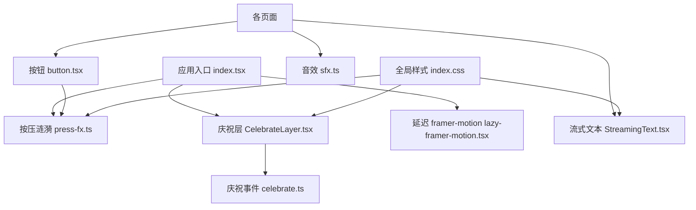
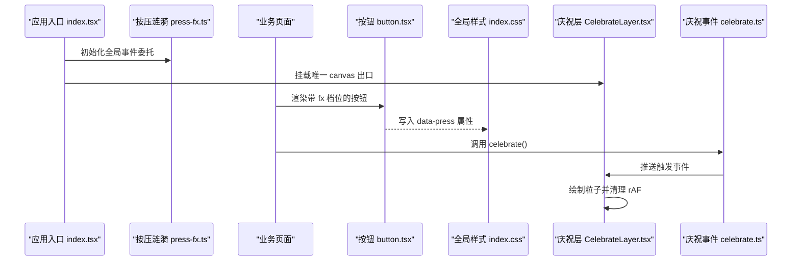
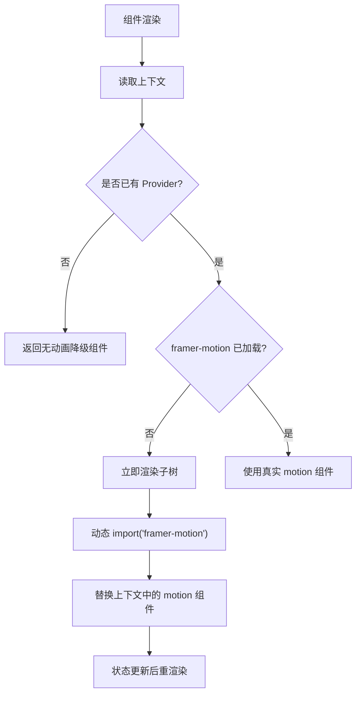
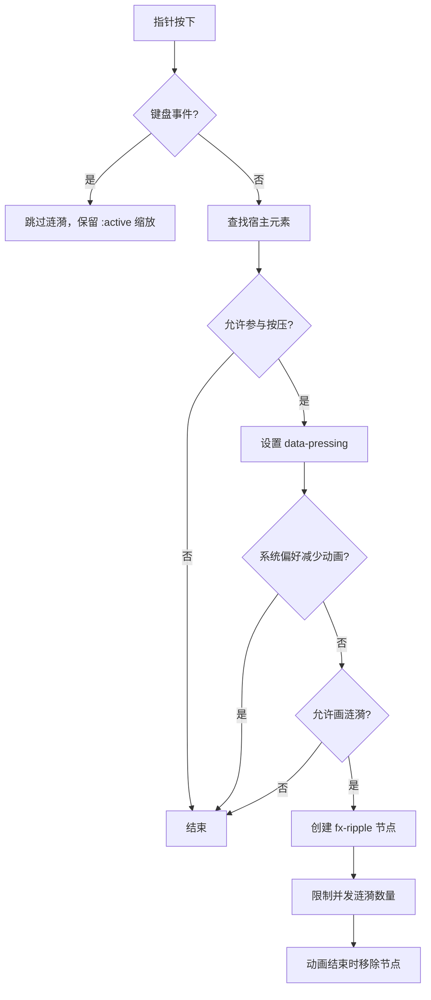
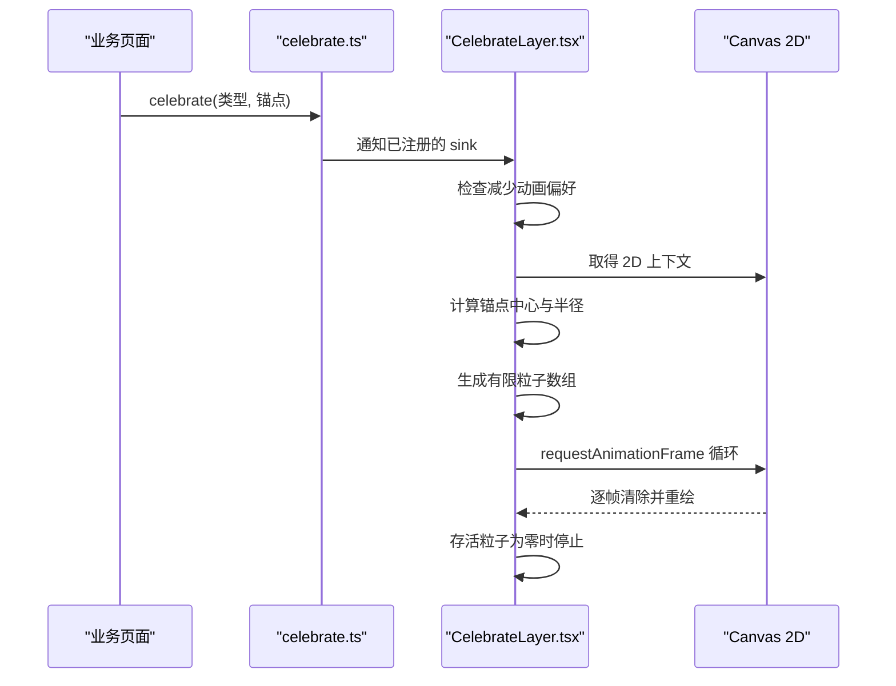
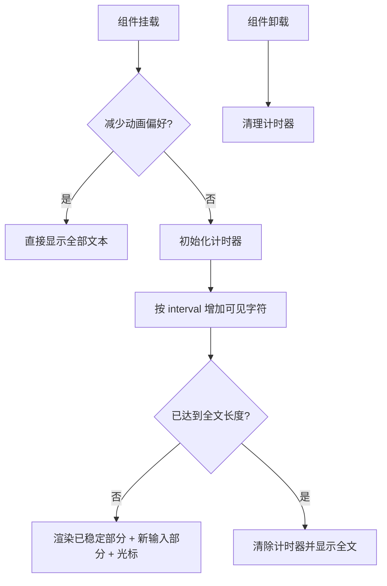
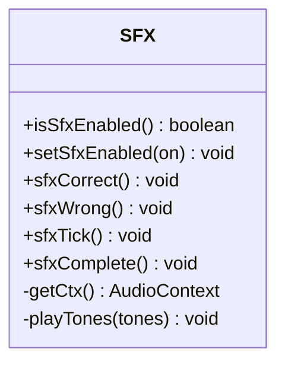
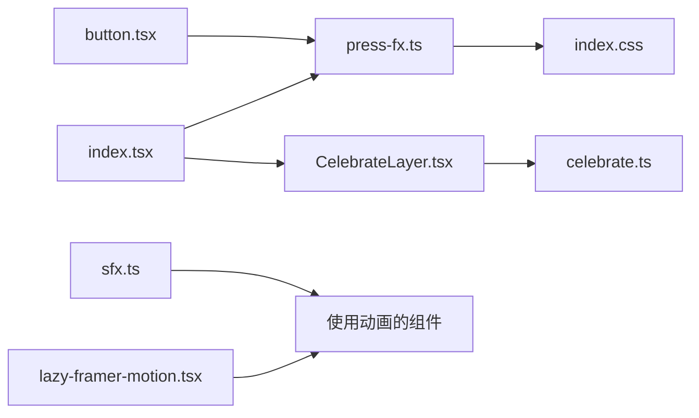

# 动画与交互系统

<cite>
**本文引用的文件**   
- [lazy-framer-motion.tsx](file://src/lib/lazy-framer-motion.tsx)
- [press-fx.ts](file://src/lib/press-fx.ts)
- [celebrate.ts](file://src/lib/celebrate.ts)
- [sfx.ts](file://src/lib/sfx.ts)
- [index.css](file://src/index.css)
- [CelebrateLayer.tsx](file://src/components/CelebrateLayer.tsx)
- [StreamingText.tsx](file://src/components/StreamingText.tsx)
- [button.tsx](file://src/components/ui/button.tsx)
- [index.tsx](file://src/index.tsx)
</cite>

## 目录
1. [引言](#引言)
2. [项目结构](#项目结构)
3. [核心组件](#核心组件)
4. [架构总览](#架构总览)
5. [详细组件分析](#详细组件分析)
6. [依赖关系分析](#依赖关系分析)
7. [性能考量](#性能考量)
8. [故障排查指南](#故障排查指南)
9. [结论](#结论)

## 引言
NativeThink 的动画与交互系统围绕五个关键子系统构建：延迟加载的 framer-motion、全站按压涟漪、程序化庆祝粒子、流式文本渲染，以及 Web Audio 合成的音效。它们共同目标是让学习反馈即时、克制且可降级：在主流浏览器上提供流畅动效，在低性能设备或无障碍偏好下退化为无动画行为；同时通过事件委托、资源上限和清理逻辑防止内存泄漏。

## 项目结构
动画相关代码分布在三个层次：
- 库层：`src/lib` 中集中实现延迟动画加载、按压涟漪、庆祝事件总线、音效合成。
- 组件层：`src/components` 中的 `CelebrateLayer` 与 `StreamingText` 是面向 UI 的动画出口。
- 样式层：`src/index.css` 统一封装压压缩放、涟漪扩散、结果图形动画和无障碍降级。
- 应用入口：`src/index.tsx` 负责挂载全局交互（按压涟漪、庆祝层）、主题初始化及错误边界。

**图表来源**
- [index.tsx:10-12](file://src/index.tsx#L10-L12)
- [index.tsx:107-111](file://src/index.tsx#L107-L111)
- [press-fx.ts:1-20](file://src/lib/press-fx.ts#L1-L20)
- [celebrate.ts:2-27](file://src/lib/celebrate.ts#L2-L27)
- [lazy-framer-motion.tsx:1-30](file://src/lib/lazy-framer-motion.tsx#L1-L30)
- [button.tsx:44-82](file://src/components/ui/button.tsx#L44-L82)
- [index.css:333-426](file://src/index.css#L333-L426)

**章节来源**
- [index.tsx:10-12](file://src/index.tsx#L10-L12)
- [index.tsx:107-111](file://src/index.tsx#L107-L111)
- [index.css:333-426](file://src/index.css#L333-L426)

## 核心组件
- **延迟 framer-motion**：通过上下文和动态导入，把 `motion.div` 与 `AnimatePresence` 懒加载到主包之外，并返回无动画降级组件。
- **按压涟漪**：一处全局指针事件委托，为所有可点元素添加缩放态与涟漪节点，避免每个按钮各自实现。
- **庆祝层**：单例 canvas 动画出口，接收 `celebrate(kind, anchor)` 调用后从锚点中心发射有限数量粒子。
- **流式文本**：按字符间隔显示文本，支持无障碍降速模式、中断清理和末尾光标。
- **音效**：使用 `AudioContext` 合成短音，不依赖音频文件，支持开关与浏览器兼容。

**章节来源**
- [lazy-framer-motion.tsx:1-99](file://src/lib/lazy-framer-motion.tsx#L1-L99)
- [press-fx.ts:1-119](file://src/lib/press-fx.ts#L1-L119)
- [CelebrateLayer.tsx:1-72](file://src/components/CelebrateLayer.tsx#L1-L72)
- [StreamingText.tsx:1-53](file://src/components/StreamingText.tsx#L1-L53)
- [sfx.ts:1-91](file://src/lib/sfx.ts#L1-L91)

## 架构总览
动画系统的控制流可以理解为“入口挂接 + 局部触发 + 统一视觉输出”：
- 应用启动时，`index.tsx` 先执行全局按压涟漪初始化，再挂载庆祝层。
- 业务组件通过 `useFramerMotion()` 获取运动组件，或通过 `celebrate()` 触发粒子。
- 样式层用 CSS 变量统一压压缩放、涟漪时长和颜色，减少 JS 重复逻辑。
- 音效由业务侧直接调用合成函数，无需资源加载。

**图表来源**
- [index.tsx:10-12](file://src/index.tsx#L10-L12)
- [index.tsx:107-111](file://src/index.tsx#L107-L111)
- [press-fx.ts:86-119](file://src/lib/press-fx.ts#L86-L119)
- [button.tsx:60-82](file://src/components/ui/button.tsx#L60-L82)
- [CelebrateLayer.tsx:23-68](file://src/components/CelebrateLayer.tsx#L23-L68)
- [celebrate.ts:17-27](file://src/lib/celebrate.ts#L17-L27)

## 详细组件分析

### 延迟加载的 framer-motion
`LazyFramerProvider` 维护一个就绪状态，首次渲染时使用 React Context 暴露降级组件；当 `import('framer-motion')` 解析完成后，将真实 `motion.div` 与 `AnimatePresence` 注入同一个上下文。这样：
- 主包不会包含完整 framer-motion，降低首屏体积。
- 缺失 Provider 时不会抛错白屏，而是回退到普通 DOM 节点，并在开发期打印一次性警告。
- 组件消费方通过 `useFramerMotion()` 获取 `LazyMotionDiv` 和 `LazyAnimatePresence`，不需要关心懒加载细节。

**图表来源**
- [lazy-framer-motion.tsx:22-61](file://src/lib/lazy-framer-motion.tsx#L22-L61)
- [lazy-framer-motion.tsx:63-99](file://src/lib/lazy-framer-motion.tsx#L63-L99)

**章节来源**
- [lazy-framer-motion.tsx:1-99](file://src/lib/lazy-framer-motion.tsx#L1-L99)

### 按压涟漪与事件委托
按压效果采用命令式模块而非组件包装，原因是全站存在大量裸按钮，逐个包裹组件成本高且容易遗漏。`initPressFx` 在文档根节点监听指针事件：
- 仅对 `pointerType !== 'keyboard'` 的事件处理涟漪，键盘操作仍走 CSS `:active` 缩放。
- 目标元素必须匹配选择器，如裸 `button`、带 `href` 的 `a`、`role="button"`，或显式声明 `data-press` 的元素。
- 支持三档：默认软档、强档、关闭档；`data-fx-ripple="0"` 表示只缩放不画涟漪。
- 涟漪节点被限制最大并发数，播放结束后自动移除，避免 DOM 无限增长。
- WebView 环境下触摸不一定进入 `:active`，因此按下态使用 `data-pressing` 属性配合 CSS `scale`，而不是完全依赖伪类。

**图表来源**
- [press-fx.ts:30-119](file://src/lib/press-fx.ts#L30-L119)
- [index.css:367-399](file://src/index.css#L367-L399)

**章节来源**
- [press-fx.ts:1-119](file://src/lib/press-fx.ts#L1-L119)
- [index.css:333-426](file://src/index.css#L333-L426)
- [button.tsx:60-82](file://src/components/ui/button.tsx#L60-L82)

### 庆祝动画系统
庆祝系统由三部分组成：
- `celebrate.ts`：提供唯一入口 `celebrate(kind, anchor?)` 和注册回调的 `attachCelebrationSink`。
- `CelebrateLayer.tsx`：挂载单个全屏 canvas，订阅庆祝事件，根据 DPR 和设备像素比裁剪渲染质量。
- `index.css`：定义结果图形的关键帧，如正确弧、连击环、错误抖动。

触发条件方面，庆祝不是简单点击就放烟花，而应绑定到有意义的学习结果，例如连击数达到阈值、整轮完成、正确率闭环等。实现上，`CelebrateLayer` 做了多项防护：
- 若用户偏好减少动画，则直接退出。
- 无法取得 2D 绘图上下文时 no-op，不回退成提示。
- DPR 最高取 2，避免手机高倍屏烧显存。
- 粒子数量和生命周期有上限，700ms 内自行清理。
- 每次新触发取消上一轮 `requestAnimationFrame`，防止多个循环同时写同一 canvas。
- 卸载时注销 sink 并清理 rAF，防止路由切换后仍有定时器运行。

**图表来源**
- [CelebrateLayer.tsx:23-68](file://src/components/CelebrateLayer.tsx#L23-L68)
- [celebrate.ts:17-27](file://src/lib/celebrate.ts#L17-L27)

**章节来源**
- [CelebrateLayer.tsx:1-72](file://src/components/CelebrateLayer.tsx#L1-L72)
- [celebrate.ts:2-27](file://src/lib/celebrate.ts#L2-L27)
- [index.css:411-417](file://src/index.css#L411-L417)

### 流式文本渲染
`StreamingText` 模拟 AI 流式输出：
- 初始可见字符数为 0，随后按固定间隔增加 `speed` 个字符。
- 当可见长度超过原文长度时，停止定时器并渲染完整文本。
- 最近两到三个字符作为“正在输入”部分，带有淡入动画；末尾有一个不可见的光标占位。
- 如果系统偏好减少动画，则直接显示完整文本，不再执行打字机循环。
- `useEffect` 清理函数会清除 `setInterval`，避免组件卸载后继续修改状态。

**图表来源**
- [StreamingText.tsx:14-53](file://src/components/StreamingText.tsx#L14-L53)
- [index.css:138-156](file://src/index.css#L138-L156)

**章节来源**
- [StreamingText.tsx:1-53](file://src/components/StreamingText.tsx#L1-L53)
- [index.css:138-156](file://src/index.css#L138-L156)

### 音效系统
`sfx.ts` 使用 Web Audio API 合成短促提示音，而不是加载外部音频文件：
- 首次播放时创建 `AudioContext`，兼容 `webkitAudioContext`。
- 若上下文处于暂停状态，尝试恢复。
- 每个音调通过振荡器和增益节点组合，使用指数斜坡避免爆音。
- 音量受 `__nativethink_sfx_enabled` 配置控制，可通过本地存储开启或关闭。
- 提供四种预设音效：答对、答错、轻滴、完成三连音。

**图表来源**
- [sfx.ts:1-91](file://src/lib/sfx.ts#L1-L91)

**章节来源**
- [sfx.ts:1-91](file://src/lib/sfx.ts#L1-L91)

## 依赖关系分析
- `index.tsx` 是全局交互的装配点：先初始化按压涟漪，再挂载庆祝层。
- `button.tsx` 将 `variant` 映射为按压档位，并在 `asChild` 模式下关闭涟漪但保留缩放。
- `press-fx.ts` 依赖全局样式中的 `data-pressing`、`fx-ripple-host`、`fx-ripple` 等类名。
- `CelebrateLayer.tsx` 依赖 `celebrate.ts` 提供的订阅接口，而不直接持有 canvas 状态。
- `lazy-framer-motion.tsx` 解耦了 framer-motion 的运行时与业务组件，使动画不再是严格前置条件。
- `index.css` 是所有动效的最终呈现层，包括压压缩放、涟漪扩散、结果图形和无障碍降级。

**图表来源**
- [index.tsx:10-12](file://src/index.tsx#L10-L12)
- [index.tsx:107-111](file://src/index.tsx#L107-L111)
- [button.tsx:60-82](file://src/components/ui/button.tsx#L60-L82)
- [press-fx.ts:86-119](file://src/lib/press-fx.ts#L86-L119)
- [celebrate.ts:17-27](file://src/lib/celebrate.ts#L17-L27)
- [lazy-framer-motion.tsx:22-61](file://src/lib/lazy-framer-motion.tsx#L22-L61)

**章节来源**
- [index.tsx:10-12](file://src/index.tsx#L10-L12)
- [button.tsx:60-82](file://src/components/ui/button.tsx#L60-L82)
- [press-fx.ts:86-119](file://src/lib/press-fx.ts#L86-L119)
- [celebrate.ts:17-27](file://src/lib/celebrate.ts#L17-L27)
- [lazy-framer-motion.tsx:22-61](file://src/lib/lazy-framer-motion.tsx#L22-L61)

## 性能考量
- **首屏体积优化**：framer-motion 通过动态导入移出主包，仅在需要时加载。
- **布局抖动控制**：压压缩放走独立 `scale` 属性，过渡只声明必要属性，避免触发布局重排。
- **涟漪内存保护**：同宿主最多同时存在有限数量的涟漪节点，动画结束后自动移除。
- **canvas 显存保护**：庆祝动画限制 DPR 上限、粒子数量和存活时间，并在卸载时清理 rAF。
- **定时器清理**：流式文本在组件卸载时清除 `setInterval`，避免状态更新旧实例。
- **Web Audio 容错**：音效合成失败时忽略单次音调异常，整体体验不因单一音频节点崩溃而中断。
- **无障碍优先**：减少动画偏好会跳过涟漪、庆祝和流式动画，保证信息可达性。

[本节为通用性能指导，不直接分析具体代码行]

## 故障排查指南
- **缺少 LazyFramerProvider 导致降级**：如果组件在 `LazyFramerProvider` 之外调用 `useFramerMotion()`，会收到控制台警告并回退到无动画渲染，而不是抛出错误。
- **WebView 下没有按压缩放**：某些 WebView 的触摸事件不进入 `:active`，必须依赖 `data-pressing` 属性；检查是否设置了 `data-press` 或默认可点元素。
- **涟漪没有消失**：检查是否存在未清理的 `pointerup` / `pointercancel` / `blur` 路径；确认涟漪节点是否在 `animationend` 后被移除。
- **庆祝动画没有触发**：确认 `CelebrateLayer` 只在应用入口挂载一次，且 `celebrate()` 传入的锚点有效；若无法取得 2D 上下文，会 no-op。
- **庆祝动画卡顿**：检查 DPR 是否过高、粒子是否过多、是否多次连续触发导致多个 rAF 并行；当前实现已限制 DPR、粒子和循环。
- **音效无声**：检查用户是否关闭音效设置，浏览器是否阻止 AudioContext，或在非安全上下文中无法创建音频上下文。
- **流式文本卡住**：检查组件是否频繁销毁重建导致定时器未清理；确认无障碍偏好下是否期望直接显示完整文本。

**章节来源**
- [lazy-framer-motion.tsx:63-79](file://src/lib/lazy-framer-motion.tsx#L63-L79)
- [press-fx.ts:86-119](file://src/lib/press-fx.ts#L86-L119)
- [CelebrateLayer.tsx:23-72](file://src/components/CelebrateLayer.tsx#L23-L72)
- [StreamingText.tsx:14-53](file://src/components/StreamingText.tsx#L14-L53)
- [sfx.ts:15-44](file://src/lib/sfx.ts#L15-L44)

## 结论
NativeThink 的动画与交互系统以“最小侵入、最大一致性”为原则：通过事件委托统一按压反馈，通过单一 canvas 出口统一庆祝动画，通过 CSS 变量统一动效参数，通过懒加载和降级策略保证性能和可用性。对于后续扩展，建议继续遵循以下约定：
- 新增动画尽量通过现有上下文、事件总线或样式 token 接入，而不是新建独立实现。
- 所有可点控件统一走 `data-press` 与按压委托，避免各处各自写缩放和涟漪。
- 重要反馈通过 `celebrate()` 表达，而不是直接操作 DOM 或 canvas。
- 任何长生命周期任务都必须提供清理逻辑，包括定时器、rAF、事件监听和音频上下文。
- 无障碍偏好必须被尊重，关键信息不能依赖动画本身传达。