# 原子 UI 组件库

<cite>
**本文引用的文件**   
- [button.tsx](file://src/components/ui/button.tsx)
- [card.tsx](file://src/components/ui/card.tsx)
- [dialog.tsx](file://src/components/ui/dialog.tsx)
- [form.tsx](file://src/components/ui/form.tsx)
- [input.tsx](file://src/components/ui/input.tsx)
- [select.tsx](file://src/components/ui/select.tsx)
- [table.tsx](file://src/components/ui/table.tsx)
- [tabs.tsx](file://src/components/ui/tabs.tsx)
- [accordion.tsx](file://src/components/ui/accordion.tsx)
- [alert.tsx](file://src/components/ui/alert.tsx)
- [badge.tsx](file://src/components/ui/badge.tsx)
- [dropdown-menu.tsx](file://src/components/ui/dropdown-menu.tsx)
- [popover.tsx](file://src/components/ui/popover.tsx)
- [tooltip.tsx](file://src/components/ui/tooltip.tsx)
- [navigation-menu.tsx](file://src/components/ui/navigation-menu.tsx)
- [label.tsx](file://src/components/ui/label.tsx)
- [utils.ts](file://src/lib/utils.ts)
- [ui-theme.ts](file://src/lib/ui-theme.ts)
- [index.css](file://src/index.css)
- [tailwind-theme.css](file://src/tailwind-theme.css)
- [components.json](file://components.json)
</cite>

## 目录
1. [简介](#简介)
2. [项目结构](#项目结构)
3. [核心组件](#核心组件)
4. [架构总览](#架构总览)
5. [详细组件分析](#详细组件分析)
6. [依赖关系分析](#依赖关系分析)
7. [性能与可访问性](#性能与可访问性)
8. [主题与定制](#主题与定制)
9. [组合模式与使用示例](#组合模式与使用示例)
10. [故障排查](#故障排查)
11. [结论](#结论)

## 简介
NativeThink 应用的原子 UI 组件库位于 `src/components/ui`，基于 shadcn/ui 的 New York 风格与 Radix UI 基础组件构建，共包含 50 多个可复用、可定制的 React 组件。这些组件统一通过 Tailwind CSS、CSS 变量和 class-variance-authority（cva）管理样式变体，并通过 Radix UI 提供键盘与屏幕阅读器支持。

本库的设计目标是：
- 以原子化粒度提供按钮、表单、卡片、对话框、下拉菜单、表格、标签页等常用界面单元。
- 通过 props 暴露稳定的 API，同时允许通过 className、data-slot 和 CSS 变量进行外观定制。
- 内置可访问性语义，包括焦点环、ARIA 属性、键盘导航和减少动画偏好。
- 支持明暗主题与多套 UI 主题，并与业务页面解耦。

## 项目结构
组件库的核心路径是 `src/components/ui`，每个文件对应一个组件或一组相关子组件；公共工具在 `src/lib/utils.ts`，主题定义在 `src/tailwind-theme.css` 与 `src/index.css`，shadcn 配置在 `components.json`。

```mermaid
graph TB
  subgraph "UI 组件层"
    Button["Button<br/>src/components/ui/button.tsx"]
    Card["Card<br/>src/components/ui/card.tsx"]
    Dialog["Dialog<br/>src/components/ui/dialog.tsx"]
    Form["Form 体系<br/>src/components/ui/form.tsx"]
    Input["Input<br/>src/components/ui/input.tsx"]
    Select["Select<br/>src/components/ui/select.tsx"]
    Table["Table<br/>src/components/ui/table.tsx"]
    Tabs["Tabs<br/>src/components/ui/tabs.tsx"]
    Accordion["Accordion<br/>src/components/ui/accordion.tsx"]
    Alert["Alert<br/>src/components/ui/alert.tsx"]
    Badge["Badge<br/>src/components/ui/badge.tsx"]
    Dropdown["DropdownMenu<br/>src/components/ui/dropdown-menu.tsx"]
    Popover["Popover<br/>src/components/ui/popover.tsx"]
    Tooltip["Tooltip<br/>src/components/ui/tooltip.tsx"]
    NavMenu["NavigationMenu<br/>src/components/ui/navigation-menu.tsx"]
  end

  subgraph "共享能力"
    Utils["cn 工具<br/>src/lib/utils.ts"]
    Theme["Tailwind 主题<br/>src/tailwind-theme.css"]
    GlobalCss["全局样式<br/>src/index.css"]
    Shadcn["shadcn 配置<br/>components.json"]
    UiTheme["UI 主题 Hook<br/>src/lib/ui-theme.ts"]
  end

  Button --> Utils
  Card --> Utils
  Dialog --> Utils
  Form --> Utils
  Input --> Utils
  Select --> Utils
  Table --> Utils
  Tabs --> Utils
  Accordion --> Utils
  Alert --> Utils
  Badge --> Utils
  Dropdown --> Utils
  Popover --> Utils
  Tooltip --> Utils
  NavMenu --> Utils

  Utils --> Theme
  Utils --> GlobalCss
  Theme --> GlobalCss
  Shadcn --> Theme
  UiTheme --> Theme
```

**图表来源**
- [button.tsx:1-82](file://src/components/ui/button.tsx#L1-L82)
- [card.tsx:1-82](file://src/components/ui/card.tsx#L1-L82)
- [dialog.tsx:1-143](file://src/components/ui/dialog.tsx#L1-L143)
- [form.tsx:1-167](file://src/components/ui/form.tsx#L1-L167)
- [input.tsx:1-21](file://src/components/ui/input.tsx#L1-L21)
- [select.tsx:1-200](file://src/components/ui/select.tsx#L1-L200)
- [table.tsx:1-116](file://src/components/ui/table.tsx#L1-L116)
- [tabs.tsx:1-66](file://src/components/ui/tabs.tsx#L1-L66)
- [accordion.tsx:1-66](file://src/components/ui/accordion.tsx#L1-L66)
- [alert.tsx:1-71](file://src/components/ui/alert.tsx#L1-L71)
- [badge.tsx:1-42](file://src/components/ui/badge.tsx#L1-L42)
- [dropdown-menu.tsx:1-200](file://src/components/ui/dropdown-menu.tsx#L1-L200)
- [popover.tsx:1-48](file://src/components/ui/popover.tsx#L1-L48)
- [tooltip.tsx:1-61](file://src/components/ui/tooltip.tsx#L1-L61)
- [navigation-menu.tsx:1-168](file://src/components/ui/navigation-menu.tsx#L1-L168)
- [utils.ts:1-87](file://src/lib/utils.ts#L1-L87)
- [tailwind-theme.css:1-200](file://src/tailwind-theme.css#L1-L200)
- [index.css:1-200](file://src/index.css#L1-L200)
- [components.json:1-21](file://components.json#L1-L21)

**章节来源**
- [components.json:1-21](file://components.json#L1-L21)
- [index.css:1-200](file://src/index.css#L1-L200)
- [tailwind-theme.css:1-200](file://src/tailwind-theme.css#L1-L200)

## 核心组件
以下组件构成 NativeThink 应用中最常用的界面元素。它们都遵循统一的命名约定、props 风格和样式扩展方式。

| 组件 | 主要职责 | 关键变体或特性 | 推荐搭配 |
|---|---|---|---|
| Button | 点击操作入口 | variant、size、asChild、fx | DialogTrigger、Link、Icon |
| Card | 内容容器 | CardHeader、CardTitle、CardContent、CardFooter | Alert、Button、Badge |
| Dialog | 模态弹窗 | showCloseButton、Overlay、Portal | Form、Button |
| Form / FormField | 受控表单编排 | FormItem、FormLabel、FormControl、FormMessage | Input、Select、Textarea |
| Input | 文本输入 | type、disabled、aria-invalid | FormField、Select |
| Select | 单选选择器 | size、position、align、EMPTY_SENTINEL | FormField |
| Table | 数据表格 | 横向滚动、行 hover、选中态 | Pagination、Badge |
| Tabs | 标签页分组 | TabsList、TabsTrigger、TabsContent | Card、Table |
| Accordion | 手风琴折叠 | 自动箭头动画、展开收起 | Alert、Badge |
| Alert | 状态提示 | default、destructive、success、warning | Badge、Button |
| Badge | 轻量标签 | default、secondary、destructive、outline | Button、Text |
| DropdownMenu | 上下文菜单 | inset、variant、Checkbox、Radio | NavigationMenu |
| Popover | 浮层气泡 | align、sideOffset | Tooltip、Button |
| Tooltip | 简短说明 | delayDuration、Arrow | Icon、Button |
| NavigationMenu | 主导航菜单 | viewport、content、viewport width | DropdownMenu |

**章节来源**
- [button.tsx:1-82](file://src/components/ui/button.tsx#L1-L82)
- [card.tsx:1-82](file://src/components/ui/card.tsx#L1-L82)
- [dialog.tsx:1-143](file://src/components/ui/dialog.tsx#L1-L143)
- [form.tsx:1-167](file://src/components/ui/form.tsx#L1-L167)
- [input.tsx:1-21](file://src/components/ui/input.tsx#L1-L21)
- [select.tsx:1-200](file://src/components/ui/select.tsx#L1-L200)
- [table.tsx:1-116](file://src/components/ui/table.tsx#L1-L116)
- [tabs.tsx:1-66](file://src/components/ui/tabs.tsx#L1-L66)
- [accordion.tsx:1-66](file://src/components/ui/accordion.tsx#L1-L66)
- [alert.tsx:1-71](file://src/components/ui/alert.tsx#L1-L71)
- [badge.tsx:1-42](file://src/components/ui/badge.tsx#L1-L42)
- [dropdown-menu.tsx:1-200](file://src/components/ui/dropdown-menu.tsx#L1-L200)
- [popover.tsx:1-48](file://src/components/ui/popover.tsx#L1-L48)
- [tooltip.tsx:1-61](file://src/components/ui/tooltip.tsx#L1-L61)
- [navigation-menu.tsx:1-168](file://src/components/ui/navigation-menu.tsx#L1-L168)

## 架构总览
NativeThink 的 UI 架构分为四层：

1. **Radix UI 原语层**：所有交互型组件（Dialog、Select、Tabs、Accordion、DropdownMenu、Popover、Tooltip、NavigationMenu）均基于 Radix UI，负责无障碍、状态和渲染逻辑。
2. **shadcn/ui 包装层**：为 Radix 原语添加默认样式、data-slot、图标和业务友好的 props。
3. **原子组件层**：暴露 Button、Card、Alert、Badge、Table 等稳定 API，供页面和业务组件使用。
4. **主题与工具层**：Tailwind CSS 变量、CSS 变量、`cn` 工具类合并以及 UI 主题 Hook 共同决定最终视觉表现。

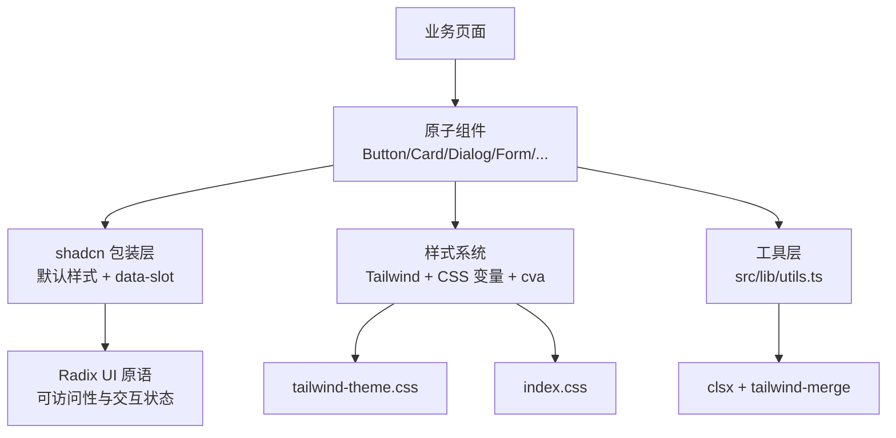

**图表来源**
- [components.json:1-21](file://components.json#L1-L21)
- [button.tsx:1-82](file://src/components/ui/button.tsx#L1-L82)
- [dialog.tsx:1-143](file://src/components/ui/dialog.tsx#L1-L143)
- [utils.ts:1-87](file://src/lib/utils.ts#L1-L87)
- [tailwind-theme.css:1-200](file://src/tailwind-theme.css#L1-L200)
- [index.css:1-200](file://src/index.css#L1-L200)

**章节来源**
- [components.json:1-21](file://components.json#L1-L21)
- [tailwind-theme.css:1-200](file://src/tailwind-theme.css#L1-L200)
- [index.css:1-200](file://src/index.css#L1-L200)

## 详细组件分析

### Button
Button 是原子组件中最重要的动作入口。它使用 cva 管理变体与尺寸，并支持 asChild 透传至 Radix Slot，以便作为 Link、Icon 或其他原生元素的包裹器。

- **Props**
  - `className`：追加样式类。
  - `variant`：default、destructive、outline、secondary、ghost。
  - `size`：default、sm、lg、icon。
  - `asChild`：是否将根节点替换为子组件。
  - `fx`：按压反馈档位，strong、soft、none；未指定时根据 variant 推断。
- **行为**
  - 通过 data-slot="button" 标记，便于测试与样式覆盖。
  - 当 asChild 为 true 时，禁用涟漪宿主注入，仅保留缩放效果。
  - 支持 disabled、focus-visible ring、hover/active elevate。
- **定制**
  - 通过 variant 切换主色、破坏色、描边按钮。
  - 通过 size 控制最小高度、内边距和字号。
  - 通过 cva 扩展新变体，例如增加 success 或 brand 按钮。

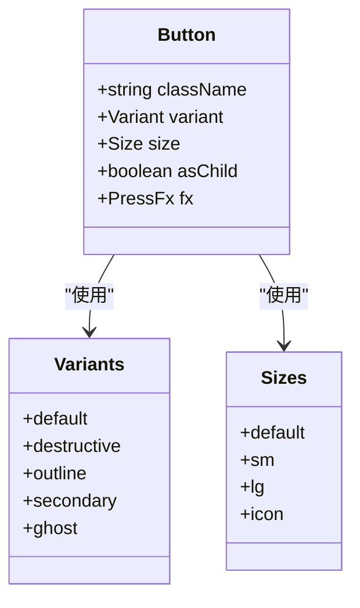

**图表来源**
- [button.tsx:1-82](file://src/components/ui/button.tsx#L1-L82)

**章节来源**
- [button.tsx:1-82](file://src/components/ui/button.tsx#L1-L82)

### Card
Card 提供圆角、边框、阴影和分层布局的子组件集合。它不引入额外状态，只负责容器结构和排版。

- **子组件**
  - Card：外层容器，使用 card 背景与 foreground。
  - CardHeader：头部区域，垂直间距和内边距。
  - CardTitle：标题，强调字号与字重。
  - CardDescription：描述文字，使用 muted-foreground。
  - CardContent：正文区域，顶部留白。
  - CardFooter：底部操作区，左右对齐。
- **响应式**
  - 主要通过 Tailwind spacing 和 text sizing 实现，没有媒体查询硬编码。
- **定制**
  - 直接给 Card 或子组件传入 className。
  - 通过 CSS 变量覆盖 --card、--card-foreground、border 等。

**章节来源**
- [card.tsx:1-82](file://src/components/ui/card.tsx#L1-L82)

### Dialog
Dialog 封装 Radix Dialog，提供遮罩、定位、关闭按钮、头部和尾部布局。移动端使用最大宽度计算，避免贴边。

- **Props**
  - DialogContent 新增 `showCloseButton`，默认显示右上角关闭按钮。
  - 其余 props 透传到 Radix Dialog 的 Root、Trigger、Portal、Close、Overlay、Content、Title、Description。
- **行为**
  - Overlay 使用半透明黑色背景。
  - Content 使用固定定位居中，带入场和退出动画。
  - 关闭按钮带有 sr-only 文本，保证屏幕阅读器可用。
- **定制**
  - 可通过 overlayClassName、contentClassName 覆盖样式。
  - 可隐藏关闭按钮，用于自定义关闭流程。

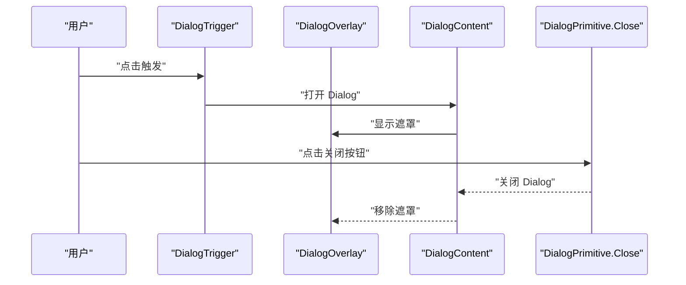

**图表来源**
- [dialog.tsx:1-143](file://src/components/ui/dialog.tsx#L1-L143)

**章节来源**
- [dialog.tsx:1-143](file://src/components/ui/dialog.tsx#L1-L143)

### Form 与 FormField
Form 体系基于 react-hook-form 和 Radix Label，提供字段上下文、ID 生成、错误描述和消息展示。

- **组件**
  - Form：FormProvider 别名。
  - FormField：用 Controller 包裹字段。
  - FormItem：提供 id 上下文和数据槽。
  - FormLabel：绑定 formItemId，错误时变为破坏色。
  - FormControl：注入 id、aria-describedby、aria-invalid。
  - FormDescription：辅助说明文本。
  - FormMessage：错误消息或自定义 children。
- **数据结构**
  - FormFieldContextValue：保存字段 name。
  - FormItemContextValue：保存字段 id。
- **错误处理**
  - useFormField 从 useFormState 获取 fieldState。
  - 当 error 存在时，FormControl 的 aria-invalid 为 true，FormMessage 渲染错误信息。
- **最佳实践**
  - 始终使用 FormField 包裹受控字段。
  - 使用 FormItem + FormLabel + FormControl + FormMessage 组合。
  - 表单验证逻辑放在上层表单 hook 中，组件只负责渲染。

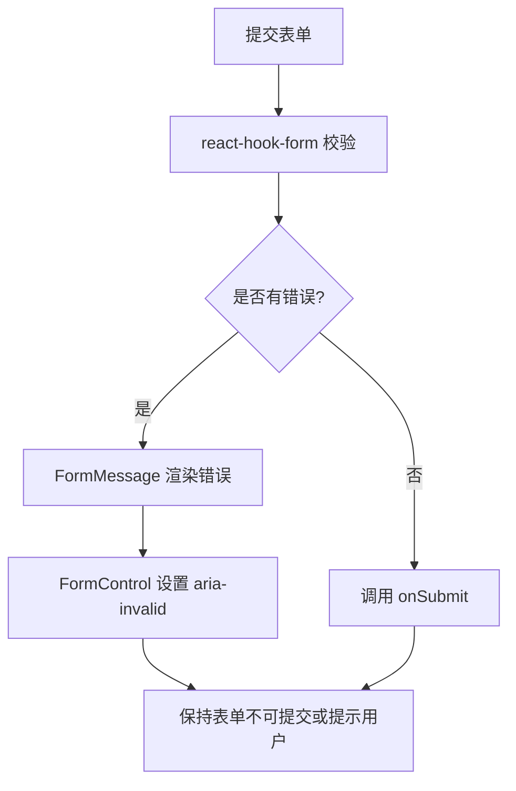

**图表来源**
- [form.tsx:1-167](file://src/components/ui/form.tsx#L1-L167)

**章节来源**
- [form.tsx:1-167](file://src/components/ui/form.tsx#L1-L167)

### Input
Input 是原生 input 的薄包装，重点在于统一 focus、disabled、aria-invalid 和暗色背景。

- **Props**
  - 透传所有原生 input props。
  - type 由父组件或表单驱动。
- **行为**
  - 默认全宽、最小宽度 0，防止 flex 溢出。
  - 支持 placeholder、file 输入、selection 颜色。
  - aria-invalid 影响 ring 和 border 颜色。
- **定制**
  - 通过 className 调整内边距、字号、边框。
  - 通过 CSS 变量 --input、--ring、--destructive 控制主题。

**章节来源**
- [input.tsx:1-21](file://src/components/ui/input.tsx#L1-L21)

### Select
Select 封装 Radix Select，解决空字符串 value 的特殊情况，并提供 size、position、align 等便捷选项。

- **特殊值处理**
  - 内部使用 EMPTY_SENTINEL 区分“空字符串”和“未选择”，在 onChange 时还原为空字符串。
- **Props**
  - Select：value、defaultValue、onValueChange。
  - SelectTrigger：size 为 sm 或 default。
  - SelectContent：position 为 popper 或其他 Radix 值，align 为 center 等。
  - SelectItem：value 必须为 string，禁用时阻止事件冒泡。
- **行为**
  - Trigger 自带下拉箭头，展开时旋转。
  - Content 使用 Portal 渲染，支持滚动和视口适配。
  - Item 右侧显示选中指示图标。
- **可访问性**
  - 使用 Radix Select 的原生键盘和 ARIA 行为。
  - 禁用项会阻止 pointer/mouse/key 事件。

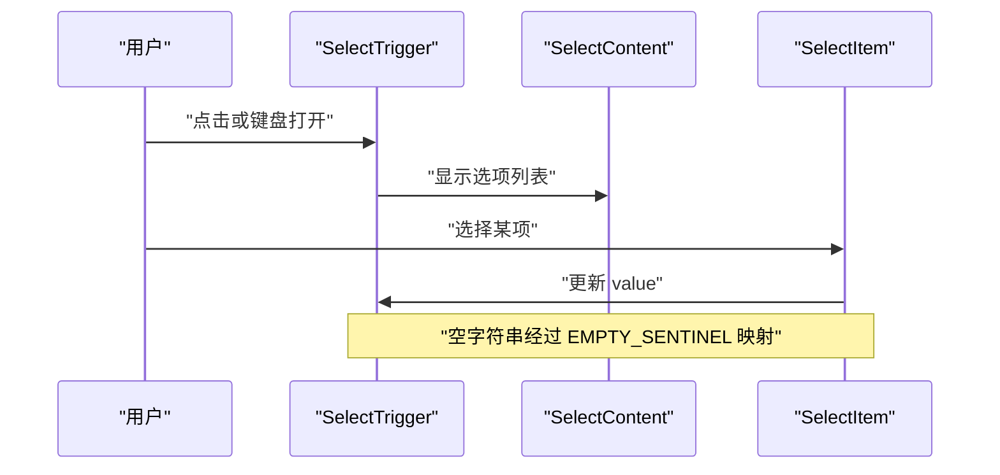

**图表来源**
- [select.tsx:1-200](file://src/components/ui/select.tsx#L1-L200)

**章节来源**
- [select.tsx:1-200](file://src/components/ui/select.tsx#L1-L200)

### Table
Table 提供表格容器、表头、表体、表尾、行、单元格和标题，支持横向滚动和选中态。

- **子组件**
  - Table：外层 div 包裹 table，启用 overflow-x。
  - TableHeader、TableBody、TableFooter：分别处理下边框和底色。
  - TableRow：hover 背景变化，选中态使用 data-state=selected。
  - TableHead、TableCell：左对齐、紧凑内边距，checkbox 场景预留空间。
  - TableCaption：底部说明文字。
- **响应式**
  - 通过外层容器的横向滚动支持小屏数据展示。
- **定制**
  - 通过 className 控制行高、边框、对齐方式。
  - 结合 Badge、Button 做操作列。

**章节来源**
- [table.tsx:1-116](file://src/components/ui/table.tsx#L1-L116)

### Tabs
Tabs 基于 Radix Tabs，提供 Tab 列表、触发器和内容区。

- **子组件**
  - Tabs：整体容器，垂直方向布局。
  - TabsList：灰色背景、圆角、内边距。
  - TabsTrigger：激活态高亮、禁用态降低透明度。
  - TabsContent：占据剩余空间。
- **行为**
  - 支持键盘左右切换。
  - 激活态有 font-medium 和阴影。
- **定制**
  - 通过 className 调整激活态背景、边框和文字颜色。

**章节来源**
- [tabs.tsx:1-66](file://src/components/ui/tabs.tsx#L1-L66)

### Accordion
Accordion 基于 Radix Accordion，提供折叠面板和自动箭头动画。

- **子组件**
  - Accordion：根容器。
  - AccordionItem：分隔线，最后一项去掉底边框。
  - AccordionTrigger：点击展开/收起，附带 ChevronDown 图标。
  - AccordionContent：带上下展开收起动画。
- **行为**
  - 展开时图标旋转 180 度。
  - 内容区域通过 animate-accordion-up/down 控制。
- **定制**
  - 可在 Trigger 中放入复杂标题。
  - 可通过 content className 调整内边距和动画。

**章节来源**
- [accordion.tsx:1-66](file://src/components/ui/accordion.tsx#L1-L66)

### Alert
Alert 使用 cva 管理 default、destructive、success、warning 四种变体，并通过 grid 布局支持图标和内容排列。

- **变体**
  - default：普通信息。
  - destructive：错误信息。
  - success：成功信息。
  - warning：警告信息。
- **子组件**
  - AlertTitle：标题，限制单行。
  - AlertDescription：描述段落，继承变体颜色。
- **可访问性**
  - Alert 根元素设置 role="alert"。
- **定制**
  - 通过 variant 切换语义颜色。
  - 通过 CSS 变量 --success、--warning、--destructive 扩展品牌语义。

**章节来源**
- [alert.tsx:1-71](file://src/components/ui/alert.tsx#L1-L71)

### Badge
Badge 提供轻量标签，禁止换行，支持 primary、secondary、destructive、outline 四种变体。

- **Props**
  - variant：default、secondary、destructive、outline。
  - className：追加样式。
- **行为**
  - 使用 hover-elevate 提供轻微悬浮反馈。
  - outline 变体使用 --badge-outline 与父背景融合。
- **定制**
  - 通过 CSS 变量 --badge-outline 调整描边透明度。
  - 通过 cva 新增业务变体，如 active、info。

**章节来源**
- [badge.tsx:1-42](file://src/components/ui/badge.tsx#L1-L42)

### DropdownMenu
DropdownMenu 基于 Radix DropdownMenu，提供菜单项、复选框项、单选组、分隔符和滚动支持。

- **主要子组件**
  - DropdownMenu、DropdownMenuPortal、DropdownMenuTrigger。
  - DropdownMenuContent：带 sideOffset、动画、滚动容器。
  - DropdownMenuItem：inset、variant=default|destructive。
  - DropdownMenuCheckboxItem：带勾选指示。
  - DropdownMenuRadioGroup、DropdownMenuRadioItem。
- **行为**
  - 禁用项会阻止 onClick、onMouseDown、onKeyDown、onKeyUp、onPointerDown。
  - destructive 变体在焦点和悬停时呈现危险色。
- **定制**
  - 通过 variant 控制危险项样式。
  - 通过 inset 控制缩进。

**章节来源**
- [dropdown-menu.tsx:1-200](file://src/components/ui/dropdown-menu.tsx#L1-L200)

### Popover
Popover 提供轻量浮层，适合短内容、帮助信息和快速操作。

- **子组件**
  - Popover、PopoverTrigger、PopoverContent、PopoverAnchor。
- **Props**
  - PopoverContent：align 默认 center，sideOffset 默认 4。
- **行为**
  - 使用 Portal 渲染，避免被父级 overflow 裁剪。
  - 带入场/退出动画和阴影。
- **定制**
  - 通过 align 和 sideOffset 控制位置。
  - 通过 className 调整宽度、圆角、内边距。

**章节来源**
- [popover.tsx:1-48](file://src/components/ui/popover.tsx#L1-L48)

### Tooltip
Tooltip 基于 Radix Tooltip，提供延迟提示和箭头。

- **子组件**
  - TooltipProvider：统一管理 delayDuration。
  - Tooltip：根容器。
  - TooltipTrigger：触发元素。
  - TooltipContent：带 Arrow，默认无偏移。
- **行为**
  - Provider 默认 delayDuration 为 0。
  - Content 使用 text-balance 优化多行文本。
- **定制**
  - 通过 sideOffset 调整提示与触发点距离。
  - 通过 className 覆盖背景、文字颜色和圆角。

**章节来源**
- [tooltip.tsx:1-61](file://src/components/ui/tooltip.tsx#L1-L61)

### NavigationMenu
NavigationMenu 提供桌面端水平导航，支持视口窗口、内容动画、指示器和链接样式。

- **子组件**
  - NavigationMenu、NavigationMenuList、NavigationMenuItem。
  - NavigationMenuTrigger：含下拉箭头。
  - NavigationMenuContent：带 motion 动画。
  - NavigationMenuViewport：视口宽度与动画。
  - NavigationMenuLink：链接样式，支持 active 状态。
  - NavigationMenuIndicator：可见时显示三角指示。
- **Props**
  - NavigationMenu：viewport 布尔值，决定是否渲染视口。
- **行为**
  - 默认启用 viewport，使大菜单在移动端也合理展示。
  - 当 viewport=false 时，Content 退化为相对定位浮层。
- **定制**
  - 使用 navigationMenuTriggerStyle 复用触发器样式。
  - 通过 data-viewport 控制不同布局分支。

**章节来源**
- [navigation-menu.tsx:1-168](file://src/components/ui/navigation-menu.tsx#L1-L168)

## 依赖关系分析
组件库的主要外部依赖如下：

| 依赖 | 用途 | 影响范围 |
|---|---|---|
| @radix-ui/react-* | 提供 Dialog、Select、Tabs、Accordion、DropdownMenu、Popover、Tooltip、NavigationMenu、Label、Slot 等底层交互 | 所有交互型组件 |
| lucide-react | 提供 XIcon、ChevronDownIcon、CheckIcon、ChevronRightIcon、CircleIcon 等图标 | Dialog、Accordion、DropdownMenu、Select、NavigationMenu |
| class-variance-authority | 管理 Button、Alert、Badge 的变体样式 | 样式变体组件 |
| react-hook-form | 管理 Form 状态、校验和提交 | Form 体系 |
| clsx + tailwind-merge | 合并 className，避免冲突 | 所有使用 cn 的组件 |
| Tailwind CSS | 原子样式系统 | 全部组件 |
| CSS 变量 | 主题、阴影、字体、品牌色 | tailwind-theme.css、index.css |

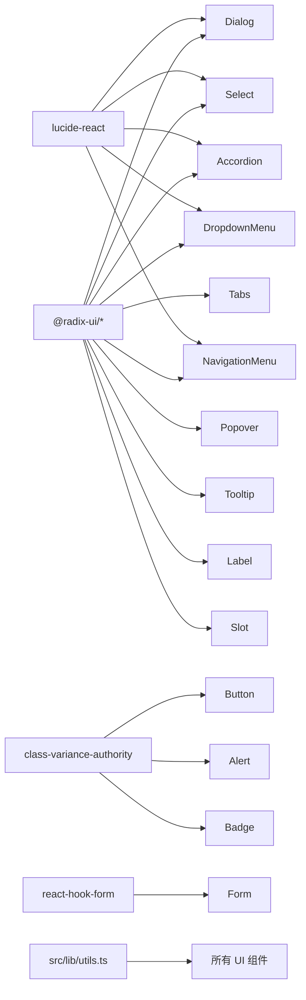

**图表来源**
- [dialog.tsx:1-143](file://src/components/ui/dialog.tsx#L1-L143)
- [select.tsx:1-200](file://src/components/ui/select.tsx#L1-L200)
- [tabs.tsx:1-66](file://src/components/ui/tabs.tsx#L1-L66)
- [accordion.tsx:1-66](file://src/components/ui/accordion.tsx#L1-L66)
- [dropdown-menu.tsx:1-200](file://src/components/ui/dropdown-menu.tsx#L1-L200)
- [popover.tsx:1-48](file://src/components/ui/popover.tsx#L1-L48)
- [tooltip.tsx:1-61](file://src/components/ui/tooltip.tsx#L1-L61)
- [navigation-menu.tsx:1-168](file://src/components/ui/navigation-menu.tsx#L1-L168)
- [form.tsx:1-167](file://src/components/ui/form.tsx#L1-L167)
- [button.tsx:1-82](file://src/components/ui/button.tsx#L1-L82)
- [alert.tsx:1-71](file://src/components/ui/alert.tsx#L1-L71)
- [badge.tsx:1-42](file://src/components/ui/badge.tsx#L1-L42)
- [utils.ts:1-87](file://src/lib/utils.ts#L1-L87)

**章节来源**
- [utils.ts:1-87](file://src/lib/utils.ts#L1-L87)

## 性能与可访问性

### 可访问性
- 所有 Radix 组件默认提供键盘导航、焦点管理和 ARIA 属性。
- Dialog、Popover、Tooltip、DropdownMenu 使用 Portal 渲染，避免 DOM 层级干扰焦点。
- Form 体系通过 htmlFor、id、aria-describedby、aria-invalid 关联 Label 与控件。
- Alert 根元素设置 role="alert"。
- 全局 focus-visible 样式统一绿色焦点环。
- index.css 中 prefers-reduced-motion 会取消页面进入、卡片交错、流式文本等动画。

### 性能建议
- 避免在大量重复列表中直接使用重型浮层组件；优先使用 Popover 或 Tooltip 展示轻量信息。
- Table 数据量大时应配合分页、虚拟滚动或后端分页。
- SelectContent、DropdownMenuContent 已使用 Portal 和滚动优化，但仍应避免一次性渲染过多选项。
- 对不需要动画的场景，可使用 prefers-reduced-motion 或自定义 className 关闭部分过渡。
- 使用 asChild 时注意子组件不会接收 Ripple 宿主，但可继续使用缩放反馈。

[本节为通用指导，不直接分析具体代码行]

## 主题与定制

### 主题机制
- shadcn/ui 使用 CSS 变量管理设计 token，配置文件在 components.json。
- 主题变量定义在 tailwind-theme.css，包括背景、前景、卡片、弹出层、主色、破坏色、成功色、警告色、边框、阴影、字体、圆角等。
- 全局样式在 index.css，导入 Tailwind、tw-animate-css、tailwind-theme.css 和 typography.css。
- UI 主题 Hook 在 ui-theme.ts，提供 classic、porcelain、graphite、lime、sand、berry 六种主题，通过 documentElement 的 data-ui-theme 切换。

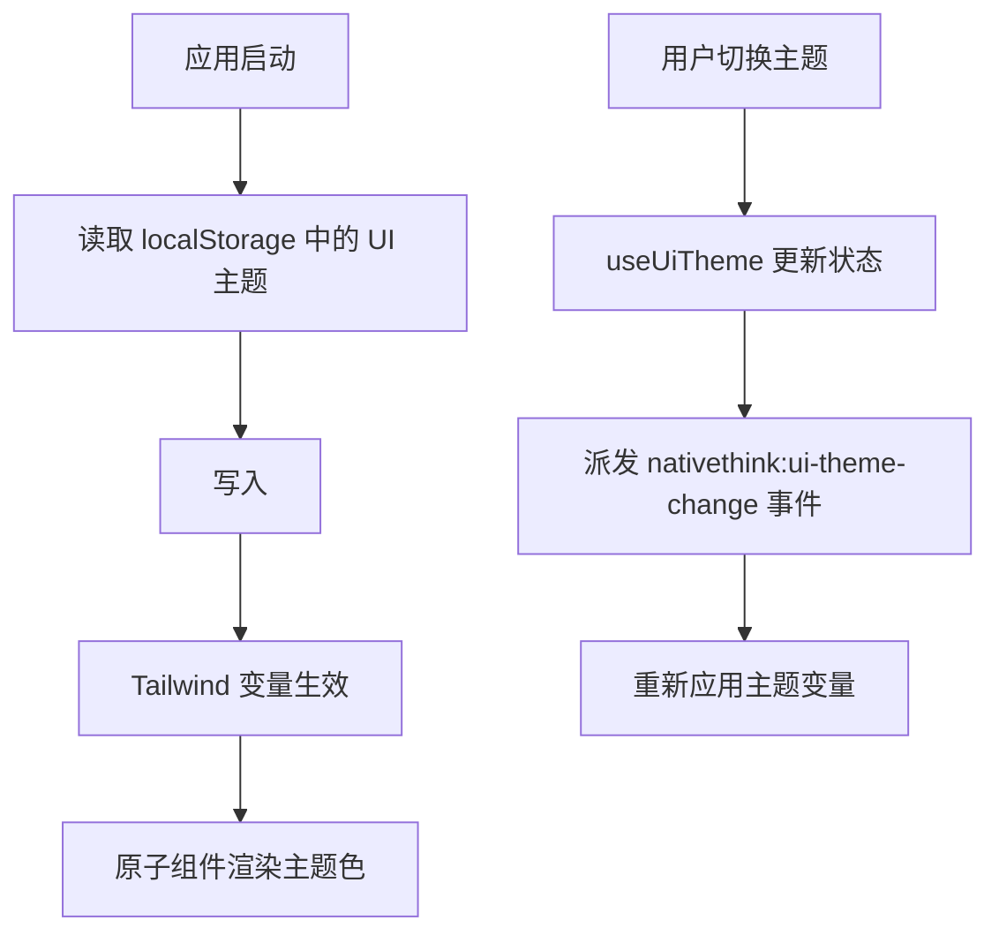

**图表来源**
- [ui-theme.ts:1-84](file://src/lib/ui-theme.ts#L1-L84)
- [tailwind-theme.css:1-200](file://src/tailwind-theme.css#L1-L200)
- [index.css:1-200](file://src/index.css#L1-L200)

### 样式覆盖方法
1. **通过 className 覆盖**
   - 大多数组件接受 className，可直接追加 Tailwind 类。
   - 推荐优先使用语义类，例如 bg-card、text-muted-foreground。
2. **通过 data-slot 覆盖**
   - 组件根节点普遍带有 data-slot 属性，可用于测试定位和精确样式覆盖。
3. **通过 CSS 变量覆盖**
   - 修改 --primary、--destructive、--success、--warning、--card、--background 等变量。
   - 切换 data-ui-theme 可批量更换整套主题。
4. **通过 cva 扩展变体**
   - 对 Button、Alert、Badge 等 cva 组件，可新增变体类型。
5. **通过 asChild 透传**
   - 将 Button 作为 Link 或 Icon 的包裹器，避免额外 DOM。

**章节来源**
- [ui-theme.ts:1-84](file://src/lib/ui-theme.ts#L1-L84)
- [tailwind-theme.css:1-200](file://src/tailwind-theme.css#L1-L200)
- [index.css:1-200](file://src/index.css#L1-L200)
- [components.json:1-21](file://components.json#L1-L21)

## 组合模式与使用示例

### 表单集成模式
推荐将 Form、FormField、Input、Select 组合使用：

- 使用 FormProvider 包裹整个表单。
- 使用 FormField 绑定字段名和校验规则。
- 使用 FormItem 包裹 Label、Control、Description、Message。
- 使用 FormControl 渲染 Input 或 Select。
- 使用 FormMessage 显示错误信息。

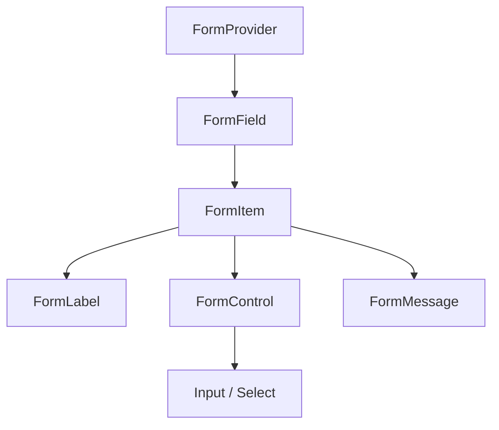

**图表来源**
- [form.tsx:1-167](file://src/components/ui/form.tsx#L1-L167)
- [input.tsx:1-21](file://src/components/ui/input.tsx#L1-L21)
- [select.tsx:1-200](file://src/components/ui/select.tsx#L1-L200)

### 弹窗表单模式
Dialog 与 Form 组合时，常见流程如下：

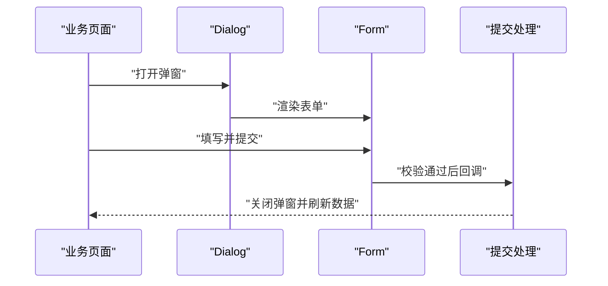

**图表来源**
- [dialog.tsx:1-143](file://src/components/ui/dialog.tsx#L1-L143)
- [form.tsx:1-167](file://src/components/ui/form.tsx#L1-L167)

### 状态管理与错误处理
- 表单状态集中在 react-hook-form 中，组件不维护冗余 state。
- 错误通过 FormMessage 渲染，FormControl 设置 aria-invalid。
- 非表单错误可使用 Alert，variant 使用 destructive、success 或 warning。
- 用户反馈可叠加 Tooltip 或 Toast（项目中另有 Sonner 组件）。

**章节来源**
- [form.tsx:1-167](file://src/components/ui/form.tsx#L1-L167)
- [alert.tsx:1-71](file://src/components/ui/alert.tsx#L1-L71)

### 数据展示模式
Table 常与 Badge、Button、DropdownMenu 组合：

- 第一列放名称或主键。
- 第二列放状态 Badge。
- 第三列放操作按钮或 DropdownMenu。
- 表头使用 TableHead，内容使用 TableCell。
- 长表格配合横向滚动和分页。

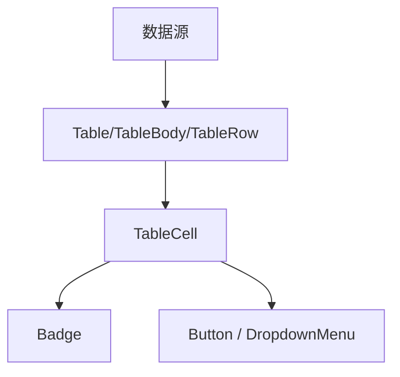

**图表来源**
- [table.tsx:1-116](file://src/components/ui/table.tsx#L1-L116)
- [badge.tsx:1-42](file://src/components/ui/badge.tsx#L1-L42)
- [button.tsx:1-82](file://src/components/ui/button.tsx#L1-L82)
- [dropdown-menu.tsx:1-200](file://src/components/ui/dropdown-menu.tsx#L1-L200)

## 故障排查

| 问题 | 可能原因 | 处理方法 |
|---|---|---|
| Select 无法选择空字符串 | 内部使用 EMPTY_SENTINEL 映射空值 | 确保 onValueChange 能处理空字符串；不要直接比较内部哨兵值 |
| FormMessage 不显示 | 未使用 FormField 包裹，或未注册字段 | 检查是否在 FormField 中使用 FormControl 和 FormMessage |
| 按钮点击无涟漪 | 使用了 asChild | asChild 模式不注入涟漪宿主，仅保留缩放反馈 |
| 主题切换闪烁 | 主题初始化时机不当 | 在应用挂载前调用 initUiTheme，并确保 localStorage 可读 |
| 表格在小屏溢出 | 未使用 Table 容器或外层 overflow 异常 | 使用 Table 外层 div，并检查父级是否强制 nowrap |
| 弹窗遮挡或滚动异常 | 父级 overflow 或 z-index 冲突 | 让 Dialog 使用默认 Portal，避免父级裁剪 |
| 样式不生效 | className 被覆盖或变量未生效 | 检查 data-slot、!important 使用、CSS 变量作用域 |

**章节来源**
- [select.tsx:1-200](file://src/components/ui/select.tsx#L1-L200)
- [form.tsx:1-167](file://src/components/ui/form.tsx#L1-L167)
- [button.tsx:1-82](file://src/components/ui/button.tsx#L1-L82)
- [dialog.tsx:1-143](file://src/components/ui/dialog.tsx#L1-L143)
- [table.tsx:1-116](file://src/components/ui/table.tsx#L1-L116)
- [ui-theme.ts:1-84](file://src/lib/ui-theme.ts#L1-L84)

## 结论
NativeThink 的原子 UI 组件库以 Radix UI 为基础、shadcn/ui 为包装、Tailwind 和 CSS 变量为主题载体，形成了一套稳定、可访问、可定制的前端组件体系。Button、Card、Dialog、Form、Input、Select、Table、Tabs、Accordion、Alert、Badge、DropdownMenu、Popover、Tooltip、NavigationMenu 等组件覆盖了大部分业务场景。

推荐的使用原则是：
- 优先使用原子组件提供的 props 和变体。
- 需要业务差异化时，先尝试 className 和 CSS 变量。
- 需要复杂交互时，优先基于 Radix 原语扩展，而不是从零实现可访问性。
- 表单状态交给 react-hook-form，组件只负责渲染和错误提示。
- 主题切换通过 data-ui-theme 和 CSS 变量完成，避免硬编码颜色。