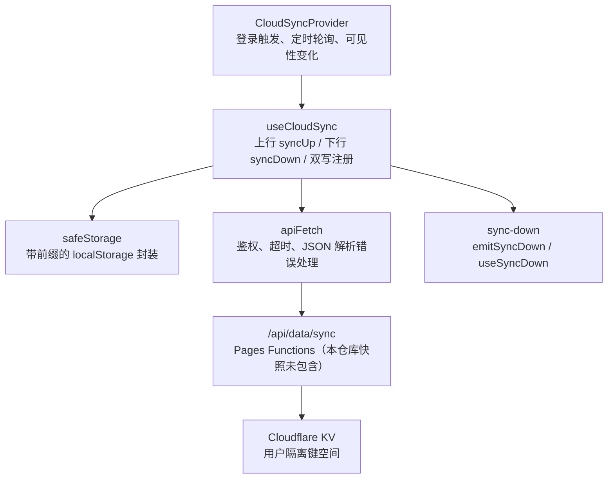
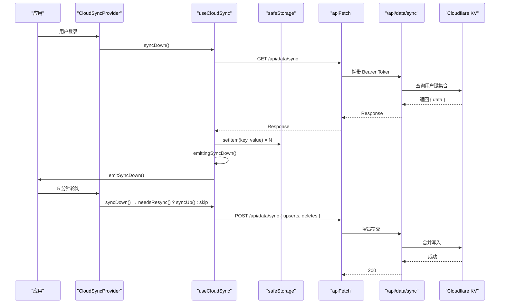
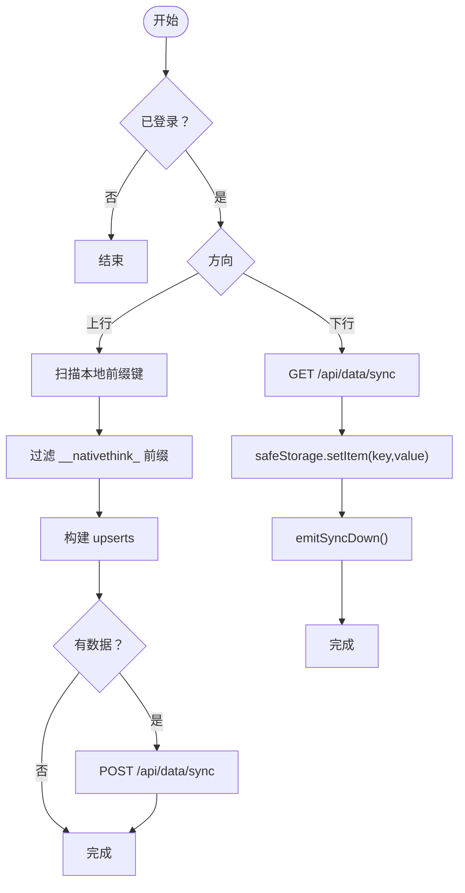
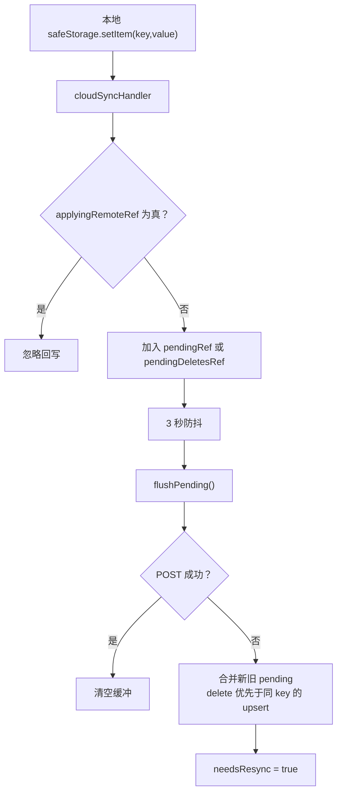
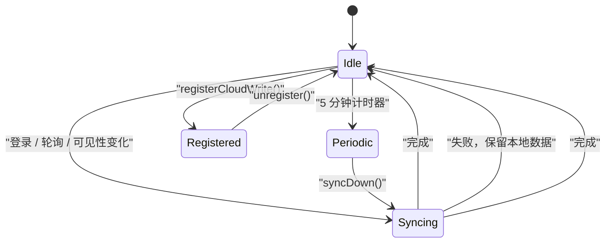
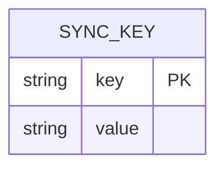
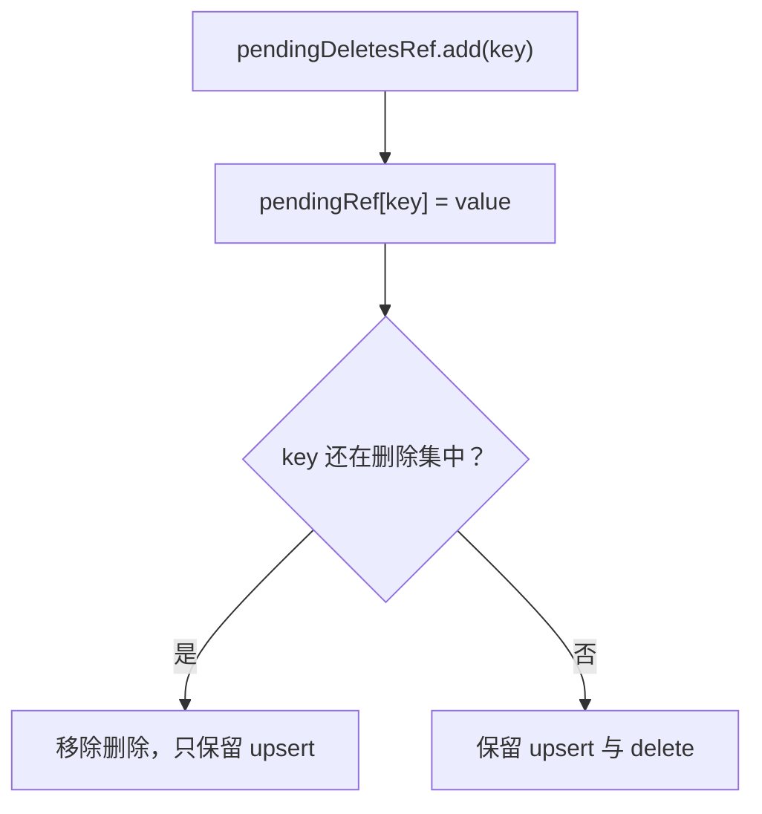
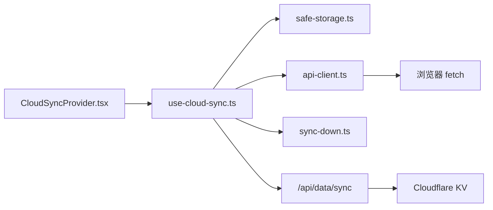

# 云同步与数据一致性

<cite>
**本文引用的文件**   
- [CloudSyncProvider.tsx](file://src/components/CloudSyncProvider.tsx)
- [use-cloud-sync.ts](file://src/lib/use-cloud-sync.ts)
- [safe-storage.ts](file://src/lib/safe-storage.ts)
- [sync-down.ts](file://src/lib/sync-down.ts)
- [api-client.ts](file://src/lib/api-client.ts)
- [verify-cloud-sync-hygiene.mjs](file://scripts/verify-cloud-sync-hygiene.mjs)
- [wrangler.toml](file://wrangler.toml)
</cite>

## 目录
1. [引言](#引言)
2. [项目结构](#项目结构)
3. [核心组件](#核心组件)
4. [架构总览](#架构总览)
5. [详细组件分析](#详细组件分析)
6. [依赖关系分析](#依赖关系分析)
7. [性能优化](#性能优化)
8. [故障恢复指南](#故障恢复指南)
9. [安全考虑](#安全考虑)
10. [结论](#结论)

## 引言
本文面向 NativeThink 应用的云同步机制，重点解释浏览器端与 Cloudflare Pages Functions / KV 之间的双向同步协议。文档覆盖增量同步、冲突检测、回声抑制、状态管理、版本控制、冲突解决策略、批量操作、断点续传、网络重试、故障恢复与安全设计。后端 API 与 KV 访问细节在本仓库当前快照中未直接暴露，因此对服务端实现以现有前端契约、环境变量和测试脚本为依据进行说明，并明确标注“代码未直接暴露”的部分。

## 项目结构
云同步相关代码主要分布在以下位置：
- 应用层入口：`src/components/CloudSyncProvider.tsx`
- 双向同步逻辑：`src/lib/use-cloud-sync.ts`
- 本地存储封装与双写钩子：`src/lib/safe-storage.ts`
- 下行重读广播：`src/lib/sync-down.ts`
- 认证与网络请求封装：`src/lib/api-client.ts`
- 云同步行为守卫测试：`scripts/verify-cloud-sync-hygiene.mjs`
- Cloudflare Pages 与 KV 绑定配置：`wrangler.toml`

**图表来源**
- [CloudSyncProvider.tsx:1-61](file://src/components/CloudSyncProvider.tsx#L1-L61)
- [use-cloud-sync.ts:1-191](file://src/lib/use-cloud-sync.ts#L1-L191)
- [safe-storage.ts:156-200](file://src/lib/safe-storage.ts#L156-L200)
- [sync-down.ts:1-49](file://src/lib/sync-down.ts#L1-L49)
- [api-client.ts:1-82](file://src/lib/api-client.ts#L1-L82)
- [wrangler.toml:1-9](file://wrangler.toml#L1-L9)

**章节来源**
- [CloudSyncProvider.tsx:1-61](file://src/components/CloudSyncProvider.tsx#L1-L61)
- [use-cloud-sync.ts:1-191](file://src/lib/use-cloud-sync.ts#L1-L191)
- [safe-storage.ts:1-216](file://src/lib/safe-storage.ts#L1-L216)
- [sync-down.ts:1-49](file://src/lib/sync-down.ts#L1-L49)
- [api-client.ts:1-82](file://src/lib/api-client.ts#L1-L82)
- [wrangler.toml:1-9](file://wrangler.toml#L1-L9)

## 核心组件
- `CloudSyncProvider`：在认证生命周期内驱动同步。登录后先拉取云端数据，再推送本地数据；之后每 5 分钟轮询一次，并在页面可见性变化时节流触发下行。
- `useCloudSync`：实现双向同步的核心 hook。提供 `syncUp`、`syncDown`、`registerCloudWrite`、`unregister`、`needsResync`、`syncing`、`lastSync` 等能力，并维护防抖缓冲、失败提示去抖、回声抑制标志、以及是否需要全量补推的标志。
- `safeStorage`：为每个用户生成带应用标识和用户标识的前缀键，封装 `localStorage`，并提供 `setCloudSyncHandler` 让每次写入可触发双写。
- `sync-down`：定义下行事件名，并提供订阅与发射函数，保证所有数据 hook 在云端数据落地后重新读取。
- `api-client`：封装带鉴权的 `fetch`，统一超时、异常 JSON 解析、服务器内部错误提示。
- `verify-cloud-sync-hygiene`：Node 环境下的云同步行为守卫测试，转译真实模块并断言下行不回声、失败有提示、周期任务不再无条件全量上推。

**章节来源**
- [CloudSyncProvider.tsx:1-61](file://src/components/CloudSyncProvider.tsx#L1-L61)
- [use-cloud-sync.ts:1-191](file://src/lib/use-cloud-sync.ts#L1-L191)
- [safe-storage.ts:1-216](file://src/lib/safe-storage.ts#L1-L216)
- [sync-down.ts:1-49](file://src/lib/sync-down.ts#L1-L49)
- [api-client.ts:1-82](file://src/lib/api-client.ts#L1-L82)
- [verify-cloud-sync-hygiene.mjs:1-200](file://scripts/verify-cloud-sync-hygiene.mjs#L1-L200)

## 架构总览
NativeThink 的云同步采用“客户端优先 + 服务端协调”的双向模型：
- 客户端负责增量变更收集、去重、防抖、回声抑制、失败重试标记、用户态 UI 反馈。
- 服务端通过 `/api/data/sync` 暴露 GET 与 POST 接口，分别用于下载全部同步键值、上传增量 upserts 与 deletes。
- 持久化层使用 Cloudflare KV，按用户隔离键空间存储。

**图表来源**
- [CloudSyncProvider.tsx:10-55](file://src/components/CloudSyncProvider.tsx#L10-L55)
- [use-cloud-sync.ts:30-191](file://src/lib/use-cloud-sync.ts#L30-L191)
- [safe-storage.ts:156-200](file://src/lib/safe-storage.ts#L156-L200)
- [api-client.ts:30-82](file://src/lib/api-client.ts#L30-L82)
- [wrangler.toml:5-9](file://wrangler.toml#L5-L9)

## 详细组件分析

### 双向同步协议
双向同步协议围绕 `/api/data/sync` 展开：
- GET：返回 `{ data: Record<string, string> }`，键名以 `__nativethink_` 开头，表示需要同步的应用数据。
- POST：接收 `{ upserts?: Record<string, string>, deletes?: string[] }`，将本地变更合并到云端。

客户端在 `syncUp` 中扫描本地带前缀的 `localStorage`，筛选出以 `__nativethink_` 开头的键作为应用数据，然后整批 POST 到服务端。客户端在 `syncDown` 中遍历远端返回的键值对，逐个写入 `safeStorage`，最后发射 `emitSyncDown` 通知各数据 hook 重新读取。

**图表来源**
- [use-cloud-sync.ts:58-142](file://src/lib/use-cloud-sync.ts#L58-L142)
- [use-cloud-sync.ts:144-191](file://src/lib/use-cloud-sync.ts#L144-L191)

**章节来源**
- [use-cloud-sync.ts:1-191](file://src/lib/use-cloud-sync.ts#L1-L191)

### 增量同步、冲突检测与回声抑制
- 增量同步：上行通过 `pendingRef` 与 `pendingDeletesRef` 累积待写入键与删除键，每 3 秒防抖后批量 POST。若某次 POST 失败，旧 pending 与新 pending 合并，并以 delete 优先于同 key 的 upsert 的规则重建删除集。
- 冲突检测：当前客户端实现没有显式的时间戳或版本号字段参与比较；冲突由服务端决定最终值。客户端仅根据是否仍有未落云的写入来决定后续是否需要全量补推。
- 回声抑制：`applyingRemoteRef` 在 `syncDown` 写入期间置真，阻止 `safeStorage` 双写处理器把云端数据再次当作本地写入而 POST 回去。这是避免“登录后周期性全量来回搬运”的关键机制。

**图表来源**
- [use-cloud-sync.ts:23-56](file://src/lib/use-cloud-sync.ts#L23-L56)
- [use-cloud-sync.ts:58-95](file://src/lib/use-cloud-sync.ts#L58-L95)
- [use-cloud-sync.ts:160-191](file://src/lib/use-cloud-sync.ts#L160-L191)

**章节来源**
- [use-cloud-sync.ts:1-191](file://src/lib/use-cloud-sync.ts#L1-L191)

### CloudSyncProvider 的状态管理与触发时机
`CloudSyncProvider` 本身不维护复杂业务状态机，而是根据认证状态与时间触发同步：
- 登录：立即执行 `syncDown()`，成功后执行 `syncUp()`，并注册 `registerCloudWrite()`。
- 登出：调用 `unregister()` 清理双写处理器与防抖定时器。
- 定时轮询：每 5 分钟执行 `syncDown()`，仅在 `needsResync()` 为真时才执行 `syncUp()`。
- 可见性变化：节流限制 60 秒内最多触发一次下行。

虽然需求描述中的状态机为 `Idle→Syncing→Conflict→Merging`，但当前代码并未在服务端返回冲突对象或使用显式的 Merging 流程；`Conflict` 更多体现为“存在需要全量补推的未落云写入”，由 `needsResyncRef` 表达。UI 可通过 `syncing` 显示正在同步，但不会进入独立的“手动合并界面”。

**图表来源**
- [CloudSyncProvider.tsx:10-55](file://src/components/CloudSyncProvider.tsx#L10-L55)
- [use-cloud-sync.ts:10-22](file://src/lib/use-cloud-sync.ts#L10-L22)
- [use-cloud-sync.ts:160-191](file://src/lib/use-cloud-sync.ts#L160-L191)

**章节来源**
- [CloudSyncProvider.tsx:1-61](file://src/components/CloudSyncProvider.tsx#L1-L61)
- [use-cloud-sync.ts:1-191](file://src/lib/use-cloud-sync.ts#L1-L191)

### Cloudflare KV 数据结构与访问模式
从前端契约可推断 KV 存储结构：
- 键名前缀：`__nativethink_`，用于区分应用同步数据与其他平台内部数据。
- 键值类型：键为字符串，值为 JSON 字符串。
- 访问模式：
  - GET `/api/data/sync`：返回该用户全部需要同步的键值对。
  - POST `/api/data/sync`：接收 upserts 与 deletes，服务端合并到 KV。
- 用户隔离：Cloudflare KV namespace 由 `wrangler.toml` 中的 `[[kv_namespaces]]` 绑定，命名空间 ID 固定，实际键空间应通过服务端的身份上下文隔离。

**图表来源**
- [use-cloud-sync.ts:1-10](file://src/lib/use-cloud-sync.ts#L1-L10)
- [use-cloud-sync.ts:58-95](file://src/lib/use-cloud-sync.ts#L58-L95)
- [use-cloud-sync.ts:118-142](file://src/lib/use-cloud-sync.ts#L118-L142)
- [wrangler.toml:5-9](file://wrangler.toml#L5-L9)

**章节来源**
- [use-cloud-sync.ts:1-191](file://src/lib/use-cloud-sync.ts#L1-L191)
- [wrangler.toml:1-9](file://wrangler.toml#L1-L9)

### 数据版本控制与冲突解决策略
当前实现的版本控制特点如下：
- 无显式版本号字段：键值直接以字符串形式存储，不包含 `_version`、`_timestamp`、`_conflictId` 等元数据。
- 无自动合并算法：客户端不会比较本地与云端差异，也不会尝试自动合并字段级冲突。
- 冲突解决策略：
  - 自动合并：当前未实现。
  - 手动合并：当前也未暴露专用 UI；冲突通过“需要全量补推”的标记间接表达。
- 实际行为更接近“最近写入者胜”或“服务端权威”：如果服务端只是简单覆盖，则最后一次成功 POST 的值胜出；如果服务端支持更复杂的合并，则应以服务端为准。

建议的未来扩展：
- 在每个同步值中加入轻量元数据，例如 `{ value, version, lastModified, deviceId }`。
- 引入基于时间的冲突检测：当本地与云端均修改过同一键且时间不可判定时，进入 Conflict 状态。
- 提供手动合并 UI：展示本地版本、云端版本，并允许用户选择保留本地、保留云端或合并字段。

**章节来源**
- [use-cloud-sync.ts:58-191](file://src/lib/use-cloud-sync.ts#L58-L191)

### 双写处理器与失效语义
`safeStorage` 在每次 `setItem` 成功后会调用注册的 cloudSyncHandler；`removeItem` 会传入 null 表示删除。这使本地写入能自然转化为云端增量。同时，删除语义经过特殊处理：
- 如果同一个 key 既有 upsert 又有 delete，则以 delete 优先。
- 如果本地删除后又被重新写入，则删除被取消，只保留 upsert。

**图表来源**
- [use-cloud-sync.ts:58-95](file://src/lib/use-cloud-sync.ts#L58-L95)
- [safe-storage.ts:156-200](file://src/lib/safe-storage.ts#L156-L200)

**章节来源**
- [use-cloud-sync.ts:58-95](file://src/lib/use-cloud-sync.ts#L58-L95)
- [safe-storage.ts:156-200](file://src/lib/safe-storage.ts#L156-L200)

### 下行重读广播
`sync-down.ts` 提供单一出口 `emitSyncDown`，`use-cloud-sync` 在成功落地云端数据后调用它。各数据 hook 通过 `onSyncDown` 或 `useSyncDown` 订阅，从而在云数据更新后重新从 `safeStorage` 读取最新值。这一设计解决了之前“内存缓存陈旧导致云端新值被本机旧实例覆盖”的问题。

**章节来源**
- [sync-down.ts:1-49](file://src/lib/sync-down.ts#L1-L49)
- [use-cloud-sync.ts:118-142](file://src/lib/use-cloud-sync.ts#L118-L142)

## 依赖关系分析

**图表来源**
- [CloudSyncProvider.tsx:1-61](file://src/components/CloudSyncProvider.tsx#L1-L61)
- [use-cloud-sync.ts:1-191](file://src/lib/use-cloud-sync.ts#L1-L191)
- [safe-storage.ts:156-200](file://src/lib/safe-storage.ts#L156-L200)
- [api-client.ts:1-82](file://src/lib/api-client.ts#L1-L82)
- [sync-down.ts:1-49](file://src/lib/sync-down.ts#L1-L49)

**章节来源**
- [CloudSyncProvider.tsx:1-61](file://src/components/CloudSyncProvider.tsx#L1-L61)
- [use-cloud-sync.ts:1-191](file://src/lib/use-cloud-sync.ts#L1-L191)
- [safe-storage.ts:1-216](file://src/lib/safe-storage.ts#L1-L216)
- [api-client.ts:1-82](file://src/lib/api-client.ts#L1-L82)
- [sync-down.ts:1-49](file://src/lib/sync-down.ts#L1-L49)

## 性能优化
当前实现已包含多项性能优化：
- 批量操作：本地写入通过 `pendingRef` 与 `pendingDeletesRef` 累积，3 秒防抖后一次性 POST。
- 减少不必要的全量上推：登录后先下行再上行，周期轮询只在 `needsResync` 为真时再做全量补推。
- 回声抑制：`applyingRemoteRef` 防止 `syncDown` 写入触发的双写。
- 失败提示去抖：同一方向的失败提示 60 秒内最多出现一次。
- 可见性节流：页面可见性变化导致的同步 60 秒内最多触发一次。
- 单条写入失败容错：`safeStorage.setItem` 返回布尔值，吞掉配额满等异常，但不影响整体 UI。
- 网络超时：`apiFetch` 默认 15 秒超时，超时抛出可读错误。

尚未实现但值得考虑的优化：
- 分页或范围同步：如果 KV 中同步键数量很大，GET 可能返回过大 payload。
- 增量 diff：客户端计算本地与上次已知版本的差集，减少 POST 体积。
- 指数退避重试：对网络错误实现重试队列，而不是静默等待下一次轮询。
- 压缩传输：对大型 JSON 值启用 gzip 或 msgpack。

**章节来源**
- [use-cloud-sync.ts:10-191](file://src/lib/use-cloud-sync.ts#L10-L191)
- [CloudSyncProvider.tsx:10-55](file://src/components/CloudSyncProvider.tsx#L10-L55)
- [api-client.ts:1-82](file://src/lib/api-client.ts#L1-L82)
- [safe-storage.ts:156-200](file://src/lib/safe-storage.ts#L156-L200)

## 故障恢复指南

### 网络异常处理
- 上行失败：`flushPending` 捕获异常后将旧 pending 与新 pending 合并，并设置 `needsResync = true`，同时弹出“云同步暂未成功，数据已保存在本机并会自动重试”的提示。
- 下行失败：`syncDown` 捕获异常后提示“云端数据暂未取回，本机数据不受影响”，不影响本地已有数据。
- 单次写入失败：`safeStorage.setItem` 返回 false，`syncDown` 统计 dropped 数量并提示存储空间可能已满。

建议排查步骤：
1. 检查浏览器控制台是否有 401、403、5xx 响应。
2. 确认用户已登录且 `Authorization` 头存在。
3. 检查 `needsResync` 是否为真，必要时手动触发一次 `syncUp`。
4. 如果是存储空间不足，清理不必要的本地数据或释放 KV 配额。

**章节来源**
- [use-cloud-sync.ts:58-142](file://src/lib/use-cloud-sync.ts#L58-L142)
- [api-client.ts:30-82](file://src/lib/api-client.ts#L30-L82)

### 数据损坏修复
- 匿名 ID 恢复：`safeStorage` 在引导键丢失时会尝试从既有前缀键中恢复匿名 ID，避免历史数据“隐身”。
- 键迁移：`safeStorage` 支持从旧前缀迁移到新前缀，确保不同用户或应用隔离后的数据平滑过渡。
- 下行单项写入失败：当部分键无法写入本地时，`needsResync` 会被置真，下次周期任务可再次尝试全量补推。

建议修复步骤：
1. 清理异常的前缀键或匿名 ID 后重新打开应用，观察是否能恢复。
2. 使用导出备份工具恢复关键数据。
3. 如怀疑 KV 数据损坏，联系后端管理员校验 KV namespace 中的数据完整性。

**章节来源**
- [safe-storage.ts:1-155](file://src/lib/safe-storage.ts#L1-L155)
- [use-cloud-sync.ts:118-142](file://src/lib/use-cloud-sync.ts#L118-L142)

### 手动干预流程
- 强制全量上推：在开发者调试场景下，可调用 `syncUp()` 主动推送本地数据。
- 强制全量下拉：调用 `syncDown()` 重新拉取云端数据。
- 禁用双写：调用 `unregister()` 停止本地写入触发云端同步，适合数据迁移或导入阶段。
- 验证行为：运行 `scripts/verify-cloud-sync-hygiene.mjs`，检查下行回声、失败提示、周期任务补推逻辑是否符合预期。

注意：手动干预可能覆盖其他设备的最新数据，应在确认冲突解决策略后再执行。

**章节来源**
- [use-cloud-sync.ts:160-191](file://src/lib/use-cloud-sync.ts#L160-L191)
- [verify-cloud-sync-hygiene.mjs:1-200](file://scripts/verify-cloud-sync-hygiene.mjs#L1-L200)

## 安全考虑
当前实现的安全要点包括：
- 鉴权：`apiFetch` 从本地存储读取 token，并在请求头中添加 `Authorization: Bearer <token>`。
- 超时保护：请求超过 15 秒会抛出超时错误，避免长时间挂起。
- 异常 JSON 解析：对 Cloudflare 内部错误码、HTML 响应做友好提示。
- 本地存储隔离：`safeStorage` 使用应用标识和用户标识生成前缀，避免不同用户或不同应用之间串数据。
- 匿名 ID 自愈：即使引导键丢失，也能尽量恢复历史数据的归属。

尚未在当前前端代码中直接体现的安全措施：
- 数据加密：KV 中的值目前以 JSON 字符串形式存取，未见客户端加密或服务端加密字段。
- 访问控制策略：KV namespace 的读写权限应由 Cloudflare Pages Functions 与 KV 策略共同保障，具体策略不在前端代码中。
- 隐私保护：同步内容包含学习统计、收藏、拼写句子库等敏感数据，应评估最小化同步字段与脱敏策略。

建议补充：
- 对敏感值进行客户端加密，密钥由后端颁发或与会话绑定。
- 在后端增加速率限制、请求签名、设备指纹校验。
- 对用户可删除数据提供端到端备份与恢复流程。

**章节来源**
- [api-client.ts:1-82](file://src/lib/api-client.ts#L1-L82)
- [safe-storage.ts:1-155](file://src/lib/safe-storage.ts#L1-L155)
- [wrangler.toml:5-9](file://wrangler.toml#L5-L9)

## 结论
NativeThink 的云同步机制以 `useCloudSync` 为核心，结合 `CloudSyncProvider` 的生命周期驱动、`safeStorage` 的双写钩子、`sync-down` 的下行广播、以及 `apiFetch` 的网络封装，实现了较为稳健的双向同步。当前实现重点解决了下行回声、失败提示、周期全量上推等问题，并通过 `needsResync` 控制补推行为。

然而，当前版本并未实现显式的版本控制、自动冲突检测与手动合并 UI。生产环境中建议逐步引入：
- 轻量级版本字段与时间戳。
- 服务端冲突检测与可选自动合并策略。
- 用户可见的冲突解决界面。
- 更完善的网络重试、分页、压缩与加密方案。

通过这些改进，NativeThink 的云同步可以在保持离线友好的同时，进一步提升多设备间的数据一致性与用户体验。