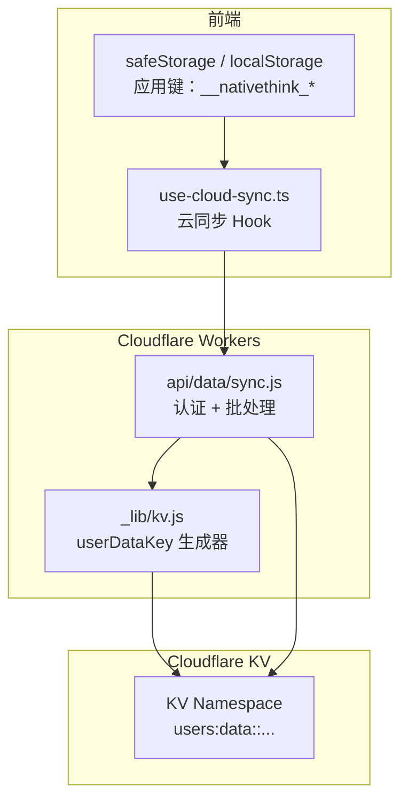
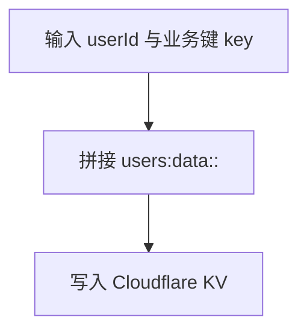
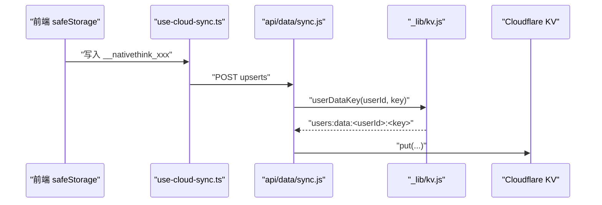
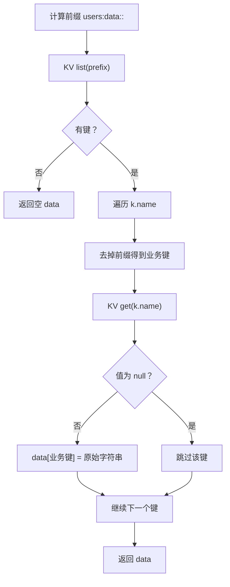
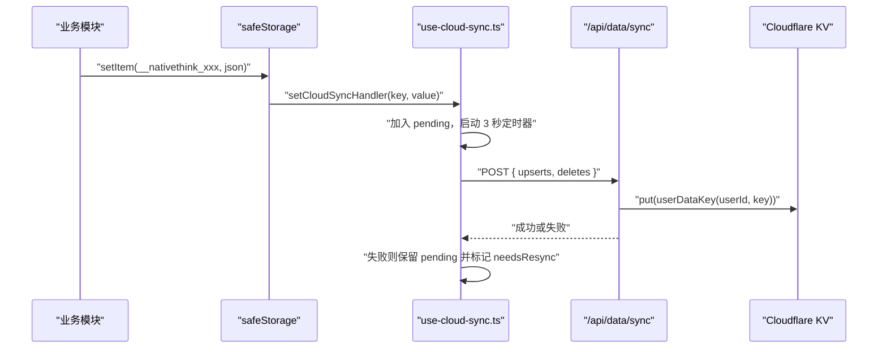
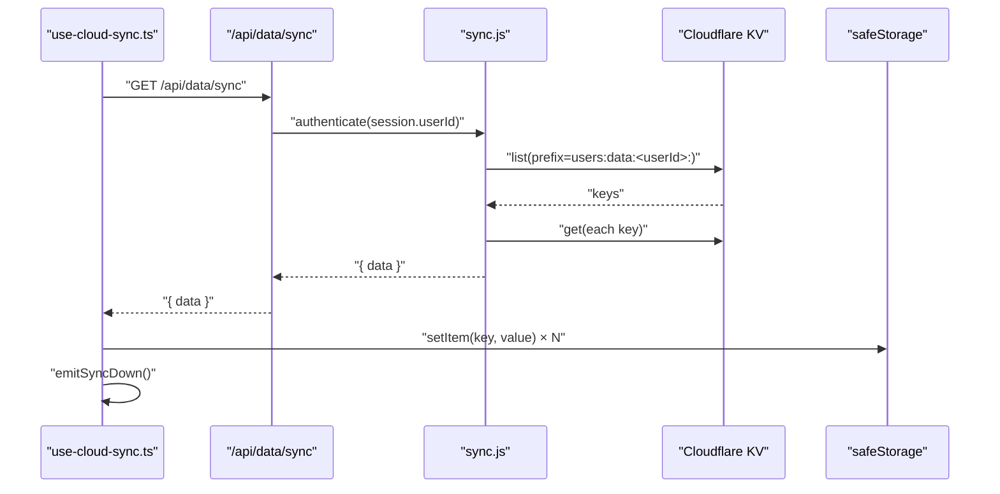
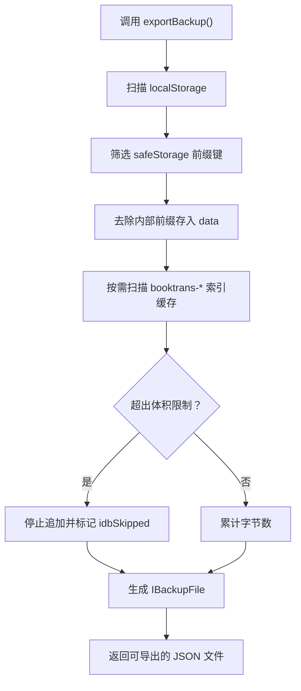
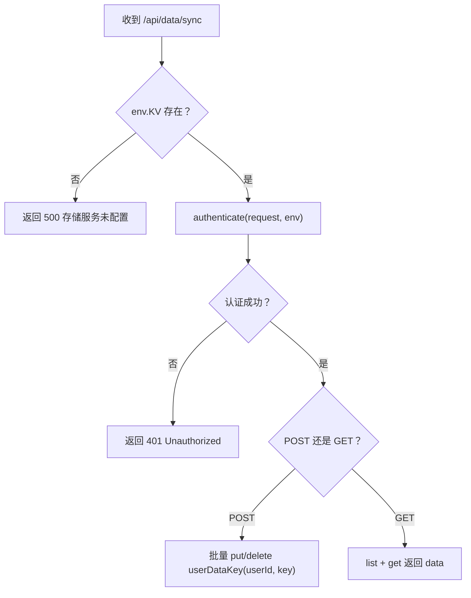

# 云端数据存储结构

<cite>
**本文引用的文件**
- [functions/_lib/kv.js](file://functions/_lib/kv.js)
- [functions/api/data/sync.js](file://functions/api/data/sync.js)
- [src/lib/use-cloud-sync.ts](file://src/lib/use-cloud-sync.ts)
- [src/lib/backup.ts](file://src/lib/backup.ts)
- [wrangler.toml](file://wrangler.toml)
- [docs/modules/cloud-sync.md](file://docs/modules/cloud-sync.md)
</cite>

## 目录
1. [简介](#简介)
2. [项目结构与数据层定位](#项目结构与数据层定位)
3. [键命名与键空间设计](#键命名与键空间设计)
4. [KV 存储模型与查询模式](#kv-存储模型与查询模式)
5. [扁平键结构的取舍](#扁平键结构的取舍)
6. [同步流程与一致性](#同步流程与一致性)
7. [配额、性能与限制](#配额性能与限制)
8. [数据迁移与备份方案](#数据迁移与备份方案)
9. [键值映射表与示例](#键值映射表与示例)
10. [访问权限控制最佳实践](#访问权限控制最佳实践)
11. [故障排查指南](#故障排查指南)
12. [结论](#结论)

## 简介
本文面向 Cloudflare Workers KV 中 NativeThink 应用的用户数据存储结构，重点说明：

- `userDataKey` 的键命名规则与前缀约定。
- 应用数据前缀 `__nativethink_` 与平台内部数据的区分方式。
- KV 中的数据类型（字符串化 JSON）、键空间隔离和基于前缀的查询模式。
- 采用扁平键结构的原因、对同步性能与一致性的影响。
- KV 配额限制、读写性能特征、数据迁移策略和备份方案。
- 键值映射、示例数据以及访问权限控制的最佳实践。

本仓库通过后端 API `/api/data/sync` 把浏览器端 `safeStorage` 中的用户数据以 KV 形式持久化；前端则通过 React Hook 做增量双写、全量补推和下行合并。

**章节来源**
- [docs/modules/cloud-sync.md:1-12](file://docs/modules/cloud-sync.md#L1-L12)

## 项目结构与数据层定位
KV 相关代码分布在以下层次：

**图示来源**
- [src/lib/use-cloud-sync.ts:1-191](file://src/lib/use-cloud-sync.ts#L1-L191)
- [functions/api/data/sync.js:1-63](file://functions/api/data/sync.js#L1-L63)
- [functions/_lib/kv.js:1-6](file://functions/_lib/kv.js#L1-L6)

### 关键组件职责
| 组件 | 职责 | 是否直接操作 KV |
|---|---|---|
| `use-cloud-sync.ts` | 登录态管理、上行双写、下行合并、回声抑制、失败重试标记 | 否，通过 HTTP 调用 |
| `api/data/sync.js` | 鉴权、POST 批量写入、GET 按前缀拉取 | 是 |
| `_lib/kv.js` | 生成用户级 KV 键 | 是 |
| `backup.ts` | 导出/恢复本地 `safeStorage` 与 IndexedDB 翻译缓存 | 否，仅本地备份 |

**章节来源**
- [src/lib/use-cloud-sync.ts:1-191](file://src/lib/use-cloud-sync.ts#L1-L191)
- [functions/api/data/sync.js:1-63](file://functions/api/data/sync.js#L1-L63)
- [functions/_lib/kv.js:1-6](file://functions/_lib/kv.js#L1-L6)
- [src/lib/backup.ts:1-105](file://src/lib/backup.ts#L1-L105)

## 键命名与键空间设计

### `userDataKey` 规则
`userDataKey(userId, key)` 生成形如 `users:data:${userId}:${key}` 的 KV 键。它承担两个作用：

1. **用户隔离**：每个用户的键都包含其 `userId`，避免多用户共享同一 KV namespace。
2. **业务域隔离**：固定前缀 `users:data:` 把用户数据与其他可能的 KV 用途分开。

**图示来源**
- [functions/_lib/kv.js:1-6](file://functions/_lib/kv.js#L1-L6)

### 应用数据前缀与平台内部数据
前端使用 `safeStorage` 把所有应用数据写入带前缀的 localStorage 键。云同步逻辑进一步用 `DATA_PREFIX = '__nativethink_'` 过滤只上传“应用数据”，跳过平台或实现细节产生的其他键。

| 类别 | 键前缀或范围 | 是否上云 | 说明 |
|---|---|---:|---|
| 用户 KV 键 | `users:data:<userId>:` | 是 | 后端统一封装 |
| 应用数据键 | `__nativethink_*` | 是 | 经 `safeStorage` 且被同步逻辑显式选择 |
| 平台内部键 | 非 `__nativethink_` | 否 | 例如 token、主题开关、瞬时 UI 状态等 |
| 非 `safeStorage` 数据 | 裸 `localStorage` 键 | 否 | 例如 AI Key、页面瞬时内存等 |

**章节来源**
- [src/lib/use-cloud-sync.ts:1-20](file://src/lib/use-cloud-sync.ts#L1-L20)
- [src/lib/use-cloud-sync.ts:70-95](file://src/lib/use-cloud-sync.ts#L70-L95)
- [docs/modules/cloud-sync.md:19-47](file://docs/modules/cloud-sync.md#L19-L47)

### 键空间隔离边界
KV 层的隔离由 `userId` 决定，而前端侧的隔离由两层组成：

1. `safeStorage` 提供带 app id 和 userId 的前缀键，用于浏览器端隔离。
2. `userDataKey` 在 KV 层再次包裹 `userId`，确保服务端写入时不会串号。

**图示来源**
- [src/lib/use-cloud-sync.ts:70-105](file://src/lib/use-cloud-sync.ts#L70-L105)
- [functions/api/data/sync.js:20-40](file://functions/api/data/sync.js#L20-L40)
- [functions/_lib/kv.js:1-6](file://functions/_lib/kv.js#L1-L6)

**章节来源**
- [functions/_lib/kv.js:1-6](file://functions/_lib/kv.js#L1-L6)
- [functions/api/data/sync.js:1-63](file://functions/api/data/sync.js#L1-L63)
- [src/lib/use-cloud-sync.ts:70-105](file://src/lib/use-cloud-sync.ts#L70-L105)

## KV 存储模型与查询模式

### 数据类型
KV 值是字符串。前端把对象序列化为 JSON 字符串后再写入，读取后由上层逻辑再解析。因此：

- 单个 KV 条目不是嵌套对象，而是扁平字符串值。
- 业务数据结构由应用层自行维护，例如词库进度、收藏、学习统计、拼写记录等。

### 查询模式：前缀列表
下载流程使用 KV 的 `list({ prefix })` 枚举当前用户的所有键，再逐个 `get` 取值：

1. 构造前缀：`users:data:<userId>:`。
2. 调用 `env.KV.list({ prefix })`。
3. 遍历返回键名，去掉前缀得到业务键。
4. 逐个 `env.KV.get(name)` 获取原始字符串值。
5. 组装为 `{ data: { businessKey: rawString } }` 返回给前端。

**图示来源**
- [functions/api/data/sync.js:42-63](file://functions/api/data/sync.js#L42-L63)

**章节来源**
- [functions/api/data/sync.js:42-63](file://functions/api/data/sync.js#L42-L63)

## 扁平键结构的取舍

### 为什么不用嵌套对象
KV 本身是键值存储，没有原生对象树语义。当前实现直接把业务键作为 KV 键的一部分，而不是把一个大型对象整体存进一个键：

- 每个功能模块通常只维护少量键，例如收藏、学习统计、会话断点、自定义词汇等。
- 扁平键便于按前缀列出、删除、增量更新，也更容易做迁移和审计。
- 前端已经通过 `safeStorage` 和 `__nativethink_` 前缀做了功能域划分，不需要再用深层对象模拟命名空间。

### 对同步性能的影响
- **优点**：可以按键增删改，避免整对象覆盖带来的不必要拷贝。
- **缺点**：每次下载会先 `list` 再逐个 `get`，如果单用户键数量很多，会产生多次网络往返。
- **缓解措施**：当前代码已把写入做 3 秒防抖和批量 upsert/delete，减少频繁 POST；但下行仍是一次拉出全部键。

### 对一致性的影响
- KV 是最终一致的键值存储，没有事务。
- 同步接口不做并发冲突解决，“后写获胜”；跨设备并行修改可能丢失一方变更。
- 前端通过下行事件通知各模块重新读取，但模块级缓存若未正确失效，可能出现旧内存覆盖新值的问题。文档注释明确记录了多个订阅者及缓存失效要求。

**章节来源**
- [src/lib/use-cloud-sync.ts:100-191](file://src/lib/use-cloud-sync.ts#L100-L191)
- [docs/modules/cloud-sync.md:47-64](file://docs/modules/cloud-sync.md#L47-L64)

## 同步流程与一致性

### 上行：增量双写
当用户通过 `safeStorage` 写入 `__nativethink_*` 键时：

1. `safeStorage` 触发双写处理器。
2. 写入进入 `pendingRef`，删除进入 `pendingDeletesRef`。
3. 3 秒无新写入后触发 `flushPending`。
4. 向 `/api/data/sync` 发送批量 upsert 和 delete。
5. 失败时保留 pending 数据并标记需要后续全量补推。

**图示来源**
- [src/lib/use-cloud-sync.ts:60-105](file://src/lib/use-cloud-sync.ts#L60-L105)
- [functions/api/data/sync.js:20-40](file://functions/api/data/sync.js#L20-L40)

### 下行：拉取并合并
1. 调用 `/api/data/sync` GET。
2. 后端按用户前缀列出并取值。
3. 前端对每个键调用 `safeStorage.setItem`。
4. 设置 `applyingRemoteRef.current = true` 防止回声。
5. 派发同步事件，让订阅模块刷新。

**图示来源**
- [src/lib/use-cloud-sync.ts:106-155](file://src/lib/use-cloud-sync.ts#L106-L155)
- [functions/api/data/sync.js:42-63](file://functions/api/data/sync.js#L42-L63)

### 回声抑制与全量补推
- 下行写入期间设置 `applyingRemoteRef.current = true`，使双写处理器直接返回，不再把云端值又推回云端。
- 同步失败或未落云写入会设置 `needsResyncRef.current = true`，后续轮询才进行全量补推。
- 登录后首次同步会无条件先拉后推，保证云端有本地既有数据。

**章节来源**
- [src/lib/use-cloud-sync.ts:15-191](file://src/lib/use-cloud-sync.ts#L15-L191)
- [docs/modules/cloud-sync.md:12-64](file://docs/modules/cloud-sync.md#L12-L64)

## 配额、性能与限制

### KV 配置
KV namespace 通过 Wrangler 绑定到 `env.KV`，binding 名称必须为 `KV`。部署时需要替换实际的 namespace ID。

| 配置项 | 当前值或约定 |
|---|---|
| binding 名称 | `KV` |
| 命名空间 | 通过 `wrangler.toml` 的 `[[kv_namespaces]]` 绑定 |
| 环境检查 | 若 `env.KV` 不存在，同步接口返回 500 |

**章节来源**
- [wrangler.toml:1-9](file://wrangler.toml#L1-L9)
- [functions/api/data/sync.js:10-18](file://functions/api/data/sync.js#L10-L18)

### 配额限制
仓库中没有对 KV 单条大小、总键数或请求量的硬编码上限；行为受 Cloudflare KV 服务配额约束。需要注意：

- 单条 KV 值不能过大，否则序列化后的 JSON 字符串会浪费配额。
- 大量小键会增加 `list` + 逐个 `get` 的下行成本。
- 同步接口当前没有分页或分批拉取，键过多时会一次性枚举并逐条读取。
- 前端本地安全存储也有配额问题；文档中多处捕获配额失败并降级。

### 读写性能特征
| 操作 | 行为 | 性能关注点 |
|---|---|---|
| 上行写入 | 3 秒防抖 + 批量 upsert/delete | 高频写入应合并，避免每秒多次 POST |
| 上行失败 | 保留 pending 并延迟重试 | 离线场景下不要静默丢弃 |
| 下行读取 | 一次 `list` + 逐个 `get` | 用户键越多，往返越多 |
| 删除 | 单独 delete 列表 | 删除后不应再被下次 list/get 拉回 |
| 鉴权 | 每次同步请求校验 session | 失败时返回 401 或 500 |

**章节来源**
- [functions/api/data/sync.js:1-63](file://functions/api/data/sync.js#L1-L63)
- [src/lib/use-cloud-sync.ts:60-155](file://src/lib/use-cloud-sync.ts#L60-L155)

## 数据迁移与备份方案

### 键迁移策略
项目中存在多处历史键迁移模式：

- 旧键与新键并存，加载时迁移一次，然后删除旧键。
- 从全局键迁移到带前缀的 `safeStorage` 键。
- 从单键改为按维度分桶，例如按 level 或 bookId。
- 对拼写、收藏、词汇会话等模块都有迁移或兼容逻辑。

典型模式包括：

| 场景 | 迁移方式 |
|---|---|
| 旧版收藏键 | 读旧键 → 写入新键 → 删除旧键 |
| 拼写断点 | 从全局键迁移到按级别分桶键 |
| 词库进度 | 从裸 `localStorage` 迁移到 `safeStorage` |
| 语块翻译缓存 | 修正旧键名到新键名 |

**章节来源**
- [src/lib/use-favorites.ts:20-28](file://src/lib/use-favorites.ts#L20-L28)
- [src/lib/spelling-resume.ts:8-22](file://src/lib/spelling-resume.ts#L8-L22)
- [src/lib/use-word-learning.ts:70-76](file://src/lib/use-word-learning.ts#L70-L76)
- [src/lib/capped-cache.ts:108-112](file://src/lib/capped-cache.ts#L108-L112)

### 备份方案
本地备份模块负责在重装或安装包更新前导出学习数据，覆盖范围包括：

1. `safeStorage` 中的所有应用数据键。
2. IndexedDB 中的整书对照翻译缓存。

备份文件结构包含：

| 字段 | 含义 |
|---|---|
| `app` | 应用标识，固定为 `NativeThink` |
| `version` | 备份格式版本 |
| `exportedAt` | 导出时间 |
| `data` | 去掉内部前缀后的 `safeStorage` 键值 |
| `idb` | 可选的 IndexedDB 整书翻译缓存 |

导入时：

- 跳过非法类型值。
- 只恢复以 `booktrans-` 开头的 IndexedDB 键。
- 单项失败不阻断整体恢复。
- 超过体积阈值时跳过部分 IDB 内容并标记 `idbSkipped`。

**图示来源**
- [src/lib/backup.ts:1-105](file://src/lib/backup.ts#L1-L105)

**章节来源**
- [src/lib/backup.ts:1-105](file://src/lib/backup.ts#L1-L105)

## 键值映射表与示例

### 后端 KV 键映射
| 业务键 | 前端键 | KV 键 | 值类型 | 说明 |
|---|---|---|---|---|
| 收藏 | `__nativethink_favorites` | `users:data:<userId>:__nativethink_favorites` | JSON 字符串 | 用户收藏词条 |
| 学习统计 | `__nativethink_learning_stats` | `users:data:<userId>:__nativethink_learning_stats` | JSON 字符串 | 学习统计数据 |
| 日历 | `__nativethink_calendar` | `users:data:<userId>:__nativethink_calendar` | JSON 字符串 | 学习日历 |
| 成就 | `__nativethink_achievements` | `users:data:<userId>:__nativethink_achievements` | JSON 字符串 | 成就列表 |
| 思维模式进度 | `__nativethink_think_pattern_progress` | `users:data:<userId>:__nativethink_think_pattern_progress` | JSON 字符串 | 思维模式练习进度 |
| 拼写句子库 | `__nativethink_spelling_sentences` | `users:data:<userId>:__nativethink_spelling_sentences` | JSON 字符串 | 拼写练习句子 |
| 短语学习 | `__nativethink_phrase_learning` | `users:data:<userId>:__nativethink_phrase_learning` | JSON 字符串 | 短语学习进度 |
| 自定义词汇 | `__nativethink_custom_words` | `users:data:<userId>:__nativethink_custom_words` | JSON 字符串 | 用户自定义词表 |
| 单词笔记 | `__nativethink_word_notes` | `users:data:<userId>:__nativethink_word_notes` | JSON 字符串 | 单词笔记 |
| 阅读批注 | `__nativethink_reader_notes_<contentId>` | `users:data:<userId>:__nativethink_reader_notes_<contentId>` | JSON 字符串 | 按内容分桶的批注 |

注意：这些键是否实际出现在 KV 中，取决于它们是否通过 `safeStorage` 写入并被同步逻辑选中。

### 不会上云的键示例
| 键 | 存储位置 | 原因 |
|---|---|---|
| `__nativethink_auth_token` | 裸 `localStorage` | 认证 token，不走 `safeStorage` |
| `ai_key_<provider>` | 裸 `localStorage` | AI Key 故意不上云 |
| `__nativethink_ui_theme` | 主题模块 | 外观偏好，通常不同步 |
| 页面瞬时内存 | 模块变量或临时 storage | 视图状态，不应跨设备 |

**章节来源**
- [src/lib/api-client.ts:1-15](file://src/lib/api-client.ts#L1-L15)
- [src/lib/ui-theme.ts:1-40](file://src/lib/ui-theme.ts#L1-L40)
- [src/pages/ArticlePage/components/reader-shared.ts:144-145](file://src/pages/ArticlePage/components/reader-shared.ts#L144-L145)
- [src/lib/use-cloud-sync.ts:70-95](file://src/lib/use-cloud-sync.ts#L70-L95)

## 访问权限控制最佳实践

### 当前鉴权机制
同步接口要求携带有效 session：

1. 若 `env.KV` 未配置，返回 500。
2. 调用 `authenticate(request, env)` 验证会话。
3. 未认证返回 401。
4. 成功后使用 `session.userId` 生成 KV 前缀。

**图示来源**
- [functions/api/data/sync.js:10-40](file://functions/api/data/sync.js#L10-L40)

### 权限控制建议
| 场景 | 建议 |
|---|---|
| 新增 KV 写入接口 | 复用 `authenticate`，禁止匿名访问 |
| 新增 KV 查询接口 | 使用相同前缀，只允许查询自己 `userId` 的数据 |
| 管理员工具 | 单独鉴权路径，不要复用普通用户同步接口 |
| 敏感键 | 避免把密码、密钥、AI Key 放入 KV；本项目已有意把 AI Key 留在裸 `localStorage` |
| 批量接口 | 保持 upsert/delete 分离，防止攻击方伪造删除列表 |
| 错误响应 | 对外不暴露内部堆栈，只返回通用错误信息 |

**章节来源**
- [functions/api/data/sync.js:1-63](file://functions/api/data/sync.js#L1-L63)
- [docs/modules/cloud-sync.md:56-64](file://docs/modules/cloud-sync.md#L56-L64)

## 故障排查指南

### 常见问题与定位
| 现象 | 可能原因 | 排查位置 |
|---|---|---|
| 登录后反复全量上传 | 上行失败导致 `needsResync` 一直为真 | `use-cloud-sync.ts` flush 与 syncUp |
| 云端数据又被推回云端 | 回声守卫失效或下行写入期间触发了双写 | `applyingRemoteRef` 与 `registerCloudWrite` |
| 换设备后部分键缺失 | 下行写入时 local quota 不足，单项失败 | `syncDown` 的 dropped 计数 |
| 其他设备修改被覆盖 | KV 无冲突解决，后写获胜 | 业务层需引入版本号或时间戳 |
| 本地恢复了但界面没刷新 | 模块级缓存未失效或订阅者未注册 | `sync-down.ts` 订阅清单 |
| 备份无法恢复整书译文 | 备份体积超限或 IDB 缓存未导出 | `backup.ts` 的 `idbSkipped` |
| 同步接口报 500 | `env.KV` 未绑定 | `wrangler.toml` 与 `sync.js` |

### 推荐诊断步骤
1. 确认 `wrangler.toml` 中 `KV` binding 已配置。
2. 检查登录态是否有效，是否能拿到 `session.userId`。
3. 查看浏览器控制台是否有“云同步暂未成功”或“云端数据暂未取回”提示。
4. 检查是否存在大量 `__nativethink_*` 键导致下行开销过大。
5. 核对业务模块是否在 `sync-down` 事件中正确失效缓存。
6. 如需恢复长期数据，优先使用本地导出备份，而非直接操作 KV。

**章节来源**
- [src/lib/use-cloud-sync.ts:60-191](file://src/lib/use-cloud-sync.ts#L60-L191)
- [src/lib/backup.ts:1-105](file://src/lib/backup.ts#L1-L105)
- [wrangler.toml:1-9](file://wrangler.toml#L1-L9)
- [docs/modules/cloud-sync.md:47-64](file://docs/modules/cloud-sync.md#L47-L64)

## 结论
NativeThink 的 KV 存储结构以 `userDataKey(userId, key)` 为核心，把用户数据按 `users:data:<userId>:` 前缀隔离到 Cloudflare KV 中。前端通过 `safeStorage` 与 `__nativethink_` 前缀共同区分应用数据和平台内部数据，并通过 `use-cloud-sync.ts` 实现增量双写、回声抑制、失败重试和下行事件通知。

这种扁平键设计简化了键空间管理，适合按功能模块独立维护；代价是下行需要 list 加逐键 get，且 KV 不提供事务或冲突解决。因此，扩展时应控制单用户键数量和单键体积，谨慎处理并发修改，并把重要长期数据纳入本地备份体系。