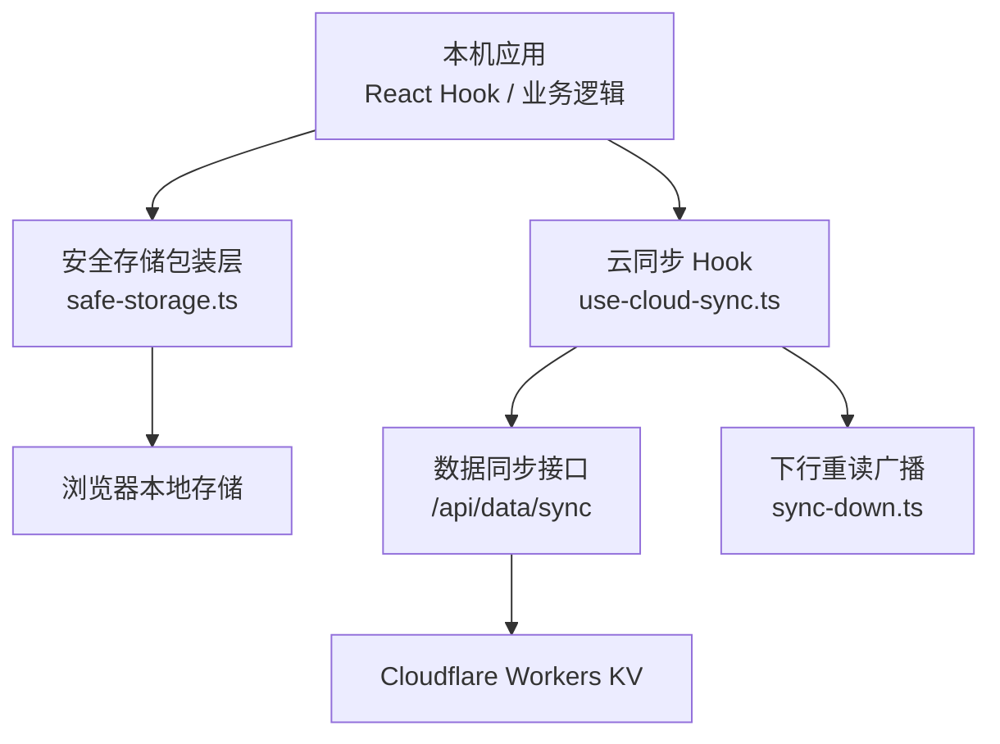
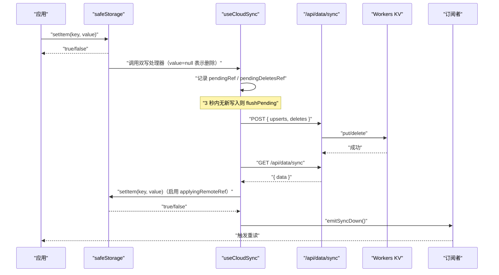
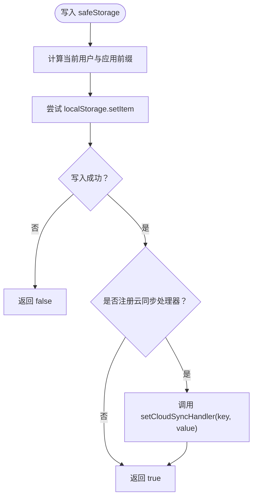
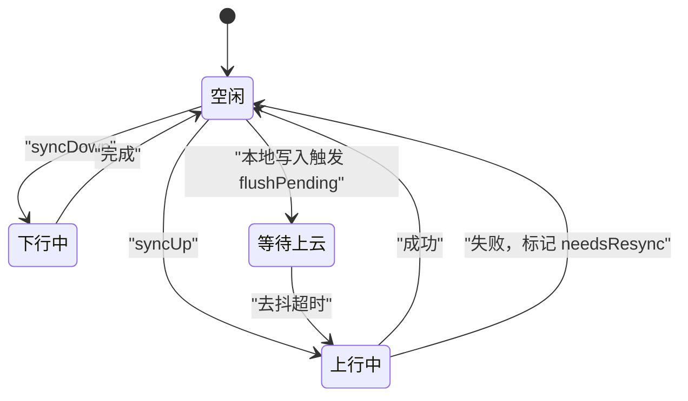
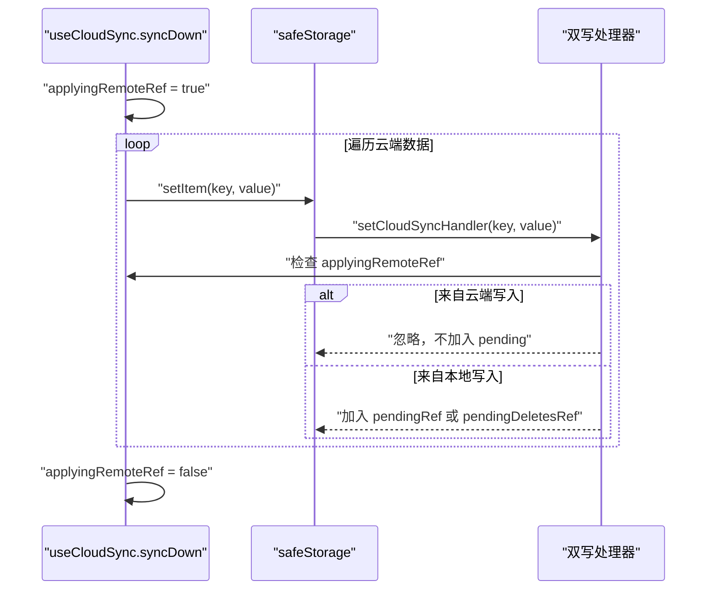
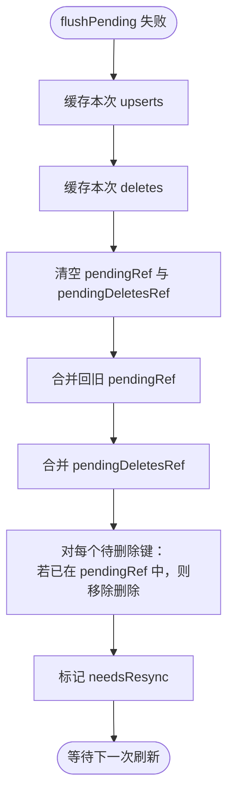
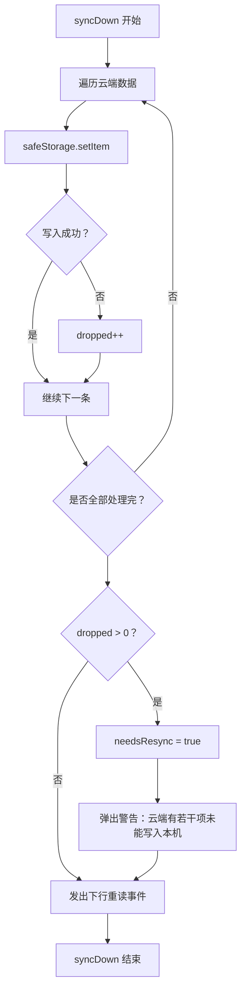
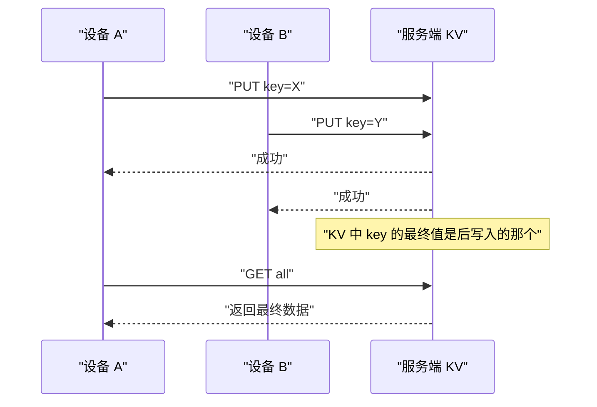
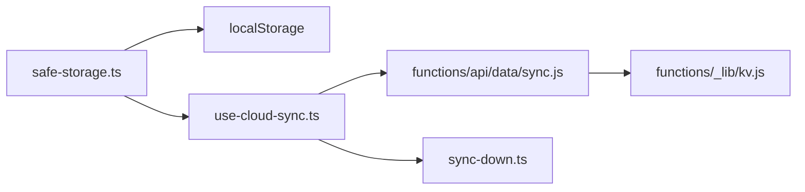

# 冲突检测与解决

<cite>
**本文引用的文件**   
- [safe-storage.ts](file://src/lib/safe-storage.ts)
- [use-cloud-sync.ts](file://src/lib/use-cloud-sync.ts)
- [sync-down.ts](file://src/lib/sync-down.ts)
- [sync.js](file://functions/api/data/sync.js)
- [kv.js](file://functions/_lib/kv.js)
</cite>

## 目录
1. [引言](#引言)
2. [项目结构](#项目结构)
3. [核心组件](#核心组件)
4. [架构总览](#架构总览)
5. [详细组件分析](#详细组件分析)
6. [依赖关系分析](#依赖关系分析)
7. [性能与一致性特性](#性能与一致性特性)
8. [故障诊断指南](#故障诊断指南)
9. [结论](#结论)

## 引言
本文面向 NativeThink 的本地存储与云端同步子系统，重点解释其“最终一致性”模型：**以最后一次有效写入为准**。系统没有实现版本向量、操作历史或基于时间戳的合并算法；当设备 A 和设备 B 同时修改同一个键时，最终谁的值留在云端，取决于哪次上传请求被服务端 KV 接受。客户端通过“最后一次落地的值生效”这一简单规则收敛到一致状态。

需要特别区分两类“冲突”：
- **并发写冲突**：多设备对同一键同时写入。
- **删除后重新设置的语义冲突**：先删除再设置同一键时，`pendingRef` 和 `pendingDeletesRef` 的合并顺序决定该键最终是“已删除”还是“保留新值”。

此外，当浏览器本地存储空间不足时，`safeStorage.setItem` 会静默失败并返回 `false`；`use-cloud-sync` 的下行路径会把这类失败计数为 `dropped`，并置位 `needsResync`，以便后续全量补推。

## 项目结构
与本机制直接相关的代码集中在三个前端模块和一个后端同步接口：

**图表来源**
- [safe-storage.ts:1-216](file://src/lib/safe-storage.ts#L1-L216)
- [use-cloud-sync.ts:1-191](file://src/lib/use-cloud-sync.ts#L1-L191)
- [sync-down.ts:1-49](file://src/lib/sync-down.ts#L1-L49)
- [sync.js:1-63](file://functions/api/data/sync.js#L1-L63)
- [kv.js:1-6](file://functions/_lib/kv.js#L1-L6)

**章节来源**
- [safe-storage.ts:1-216](file://src/lib/safe-storage.ts#L1-L216)
- [use-cloud-sync.ts:1-191](file://src/lib/use-cloud-sync.ts#L1-L191)
- [sync-down.ts:1-49](file://src/lib/sync-down.ts#L1-L49)
- [sync.js:1-63](file://functions/api/data/sync.js#L1-L63)
- [kv.js:1-6](file://functions/_lib/kv.js#L1-L6)

## 核心组件
| 组件 | 职责 | 关键行为 |
|---|---|---|
| `safeStorage` | 带前缀隔离的本地存储包装器 | 自动迁移旧键、按用户与应用隔离键空间、向云同步处理器双写、返回值指示写入是否成功。 |
| `useCloudSync` | 连接本地存储与远端 KV 的 React Hook | 提供 `syncUp`、`syncDown`、去抖双写、回声抑制、失败重试标记。 |
| `sync-down` | 下行落地后的事件广播 | 统一订阅入口，防止各 hook 持有陈旧内存态。 |
| `/api/data/sync` | 后端批量上/下传接口 | 认证后对每个 key 执行 KV put/delete，GET 时列出并返回当前用户全部数据。 |
| `userDataKey` | KV 键命名辅助 | 将用户 ID 与业务 key 拼接成全局唯一 KV 键。 |

**章节来源**
- [safe-storage.ts:1-216](file://src/lib/safe-storage.ts#L1-L216)
- [use-cloud-sync.ts:1-191](file://src/lib/use-cloud-sync.ts#L1-L191)
- [sync-down.ts:1-49](file://src/lib/sync-down.ts#L1-L49)
- [sync.js:1-63](file://functions/api/data/sync.js#L1-L63)
- [kv.js:1-6](file://functions/_lib/kv.js#L1-L6)

## 架构总览
NativeThink 的数据流由“本地优先 + 异步双写 + 周期性拉取”组成：

**图表来源**
- [safe-storage.ts:120-216](file://src/lib/safe-storage.ts#L120-L216)
- [use-cloud-sync.ts:38-191](file://src/lib/use-cloud-sync.ts#L38-L191)
- [sync-down.ts:1-49](file://src/lib/sync-down.ts#L1-L49)
- [sync.js:1-63](file://functions/api/data/sync.js#L1-L63)

**章节来源**
- [use-cloud-sync.ts:38-191](file://src/lib/use-cloud-sync.ts#L38-L191)
- [sync-down.ts:1-49](file://src/lib/sync-down.ts#L1-L49)
- [sync.js:1-63](file://functions/api/data/sync.js#L1-L63)

## 详细组件分析

### 安全存储与前缀隔离
`safeStorage` 不是直接访问 `localStorage` 的裸封装，而是为每个“应用 + 用户”生成独立前缀。这样做的目的是避免平台内部数据和本地业务数据互相污染。

- 在 miaoda 等平台环境中，键形如 `__miaoda_<appId>_<userId>__:<key>`。
- 在非平台环境，键形如 `__miaoda___global____<anonId>__:<key>`，其中匿名 ID 会尽量恢复，避免清理部分存储后历史数据“隐身”。
- 迁移逻辑会在首次读取旧格式键时，把旧前缀数据复制到新前缀，然后删除旧键。
- `setItem` 返回布尔值：成功为 `true`，捕获异常时为 `false`。这使上层能区分“真的存下了”和“静默丢了”。
- 每次 `setItem` 如果注册了云同步处理器，会立即触发一次 fire-and-forget 的双写通知。

**图表来源**
- [safe-storage.ts:60-118](file://src/lib/safe-storage.ts#L60-L118)
- [safe-storage.ts:120-216](file://src/lib/safe-storage.ts#L120-L216)

**章节来源**
- [safe-storage.ts:1-216](file://src/lib/safe-storage.ts#L1-L216)

### 云同步 Hook 的状态机
`useCloudSync` 维护以下关键状态：

| 状态 | 含义 |
|---|---|
| `applyingRemoteRef` | 当前正在把云端数据写入本地存储；用于抑制回声写入。 |
| `pendingRef` | 待上云的键值映射；新的写入覆盖同键旧值。 |
| `pendingDeletesRef` | 待上云的删除集合；新增删除不会立刻发送，等待去抖。 |
| `needsResyncRef` | 存在未落云写入或下行写入失败，下次 `syncUp` 应做全量扫描。 |
| `lastWarnRef` | 控制上/下行提示的去抖，避免离线时频繁弹窗。 |

**图表来源**
- [use-cloud-sync.ts:10-191](file://src/lib/use-cloud-sync.ts#L10-L191)

**章节来源**
- [use-cloud-sync.ts:10-191](file://src/lib/use-cloud-sync.ts#L10-L191)

### 回声抑制：`applyingRemoteRef`
`syncDown` 使用 `safeStorage.setItem` 逐条写入云端数据。由于 `safeStorage.setItem` 会同步调用注册的云同步处理器，刚下载的值会进入 `pendingRef`，随后 3 秒后被 POST 回云端。如果不加保护，登录后即使没有任何本地改动，也会周期性地把全量数据来回搬运。

实现方式：
1. 开始写入前设置 `applyingRemoteRef = true`。
2. 双写处理器发现 `applyingRemoteRef` 为真时直接返回。
3. 无论写入过程中是否有单项失败，`finally` 块都会重置为 `false`。

**图表来源**
- [use-cloud-sync.ts:96-143](file://src/lib/use-cloud-sync.ts#L96-L143)
- [safe-storage.ts:160-177](file://src/lib/safe-storage.ts#L160-L177)

**章节来源**
- [use-cloud-sync.ts:96-143](file://src/lib/use-cloud-sync.ts#L96-L143)
- [safe-storage.ts:160-177](file://src/lib/safe-storage.ts#L160-L177)

### 删除与重新设置的冲突处理：`pendingRef` 与 `pendingDeletesRef`
双写处理器对普通写入和删除采用不同数据结构：
- 普通写入：删除 `pendingDeletesRef` 中的同键，并把值放入 `pendingRef`。
- 删除写入：删除 `pendingRef` 中的同键，并把键加入 `pendingDeletesRef`。

因此，“先删除再设置”在同一去抖周期内会以“保留新值”结束；“先设置再删除”则以“删除”结束。

网络失败时的合并逻辑也遵循同样语义：
1. 先把本次要刷新的 upserts 和 deletes 清空到临时变量。
2. 失败后把旧 pending 合并回来，新值覆盖旧值。
3. 把本次 deletes 合并进 `pendingDeletesRef`。
4. 对每个待删除键，如果它也在 `pendingRef` 中，则移除该删除，只保留 upsert。

**图表来源**
- [use-cloud-sync.ts:56-94](file://src/lib/use-cloud-sync.ts#L56-L94)

**章节来源**
- [use-cloud-sync.ts:56-94](file://src/lib/use-cloud-sync.ts#L56-L94)

### 存储空间已满：`dropped` 与 `needsResync`
`safeStorage.setItem` 在捕获到异常时返回 `false`，而不是抛出错误。这是为了让 UI 不因底层存储不可用而崩溃，同时让调用方知道“这次写入可能失败了”。

`useCloudSync.syncDown` 在下行写入时统计 `dropped`：
- 每条 `safeStorage.setItem` 都放在 try/catch 中。
- 任何失败都会累加 `dropped`。
- 只要 `dropped > 0`，就设置 `needsResyncRef.current = true`。
- 同时通过 `warnThrottled('down', ...)` 弹出一次性警告，提示用户存储空间可能已满。

`needsResync` 的作用：
- `syncUp` 成功后会把它清零。
- `syncUp` 失败时会把它设为真。
- 失败的上行合并路径也会把它设为真。
- 外部轮询任务可读取这个标志，决定是否做一次全量扫描并上传所有 `safeStorage` 前缀下的键。

**图表来源**
- [use-cloud-sync.ts:106-143](file://src/lib/use-cloud-sync.ts#L106-L143)
- [safe-storage.ts:140-177](file://src/lib/safe-storage.ts#L140-L177)

**章节来源**
- [use-cloud-sync.ts:106-143](file://src/lib/use-cloud-sync.ts#L106-L143)
- [safe-storage.ts:140-177](file://src/lib/safe-storage.ts#L140-L177)

### 最终一致性模型与并发冲突
当前实现没有版本号、时间戳、操作日志或冲突检测回调。它的规则可以概括为：

1. 本地写入先进入 `pendingRef` / `pendingDeletesRef`。
2. 去抖后批量 POST 到 `/api/data/sync`。
3. 服务端对每个 key 执行 KV put/delete。
4. 另一个设备 GET 时拿到 KV 中的最新值。
5. 下行写入本地后，通过 `emitSyncDown()` 通知订阅者重读。

这意味着：
- 如果设备 A 和设备 B 同时修改同一键，最终结果取决于哪个设备的 POST 请求被 KV 最后接受。
- 如果一方先上传成功，另一方稍后上传，后上传的一方获胜。
- 如果某一方网络失败，`needsResync` 会被置位，后续 `syncUp` 会扫描本地所有前缀键并重试。

**图表来源**
- [sync.js:24-57](file://functions/api/data/sync.js#L24-L57)
- [kv.js:1-6](file://functions/_lib/kv.js#L1-L6)

**章节来源**
- [sync.js:24-57](file://functions/api/data/sync.js#L24-L57)
- [kv.js:1-6](file://functions/_lib/kv.js#L1-L6)

### 用户通知机制
系统通过 `toast.warning` 提供有限但必要的用户反馈：

| 场景 | 通知内容 | 频率限制 |
|---|---|---|
| 上行失败 | “云同步暂未成功，数据已保存在本机并会自动重试” | 同一类型 60 秒内最多一次 |
| 下行写入失败 | “云端有 N 项未能写入本机（存储空间可能已满）” | 同一类型 60 秒内最多一次 |
| 下行拉取失败 | “云端数据暂未取回，本机数据不受影响” | 同一类型 60 秒内最多一次 |

这些提示不要求用户手动干预；真正的恢复策略由 `needsResync` 和周期性任务驱动。

**章节来源**
- [use-cloud-sync.ts:24-94](file://src/lib/use-cloud-sync.ts#L24-L94)

## 依赖关系分析

**图表来源**
- [safe-storage.ts:120-216](file://src/lib/safe-storage.ts#L120-L216)
- [use-cloud-sync.ts:1-191](file://src/lib/use-cloud-sync.ts#L1-L191)
- [sync-down.ts:1-49](file://src/lib/sync-down.ts#L1-L49)
- [sync.js:1-63](file://functions/api/data/sync.js#L1-L63)
- [kv.js:1-6](file://functions/_lib/kv.js#L1-L6)

耦合关系要点：
- `safeStorage` 通过 `setCloudSyncHandler` 反向暴露写入事件给 `useCloudSync`，形成“存储层 → 同步层”的单向回调链。
- `useCloudSync` 是唯一注册和注销云同步处理器的地方，登出时清理定时器并 flush 剩余 pending。
- `sync-down.ts` 把“下行落地后重读”从多个分散订阅点收敛为单一事件出口，降低 hook 间耦合。
- 后端 `/api/data/sync` 仅依赖认证和用户 ID，不对业务键做额外校验。

**章节来源**
- [safe-storage.ts:120-216](file://src/lib/safe-storage.ts#L120-L216)
- [use-cloud-sync.ts:144-191](file://src/lib/use-cloud-sync.ts#L144-L191)
- [sync-down.ts:1-49](file://src/lib/sync-down.ts#L1-L49)
- [sync.js:1-63](file://functions/api/data/sync.js#L1-L63)

## 性能与一致性特性
| 维度 | 当前实现 | 影响 |
|---|---|---|
| 一致性模型 | 最终一致性，最后一次有效写入为准 | 简单可靠，但无法保证“早写入一定保留” |
| 版本控制 | 无版本向量、无操作历史 | 不产生复杂冲突，也不支持精细合并 |
| 上行延迟 | 去抖 3 秒 | 减少频繁网络请求，但用户关闭页面后仍有少量延迟 |
| 下行延迟 | 周期性轮询（文档描述为约 5 分钟） | 其他设备变更不会立即反映，需等到下次轮询或主动触发 |
| 回声写入 | `applyingRemoteRef` 抑制 | 避免登录后全量数据反复往返 |
| 删除语义 | `pendingRef` 与 `pendingDeletesRef` 互斥合并 | 同一去抖周期内，后发生的操作优先级更高 |
| 存储溢出 | `safeStorage` 返回 `false`，`dropped` 计数 | 不崩溃，但需要 `needsResync` 恢复 |
| 数据隔离 | 前缀包含 appId 与 userId | 避免跨用户、跨应用数据污染 |

**章节来源**
- [use-cloud-sync.ts:10-191](file://src/lib/use-cloud-sync.ts#L10-L191)
- [safe-storage.ts:1-216](file://src/lib/safe-storage.ts#L1-L216)
- [sync.js:1-63](file://functions/api/data/sync.js#L1-L63)

## 故障诊断指南

### 常见冲突场景分类
| 场景 | 表现 | 根因 | 建议处理方式 |
|---|---|---|---|
| 设备 A 和设备 B 同时修改同一键 | 最终只保留其中一个设备的值 | KV 只接受最后一次写入 | 确认最终值是否符合预期；必要时手动修复 |
| 先删除键，又立即重新设置 | 键最终保留新值 | `pendingRef` 覆盖了 `pendingDeletesRef` | 通常符合直觉；如需严格删除，应避免在同一去抖周期内重设 |
| 先设置键，又立即删除 | 键最终被删除 | 删除晚于设置，且未被后续 upsert 覆盖 | 正常行为 |
| 存储空间已满 | 下拉时出现 dropped 计数，界面可能缺少部分数据 | `safeStorage.setItem` 失败 | 清理浏览器存储或释放空间后重新登录触发 resync |
| 登录后数据反复上传 | 控制台或网络面板看到大量重复 POST | 回声抑制失效或状态异常 | 检查 `applyingRemoteRef` 是否被意外修改 |
| 另一台设备改了数据，本机不更新 | 需要重启页面才看到变化 | 未触发下行事件或订阅者未重读 | 检查 `emitSyncDown` 和订阅者是否正确挂载 |

### 手动修复步骤
1. **确认本地前缀隔离是否正常**
   - 使用 `safeStorage.getPrefixedKey(...)` 查看实际写入的键。
   - 检查键是否以 `__miaoda_<appId>_<userId>__:` 开头。
   - 如果用户 ID 发生变化，确认旧前缀数据是否被迁移到新前缀。

2. **检查是否存在未落云写入**
   - 查看 `useCloudSync` 暴露的 `needsResync`。
   - 如果为真，说明有过失败的上行或未完全落云的本地写入。
   - 确保 `syncUp` 能成功运行，并在成功后将其清零。

3. **处理存储空间已满问题**
   - 观察下行日志中的 `dropped` 计数。
   - 在浏览器开发者工具中清理无效缓存或释放本地存储。
   - 重新登录或等待下一次轮询，让 `syncUp` 把本地剩余数据补推到云端。

4. **排查回声写入**
   - 在网络面板中观察是否出现大量重复 POST。
   - 确认 `applyingRemoteRef` 只在 `syncDown` 写入期间为真。
   - 确认双写处理器没有被重复注册。

5. **验证下行重读链路**
   - 确认 `emitSyncDown()` 被调用。
   - 确认订阅者通过 `onSyncDown` 或 `useSyncDown` 正确订阅。
   - 检查订阅者抛错是否影响其他订阅者；当前实现保证单个订阅者失败不影响其余订阅者。

6. **后端 KV 一致性检查**
   - 使用 `/api/data/sync` 的 GET 接口获取当前用户全部数据。
   - 对比本地 `safeStorage` 前缀下的键集。
   - 如果差异较大，检查网络错误、配额限制和 `needsResync` 是否持续为真。

**章节来源**
- [safe-storage.ts:120-216](file://src/lib/safe-storage.ts#L120-L216)
- [use-cloud-sync.ts:24-191](file://src/lib/use-cloud-sync.ts#L24-L191)
- [sync-down.ts:1-49](file://src/lib/sync-down.ts#L1-L49)
- [sync.js:1-63](file://functions/api/data/sync.js#L1-L63)

## 结论
NativeThink 的冲突机制选择了“简单优先”的最终一致性方案：不引入版本向量或操作历史，而是依赖浏览器本地存储的最后写入、云端 KV 的最后写入，以及 `needsResync` 的全量补推能力收敛数据。这种设计降低了实现复杂度，适合学习类应用的离线优先场景；代价是并发冲突只能以“后写入者胜”的方式解决，无法提供细粒度合并或撤销能力。

在实际使用中，最重要的保障点是：
- 使用前缀隔离避免平台数据污染。
- 用 `applyingRemoteRef` 防止回声写入造成无限循环。
- 用 `pendingRef` 与 `pendingDeletesRef` 的合并规则处理删除后重设。
- 用 `dropped` 和 `needsResync` 暴露并恢复存储配额失败。
- 用 `emitSyncDown()` 确保其他设备变更后，本机能重新读取最新值。