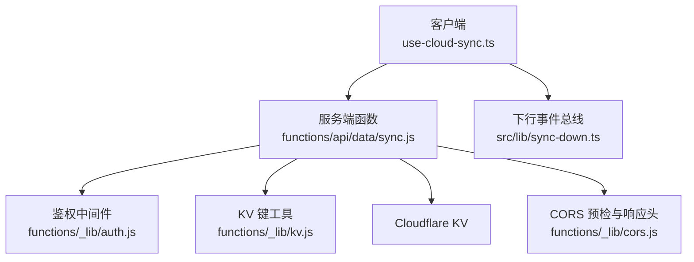
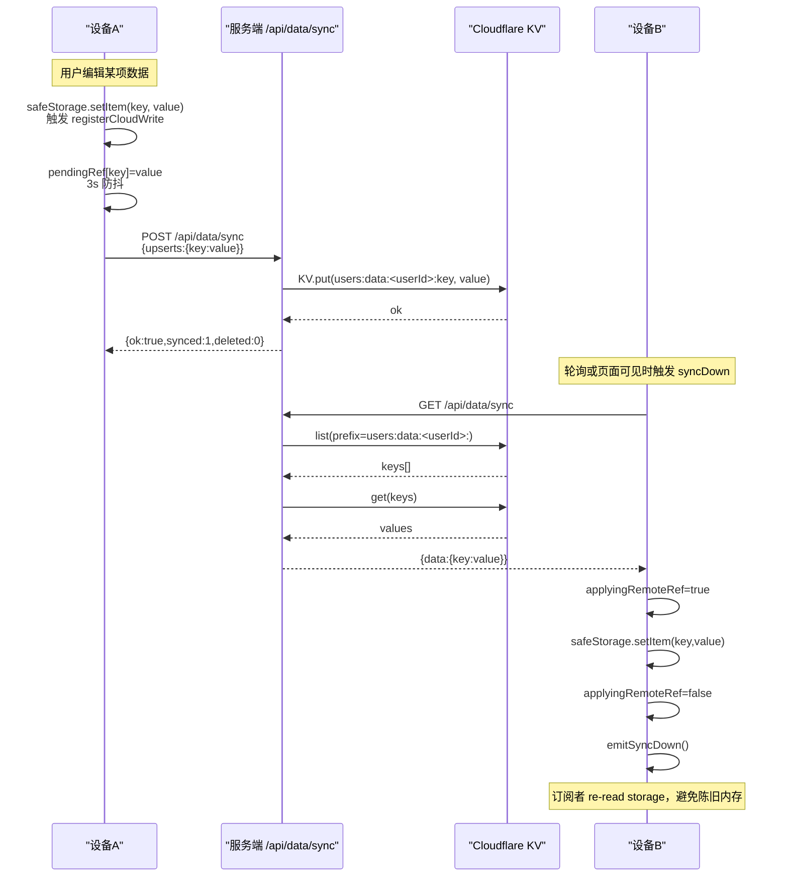
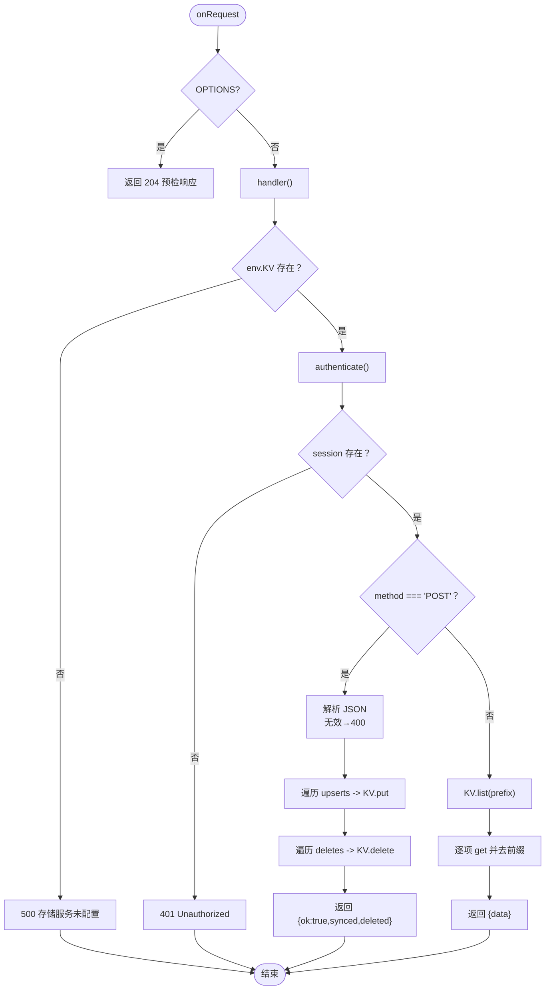
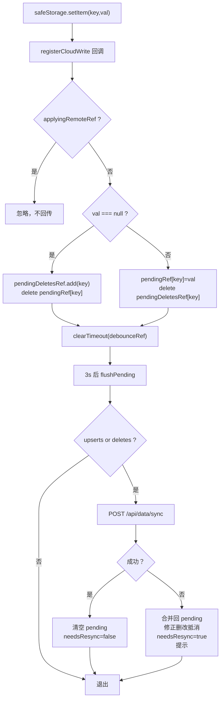
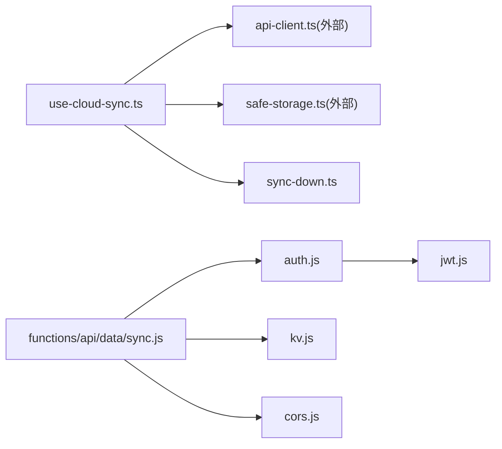

# 双向同步协议

<cite>
**本文引用的文件**
- [functions/api/data/sync.js](file://functions/api/data/sync.js)
- [src/lib/use-cloud-sync.ts](file://src/lib/use-cloud-sync.ts)
- [src/lib/sync-down.ts](file://src/lib/sync-down.ts)
- [functions/_lib/auth.js](file://functions/_lib/auth.js)
- [functions/_lib/cors.js](file://functions/_lib/cors.js)
- [functions/_lib/jwt.js](file://functions/_lib/jwt.js)
- [functions/_lib/kv.js](file://functions/_lib/kv.js)
- [docs/modules/cloud-sync.md](file://docs/modules/cloud-sync.md)
</cite>

## 目录
1. [引言](#引言)
2. [项目结构](#项目结构)
3. [核心组件](#核心组件)
4. [架构总览](#架构总览)
5. [详细组件分析](#详细组件分析)
6. [依赖关系分析](#依赖关系分析)
7. [性能与一致性考量](#性能与一致性考量)
8. [故障排查指南](#故障排查指南)
9. [结论](#结论)

## 引言
本文件为 NativeThink 的“本地存储 ↔ Cloudflare KV”双向云同步协议提供完整说明，覆盖以下目标：
- POST /api/data/sync：增量 upserts/deletes 批量上传机制。
- GET /api/data/sync：按用户全量拉取数据。
- 请求/响应 JSON 结构、认证方式（JWT session）、错误码和重试策略。
- 回声抑制 applyingRemoteRef，防止 syncDown 写入触发二次上传。
- pendingRef + pendingDeletesRef 的去抖合并，实现本地变更的批量上云。
- 网络异常处理、KV 键命名规则、跨域配置与预检请求处理。
- 客户端与服务端交互时序图及关键流程的代码级示例路径。

## 项目结构
双向同步由三层组成：
- 客户端 React Hook：use-cloud-sync.ts 负责登录态同步、上行增量去抖、下行落盘与事件广播。
- 服务端函数：functions/api/data/sync.js 统一路由 POST/GET，完成鉴权、KV 读写与 CORS。
- 共享工具库：_lib/auth.js、jwt.js、kv.js、cors.js 提供鉴权、JWT、KV 前缀与跨域能力。

图示来源
- [functions/api/data/sync.js:1-63](file://functions/api/data/sync.js#L1-L63)
- [src/lib/use-cloud-sync.ts:1-191](file://src/lib/use-cloud-sync.ts#L1-L191)
- [src/lib/sync-down.ts:1-49](file://src/lib/sync-down.ts#L1-L49)
- [functions/_lib/auth.js:1-8](file://functions/_lib/auth.js#L1-L8)
- [functions/_lib/cors.js:1-29](file://functions/_lib/cors.js#L1-L29)
- [functions/_lib/kv.js:1-6](file://functions/_lib/kv.js#L1-L6)

章节来源
- [docs/modules/cloud-sync.md:1-64](file://docs/modules/cloud-sync.md#L1-L64)

## 核心组件
- 客户端同步 Hook（use-cloud-sync.ts）
  - 维护 isAuthenticated 登录态；在登录后执行一次“先拉后推”，并注册 safeStorage 的双写处理器。
  - 上行通道 A：safeStorage.setItem 经双写处理器进入 pendingRef/pendingDeletesRef，3 秒防抖后 flushPending 批量 POST。
  - 上行通道 B：syncUp 扫描 localStorage，按 safeStorage 前缀与 DATA_PREFIX 过滤后做全量补推。
  - 下行通道：syncDown 调用 GET /api/data/sync，逐个 safeStorage.setItem，设置 applyingRemoteRef 抑制回声，最后 emitSyncDown 通知各 hook 重读。
- 服务端同步函数（functions/api/data/sync.js）
  - onRequest 统一走 CORS 预检判断；handler 校验 env.KV、鉴权、POST upserts/deletes、GET 全量枚举。
- 鉴权与 JWT（auth.js、jwt.js）
  - 从 Authorization: Bearer <token> 解析，使用 jose 验证 HS256 令牌，返回 { userId, email } 或 null。
- KV 键工具（kv.js）
  - userDataKey(userId, key) 生成 users:data:<userId>:<key> 格式。
- CORS（cors.js）
  - Access-Control-Allow-Origin:*，支持 GET/POST/PUT/DELETE/OPTIONS，含预检短路。

章节来源
- [src/lib/use-cloud-sync.ts:1-191](file://src/lib/use-cloud-sync.ts#L1-L191)
- [functions/api/data/sync.js:1-63](file://functions/api/data/sync.js#L1-L63)
- [functions/_lib/auth.js:1-8](file://functions/_lib/auth.js#L1-L8)
- [functions/_lib/jwt.js:1-26](file://functions/_lib/jwt.js#L1-L26)
- [functions/_lib/kv.js:1-6](file://functions/_lib/kv.js#L1-L6)
- [functions/_lib/cors.js:1-29](file://functions/_lib/cors.js#L1-L29)

## 架构总览
下图展示一次完整的“设备 A 修改 → 云端 → 设备 B 拉取 → UI 刷新”流程，以及回声抑制与去抖合并的关键点。

图示来源
- [src/lib/use-cloud-sync.ts:20-105](file://src/lib/use-cloud-sync.ts#L20-L105)
- [src/lib/use-cloud-sync.ts:107-191](file://src/lib/use-cloud-sync.ts#L107-L191)
- [functions/api/data/sync.js:9-63](file://functions/api/data/sync.js#L9-L63)
- [functions/_lib/kv.js:1-6](file://functions/_lib/kv.js#L1-L6)

## 详细组件分析

### 服务端：/api/data/sync 路由
- 入口 onRequest(context)
  - isPreflight(request) 为 OPTIONS 时直接返回 preflight() 204。
  - 其他请求经 handler 处理后用 withCors(response) 追加跨域头。
- handler(context)
  - 防御性检查：env.KV 未配置 → 500 {error:"存储服务未配置"}。
  - 鉴权：authenticate(request, env) 失败 → 500 {error:"认证失败"}；未携带有效 token → 401 {error:"Unauthorized"}。
  - POST 分支
    - 解析 JSON；无效 JSON → 400 {error:"Invalid JSON"}。
    - upserts = body.upserts || {}；deletes = Array.isArray(body.deletes) ? body.deletes : []。
    - 遍历 upserts 调用 env.KV.put(userDataKey(session.userId, key), value)。
    - 遍历 deletes 调用 env.KV.delete(userDataKey(session.userId, key))。
    - 返回 {ok:true, synced:keys.length, deleted:deletes.length}。
  - GET 分支
    - prefix = userDataKey(session.userId, '')。
    - env.KV.list({prefix}) 枚举 key，逐项 get 并去掉前缀后拼成 data 对象。
    - 返回 {data:{...}}。
  - 异常兜底：catch → 500 {error:"同步失败，请稍后重试"}。

图示来源
- [functions/api/data/sync.js:1-63](file://functions/api/data/sync.js#L1-L63)
- [functions/_lib/auth.js:1-8](file://functions/_lib/auth.js#L1-L8)
- [functions/_lib/cors.js:1-29](file://functions/_lib/cors.js#L1-L29)
- [functions/_lib/kv.js:1-6](file://functions/_lib/kv.js#L1-L6)

章节来源
- [functions/api/data/sync.js:1-63](file://functions/api/data/sync.js#L1-L63)
- [functions/_lib/cors.js:1-29](file://functions/_lib/cors.js#L1-L29)

### 客户端：use-cloud-sync.ts
- 状态与引用
  - syncing：当前是否正在同步。
  - lastSyncRef：上次成功时间戳。
  - pendingRef：待上行的 upserts 字典。
  - pendingDeletesRef：待上行的删除集合。
  - debounceRef：setTimeout 句柄，实现 3 秒去抖。
  - applyingRemoteRef：下行写入期间为 true，用于抑制回声。
  - lastWarnRef：提示去抖（同一类型 60 秒内最多一次）。
  - needsResyncRef：是否有过失败或未落云的本地写入，决定周期任务是否需要全量补推。
- 上行通道 A：增量双写
  - setCloudSyncHandler 注册回调；当 safeStorage.setItem(key, value) 或 delete 时触发。
  - 若 applyingRemoteRef.current 为 true，直接 return，不进入 pending。
  - value 为 null 表示删除：从 pendingRef 中移除该 key，加入 pendingDeletesRef。
  - 否则：从 pendingDeletesRef 移除该 key，写入 pendingRef[key] = value。
  - 每次触发都清空旧定时器并设 3 秒后 flushPending。
- 上行通道 B：全量补推 syncUp
  - 仅 authenticated 时执行。
  - 获取 safeStorage.getPrefixedKey('')，遍历 localStorage.key(i)，只取以 prefix 开头的键。
  - 再过滤 appKey.startsWith('__nativethink_')，仅同步应用数据。
  - 有 upserts 则 POST {upserts}；成功后更新 lastSyncRef 与 needsResyncRef。
- 下行通道 syncDown
  - 仅 authenticated 时执行。
  - GET /api/data/sync，返回 {data:{key:value}}。
  - 开启 applyingRemoteRef.current = true，逐个 safeStorage.setItem；catch 单项抛错计数 dropped。
  - finally 关闭 applyingRemoteRef。
  - 若有 dropped > 0，设置 needsResyncRef = true 并提示存储空间可能已满。
  - 最后 emitSyncDown() 触发所有订阅者重读。
- 失败提示与重试
  - warnThrottled：同一 up/down 类型 60 秒内最多弹一次 toast。
  - flushPending catch：将本次 upserts/deletes 合并回 pending，并修正“删了又写回”的抵消；needsResyncRef = true；提示“云同步暂未成功，数据已保存在本机并会自动重试”。
  - syncUp catch：needsResyncRef = true；提示同上。
  - syncDown catch：提示“云端数据暂未取回，本机数据不受影响”。
- 生命周期
  - registerCloudWrite：authenticated 时注册双写处理器。
  - unregister：logout 时清除处理器，并 flushPending 确保剩余 pending 至少尝试一次。

图示来源
- [src/lib/use-cloud-sync.ts:20-105](file://src/lib/use-cloud-sync.ts#L20-L105)
- [src/lib/use-cloud-sync.ts:107-191](file://src/lib/use-cloud-sync.ts#L107-L191)

章节来源
- [src/lib/use-cloud-sync.ts:1-191](file://src/lib/use-cloud-sync.ts#L1-L191)
- [docs/modules/cloud-sync.md:1-64](file://docs/modules/cloud-sync.md#L1-L64)

### 下行事件广播：sync-down.ts
- SYNC_DOWN_EVENT = 'nativethink-sync-down'，作为唯一事件名定义处。
- onSyncDown(cb, target?)：添加事件监听；cb 包裹 try/catch，单个订阅者抛错不影响其它订阅者；返回退订函数。
- emitSyncDown()：window.dispatchEvent(SYNC_DOWN_EVENT)，SSR/无 window 环境捕获抛错。
- useSyncDown(cb)：React Hook 封装，ref 保存最新 cb，仅挂载一次订阅，避免 render 频繁订阅/退订导致事件丢失。

章节来源
- [src/lib/sync-down.ts:1-49](file://src/lib/sync-down.ts#L1-L49)

### 鉴权与 JWT
- auth.authenticate(request, env)
  - 读取 Authorization 头，要求以 "Bearer " 开头。
  - 截取 token 后调用 jwt.verifyToken(token, env)。
- jwt.signToken(payload, env)、verifyToken(token, env)
  - signToken：HS256，payload 包含 sub=email，过期 30 天。
  - verifyToken：jose.jwtVerify；失败返回 null。

章节来源
- [functions/_lib/auth.js:1-8](file://functions/_lib/auth.js#L1-L8)
- [functions/_lib/jwt.js:1-26](file://functions/_lib/jwt.js#L1-L26)

### KV 键命名规则
- userDataKey(userId, key) → users:data:<userId>:<key>。
- 客户端 syncUp 会基于 safeStorage.getPrefixedKey('') 与 DATA_PREFIX='__nativethink_' 双重过滤，仅同步应用数据。
- 文档还指出 safe-storage 的前缀模式为 __miaoda_<appId>_<userId>__:key，其中 userId 可回退到 anonId。

章节来源
- [functions/_lib/kv.js:1-6](file://functions/_lib/kv.js#L1-L6)
- [src/lib/use-cloud-sync.ts:1-191](file://src/lib/use-cloud-sync.ts#L1-L191)
- [docs/modules/cloud-sync.md:1-64](file://docs/modules/cloud-sync.md#L1-L64)

### 跨域与预检
- cors.CORS_HEADERS：允许 Origin:*，Methods: GET/POST/PUT/DELETE/OPTIONS，Headers: Content-Type, Authorization，Max-Age: 86400。
- withCors(response)：幂等追加跨域头。
- preflight()：204 空响应。
- isPreflight(request)：method==='OPTIONS' 即预检。
- onRequest(context)：先判断预检，再调用 handler，并把结果交给 withCors。

章节来源
- [functions/_lib/cors.js:1-29](file://functions/_lib/cors.js#L1-L29)
- [functions/api/data/sync.js:1-63](file://functions/api/data/sync.js#L1-L63)

## 依赖关系分析

图示来源
- [src/lib/use-cloud-sync.ts:1-191](file://src/lib/use-cloud-sync.ts#L1-L191)
- [src/lib/sync-down.ts:1-49](file://src/lib/sync-down.ts#L1-L49)
- [functions/api/data/sync.js:1-63](file://functions/api/data/sync.js#L1-L63)
- [functions/_lib/auth.js:1-8](file://functions/_lib/auth.js#L1-L8)
- [functions/_lib/kv.js:1-6](file://functions/_lib/kv.js#L1-L6)
- [functions/_lib/cors.js:1-29](file://functions/_lib/cors.js#L1-L29)
- [functions/_lib/jwt.js:1-26](file://functions/_lib/jwt.js#L1-L26)

## 性能与一致性考量
- 去抖合并
  - pendingRef + pendingDeletesRef 保证多次同键写入在 3 秒内合并为一次 POST，减少网络请求。
  - 删除与写入冲突时，最终值优先：删除后再写入该键，不会留在 deletes 中。
- 回声抑制
  - applyingRemoteRef 只在 syncDown 落盘期间为 true，避免刚下载的键再次进入 pendingRef。
- 全量补推条件
  - 周期任务仅在 needsResync=true 时执行 syncUp；首次登录仍无条件全量补推，以便把本地既有数据填满云端。
- 单键失败隔离
  - syncDown 对每个 safeStorage.setItem 单独 try/catch，记录 dropped 数量，不影响其余键落地。
- KV 一致性模型
  - KV 是全量覆盖式写入，没有冲突解决；并行设备可能丢一边。
- 非同步范围
  - AI Key 等裸 localStorage 数据不上云；IndexedDB 缓存也不上云。

章节来源
- [src/lib/use-cloud-sync.ts:20-191](file://src/lib/use-cloud-sync.ts#L20-L191)
- [docs/modules/cloud-sync.md:1-64](file://docs/modules/cloud-sync.md#L1-L64)

## 故障排查指南
- 常见错误码与含义
  - 400 Invalid JSON：POST body 不是合法 JSON。
  - 401 Unauthorized：Authorization 缺失或 JWT 无效。
  - 500 存储服务未配置：env.KV 未绑定。
  - 500 认证失败：鉴权过程抛出异常。
  - 500 同步失败：KV 操作异常。
- 上行失败重试
  - flushPending catch 会把本次 upserts/deletes 合并回 pending，下次 3 秒后继续尝试；同时标记 needsResync=true，后续周期任务会触发全量补推。
- 下行失败行为
  - syncDown catch 仅提示“云端数据暂未取回，本机数据不受影响”，不会破坏本地数据。
- 存储空间不足
  - syncDown 单项写入失败会统计 dropped 并提示“存储空间可能已满”，同时标记 needsResync=true。
- 提示去抖
  - 三类提示均受 warnThrottled 保护，同一类型 60 秒内最多一次，避免离线状态下重复弹窗。
- 回声问题定位
  - 确认 applyingRemoteRef 在 syncDown 落盘前后正确切换。
  - 确认 registerCloudWrite 开头对 applyingRemoteRef 的判断存在。
- KV 键污染排查
  - 检查 safeStorage 前缀是否正确；确认 DATA_PREFIX='__nativethink_' 过滤生效。
- 跨域问题
  - 确认客户端发起的是 GET/POST；预检请求会被服务端 204 短路。
  - 确认 Authorization 与 Content-Type 在允许的 headers 列表中。

章节来源
- [functions/api/data/sync.js:9-63](file://functions/api/data/sync.js#L9-L63)
- [src/lib/use-cloud-sync.ts:20-191](file://src/lib/use-cloud-sync.ts#L20-L191)
- [functions/_lib/cors.js:1-29](file://functions/_lib/cors.js#L1-L29)

## 结论
NativeThink 的双向同步协议通过“增量去抖 + 全量补推 + 回声抑制 + 下行事件广播”的组合，实现了低开销、容错的本地与云端数据同步：
- 客户端侧，safeStorage 双写处理器把任意写入合并到 pendingRef/pendingDeletesRef，3 秒后批量 POST；syncUp 在全量场景下按 safeStorage 前缀与应用数据前缀过滤，避免污染 KV。
- 服务端侧，/api/data/sync 统一处理 POST upserts/deletes 与 GET 全量拉取，结合 JWT 鉴权与 KV 前缀隔离用户数据。
- 可靠性方面，上行失败自动合并重试并标记 needsResync；下行失败不破坏本地数据；单项写入失败可统计 dropped；CORS 预检保障 Capacitor APK 跨域访问。
- 一致性方面，KV 为覆盖式写入，没有冲突解决；需要业务层接受“最后一次写入获胜”的语义。