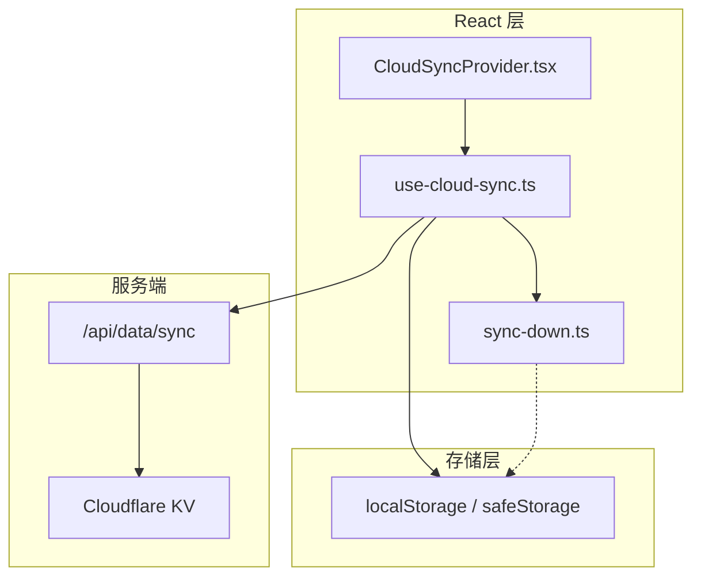
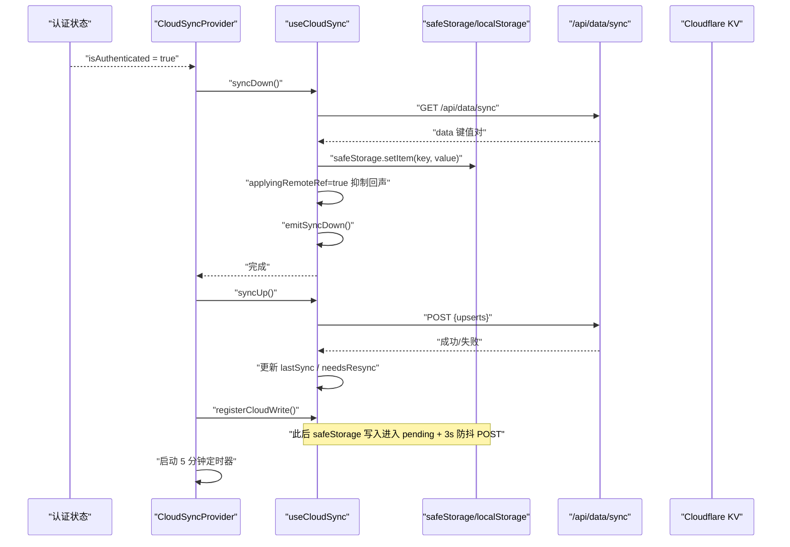
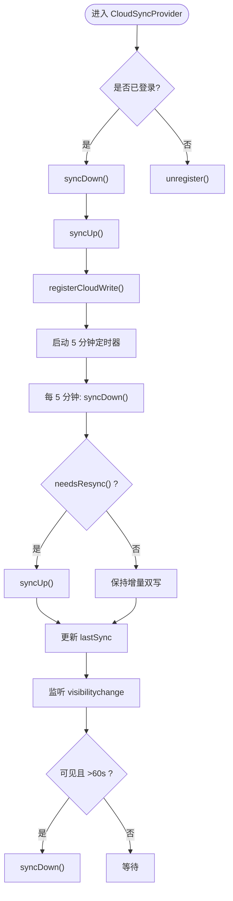
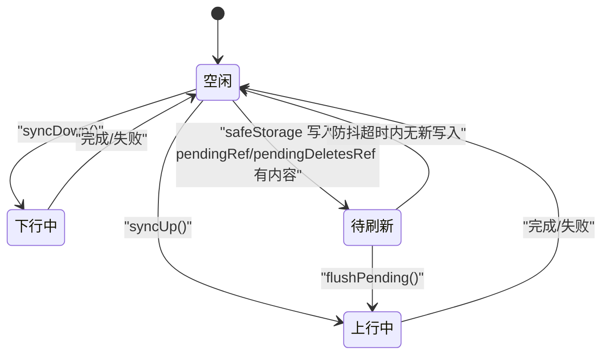
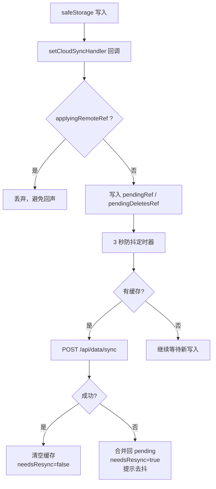
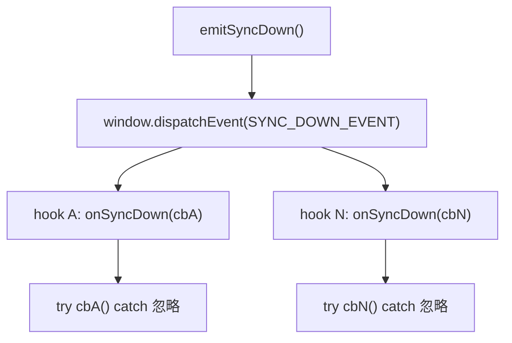
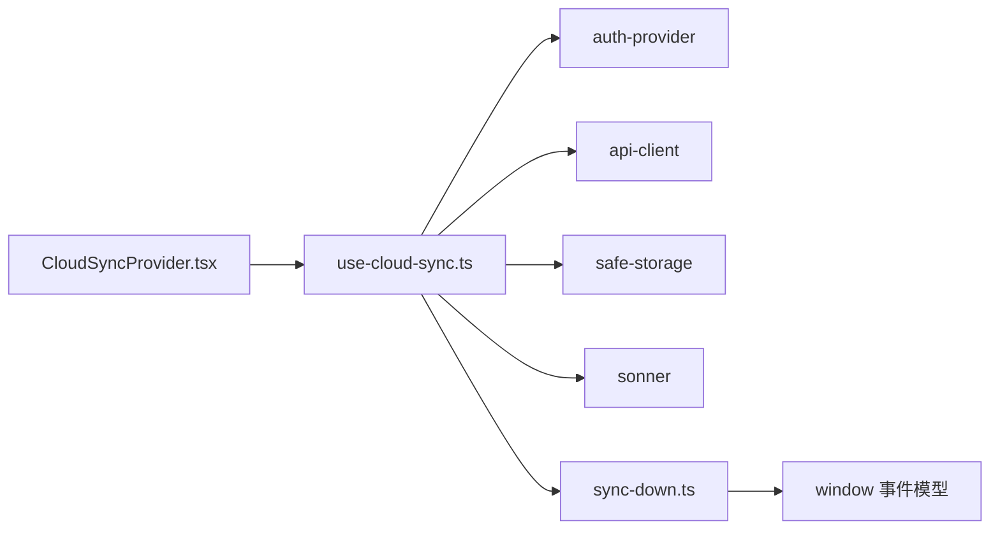
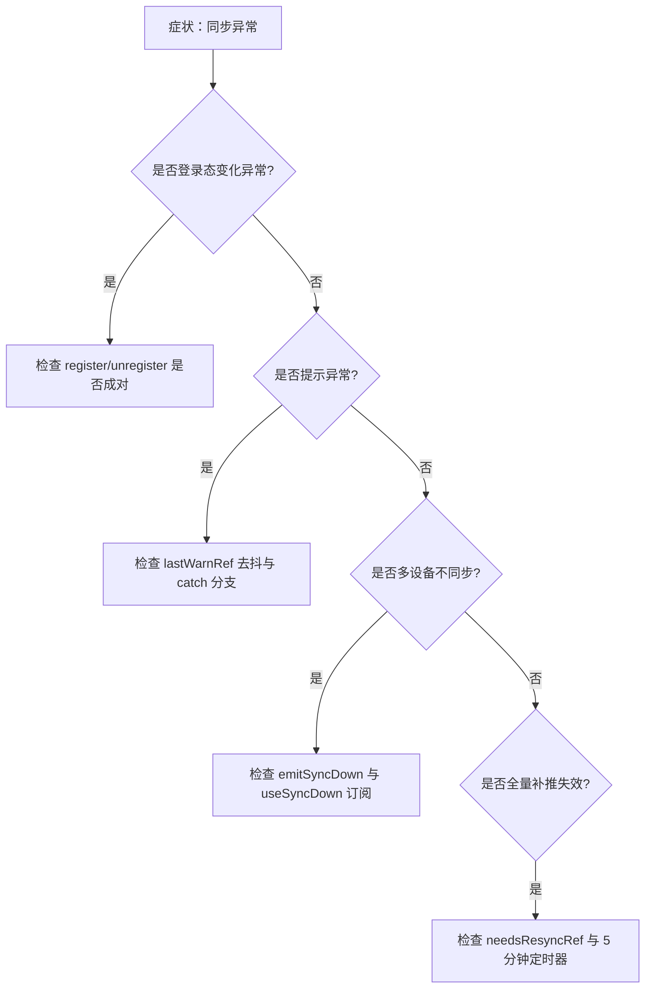

# 同步状态管理

<cite>
**本文引用的文件**   
- [CloudSyncProvider.tsx](file://src/components/CloudSyncProvider.tsx)
- [use-cloud-sync.ts](file://src/lib/use-cloud-sync.ts)
- [sync-down.ts](file://src/lib/sync-down.ts)
- [cloud-sync.md](file://docs/modules/cloud-sync.md)
</cite>

## 目录
1. [引言](#引言)
2. [项目结构](#项目结构)
3. [核心组件](#核心组件)
4. [架构总览](#架构总览)
5. [详细组件分析](#详细组件分析)
6. [依赖关系分析](#依赖关系分析)
7. [性能考虑](#性能考虑)
8. [故障排查指南](#故障排查指南)
9. [结论](#结论)

## 引言
本文件围绕 CloudSyncProvider 的状态管理机制，系统性说明“认证生命周期驱动的同步流程”“5 分钟定时轮询触发条件”“页面可见性节流逻辑”“UI 反馈字段 syncing、lastSync、lastWarnRef”“双写处理器注册与注销的生命周期”，并给出状态转换图、常见卡死场景的排查方法与性能优化建议。目标是让非深度开发者也能理解数据在本地 storage 与云端 KV 之间的往返路径。

## 项目结构
CloudSyncProvider 把云同步能力接入 React 应用的认证生命周期；useCloudSync 实现双向同步、双写缓冲、失败重试和提示去抖；sync-down.ts 提供下行落地的统一广播通道；文档 cloud-sync.md 记录了两条上行通道（增量双写 vs 全量补推）以及历史修复要点。

**图表来源**
- [CloudSyncProvider.tsx:10-61](file://src/components/CloudSyncProvider.tsx#L10-L61)
- [use-cloud-sync.ts:1-191](file://src/lib/use-cloud-sync.ts#L1-L191)
- [sync-down.ts:1-49](file://src/lib/sync-down.ts#L1-L49)

**章节来源**
- [CloudSyncProvider.tsx:10-61](file://src/components/CloudSyncProvider.tsx#L10-L61)
- [use-cloud-sync.ts:1-191](file://src/lib/use-cloud-sync.ts#L1-L191)
- [sync-down.ts:1-49](file://src/lib/sync-down.ts#L1-L49)
- [cloud-sync.md:1-64](file://docs/modules/cloud-sync.md#L1-L64)

## 核心组件
- CloudSyncProvider：绑定认证状态变化，负责登录时先 syncDown 再 syncUp，登出时 unregister；维护 5 分钟定时器与 visibilitychange 节流。
- useCloudSync：暴露 syncUp、syncDown、registerCloudWrite、unregister、needsResync，以及供 UI 观察的 syncing、lastSync；内部维护 pending upserts/deletes、防抖 flush、回声抑制、失败去抖提示、needsResync 标记。
- sync-down.ts：定义 SYNC_DOWN_EVENT，提供 onSyncDown/useSyncDown 订阅入口，并在下行落地后 emitSyncDown 通知各数据 hook 重读。

**章节来源**
- [CloudSyncProvider.tsx:10-61](file://src/components/CloudSyncProvider.tsx#L10-L61)
- [use-cloud-sync.ts:1-191](file://src/lib/use-cloud-sync.ts#L1-L191)
- [sync-down.ts:1-49](file://src/lib/sync-down.ts#L1-L49)

## 架构总览
下图展示一次完整登录到后台同步的关键时序，包括首次拉取、首次推送、双写注册与后续定时任务。

**图表来源**
- [CloudSyncProvider.tsx:14-41](file://src/components/CloudSyncProvider.tsx#L14-L41)
- [use-cloud-sync.ts:47-113](file://src/lib/use-cloud-sync.ts#L47-L113)
- [sync-down.ts:35-49](file://src/lib/sync-down.ts#L35-L49)

## 详细组件分析

### 1. CloudSyncProvider：认证驱动与调度器
- 登录分支：调用 syncDown，成功后立即 syncUp，然后 registerCloudWrite；同时更新 lastSyncRef 用于页面可见性节流。
- 登出分支：调用 unregister，关闭双写处理器，避免未登录状态下产生无效网络请求。
- 5 分钟轮询：仅当 isAuthenticated 为真时启动；每次 syncDown 完成后，只有 needsResync() 返回真才执行 syncUp；最后更新时间戳。
- 页面可见性节流：visibilityState === 'visible' 且距离上次同步超过 60 秒时才执行 syncDown，避免频繁切换标签页触发网络。

**图表来源**
- [CloudSyncProvider.tsx:14-61](file://src/components/CloudSyncProvider.tsx#L14-L61)

**章节来源**
- [CloudSyncProvider.tsx:14-61](file://src/components/CloudSyncProvider.tsx#L14-L61)

### 2. useCloudSync：状态机、双写缓冲与提示去抖
该 hook 内部可理解为如下状态机：

关键状态与字段：
- syncing：当前是否有 syncUp 或 syncDown 正在进行；供 UI 显示加载中反馈。
- lastSync：最后一次同步时间戳（毫秒），用于页面可见性节流判断。
- lastWarnRef：记录上一次 up/down 类提示的时间，60 秒内重复不弹窗。
- needsResyncRef：是否存在失败或未落云的本地写入，控制 5 分钟轮询是否做全量补推。
- applyingRemoteRef：下行写入期间的“回声守卫”，防止刚下载的远端数据再次被双写回推。
- pendingRef / pendingDeletesRef：增量双写的缓存队列。
- debounceRef：3 秒防抖，合并多次写入后一次性 POST。

**图表来源**
- [use-cloud-sync.ts:21-113](file://src/lib/use-cloud-sync.ts#L21-L113)

**章节来源**
- [use-cloud-sync.ts:21-113](file://src/lib/use-cloud-sync.ts#L21-L113)

### 3. sync-down.ts：下行事件单一出口
- 定义事件名 SYNC_DOWN_EVENT，避免多处硬编码。
- onSyncDown：订阅下行事件，单个订阅者抛错不会污染其他订阅者。
- emitSyncDown：由 useCloudSync.syncDown 在落地完成后调用，通知所有数据 hook 重新读取。
- useSyncDown：React hook 封装，使用 ref 保存最新回调，只在挂载时订阅，避免闭包陈旧和频繁退订订阅。

**图表来源**
- [sync-down.ts:1-49](file://src/lib/sync-down.ts#L1-L49)

**章节来源**
- [sync-down.ts:1-49](file://src/lib/sync-down.ts#L1-L49)

## 依赖关系分析
- CloudSyncProvider 依赖 useCloudSync 提供的同步方法、注册/注销接口、needsResync 探测函数，以及 syncing/lastSync 供未来 UI 消费。
- useCloudSync 依赖 auth-provider（判断是否登录）、api-client（网络请求）、safe-storage（带前缀的 localStorage 封装与 setCloudSyncHandler）、sonner（toast 提示）、sync-down（下行事件广播）。
- sync-down.ts 只依赖 window 事件模型，并提供可注入 target 的 onSyncDown，便于测试。

**图表来源**
- [CloudSyncProvider.tsx:1-12](file://src/components/CloudSyncProvider.tsx#L1-L12)
- [use-cloud-sync.ts:1-12](file://src/lib/use-cloud-sync.ts#L1-L12)
- [sync-down.ts:1-15](file://src/lib/sync-down.ts#L1-L15)

**章节来源**
- [CloudSyncProvider.tsx:1-12](file://src/components/CloudSyncProvider.tsx#L1-L12)
- [use-cloud-sync.ts:1-12](file://src/lib/use-cloud-sync.ts#L1-L12)
- [sync-down.ts:1-15](file://src/lib/sync-down.ts#L1-L15)

## 性能考虑
- 回声抑制：applyingRemoteRef 包裹 safeStorage.setItem 循环，避免下载的数据再次进入 pendingRef 造成周期性全量回传。
- 增量双写 vs 全量补推：日常写入走 3 秒防抖的增量 POST；全量 syncUp 仅在登录首启和 needsResync 为真时执行，减少整库反复 POST。
- 5 分钟轮询稳定：needsResync 通过 useCallback 保持稳定引用，避免 setInterval 因依赖变化被反复重建，导致定时器永远无法到达 5 分钟。
- 页面可见性节流：最近 60 秒内不再因 visibilitychange 触发同步，降低多标签页频繁切前台的网络压力。
- 下行事件订阅保护：onSyncDown 捕获单个订阅者异常，避免一个 hook 失败阻断其余 hook 的重读。
- 离线重试合并：flushPending 失败时将旧缓存与新写入合并，保留“删了又写回”的正确语义，避免覆盖用户最新操作。

[本节为通用性能建议，不直接分析具体代码行]

## 故障排查指南

### 常见状态卡死场景
1. 登录后一直同步或频繁弹窗
   - 检查 applyingRemoteRef 是否正确包裹 safeStorage.setItem 循环，确认没有回声导致 pendingRef 堆积。
   - 检查 registerCloudWrite 是否在登录分支注册，unregister 是否在登出分支清理。
   - 检查 5 分钟定时器是否因 needsResync 引用不稳定而不断重建。

2. 离线时不弹提示或提示过于频繁
   - 检查 warnThrottled 的 lastWarnRef 是否按 up/down 维度区分，并且 60 秒内重复不弹出。
   - 确认 toast.warning 在 flushPending 和 syncUp/syncDown 的 catch 分支中正确触发。

3. 某设备修改后另一设备未刷新
   - 确认 syncDown 完成后调用了 emitSyncDown。
   - 确认相关 hook 使用 useSyncDown 或 onSyncDown 订阅，而非自行拼接事件名。
   - 检查模块级缓存是否在下行回调中先 invalidate 再重读，避免旧内存覆盖新值。

4. 双写处理器泄漏
   - 确认 unregister 会清除 debounceRef 并 flushPending，避免卸载后仍有定时器尝试网络请求。
   - 确认 setCloudSyncHandler(null) 能移除 handler，使后续 safeStorage 写入不再入队。

5. 需要全量补推但不触发
   - 检查 needsResyncRef 是否在 flushPending/syncUp/syncDown 失败分支置为 true。
   - 检查 5 分钟定时器回调中是否使用了 needsResyncProbe 返回值。

[此图为概念性流程图，不对应具体源码行]

**章节来源**
- [CloudSyncProvider.tsx:14-61](file://src/components/CloudSyncProvider.tsx#L14-L61)
- [use-cloud-sync.ts:21-191](file://src/lib/use-cloud-sync.ts#L21-L191)
- [sync-down.ts:1-49](file://src/lib/sync-down.ts#L1-L49)
- [cloud-sync.md:1-64](file://docs/modules/cloud-sync.md#L1-L64)

## 结论
CloudSyncProvider 通过认证生命周期协调“先下后上”的首次同步、5 分钟按需轮询与页面可见性节流；useCloudSync 以 syncing、lastSync、lastWarnRef、needsResync 等状态字段形成清晰的可观测状态机，并通过 applyingRemoteRef 与 3 秒防抖保证增量双写高效且不回声；sync-down.ts 将下行事件收口为单一广播点，保障多 hook 安全重读。排查时应优先从“回声抑制、双写生命周期、needsResync 稳定性、下行事件订阅”四个维度入手。