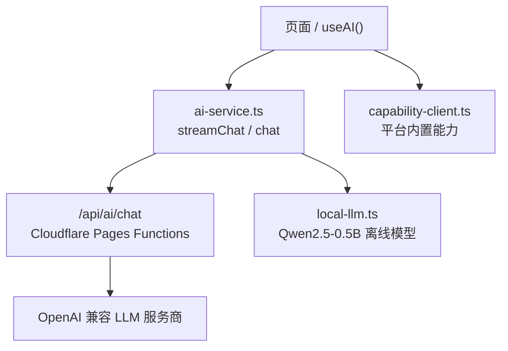
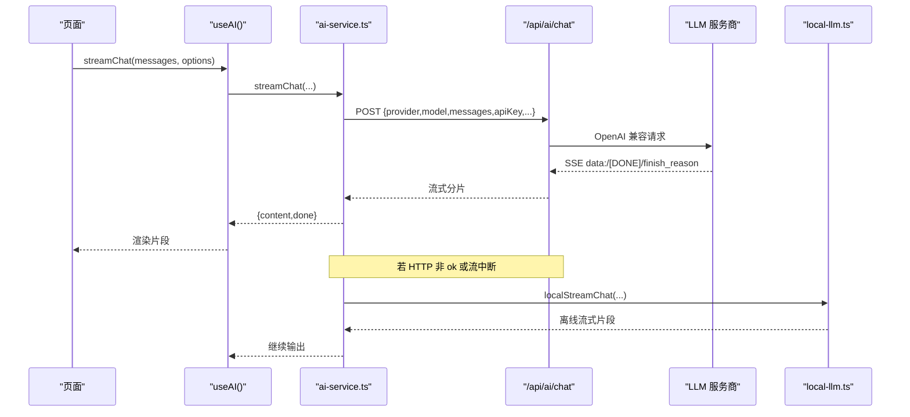
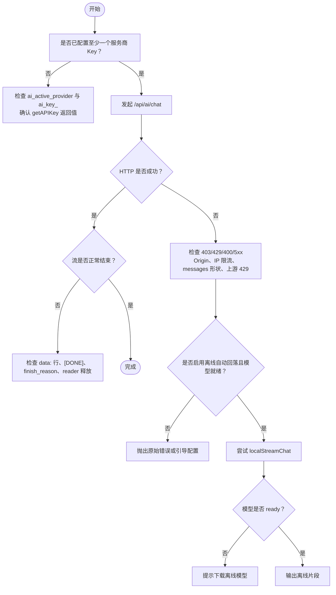
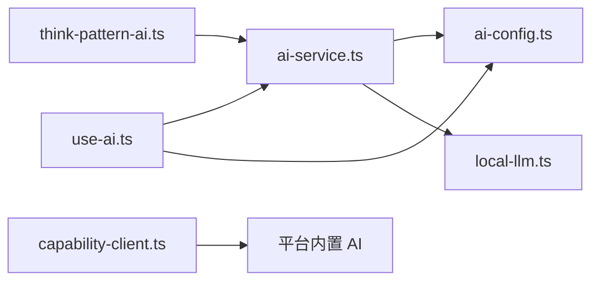

# AI 服务问题排查

<cite>
**本文引用的文件**   
- [ai-service.ts](file://src/services/ai-service.ts)
- [ai-config.ts](file://src/services/ai-config.ts)
- [use-ai.ts](file://src/hooks/use-ai.ts)
- [local-llm.ts](file://src/lib/local-llm.ts)
- [capability-client.ts](file://src/lib/capability-client.ts)
- [think-pattern-ai.ts](file://src/lib/think-pattern-ai.ts)
- [ai-services.md](file://docs/modules/ai-services.md)
</cite>

## 目录
1. [引言](#引言)
2. [项目结构与 AI 调用链](#项目结构与-ai-调用链)
3. [核心组件与职责](#核心组件与职责)
4. [架构总览](#架构总览)
5. [故障分类与诊断流程](#故障分类与诊断流程)
6. [详细排障指南](#详细排障指南)
7. [依赖关系分析](#依赖关系分析)
8. [性能、背压与内存管理](#性能背压与内存管理)
9. [不同 AI 提供商的特定问题](#不同-ai-提供商的特定问题)
10. [监控、成本优化与最佳实践](#监控成本优化与最佳实践)
11. [结论](#结论)

## 引言
本指南面向 NativeThink 的 AI 服务集成，聚焦四类典型问题：
- LLM API 调用失败
- 流式响应中断
- 本地模型加载超时
- 能力客户端异常

文档从系统调用链出发，给出症状、可能原因、诊断步骤和具体修复方案，并覆盖流式中断恢复、背压控制、内存管理、多厂商差异以及监控与成本控制。读者无需深入源码即可按清单定位问题。

## 项目结构与 AI 调用链
NativeThink 的 AI 能力由三条路径组成：
- 用户自配 Key 的云端 OpenAI 兼容接口
- Cloudflare Pages Functions 代理 `/api/ai/chat`
- 端侧离线小模型（Qwen2.5-0.5B）

前端通过 `useAI()` Hook 暴露统一的对话与流式接口；业务页面只关心消息、流式片段和错误提示，不直接处理网络细节。服务端代理负责鉴权、限流、任务选模型和免费档回退。端侧模型作为出厂 Key 限流或断网时的兜底。

**图表来源**
- [ai-service.ts:1-368](file://src/services/ai-service.ts#L1-L368)
- [ai-config.ts:1-206](file://src/services/ai-config.ts#L1-L206)
- [local-llm.ts:1-204](file://src/lib/local-llm.ts#L1-L204)
- [capability-client.ts:1-23](file://src/lib/capability-client.ts#L1-L23)
- [ai-services.md:1-107](file://docs/modules/ai-services.md#L1-L107)

**章节来源**
- [ai-services.md:1-107](file://docs/modules/ai-services.md#L1-L20)

## 核心组件与职责
| 组件 | 主要职责 | 关键行为 |
|---|---|---|
| `ai-config.ts` | 服务商配置、Key 读取、当前服务商切换 | 提供出厂 Key、用户 Key、默认服务商、事件广播 |
| `ai-service.ts` | 统一聊天入口、SSE 流解析、离线回落 | 优先走服务端代理；失败后按条件回落到本地模型 |
| `use-ai.ts` | React Hook 封装 | 把流式结果交给 UI；统一捕获 AbortError 和非静默错误 |
| `local-llm.ts` | 离线小模型下载、状态、流式推理 | transformers.js + Qwen2.5-0.5B；支持 webgpu/wasm；镜像源自动重试 |
| `capability-client.ts` | 平台内置 AI 能力客户端 | 按需动态加载，避免首屏 160KB 开销 |
| `think-pattern-ai.ts` | “思维模式”判断 Prompt 与结果校验 | 纯函数，不引入运行时依赖 |

**章节来源**
- [ai-config.ts:1-206](file://src/services/ai-config.ts#L1-L206)
- [ai-service.ts:1-368](file://src/services/ai-service.ts#L1-L368)
- [use-ai.ts:1-101](file://src/hooks/use-ai.ts#L1-L101)
- [local-llm.ts:1-204](file://src/lib/local-llm.ts#L1-L204)
- [capability-client.ts:1-23](file://src/lib/capability-client.ts#L1-L23)
- [think-pattern-ai.ts:1-66](file://src/lib/think-pattern-ai.ts#L1-L66)

## 架构总览
下图展示一次正常流式对话的端到端流程，包括失败时如何进入离线小模型。

**图表来源**
- [ai-service.ts:100-190](file://src/services/ai-service.ts#L100-L190)
- [ai-service.ts:302-368](file://src/services/ai-service.ts#L302-L368)
- [local-llm.ts:140-204](file://src/lib/local-llm.ts#L140-L204)
- [use-ai.ts:40-101](file://src/hooks/use-ai.ts#L40-L101)

## 故障分类与诊断流程
### 快速决策树

**图表来源**
- [ai-service.ts:100-190](file://src/services/ai-service.ts#L100-L190)
- [ai-service.ts:302-368](file://src/services/ai-service.ts#L302-L368)
- [local-llm.ts:30-108](file://src/lib/local-llm.ts#L30-L108)

## 详细排障指南

### 一、LLM API 调用失败
#### 常见症状
- 点击“发送”后无响应或立即报错
- 非流式调用返回空字符串
- 提示“服务端 AI Key 未配置”
- 频繁出现 429 或 5xx 错误

#### 可能原因
- 未配置任何服务商 Key
- 当前活跃服务商 `ai_active_provider` 指向没有 Key 的服务商
- 用户 Key 被清空或存储不可用
- 服务端未配置对应 Key，返回 503
- 服务端 Origin 白名单拒绝请求
- IP 限流触发 429
- messages 长度或形状超限
- 上游服务商限流或宕机

#### 诊断方法
1. 检查前端是否已有可用服务商：
   - 查看 `getActiveProvider()` 返回值
   - 检查 `localStorage` 中 `ai_active_provider`
   - 检查 `localStorage` 中 `ai_key_<provider>`
   - 确认 `hasFactoryKey()` 和 `isFactoryKey(provider)`
2. 检查服务端代理：
   - 观察 `/api/ai/chat` 返回码
   - 403：Origin 不在白名单
   - 429：IP 每分钟超过限制
   - 400：messages 为空、条数过多、字段类型不对或总字符过长
   - 503：服务端未配置 Key
   - 5xx：上游服务商异常
3. 检查工厂 Key 用量：
   - 使用 GET `/api/ai/chat` 获取用量快照
   - 在 Cloudflare Real-time Logs 中检索 `type:"ai_factory_usage"`

#### 解决步骤
- 在设置页重新配置服务商 Key，并选择正确的活跃服务商
- 如仅使用出厂免费额度，确保未误删 `scripts/.apikey`，并确认构建注入了 `__FACTORY_API_KEY__`
- 若为打包应用，确认部署域名在 Origin 白名单内
- 若频繁 429，降低并发或切换到更稳定的服务商
- 修正 messages 结构：确保每条消息有 `role` 和 `content`，总条数不超过上限，总字符长度不超过上限
- 检查上游服务商配额、模型可用性、计费账户状态

**章节来源**
- [ai-config.ts:1-206](file://src/services/ai-config.ts#L1-L206)
- [ai-service.ts:100-190](file://src/services/ai-service.ts#L100-L190)
- [ai-service.ts:201-260](file://src/services/ai-service.ts#L201-L260)
- [ai-services.md:1-107](file://docs/modules/ai-services.md#L1-L107)

### 二、流式响应中断
#### 常见症状
- 对话开头能出字，随后卡顿或停止
- 最后一条片段不完整
- 浏览器控制台出现流 reader 未释放警告
- 取消对话后仍残留未完成状态

#### 可能原因
- 上游 SSE 连接断开
- 网络抖动导致 `response.body.getReader().read()` 失败
- `[DONE]` 未到达
- `finish_reason` 未到达但流已结束
- 调用方未正确消费 AsyncGenerator
- `AbortSignal` 提前中止但未正确处理

#### 诊断方法
1. 确认 `apiStreamChat` 是否正确解析 `data:` 行：
   - 是否跳过空行或非 `data:` 前缀
   - 是否在 `[DONE]` 后产出 `{done:true}`
   - 是否识别 `finish_reason` 并提前结束
2. 检查缓冲逻辑：
   - 未完整行是否保留在 buffer
   - 循环结束后是否处理剩余 buffer
3. 检查资源释放：
   - `finally` 块是否调用 `reader.releaseLock()`
4. 检查调用层：
   - `use-ai.ts` 是否捕获 AbortError
   - 非静默错误是否弹出 toast
   - 流结束后是否产出 `{content:'',done:true}`

#### 解决步骤
- 确保 UI 层以 `for await` 消费流，并在 `done` 为真时停止渲染
- 对中断错误实现重试策略：指数退避、最多重试次数、可取消
- 对网络异常增加显式提示，而不是让用户看到“无响应”
- 若上游频繁丢包，考虑增大单次 chunk 处理间隔或增加去抖
- 取消对话时传递 `AbortSignal`，并确保 `signal.aborted` 时直接抛错而不进入离线回落

**章节来源**
- [ai-service.ts:100-190](file://src/services/ai-service.ts#L100-L190)
- [use-ai.ts:40-101](file://src/hooks/use-ai.ts#L40-L101)

### 三、本地模型加载超时
#### 常见症状
- 提示“离线小模型未下载”
- 下载进度卡在 0% 或 99%
- 首次加载耗时很长
- 国内手机无法连接 huggingface.co
- APK/桌面版无法命中同源模型

#### 可能原因
- 尚未下载离线模型
- 远程源不可达
- 看门狗判定 45 秒无进度，认为源不可用
- 设备不支持 webgpu，回退到 wasm，加载更慢
- 打包版缺少 `/models/<id>/config.json`
- Cache API 或 localStorage 不可用
- 重复下载阻塞

#### 诊断方法
1. 检查模型状态：
   - `getLocalLlmStatus()` 是否为 `ready`
   - `getDownloadProgress()` 是否停在某值
   - `isAutoFallbackEnabled()` 是否开启
   - `isLocalLlmReady()` 是否返回真
2. 检查下载逻辑：
   - 是否动态 import `@huggingface/transformers`
   - 是否设置 `allowLocalModels=true` 与 `localModelPath='/models/'`
   - 是否按语言/UA 选择 hf-mirror 与 huggingface.co
   - 是否触发 45 秒看门狗
3. 检查打包环境：
   - APK/桌面是否硬链接 `models-bundled/`
   - 网页版是否依赖远程下载

#### 解决步骤
- 在设置页手动触发下载，并观察进度
- 国内网络优先使用 hf-mirror；必要时调整远端源顺序
- 清除缓存后重试：`clearLocalLlmCache()`
- 打包应用确保 `android-copy-models.cjs` 执行成功，assets 中存在 `/models/<id>/config.json`
- 若设备性能不足，关闭自动回落，避免低端机长时间卡顿
- 不要往 `local-llm.ts` 顶部添加静态 import，否则会增大首屏体积

**章节来源**
- [local-llm.ts:1-108](file://src/lib/local-llm.ts#L1-L108)
- [local-llm.ts:140-204](file://src/lib/local-llm.ts#L140-L204)
- [ai-services.md:1-107](file://docs/modules/ai-services.md#L1-L107)

### 四、能力客户端异常
#### 常见症状
- 在非平台环境进入“AI 服务暂不可用”分支
- 首次进入相关路由时明显卡顿
- 平台外运行时报模块加载失败
- 某些功能页无法使用平台内置 AI

#### 可能原因
- 当前运行环境不是 miaoda 平台
- 动态 import `@lark-apaas/client-toolkit-lite` 失败
- 网络抖动导致一次失败后缓存了失败 promise
- 模块导出中没有 `capabilityClient`

#### 诊断方法
1. 检查 `getCapabilityClient()` 是否返回 `null`
2. 确认该模块只在真正需要时才动态加载，而非静态 import
3. 检查失败时 `pending` 是否被重置为 null，以便后续重试
4. 评估首屏 bundle 大小变化，确认未静态引入该模块

#### 解决步骤
- 保持当前的懒加载设计：仅在确实要走平台能力分支时调用
- 如果平台环境确实不可用，让调用方沿用原有的 try-catch 和“AI 服务暂不可用”提示
- 若需要调试，可在失败回调中打印错误信息，但不要修改其始终返回 null 的降级语义
- 验证四个相关功能页（思维、语块、对话、写作）在不加载该模块时仍能正常使用出厂免费额度

**章节来源**
- [capability-client.ts:1-23](file://src/lib/capability-client.ts#L1-L23)
- [ai-services.md:1-107](file://docs/modules/ai-services.md#L1-L107)

### 五、“思维模式”AI 判定的特殊问题
#### 常见症状
- 思维模式复习返回空结果
- 用户句子被判为不符合目标模式
- 反馈文本缺失
- JSON 解析失败

#### 可能原因
- 上游 AI 返回空串
- 返回内容不是合法 JSON
- JSON 中缺少 `pass`、`feedback` 或字段类型不正确
- 调用方没有先判空就解析

#### 诊断方法
1. 确认调用方先判断 `!raw.trim()`，将空串视为服务不可用
2. 检查 `validatePatternJudgeResult` 是否能接受布尔、字符串、宽松类型
3. 核对 `buildPatternJudgePrompt` 生成的 system prompt 是否包含目标模式、线索、中英对比、场景和焦点

#### 解决步骤
- 对空响应做降级：提示“AI 暂时无法判断”，允许用户重试
- 对非法 JSON 返回 null，由上层决定重试或显示友好提示
- 若提示词质量不稳定，优先调整 prompt 描述，而不是放宽校验
- 注意该模块只做数据校验，不负责 JSON 解析

**章节来源**
- [think-pattern-ai.ts:1-66](file://src/lib/think-pattern-ai.ts#L1-L66)

## 依赖关系分析

**图表来源**
- [use-ai.ts:1-101](file://src/hooks/use-ai.ts#L1-L101)
- [ai-service.ts:1-368](file://src/services/ai-service.ts#L1-L368)
- [ai-config.ts:1-206](file://src/services/ai-config.ts#L1-L206)
- [local-llm.ts:1-204](file://src/lib/local-llm.ts#L1-L204)
- [think-pattern-ai.ts:1-66](file://src/lib/think-pattern-ai.ts#L1-L66)
- [capability-client.ts:1-23](file://src/lib/capability-client.ts#L1-L23)

**章节来源**
- [ai-service.ts:1-368](file://src/services/ai-service.ts#L1-L368)
- [use-ai.ts:1-101](file://src/hooks/use-ai.ts#L1-L101)

## 性能、背压与内存管理
### 流式背压控制
- `apiStreamChat` 使用 `TextDecoder` 逐字节解码，并按换行拆分 `data:` 行
- 未完整行保存在 buffer，避免丢失分片
- 每个有效 content 片段立即 yield，UI 层应控制渲染频率
- 建议 UI 层对高频更新做节流或合并，避免 DOM 抖动

### 资源释放
- 流结束时必须释放 `reader`
- 取消对话应使用 `AbortSignal`，并在 `signal.aborted` 时尽早退出
- 本地模型下载中的定时器在看门狗完成后需清理

### 内存与体积
- 离线模型约 780MB；wasm 运行时约 22.5MB；transformers JS 约 538KB
- 这些大资源仅在动态 import 后加载，不应静态引入
- 打包版通过硬链接复用 `models-bundled/`，避免仓库膨胀
- 能力客户端模块约 160KB gzip，必须懒加载

### 推荐实践
- 对流式输出设置最大渲染队列长度，超出时丢弃旧片段
- 对长对话进行上下文裁剪，避免消息数组无限增长
- 对失败重试采用指数退避，避免雪崩
- 对本地模型下载提供进度、取消、重试入口
- 对 bundle 大小运行预算检查，防止新增静态依赖

**章节来源**
- [ai-service.ts:100-190](file://src/services/ai-service.ts#L100-L190)
- [local-llm.ts:1-108](file://src/lib/local-llm.ts#L1-L108)
- [ai-services.md:1-107](file://docs/modules/ai-services.md#L1-L107)

## 不同 AI 提供商的特定问题

### 智谱 GLM 与出厂免费选项
- 出厂免费选项独立于用户配置的 GLM Key
- 翻译任务优先选择更准模型，对话任务优先选择更快模型
- 高峰时段容易 429，服务端会按 429/5xx 回退到其他免费模型

**排查重点**
- 区分 `factory` 与 `glm`
- 检查任务类型是否影响模型选择
- 关注上游 429 和 5xx 的回退链

**章节来源**
- [ai-config.ts:1-206](file://src/services/ai-config.ts#L1-L206)
- [ai-service.ts:50-80](file://src/services/ai-service.ts#L50-L80)
- [ai-services.md:1-107](file://docs/modules/ai-services.md#L1-L107)

### DeepSeek
- 使用 OpenAI 兼容接口
- 免费额度有限，注意限额与速率限制
- 推理模型可能延迟较高

**排查重点**
- 检查 API Key 是否有效
- 检查余额和配额
- 对高延迟请求增加超时和重试

**章节来源**
- [ai-config.ts:50-140](file://src/services/ai-config.ts#L50-L140)

### 豆包 Doubao
- 通过火山引擎 Ark 提供 OpenAI 兼容接口
- 免费额度按天计算

**排查重点**
- 检查 endpoint 是否变更
- 检查区域与权限
- 关注日配额耗尽后的 429

**章节来源**
- [ai-config.ts:50-140](file://src/services/ai-config.ts#L50-L140)

### 通义千问 Qwen
- 通过阿里云 dashscope 兼容模式访问
- 免费额度较大，适合批量任务

**排查重点**
- 检查签名和 endpoint
- 注意不同模型的 token 限制
- 对大批量请求做分批和限流

**章节来源**
- [ai-config.ts:50-140](file://src/services/ai-config.ts#L50-L140)

### SiliconFlow、Moonshot、Groq
- 均使用 OpenAI 兼容接口
- 免费额度或新用户额度不同
- Groq 强调低延迟

**排查重点**
- 检查各厂商注册、Key、模型列表
- 对高吞吐场景评估是否值得付费升级
- 对延迟敏感任务优先测 Groq

**章节来源**
- [ai-config.ts:50-140](file://src/services/ai-config.ts#L50-L140)

## 监控、成本优化与最佳实践

### 监控建议
- 记录每次 AI 调用的 provider、model、task、status、token 估算、耗时
- 对 429、500、502、503、504 单独计数
- 对离线回落次数、本地模型加载时长、失败原因分别统计
- 使用服务端工厂 Key 用量接口和 Cloudflare Real-time Logs 追踪免费额度消耗

### 成本优化
- 优先使用任务分工模型：翻译用更准模型，对话用更快模型
- 对练习界面使用 `silent` 模式，避免全局 toast 干扰体验
- 对短任务降低 `maxTokens`，减少 token 消耗
- 对不需要流式的场景使用非流式接口，减少连接开销
- 合理使用离线小模型作为兜底，但明确其质量不如云端大模型

### 安全与稳定性
- 不要在前端日志中明文打印 API Key
- 不要把 `scripts/.apikey` 提交到仓库
- 保证所有 `/api/ai/*` 函数都挂载 CORS 守卫
- 对 Origin 白名单和 IP 限流改动进行手工测试
- 对 guard 配置改动执行四种响应测试：403、429、400、200

**章节来源**
- [ai-services.md:1-107](file://docs/modules/ai-services.md#L1-L107)
- [ai-config.ts:1-206](file://src/services/ai-config.ts#L1-L206)
- [ai-service.ts:100-190](file://src/services/ai-service.ts#L100-L190)

## 结论
NativeThink 的 AI 服务集成通过统一的前端服务、服务端代理和多路径兜底，覆盖了云端调用、流式输出、离线模型和能力客户端四个维度。排查问题时，应按“配置 → 代理 → 上游 → 流式 → 离线 → 能力客户端”的顺序逐步缩小范围。对于流式中断和本地模型加载，重点检查 reader 释放、buffer 处理、看门狗行为和打包环境；对于多厂商问题，重点检查 Key、endpoint、模型、配额和限流。长期维护应结合监控指标、成本约束和安全守卫，避免把临时修复变成系统性风险。