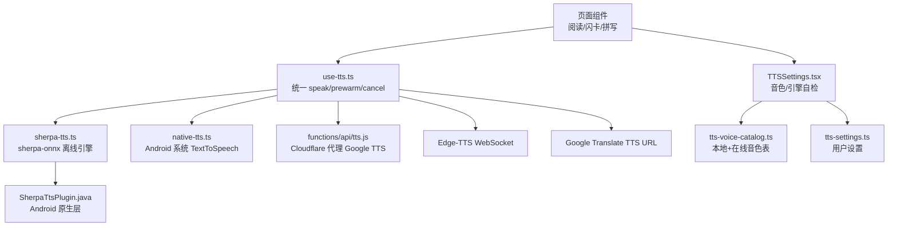
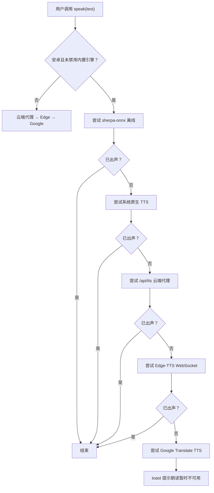
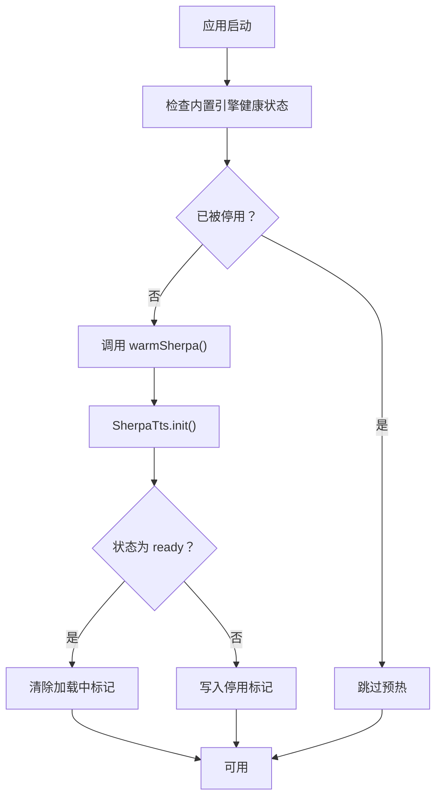
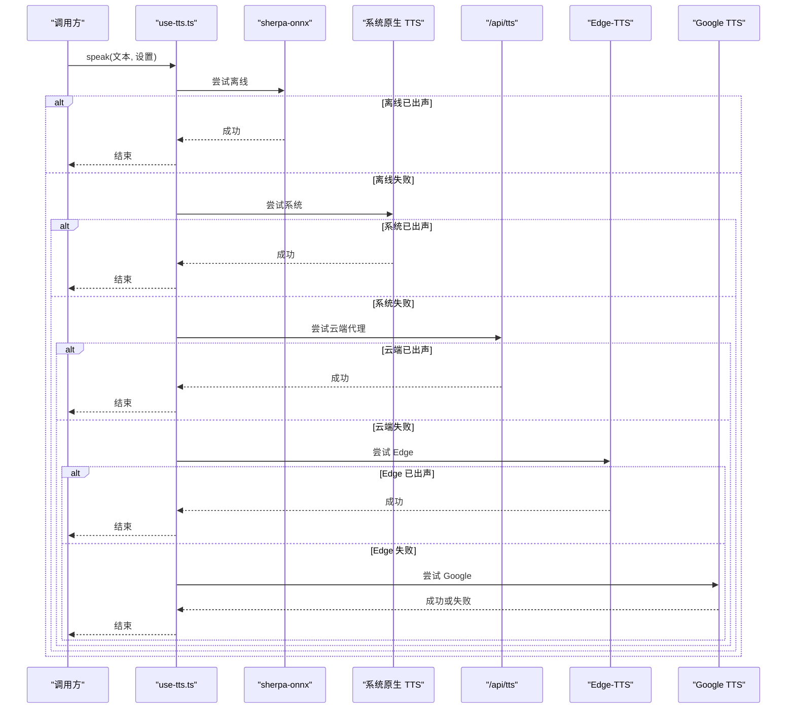

# TTS 语音合成问题排查

<cite>
**本文引用的文件**   
- [sherpa-tts.ts](file://src/lib/sherpa-tts.ts)
- [use-tts.ts](file://src/lib/use-tts.ts)
- [tts-settings.ts](file://src/lib/tts-settings.ts)
- [tts-voice-catalog.ts](file://src/lib/tts-voice-catalog.ts)
- [TTSSettings.tsx](file://src/components/TTSSettings.tsx)
- [native-tts.ts](file://src/lib/native-tts.ts)
- [SherpaTtsPlugin.java](file://android/app/src/main/java/com/nativethink/app/SherpaTtsPlugin.java)
- [tts.md](file://docs/modules/tts.md)
- [tts.js](file://functions/api/tts.js)
- [check-tts-latency.mjs](file://scripts/check-tts-latency.mjs)
- [check-tts-voices.cjs](file://scripts/check-tts-voices.cjs)
</cite>

## 目录

1. [引言](#引言)
2. [项目结构与 TTS 总览](#项目结构与-tts-总览)
3. [多引擎降级链](#多引擎降级链)
4. [常见问题与排查路径](#常见问题与排查路径)
5. [离线模型加载失败排查](#离线模型加载失败排查)
6. [音频播放异常排查](#音频播放异常排查)
7. [音质不佳与长文卡顿排查](#音质不佳与长文卡顿排查)
8. [多引擎降级链失效排查](#多引擎降级链失效排查)
9. [移动端特有问题](#移动端特有问题)
10. [日志收集与开发者工具调试](#日志收集与开发者工具调试)
11. [性能优化建议](#性能优化建议)
12. [自检流程与结论](#自检流程与结论)

## 引言

NativeThink 的 TTS 不是单一功能，而是一条按平台、网络、系统能力和用户设置动态选择引擎的链路。核心目标是：同一段英文在手机上能够离线、即时、连续地朗读；当首选离线引擎不可用时自动降级到系统语音、云端代理、Edge-TTS 或 Google TTS，而不是静默无声。

从问题排查角度，最重要的认知是：**“没有声音”不等于“TTS 坏了”**。它可能是 sherpa-onnx 模型初始化失败、浏览器不支持 `speechSynthesis`、系统原生 TTS 没有英语音色、云端代理被墙、WebSocket 连接超时、或者音频播放被浏览器限制。因此排查必须按“先定位当前走哪条通道，再验证该通道能力”的顺序进行。

## 项目结构与 TTS 总览

TTS 相关代码分布在三个层次：

| 层次 | 主要文件 | 职责 |
|---|---|---|
| 前端调用入口 | [use-tts.ts](file://src/lib/use-tts.ts) | 统一 `speak()` / `prewarm()` / `pause()` / `resume()` / `cancel()`，负责切片、降级、看门狗和进度上报 |
| 离线引擎封装 | [sherpa-tts.ts](file://src/lib/sherpa-tts.ts) | Android APK 中通过 Capacitor 插件调用 sherpa-onnx，负责预热、状态、缓存、健康护栏和日志读取 |
| 本地音色表 | [tts-voice-catalog.ts](file://src/lib/tts-voice-catalog.ts) | 定义 Piper lessac、Kokoro 11 个英文音色、默认音色、在线 Edge 音色目录 |
| 系统原生 TTS | [native-tts.ts](file://src/lib/native-tts.ts) | Android 系统 `TextToSpeech` 插件封装，列出系统语音、选本地英语音色、打开安装页 |
| 设置界面 | [TTSSettings.tsx](file://src/components/TTSSettings.tsx) | 音色选择、试听、引擎自检、内置引擎状态、上次朗读实测 |
| 持久化设置 | [tts-settings.ts](file://src/lib/tts-settings.ts) | 保存用户选择的语音、语速、音高、音量、是否优先系统引擎 |
| 云端代理 | [tts.js](file://functions/api/tts.js) | Cloudflare Pages Function，代理 Google Translate TTS，CDN 缓存 MP3 |
| 原生实现 | [SherpaTtsPlugin.java](file://android/app/src/main/java/com/nativethink/app/SherpaTtsPlugin.java) | Android 端 sherpa-onnx 模型加载、WAV 合成、文件缓存、初始化日志 |
| 诊断脚本 | [check-tts-latency.mjs](file://scripts/check-tts-latency.mjs)、[check-tts-voices.cjs](file://scripts/check-tts-voices.cjs) | RTF 实测、入队顺序测试、音色注册表与模型元数据校验 |

**图表来源**
- [use-tts.ts:1-120](file://src/lib/use-tts.ts#L1-L120)
- [sherpa-tts.ts:1-120](file://src/lib/sherpa-tts.ts#L1-L120)
- [native-tts.ts:1-60](file://src/lib/native-tts.ts#L1-L60)
- [tts.js:1-40](file://functions/api/tts.js#L1-L40)
- [SherpaTtsPlugin.java:1-80](file://android/app/src/main/java/com/nativethink/app/SherpaTtsPlugin.java#L1-L80)
- [TTSSettings.tsx:1-60](file://src/components/TTSSettings.tsx#L1-L60)

**章节来源**
- [use-tts.ts:1-120](file://src/lib/use-tts.ts#L1-L120)
- [sherpa-tts.ts:1-120](file://src/lib/sherpa-tts.ts#L1-L120)
- [tts.md:1-40](file://docs/modules/tts.md#L1-L40)

## 多引擎降级链

use-tts.ts 是所有朗读调用的统一入口，核心规则是：**同一句已经出声就不再换引擎重试**，全部引擎失败才尝试兜底，仍失败才给用户提示。这样避免用户听到同一句话被两个引擎读两遍。

不同平台的候选顺序如下：

| 条件 | 候选顺序 |
|---|---|
| 安卓默认 | sherpa-onnx 离线 → 系统原生 → 云端代理 `/api/tts` → Edge-TTS → Google TTS |
| 显式选择在线 Edge 音色 | 云端代理 → sherpa-onnx → 系统原生 → Edge → Google |
| 开启「只用系统引擎」 | 仅系统原生 |
| 内置引擎被闪退护栏停用 | 从候选中剔除 sherpa-onnx |
| 非安卓（网页/桌面/iOS） | 云端代理 → Edge → Google |

**图表来源**
- [use-tts.ts:470-600](file://src/lib/use-tts.ts#L470-L600)
- [tts.md:80-120](file://docs/modules/tts.md#L80-L120)

降级判断的关键点包括：

1. **已出声分流**：每个引擎执行前检查是否已经发出过声音；一旦出声，后续降级不再触发。
2. **看门狗**：URL 引擎有 25 秒安全定时器；原生分支根据是否有英语音色设定更短的静音预算。
3. **代际号防并发冲突**：取消和继续朗读使用单调递增的代际号，防止旧请求回调覆盖新请求。
4. **错误去抖**：全部引擎失败后的 toast 5 秒内只提示一次，避免刷屏。

**章节来源**
- [use-tts.ts:1-120](file://src/lib/use-tts.ts#L1-L120)
- [use-tts.ts:470-600](file://src/lib/use-tts.ts#L470-L600)
- [tts.md:80-120](file://docs/modules/tts.md#L80-L120)

## 常见问题与排查路径

下面按症状组织排查路径。每种问题都给出典型表现、可能原因、诊断步骤和解决方案。

### 一、点击喇叭后完全没声音

#### 典型表现

- 桌面网页：点击喇叭无反应，控制台可能有自动播放拦截警告。
- Android WebView：系统 `speechSynthesis.getVoices()` 返回空数组，界面上没有可选语音。
- iOS Safari：`speechSynthesis` 存在但行为异常，通常直接走云端或 Edge。
- 所有平台：如果全部引擎失败，会显示“朗读暂时不可用”。

#### 可能原因

1. 浏览器禁止自动播放或媒体播放需要用户手势。
2. 设备没有可用的系统语音。
3. 云端代理无法访问。
4. Edge-TTS WebSocket 被墙或连接超时。
5. Google TTS URL 被网络策略拒绝。
6. 用户开启了「只用系统引擎」，但系统没有英语 TTS。

#### 诊断步骤

1. 打开设置面板中的“朗读自检”，查看当前各引擎探测结果。
2. 确认当前文本实际走了哪个引擎：设置面板会记录最近一次朗读实测。
3. 如果是安卓 APK，检查内置离线引擎是否被闪退护栏停用。
4. 在非安卓环境，确认 `speechSynthesis` 是否存在。
5. 切换一个已知可用的在线 Edge 音色再次试听。

#### 解决方案

- 桌面端：由用户手动点击任意页面元素后再试，或允许站点自动播放。
- 安卓端：如系统缺少英语 TTS，使用设置页引导安装系统语音包。
- 网络受限环境：让 use-tts.ts 自动回退到 Edge-TTS 或 Google TTS。
- 用户误开「只用系统引擎」：关闭该选项，恢复默认多引擎降级链。

**章节来源**
- [use-tts.ts:1-120](file://src/lib/use-tts.ts#L1-L120)
- [native-tts.ts:1-60](file://src/lib/native-tts.ts#L1-L60)
- [TTSSettings.tsx:1-120](file://src/components/TTSSettings.tsx#L1-L120)

### 二、首包慢、第一句要等很久

#### 典型表现

- 长文朗读开头停顿明显，后续句子变快。
- Kokoro 音色冷启动尤其慢，短词朗读时有时反而走云端更快。
- 预取下一段后整体延迟下降，但第一句仍然要等。

#### 可能原因

1. sherpa-onnx 模型首次加载需要摊包并初始化。
2. 预取逻辑曾把下一段排在本段前面，导致原生串行队列首包翻倍。
3. 单词级短文本适合走云端代理，因为本地小模型对个别发音有限制。
4. 设备 CPU 较弱，Kokoro RTF 接近或超过 1.0。

#### 诊断步骤

1. 观察设置面板中 Kokoro 音色的小字提示，确认是否标注“合成慢于播放”。
2. 运行诊断脚本 `scripts/check-tts-latency.mjs`，查看冷合成耗时和 RTF。
3. 对比 lessac 与 Kokoro 的首包差异。
4. 确认短词朗读是否命中云端代理。

#### 解决方案

- 短词朗读：保持默认“联网时云端优先”的逻辑，减少本地小模型缺陷。
- 长文朗读：使用默认 lessac，RTF 约 0.08–0.12，能跟上播放。
- 提前预热：在进入阅读或学习页前调用 `warmSherpa()`。
- 不要盲目增加切片长度或预取深度；文档明确说明这会积压队列。

**章节来源**
- [tts.md:1-80](file://docs/modules/tts.md#L1-L80)
- [check-tts-latency.mjs:1-149](file://scripts/check-tts-latency.mjs#L1-L149)
- [sherpa-tts.ts:100-160](file://src/lib/sherpa-tts.ts#L100-L160)

### 三、长文朗读逐句卡顿

#### 典型表现

- lessac 流畅，Kokoro 每句之间出现停顿。
- 加大预取深度后并没有改善，反而队列更长。
- 提高线程数也没有把 Kokoro 的 RTF 压到 1.0 以下。

#### 可能原因

Kokoro int8 的 RTF 约为 1.008–1.25，意味着合成速度追不上播放速度。这不是播放层问题，而是模型合成上限。

#### 诊断步骤

1. 在设置页确认正在使用的音色是 Kokoro。
2. 查看设置页中该音色的提示文案。
3. 用 `check-tts-latency.mjs` 测量 RTF。
4. 切换到 lessac 或在线 Edge 音色复测。

#### 解决方案

- 长文连续朗读：选择默认 lessac 或在线 Edge 音色。
- 保留 Kokoro 用于短文本、单句试听、对音质敏感的场景。
- 不要在产品逻辑里悄悄替换用户选择的音色；代码注释明确强调这一点。

**章节来源**
- [tts.md:40-120](file://docs/modules/tts.md#L40-L120)
- [tts-voice-catalog.ts:120-162](file://src/lib/tts-voice-catalog.ts#L120-L162)

### 四、快速切卡时部分单词或句子突然没声

#### 典型表现

- 自动朗读每隔几张死一张。
- 快速点击喇叭也会偶发无声。
- 控制台出现 `AbortError`。
- 表面看是“某个引擎失败”，实际是 App 自己取消了刚起播的新朗读。

#### 可能原因

这是由取消逻辑与音频事件时序造成的并发冲突。旧链体可能在旧请求结束后读取到新的状态，进而把新朗读掐掉；或者 `stopAudio()` 清理事件监听器的时机不够早，导致旧元素的 `onerror` 驱动错误降级。

#### 诊断步骤

1. 打开控制台，搜索 `AbortError`。
2. 观察快速切换时的播放日志，确认是否同时发起多个朗读。
3. 检查是否在取消后立即再次朗读。
4. 使用 `scripts/walk-quickcard-tts.mjs`（项目中存在对应脚本名）复现问题。

#### 解决方案

当前实现已通过以下机制修复：

- 使用单调递增的代际号标记每次朗读链。
- 每个链体第一时间检查代际号，旧链直接退出。
- `stopAudio()` 先摘除 `onplay/onended/onerror/onpause`，再暂停并清空源。
- 原生回放链路也携带代际号。

如果用户仍遇到此问题，通常是外部调用方绕过 use-tts.ts 直接操作音频或语音对象，应改为复用统一 hook。

**章节来源**
- [tts.md:120-200](file://docs/modules/tts.md#L120-L200)
- [use-tts.ts:1-120](file://src/lib/use-tts.ts#L1-L120)

### 五、换音色后听到上一个音色的音频

#### 典型表现

- 选择新音色后，前几次朗读仍是旧音色。
- 多次重复朗读同一句正常，换音色后才出问题。

#### 可能原因

JS 层 URL 缓存 key 必须包含音色。如果只按文本和语速缓存，换音色后会命中旧音频。

#### 诊断步骤

1. 在设置页试听不同 Kokoro 音色。
2. 观察是否每次试听都是不同音色。
3. 清除内置引擎缓存后复测。

#### 解决方案

- 确保缓存 key 包含 `voiceId`、`speed` 和 `text`。
- 必要时调用 `purgeSherpaCache()` 清理原生文件和 JS Map 缓存。
- 注意设置页中的“音色暂不可用已改用…”提示，说明当前发生了音色回退。

**章节来源**
- [sherpa-tts.ts:160-240](file://src/lib/sherpa-tts.ts#L160-L240)
- [TTSSettings.tsx:1-120](file://src/components/TTSSettings.tsx#L1-L120)

## 离线模型加载失败排查

### 典型症状

- 设置页显示内置引擎状态为 `loading` 或 `error`。
- 应用冷启动后闪退，或进入阅读页后内置引擎不可用。
- 设置页可看到初始化日志为空或包含错误信息。
- 只有 Kokoro 失败，lessac 仍可工作。
- 内置引擎被自动停用，需要手动重新启用。

### 可能原因

| 原因 | 现象 | 说明 |
|---|---|---|
| assets 中缺少模型文件 | 初始化报错 | 打包阶段未正确拷贝 Kokoro 或 Piper 资产 |
| espeak-ng-data 不完整 | 初始化失败或发音异常 | Kokoro 复用 Piper 的 espeak 数据 |
| 模型损坏或版本不匹配 | 元数据校验失败 | `n_speakers` 或 `speaker2id` 与前端注册表不一致 |
| 设备内存不足 | 进程崩溃或初始化超时 | sherpa-onnx 加载大模型需要足够堆空间 |
| 上次加载中途崩溃 | 下次启动自动停用 | 健康护栏检测到未完成标记 |
| 模型摊包失败 | 文件路径不存在或权限不足 | 从 assets 摊到内部存储失败 |
| 并发请求过多 | pthread 线程耗尽闪退 | 原生层已有最大待处理任务上限保护 |

### 诊断步骤

1. 打开设置页，查看内置引擎状态和初始化日志。
2. 运行打包前校验脚本 `scripts/check-tts-voices.cjs`。
3. 检查 APK 中 assets 目录是否存在 `tts/kokoro-int8-multi-lang-v1_0` 和 `piper/vits-piper-en_US-lessac-medium`。
4. 检查 espeak-ng-data 条目数量，不应少于 50。
5. 核对 Kokoro 模型内嵌元数据中的 `n_speakers` 与 `speaker2id`。
6. 查看原生初始化日志文件位置，确认写入成功。
7. 如果内置引擎被停用，点击设置页中的重新启用按钮。

### 解决方案

1. **重新下载模型资产**：运行 `scripts/fetch-android-tts.cjs --force`，确保 Kokoro v1.0 与 54 音色完整。
2. **清理缓存**：在设置页调用 `purgeSherpaCache()`，删除旧的 WAV 缓存和可能损坏的摊包目录。
3. **手动重新启用内置引擎**：调用 `reenableBundledEngine()` 或通过设置界面恢复。
4. **修复模型注册表**：修改 `MODELS` 或 `tts-voice-catalog.ts` 后必须运行 `npm run check:tts-voices`。
5. **降低并发压力**：避免短时间内大量并行朗读；use-tts.ts 已在 JS 层做请求去重。
6. **回退到 lessac**：如果 Kokoro 持续失败，默认音色 lessac 仍可工作。

**图表来源**
- [sherpa-tts.ts:1-120](file://src/lib/sherpa-tts.ts#L1-L120)
- [SherpaTtsPlugin.java:80-160](file://android/app/src/main/java/com/nativethink/app/SherpaTtsPlugin.java#L80-L160)

**章节来源**
- [sherpa-tts.ts:1-120](file://src/lib/sherpa-tts.ts#L1-L120)
- [SherpaTtsPlugin.java:1-200](file://android/app/src/main/java/com/nativethink/app/SherpaTtsPlugin.java#L1-L200)
- [check-tts-voices.cjs:1-120](file://scripts/check-tts-voices.cjs#L1-L120)

## 音频播放异常排查

### 典型症状

- 合成成功但没有声音。
- 播放中断。
- 播放开始后又立即停止。
- 多段朗读互相抢占。
- 暂停后恢复失败。

### 可能原因

1. 浏览器阻止 `<audio.play()`。
2. 旧音频元素的 `onerror` 触发了错误降级。
3. 取消与新朗读并发，代际号未正确传递。
4. 原生引擎整句完成时才 resolve，看门狗误判。
5. 音频 URL 过期或被回收。
6. 移动端后台播放受限。

### 诊断步骤

1. 打开浏览器控制台，过滤 `Audio`、`AbortError`、`play()`。
2. 检查设置面板中的“上次朗读实测”，确认是否真有声学输出。
3. 分别测试单个短词和长段落。
4. 测试暂停后恢复。
5. 在非安卓设备排除 sherpa-onnx 影响，聚焦播放层。
6. 在安卓设备检查系统原生 TTS 是否能独立发声。

### 解决方案

- 确保用户交互后调用播放。
- 使用 use-tts.ts 的统一接口，不要绕过它的取消和代际号逻辑。
- 对于原生引擎，依赖其内置的静音预算和英语音色检测。
- 如果后端合成成功但前端不响，重点检查 `<audio>` 生命周期和事件监听器清理。
- 移动端需考虑后台播放限制和系统省电策略。

**章节来源**
- [use-tts.ts:500-700](file://src/lib/use-tts.ts#L500-L700)
- [tts.md:120-200](file://docs/modules/tts.md#L120-L200)

## 音质不佳与长文卡顿排查

### 典型症状

- Kokoro 音色听起来比 Edge 或系统神经语音差。
- 短词发音不准确，例如某些辅音簇或词首发音异常。
- 长文朗读 Kokoro 每句之间有停顿。
- lessac 流畅但音色较普通。

### 可能原因

1. Kokoro int8 是小模型量化版本，音质和发音准确性低于在线神经语音。
2. 实测发现某些词在小模型下存在系统性偏差，无法通过 override、文本变体或换音色解决。
3. Kokoro RTF 接近或超过 1.0，长文必然断续。
4. lessac 虽然音质普通，但 RTF 很低，更适合长文连续朗读。
5. 在线 Edge 音色质量更高，但依赖网络。

### 诊断步骤

1. 在设置页逐个试听 Kokoro 11 个音色。
2. 对比默认 lessac 和在线 Edge 音色。
3. 对问题短词分别用本地和云端朗读。
4. 使用 `check-tts-latency.mjs` 测量 RTF。
5. 确认是否误把 Kokoro 作为长文默认音色。

### 解决方案

- 短词、单词朗读：保持云端优先逻辑，绕过小模型发音上限。
- 长文朗读：默认 lessac，或在设置中选择在线 Edge 音色。
- 对音质敏感的单句场景：显式选择 Kokoro 或 Edge 音色，并接受可能的首包延迟。
- 不要在产品逻辑中静默替换用户选择；设置页应如实告知代价。

**章节来源**
- [tts.md:1-80](file://docs/modules/tts.md#L1-L80)
- [tts-voice-catalog.ts:100-162](file://src/lib/tts-voice-catalog.ts#L100-L162)
- [check-tts-latency.mjs:80-149](file://scripts/check-tts-latency.mjs#L80-L149)

## 多引擎降级链失效排查

### 典型症状

- 明明设置了在线音色，却走了离线引擎。
- 开了「只用系统引擎」，但仍尝试云端。
- 内置引擎崩过一次后，后续完全不尝试离线。
- 某台设备上一切引擎都失败，但另一台正常。
- 网络断开后没有回退，直接静音。

### 可能原因

1. 用户选择了 `srv:edge:*` 在线音色，此时云端代理排在最前。
2. 内置引擎曾被闪退护栏停用，piper 被主动剔除。
3. `preferNative` 被开启，候选链只剩系统原生。
4. 云端代理被墙、WebSocket 连接超时、Google TTS 不可达。
5. 系统原生 TTS 没有英语音色，且其他引擎也失败。
6. 调用方绕过 use-tts.ts，直接调用底层引擎。

### 诊断步骤

1. 打开设置页的“朗读自检”，查看每条引擎的探测结果。
2. 确认当前选择的音色类型：本地 Kokoro、本地 lessac、还是在线 Edge。
3. 确认是否开启「只用系统引擎」。
4. 检查内置引擎是否被停用。
5. 在不同网络环境下复测云端代理。
6. 在非安卓设备排除 sherpa-onnx 影响。

### 解决方案

- 想要纯系统语音：开启「只用系统引擎」，并确保系统已安装英语 TTS。
- 想要离线优先：保持默认设置，但接受 kokoro 可能较慢。
- 想要在线高质量音色：选择 `srv:edge:*`，并接受网络依赖。
- 内置引擎不稳定：点击设置页中的重新启用，或永久改用系统/云端引擎。
- 全部失败：检查网络、浏览器兼容性、系统语音包和权限。

**图表来源**
- [use-tts.ts:470-700](file://src/lib/use-tts.ts#L470-L700)
- [tts.md:80-120](file://docs/modules/tts.md#L80-L120)

**章节来源**
- [use-tts.ts:470-700](file://src/lib/use-tts.ts#L470-L700)
- [tts.md:80-120](file://docs/modules/tts.md#L80-L120)
- [TTSSettings.tsx:1-120](file://src/components/TTSSettings.tsx#L1-L120)

## 移动端特有问题

### 权限拒绝

**症状**

- 首次打开应用后无法朗读。
- 系统 TTS 列表为空。
- 设置页显示“读取中…”或始终无语音。

**原因**

Android WebView 几乎不实现 `speechSynthesis`，必须通过原生插件获取系统 TTS。如果系统未安装英语语音包，或插件初始化失败，就会表现为没有声音。

**解决方案**

1. 在设置页点击“打开系统 TTS 安装页”，引导用户安装语音包。
2. 使用 `listNativeEnglishVoices()` 获取真实可用语音。
3. 使用 `pickPreferredEnglishVoice()` 优先选择本地英语音色。
4. 如果插件不可用，回退到云端或 Edge。

**章节来源**
- [native-tts.ts:1-120](file://src/lib/native-tts.ts#L1-L120)

### 后台播放限制

**症状**

- 应用切到后台后朗读停止。
- 锁屏后朗读中断。
- 某些 ROM 在后台限制音频播放。

**原因**

Android 系统对后台音频播放有严格限制，WebView 中的 `<audio>` 不一定能继续播放。原生 TTS 的行为也因系统而异。

**解决方案**

1. 尽量在前台完成关键朗读。
2. 如需后台播放，应在应用层面配置前台服务或音频焦点。
3. 不要依赖浏览器自动后台播放。
4. 在设置页提示用户当前处于前台朗读模式。

### 电池优化影响

**症状**

- 冷启动后内置引擎初始化很慢。
- 长时间不使用后首次朗读特别慢。
- 低电量模式下合成卡顿。

**原因**

- sherpa-onnx 首次加载需要摊包和初始化。
- 低电量模式可能限制 CPU 频率。
- 系统省电策略可能杀死后台线程。

**解决方案**

1. 在进入阅读页前预热引擎。
2. 避免在低电量模式下进行长文批量朗读。
3. 将重要朗读放在用户可见的前台界面。
4. 对超长任务提供进度反馈，避免用户以为卡死。

**章节来源**
- [sherpa-tts.ts:1-120](file://src/lib/sherpa-tts.ts#L1-L120)
- [native-tts.ts:120-199](file://src/lib/native-tts.ts#L120-L199)

## 日志收集与开发者工具调试

### 前端控制台日志

重点关注：

- `Toast` 提示：“音色暂不可用已改用…”、“朗读暂时不可用”。
- `AbortError`：表示音频播放被取消。
- WebSocket 错误：Edge-TTS 连接失败。
- fetch 错误：云端代理不可达。
- `speechSynthesis` 相关警告：自动播放被拦截。

### 内置引擎初始化日志

内置引擎会把初始化进度写入原生层的日志文件，并通过 `readLog()` 暴露给前端。

**收集方式**

1. 打开设置页。
2. 在安卓设备上查看内置引擎状态。
3. 如果状态不是 `ready`，查看初始化日志。
4. 将日志内容连同设备型号、ROM 版本、应用版本一起反馈。

**日志用途**

- 定位模型摊包失败。
- 定位 espeak-ng-data 缺失。
- 定位 ONNX 模型加载失败。
- 区分 Kokoro 和 lessac 的失败范围。

**章节来源**
- [sherpa-tts.ts:100-200](file://src/lib/sherpa-tts.ts#L100-L200)
- [SherpaTtsPlugin.java:160-240](file://android/app/src/main/java/com/nativethink/app/SherpaTtsPlugin.java#L160-L240)

### 音频流调试

在浏览器开发者工具中：

1. 打开 Network 面板，过滤 audio 请求。
2. 检查 `/api/tts` 是否返回 `audio/mpeg`。
3. 打开 Application 面板的 Media 区域，查看 `<audio>` 元素。
4. 检查 Audio 事件的 `play`、`pause`、`ended`、`error`。
5. 对 Edge-TTS，检查 WebSocket 消息是否收到二进制音频片段。
6. 对 Google TTS URL，检查响应头和缓存头。

### 性能基准脚本

推荐使用 `scripts/check-tts-latency.mjs`：

| 测试项 | 作用 |
|---|---|
| 引擎状态 | 确认 sherpa-onnx 是否 ready |
| 音色 RTF | 判断合成是否追得上播放 |
| 入队顺序 A/B | 验证预取是否导致首包翻倍 |
| 缓存命中率 | 区分冷合成与热缓存 |

**章节来源**
- [check-tts-latency.mjs:1-149](file://scripts/check-tts-latency.mjs#L1-L149)

## 性能优化建议

### 1. 使用默认 lessac 作为长文默认音色

lessac 的 RTF 约为 0.08–0.12，能稳定追上播放；Kokoro 的 RTF 约为 1.008–1.25，长文会断。默认值放在 `tts-voice-catalog.ts`，并由设置页如实展示。

### 2. 提前预热引擎

在进入阅读或学习页前调用 `warmSherpa()`，避免首包冷启动延迟。预热是幂等的，重复调用不会重复初始化。

### 3. 避免并发朗读堆积

use-tts.ts 已在 JS 层对相同 `(voiceId, text, speed)` 的请求去重；原生层也有最大待处理任务上限。不要绕过这些守卫直接调用原生插件。

### 4. 不要盲目增加线程数

文档明确指出，numThreads 对 Kokoro 的优化是次线性的，越不过 RTF=1.0，而且会与 UI 和音频线程争抢 CPU。

### 5. 不要改 180 字符切片口径

全站阅读器“读到哪”的反查表依赖恒等式：各段词数之和等于各切片词数之和。改动切片长度会破坏这个恒等式。

### 6. 利用 CDN 缓存

云端代理 `/api/tts` 对 Google TTS 的结果设置一年不变缓存，同一文本第二次播放只需几毫秒。

### 7. 合理选择音色

- 短词、单词：云端优先。
- 长文连续朗读：lessac 或在线 Edge。
- 单句试听、音质敏感：Kokoro 或 Edge。
- 纯系统离线：开启 `preferNative` 并安装系统英语 TTS。

**章节来源**
- [tts.md:40-120](file://docs/modules/tts.md#L40-L120)
- [sherpa-tts.ts:100-200](file://src/lib/sherpa-tts.ts#L100-L200)
- [tts-voice-catalog.ts:120-162](file://src/lib/tts-voice-catalog.ts#L120-L162)
- [tts.js:1-69](file://functions/api/tts.js#L1-L69)

## 自检流程与结论

### 推荐排查顺序

1. **先看设置页的朗读自检**：确认哪些引擎可用、哪些失败。
2. **确认当前走的是哪条通道**：本地离线、系统原生、云端代理、Edge、Google。
3. **如果是安卓 APK**：检查内置引擎是否被停用，查看初始化日志。
4. **如果是短词**：确认是否命中云端代理。
5. **如果是长文 Kokoro 卡顿**：确认是否为预期行为，考虑切换 lessac。
6. **如果全部失败**：检查网络、浏览器兼容性、系统 TTS 和权限。
7. **如果反复闪退**：清理内置引擎缓存，重新启用内置引擎，或永久改用系统/云端。

### 快速决策表

| 现象 | 优先动作 |
|---|---|
| 完全没有声音 | 打开设置页朗读自检，查看最后一条失败引擎 |
| 首包慢 | 预热引擎；短词走云端；长文用 lessac |
| 长文 Kokoro 断句 | 接受 RTF≈1.0 的限制，或换 lessac/在线音色 |
| 内置引擎崩了 | 查看初始化日志，清理缓存，重新启用 |
| 系统没有语音 | 安装系统英语 TTS，或改用云端/Edge |
| 网络受限 | 依赖 Edge-TTS 或 Google TTS 降级 |
| 换音色听错 | 清理缓存，确认缓存 key 含音色 |

### 结论

TTS 问题的根因往往不在“播放器本身”，而在“引擎选择链”“模型能力边界”“平台兼容性”和“移动端资源限制”四个维度。排查时应优先定位当前走哪条通道，再用对应的诊断手段验证该通道，而不是在所有引擎上盲目重试。

对于开发者和维护者，最重要的保障是：

- 使用 `use-tts.ts` 作为唯一朗读入口。
- 通过设置页和自检按钮暴露引擎状态。
- 用 `check-tts-latency.mjs` 和 `check-tts-voices.cjs` 做性能和资产校验。
- 对 Kokoro 的真实性能边界保持透明，不悄悄替换用户选择。
- 对内置引擎崩溃有护栏，保证应用至少能回退到其他通道。

**章节来源**
- [TTSSettings.tsx:1-200](file://src/components/TTSSettings.tsx#L1-L200)
- [use-tts.ts:1-120](file://src/lib/use-tts.ts#L1-L120)
- [tts.md:1-200](file://docs/modules/tts.md#L1-L200)
- [check-tts-voices.cjs:1-200](file://scripts/check-tts-voices.cjs#L1-L200)