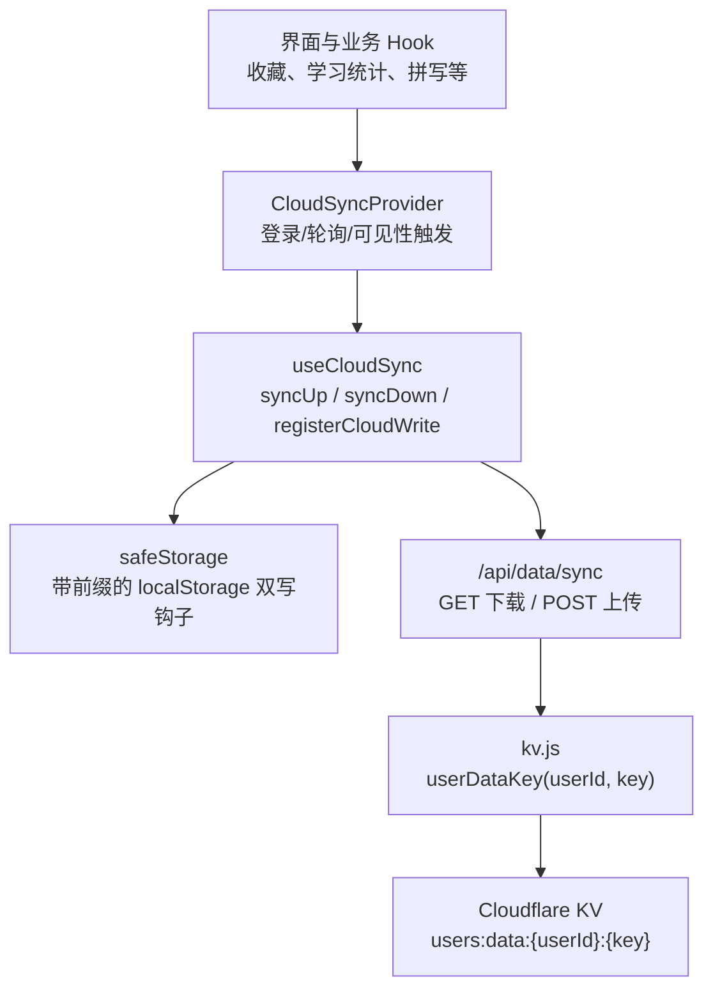
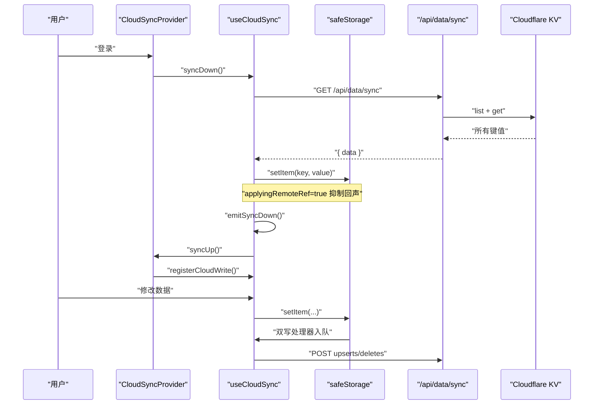
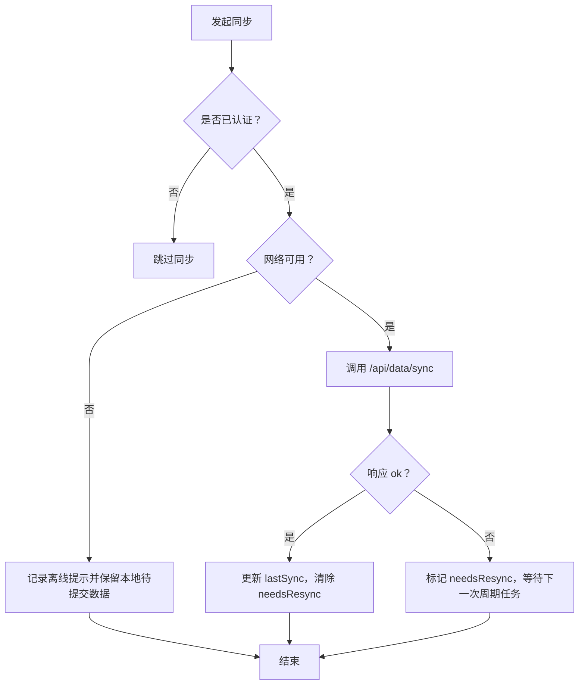
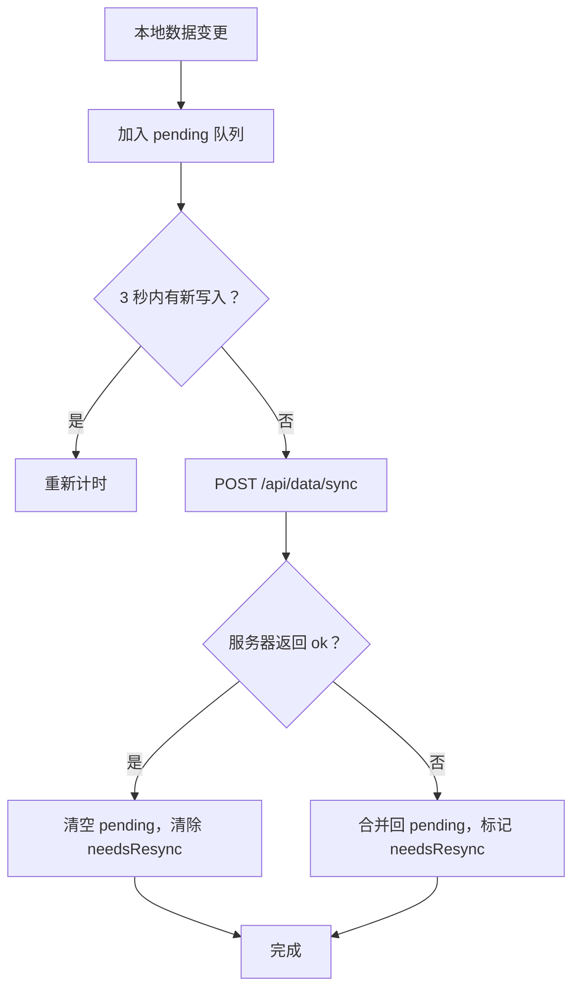
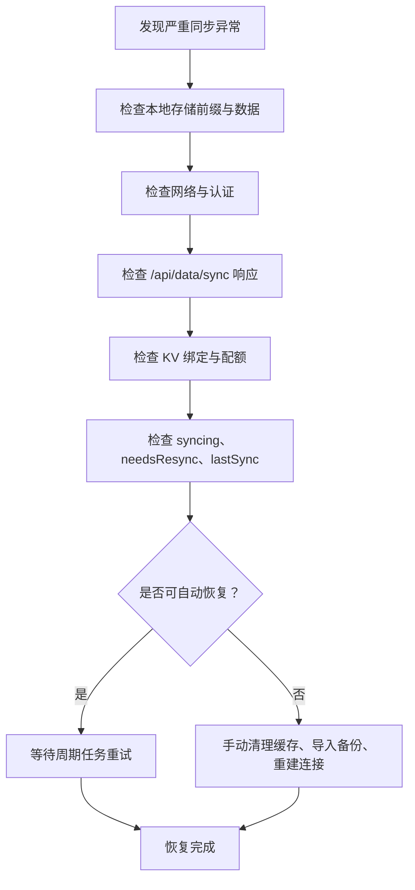

# 云同步问题排查

<cite>
**本文引用的文件**   
- [use-cloud-sync.ts](file://src/lib/use-cloud-sync.ts)
- [CloudSyncProvider.tsx](file://src/components/CloudSyncProvider.tsx)
- [sync-down.ts](file://src/lib/sync-down.ts)
- [safe-storage.ts](file://src/lib/safe-storage.ts)
- [sync.js](file://functions/api/data/sync.js)
- [kv.js](file://functions/_lib/kv.js)
- [verify-cloud-sync-hygiene.mjs](file://scripts/verify-cloud-sync-hygiene.mjs)
</cite>

## 目录
1. [引言](#引言)
2. [项目结构与同步边界](#项目结构与同步边界)
3. [核心组件与数据流](#核心组件与数据流)
4. [故障分类与诊断表](#故障分类与诊断表)
5. [网络超时与请求失败](#网络超时与请求失败)
6. [数据冲突与不一致](#数据冲突与不一致)
7. [同步状态异常](#同步状态异常)
8. [Cloudflare KV 限制与配额问题](#cloudflare-kv-限制与配额问题)
9. [离线模式下的数据一致性](#离线模式下的数据一致性)
10. [性能监控与批量优化](#性能监控与批量优化)
11. [紧急恢复流程](#紧急恢复流程)
12. [结论](#结论)

## 引言
本指南面向 NativeThink 的云同步功能，重点覆盖以下问题：
- 网络超时、请求失败导致的同步卡住或提示频繁。
- 云端与本地数据不一致、下行后旧内存未刷新。
- 并发写入导致的数据覆盖、删除键被重新拉回。
- 同步状态机长期处于“正在同步”、周期任务失效。
- Cloudflare KV 配额耗尽、KV 绑定缺失、认证失败。
- 离线模式下本机数据如何保留、何时重试、何时需要手动合并。
- 如何通过现有验证脚本和可观测字段定位问题，并在紧急情况下恢复数据。

## 项目结构与同步边界
NativeThink 的云同步由浏览器端 Hook、React Provider、后端 Worker API 和 Cloudflare KV 组成：

**图表来源**
- [CloudSyncProvider.tsx:1-61](file://src/components/CloudSyncProvider.tsx#L1-L61)
- [use-cloud-sync.ts:1-191](file://src/lib/use-cloud-sync.ts#L1-L191)
- [sync-down.ts:1-49](file://src/lib/sync-down.ts#L1-L49)
- [safe-storage.ts:1-216](file://src/lib/safe-storage.ts#L1-L216)
- [sync.js:1-63](file://functions/api/data/sync.js#L1-L63)
- [kv.js:1-6](file://functions/_lib/kv.js#L1-L6)

**章节来源**
- [CloudSyncProvider.tsx:1-61](file://src/components/CloudSyncProvider.tsx#L1-L61)
- [use-cloud-sync.ts:1-191](file://src/lib/use-cloud-sync.ts#L1-L191)
- [sync.js:1-63](file://functions/api/data/sync.js#L1-L63)
- [kv.js:1-6](file://functions/_lib/kv.js#L1-L6)

## 核心组件与数据流
### 上行路径：本地写入 → 云端
1. 业务 Hook 通过 `safeStorage.setItem` 写入带前缀的 `localStorage`。
2. `safeStorage` 若已注册双写处理器，则调用该处理器。
3. `useCloudSync.registerCloudWrite` 将写入加入去抖队列；3 秒无新写入后批量 `POST /api/data/sync`。
4. 后端 Worker 把 `upserts` 写入 KV，把 `deletes` 从 KV 删除。
5. 成功后清除 pending 并重置 `needsResyncRef`；失败时合并回 pending，标记需要全量补推。

### 下行路径：云端 → 本地
1. `syncDown` 调用 `GET /api/data/sync`。
2. 响应中的每个键通过 `safeStorage.setItem` 写入本地。
3. 写入期间设置 `applyingRemoteRef.current = true`，抑制双写处理器向上行推送。
4. 全部写入完成后广播 `nativethink-sync-down`，通知订阅 Hook 重读。
5. 单个键写入失败会记录 `dropped`，并标记 `needsResyncRef = true`。

### 生命周期与周期任务
- 登录时先下行再上行，避免双写覆盖最新远端值。
- 每 5 分钟执行一次 `syncDown`；仅当 `needsResync()` 为真时才执行 `syncUp`。
- 页面可见性变化时最多每分钟触发一次下行。
- 登出时注销双写处理器，并在清理前尝试 flush 剩余 pending。

**图表来源**
- [CloudSyncProvider.tsx:14-40](file://src/components/CloudSyncProvider.tsx#L14-L40)
- [use-cloud-sync.ts:49-142](file://src/lib/use-cloud-sync.ts#L49-L142)
- [sync-down.ts:31-47](file://src/lib/sync-down.ts#L31-L47)
- [sync.js:20-57](file://functions/api/data/sync.js#L20-L57)

**章节来源**
- [use-cloud-sync.ts:21-191](file://src/lib/use-cloud-sync.ts#L21-L191)
- [CloudSyncProvider.tsx:14-61](file://src/components/CloudSyncProvider.tsx#L14-L61)
- [sync-down.ts:1-49](file://src/lib/sync-down.ts#L1-L49)

## 故障分类与诊断表

| 问题类别 | 典型症状 | 可能原因 | 关键诊断点 | 优先处理步骤 |
|---|---|---|---|---|
| 网络超时 | 同步一直显示“正在同步”，或长时间不推进 | 网络不可用、Worker 超时、代理拦截 | `syncing` 状态、lastSync 时间、API 是否返回 | 检查网络 → 等待重试 → 检查认证 → 必要时清空缓存并重试 |
| 请求失败 | 提示“云同步暂未成功”或“云端数据暂未取回” | 401、500、JSON 解析失败、KV 未配置 | `/api/data/sync` 响应码、错误消息 | 修复认证 → 确认 KV 绑定 → 重试 |
| 数据不一致 | 其他设备改了数据，本机仍显示旧值 | 下行未触发、Hook 未重读、模块缓存未失效 | `nativethink-sync-down` 事件、`_cache` 是否清空 | 强制可见性变化 → 检查订阅者 → 手动失效缓存 |
| 回声重复 | 登录后反复把云端数据推回云端 | `applyingRemoteRef` 守卫失效、双写处理器误注册 | 双写处理器是否跳过下行写入 | 重启页面 → 检查 `registerCloudWrite` 调用时机 |
| 删除键复活 | 删除的键在下次下行后重新出现 | 删除未上云、KV 中仍有旧值、删除与写入顺序颠倒 | pending deletes、KV 中对应键 | 确认 delete 已 POST → 清理 KV → 再次删除 |
| 周期任务卡住 | 5 分钟不再同步，或每次都在同步 | `needsResync` 引用不稳定、interval 重建 | `needsResync` 是否为稳定函数 | 使用当前实现，不要自行替换为内联箭头 |
| 存储空间不足 | 部分键丢失，但整体仍可浏览 | `safeStorage.setItem` 抛错、KV 配额满 | `dropped > 0`、`setItem` 返回值 | 减少数据体积 → 清理无效键 → 扩容配额 |
| 离线数据丢失 | 关闭应用后数据消失 | 本地存储被清理、匿名 ID 恢复失败 | `ANON_ID_KEY`、`getPrefixedKey` | 备份 → 恢复 anonId → 导入备份 |

**章节来源**
- [use-cloud-sync.ts:21-191](file://src/lib/use-cloud-sync.ts#L21-L191)
- [CloudSyncProvider.tsx:14-61](file://src/components/CloudSyncProvider.tsx#L14-L61)
- [safe-storage.ts:150-216](file://src/lib/safe-storage.ts#L150-L216)
- [sync.js:1-63](file://functions/api/data/sync.js#L1-L63)

## 网络超时与请求失败

### 症状
- 同步按钮或状态栏长期显示“正在同步”。
- 出现“云同步暂未成功，数据已保存在本机并会自动重试”或“云端数据暂未取回，本机数据不受影响”的提示。
- 登录成功后没有立即看到其他设备的最新数据。

### 可能原因
- 客户端网络断开或请求超时。
- `/api/data/sync` 返回非 `ok` 响应。
- 认证失败（401）。
- Worker 内部错误（500），例如 KV 绑定缺失。

### 诊断方法
1. 打开开发者工具的网络面板，查看 `/api/data/sync` 的请求：
   - GET 请求是否返回 `{ data }`。
   - POST 请求是否包含 `upserts` 或 `deletes`。
2. 检查认证状态：
   - Provider 只在 `isAuthenticated` 为真时运行同步。
   - 401 表示认证失败。
3. 检查服务端日志：
   - `sync.js` 会在认证失败、JSON 解析失败、KV 操作失败时记录错误。
4. 检查本地提示去抖：
   - 同一类提示 60 秒内只展示一次，避免离线时频繁弹窗。

### 解决步骤
1. 恢复网络连接。
2. 切换到可见标签页，触发可见性变化触发的一次下行。
3. 等待最多 5 分钟的周期任务。
4. 如果 `needsResync` 为真，系统会在下一轮周期任务中自动补推。
5. 如果长期卡在“正在同步”，检查是否登出后未正确注销双写处理器。

**图表来源**
- [use-cloud-sync.ts:60-142](file://src/lib/use-cloud-sync.ts#L60-L142)
- [CloudSyncProvider.tsx:14-40](file://src/components/CloudSyncProvider.tsx#L14-L40)

**章节来源**
- [use-cloud-sync.ts:60-142](file://src/lib/use-cloud-sync.ts#L60-L142)
- [sync.js:1-63](file://functions/api/data/sync.js#L1-L63)

## 数据冲突与不一致

### 症状
- A 设备修改了收藏、学习进度或自定义词库，B 设备刷新后仍未更新。
- B 设备修改数据后，又把 A 设备的旧值写回云端。
- 删除某个键后，下次同步又出现。
- 某些 Hook 的状态与其他设备不一致。

### 可能原因
1. 下行后 Hook 没有重读。
2. 模块级 `_cache` 未失效，直接读到陈旧内存。
3. 上行写入与下行写入同时发生，造成覆盖。
4. 删除操作尚未 POST 到云端，随后下行把旧键拉回。
5. 业务 Hook 在下行重读后再次无条件写回 storage。

### 诊断方法
1. 检查是否收到 `nativethink-sync-down` 事件：
   - `sync-down.ts` 是唯一的事件出口。
   - 订阅者应通过 `useSyncDown` 或 `onSyncDown` 订阅。
2. 检查 Hook 是否在回调中先作废缓存再重读：
   - `custom-words.ts`、`word-notes.ts`、`quickcard-history.ts` 有明确的缓存失效要求。
3. 检查是否有 Hook 在挂载或下行回调中无条件写回 storage：
   - `use-word-learning.ts`、`use-phrase-learning.ts`、`use-spelling-learning.ts` 有额外回声守卫。
4. 检查 pending 队列：
   - 失败时 `flushPending` 会把本次写入与已有 pending 合并。
   - 删除后再写入同一个键，会移除 pending delete，只保留 upsert。

**图表来源**
- [use-cloud-sync.ts:33-95](file://src/lib/use-cloud-sync.ts#L33-L95)

**章节来源**
- [use-cloud-sync.ts:33-142](file://src/lib/use-cloud-sync.ts#L33-L142)
- [sync-down.ts:1-49](file://src/lib/sync-down.ts#L1-L49)
- [verify-cloud-sync-hygiene.mjs:300-440](file://scripts/verify-cloud-sync-hygiene.mjs#L300-L440)

## 同步状态异常

### 症状
- `syncing` 始终为真。
- 周期任务似乎不工作，要么从不触发，要么每次都全量上传。
- 页面切换标签后立即触发大量同步。
- 登出后仍在向云端推送数据。

### 可能原因
1. `syncing` 仅在 `try/catch/finally` 中设置，正常流程和异常都会释放。
2. `needsResync` 如果是内联箭头函数，引用不稳定会导致 Provider 的 `setInterval` 依赖变化，从而不断重建定时器。
3. 可见性变化节流逻辑允许最多每分钟一次下行。
4. 登出时 `unregister` 会清除双写处理器并尝试 flush。

### 诊断方法
1. 观察 `syncing` 状态变化：
   - 它应在单次 `syncUp` 或 `syncDown` 结束后变回 false。
2. 检查 `lastSyncRef`：
   - Provider 用它控制可见性变化节流。
3. 检查 `needsResync` 的导出方式：
   - 必须是通过 `useCallback` 暴露的稳定函数。
4. 检查 Provider 的 `setInterval`：
   - 不应因为 render 而频繁销毁重建。

### 解决步骤
1. 不要替换 `needsResync` 为内联函数。
2. 保持 Provider 对 `syncDown`、`syncUp`、`needsResync` 的依赖不变。
3. 如果遇到长时间同步：
   - 检查是否网络请求挂起。
   - 检查是否 `safeStorage.setItem` 抛出异常但未释放状态。
4. 登出后确认双写处理器已被移除。

**章节来源**
- [use-cloud-sync.ts:21-191](file://src/lib/use-cloud-sync.ts#L21-L191)
- [CloudSyncProvider.tsx:14-61](file://src/components/CloudSyncProvider.tsx#L14-L61)
- [verify-cloud-sync-hygiene.mjs:250-300](file://scripts/verify-cloud-sync-hygiene.mjs#L250-L300)

## Cloudflare KV 限制与配额问题

### 已知限制与行为
- 键名前缀为 `users:data:{userId}:`。
- GET 使用 `env.KV.list({ prefix })` 列出所有键，然后逐个 `get`。
- POST 支持批量 `put` 和 `delete`。
- `sync.js` 对 KV 绑定缺失返回 500。
- `safeStorage.setItem` 在底层抛错时不会崩溃 UI，但返回 false；不过当前 `safeStorage.setItem` 调用方未使用该布尔值判断是否落盘成功。
- 下行写入过程中单个键失败会被计数为 `dropped`，并触发 `needsResync`。

### 常见配额问题
- 单键值过大。
- 总键数过多。
- 每秒或每分钟写入次数超过配额。
- 存储空间达到上限。

### 处理方法
1. 检查 `/api/data/sync` 是否返回 500。
2. 检查 KV 绑定名称是否为 `KV`。
3. 检查用户数据量：
   - 如果大量临时数据未清理，应考虑业务层减少冗余键。
4. 如果 `dropped > 0`：
   - 说明部分键未能写入本地，但云端数据仍存在。
   - 系统会标记 `needsResync`，后续周期任务会重试。
5. 如果怀疑 KV 配额超限：
   - 暂停高频写入。
   - 清理无效键。
   - 联系平台管理员检查 KV 配额。

**章节来源**
- [kv.js:1-6](file://functions/_lib/kv.js#L1-L6)
- [sync.js:1-63](file://functions/api/data/sync.js#L1-L63)
- [use-cloud-sync.ts:96-142](file://src/lib/use-cloud-sync.ts#L96-L142)
- [safe-storage.ts:170-200](file://src/lib/safe-storage.ts#L170-L200)

## 离线模式下的数据一致性

### 设计原则
- 本地写入优先落盘到 `localStorage`。
- 双写处理器失败时，pending 数据不会被丢弃，而是合并回队列。
- 上行失败不会回滚本地写入。
- 下行失败不会影响本地数据。
- 周期任务在 `needsResync` 为真时补推。

### 一致性保证机制
1. **本地持久化**：`safeStorage.setItem` 直接写入 `localStorage`。
2. **上行重试**：`flushPending` 捕获失败后保留 pending。
3. **删除语义**：pending delete 与 pending upsert 会按写入顺序合并。
4. **下行安全**：`applyingRemoteRef` 防止刚下载的键再次上行。
5. **Hook 重读**：`emitSyncDown` 通知所有订阅者刷新。
6. **缓存失效**：带模块级缓存的库必须在下行回调中失效缓存。

### 离线恢复建议
1. 恢复网络后等待最多 5 分钟。
2. 切换页面标签触发可见性变化。
3. 如果仍有 pending，确认 `needsResync` 为真。
4. 检查是否需要手动触发一次完整同步。
5. 如果本地数据损坏：
   - 使用备份恢复。
   - 检查匿名 ID 恢复逻辑。

**章节来源**
- [use-cloud-sync.ts:33-142](file://src/lib/use-cloud-sync.ts#L33-L142)
- [sync-down.ts:1-49](file://src/lib/sync-down.ts#L1-L49)
- [safe-storage.ts:150-216](file://src/lib/safe-storage.ts#L150-L216)

## 性能监控与批量优化

### 现有优化
- 上行使用 3 秒去抖，合并多次写入。
- 上行失败时合并 pending，避免重复提交。
- 提示使用 60 秒去抖，避免离线时频繁弹窗。
- 周期任务只在 `needsResync` 为真时全量补推。
- 可见性变化最多每分钟触发一次下行。
- 下行一次性遍历远端数据，但逐键 `get`，大集合下会有 N+1 查询成本。

### 监控建议
- 关注 `syncing` 持续时间。
- 关注 `needsResync` 是否长期为真。
- 关注 `/api/data/sync` 的 POST 大小，尤其是 `upserts` 数量。
- 关注 `dropped` 是否大于 0。
- 关注 `lastSync` 是否长时间不更新。

### 优化建议
- 避免在短间隔内频繁 `safeStorage.setItem`。
- 避免在 Hook 中无条件写回 storage，特别是下行回调之后。
- 避免同步大块二进制数据。
- 如需大幅调整数据模型，应先清理历史键，再迁移到新键结构。

**章节来源**
- [use-cloud-sync.ts:33-191](file://src/lib/use-cloud-sync.ts#L33-L191)
- [CloudSyncProvider.tsx:28-61](file://src/components/CloudSyncProvider.tsx#L28-L61)

## 紧急恢复流程

### 场景一：云端数据丢失
1. 确认本地 `localStorage` 是否仍有带前缀的键。
2. 使用 `safeStorage.getPrefixedKey` 调试前缀。
3. 如果本地数据存在：
   - 恢复网络。
   - 等待周期任务补推。
   - 如未触发，检查 `needsResync` 是否被正确标记。
4. 如果本地数据也丢失：
   - 检查是否有备份。
   - 检查匿名 ID 是否因清理 `localStorage` 而失效。
   - 使用 `safe-storage.ts` 的匿名 ID 恢复逻辑进行诊断。

### 场景二：重复回声导致无限同步
1. 确认 `applyingRemoteRef` 是否生效。
2. 确认 `registerCloudWrite` 只在登录后调用。
3. 确认登出时调用了 `unregister`。
4. 重启页面以重置 React state。

### 场景三：Hook 状态不一致
1. 确认 `nativethink-sync-down` 事件是否发出。
2. 确认相关 Hook 使用了 `useSyncDown`。
3. 确认带缓存的 Hook 已调用对应的 `invalidate*Cache`。
4. 参考验证脚本中的订阅者清单，确认新增 Hook 已登记。

### 场景四：KV 无法访问
1. 检查 `/api/data/sync` 是否返回 500。
2. 检查 Cloudflare Workers KV 绑定。
3. 检查用户认证是否有效。
4. 检查是否存在 CORS 预检失败（Capacitor APK 使用 `https://localhost`）。

**图表来源**
- [safe-storage.ts:1-216](file://src/lib/safe-storage.ts#L1-L216)
- [use-cloud-sync.ts:21-191](file://src/lib/use-cloud-sync.ts#L21-L191)
- [sync.js:1-63](file://functions/api/data/sync.js#L1-L63)

**章节来源**
- [safe-storage.ts:1-216](file://src/lib/safe-storage.ts#L1-L216)
- [use-cloud-sync.ts:21-191](file://src/lib/use-cloud-sync.ts#L21-L191)
- [sync.js:1-63](file://functions/api/data/sync.js#L1-L63)

## 结论
NativeThink 的云同步已经具备较完整的容错能力：本地写入优先持久化，上行失败保留 pending，下行失败不影响本地数据，并通过事件机制通知业务 Hook 刷新。排查时应优先区分“网络层问题”“认证层问题”“KV 层问题”和“Hook 状态层问题”。对于大多数偶发问题，恢复网络并等待周期任务即可；对于持续不一致，应重点检查下行广播、模块缓存失效、pending 合并逻辑以及 `needsResync` 的状态。在紧急情况下，应结合本地存储、备份数据和服务端日志进行恢复，而不是盲目清空缓存。