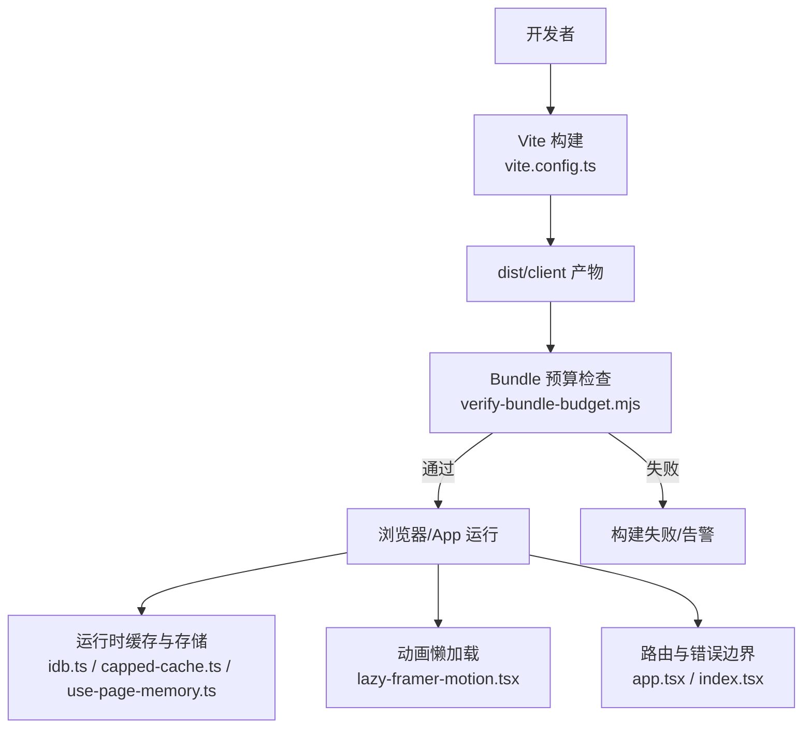
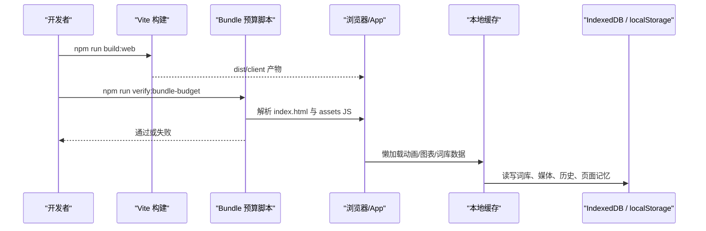
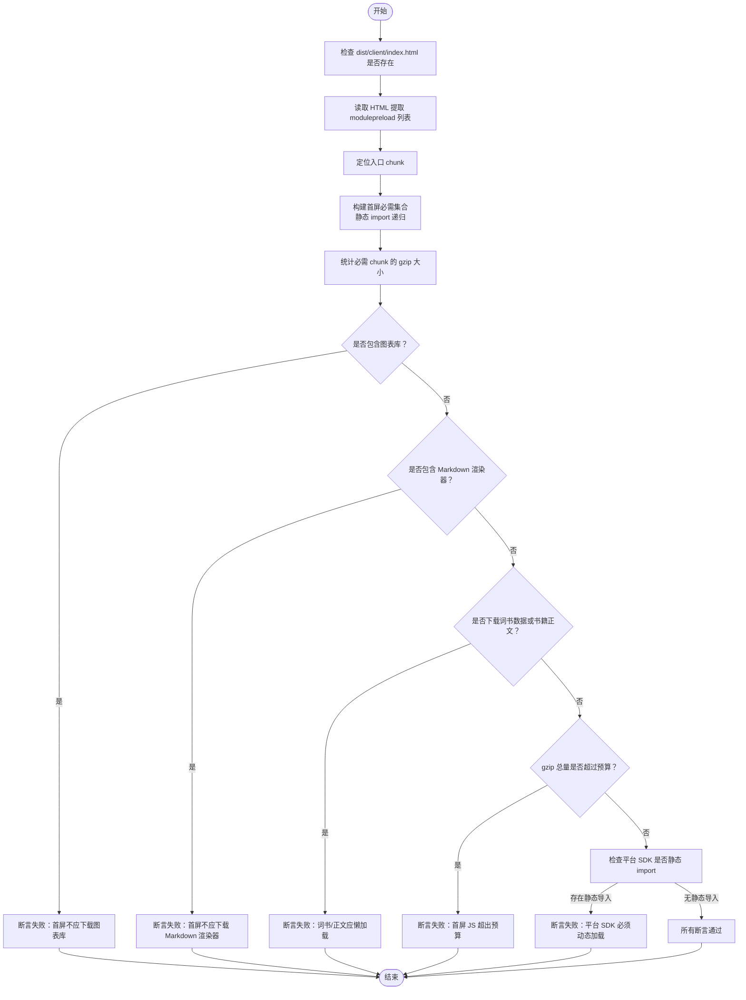
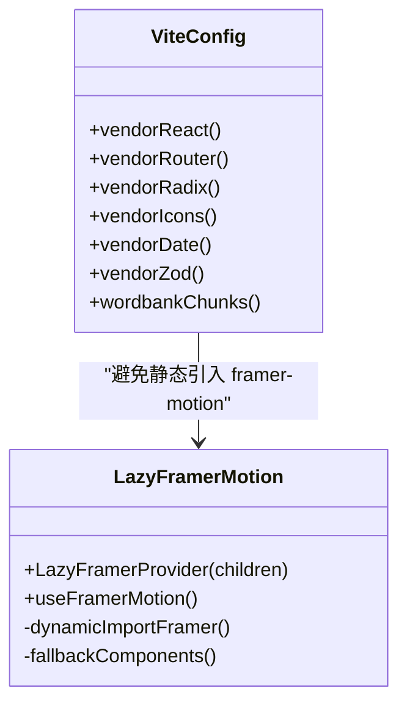
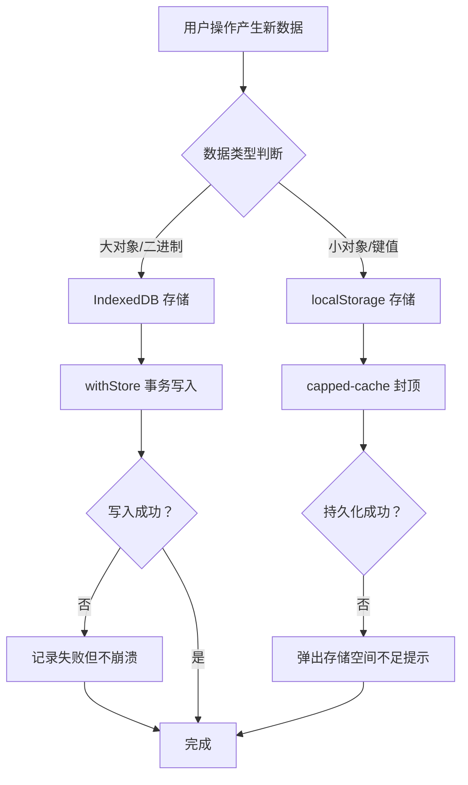
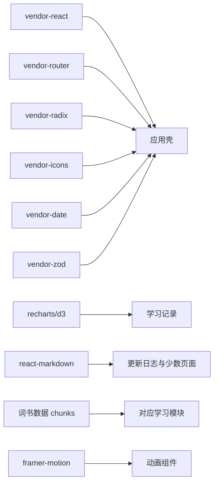

# 性能监控与优化

<cite>
**本文引用的文件**   
- [package.json](file://package.json)
- [vite.config.ts](file://vite.config.ts)
- [scripts/verify-bundle-budget.mjs](file://scripts/verify-bundle-budget.mjs)
- [src/lib/lazy-framer-motion.tsx](file://src/lib/lazy-framer-motion.tsx)
- [src/lib/idb.ts](file://src/lib/idb.ts)
- [src/lib/capped-cache.ts](file://src/lib/capped-cache.ts)
- [src/lib/use-page-memory.ts](file://src/lib/use-page-memory.ts)
- [src/app.tsx](file://src/app.tsx)
- [src/index.tsx](file://src/index.tsx)
- [docs/mobile-qa-report-20260921.md](file://docs/mobile-qa-report-20260921.md)
</cite>

## 目录
1. [引言](#引言)
2. [项目结构](#项目结构)
3. [核心组件](#核心组件)
4. [架构总览](#架构总览)
5. [详细组件分析](#详细组件分析)
6. [依赖分析](#依赖分析)
7. [性能考量](#性能考量)
8. [故障排查指南](#故障排查指南)
9. [结论](#结论)

## 引言
本指南面向 NativeThink 应用的性能工程实践，覆盖构建期 Bundle 预算、运行时性能指标、内存泄漏检测、渲染性能优化以及移动端特殊约束。重点说明如何识别 Bundle 过大、首屏加载缓慢、内存持续增长和动画卡顿等问题，并给出基于仓库现有实现的优化策略：代码分割、懒加载、缓存容量封顶、平台 SDK 动态加载、IndexedDB 大对象隔离等。同时提供使用 `verify-bundle-budget` 脚本进行构建时检查的方法，以及如何把性能回归纳入持续集成流程。

## 项目结构
NativeThink 是 React 19 + TypeScript + Vite 应用，后端走 Cloudflare Functions。构建产物输出到 `dist/client`；Android 端通过 Capacitor 打包。性能相关的关键位置包括：

- 构建配置与分包策略：`vite.config.ts`
- 构建时 Bundle 预算守卫：`scripts/verify-bundle-budget.mjs`
- 包管理与命令入口：`package.json`
- 动画库懒加载实现：`src/lib/lazy-framer-motion.tsx`
- 本地持久化与缓存：`src/lib/idb.ts`、`src/lib/capped-cache.ts`、`src/lib/use-page-memory.ts`
- 路由级错误边界与全局错误处理：`src/app.tsx`、`src/index.tsx`
- 移动端质量基线报告：`docs/mobile-qa-report-20260921.md`

**图表来源**
- [vite.config.ts:120-246](file://vite.config.ts#L120-L246)
- [scripts/verify-bundle-budget.mjs:1-111](file://scripts/verify-bundle-budget.mjs#L1-L111)
- [src/lib/idb.ts:1-200](file://src/lib/idb.ts#L1-L200)
- [src/lib/capped-cache.ts:1-114](file://src/lib/capped-cache.ts#L1-L114)
- [src/lib/lazy-framer-motion.tsx:1-99](file://src/lib/lazy-framer-motion.tsx#L1-L99)
- [src/app.tsx:3-60](file://src/app.tsx#L3-L60)
- [src/index.tsx:1-116](file://src/index.tsx#L1-L116)

**章节来源**
- [package.json:1-130](file://package.json#L1-L130)
- [vite.config.ts:120-246](file://vite.config.ts#L120-L246)

## 核心组件
本节聚焦与性能直接相关的已有实现：

- **构建时 Bundle 预算检查**  
  `scripts/verify-bundle-budget.mjs` 从 `dist/client/index.html` 的 `modulepreload` 和入口 chunk 静态导入出发，递归计算“首屏必需”JS 集合，统计 gzip 总量并与预算比较；同时断言首屏不得包含图表库、Markdown 渲染器、词书数据 chunk 和书籍正文 chunk，并对平台 SDK 做源码级静态检查，禁止静态 import。

- **Vite 分包与按需引入**  
  `vite.config.ts` 中显式拆分 React、Router、Radix UI、图标、日期工具、Zod 等 vendor chunk；对词库数据按词书级别拆分独立 chunk。注释明确解释为何没有给 recharts、d3、react-markdown 写强制 `manualChunks`——避免它们被反向拉入入口 chunk。

- **动画库懒加载**  
  `src/lib/lazy-framer-motion.tsx` 通过 `import('framer-motion')` 在 Provider 初始化时动态加载，并提供降级 fallback，保证漏加 Provider 时不白屏，只在开发期输出一次警告。

- **本地缓存与存储容量控制**  
  `src/lib/idb.ts` 将词库数据和视频媒体分库管理，避免清理词库缓存误删用户媒体资产；媒体列表读取采用游标迭代轻量索引，不把几百 MB blob 一次性拉进内存。`src/lib/capped-cache.ts` 为 localStorage JSON 缓存提供 FIFO 封顶、双封顶（条数+字节）和历史窗口裁剪，并暴露空间不足提示。`src/lib/use-page-memory.ts` 封装页面状态落盘与防抖写入。

- **错误边界与容错**  
  `src/app.tsx` 为每个路由包裹 `ErrorBoundary`；`src/index.tsx` 提供全局错误回退界面，提升异常路径下的用户体验。

**章节来源**
- [scripts/verify-bundle-budget.mjs:1-111](file://scripts/verify-bundle-budget.mjs#L1-L111)
- [vite.config.ts:120-246](file://vite.config.ts#L120-L246)
- [src/lib/lazy-framer-motion.tsx:1-99](file://src/lib/lazy-framer-motion.tsx#L1-L99)
- [src/lib/idb.ts:1-200](file://src/lib/idb.ts#L1-L200)
- [src/lib/capped-cache.ts:1-114](file://src/lib/capped-cache.ts#L1-L114)
- [src/lib/use-page-memory.ts:1-60](file://src/lib/use-page-memory.ts#L1-L60)
- [src/app.tsx:3-60](file://src/app.tsx#L3-L60)
- [src/index.tsx:1-116](file://src/index.tsx#L1-L116)

## 架构总览
下图展示 NativeThink 的性能关键路径：构建阶段由 Vite 生成产物并由预算脚本校验；运行阶段由路由、懒加载、缓存层共同决定首屏体积、交互延迟和内存占用。

**图表来源**
- [package.json:1-130](file://package.json#L1-L130)
- [vite.config.ts:120-246](file://vite.config.ts#L120-L246)
- [scripts/verify-bundle-budget.mjs:1-111](file://scripts/verify-bundle-budget.mjs#L1-L111)
- [src/lib/idb.ts:1-200](file://src/lib/idb.ts#L1-L200)
- [src/lib/capped-cache.ts:1-114](file://src/lib/capped-cache.ts#L1-L114)

## 详细组件分析

### Bundle 大小监控与构建时检查
`verify-bundle-budget.mjs` 的实现逻辑可概括为以下流程：

**图表来源**
- [scripts/verify-bundle-budget.mjs:1-111](file://scripts/verify-bundle-budget.mjs#L1-L111)

关键要点：
- 首屏预算以 gzip 计算，当前硬编码预算约 600KB；脚本会打印每个 chunk 的大小，便于定位新增重依赖。
- 脚本不仅看最终体积，还反向确认图表库和 Markdown 渲染器仍存在于产物中，防止“被误删造成假通过”。
- 对 `@lark-apaas/client-toolkit-lite` 这类平台 SDK，脚本通过 git grep 检查源码中是否存在静态 import，只允许动态 import。

建议执行方式：
1. 先运行 Web 构建：`npm run build:web`。
2. 再运行预算检查：`npm run verify:bundle-budget`。
3. 若断言失败，优先查看控制台列出的违规 chunk 名称和具体行号。

**章节来源**
- [scripts/verify-bundle-budget.mjs:1-111](file://scripts/verify-bundle-budget.mjs#L1-L111)
- [package.json:1-130](file://package.json#L1-L130)

### 代码分割与懒加载策略
Vite 配置中的分包策略体现两个原则：

1. **公共第三方库拆出稳定 vendor chunk**：React、React Router、Radix UI、Lucide 图标、date-fns、Zod 分别归组，提高浏览器缓存命中。
2. **功能数据按业务域拆分**：词库数据按考试等级拆成独立 chunk，避免首屏携带全部词汇表。

同时，配置注释明确指出：
- 不要给 recharts、d3、react-markdown 单独设置 `manualChunks`，否则会把这些模块反向拉入入口 chunk，导致每条路由都加载这些重依赖。
- Framer Motion 也不写强制规则，实际通过 `src/lib/lazy-framer-motion.tsx` 的动态 import 实现按需加载。

**图表来源**
- [vite.config.ts:120-246](file://vite.config.ts#L120-L246)
- [src/lib/lazy-framer-motion.tsx:1-99](file://src/lib/lazy-framer-motion.tsx#L1-L99)

实践建议：
- 新增大型第三方库时，优先用动态 import，而不是在路由入口处静态引入。
- 对于只有少数页面使用的重型组件，继续使用 React.lazy 或函数内 `import()`。
- 修改 `manualChunks` 后，必须重新运行 `npm run verify:bundle-budget`，否则可能引入“看似正确但首屏变大”的反向优化。

**章节来源**
- [vite.config.ts:120-246](file://vite.config.ts#L120-L246)
- [src/lib/lazy-framer-motion.tsx:1-99](file://src/lib/lazy-framer-motion.tsx#L1-L99)

### 运行时性能指标与埋点建议
仓库中没有内置 PerformanceObserver 或自定义性能上报 SDK。结合移动端测试报告，当前更关注的是真实设备上的冷启动、内存增长和网络行为。建议在现有架构上补充三类埋点：

| 指标 | 采集时机 | 推荐实现方式 | 阈值建议 |
| --- | --- | --- | --- |
| 首屏可交互时间 | 应用初始化完成、路由挂载完成 | `performance.mark` + `PerformanceObserver` | 首屏 JS gzip ≤ 600KB 时，TTFB + 主包解析 ≤ 2s（弱网放宽） |
| 长任务 | 主线程阻塞 | `PerformanceObserver({ entryTypes: ['longtask'] })` | 单次 ≥ 50ms 的任务需记录调用栈片段 |
| 内存峰值 | 页面切换、打开阅读器、加载 TTS 模型 | `performance.memory.usedJSHeapSize` 或 CDP 采集 | 低端机不超过设备物理内存的 60% |

注意：
- 当前构建已关闭 sourcemap（`sourcemap: false`），线上调试需结合 Source Maps 部署策略，谨慎开启以避免泄露内部路径。
- 移动端报告指出遥测 SDK 在某些环境会报错，因此新增埋点应避免引入新的外部遥测依赖，优先使用浏览器原生 API 和本地日志聚合。

**章节来源**
- [vite.config.ts:120-246](file://vite.config.ts#L120-L246)
- [docs/mobile-qa-report-20260921.md:1-200](file://docs/mobile-qa-report-20260921.md#L1-L200)

### 内存泄漏检测与本地存储健康
NativeThink 的内存风险主要集中在三个层面：

1. **大型媒体与 WASM 模型**  
   移动端报告显示离线 TTS 模型加载后内存可达约 1 GB，低端设备存在系统回收风险。应对策略：
   - 避免同时加载多个大型模型。
   - 在离开页面时主动停止音频播放、释放引用。
   - 对 IndexedDB 中的媒体元数据使用轻量索引，不要把 blob 全量枚举到内存。

2. **IndexedDB 与 localStorage 混合使用**  
   `src/lib/idb.ts` 将词库与媒体分库，避免误删用户资产；`src/lib/capped-cache.ts` 为 localStorage 设置 FIFO 封顶和字节上限。新增缓存时应遵循相同模式：
   - 大对象放 IndexedDB。
   - 小对象放 localStorage，但必须带容量封顶。
   - 写失败时给出可操作提示，而不是静默丢失。

3. **页面状态持久化**  
   `src/lib/use-page-memory.ts` 提供同步和防抖两种落盘方式。频繁更新的搜索输入应使用防抖版本，减少主线程压力与磁盘写入。

**图表来源**
- [src/lib/idb.ts:1-200](file://src/lib/idb.ts#L1-L200)
- [src/lib/capped-cache.ts:1-114](file://src/lib/capped-cache.ts#L1-L114)
- [src/lib/use-page-memory.ts:1-60](file://src/lib/use-page-memory.ts#L1-L60)

**章节来源**
- [src/lib/idb.ts:1-200](file://src/lib/idb.ts#L1-L200)
- [src/lib/capped-cache.ts:1-114](file://src/lib/capped-cache.ts#L1-L114)
- [src/lib/use-page-memory.ts:1-60](file://src/lib/use-page-memory.ts#L1-L60)
- [docs/mobile-qa-report-20260921.md:1-200](file://docs/mobile-qa-report-20260921.md#L1-L200)

### 渲染性能优化
仓库中与渲染性能相关的既有实践包括：

- **动画按需加载**：Framer Motion 不在主 bundle 中，避免首屏解析动画引擎。
- **页面滚动恢复使用 requestAnimationFrame**：多处页面在恢复滚动位置时使用 RAF，减少布局抖动。
- **大量 DOM 页面的风险提示**：移动端报告指出写作页面内容极高、DOM 节点较多，切页时主线程阻塞明显。
- **错误边界保护渲染**：每个路由都有 `ErrorBoundary`，单个页面渲染失败不会拖垮整应用。

优化建议：
- 对超长列表使用虚拟滚动或分页加载，避免一次性渲染数千节点。
- 对复杂动画启用 `will-change` 或 GPU 加速图层时要谨慎，避免过度合成。
- 在长时间计算场景考虑使用 Web Worker 或 `requestIdleCallback`，当前仓库尚未发现直接使用这些 API 的代码，可作为后续扩展方向。
- 保持 `ErrorBoundary` 与懒加载组合使用，确保异常路径下仍可降级渲染。

**章节来源**
- [src/lib/lazy-framer-motion.tsx:1-99](file://src/lib/lazy-framer-motion.tsx#L1-L99)
- [src/app.tsx:3-60](file://src/app.tsx#L3-L60)
- [docs/mobile-qa-report-20260921.md:1-200](file://docs/mobile-qa-report-20260921.md#L1-L200)

### 移动端性能优化的特殊考虑
根据移动端 QA 报告，NativeThink 在 Android WebView 环境下需要特别关注以下问题：

| 领域 | 现状 | 建议 |
| --- | --- | --- |
| 冷启动 | 存在外部字体和资源请求，且平台 SDK 会发起遥测请求 | 尽量本地化字体；继续剥离平台遥测；保留 `fixHtmlPlaceholders` 对非平台环境的无用脚本剔除逻辑 |
| 内存占用 | TTS 模型 + native 层可达约 1 GB | 限制并发模型加载；提供手动释放入口；低端设备禁用不必要的离线能力 |
| 网络请求 | 预热 TTS 长文本返回 502；部分端点不存在导致无效请求 | 统一预热线程分片；删除或条件化无效端点调用 |
| 触摸与可读性 | 按钮过小、字号低于 16px、头部菜单溢出 | 统一最小触摸目标 44×44；输入框不小于 16px；头部容器增加可见滚动或截断 |
| 资源体积 | APK 内主包接近 1MB | 继续坚持 Bundle 预算；对图片、音视频、词典数据使用懒加载 |

报告中还记录了若干 P0/P1 缺陷，例如原生 TTS Promise 永久挂起、云端 TTS 预热不分片、遥测 SDK 启动报错等。虽然这些问题偏功能性，但它们会间接造成启动卡顿、无效网络和内存浪费，因此也应纳入性能治理范围。

**章节来源**
- [docs/mobile-qa-report-20260921.md:1-200](file://docs/mobile-qa-report-20260921.md#L1-L200)

## 依赖分析
NativeThink 的主要前端依赖包括 React、React Router、Radix UI、framer-motion、recharts、react-markdown、zod、date-fns、lucide-react 等。构建配置对这些依赖的处理直接影响首屏体积：

- React 和 React Router 作为路由壳被频繁复用，适合放在共享 vendor chunk。
- Radix UI 作为基础 UI 原语，也适合共享。
- Framer Motion 因仅部分页面使用，已通过懒加载避免进入主包。
- Recharts 和 react-markdown 被刻意避免强制分包，以防止被反向拉入入口。
- 词库数据按词书维度分包，符合“只有访问对应学习模块时才加载”的原则。

**图表来源**
- [vite.config.ts:120-246](file://vite.config.ts#L120-L246)
- [scripts/verify-bundle-budget.mjs:1-111](file://scripts/verify-bundle-budget.mjs#L1-L111)

**章节来源**
- [vite.config.ts:120-246](file://vite.config.ts#L120-L246)
- [package.json:1-130](file://package.json#L1-L130)

## 性能考量
### Bundle 大小监控
- 使用 `npm run build:web` 构建 Web 产物。
- 使用 `npm run verify:bundle-budget` 验证首屏必需 JS 不超过预算。
- 如果新增路由引入了图表、Markdown、词书数据或书籍正文，请确认它们是懒加载，而不是在入口静态引入。

### 运行时性能指标
- 使用 Chrome Performance 面板录制冷启动、页面切换、打开阅读器和加载 TTS 模型的完整链路。
- 关注 Long Task、Layout Shift、Main Thread Blocking 和 JavaScript 执行时间。
- 在移动端可使用 Chrome DevTools Protocol 驱动 WebView 复现报告中的问题。

### 内存泄漏检测
- 在 Chrome DevTools Memory 面板中使用 Heap Snapshot 对比页面切换前后对象图。
- 重点关注未释放的事件监听器、定时器、RAF 回调、DOM 引用和 IndexedDB 游标。
- 对 TTS 模型、语音流、媒体 blob 建立明确的创建与销毁生命周期。

### 渲染性能优化
- 动画组件使用懒加载 Provider。
- 避免在 render 中执行重型计算；必要时改用 memo、useMemo 或 Web Worker。
- 列表渲染使用虚拟滚动或分页。
- 保持 ErrorBoundary 覆盖所有路由。

### 缓存策略调优
- 词库数据与媒体分开存储。
- localStorage 缓存使用 FIFO 封顶和字节封顶。
- 高频写入使用防抖持久化。
- 写失败时给用户明确提示，而不是静默丢数据。

### 资源压缩配置
- 当前 Vite 默认启用生产压缩；如需进一步调整，可在构建阶段接入 Brotli 或 Gzip 分析工具。
- 注意：仓库中预算脚本使用 gzip 统计首屏体积，因此调整压缩算法时也要同步更新评估口径。

### 性能回归告警
建议将性能检查加入 CI：

1. 每次合并前执行 `npm run build:web`。
2. 随后执行 `npm run verify:bundle-budget`。
3. 在 CI 中捕获脚本退出码，失败则阻断合并。
4. 可选：额外产出 `dist/client` 的体积报告并上传到制品库，用于趋势对比。

**章节来源**
- [scripts/verify-bundle-budget.mjs:1-111](file://scripts/verify-bundle-budget.mjs#L1-L111)
- [package.json:1-130](file://package.json#L1-L130)
- [vite.config.ts:120-246](file://vite.config.ts#L120-L246)
- [src/lib/capped-cache.ts:1-114](file://src/lib/capped-cache.ts#L1-L114)
- [src/lib/idb.ts:1-200](file://src/lib/idb.ts#L1-L200)

## 故障排查指南
### Bundle 超标
症状：
- `verify-bundle-budget` 报“首屏必需 JS 超出预算”。
- 首屏加载变慢，尤其是低带宽设备。

排查步骤：
1. 查看脚本输出的 chunk 列表，定位新增的重模块。
2. 检查是否在路由或入口文件中静态引入了图表、Markdown、词书数据或书籍正文。
3. 检查是否新增了强制 `manualChunks` 导致模块被反向拉入入口。
4. 确认平台 SDK 是否仍通过动态 import 加载。

### 首屏加载缓慢
症状：
- 打开应用后长时间白屏或骨架屏。
- Chrome Network 面板显示主包过大。

排查步骤：
1. 检查 `index.html` 的 `modulepreload` 列表。
2. 使用 `verify-bundle-budget` 确认首屏必需集合。
3. 检查是否有第三方 SDK、遥测脚本被注入到非平台环境。
4. 检查字体、CDN、外部资源是否影响首屏。

### 内存持续增长
症状：
- 长时间使用后内存逐步上升。
- 低端设备出现页面闪退或被系统回收。

排查步骤：
1. 使用 Memory 面板 Heap Snapshot 对比进入和离开页面。
2. 检查 TTS 模型、语音流、媒体 blob 是否释放。
3. 检查 IndexedDB 是否无限增长，是否需要清理策略。
4. 检查定时器、事件监听器、RAF 是否清理。

### 动画卡顿
症状：
- 滑动、翻页、展开收起时掉帧。
- 动画库加载后仍有卡顿。

排查步骤：
1. 确认动画组件是否通过 `LazyFramerProvider` 包裹。
2. 检查是否在主线程执行了重型计算。
3. 检查是否大量元素同时触发重排重绘。
4. 使用 Performance 面板查看 FPS 和 Main Thread 耗时。

### 移动端问题
症状：
- 启动时报遥测错误。
- TTS 预热失败。
- 按钮太小、输入框字号过小、头部菜单溢出。

排查步骤：
1. 参考移动端 QA 报告中的真机复现信息。
2. 检查 WebView 控制台和网络请求。
3. 检查触摸目标尺寸、字号、视口布局。
4. 检查是否存在无效远程端点调用。

**章节来源**
- [scripts/verify-bundle-budget.mjs:1-111](file://scripts/verify-bundle-budget.mjs#L1-L111)
- [docs/mobile-qa-report-20260921.md:1-200](file://docs/mobile-qa-report-20260921.md#L1-L200)

## 结论
NativeThink 已经在 Bundle 分包、动画懒加载、本地缓存容量控制和错误边界方面建立了较好的基础。性能治理的关键在于持续使用 `verify-bundle-budget` 守护首屏体积，避免新功能把重型依赖悄悄塞进入口；同时针对移动端真实设备关注冷启动、内存峰值、TTS 模型和媒体资源的生命周期。未来可在此基础上补充运行时性能埋点、CI 性能回归检查和更严格的移动端自动化测试，使性能指标像代码质量一样成为可度量、可告警、可回归的工程能力。