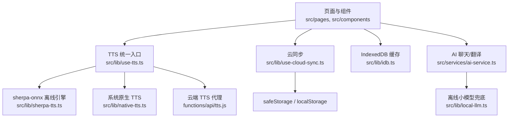
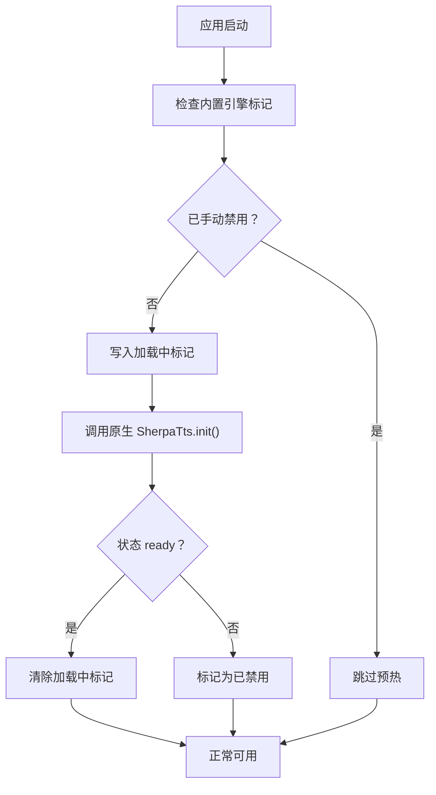
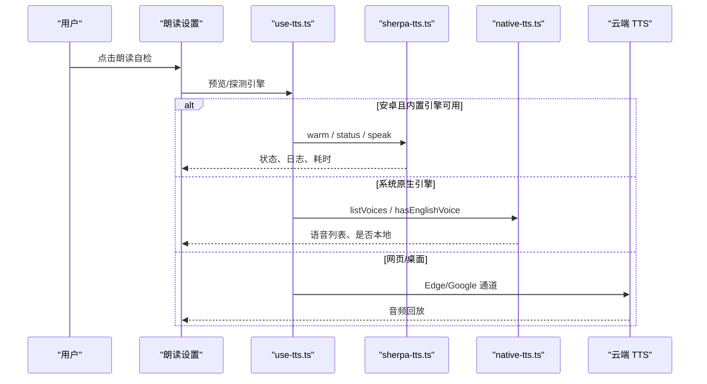

# 故障排除与常见问题

<cite>
**本文引用的文件**   
- [README.md](file://README.md)
- [src/lib/sherpa-tts.ts](file://src/lib/sherpa-tts.ts)
- [src/lib/use-tts.ts](file://src/lib/use-tts.ts)
- [src/lib/tts-settings.ts](file://src/lib/tts-settings.ts)
- [src/lib/tts-voice-catalog.ts](file://src/lib/tts-voice-catalog.ts)
- [src/components/TTSSettings.tsx](file://src/components/TTSSettings.tsx)
- [src/lib/native-tts.ts](file://src/lib/native-tts.ts)
- [docs/modules/tts.md](file://docs/modules/tts.md)
- [scripts/check-tts-latency.mjs](file://scripts/check-tts-latency.mjs)
- [scripts/verify-native-tts.mjs](file://scripts/verify-native-tts.mjs)
- [src/lib/use-cloud-sync.ts](file://src/lib/use-cloud-sync.ts)
- [src/lib/sync-down.ts](file://src/lib/sync-down.ts)
- [docs/modules/cloud-sync.md](file://docs/modules/cloud-sync.md)
- [src/lib/idb.ts](file://src/lib/idb.ts)
- [src/lib/backup.ts](file://src/lib/backup.ts)
- [docs/modules/storage-and-stats.md](file://docs/modules/storage-and-stats.md)
- [src/services/ai-service.ts](file://src/services/ai-service.ts)
- [src/lib/local-llm.ts](file://src/lib/local-llm.ts)
- [src/services/asr-service.ts](file://src/services/asr-service.ts)
</cite>

## 目录
1. [简介](#简介)
2. [项目结构与定位](#项目结构与定位)
3. [核心故障域总览](#核心故障域总览)
4. [TTS 相关问题排查](#tts-相关问题排查)
5. [云同步问题排查](#云同步问题排查)
6. [存储问题排查](#存储问题排查)
7. [AI 服务问题排查](#ai-服务问题排查)
8. [移动端与原生问题排查](#移动端与原生问题排查)
9. [日志分析与诊断工具](#日志分析与诊断工具)
10. [紧急恢复流程](#紧急恢复流程)
11. [性能监控与指标](#性能监控与指标)
12. [提交问题报告与参与贡献](#提交问题报告与参与贡献)
13. [结论](#结论)

## 简介
本指南面向 NativeThink 应用的用户、技术支持和开发者，聚焦五大常见故障域：
- TTS 朗读异常
- 云同步不一致或失败
- IndexedDB / localStorage 容量或损坏
- AI 调用失败、流中断、模型加载超时
- 移动端权限、后台播放、电池优化导致的体验降级

每个问题都给出症状、原因、诊断步骤、解决方案和预防措施，并附带可直接对照的源码路径。

## 项目结构与定位
NativeThink 是 React + TypeScript 前端应用；Android 通过 Capacitor 打包为 APK；云端能力由 Cloudflare Functions 提供；学习数据主要落盘在设备本地（localStorage + IndexedDB），并通过安全前缀封装后选择性同步到云端 KV。

**图表来源**
- [src/lib/use-tts.ts:1-120](file://src/lib/use-tts.ts#L1-L120)
- [src/lib/sherpa-tts.ts:1-60](file://src/lib/sherpa-tts.ts#L1-L60)
- [src/lib/native-tts.ts:1-40](file://src/lib/native-tts.ts#L1-L40)
- [src/lib/use-cloud-sync.ts:1-40](file://src/lib/use-cloud-sync.ts#L1-L40)
- [src/lib/idb.ts:1-40](file://src/lib/idb.ts#L1-L40)
- [src/services/ai-service.ts:1-60](file://src/services/ai-service.ts#L1-L60)
- [src/lib/local-llm.ts:1-40](file://src/lib/local-llm.ts#L1-L40)

**章节来源**
- [README.md:1-40](file://README.md#L1-L40)

## 核心故障域总览
| 故障域 | 典型症状 | 关键实现位置 | 首要判断点 |
|---|---|---|---|
| TTS | 无声、起播慢、长文断续、换音色无效、自检卡住 | `use-tts.ts`、`sherpa-tts.ts`、`native-tts.ts`、`TTSSettings.tsx` | 当前平台、已选引擎、是否在线、是否有英语语音 |
| 云同步 | 换设备数据缺失、来回搬数据、提示频繁 | `use-cloud-sync.ts`、`sync-down.ts`、`safe-storage.ts` | 是否登录、双写处理器、事件订阅、KV 覆盖语义 |
| 存储 | 写入静默丢失、空间不足、词库/译文损坏 | `idb.ts`、`backup.ts`、`storage-and-stats.md` | safeStorage 返回值、IDB 事务结果、备份版本 |
| AI 服务 | API 报错、流中断、服务端未配置、离线模型下载失败 | `ai-service.ts`、`local-llm.ts`、`asr-service.ts` | HTTP 状态、SSE 分片、本地模型状态、ASR 候选 |
| 移动端 | 权限拒绝、后台断音、电池优化杀进程、设置页卡顿 | `native-tts.ts`、`sherpa-tts.ts`、Capacitor 插件 | 平台检测、插件可用、超时保护、闪退护栏 |

## TTS 相关问题排查

### 症状一：安卓上朗读无声或没有可选声音
**可能原因**
- Android WebView 没有 `speechSynthesis` 语音列表。
- 系统 TextToSpeech 未安装英语语音包。
- 原生插件不可用或初始化挂死。

**诊断步骤**
1. 打开“朗读设置”，查看“系统原生语音”列表是否为空。
2. 点击“朗读自检”，观察是否长时间显示“读取中…”或“自检中…”。
3. 检查设置中是否选择了在线 Edge 音色，且当前网络可达。
4. 确认是否开启了“只用系统引擎”，但系统引擎又无英语语音。

**解决方案**
- 通过设置页打开系统 TTS 安装引导，安装英文语音包。
- 若系统引擎不稳定，改回默认离线引擎（lessac）或选择在线神经音色。
- 若原生插件永久挂死，尝试重启应用；必要时重置内置引擎启用标记。

**预防措施**
- 不要在页面里直接调用浏览器 `speechSynthesis`，应走统一 TTS 入口。
- 对“系统引擎 + 无英语语音”的场景使用看门狗预算，避免把长句误判为无声。

**章节来源**
- [src/lib/native-tts.ts:1-60](file://src/lib/native-tts.ts#L1-L60)
- [src/lib/native-tts.ts:140-199](file://src/lib/native-tts.ts#L140-L199)
- [src/components/TTSSettings.tsx:1-60](file://src/components/TTSSettings.tsx#L1-L60)
- [docs/modules/tts.md:1-30](file://docs/modules/tts.md#L1-L30)

### 症状二：sherpa-onnx 模型加载失败或内置引擎被停用
**可能原因**
- 原生 sherpa-onnx 初始化崩溃，触发闪退护栏自动停用。
- 模型摊出或 espeak 数据不完整。
- 上一次启动异常导致 TRY_KEY 仍挂着。

**诊断步骤**
1. 进入“朗读设置”，查看“内置离线引擎状态”是否显示 error。
2. 查看“初始化日志”，确认是 assets 直读失败还是 files 摊出失败。
3. 检查是否出现“内置引擎已被闪退护栏停用”。
4. 使用清理缓存功能，清除原生合成缓存后再试。

**解决方案**
- 点击“重新启用内置引擎”，让下次启动重试。
- 清理 sherpa 缓存，排除旧文件干扰。
- 若仍失败，暂时改用在线引擎或系统引擎。

**预防机制**
- 启动时检查 TRY_KEY：上次成功才清除，否则自动停用内置引擎，避免反复闪退。
- 用户可手动重新启用，不依赖时间戳。

**图表来源**
- [src/lib/sherpa-tts.ts:18-60](file://src/lib/sherpa-tts.ts#L18-L60)
- [src/lib/sherpa-tts.ts:80-120](file://src/lib/sherpa-tts.ts#L80-L120)

**章节来源**
- [src/lib/sherpa-tts.ts:1-120](file://src/lib/sherpa-tts.ts#L1-L120)
- [src/components/TTSSettings.tsx:120-190](file://src/components/TTSSettings.tsx#L120-L190)

### 症状三：音频播放异常、重复播放或快速切卡没声
**可能原因**
- 取消逻辑按布尔位切换，新旧朗读互相 AbortError。
- 停止音频元素时回调仍在，旧 onerror 驱动新链路。
- 原生暂停恢复重播时链代际号未传递。

**诊断步骤**
1. 快速点击喇叭或自动朗读，观察控制台是否出现多个 AbortError。
2. 检查“上次朗读实测”是否记录到具体引擎。
3. 使用脚本验证快速闪卡朗读顺序。

**解决方案**
- 使用应用内“朗读自检”，不要直接操作底层 Audio。
- 保持切片长度不变，不要自行缩小切片以掩盖合成慢。
- 若问题稳定复现，收集控制台日志并反馈。

**预防机制**
- 使用单调递增的链代际号，所有续链调用必须携带。
- 停止音频前先摘掉所有播放回调，再 pause 和清空 src。
- 原生重播路径同样要带代际号。

**章节来源**
- [docs/modules/tts.md:90-160](file://docs/modules/tts.md#L90-L160)
- [src/lib/use-tts.ts:1-120](file://src/lib/use-tts.ts#L1-L120)

### 症状四：长文朗读断续、某音色很慢
**可能原因**
- Kokoro 音色 RTF 接近或超过 1，合成追不上播放。
- 预取顺序不当，首包等两次合成。
- 用户误以为增加线程或缩小切片能解决。

**诊断步骤**
1. 在设置中选择 Kokoro 音色，观察界面是否提示“合成慢于播放”。
2. 运行 TTS 延迟测试脚本，查看 RTF。
3. 对比 lessac 与 Kokoro 的首包和两轮时长。

**解决方案**
- 长文优先使用 lessac 或在线神经音色。
- 显式选择 Kokoro 时接受“句间停顿”的体验代价。
- 不要通过修改全局切片长度来修复合成速度。

**章节来源**
- [docs/modules/tts.md:30-90](file://docs/modules/tts.md#L30-L90)
- [src/lib/tts-voice-catalog.ts:120-162](file://src/lib/tts-voice-catalog.ts#L120-L162)
- [scripts/check-tts-latency.mjs:1-149](file://scripts/check-tts-latency.mjs#L1-L149)

### 症状五：音质问题或单词发音不准
**可能原因**
- 小模型存在音素级缺陷，例如特定辅音组合读错。
- 短文本走了不同引擎排序策略。
- 词典注音正确，但合成模型本身有上限。

**诊断步骤**
1. 使用“朗读自检”分别试听系统引擎、离线引擎、在线引擎。
2. 对同一短句比较不同音色。
3. 若只影响个别单词，优先考虑在线神经音色。

**解决方案**
- 对短单词优先使用云端通道，失败再回退离线链。
- 长文本保留离线优先，避免频繁联网。
- 接受小模型质量边界，不要期望 override 或换音色完全修正音素缺陷。

**章节来源**
- [docs/modules/tts.md:1-30](file://docs/modules/tts.md#L1-L30)
- [src/lib/use-tts.ts:1-120](file://src/lib/use-tts.ts#L1-L120)

## 云同步问题排查

### 症状一：换设备后数据缺失
**可能原因**
- 用户未登录，因此没有双向同步。
- 数据实际落在 IndexedDB 中，而 IndexedDB 不同步。
- 重装 APK 清掉了 localStorage，但没有提前导出备份。

**诊断步骤**
1. 确认当前是否已登录。
2. 检查“学习记录”是否导出了备份文件。
3. 区分哪些数据是 safeStorage、哪些是裸 localStorage、哪些是 IndexedDB。

**解决方案**
- 登录后等待一次下行，再检查学习进度、收藏、拼写句子等。
- 从之前的备份 JSON 恢复。
- 重要数据建议同时开启云同步并定期导出备份。

**章节来源**
- [docs/modules/cloud-sync.md:1-30](file://docs/modules/cloud-sync.md#L1-L30)
- [src/lib/backup.ts:1-60](file://src/lib/backup.ts#L1-L60)
- [docs/modules/storage-and-stats.md:90-138](file://docs/modules/storage-and-stats.md#L90-L138)

### 症状二：登录后一直来回搬运数据
**可能原因**
- 下行落地时触发了双写处理器，刚下载的键又被 POST 回云端。
- 周期任务无条件全量 syncUp。

**现状说明**
- 代码已通过 applyingRemoteRef 抑制回声。
- 周期轮询只在存在未落云写入时才补推。
- 首次登录仍会全量补推，用于把本地既有数据填满云端。

**诊断步骤**
1. 观察是否在登录后立即出现大量同步提示。
2. 检查是否需要 Resync 标志。
3. 查看下行单项写入是否因配额满被丢弃。

**解决方案**
- 先完成一次下行，再进行一次上行补推。
- 清理本地过多临时数据，释放存储空间。
- 如仍频繁提示，截图同步提示和时间线，提交问题报告。

**章节来源**
- [src/lib/use-cloud-sync.ts:40-120](file://src/lib/use-cloud-sync.ts#L40-L120)
- [docs/modules/cloud-sync.md:30-64](file://docs/modules/cloud-sync.md#L30-L64)

### 症状三：A 设备改了，B 设备不刷新
**可能原因**
- B 设备持有陈旧内存态。
- 下行事件订阅未生效。
- 模块级缓存没有被作废。

**诊断步骤**
1. 检查 B 设备是否收到 `nativethink-sync-down` 事件。
2. 确认相关 hook 是否通过 `useSyncDown` 订阅。
3. 检查是否存在模块级缓存，并在订阅回调中失效。

**解决方案**
- 重新打开对应页面，触发下行重读。
- 对自定义模块，确保订阅下行事件并作废本地缓存。
- 不要直接拼事件名，应使用单一出口。

**章节来源**
- [src/lib/sync-down.ts:1-49](file://src/lib/sync-down.ts#L1-L49)
- [src/lib/use-cloud-sync.ts:120-191](file://src/lib/use-cloud-sync.ts#L120-L191)
- [docs/modules/cloud-sync.md:30-64](file://docs/modules/cloud-sync.md#L30-L64)

### 症状四：云同步提示频繁或完全静默
**可能原因**
- 离线时每条失败都可能弹提示。
- 提示未去抖。
- 捕获了错误但没告知用户。

**解决方案**
- 应用已对上行和下行提示做 60 秒去抖。
- 若仍觉得提示过多，可在弱网环境下减少同步频率。
- 若完全静默且数据确实未上云，检查网络、登录态和 API Key。

**章节来源**
- [src/lib/use-cloud-sync.ts:20-40](file://src/lib/use-cloud-sync.ts#L20-L40)
- [docs/modules/cloud-sync.md:30-64](file://docs/modules/cloud-sync.md#L30-L64)

## 存储问题排查

### 症状一：写入静默丢失
**可能原因**
- safeStorage 内部 catch 吞了异常，但调用方曾认为返回 void。
- 存储空间已满或隐私模式不可写。
- 旧键迁移失败。

**诊断步骤**
1. 检查 safeStorage 的 setItem 返回值。
2. 观察是否有“存储空间可能已满”类提示。
3. 检查 anonId 是否恢复成功。

**解决方案**
- 遇到写入失败时，优先清理学习数据或释放存储空间。
- 如果 anonId 丢失，尝试恢复或使用备份重建。
- 对不可重算数据，避免无限累积。

**章节来源**
- [src/lib/safe-storage.ts:140-200](file://src/lib/safe-storage.ts#L140-L200)
- [docs/modules/storage-and-stats.md:20-60](file://docs/modules/storage-and-stats.md#L20-L60)

### 症状二：IndexedDB 容量限制或损坏
**可能原因**
- IndexedDB 事务失败，可能是配额满、store 不存在或浏览器拒绝。
- 视频精听媒体过大，长期积累导致压力。
- 词库缓存与媒体 store 混在一起会被误删。

**诊断步骤**
1. 检查词库缓存是否可加载。
2. 检查导入的视频是否还在。
3. 确认是否调用了正确的清理接口。

**解决方案**
- 清理词库缓存时不会删除用户导入视频。
- 对损坏的词库缓存，可执行自愈流程。
- 对超大媒体，考虑删除不再使用的视频条目。

**章节来源**
- [src/lib/idb.ts:1-120](file://src/lib/idb.ts#L1-L120)
- [docs/modules/storage-and-stats.md:60-100](file://docs/modules/storage-and-stats.md#L60-L100)

### 症状三：localStorage 配额不足
**可能原因**
- AI 派生缓存无限增长。
- 用户创作数据超过上限。
- 多条累积缓存共用同一个 key。

**诊断步骤**
1. 检查是否有“存储空间已满”提示。
2. 查看最近一次写入是否返回 false。
3. 检查 capped-cache 的上限是否达到。

**解决方案**
- 清理学习数据，释放 safeStorage 空间。
- 对可重算数据允许 FIFO 淘汰。
- 对用户创作数据拒绝新增并如实上报。

**章节来源**
- [docs/modules/storage-and-stats.md:100-138](file://docs/modules/storage-and-stats.md#L100-L138)

## AI 服务问题排查

### 症状一：API 调用失败
**可能原因**
- 服务端未配置 Provider API Key，返回 503。
- 上游返回非 2xx 状态。
- 请求体或消息格式异常。

**诊断步骤**
1. 检查是否看到“服务端 AI Key 未配置”类错误。
2. 查看 HTTP 状态码和响应体。
3. 确认当前激活的 Provider 和模型。

**解决方案**
- 在服务端配置对应 Provider 的 API Key。
- 更换可用的 Provider 或模型。
- 对练习界面可使用静默降级，避免打断学习流程。

**章节来源**
- [src/services/ai-service.ts:60-140](file://src/services/ai-service.ts#L60-L140)
- [docs/modules/cloud-sync.md:60-64](file://docs/modules/cloud-sync.md#L60-L64)

### 症状二：流式响应中断
**可能原因**
- SSE 分片解析中断。
- 连接断开但 reader 未正确处理剩余 buffer。
- 客户端主动取消。

**诊断步骤**
1. 观察流是否在中间停止。
2. 检查是否出现 AbortError。
3. 确认 signal 是否被提前触发。

**解决方案**
- 对短暂中断，调用方可重试或回退本地模型。
- 对频繁中断，检查服务端和网络环境。
- 不要忽略 finally 中的 reader 释放。

**章节来源**
- [src/services/ai-service.ts:140-200](file://src/services/ai-service.ts#L140-L200)

### 症状三：离线小模型加载超时
**可能原因**
- HuggingFace 直连失败。
- 国内镜像源也失败。
- 45 秒无进度被判定为下载超时。
- 浏览器 Cache API 或 GPU/WASM 初始化异常。

**诊断步骤**
1. 检查本地模型状态是否为 none、downloading 或 ready。
2. 查看下载进度是否卡在 0~99。
3. 确认语言环境是否命中中文镜像源优先级。

**解决方案**
- 在网络恢复后重新下载模型。
- 清除本地模型缓存后重试。
- 在移动端注意电量与后台限制，避免下载被中断。

**章节来源**
- [src/lib/local-llm.ts:1-120](file://src/lib/local-llm.ts#L1-L120)

### 症状四：录音转写失败
**可能原因**
- 没有可用 ASR Provider。
- 音频中没有识别到英文内容。
- 转写超时或被外部取消。
- 所有候选 Provider 均失败。

**诊断步骤**
1. 检查麦克风权限。
2. 确认至少有一个 Provider 配置了 API Key。
3. 查看是否出现“转写超时”或“转写已取消”。
4. 尝试靠近麦克风并重录。

**解决方案**
- 配置至少一个 ASR Provider。
- 对超时请求延长超时或重试。
- 对无声录音，引导用户重新录制。

**章节来源**
- [src/services/asr-service.ts:1-99](file://src/services/asr-service.ts#L1-L99)

## 移动端与原生问题排查

### 症状一：权限拒绝
**可能原因**
- 未授予麦克风权限。
- WebView 或系统 TTS 权限被拒绝。
- 后台运行时权限失效。

**诊断步骤**
1. 检查系统设置中应用的麦克风权限。
2. 检查 TTS 相关权限。
3. 确认是否从后台回到前台后权限丢失。

**解决方案**
- 在系统设置中重新授权。
- 重新打开应用并触发录音或朗读。
- 对系统 TTS，引导用户安装语音包。

**章节来源**
- [src/services/asr-service.ts:1-40](file://src/services/asr-service.ts#L1-L40)
- [src/lib/native-tts.ts:140-199](file://src/lib/native-tts.ts#L140-L199)

### 症状二：后台播放中断
**可能原因**
- 移动端系统限制后台音频。
- 电池优化或省电模式杀死进程。
- WebView 生命周期被回收。

**诊断步骤**
1. 切换到后台后观察是否继续播放。
2. 检查系统电池优化设置。
3. 查看应用是否被系统清理。

**解决方案**
- 将应用加入电池优化白名单。
- 避免长时间后台运行朗读。
- 在前台继续朗读，或使用系统支持的后台音频方案。

**章节来源**
- [src/lib/sherpa-tts.ts:1-40](file://src/lib/sherpa-tts.ts#L1-L40)
- [src/lib/native-tts.ts:1-40](file://src/lib/native-tts.ts#L1-L40)

### 症状三：设置页或朗读自检卡住
**可能原因**
- 原生插件 Proxy 被错误地穿过 Promise 边界。
- 插件方法永不 settle。
- 音色列表查询超时。

**诊断步骤**
1. 观察“系统语音引擎”是否永远“读取中…”。
2. 观察“朗读自检”是否永远“自检中…”。
3. 使用 native-tts 验证脚本检查静态契约。

**解决方案**
- 重启应用。
- 若问题稳定复现，提交包含控制台日志的问题报告。
- 开发侧应坚持使用持有者对象包装插件句柄，并加超时保护。

**章节来源**
- [src/lib/native-tts.ts:60-120](file://src/lib/native-tts.ts#L60-L120)
- [scripts/verify-native-tts.mjs:1-120](file://scripts/verify-native-tts.mjs#L1-L120)

## 日志分析与诊断工具

### 日志分析方法
| 日志类型 | 获取位置 | 用途 |
|---|---|---|
| sherpa 初始化日志 | 设置页内置引擎状态区域 | 定位原生初始化失败阶段 |
| 控制台日志 | 浏览器 DevTools 或真机调试 | 观察 TTS 引擎选择、AbortError、网络错误 |
| 同步提示 | Toaster 提示 | 判断上行/下行失败、配额满、回声抑制 |
| 下载进度 | 离线模型状态 | 判断 transformers.js 下载是否卡住 |
| TTS 实测报告 | 设置页“上次朗读实测” | 判断起播耗时、是否整句念完 |

### 调试工具
- **TTS 延迟测试脚本**：直连原生插件，测量冷合成、RTF、入队顺序、缓存命中。
- **native-tts 验证脚本**：模拟真机 Proxy 行为，检查永久 pending、超时、英语语音探测。
- **朗读自检**：统一入口，可区分系统引擎、离线引擎、在线引擎表现。

**图表来源**
- [src/components/TTSSettings.tsx:1-120](file://src/components/TTSSettings.tsx#L1-L120)
- [src/lib/use-tts.ts:1-120](file://src/lib/use-tts.ts#L1-L120)
- [src/lib/sherpa-tts.ts:120-200](file://src/lib/sherpa-tts.ts#L120-L200)
- [src/lib/native-tts.ts:100-160](file://src/lib/native-tts.ts#L100-L160)

**章节来源**
- [scripts/check-tts-latency.mjs:1-149](file://scripts/check-tts-latency.mjs#L1-L149)
- [scripts/verify-native-tts.mjs:1-200](file://scripts/verify-native-tts.mjs#L1-L200)
- [src/components/TTSSettings.tsx:1-120](file://src/components/TTSSettings.tsx#L1-L120)

## 紧急恢复流程

### 数据备份恢复
1. 进入“学习记录”，选择“导出学习数据”。
2. 备份文件包含 safeStorage 应用数据和部分 IndexedDB 整书翻译缓存。
3. 在新设备或重装后，选择该 JSON 进行恢复。
4. 恢复完成后，等待一次云同步下行。

**注意**
- 备份体积受 IndexedDB 导出上限限制。
- 仅恢复同应用标识的数据。
- 单键失败不会阻断整体恢复。

**章节来源**
- [src/lib/backup.ts:1-105](file://src/lib/backup.ts#L1-L105)

### 配置重置
- 若内置引擎反复闪退，可先重新启用内置引擎。
- 若 TTS 行为异常，可切换回默认 lessac 或在线引擎。
- 若云同步行为异常，先完成一次下行，再触发一次上行补推。

**章节来源**
- [src/lib/sherpa-tts.ts:18-60](file://src/lib/sherpa-tts.ts#L18-L60)
- [src/lib/tts-settings.ts:1-80](file://src/lib/tts-settings.ts#L1-L80)
- [src/lib/use-cloud-sync.ts:40-120](file://src/lib/use-cloud-sync.ts#L40-L120)

### 缓存清理
- 清理 sherpa 缓存：适用于内置引擎合成异常或缓存污染。
- 清理本地离线模型：适用于 transformers.js 模型下载损坏。
- 清理学习数据：适用于 safeStorage 或 IndexedDB 空间不足。
- 清理词库缓存：不影响用户导入视频。

**章节来源**
- [src/lib/sherpa-tts.ts:120-160](file://src/lib/sherpa-tts.ts#L120-L160)
- [src/lib/local-llm.ts:40-80](file://src/lib/local-llm.ts#L40-L80)
- [src/lib/idb.ts:160-213](file://src/lib/idb.ts#L160-L213)

## 性能监控与指标

### TTS 关键指标
| 指标 | 含义 | 健康阈值 | 采集方式 |
|---|---|---|---|
| RTF | 合成耗时 ÷ 音频时长 | lessac < 0.2；Kokoro ≈ 1.0 | 原生插件返回 ms 与 durationMs |
| 首包延迟 | 第一次合成完成时间 | 预热后显著降低 | check-tts-latency 脚本 |
| 缓存命中率 | 第二次朗读是否命中原生文件缓存 | 越高越好 | sherpa speak 返回 cached |
| 起播证据 | 是否派发 onRangeStart 或整句结束 | 需区分两档 | use-tts 实测报告 |
| 链代际号 | 避免新旧朗读互相掐断 | 单调递增 | 内部状态 |

**章节来源**
- [docs/modules/tts.md:30-160](file://docs/modules/tts.md#L30-L160)
- [scripts/check-tts-latency.mjs:60-149](file://scripts/check-tts-latency.mjs#L60-L149)

### 云同步关键指标
| 指标 | 含义 | 健康阈值 | 采集方式 |
|---|---|---|---|
| 上行失败率 | flushPending 失败次数 | 越低越好 | 同步提示计数 |
| 下行丢项数 | safeStorage.setItem 失败条数 | 应为 0 | needsResync 与警告 |
| 回声抑制 | 下行期间是否触发双写 | 应为 0 | applyingRemoteRef |
| 轮询稳定性 | needsResync 引用是否稳定 | 定时器不被频繁重建 | 源码守卫 |

**章节来源**
- [src/lib/use-cloud-sync.ts:20-120](file://src/lib/use-cloud-sync.ts#L20-L120)
- [docs/modules/cloud-sync.md:30-64](file://docs/modules/cloud-sync.md#L30-L64)

### AI 服务关键指标
| 指标 | 含义 | 健康阈值 | 采集方式 |
|---|---|---|---|
| HTTP 成功率 | /api/ai/chat 响应 ok | 越高越好 | 控制台错误 |
| 流完整性 | 是否输出 [DONE] | 应完整 | streamChat 生成器 |
| 本地模型就绪 | getLocalLlmStatus | none/downloading/ready | local-llm.ts |
| ASR 候选数 | 有效 Provider 数量 | ≥1 | getAsrCandidates |

**章节来源**
- [src/services/ai-service.ts:60-200](file://src/services/ai-service.ts#L60-L200)
- [src/lib/local-llm.ts:1-120](file://src/lib/local-llm.ts#L1-L120)
- [src/services/asr-service.ts:1-60](file://src/services/asr-service.ts#L1-L60)

## 提交问题报告与参与贡献

### 如何收集问题报告
1. 记录平台：网页、桌面 Electron、Android APK。
2. 记录复现步骤：包括是否登录、是否在线、是否后台。
3. 收集控制台日志：尤其是 TTS、网络、原生插件相关错误。
4. 记录“上次朗读实测”和内置引擎状态。
5. 若是云同步问题，记录同步提示、设备数量和数据差异。
6. 若是存储问题，记录是否做过备份恢复或缓存清理。

### 如何联系技术支持
- 提供最小复现代码路径和错误信息。
- 如果是 TTS，附上引擎选择、音色、RTF 和首包情况。
- 如果是云同步，说明登录态、下行/上行行为和 needsResync 状态。
- 如果是 AI 服务，说明 Provider、模型、HTTP 状态和流中断位置。
- 如果是移动端，说明系统版本、WebView 行为和电池优化设置。

### 如何参与社区贡献
- 阅读文档模块，特别是 TTS、云同步、存储与安全规范。
- 运行现有验证脚本，例如 TTS 延迟测试和 native-tts 回归验证。
- 新增功能时遵循单一入口原则，不要绕过统一 TTS、同步和存储封装。
- 对错误处理保持可见性，不把失败静默吞掉。

**章节来源**
- [docs/modules/tts.md:1-204](file://docs/modules/tts.md#L1-L204)
- [docs/modules/cloud-sync.md:1-64](file://docs/modules/cloud-sync.md#L1-L64)
- [docs/modules/storage-and-stats.md:1-138](file://docs/modules/storage-and-stats.md#L1-L138)
- [scripts/verify-native-tts.mjs:1-200](file://scripts/verify-native-tts.mjs#L1-L200)

## 结论
NativeThink 的可靠性建立在多层降级与明确边界之上：
- TTS 通过离线引擎、系统引擎、云端通道统一编排，并用链代际号和看门狗避免互相干扰。
- 云同步通过双写处理器、事件广播和回声抑制，尽量保证多设备一致性，但 KV 是覆盖式写入，需要用户配合登录与备份。
- 存储层区分 safeStorage、localStorage、IndexedDB 和 capped-cache，并对写入失败提供可观测结果。
- AI 服务支持云端流式响应和离线小模型兜底，但必须配置 Provider 并注意网络与模型下载条件。
- 移动端问题通常集中在原生插件可用性、权限、电池优化和 WebView 生命周期，诊断时应优先区分 JS 层与原生层。

遇到问题时，先从“当前平台 + 当前引擎 + 是否在线 + 是否登录 + 是否备份”五个维度缩小范围，再结合日志和脚本定位根因。