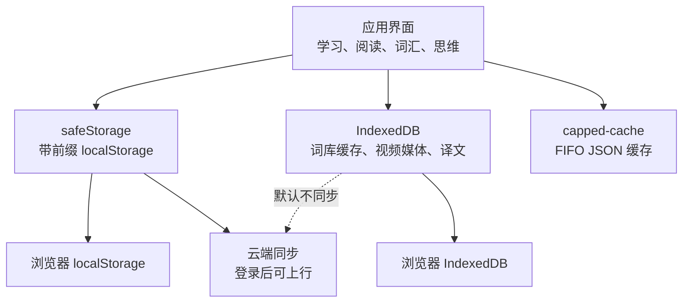
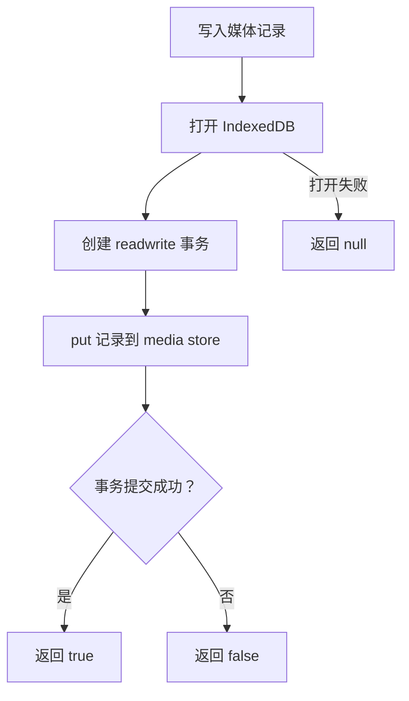
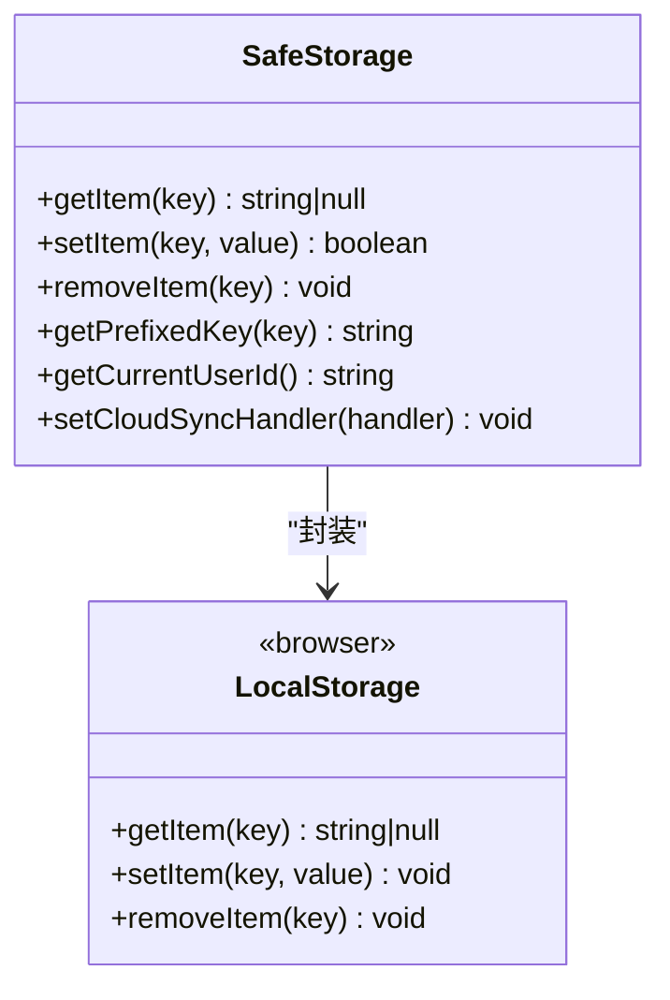
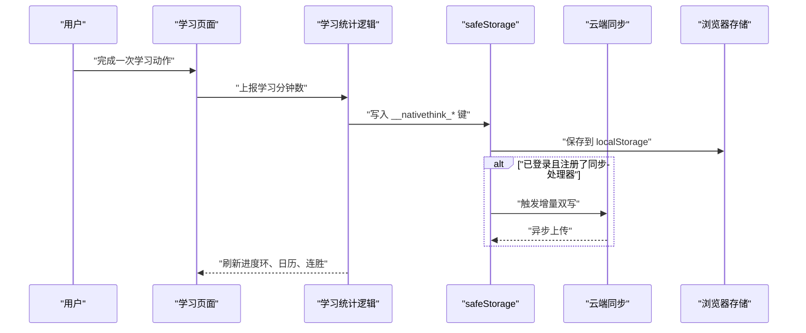
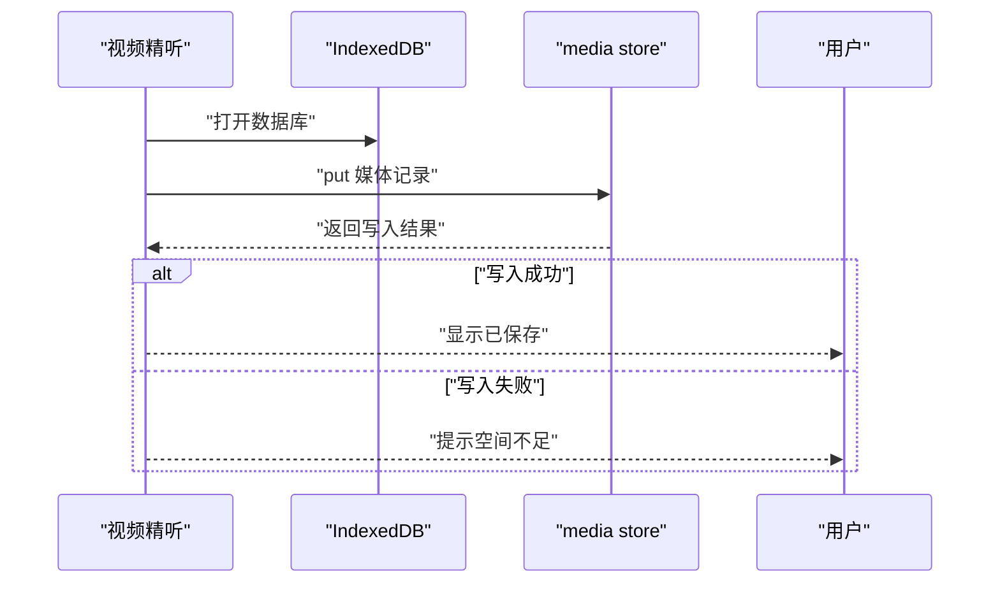
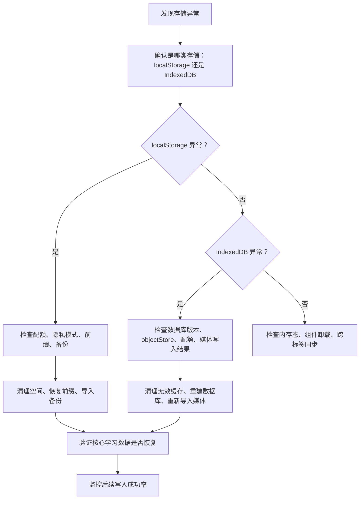
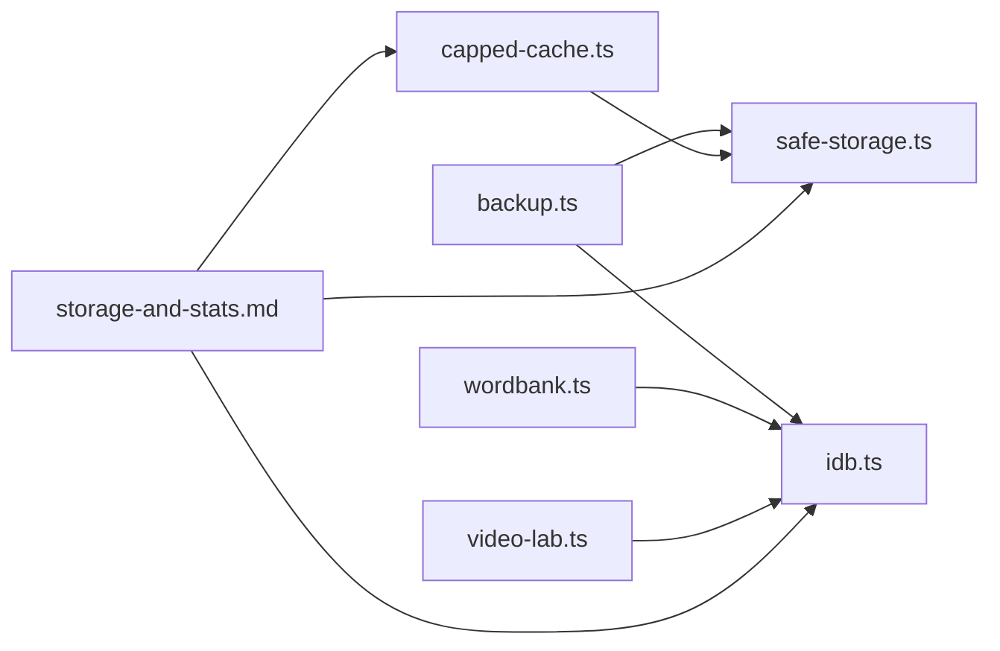

# 数据存储问题排查

<cite>
**本文引用的文件**   
- [src/lib/idb.ts](file://src/lib/idb.ts)
- [src/lib/safe-storage.ts](file://src/lib/safe-storage.ts)
- [src/lib/backup.ts](file://src/lib/backup.ts)
- [src/lib/capped-cache.ts](file://src/lib/capped-cache.ts)
- [docs/modules/storage-and-stats.md](file://docs/modules/storage-and-stats.md)
- [src/data/wordbank/wordbank.ts](file://src/data/wordbank/wordbank.ts)
- [src/lib/video-lab.ts](file://src/lib/video-lab.ts)
</cite>

## 目录
1. [引言](#引言)
2. [项目结构与存储边界](#项目结构与存储边界)
3. [核心持久化组件](#核心持久化组件)
4. [架构与数据流](#架构与数据流)
5. [关键故障排查手册](#关键故障排查手册)
6. [依赖关系分析](#依赖关系分析)
7. [性能与容量优化](#性能与容量优化)
8. [诊断工具清单](#诊断工具清单)
9. [结论与最佳实践](#结论与最佳实践)

## 引言
本指南面向 NativeThink 的数据持久化层，重点覆盖以下问题：
- IndexedDB 容量限制、版本升级与媒体写入失败。
- localStorage 配额耗尽、前缀变化导致的“数据隐身”。
- 学习记录无法保存、统计数据丢失、缓存失效。
- 跨标签页同步、备份恢复、数据库修复与极端情况下的数据重建。
- 如何监控存储使用、设置合理缓存策略，以及处理大数据量。

该项目没有后端业务库，用户数据主要落在本机 localStorage 与 IndexedDB；云同步仅对部分 safeStorage 键进行增量或全量补推，IndexedDB 默认不同步。

**章节来源**
- [docs/modules/storage-and-stats.md:1-138](file://docs/modules/storage-and-stats.md#L1-L138)

## 项目结构与存储边界
NativeThink 的本地存储分为四套机制，职责清晰但容易混淆：

| 机制 | 实现位置 | 用途 | 是否上云 |
|---|---|---|---|
| `safeStorage` | `src/lib/safe-storage.ts` | 带 appId/userId 前缀的 localStorage 封装，绝大多数业务键 | 登录后通过双写处理器可上行 |
| 裸 `localStorage` | 多处直接调用 | 少量旧键、隐私敏感 API Key、兜底词库缓存 | 通常不上云 |
| IndexedDB | `src/lib/idb.ts` | 大容量缓存：词库缓存、书籍全文、译文、视频精听媒体 | 默认不同步 |
| `capped-cache` | `src/lib/capped-cache.ts` | FIFO 封顶的 JSON 缓存读写与提示 | 落盘走 safeStorage，受同步边界约束 |

需要注意：
- `usePageMemory` 虽然统一抽象页面记忆，但底层键是裸短名，仍经过 safeStorage；其同步行为取决于是否被 cloud sync 过滤。
- 真正决定“是否上云”的关键不是键名前缀，而是“是否经过 safeStorage”，以及 cloud sync 的全量扫描是否包含该键。

**图表来源**
- [src/lib/safe-storage.ts:1-216](file://src/lib/safe-storage.ts#L1-L216)
- [src/lib/idb.ts:1-213](file://src/lib/idb.ts#L1-L213)
- [src/lib/capped-cache.ts:1-114](file://src/lib/capped-cache.ts#L1-L114)
- [docs/modules/storage-and-stats.md:1-138](file://docs/modules/storage-and-stats.md#L1-L138)

**章节来源**
- [docs/modules/storage-and-stats.md:1-138](file://docs/modules/storage-and-stats.md#L1-L138)

## 核心持久化组件

### IndexedDB 包装器
`src/lib/idb.ts` 提供两类能力：
1. 通用 KV 操作：`idbGet`、`idbSet`、`idbDelete`、`idbHas`、`idbClear`，作用于 `wordbank` store。
2. 媒体操作：`idbMediaPut`、`idbMediaGet`、`idbMediaAll`、`idbMediaDelete`，作用于独立 `media` store，用于视频精听的大体积媒体和字幕。

关键点：
- 数据库名为 `nativethink-wordbank`，当前版本为 2。
- `openDB` 使用单例缓存 `dbInstance`，避免重复打开。
- `withStore` 以事务提交结果为准，捕获配额满、store 不存在、浏览器拒绝等异常，返回 `{ ok: boolean }`。
- `idbMediaPut` 返回布尔值，失败时调用方应告知用户；常见原因是存储空间不足。
- `idbMediaAll` 遍历 cursor 并收集轻量索引，避免一次性把几百 MB blob 拉入内存。
- `idbClear` 只清理 `wordbank` store，不会误删 `media` store 中的用户导入视频。

错误处理风格偏“静默降级”：很多方法在 catch 中返回空值或不抛错，因此上层必须检查返回值和状态。

**图表来源**
- [src/lib/idb.ts:18-108](file://src/lib/idb.ts#L18-L108)

**章节来源**
- [src/lib/idb.ts:1-213](file://src/lib/idb.ts#L1-L213)

### safeStorage：带作用域的 localStorage 封装
`src/lib/safe-storage.ts` 的核心职责是：
- 生成稳定键前缀：平台内使用 `__miaoda_<appId>_<userId>__:`，独立运行使用匿名 ID。
- 自动迁移旧格式键。
- 可选的双写处理器，用于云同步。
- 将 `setItem` 的返回值从 `void` 改为 `boolean`，让调用方区分“写成功”和“静默丢数据”。

重要设计：
- 引导键 `__miaoda_anon_id_v1` 丢失时，会从既有键反解 `anon_…` 恢复，避免历史数据“隐身”。
- `_prefix` 整会话缓存，会话中途登录可能导致前缀不一致，已有迁移逻辑有限。
- `setCloudSyncHandler` 允许外部注册写事件，用于登录后的增量双写。
- `getPrefixedKey` 暴露原始键，方便调试定位实际存储在哪个 key 下。

**图表来源**
- [src/lib/safe-storage.ts:1-216](file://src/lib/safe-storage.ts#L1-L216)

**章节来源**
- [src/lib/safe-storage.ts:1-216](file://src/lib/safe-storage.ts#L1-L216)

### capped-cache：容量封顶缓存
`src/lib/capped-cache.ts` 提供统一的 JSON 缓存策略：
- `readJson`：安全读取并解析。
- `persistJson`：序列化后写入 safeStorage，返回是否成功。
- `warnStorageFull`：60 秒去抖提示空间不足。
- `appendCapped`：不可重算的用户创作清单，只拒绝新增，不删除已有条目。
- `cappedPut`：可重算缓存采用 FIFO 淘汰。
- `trimOldest`：滚动窗口类历史按条数与字节双封顶。

这个模块是解决“累积缓存撑爆 localStorage”的关键防线。

**章节来源**
- [src/lib/capped-cache.ts:1-114](file://src/lib/capped-cache.ts#L1-L114)
- [docs/modules/storage-and-stats.md:60-138](file://docs/modules/storage-and-stats.md#L60-L138)

### 备份与恢复
`src/lib/backup.ts` 负责导出 safeStorage 数据与部分 IndexedDB 数据：
- 导出范围：safeStorage 作用域内的所有键，以及 book translation 缓存。
- 结构体 `IBackupFile` 包含 app、version、exportedAt、data、idb。
- 导出时对 IndexedDB 数据加 40MB 上限，超出则跳过并标记 `idbSkipped`。
- 导入时逐键写入 safeStorage，再批量写入 IndexedDB 中以 `booktrans-` 开头的键。

注意：
- 备份文件中 `idb` 字段可能为空，表示未成功导出；恢复时需判断。
- 导入单个键失败不会阻断整体恢复，适合容错。

**章节来源**
- [src/lib/backup.ts:1-105](file://src/lib/backup.ts#L1-L105)

## 架构与数据流

### 典型写路径：学习统计与进度
学习统计、单词复习、拼写、每日学习等流程通常经历：
1. 业务组件产生学习动作。
2. 通过 safeStorage 写入带前缀的键。
3. 如果已登录，cloud sync 双写处理器接收变更。
4. 前端根据本地数据更新 UI，并在多标签页之间广播事件。

**图表来源**
- [docs/modules/storage-and-stats.md:24-59](file://docs/modules/storage-and-stats.md#L24-L59)
- [src/lib/safe-storage.ts:141-216](file://src/lib/safe-storage.ts#L141-L216)

### 媒体写入路径：视频精听
视频精听使用独立的 IndexedDB store，避免词库缓存清理误删用户导入视频：
1. 用户选择视频、字幕或录音。
2. 调用 `idbMediaPut` 写入媒体记录。
3. 若返回 false，说明写入失败，通常是配额不足。
4. 列表展示通过 `idbMediaAll` 获取轻量索引，避免加载全部 blob。

**图表来源**
- [src/lib/idb.ts:60-108](file://src/lib/idb.ts#L60-L108)
- [src/lib/video-lab.ts:299-301](file://src/lib/video-lab.ts#L299-L301)

**章节来源**
- [src/lib/video-lab.ts:299-301](file://src/lib/video-lab.ts#L299-L301)

## 关键故障排查手册

### 症状一：无法保存学习记录
**可能原因**
- localStorage 配额已满。
- 隐私模式或受限环境导致 localStorage 不可用。
- safeStorage 前缀变化，新键写入成功但旧键读不到。
- 写入返回 false 但上层未检查，表现为“刷新后数据没了”。

**诊断步骤**
1. 确认写入函数是否检查返回值：safeStorage 的 `setItem` 现在返回 boolean。
2. 使用 `safeStorage.getPrefixedKey(key)` 查看真实键名。
3. 打开浏览器开发者工具的 Application 面板，检查 localStorage 是否有对应前缀的键。
4. 检查是否处于隐私模式或第三方 Cookie 受限环境。
5. 查看控制台是否有空间不足警告，或 capped-cache 的去抖提示。

**解决步骤**
1. 清理不必要的自定义内容、历史记录或浏览状态。
2. 优先保留核心学习数据，可先导出备份再清理。
3. 如果是前缀变化导致，检查是否会话中途登录，或平台 user_id 发生变化。
4. 对于累积型缓存，启用 capped-cache 的 FIFO 封顶，避免无限增长。
5. 如 localStorage 完全不可用，考虑把非关键临时状态迁移到 sessionStorage 或内存态，并明确标注风险。

**章节来源**
- [src/lib/safe-storage.ts:141-216](file://src/lib/safe-storage.ts#L141-L216)
- [src/lib/capped-cache.ts:18-48](file://src/lib/capped-cache.ts#L18-L48)
- [docs/modules/storage-and-stats.md:100-138](file://docs/modules/storage-and-stats.md#L100-L138)

### 症状二：统计数据丢失
**可能原因**
- localStorage 被清理，`__nativethink_learning_stats` 或日历数据丢失。
- 前缀变化导致读取的是另一个用户作用域。
- 多实例竞争写入，但本次排查更关注持久化而非内存态。
- 云同步未生效，换设备后看不到上次数据。

**诊断步骤**
1. 检查 localStorage 是否存在 `__nativethink_learning_stats` 和日历相关键。
2. 使用 `safeStorage.getCurrentUserId()` 确认当前用户标识。
3. 检查是否登录过，并确认 cloud sync 是否开启。
4. 对比旧设备与新设备的键前缀，判断是否因 anonId 或 userId 变化导致数据隔离。
5. 查看是否有有效备份文件。

**解决步骤**
1. 如果本地有备份，执行“从备份恢复”。
2. 如果曾登录并同步，重新登录并等待增量同步完成。
3. 如果只是匿名 ID 变化，尝试恢复引导键或手动迁移旧键到新前缀（谨慎操作）。
4. 对于统计类数据，建议优先依赖本地权威源，同时开启云同步作为辅助。

**章节来源**
- [docs/modules/storage-and-stats.md:24-59](file://docs/modules/storage-and-stats.md#L24-L59)
- [src/lib/safe-storage.ts:1-80](file://src/lib/safe-storage.ts#L1-L80)
- [src/lib/backup.ts:1-105](file://src/lib/backup.ts#L1-L105)

### 症状三：缓存失效或词库数据异常
**可能原因**
- IndexedDB 损坏或版本升级失败。
- 词库缓存与 localStorage 镜像不一致。
- 清理 wordbank store 后未重建缓存。
- 浏览器禁用 IndexedDB。

**诊断步骤**
1. 打开 Application 面板的 IndexedDB Inspector，查看 `nativethink-wordbank` 数据库。
2. 检查 `wordbank` store 是否存在，以及键是否符合预期。
3. 检查 `media` store 是否被意外清空。
4. 确认词库侧是否在 IDB 失败时回落到 localStorage。
5. 观察是否出现 `idbClear` 调用后的空缓存。

**解决步骤**
1. 对非关键缓存，可调用 `idbClear` 清理后重新加载词库。
2. 对媒体数据，不要使用 `idbClear`，应使用 `idbMediaDelete` 单独删除。
3. 如果 IndexedDB 整体损坏，可在开发者工具中删除整个数据库后重试。
4. 确保词库加载逻辑在 IDB 失败时能回退到网络或包内资源。

**章节来源**
- [src/lib/idb.ts:1-108](file://src/lib/idb.ts#L1-L108)
- [src/data/wordbank/wordbank.ts:5-165](file://src/data/wordbank/wordbank.ts#L5-L165)

### 症状四：视频精听媒体无法保存或列表为空
**可能原因**
- IndexedDB 配额不足，`idbMediaPut` 返回 false。
- 媒体记录 id 冲突或数据格式不符合预期。
- `media` store 不存在或版本升级失败。
- 列表查询异常，cursor 遍历中断。

**诊断步骤**
1. 查看 `idbMediaPut` 的返回值，false 即写入失败。
2. 在 IndexedDB Inspector 中确认 `media` store 存在。
3. 检查媒体记录的 id 是否唯一。
4. 使用 `idbMediaAll` 验证轻量索引是否能列出记录。
5. 检查浏览器磁盘配额和站点存储限制。

**解决步骤**
1. 释放浏览器存储空间或删除旧视频。
2. 重新导入媒体，并确保 id 唯一。
3. 如果 `media` store 缺失，可删除数据库后重新初始化。
4. 对超大媒体建议分片或降低分辨率，避免单次写入超过配额。

**章节来源**
- [src/lib/idb.ts:60-108](file://src/lib/idb.ts#L60-L108)
- [src/lib/video-lab.ts:299-301](file://src/lib/video-lab.ts#L299-L301)

### 症状五：跨标签页数据不同步
**可能原因**
- 数据只写在 localStorage，但未触发其他标签页的事件监听。
- 使用了内存 state 而不是持久化键。
- 页面卸载后组件 state 消失。
- cloud sync 的上行与下行未在目标标签页生效。

**诊断步骤**
1. 确认数据是否写入 localStorage 或 IndexedDB。
2. 检查是否有 `visibilitychange` 或自定义事件监听。
3. 检查页面切换是否卸载组件，导致内存态丢失。
4. 检查 cloud sync 是否已注册并成功同步。

**解决步骤**
1. 对学习断点、阅读位置等用户状态，显式持久化到 safeStorage。
2. 在页面挂载时恢复持久化状态。
3. 对需要跨标签同步的状态，使用 storage 事件或 `BroadcastChannel`。
4. 对云同步数据，在页面可见或登录态变化时主动拉取。

**章节来源**
- [docs/modules/storage-and-stats.md:24-59](file://docs/modules/storage-and-stats.md#L24-L59)
- [docs/modules/storage-and-stats.md:120-138](file://docs/modules/storage-and-stats.md#L120-L138)

### 症状六：数据损坏或版本迁移失败
**可能原因**
- IndexedDB 版本升级时 objectStore 创建失败。
- localStorage 部分键被清理，引导键丢失。
- 老格式键迁移未完成。
- 备份文件损坏或版本不兼容。

**诊断步骤**
1. 检查 IndexedDB 数据库版本与 objectStore 列表。
2. 检查 `__miaoda_anon_id_v1` 是否存在。
3. 检查是否存在旧格式键 `__miaoda_<appId>__:<key>`。
4. 验证备份文件的 `app`、`version`、`data`、`idb` 字段。

**解决步骤**
1. 对 IndexedDB 损坏，删除数据库后重启应用以重建。
2. 对 anonId 丢失，尝试从既有键恢复；若失败，接受数据“隐身”风险并重新生成。
3. 对老格式键，让 `tryMigrate` 迁移，或手动搬移。
4. 对损坏备份，丢弃后重新导出；必要时只恢复 safeStorage data，不恢复 idb。

**章节来源**
- [src/lib/idb.ts:18-59](file://src/lib/idb.ts#L18-L59)
- [src/lib/safe-storage.ts:1-80](file://src/lib/safe-storage.ts#L1-L80)
- [src/lib/backup.ts:1-105](file://src/lib/backup.ts#L1-L105)

### 系统化的解决流程
推荐按以下顺序处理存储问题：

[本图为概念流程，不对应具体代码文件]

## 依赖关系分析

**图表来源**
- [src/lib/backup.ts:1-105](file://src/lib/backup.ts#L1-L105)
- [src/lib/idb.ts:1-213](file://src/lib/idb.ts#L1-L213)
- [src/lib/safe-storage.ts:1-216](file://src/lib/safe-storage.ts#L1-L216)
- [src/lib/capped-cache.ts:1-114](file://src/lib/capped-cache.ts#L1-L114)
- [src/data/wordbank/wordbank.ts:5-165](file://src/data/wordbank/wordbank.ts#L5-L165)
- [src/lib/video-lab.ts:299-301](file://src/lib/video-lab.ts#L299-L301)
- [docs/modules/storage-and-stats.md:1-138](file://docs/modules/storage-and-stats.md#L1-L138)

**章节来源**
- [src/lib/backup.ts:1-105](file://src/lib/backup.ts#L1-L105)
- [src/lib/idb.ts:1-213](file://src/lib/idb.ts#L1-L213)
- [src/lib/safe-storage.ts:1-216](file://src/lib/safe-storage.ts#L1-L216)
- [src/lib/capped-cache.ts:1-114](file://src/lib/capped-cache.ts#L1-L114)
- [src/data/wordbank/wordbank.ts:5-165](file://src/data/wordbank/wordbank.ts#L5-L165)
- [src/lib/video-lab.ts:299-301](file://src/lib/video-lab.ts#L299-L301)
- [docs/modules/storage-and-stats.md:1-138](file://docs/modules/storage-and-stats.md#L1-L138)

## 性能与容量优化

### 容量管理策略
- 对可重算数据（例句、翻译、AI 派生缓存）使用 `cappedPut` 的 FIFO 淘汰。
- 对用户创作数据（自定义题目、句子库、已记住清单）使用 `appendCapped`，只拒绝新增，不删除已有条目。
- 对滚动窗口历史使用 `trimOldest`，按条数和字节双封顶。
- 所有落盘失败都应返回布尔值并提示用户，不能静默吞掉。

### 大数据量优化
- 视频媒体只存 IndexedDB，不进入 localStorage。
- 媒体列表使用 `idbMediaAll` 的 cursor 遍历，避免一次性加载大 blob。
- 备份时对 IndexedDB 数据限制 40MB，超出则跳过并标记。
- 词库缓存优先走 IndexedDB，只有 IDB 失败时才镜像到 localStorage，避免双倍占用。

### 并发与稳定性
- IndexedDB 操作以事务提交为准，catch 分支要返回明确的失败状态。
- 避免在长任务结束时用陈旧快照回写，应使用函数式更新。
- 对高频写操作做去抖，防止 toast 刷屏或频繁触达配额上限。

**章节来源**
- [src/lib/capped-cache.ts:18-114](file://src/lib/capped-cache.ts#L18-L114)
- [src/lib/idb.ts:60-108](file://src/lib/idb.ts#L60-L108)
- [src/lib/backup.ts:20-105](file://src/lib/backup.ts#L20-L105)
- [docs/modules/storage-and-stats.md:60-138](file://docs/modules/storage-and-stats.md#L60-L138)

## 诊断工具清单

### 浏览器开发者工具
- **Application 面板**：查看 localStorage 键、大小、过期时间，确认前缀是否正确。
- **IndexedDB Inspector**：查看 `nativethink-wordbank` 数据库、objectStore、记录数量与大小。
- **存储用量**：查看站点存储配额、已用空间、是否接近上限。
- **控制台日志**：查找 `warnStorageFull` 的空间不足提示。

### 应用内诊断
- 使用 `safeStorage.getPrefixedKey(key)` 查看真实键名。
- 使用 `safeStorage.getCurrentUserId()` 确认当前用户作用域。
- 检查备份文件结构，确认 `app`、`version`、`data`、`idb` 是否完整。
- 对媒体数据，分别检查 `idbMediaPut` 返回值与 `idbMediaAll` 列表。

### 常见问题对照表
| 现象 | 优先检查 | 常见根因 | 建议动作 |
|---|---|---|---|
| 学习记录刷新后消失 | localStorage 键、前缀、备份 | 配额满、匿名 ID 变化、隐私模式 | 清理空间、恢复前缀、导入备份 |
| 统计数据归零 | 统计键、日历键、cloud sync | 本地存储被清、同步未生效 | 恢复备份、重新登录同步 |
| 词库缓存为空 | IndexedDB wordbank store | IDB 损坏、清理、版本升级失败 | 重建数据库、重新加载词库 |
| 视频无法保存 | media store、quota | 存储空间不足 | 删除旧媒体、释放配额 |
| 跨标签数据不同步 | storage 事件、组件生命周期 | 只写内存、未持久化 | 显式持久化并恢复 |

**章节来源**
- [src/lib/safe-storage.ts:180-216](file://src/lib/safe-storage.ts#L180-L216)
- [src/lib/capped-cache.ts:18-48](file://src/lib/capped-cache.ts#L18-L48)
- [src/lib/backup.ts:1-105](file://src/lib/backup.ts#L1-L105)
- [docs/modules/storage-and-stats.md:1-138](file://docs/modules/storage-and-stats.md#L1-L138)

## 结论与最佳实践
- 明确数据归属：学习记录、进度、设置走 safeStorage；大体积媒体、词库缓存、译文走 IndexedDB；临时缓存走 capped-cache。
- 所有写操作都要检查返回值，尤其是 safeStorage.setItem 和 idbMediaPut。
- 对累积型缓存设置上限，区分“可重算”和“不可重算”两类数据。
- 使用前缀调试能力定位实际键，避免误判“数据丢失”。
- 重要用户资产定期导出备份，重装或升级前先备份。
- 遇到存储异常时，先从配额和前缀入手，再处理版本迁移和数据库修复。
- 极端情况下，可删除 IndexedDB 或 localStorage 中可疑数据，然后从备份或云端恢复核心学习数据。

[本节为总结性内容，不直接分析具体文件]