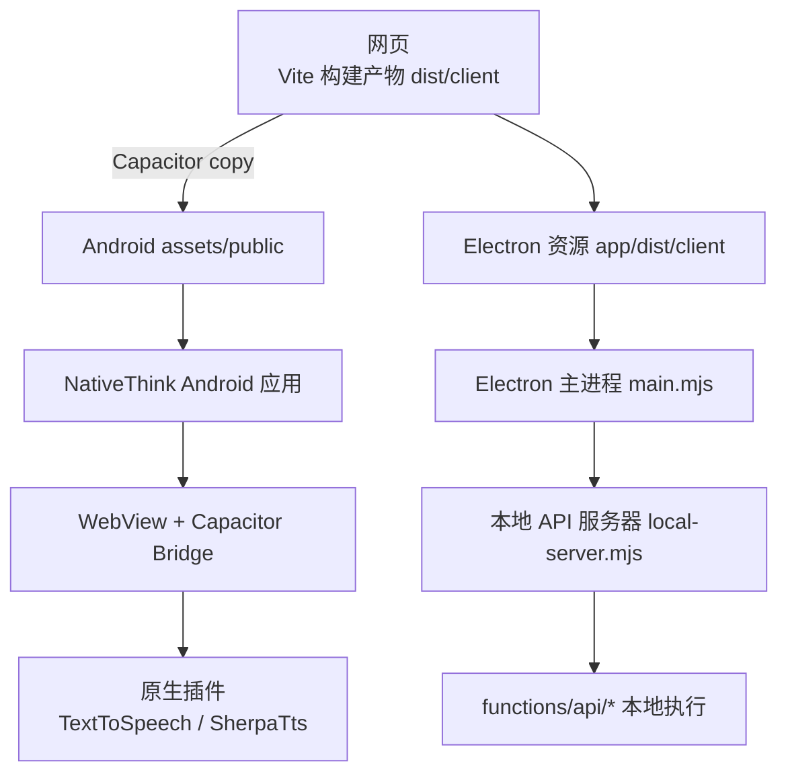
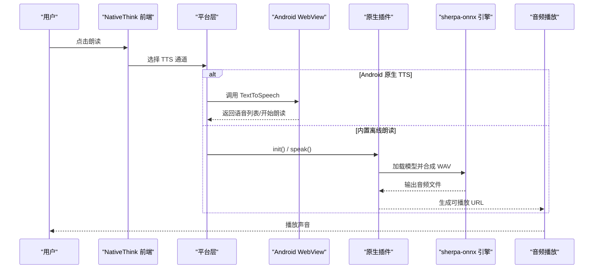
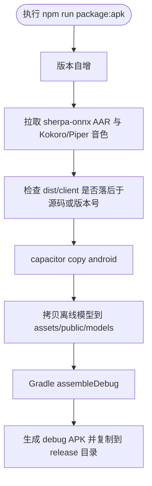
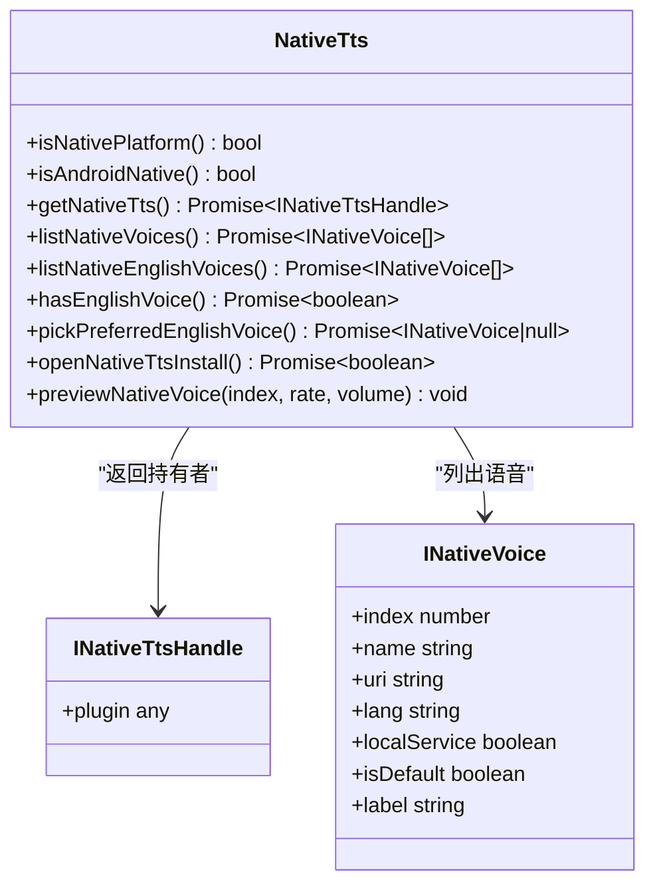
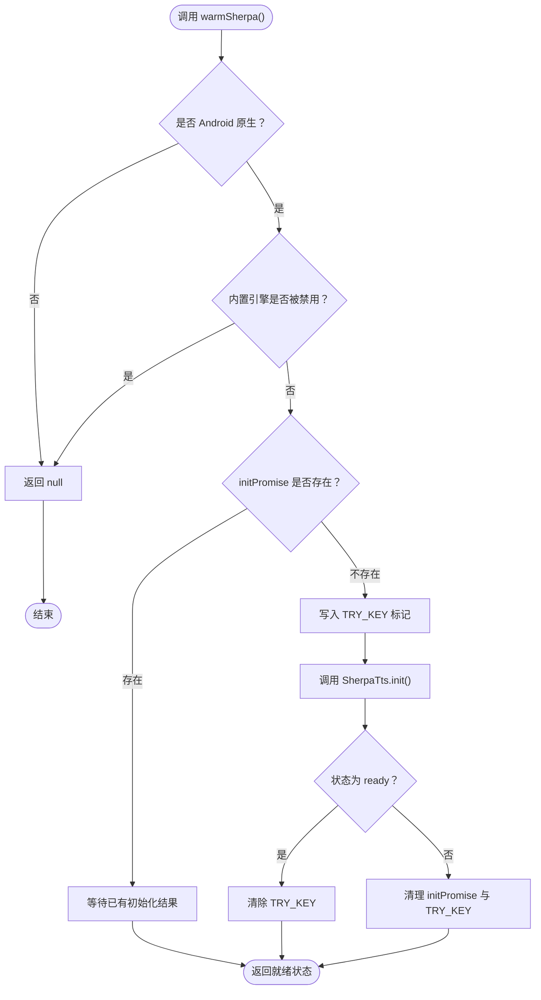
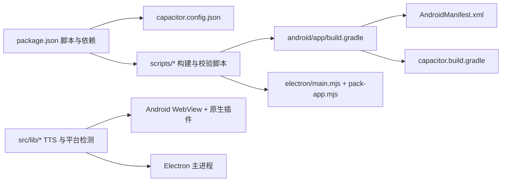

# 移动端平台问题排查

<cite>
**本文引用的文件**   
- [capacitor.config.json](file://capacitor.config.json)
- [package.json](file://package.json)
- [electron/main.mjs](file://electron/main.mjs)
- [android/app/src/main/AndroidManifest.xml](file://android/app/src/main/AndroidManifest.xml)
- [android/app/build.gradle](file://android/app/build.gradle)
- [android/app/capacitor.build.gradle](file://android/app/capacitor.build.gradle)
- [android/app/proguard-rules.pro](file://android/app/proguard-rules.pro)
- [android/app/src/main/res/xml/file_paths.xml](file://android/app/src/main/res/xml/file_paths.xml)
- [scripts/android-env.cjs](file://scripts/android-env.cjs)
- [scripts/android-copy-models.cjs](file://scripts/android-copy-models.cjs)
- [scripts/fetch-android-tts.cjs](file://scripts/fetch-android-tts.cjs)
- [scripts/pack-app.mjs](file://scripts/pack-app.mjs)
- [scripts/ensure-web-build.mjs](file://scripts/ensure-web-build.mjs)
- [scripts/check-tts-voices.cjs](file://scripts/check-tts-voices.cjs)
- [scripts/verify-native-tts.mjs](file://scripts/verify-native-tts.mjs)
- [src/lib/app-env.ts](file://src/lib/app-env.ts)
- [src/lib/native-tts.ts](file://src/lib/native-tts.ts)
- [src/lib/sherpa-tts.ts](file://src/lib/sherpa-tts.ts)
- [src/lib/tts-settings.ts](file://src/lib/tts-settings.ts)
- [server/local-server.mjs](file://server/local-server.mjs)
- [docs/mobile-qa-report-20260921.md](file://docs/mobile-qa-report-20260921.md)
</cite>

## 目录
1. [引言](#引言)
2. [项目结构与多平台边界](#项目结构与多平台边界)
3. [核心组件与平台能力](#核心组件与平台能力)
4. [架构总览](#架构总览)
5. [详细组件分析](#详细组件分析)
6. [依赖关系分析](#依赖关系分析)
7. [性能调优建议](#性能调优建议)
8. [排障指南](#排障指南)
9. [结论](#结论)

## 引言
本指南面向 NativeThink 的 Capacitor Android、Electron 桌面端以及网页运行环境，聚焦打包失败、权限拒绝、原生 TTS 异常、离线模型缺失、代理和 B 站资源不可用等真实问题。文档从仓库现有的构建脚本、Capacitor 配置、Android 清单、Electron 主进程和 TTS 相关源码出发，给出可操作的诊断路径与修复步骤，并补充电池优化、通知推送、文件访问限制等移动端常见问题处理方法。

## 项目结构与多平台边界
NativeThink 是一个 React + Vite 前端应用，通过三种方式部署：
- 网页：`dist/client` 静态产物。
- Android APK：Capacitor 将 `dist/client` 注入 WebView，并桥接原生插件（TTS、sherpa-onnx）。
- Electron 桌面：主进程启动本地 Node HTTP 服务器，加载 `dist/client`，复用 Cloudflare Functions 后端代码。

**图示来源**
- [package.json:6-38](file://package.json#L6-L38)
- [capacitor.config.json:1-11](file://capacitor.config.json#L1-L11)
- [electron/main.mjs:1-176](file://electron/main.mjs#L1-L176)
- [server/local-server.mjs:1-120](file://server/local-server.mjs#L1-L120)

**章节来源**
- [package.json:1-130](file://package.json#L1-L130)
- [capacitor.config.json:1-11](file://capacitor.config.json#L1-L11)

## 核心组件与平台能力
- 平台识别：`platformTag()` 优先判断 Capacitor 原生平台，再回退到 UA 检测 Electron，最后视为网页。
- Android 原生能力：
  - 系统 TTS：通过 `@capacitor-community/text-to-speech` 查询语音列表、试听、安装引导。
  - 内置离线朗读：sherpa-onnx AAR + Piper/Kokoro 模型，合成 WAV 后由 WebView `<audio>` 播放。
- Electron 能力：
  - 本地 HTTP 服务提供 `/api/*` 路由，模拟 Cloudflare KV，支持跨域隔离头以启用多线程 WASM。
  - 注入 B 站登录态、UA 伪装、系统代理转发。

**章节来源**
- [src/lib/app-env.ts:1-29](file://src/lib/app-env.ts#L1-L29)
- [src/lib/native-tts.ts:1-199](file://src/lib/native-tts.ts#L1-L199)
- [src/lib/sherpa-tts.ts:1-200](file://src/lib/sherpa-tts.ts#L1-L200)
- [server/local-server.mjs:1-120](file://server/local-server.mjs#L1-L120)

## 架构总览

**图示来源**
- [src/lib/native-tts.ts:52-199](file://src/lib/native-tts.ts#L52-L199)
- [src/lib/sherpa-tts.ts:1-200](file://src/lib/sherpa-tts.ts#L1-L200)

## 详细组件分析

### Android 打包与构建链路
`npm run package:apk` 是 Android 打包入口，其职责包括版本号自增、拉取离线 TTS 二进制、确保 web 产物最新、复制 Capacitor 资源、拷贝离线模型、Gradle 构建 debug APK，并把产物复制到 `release/NativeThink-mobile-debug.apk`。

关键风险点：
- 如果 `models-bundled` 不存在，`android-copy-models.cjs` 会跳过，APK 将不含离线模型。
- 模拟器专用构建使用 `NT_EMU=1` 只包含 `x86_64` ABI，不能作为发布物。
- Gradle 使用 Java 21；Windows 上 `android-env.cjs` 会写入 `local.properties` 和 `gradle.properties`，但 JDK 路径硬编码为 `B:/jdk21`，在其它机器上会失败。
- ProGuard 默认关闭混淆，但 release 仍引用 `proguard-rules.pro`；若未来开启混淆，需保留 JS 接口类名。

**图示来源**
- [package.json:20-38](file://package.json#L20-L38)
- [scripts/fetch-android-tts.cjs:1-200](file://scripts/fetch-android-tts.cjs#L1-L200)
- [scripts/ensure-web-build.mjs:1-93](file://scripts/ensure-web-build.mjs#L1-L93)
- [scripts/android-copy-models.cjs:1-23](file://scripts/android-copy-models.cjs#L1-L23)
- [android/app/build.gradle:1-95](file://android/app/build.gradle#L1-L95)

**章节来源**
- [package.json:20-38](file://package.json#L20-L38)
- [scripts/fetch-android-tts.cjs:1-200](file://scripts/fetch-android-tts.cjs#L1-L200)
- [scripts/ensure-web-build.mjs:1-93](file://scripts/ensure-web-build.mjs#L1-L93)
- [scripts/android-copy-models.cjs:1-23](file://scripts/android-copy-models.cjs#L1-L23)
- [android/app/build.gradle:1-95](file://android/app/build.gradle#L1-L95)
- [scripts/android-env.cjs:1-12](file://scripts/android-env.cjs#L1-L12)

### Android 权限与运行时行为
Android 清单已声明网络、录音和音频设置权限。注释明确指出：跟读评价需要录音，Capacitor 的 `BridgeWebChromeClient` 会在 WebView 请求麦克风时申请运行时权限，前提是清单中已声明。

需要注意：
- 当前清单未显式声明存储读写权限，仅通过 `FileProvider` 暴露 URI。
- 如需直接访问外部存储或下载大文件，应评估是否需要添加相应权限。
- `file_paths.xml` 允许访问外部存储根目录和缓存目录中的图片，这是相对宽松的 FileProvider 配置。

**章节来源**
- [android/app/src/main/AndroidManifest.xml:1-41](file://android/app/src/main/AndroidManifest.xml#L1-L41)
- [android/app/src/main/res/xml/file_paths.xml:1-5](file://android/app/src/main/res/xml/file_paths.xml#L1-L5)

### 系统 TTS 插件与 Promise 挂死问题
`native-tts.ts` 的 `getNativeTts()` 曾直接返回 Capacitor 插件对象，导致异步函数返回值被 Promise 同化，触发对不存在的 `then` 方法的原生调用，最终永久 pending。修复方案是返回 `{ plugin }` 持有者对象，避免把 Proxy 本身穿过 Promise 边界。

**图示来源**
- [src/lib/native-tts.ts:1-199](file://src/lib/native-tts.ts#L1-L199)

**章节来源**
- [src/lib/native-tts.ts:1-199](file://src/lib/native-tts.ts#L1-L199)
- [scripts/verify-native-tts.mjs:1-200](file://scripts/verify-native-tts.mjs#L1-L200)
- [docs/mobile-qa-report-20260921.md:1-200](file://docs/mobile-qa-report-20260921.md#L1-L200)

### 内置离线朗读引擎 sherpa-onnx
sherpa-tts 模块仅在 Android 原生平台可用。它负责：
- 健康检查：上次加载崩溃会停用内置引擎，防止反复闪退。
- 预热初始化：首次加载约 1–2 秒，应在阅读或学习页提前预热。
- 并发去重：相同音色、文本、语速的合成请求合并，避免原生队列堆积导致内存溢出。
- 结果缓存：按音色、语速、文本缓存合成 URL，减少重复跨端调用。
- 日志读取：提供 `readLog()` 用于定位原生初始化失败位置。

**图示来源**
- [src/lib/sherpa-tts.ts:1-200](file://src/lib/sherpa-tts.ts#L1-L200)

**章节来源**
- [src/lib/sherpa-tts.ts:1-200](file://src/lib/sherpa-tts.ts#L1-L200)
- [scripts/fetch-android-tts.cjs:1-200](file://scripts/fetch-android-tts.cjs#L1-L200)
- [scripts/check-tts-voices.cjs:1-200](file://scripts/check-tts-voices.cjs#L1-L200)

### Electron 桌面应用
Electron 主进程做四件事：
1. 单实例锁定，固定端口探测并启动本地服务器。
2. 启动 `server/local-server.mjs`，将 `dist/client`、`functions`、`server` 和资源放入可运行结构。
3. 注入 B 站 `SESSDATA` Cookie，让播放器 iframe 获得高清播放与 AI 字幕能力。
4. 针对 B 站域名重写 UA 与 Referer，绕过部分 CDN 热链保护。

本地服务器还设置 `Cross-Origin-Opener-Policy` 与 `Cross-Origin-Embedder-Policy`，尝试启用 SharedArrayBuffer 和多线程 WASM，加速离线模型加载与推理。

**章节来源**
- [electron/main.mjs:1-176](file://electron/main.mjs#L1-L176)
- [server/local-server.mjs:1-120](file://server/local-server.mjs#L1-L120)

### 桌面打包脚本
`pack-app.mjs` 采用硬链接式复制，避免重复拷贝 Electron 运行时和约 750MB 离线模型。它只复制本地服务器所需的依赖子树（如 `jose`、`undici`、`msedge-tts`），并可选打包 `models-bundled`。

常见陷阱：
- 缺少 `icon.ico` 不会阻断，但打包产物可能没有应用图标。
- 依赖收集基于 `node_modules` 中包描述文件的 dependencies，若依赖结构变化但未重新安装，可能漏拷。
- `--skip-web` 假设外部已经构建好 `dist/client`，否则桌面版加载不到前端页面。

**章节来源**
- [scripts/pack-app.mjs:1-108](file://scripts/pack-app.mjs#L1-L108)
- [package.json:10-20](file://package.json#L10-L20)

## 依赖关系分析

**图示来源**
- [package.json:1-130](file://package.json#L1-L130)
- [capacitor.config.json:1-11](file://capacitor.config.json#L1-L11)
- [android/app/build.gradle:1-95](file://android/app/build.gradle#L1-L95)
- [android/app/capacitor.build.gradle:1-19](file://android/app/capacitor.build.gradle#L1-L19)
- [electron/main.mjs:1-176](file://electron/main.mjs#L1-L176)

**章节来源**
- [package.json:1-130](file://package.json#L1-L130)
- [android/app/build.gradle:1-95](file://android/app/build.gradle#L1-L95)
- [electron/main.mjs:1-176](file://electron/main.mjs#L1-L176)

## 性能调优建议
- Android：
  - 只在必要时预热 sherpa-onnx，进入阅读或学习页时调用预热，避免冷启动阻塞。
  - 控制并发合成请求，利用已有的 `inflight` 去重机制，避免原生串行队列耗尽线程。
  - 低端设备关注内存占用；离线 Kokoro 模型加原生层可能常驻超 GB，需观察 OutOfMemory 风险。
- Electron：
  - 保持 `Cross-Origin-Opener-Policy` 与 `Cross-Origin-Embedder-Policy` 响应头，使 Chromium 能启用多线程 WASM。
  - 通过系统代理解决受限网络下的 Wikipedia、Google TTS 访问问题。
- 通用：
  - 使用 `check-tts-voices.cjs` 在打包前校验音色表、模型文件、内嵌元数据，避免真机出现“声音奇怪”或 speakerId 越界。
  - 使用 `verify-native-tts.mjs` 验证原生 TTS 插件不会永久挂起，保证 UI 不会因为 Promise 同化问题卡死。

[本节为通用指导，不直接分析具体文件]

## 排障指南

### 一、Capacitor Android 打包问题

#### 症状：Gradle 找不到 SDK 或 Java 版本错误
- 现象：`local.properties` 未生成、`org.gradle.java.home` 未配置、Java 21 报错。
- 原因：`android-env.cjs` 依赖 `LOCALAPPDATA\Android\Sdk`，并硬写 `B:/jdk21`。
- 处理步骤：
  1. 确认环境变量 `ANDROID_HOME` 或 `LOCALAPPDATA` 指向有效 Android SDK。
  2. 运行 `node scripts/android-env.cjs`，检查生成的 `android/local.properties` 与 `gradle.properties`。
  3. 修改 `gradle.properties` 中的 `org.gradle.java.home` 为本机 JDK 21 路径。
  4. 删除 `android/.gradle` 缓存后重试构建。

**章节来源**
- [scripts/android-env.cjs:1-12](file://scripts/android-env.cjs#L1-L12)
- [android/app/build.gradle:1-30](file://android/app/build.gradle#L1-L30)
- [android/app/capacitor.build.gradle:1-10](file://android/app/capacitor.build.gradle#L1-L10)

#### 症状：APK 体积过大或模拟器无法运行
- 现象：安装包包含 x86/x86_64，体积增加约 42MB；模拟器运行时报 JNI 库缺失。
- 原因：正常构建只包含 `arm64-v8a` 和 `armeabi-v7a`；模拟器专用构建才加入 `x86_64`。
- 处理步骤：
  1. 常规发布不要使用 `NT_EMU=1`。
  2. 模拟器调试时使用 `NT_EMU=1` 配合 `package-apk-emu.cjs` 或对应构建命令。
  3. 确认 `versionCode` 递增，避免覆盖安装失败导致数据丢失。

**章节来源**
- [android/app/build.gradle:10-35](file://android/app/build.gradle#L10-L35)
- [package.json:24-38](file://package.json#L24-L38)

#### 症状：APK 内无离线 TTS 模型或语音
- 现象：朗读走云端、起播慢；设置页显示“无本地语音”。
- 原因：`fetch-android-tts.cjs` 未执行、HF 镜像拉取失败、`models-bundled` 缺失，或 `android-copy-models.cjs` 跳过。
- 处理步骤：
  1. 先运行 `node scripts/fetch-android-tts.cjs --force`。
  2. 确认 `android/app/libs` 中出现 sherpa-onnx AAR。
  3. 确认 `android/app/src/main/assets/tts` 和 `piper` 目录存在。
  4. 再次执行 `npm run package:apk`，确保 `ensure-web-build.mjs` 和 `android-copy-models.cjs` 都成功。
  5. 运行 `node scripts/check-tts-voices.cjs` 校验音色注册表和模型元数据。

**章节来源**
- [scripts/fetch-android-tts.cjs:1-200](file://scripts/fetch-android-tts.cjs#L1-L200)
- [scripts/android-copy-models.cjs:1-23](file://scripts/android-copy-models.cjs#L1-L23)
- [scripts/check-tts-voices.cjs:1-200](file://scripts/check-tts-voices.cjs#L1-L200)
- [scripts/ensure-web-build.mjs:1-93](file://scripts/ensure-web-build.mjs#L1-L93)

#### 症状：签名冲突或安装失败
- 现象：debug/release 互相覆盖安装要求卸载，或升级提示签名不一致。
- 原因：`build.gradle` 在 debug 和 release 都尝试使用同一 keystore；keystore 配置来自仓库外的 `keystore.properties`。
- 处理步骤：
  1. 确认 `android/keystore.properties` 存在且路径正确。
  2. 发布前不要随意更换 keystore。
  3. 开发阶段统一 debug/release 签名可以避免卸载重装，但升级包必须使用同一签名。

**章节来源**
- [android/app/build.gradle:36-80](file://android/app/build.gradle#L36-L80)

#### 症状：ProGuard 混淆后 WebView 或 JS 接口异常
- 现象：线上包出现反射失败、JS 接口不可见或堆栈不可读。
- 原因：当前 release 关闭混淆，但若未来开启，需保留 WebView JS 接口类和必要属性。
- 处理步骤：
  1. 在 `proguard-rules.pro` 中取消注释保留 WebView JS 接口类的规则。
  2. 开启混淆前先打 debug 混淆包验证。
  3. 保留行号信息以便定位崩溃堆栈。

**章节来源**
- [android/app/proguard-rules.pro:1-21](file://android/app/proguard-rules.pro#L1-L21)

### 二、Electron 桌面应用异常

#### 症状：B 站视频无法播放、字幕不可用或 403
- 现象：嵌入播放器加载失败，AI 字幕不可用。
- 原因：Electron UA 被 B 站部分资源拒绝，CDN 有热链保护；同时需要 `SESSDATA` Cookie。
- 处理步骤：
  1. 在数据目录 `userData/data/server-config.json` 中配置 `bilibiliSessdata`。
  2. 重启 Electron，确认主进程日志中出现注入 SESSDATA 的记录。
  3. 确认 `main.mjs` 对 bilibili 域名重写 UA 和 Referer。
  4. 若仍在受限网络下失败，检查系统代理并通过 `NATIVETHINK_PROXY` 传给本地服务器。

**章节来源**
- [electron/main.mjs:40-140](file://electron/main.mjs#L40-L140)
- [server/local-server.mjs:80-140](file://server/local-server.mjs#L80-L140)

#### 症状：本地 API 端口被占用或无法启动
- 现象：应用启动失败、窗口不显示或 `/api/*` 全部 404。
- 原因：主进程从 31745 开始探测空闲端口，若所有端口都被占用则无法绑定。
- 处理步骤：
  1. 检查是否有残留 Electron 进程。
  2. 释放 31745 附近端口。
  3. 查看主进程控制台输出，确认实际绑定端口。
  4. 本地调试可在环境变量中指定 `NATIVETHINK_DEV`，便于区分开发与生产行为。

**章节来源**
- [electron/main.mjs:20-60](file://electron/main.mjs#L20-L60)

#### 症状：桌面版缺少依赖或离线模型
- 现象：本地服务器报模块缺失，或离线模型 404。
- 原因：`pack-app.mjs` 只复制本地服务器需要的依赖子树；`models-bundled` 仅在存在时打包。
- 处理步骤：
  1. 运行完整打包流程，不要跳过 web 构建。
  2. 若希望零下载体验，确保 `models-bundled` 存在。
  3. 检查 `release/NativeThink-win32-x64/resources/app/node_modules` 是否包含 jose、undici、msedge-tts。

**章节来源**
- [scripts/pack-app.mjs:1-108](file://scripts/pack-app.mjs#L1-L108)
- [electron/main.mjs:60-120](file://electron/main.mjs#L60-L120)

### 三、平台特性检测与功能受限

#### 症状：网页端误判为桌面端或原生平台
- 现象：某些分支未按预期执行。
- 原因：`platformTag()` 优先判断 Capacitor，其次看 UA 是否含 Electron；异常时降级为网页。
- 处理步骤：
  1. 在 Capacitor 环境中确认 `Capacitor.isNativePlatform()` 返回 true。
  2. 在 Electron 中确认 UA 包含 `Electron` 或 `NativeThink/`。
  3. 在纯浏览器中确认 UA 不包含上述标识。

**章节来源**
- [src/lib/app-env.ts:1-29](file://src/lib/app-env.ts#L1-L29)

#### 症状：Android 上系统 TTS 列表为空或朗读自检卡死
- 现象：设置页“系统语音”永远读取中，朗读自检停在自检中。
- 原因：旧实现把 Capacitor 插件对象直接作为 async 返回值，Promise 同化触发原生 `then` 调用失败。
- 处理步骤：
  1. 确认当前实现返回 `{ plugin }` 而非插件对象。
  2. 运行 `node scripts/verify-native-tts.mjs` 验证超时兜底逻辑。
  3. 若系统无英语语音，引导用户安装系统 TTS 语言包。

**章节来源**
- [src/lib/native-tts.ts:52-120](file://src/lib/native-tts.ts#L52-L120)
- [scripts/verify-native-tts.mjs:1-200](file://scripts/verify-native-tts.mjs#L1-L200)
- [docs/mobile-qa-report-20260921.md:1-120](file://docs/mobile-qa-report-20260921.md#L1-L120)

#### 症状：内置离线朗读无声或频繁闪退
- 现象：切换内置引擎后不出声，或应用冷启动后闪退。
- 原因：sherpa-onnx 原生层崩溃、模型文件不完整、espeak 数据缺失、或上次加载未完成。
- 处理步骤：
  1. 检查 `__nativethink_sherpa_off` 是否被自动写入，表示引擎被护栏停用。
  2. 通过设置页手动重新启用内置引擎。
  3. 调用 `getSherpaInitLog()` 获取原生初始化日志。
  4. 重新执行 `fetch-android-tts.cjs` 并校验音色表。
  5. 若问题复现，暂时切回系统 TTS 或云端 TTS，避免反复闪退。

**章节来源**
- [src/lib/sherpa-tts.ts:1-120](file://src/lib/sherpa-tts.ts#L1-L120)
- [scripts/fetch-android-tts.cjs:1-200](file://scripts/fetch-android-tts.cjs#L1-L200)
- [scripts/check-tts-voices.cjs:1-200](file://scripts/check-tts-voices.cjs#L1-L200)

### 四、电池优化、通知推送与文件访问

#### 电池优化与后台限制
- 现象：应用在后台被杀死，TTS 停止、录音中断。
- 原因：Android 系统对后台 WebView、前台服务和录音任务有限制。
- 处理建议：
  1. 尽量避免长时间后台执行重型合成任务。
  2. 使用系统前台服务承载长时录音或朗读（需额外原生适配）。
  3. 提醒用户关闭省电策略中对应用的后台限制。
  4. 在设置页明确告知用户：后台朗读可能受系统策略影响。

[本节为通用指导，不直接分析具体文件]

#### 通知推送
- 现状：Android 构建脚本中若检测到 `google-services.json` 才启用 Google Services 插件；不存在时记录“Push Notifications won't work”。
- 处理建议：
  1. 如需推送，准备 Firebase/FCM 配置并接入 Capacitor Push Notification 插件。
  2. 在 AndroidManifest 中声明推送所需权限。
  3. 在应用中请求通知权限，并处理不同 Android 版本的通知渠道。

**章节来源**
- [android/app/build.gradle:86-95](file://android/app/build.gradle#L86-L95)

#### 文件访问限制
- 现状：应用使用 `FileProvider` 暴露 URI，未直接声明外部存储读写权限。
- 处理建议：
  1. 若只需分享或读取已授予 URI，维持现有 FileProvider 配置即可。
  2. 若需要扫描相册、下载大文件或读写公共目录，评估是否添加 `READ_EXTERNAL_STORAGE`/`WRITE_EXTERNAL_STORAGE` 或使用 Android 11+ 的分区存储 API。
  3. 谨慎放宽 `file_paths.xml`，避免过度暴露外部目录。

**章节来源**
- [android/app/src/main/AndroidManifest.xml:18-41](file://android/app/src/main/AndroidManifest.xml#L18-L41)
- [android/app/src/main/res/xml/file_paths.xml:1-5](file://android/app/src/main/res/xml/file_paths.xml#L1-L5)

### 五、诊断工具与定位方法

| 平台 | 主要工具 | 用途 | 常用操作 |
|---|---|---|---|
| Android | Logcat | 查看系统、WebView、原生插件日志 | `adb logcat`，过滤 `com.nativethink.app`、`Capacitor`、`SherpaTts` |
| Android | Chrome DevTools | 调试 WebView JS、网络、性能 | 连接设备后使用 `chrome://inspect` 打开 WebView |
| Android | Platform Inspector | 查看 Capacitor 插件可用性 | 在 Console 中调用 `Capacitor.isPluginAvailable('TextToSpeech')` |
| Electron | DevTools | 调试主进程与渲染进程 | `View → Developer Tools`，查看 Network、Console、Performance |
| 通用 | 构建脚本日志 | 定位打包失败、模型缺失、版本不一致 | 查看 `ensure-web-build.mjs`、`check-tts-voices.cjs`、`verify-native-tts.mjs` 输出 |

**章节来源**
- [docs/mobile-qa-report-20260921.md:1-60](file://docs/mobile-qa-report-20260921.md#L1-L60)
- [src/lib/native-tts.ts:1-40](file://src/lib/native-tts.ts#L1-L40)
- [scripts/verify-native-tts.mjs:1-60](file://scripts/verify-native-tts.mjs#L1-L60)

### 六、跨平台兼容性测试方法论

推荐测试矩阵：
- 平台维度：网页、Android 真机、Android 模拟器、Electron Windows。
- 功能维度：系统 TTS、内置离线朗读、云端 TTS、B 站播放、本地 API、文件分享。
- 版本维度：低版本 Android、高版本 Android、不同 WebView 内核、不同 Electron 版本。

建议流程：
1. 先在网页环境验证基础业务逻辑。
2. 使用 `npm run app:start` 验证 Electron 本地服务器、B 站注入、代理转发。
3. 使用 `npm run package:apk` 生成 APK，安装到真机。
4. 使用 Logcat 和 Chrome DevTools 捕获 TTS、网络、内存异常。
5. 运行 `check-tts-voices.cjs` 和 `verify-native-tts.mjs` 做静态与模拟回归。
6. 记录各平台差异：例如 WebView 不支持 `speechSynthesis`、Electron UA 被 B 站拒绝、Android 原生插件可能挂起。

**章节来源**
- [package.json:20-38](file://package.json#L20-L38)
- [electron/main.mjs:1-176](file://electron/main.mjs#L1-L176)
- [scripts/check-tts-voices.cjs:1-200](file://scripts/check-tts-voices.cjs#L1-L200)
- [scripts/verify-native-tts.mjs:1-200](file://scripts/verify-native-tts.mjs#L1-L200)
- [docs/mobile-qa-report-20260921.md:1-200](file://docs/mobile-qa-report-20260921.md#L1-L200)

## 结论
NativeThink 的多平台部署依赖清晰的平台边界：Capacitor 负责 Android WebView 与原生插件桥接，Electron 负责本地服务器与桌面交互，前端通过 `app-env.ts` 和 TTS 模块在不同平台间做能力检测与降级。排查时应优先确认构建产物是否正确、离线模型是否到位、原生插件是否可用，再结合 Logcat、DevTools 和现有校验脚本定位具体平台差异。对于移动端特有的电池优化、通知推送和文件访问限制，应结合 Android 系统策略进行最小权限适配，并在设置页向用户说明平台限制与替代方案。