# 内容数据模型

<cite>
**本文引用的文件**   
- [books.ts](file://src/data/books.ts)
- [book-fulltext.ts](file://src/data/book-fulltext.ts)
- [book-clean.ts](file://src/data/book-clean.ts)
- [book-stats.ts](file://src/data/book-stats.ts)
- [imported-books.ts](file://src/data/imported-books.ts)
- [books-meta.ts](file://src/data/books-meta.ts)
- [reading.ts](file://src/data/reading.ts)
- [reader-highlight.ts](file://src/lib/reader-highlight.ts)
- [idb.ts](file://src/lib/idb.ts)
- [gen-books-meta.cjs](file://scripts/gen-books-meta.cjs)
- [dump-book-texts.cjs](file://scripts/dump-book-texts.cjs)
- [index.json](file://public/books/index.json)
</cite>

## 目录
1. [引言](#引言)
2. [项目结构与数据分层](#项目结构与数据分层)
3. [核心数据模型](#核心数据模型)
4. [书籍元数据与清单](#书籍元数据与清单)
5. [全文导入与清洗流程](#全文导入与清洗流程)
6. [阅读分页与加载策略](#阅读分页与加载策略)
7. [复习词高亮机制](#复习词高亮机制)
8. [阅读统计与真实规模](#阅读统计与真实规模)
9. [用户导入书籍流程](#用户导入书籍流程)
10. [依赖关系与架构总览](#依赖关系与架构总览)
11. [性能、内存与分页优化](#性能内存与分页优化)
12. [版本管理、增量更新与冲突处理](#版本管理增量更新与冲突处理)
13. [故障排查](#故障排查)
14. [结论](#结论)

## 引言
NativeThink 的内容数据模型围绕“书”这一核心实体展开，目标是让内置公版书和用户导入英文文本都能进入统一的阅读器：查词、翻译、批注、收藏、朗读、全书翻译、章节跳转和复习词高亮。

该模型把数据拆成五个层次：
- 统一阅读接口：`IReadingContent`、`IParagraph`、`IPage`
- 内置书籍节选：`books.ts`
- 运行时全文升级：`book-fulltext.ts`
- 文本清洗与章节识别：`book-clean.ts`
- 用户导入存储：`imported-books.ts`
- 元数据与统计：`books-meta.ts`、`book-stats.ts`

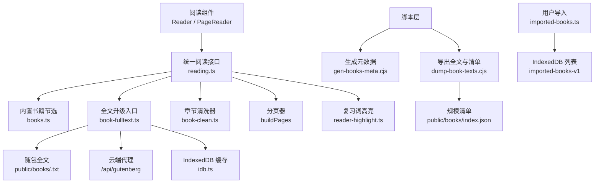

**图表来源**
- [reading.ts:1-83](file://src/data/reading.ts#L1-L83)
- [books.ts:1-37](file://src/data/books.ts#L1-L37)
- [book-fulltext.ts:1-106](file://src/data/book-fulltext.ts#L1-L106)
- [book-clean.ts:1-194](file://src/data/book-clean.ts#L1-L194)
- [imported-books.ts:1-154](file://src/data/imported-books.ts#L1-L154)
- [books-meta.ts:1-50](file://src/data/books-meta.ts#L1-L50)
- [idb.ts:1-200](file://src/lib/idb.ts#L1-L200)
- [gen-books-meta.cjs:1-105](file://scripts/gen-books-meta.cjs#L1-L105)
- [dump-book-texts.cjs:1-120](file://scripts/dump-book-texts.cjs#L1-L120)
- [index.json:1-1](file://public/books/index.json#L1-L1)

**章节来源**
- [reading.ts:1-83](file://src/data/reading.ts#L1-L83)
- [books.ts:1-37](file://src/data/books.ts#L1-L37)
- [book-fulltext.ts:1-106](file://src/data/book-fulltext.ts#L1-L106)
- [book-clean.ts:1-194](file://src/data/book-clean.ts#L1-L194)
- [imported-books.ts:1-154](file://src/data/imported-books.ts#L1-L154)
- [books-meta.ts:1-50](file://src/data/books-meta.ts#L1-L50)

## 项目结构与数据分层
数据按用途分为三类：

| 层级 | 主要职责 | 关键文件 |
|---|---|---|
| 统一模型层 | 定义段落、页面、阅读内容的类型；实现分页 | [reading.ts](file://src/data/reading.ts) |
| 内容生产层 | 内置节选、全文解析、清洗切章、用户导入 | [books.ts](file://src/data/books.ts)、[book-clean.ts](file://src/data/book-clean.ts)、[book-fulltext.ts](file://src/data/book-fulltext.ts)、[imported-books.ts](file://src/data/imported-books.ts) |
| 展示与统计层 | 书单卡片、真实词数、阅读进度、高亮颜色 | [books-meta.ts](file://src/data/books-meta.ts)、[book-stats.ts](file://src/data/book-stats.ts)、[reader-highlight.ts](file://src/lib/reader-highlight.ts) |
| 持久化层 | IndexedDB 读写、媒体库隔离 | [idb.ts](file://src/lib/idb.ts) |
| 构建脚本层 | 生成元数据、导出全文、生成规模清单 | [gen-books-meta.cjs](file://scripts/gen-books-meta.cjs)、[dump-book-texts.cjs](file://scripts/dump-book-texts.cjs) |

这种分层让“书单页不加载正文”“阅读器按需拉全文”“用户导入内容与内置书共用渲染逻辑”同时成立。

**章节来源**
- [reading.ts:1-83](file://src/data/reading.ts#L1-L83)
- [books-meta.ts:1-50](file://src/data/books-meta.ts#L1-L50)
- [book-stats.ts:1-37](file://src/data/book-stats.ts#L1-L37)
- [imported-books.ts:1-154](file://src/data/imported-books.ts#L1-L154)

## 核心数据模型
统一阅读接口 `IReadingContent` 是整条数据链的根类型。它描述一本书、一篇文章或一段 AI 生成内容，并暴露给所有阅读相关 UI。

### 核心类型关系

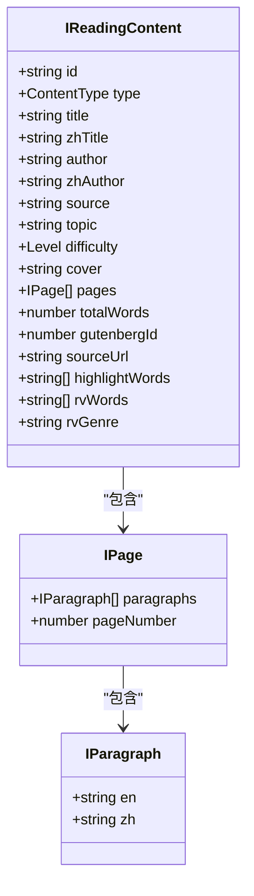

**图表来源**
- [reading.ts:1-83](file://src/data/reading.ts#L1-L83)

### 关键字段语义
| 字段 | 含义 | 使用场景 |
|---|---|---|
| `id` | 内容唯一标识；内置书用古腾堡编号，导入书以 `imp_` 前缀 | 路由、缓存键、删除、进度 |
| `type` | 内容类型，书为 `book` | 区分阅读模式 |
| `title` / `zhTitle` | 原文标题与中文标题 | 书单、标题栏 |
| `source` | 来源标签，如 `Project Gutenberg`、`导入` | 数据溯源 |
| `topic` | 主题分类，如 `literature`、`philosophy`、`imported` | 筛选、路径链 |
| `difficulty` | 难度等级 | 难度筛选 |
| `pages` | 分页后的段落数组 | 翻页渲染 |
| `totalWords` | 词数统计 | 进度百分比 |
| `gutenbergId` | 古腾堡 ID；存在时允许运行时升级为全文 | 全文加载决策 |
| `highlightWords` | 待高亮的复习词 | 阅读器高亮 |
| `rvWords` | 文章使用的复习词汇小写键 | 复习词生成去重 |
| `rvGenre` | 复习文章的体裁 | 重写时保持风格 |

**章节来源**
- [reading.ts:1-83](file://src/data/reading.ts#L1-L83)

## 书籍元数据与清单
内置书有两份元数据：

1. **轻量元数据 `BOOK_META`**：由脚本从 `books.ts` 生成，只包含卡片显示所需字段与预计算的页数、词数。
2. **真实规模清单 `public/books/index.json`**：由 `dump-book-texts.cjs` 对全文重新计数后产出，用于纠正节选词数造成的“每本书看起来一样厚”。

### 元数据结构

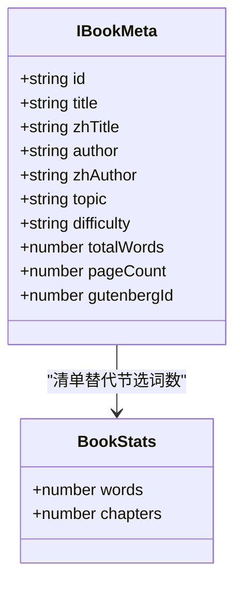

**图表来源**
- [books-meta.ts:1-50](file://src/data/books-meta.ts#L1-L50)
- [book-stats.ts:1-37](file://src/data/book-stats.ts#L1-L37)

### 生成链路
- `gen-books-meta.cjs` 编译 `books.ts`，复用真实 `buildPages` 计算页数，再写出 `books-meta.ts`。
- `dump-book-texts.cjs` 从代理拉取完整原文，清洗后写入 `public/books/<id>.txt`，同时统计词数和章节数，写出 `public/books/index.json`。

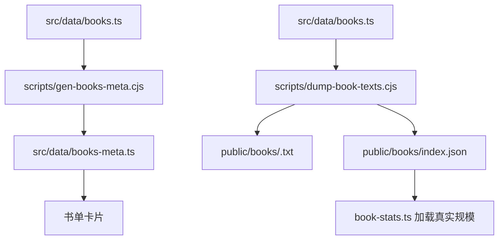

**图表来源**
- [gen-books-meta.cjs:1-105](file://scripts/gen-books-meta.cjs#L1-L105)
- [dump-book-texts.cjs:1-120](file://scripts/dump-book-texts.cjs#L1-L120)
- [books-meta.ts:1-50](file://src/data/books-meta.ts#L1-L50)
- [index.json:1-1](file://public/books/index.json#L1-L1)

**章节来源**
- [books-meta.ts:1-50](file://src/data/books-meta.ts#L1-L50)
- [gen-books-meta.cjs:1-105](file://scripts/gen-books-meta.cjs#L1-L105)
- [dump-book-texts.cjs:1-120](file://scripts/dump-book-texts.cjs#L1-L120)
- [book-stats.ts:1-37](file://src/data/book-stats.ts#L1-L37)
- [index.json:1-1](file://public/books/index.json#L1-L1)

## 全文导入与清洗流程
清洗模块负责把原始英文段落转换为带章节标记的段落序列。它是纯函数，被内置书、全文升级和用户导入共同复用。

### 清洗规则要点
| 规则 | 行为 |
|---|---|
| 跳过古腾堡模板 | 忽略版权信息、Credits、许可证声明等段落 |
| 定位内容起止 | 优先识别 `START OF THE PROJECT GUTENBERG EBOOK` 与 `END OF THE PROJECT GUTENBERG EBOOK` |
| 识别明确章节 | 匹配 `CHAPTER`、`BOOK`、`PART`、`VOLUME`、`LETTER`、`SECTION`、罗马数字、阿拉伯数字、中文“第 x 章”等 |
| 可选全大写小节名 | 当明确章节标记不足 5 个时启用启发式，避免出版社名被误判为章节 |
| 多章节段落拆分 | 单行含多个章节标记时拆出多个 `##CHAPTER##` 条目 |
| 合成章节 | 若无足够章节结构且篇幅较长，按约 3000 词插入合成章节，保证目录可用 |

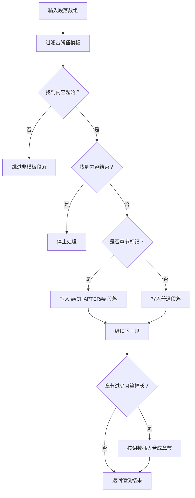

**图表来源**
- [book-clean.ts:1-194](file://src/data/book-clean.ts#L1-L194)

**章节来源**
- [book-clean.ts:1-194](file://src/data/book-clean.ts#L1-L194)

## 阅读分页与加载策略
### 分页算法
`buildPages` 按段落累计英文单词数，超过默认 300 词时切出新页。这样每页通常有 200–400 词，适合移动端一页一屏的阅读节奏。

| 参数 | 默认值 | 说明 |
|---|---:|---|
| `maxWordsPerPage` | 300 | 每页最大英文词数 |
| 分段粒度 | 段落 | 不跨段落切页，避免破坏句子结构 |
| 输出 | `IPage[]` | 每个页面携带序号和段落数组 |

### 内置书加载顺序
1. 首屏使用 `books.ts` 中的压缩节选（每本约 4800 词），避免一次性加载 22 本全集。
2. 打开书籍时调用 `fetchFullBook`，尝试加载随包全文。
3. 成功则替换为完整章节目录和全文；失败则停留在节选，不会静默崩溃。

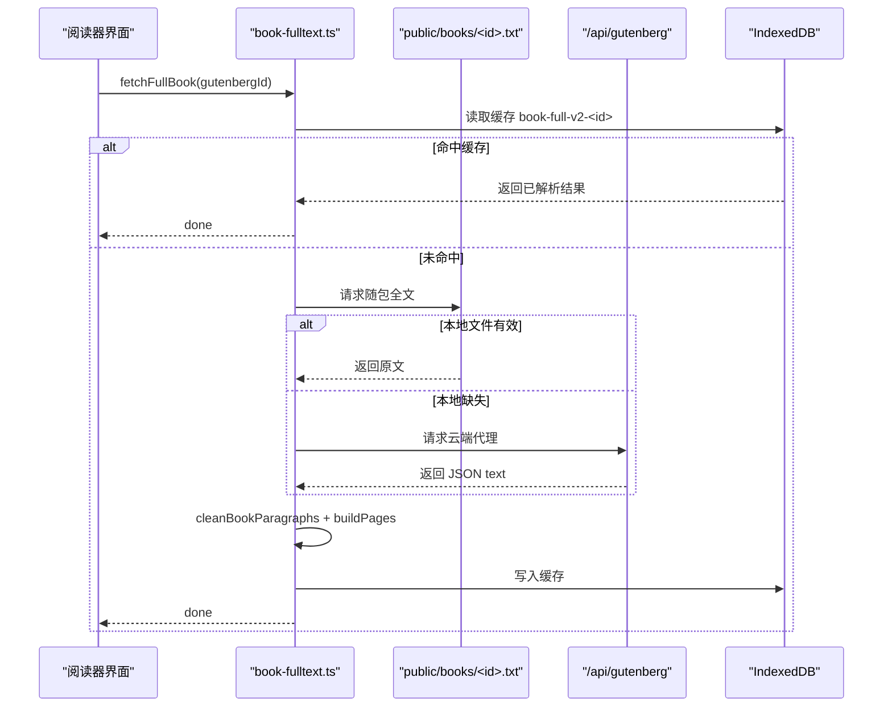

**图表来源**
- [book-fulltext.ts:1-106](file://src/data/book-fulltext.ts#L1-L106)
- [book-clean.ts:1-194](file://src/data/book-clean.ts#L1-L194)
- [idb.ts:1-200](file://src/lib/idb.ts#L1-L200)

**章节来源**
- [reading.ts:1-83](file://src/data/reading.ts#L1-L83)
- [book-fulltext.ts:1-106](file://src/data/book-fulltext.ts#L1-L106)

## 复习词高亮机制
复习词高亮不是静态样式，而是运行时状态：阅读器打开内容时设置当前文章的复习词表，段落渲染时判断是否高亮。

### 高亮流程

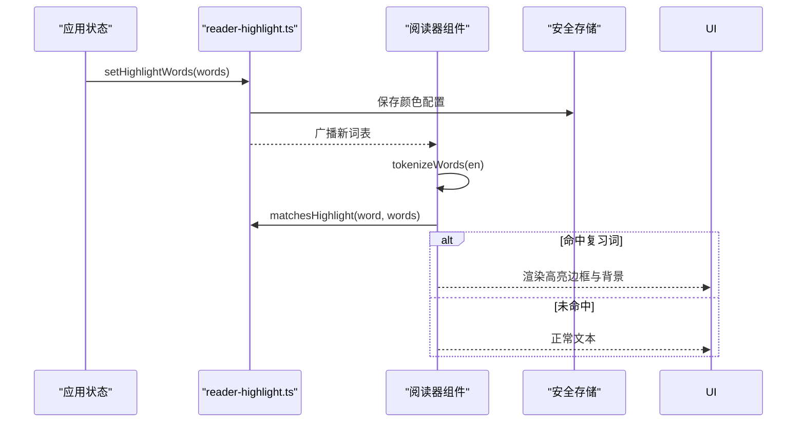

**图表来源**
- [reader-highlight.ts:1-128](file://src/lib/reader-highlight.ts#L1-L128)
- [reading.ts:1-83](file://src/data/reading.ts#L1-L83)

### 匹配策略
- 归一化：仅保留小写字母和连字符，去除复数、时态等后缀差异。
- 保守形态合并：支持常见后缀 `s`、`es`、`ed`、`d`、`ing`、`er`、`est`。
- 辅音重复变形：如 `stop` → `stopped` / `stopping`。
- 不做完整词干化，宁可漏标也不误标，避免干扰阅读体验。

### 颜色与共享状态
- 颜色来自一组柔和配色，默认青绿。
- 通过模块级事件在多个阅读器之间同步颜色与词表。
- 颜色偏好保存在安全存储中。

**章节来源**
- [reader-highlight.ts:1-128](file://src/lib/reader-highlight.ts#L1-L128)
- [reading.ts:1-83](file://src/data/reading.ts#L1-L83)

## 阅读统计与真实规模
`book-stats.ts` 提供两个能力：
- `loadBookStats()`：并发去重地加载 `/books/index.json`。
- `getBookStat(id)`：按书籍 ID 获取真实词数与章节数。

它的职责是修正 `books-meta.ts` 中基于节选的 `totalWords`。例如《基督山伯爵》节选约 4870 词，而真实规模清单记录 460936 词、124 章。

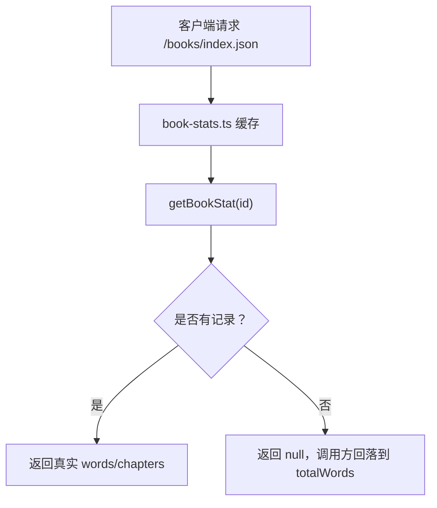

**图表来源**
- [book-stats.ts:1-37](file://src/data/book-stats.ts#L1-L37)
- [index.json:1-1](file://public/books/index.json#L1-L1)

**章节来源**
- [book-stats.ts:1-37](file://src/data/book-stats.ts#L1-L37)
- [index.json:1-1](file://public/books/index.json#L1-L1)

## 用户导入书籍流程
用户导入的英文文本（txt、md、粘贴文本）会转化为标准 `IReadingContent`，从而复用阅读器全部功能。

### 导入数据模型

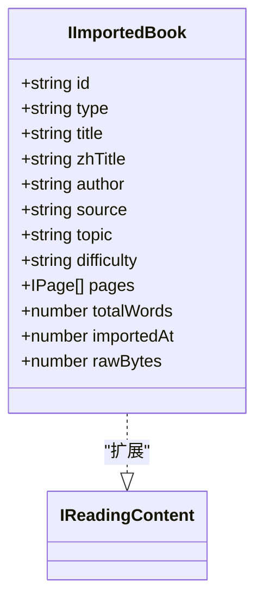

**图表来源**
- [imported-books.ts:1-154](file://src/data/imported-books.ts#L1-L154)
- [reading.ts:1-83](file://src/data/reading.ts#L1-L83)

### 导入步骤
1. 文本按空行切段，单换行合并到段落。
2. 识别章节标题：`chapter`、`part`、`第 x 章/节/回/篇`、罗马数字开头小节等。
3. 若发现章节标记，将对应段落标记为 `##CHAPTER##`。
4. 若没有章节标记且段落较多，按固定词数自动切块并命名。
5. 若首个章节前有前言，补入“前言”章节。
6. 计算词数、调用 `buildPages` 生成页面。
7. 写入 IndexedDB 的 `imported-books-v1` 列表，并按导入时间倒序排列。

### 导入格式规范
| 项目 | 要求 |
|---|---|
| 输入 | 任意英文文本，推荐按自然段落组织 |
| 章节标记 | 推荐使用 `Chapter 1`、`Part II`、`第 1 章` 等清晰标记 |
| 超长行 | 会自动截断，避免单段过长 |
| 空内容 | 解析为空时会抛出错误 |
| 存储位置 | IndexedDB，键 `imported-books-v1` |
| 删除 | 支持按 ID 删除 |

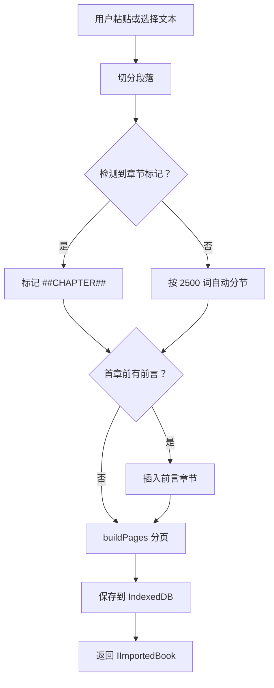

**图表来源**
- [imported-books.ts:1-154](file://src/data/imported-books.ts#L1-L154)
- [reading.ts:1-83](file://src/data/reading.ts#L1-L83)

**章节来源**
- [imported-books.ts:1-154](file://src/data/imported-books.ts#L1-L154)

## 依赖关系与架构总览
内容数据模型的依赖方向是单向的：上层消费下层，脚本层消费源码层。

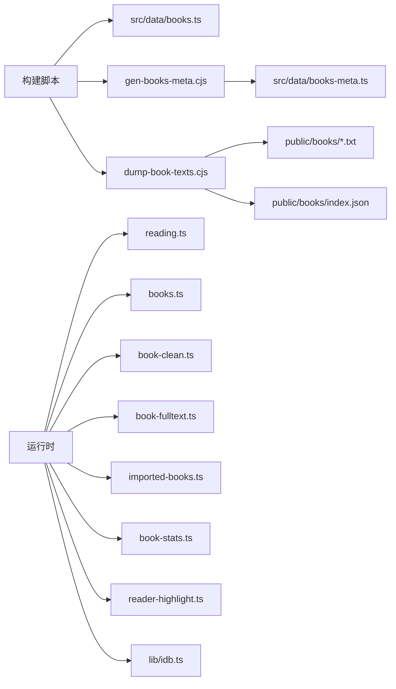

**图表来源**
- [gen-books-meta.cjs:1-105](file://scripts/gen-books-meta.cjs#L1-L105)
- [dump-book-texts.cjs:1-120](file://scripts/dump-book-texts.cjs#L1-L120)
- [books.ts:1-37](file://src/data/books.ts#L1-L37)
- [books-meta.ts:1-50](file://src/data/books-meta.ts#L1-L50)
- [book-fulltext.ts:1-106](file://src/data/book-fulltext.ts#L1-L106)
- [book-clean.ts:1-194](file://src/data/book-clean.ts#L1-L194)
- [imported-books.ts:1-154](file://src/data/imported-books.ts#L1-L154)
- [book-stats.ts:1-37](file://src/data/book-stats.ts#L1-L37)
- [reader-highlight.ts:1-128](file://src/lib/reader-highlight.ts#L1-L128)
- [idb.ts:1-200](file://src/lib/idb.ts#L1-L200)

**章节来源**
- [books.ts:1-37](file://src/data/books.ts#L1-L37)
- [book-fulltext.ts:1-106](file://src/data/book-fulltext.ts#L1-L106)
- [book-clean.ts:1-194](file://src/data/book-clean.ts#L1-L194)
- [imported-books.ts:1-154](file://src/data/imported-books.ts#L1-L154)
- [books-meta.ts:1-50](file://src/data/books-meta.ts#L1-L50)
- [book-stats.ts:1-37](file://src/data/book-stats.ts#L1-L37)
- [reader-highlight.ts:1-128](file://src/lib/reader-highlight.ts#L1-L128)
- [idb.ts:1-200](file://src/lib/idb.ts#L1-L200)

## 性能、内存与分页优化
### 首屏体积控制
- `books.ts` 只内置每本约 4800 词的节选，避免 22 本全集拖垮首屏。
- `books-meta.ts` 由脚本生成，使书单列表无需引入正文。
- 真正全文走 `public/books/<id>.txt` 或运行时网络兜底。

### 全文加载优化
- 随包全文优先，零网络延迟。
- 失败时降级到云端代理。
- 解析结果写入 IndexedDB，键前缀 `book-full-v2-`。
- 并发去重：同一古腾堡 ID 的多次调用共享同一个 Promise。
- 失败时不阻塞主流程，直接返回空结果，由调用方决定回退。

### 分页与内存
- `buildPages` 按段落累加词数，不切分段落内部，减少 DOM 重建。
- 大文本不整体放入 localStorage；导入书籍、全文缓存、媒体资源均使用 IndexedDB。
- 用户导入文本在解析阶段就分批写入段落数组，避免超长字符串堆积。

### 批量处理方法
| 任务 | 方法 | 数据来源 |
|---|---|---|
| 生成书单元数据 | `node scripts/gen-books-meta.cjs` | `src/data/books.ts` |
| 导出随包全文 | `node scripts/dump-book-texts.cjs [id...] [--force]` | 古腾堡代理 |
| 刷新真实规模 | 同上，自动重写 `index.json` | 已落盘全文 |
| 批量导入 | 逐条调用 `importBookFromText` | 用户文本 |
| 批量清理 | 遍历 `loadImportedBooks` 后 `deleteImportedBook` | IndexedDB |

**章节来源**
- [books.ts:1-37](file://src/data/books.ts#L1-L37)
- [books-meta.ts:1-50](file://src/data/books-meta.ts#L1-L50)
- [book-fulltext.ts:1-106](file://src/data/book-fulltext.ts#L1-L106)
- [imported-books.ts:1-154](file://src/data/imported-books.ts#L1-L154)
- [dump-book-texts.cjs:1-120](file://scripts/dump-book-texts.cjs#L1-L120)

## 版本管理、增量更新与冲突处理
### 版本键设计
- 全文缓存键前缀为 `book-full-v2-`。注释明确指出 v2 用随包全文取代联网拉取，因此缓存键换代可以丢弃旧解析结果，避免新旧结构不一致。
- 导入书籍列表键为 `imported-books-v1`，属于稳定键名。
- IndexedDB 数据库名为 `nativethink-wordbank`，版本号为 `2`，并通过对象存储名称隔离不同数据类型。

### 增量更新策略
- 随包全文导出脚本支持增量：已有且大于 5000 字节时跳过，除非传入 `--force`。
- 清单 `index.json` 会在导出过程中补齐跳过的条目，保证后续客户端能读到完整统计。
- 运行时代码对 IndexedDB 写入失败采用静默容错，不阻断阅读流程。

### 冲突与一致性
- 导出脚本会对比译稿章节段数，若不一致给出警告，防止章节错位导致译文贴错。
- 阅读器全文解析先读缓存，再拉网络，最后才解析；解析成功后才写缓存，降低脏数据概率。
- 导入书籍按 `importedAt` 排序，新增放在前面，删除按 ID 精确过滤，避免同名覆盖。

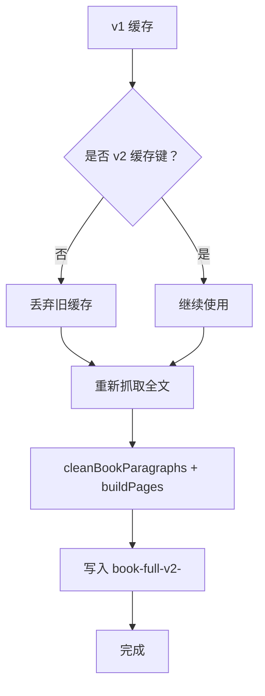

**图表来源**
- [book-fulltext.ts:1-106](file://src/data/book-fulltext.ts#L1-L106)
- [idb.ts:1-200](file://src/lib/idb.ts#L1-L200)
- [dump-book-texts.cjs:1-120](file://scripts/dump-book-texts.cjs#L1-L120)

**章节来源**
- [book-fulltext.ts:1-106](file://src/data/book-fulltext.ts#L1-L106)
- [idb.ts:1-200](file://src/lib/idb.ts#L1-L200)
- [dump-book-texts.cjs:1-120](file://scripts/dump-book-texts.cjs#L1-L120)

## 故障排查
| 现象 | 可能原因 | 排查建议 |
|---|---|---|
| 打开书后章节很少 | 节选文本本身章节少，或随包全文缺失 | 检查 `public/books/<id>.txt` 是否存在 |
| 译文章节错位 | 节选与全文章节结构不一致，且网络回退 | 确保全文成功加载，不要停留在节选 |
| 词数显示异常 | 书单用了节选词数，未加载真实清单 | 确认 `/books/index.json` 可访问 |
| 全文加载慢 | 首次需要拉取并解析全文 | 等待 IndexedDB 缓存命中 |
| 全文解析失败 | 文本太短、HTML 兜底返回、代理不可用 | 检查响应长度、是否为 HTML、代理状态 |
| 导入书无法显示 | 文本为空或无法解析出段落 | 检查输入是否为空白或仅有无效符号 |
| 复习词不高亮 | 词表为空、拼写形态不匹配、颜色配置异常 | 检查 `highlightWords`、`matchesHighlight` 归一化规则 |
| IndexedDB 写入失败 | 配额满或浏览器拒绝 | 查看容量，清理非必要缓存 |

**章节来源**
- [book-fulltext.ts:1-106](file://src/data/book-fulltext.ts#L1-L106)
- [book-stats.ts:1-37](file://src/data/book-stats.ts#L1-L37)
- [imported-books.ts:1-154](file://src/data/imported-books.ts#L1-L154)
- [reader-highlight.ts:1-128](file://src/lib/reader-highlight.ts#L1-L128)
- [idb.ts:1-200](file://src/lib/idb.ts#L1-L200)

## 结论
NativeThink 的内容数据模型以 `IReadingContent` 为中心，把内置节选、运行时全文、清洗切章、用户导入、元数据、统计和高亮统一到一套可测试、可演进的数据结构中。

它的关键设计价值在于：
- 首屏轻量：书单不加载正文。
- 全文可靠：随包优先、网络兜底、IndexedDB 缓存。
- 清洗稳定：纯函数章节识别，兼容多种出版格式。
- 导入通用：用户文本也能获得与内置书一致的阅读体验。
- 统计准确：用真实规模清单修正节选词数。
- 高亮可控：复习词匹配保守、颜色可配、多组件共享状态。

未来可扩展的方向包括：自定义章节边界规则、离线全文校验哈希、导入文本语言检测、以及按阅读进度触发增量章节翻译。这些扩展都应沿用现有分层：先改清洗或解析，再决定是否影响缓存键和统计清单。