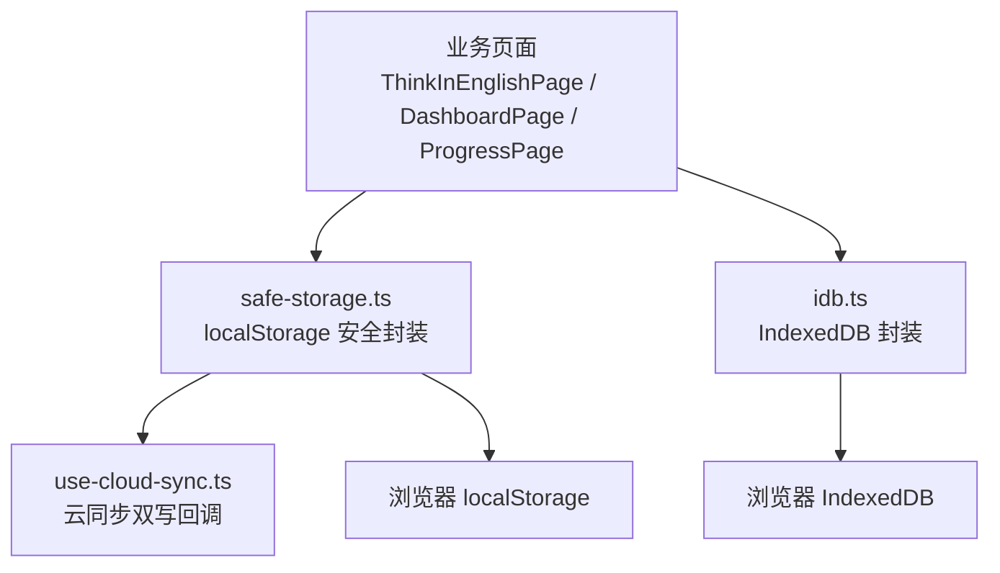
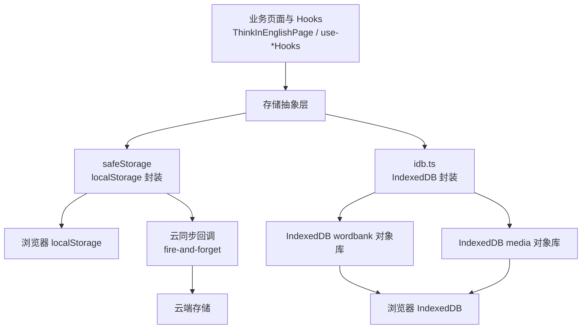
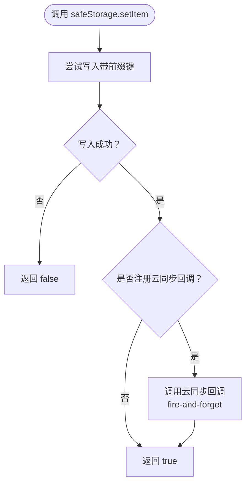
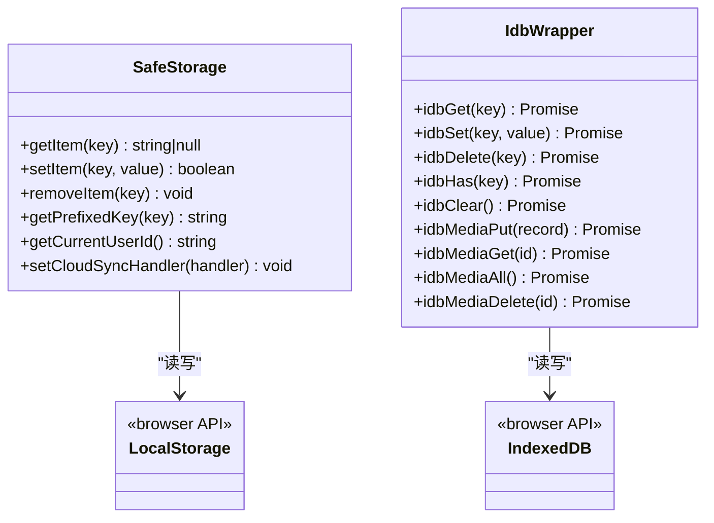
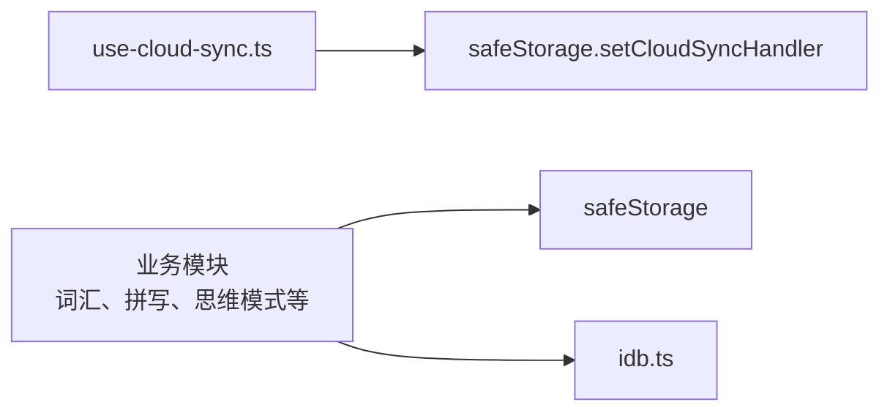

# 存储抽象层

<cite>
**本文引用的文件**   
- [safe-storage.ts](file://src/lib/safe-storage.ts)
- [idb.ts](file://src/lib/idb.ts)
- [use-cloud-sync.ts](file://src/lib/use-cloud-sync.ts)
- [storage-and-stats.md](file://docs/modules/storage-and-stats.md)
</cite>

## 目录
1. [引言](#引言)
2. [项目结构定位](#项目结构定位)
3. [核心组件总览](#核心组件总览)
4. [架构总览](#架构总览)
5. [详细组件分析](#详细组件分析)
6. [依赖关系分析](#依赖关系分析)
7. [性能与容量特征](#性能与容量特征)
8. [使用示例与最佳实践](#使用示例与最佳实践)
9. [故障排查指南](#故障排查指南)
10. [结论](#结论)

## 引言
本文件为 NativeThink 应用的“存储抽象层”提供完整技术文档。该抽象层由两部分组成：

- `safeStorage`：对浏览器 `localStorage` 的安全封装，负责键前缀隔离、用户/应用级数据隔离、旧格式迁移、云同步双写、以及跨标签页可见性。
- `IndexedDB 封装`：对 IndexedDB 的轻量封装，包含数据库连接管理、事务包装、对象库设计（词库键值库与视频媒体库）、批量索引枚举和错误降级。

它们共同构成应用离线数据持久化的基础，并向上暴露稳定的读写接口，让业务模块无需关心底层是内存缓存、`localStorage` 还是 IndexedDB。

## 项目结构定位
存储相关代码位于前端资源目录下的 `src/lib` 中：

**图表来源**
- [safe-storage.ts:1-216](file://src/lib/safe-storage.ts#L1-L216)
- [idb.ts:1-213](file://src/lib/idb.ts#L1-L213)
- [use-cloud-sync.ts](file://src/lib/use-cloud-sync.ts)

**章节来源**
- [safe-storage.ts:1-216](file://src/lib/safe-storage.ts#L1-L216)
- [idb.ts:1-213](file://src/lib/idb.ts#L1-L213)

## 核心组件总览

### safeStorage：localStorage 安全封装
`safeStorage` 暴露一个类似 `Storage` 的 API，但增加了以下能力：

| 能力 | 说明 |
|---|---|
| 键前缀隔离 | 通过 `__miaoda_<appId>_<userId>__:<key>` 避免不同应用、不同用户之间共享数据 |
| 匿名身份恢复 | 若引导键丢失，会从已有键名中尝试恢复匿名 ID，避免历史数据“隐身” |
| 平台用户识别 | 优先读取平台 `_userInfo.user_id` 或 `__PLATFORM_USER__.user_id`，否则回退到匿名 ID |
| 旧格式迁移 | 自动把旧前缀 `__miaoda_<appId>__:<key>` 迁移到新前缀，且记录已迁移键集合避免重复检查 |
| 云同步双写 | 通过 `setCloudSyncHandler` 注册回调，每次写入或删除时向云端触发一次 fire-and-forget 同步 |
| 静默容错 | 大多数 `localStorage` 异常被捕获，`setItem` 返回 `boolean` 表示是否真正写入成功 |
| 调试出口 | 暴露 `getPrefixedKey` 和 `getCurrentUserId`，用于排查实际落盘键和用户标识 |

关键行为要点：

- `getItem(key)`：先尝试迁移旧键，再从新前缀键读取；任何异常返回 `null`。
- `setItem(key, value)`：写入新前缀键，同时可选地触发云同步回调；失败不抛异常，而是返回 `false`，让调用方区分“存下”和“静默丢失”。
- `removeItem(key)`：删除新前缀键，也清理旧前缀键，并通过云同步回调通知删除。
- `clearPrefixCache()`：仅用于测试场景，清空当前会话中的前缀缓存。

**章节来源**
- [safe-storage.ts:1-216](file://src/lib/safe-storage.ts#L1-L216)

### idb.ts：IndexedDB 封装
`idb.ts` 提供两类存储语义：

1. **词库键值库 `wordbank`**  
   - 对象库名称：`wordbank`  
   - keyPath：`key`  
   - 用途：缓存词库数据等结构化文本内容  
   - API：`idbGet`、`idbSet`、`idbDelete`、`idbHas`、`idbClear`

2. **视频媒体库 `media`**  
   - 对象库名称：`MEDIA_STORE = 'media'`  
   - keyPath：`id`  
   - 用途：保存视频精听元数据、字幕及媒体 blob  
   - API：`idbMediaPut`、`idbMediaGet`、`idbMediaAll`、`idbMediaDelete`

重要设计决策：

- 两个库分开：`idbClear()` 只清理词库缓存，不会误删用户导入的视频等不可重算资产。
- 数据库版本：`DB_VERSION = 2`，在 `onupgradeneeded` 中创建 `wordbank` 和 `media` 两个对象库。
- 事务包装器 `withStore`：统一处理打开失败、事务提交状态，对外返回 `{ ok, value }`，避免上层直接面对拒绝 Promise。
- `openDBSafe`：对 `openDB` 做 `.catch(() => null)` 包裹，供媒体列表等“读不到就返回空数组”的场景使用。
- 媒体列表枚举采用游标遍历，逐条推入结果数组，而不是把整个 store 一次性拉入内存后再过滤。

**章节来源**
- [idb.ts:1-213](file://src/lib/idb.ts#L1-L213)

## 架构总览

下图展示 NativeThink 存储抽象层在应用中的整体位置和数据流向：

**图表来源**
- [safe-storage.ts:1-216](file://src/lib/safe-storage.ts#L1-L216)
- [idb.ts:1-213](file://src/lib/idb.ts#L1-L213)
- [use-cloud-sync.ts](file://src/lib/use-cloud-sync.ts)

## 详细组件分析

### safeStorage 实现分析

#### 键前缀与用户隔离策略
safeStorage 的核心思路是把“应用 + 用户”作为命名空间前缀：

- 平台环境：`__miaoda_<appId>_<userId>__:<key>`
- 独立部署环境：`__miaoda___global____<anonId>__:<key>`

这保证了：

- 同一域名下多个应用互不干扰。
- 同一应用中不同用户的数据隔离。
- 同一用户在多会话中始终看到自己的数据。

匿名 ID 生成后保存在专用引导键中；如果引导键被清除，safeStorage 会扫描 localStorage 中已有的带前缀键，尝试从键名中恢复匿名 ID，从而保持历史数据可访问。

#### 旧格式迁移机制
旧键前缀是 `__miaoda_<appId>__:<key>`，新用户隔离引入后需要迁移到带 `userId` 的新前缀。迁移逻辑：

1. 维护 `_migratedKeys` 集合，避免重复检查。
2. 比较新旧全量键名是否相同（用户未变化时可跳过）。
3. 若新键不存在但旧键存在，则复制旧值到新键并删除旧键。
4. 所有 localStorage 操作都包裹 try/catch，防止迁移过程影响主流程。

#### 云同步双写
safeStorage 本身不实现云同步协议，而是通过 `setCloudSyncHandler` 暴露一个回调注册点。当 `setItem` 或 `removeItem` 成功后，会调用注册的云同步处理器：

- 写入：传入 `(key, value)`
- 删除：传入 `(key, null)`

这种设计使 cloud sync 成为“附加能力”，不影响本地存储主路径；同时删除事件也能传播，避免后续同步拉取旧云数据导致“复活”。

#### 错误处理模型
safeStorage 的错误处理偏保守：

- `getItem`：任何异常返回 `null`。
- `setItem`：捕获配额不足、隐私模式等异常，返回 `false`。
- `removeItem`：忽略内部清理旧键时的异常。
- 云同步回调是 fire-and-forget，异常不会回传到调用方。

这意味着上层必须检查 `setItem` 返回值，而不能假定它一定成功。

**图表来源**
- [safe-storage.ts:140-216](file://src/lib/safe-storage.ts#L140-L216)

**章节来源**
- [safe-storage.ts:1-216](file://src/lib/safe-storage.ts#L1-L216)

### idb.ts 实现分析

#### 数据库连接管理
`openDB` 是 IndexedDB 入口：

- 首次调用创建 Promise，后续复用 `dbInstance` 单例。
- `onupgradeneeded` 中创建 `wordbank` 和 `media` 两个对象库。
- 失败时 reject，由外层包装决定如何处理。

`openDBSafe` 是安全版：打开失败返回 `null`，适用于“没有数据库也能继续运行”的场景，例如媒体列表初始化。

#### 事务包装器 withStore
`withStore(store, mode, run)` 统一封装事务生命周期：

- 打开数据库。
- 创建事务。
- 执行传入的 `run` 函数获取请求。
- 以 `tx.oncomplete` 作为提交成功的依据。
- `onerror`、`onabort` 或 catch 分支返回 `{ ok: false, value: null }`。

这使得上层不必分别处理 request 成功、事务提交成功、事务失败等三种状态。

#### 媒体库设计
媒体库是 v2 新增的对象库，用于视频精听：

- 记录结构至少包含 `id`。
- 可能包含大体积 blob。
- `idbMediaAll` 使用游标遍历，逐步收集轻量索引，避免一次性把所有媒体加载进内存。
- `idbMediaPut` 返回布尔值，明确告诉调用方是否写入成功。

#### 词库键值库
词库对象库是简单 KV 结构，每条记录形如 `{ key, value, timestamp }`：

- `idbSet`：put 一条记录。
- `idbGet`：根据 key 查询。
- `idbDelete`：删除 key。
- `idbHas`：通过 count 判断是否存在。
- `idbClear`：清空整个 wordbank 对象库。

注意：`idbGet`、`idbSet`、`idbDelete`、`idbHas`、`idbClear` 在底层 Promise reject 时通常转换为静默失败或返回默认值，这与 `withStore` 返回 `{ ok, value }` 的语义略有不同，使用时要注意区别。

**图表来源**
- [safe-storage.ts:140-216](file://src/lib/safe-storage.ts#L140-L216)
- [idb.ts:1-213](file://src/lib/idb.ts#L1-L213)

**章节来源**
- [idb.ts:1-213](file://src/lib/idb.ts#L1-L213)

## 依赖关系分析

safeStorage 与云同步模块之间存在弱耦合：cloud sync 通过 `setCloudSyncHandler` 注入回调，而不是直接 import safeStorage 的内部状态。这样既允许业务侧决定是否开启云同步，也避免循环依赖。

idb.ts 是相对独立的底层封装，不反向依赖 safeStorage。

**图表来源**
- [safe-storage.ts:120-160](file://src/lib/safe-storage.ts#L120-L160)
- [use-cloud-sync.ts](file://src/lib/use-cloud-sync.ts)

**章节来源**
- [safe-storage.ts:1-216](file://src/lib/safe-storage.ts#L1-L216)
- [idb.ts:1-213](file://src/lib/idb.ts#L1-L213)

## 性能与容量特征

### localStorage 特性
- 容量限制：通常为每个源约 5MB，具体取决于浏览器。
- 同步阻塞：`localStorage` 操作是同步的，不适合大对象或高频写入。
- 跨标签页可见：同一源的 `localStorage` 在所有标签页共享，因此 safeStorage 天然具备跨标签页数据可见性。
- 序列化成本：safeStorage 的键值是字符串，适合小配置、小状态；不适合频繁序列化大 JSON。

### IndexedDB 特性
- 容量更大：通常是几十 MB 到几百 MB，甚至更多，适合词库缓存、视频媒体等大体积数据。
- 异步非阻塞：基于 Promise 和事务，不会阻塞主线程。
- 对象库分离：词库缓存与视频媒体分开，降低误清风险。
- 媒体枚举优化：`idbMediaAll` 使用游标，逐条收集结果，避免一次性加载全部 blob。

### 选择策略与降级机制

| 场景 | 推荐介质 | 原因 |
|---|---|---|
| 小配置、设置项、用户标识 | safeStorage | 轻量、跨标签页可见、API 简单 |
| 词库缓存、结构化数据 | IndexedDB wordbank | 容量更大、异步、支持复杂对象 |
| 视频、字幕、媒体 blob | IndexedDB media | 原生支持 blob，避免 JSON 序列化开销 |
| localStorage 写入失败 | 上层应降级 | safeStorage.setItem 返回 false，上层可选择提示或重试 |
| IndexedDB 不可用 | 静默降级 | idb 多数方法捕获异常并返回默认值 |

需要注意：仓库中没有统一的“自动从 localStorage 降级到 IndexedDB”调度器；选择通常由调用方决定。例如：

- 小数据用 safeStorage。
- 大数据或媒体用 idb.ts。
- 如果需要两者结合，应由业务层协调，例如先用 safeStorage 存配置，再用 idb.ts 存数据。

**章节来源**
- [safe-storage.ts:1-216](file://src/lib/safe-storage.ts#L1-L216)
- [idb.ts:1-213](file://src/lib/idb.ts#L1-L213)
- [storage-and-stats.md](file://docs/modules/storage-and-stats.md)

## 使用示例与最佳实践

### 基本读写示例

- 读取配置：调用 `safeStorage.getItem('key')`，返回字符串或 `null`。
- 写入配置：调用 `safeStorage.setItem('key', value)`，并检查返回值是否为 `true`。
- 删除配置：调用 `safeStorage.removeItem('key')`。
- 读取词库缓存：调用 `idbGet<T>('key')`。
- 写入词库缓存：调用 `idbSet<T>('key', value)`。
- 删除词库缓存：调用 `idbDelete('key')`。
- 判断词库缓存是否存在：调用 `idbHas('key')`。
- 清空词库缓存：调用 `idbClear()`。

### 批量处理建议

- 对于大量 safeStorage 写入：分批执行，并在失败时检查返回值，必要时暂停写入并提示用户。
- 对于大量 IndexedDB 写入：尽量复用同一个事务；避免在高频 UI 事件中直接触发多次事务。
- 对于媒体列表：使用 `idbMediaAll`，不要自行将整个对象库映射成内存数组后再过滤。

### 错误恢复策略

- safeStorage：
  - 如果 `setItem` 返回 `false`，应视为写入失败。
  - 可提示用户存储空间不足，或暂时禁用自动保存。
  - 不要假设 `null` 一定是“没有数据”，也可能是 storage 不可用。
- IndexedDB：
  - 对 `idbMediaPut` 等返回布尔值的 API，必须检查是否写入成功。
  - 对返回 Promise 的 API，建议在调用处增加 fallback，例如回退到内存缓存或提示用户。

### 云同步集成

- 通过 `safeStorage.setCloudSyncHandler(handler)` 注册回调。
- 在用户登录后启用，登出后传入 `null` 关闭。
- 回调中应实现幂等写入：同一 key/value 多次写入不应造成脏数据。
- 删除操作也要传 `null`，避免云端旧数据重新覆盖本地。

**章节来源**
- [safe-storage.ts:120-216](file://src/lib/safe-storage.ts#L120-L216)
- [idb.ts:1-213](file://src/lib/idb.ts#L1-L213)

## 故障排查指南

### 常见问题一：存储配额不足

**现象**

- `safeStorage.setItem` 返回 `false`。
- 刷新后部分本地数据消失。
- 某些功能无法保存进度。

**排查步骤**

1. 检查 `safeStorage.setItem` 返回值。
2. 使用 `safeStorage.getPrefixedKey('key')` 查看实际键名，确认是否被前缀隔离。
3. 检查浏览器隐私模式或第三方 Cookie 阻止策略。
4. 清理不必要的 localStorage 键，或减少单次写入体积。
5. 将大对象迁移到 IndexedDB。

**根因**

- localStorage 容量有限。
- 隐私模式或浏览器安全策略禁止写入。
- 大对象序列化后超过限额。

**解决方案**

- 对关键小配置保留 localStorage。
- 对大体积数据使用 idb.ts。
- 对写入失败做用户提示和降级。

**章节来源**
- [safe-storage.ts:160-216](file://src/lib/safe-storage.ts#L160-L216)

### 常见问题二：历史数据“看起来丢失”

**现象**

- 升级或清理部分 localStorage 后，之前保存的用户数据不再出现。

**排查步骤**

1. 检查匿名 ID 引导键是否存在。
2. 查看是否有残留的旧前缀键。
3. 确认是否触发了匿名 ID 重建。

**根因**

- 匿名 ID 引导键丢失。
- 旧前缀数据仍存在，但新键找不到。

**解决方案**

- safeStorage 已内置 `recoverAnonIdFromStorage`，会尝试从既有键恢复匿名 ID。
- 若仍失败，可考虑导出备份后重新导入。
- 避免手动清理 `__miaoda_*` 开头的键。

**章节来源**
- [safe-storage.ts:1-60](file://src/lib/safe-storage.ts#L1-L60)

### 常见问题三：跨标签页数据不一致

**现象**

- 一个标签页修改了数据，另一个标签页未及时反映。

**排查步骤**

1. 确认双方使用的是同一个域名和协议。
2. 确认没有使用不同的 appId 或 userId。
3. 检查是否通过 `setCloudSyncHandler` 实现了云同步。

**根因**

- localStorage 在同一源内共享，理论上数据可见。
- 但如果用户切换账号或应用隔离前缀不同，键名不同，数据自然不可见。
- 若业务期望实时同步，仅靠 localStorage 不够，应配合云同步或 `storage` 事件。

**解决方案**

- 确保用户标识和应用标识一致。
- 如需强一致性，使用云同步。
- 如需浏览器内实时同步，可在 `storage` 事件监听中刷新 UI。

**章节来源**
- [safe-storage.ts:1-120](file://src/lib/safe-storage.ts#L1-L120)

### 常见问题四：IndexedDB 不可用或写入失败

**现象**

- 词库缓存不生效。
- 视频媒体无法保存。
- 某些页面数据为空。

**排查步骤**

1. 检查浏览器是否支持 IndexedDB。
2. 检查存储空间配额。
3. 检查对象库是否正确创建。
4. 检查 `idbMediaPut` 是否返回 `false`。
5. 检查是否调用了 `idbClear` 误清数据。

**根因**

- 浏览器禁用 IndexedDB。
- 存储空间不足。
- 对象库尚未创建或升级失败。
- 媒体体积过大导致写入失败。

**解决方案**

- 对媒体写入失败做用户提示。
- 避免在缓存清理流程中误删媒体库。
- 使用 `idbMediaAll` 时注意内存占用。
- 对关键路径增加降级逻辑，例如回退到网络加载或内存缓存。

**章节来源**
- [idb.ts:1-213](file://src/lib/idb.ts#L1-L213)

### 常见问题五：云同步导致数据“复活”

**现象**

- 本地删除了某条数据，但之后又出现。

**排查步骤**

1. 检查是否启用了云同步。
2. 检查删除操作是否触发了云同步回调。
3. 检查云端是否保留了旧数据。

**根因**

- 本地删除未同步到云端。
- 后续同步拉取时覆盖了本地删除。

**解决方案**

- 确保 `safeStorage.removeItem` 触发云同步回调，传入 `null`。
- 在云端实现删除事件或软删除标记。
- 避免无差别全量覆盖式同步。

**章节来源**
- [safe-storage.ts:160-216](file://src/lib/safe-storage.ts#L160-L216)

## 结论
NativeThink 的存储抽象层通过 safeStorage 和 idb.ts 提供了两层互补的持久化能力：

- safeStorage 提供轻量、跨标签页可见、带用户隔离和云同步能力的 localStorage 封装。
- idb.ts 提供大容量、异步、对象库分离的 IndexedDB 封装，特别适合词库缓存和视频媒体。

在实际使用中，应避免把大对象塞进 localStorage，也不要假设 safeStorage 的写入一定成功；对于 IndexedDB，要区分 `withStore` 的 `{ ok, value }` 语义和普通 Promise API 的静默降级语义。对于跨标签页、多用户、多应用的数据一致性，应以“键前缀隔离 + 云同步”作为主要保障手段。