# 学习数据模型

<cite>
**本文引用的文件**   
- [chunks.ts](file://src/data/chunks.ts)
- [chunks-extra.ts](file://src/data/chunks-extra.ts)
- [chunk-dedupe.ts](file://src/lib/chunk-dedupe.ts)
- [ChunkTrainingPage.tsx](file://src/pages/ChunkTrainingPage/ChunkTrainingPage.tsx)
- [think-patterns.ts](file://src/data/think-patterns.ts)
- [sentence-lab.ts](file://src/data/sentence-lab.ts)
- [sentence-lab-auto.ts](file://src/data/sentence-lab-auto.ts)
- [sentence-lab-extra.ts](file://src/data/sentence-lab-extra.ts)
- [shadowing.ts](file://src/data/shadowing.ts)
- [shadowing-progress.ts](file://src/lib/shadowing-progress.ts)
- [speech-analysis.ts](file://src/lib/speech-analysis.ts)
- [storage-and-stats.md](file://docs/modules/storage-and-stats.md)
</cite>

## 目录

1. [引言](#引言)
2. [项目结构](#项目结构)
3. [核心模型总览](#核心模型总览)
4. [语块（chunks）模型](#语块chunks模型)
5. [思维模式（think-patterns）模型](#思维模式think-patterns模型)
6. [句子学习（sentence-lab）模型](#句子学习sentence-lab模型)
7. [影子跟读（shadowing）模型](#影子跟读shadowing模型)
8. [模型关联与数据流转](#模型关联与数据流转)
9. [CRUD 操作示例与查询模式](#crud-操作示例与查询模式)
10. [学习进度持久化与状态管理](#学习进度持久化与状态管理)
11. [数据质量检查方法](#数据质量检查方法)
12. [异常数据处理方案](#异常数据处理方案)
13. [性能与可维护性建议](#性能与可维护性建议)
14. [结论](#结论)

## 引言

NativeThink 的学习数据模型围绕四个模块组织：**语块、思维模式、句子学习和影子跟读**。它们共同承担输入材料定义、交互判定、练习队列和进度记录职责，但各自的数据形态差异很大：

- **语块**是短语级词条库，强调分类、难度、例句和记忆状态。
- **思维模式**是认知层训练题，强调识别选项、迁移场景和四层能力维度。
- **句子学习**是长句理解语料，强调意群切分、主干标注和三步读句法。
- **影子跟读**是音频跟练题库，强调原句、重读标注、翻译、时长和完成标记。

这些模型大多以 TypeScript 接口加常量数组的形式存在于 `src/data`，由页面组件消费；学习进度则通过本地存储（localStorage / IndexedDB / safeStorage）持久化，并由统计模块汇总到今日学习时长、连续天数和学习模块进度环中。

## 项目结构

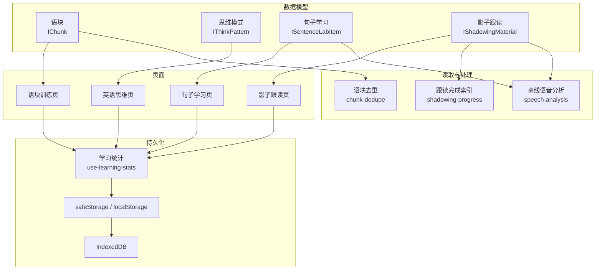

**图表来源**
- [chunks.ts:1-15](file://src/data/chunks.ts#L1-L15)
- [think-patterns.ts:1-70](file://src/data/think-patterns.ts#L1-L70)
- [sentence-lab.ts:1-40](file://src/data/sentence-lab.ts#L1-L40)
- [shadowing.ts:1-15](file://src/data/shadowing.ts#L1-L15)
- [chunk-dedupe.ts:1-76](file://src/lib/chunk-dedupe.ts#L1-L76)
- [shadowing-progress.ts:1-85](file://src/lib/shadowing-progress.ts#L1-L85)
- [speech-analysis.ts:1-40](file://src/lib/speech-analysis.ts#L1-L40)
- [storage-and-stats.md:1-40](file://docs/modules/storage-and-stats.md#L1-L40)

**章节来源**
- [storage-and-stats.md:1-40](file://docs/modules/storage-and-stats.md#L1-L40)

## 核心模型总览

| 模型 | 主要文件 | 核心实体 | 关键属性 | 难度体系 | 主要用途 |
|---|---|---|---|---|---|
| 语块 | `src/data/chunks.ts`、`src/data/chunks-extra.ts` | `IChunk` | `id`、`content`、`meaning`、`category`、`usage`、`example`、`difficulty` | 初学、中级、高级 | 短语替换、接龙造句、闪卡复习 |
| 思维模式 | `src/data/think-patterns.ts` | `IThinkPattern` | `layer`、`name`、`contrast`、`cues`、`recognition`、`transfer` | 四层能力 + 初/中/高（外部使用） | 母语思维识别、表达迁移、AI 判分 |
| 句子学习 | `src/data/sentence-lab.ts` | `ISentenceLabItem`、`ISentenceSegment` | `en`、`zh`、`level`、`tip`、`backboneGloss`、`segments` | 初学、中级、高级 | 找动词、定主干、切意群 |
| 影子跟读 | `src/data/shadowing.ts` | `IShadowingMaterial`、`IShadowingSentence` | `title`、`category`、`difficulty`、`accent`、`sentences` | 初学、中级、高级 | 听读、录音评分、节奏音量音高分析 |

**章节来源**
- [chunks.ts:1-15](file://src/data/chunks.ts#L1-L15)
- [think-patterns.ts:1-70](file://src/data/think-patterns.ts#L1-L70)
- [sentence-lab.ts:1-40](file://src/data/sentence-lab.ts#L1-L40)
- [shadowing.ts:1-15](file://src/data/shadowing.ts#L1-L15)

## 语块（chunks）模型

### 数据结构

语块的核心类型是 `IChunk`，字段语义如下：

| 字段 | 类型 | 含义 |
|---|---|---|
| `id` | 字符串 | 语块唯一标识，主库为 `c1`…`c748`，扩容库为 `cx*` |
| `content` | 字符串 | 英文短语或固定搭配 |
| `meaning` | 字符串 | 中文释义 |
| `category` | 枚举 | 主题分类，包括日常、职场、社交、情感、旅行、科技、食物、健康、学习、购物、运动 |
| `usage` | 字符串 | 使用场景说明 |
| `example` | 字符串 | 英文例句 |
| `exampleZh` | 可选字符串 | 例句中文翻译 |
| `introduction` | 可选字符串 | 语块用法介绍 |
| `difficulty` | 枚举 | 初学、中级、高级 |

语块库由两部分组成：

1. **主库**：`MOCK_CHUNKS_BASE`，约 748 条，按生成脚本整体写入。
2. **扩容库**：`CHUNKS_EXTRA`，约 215 条，补齐旅行、学习、科技、食物、健康、购物、运动等分类。

最终导出池包含两者合并结果，并在读取层按短语内容去重，得到约 951 条显示口径。

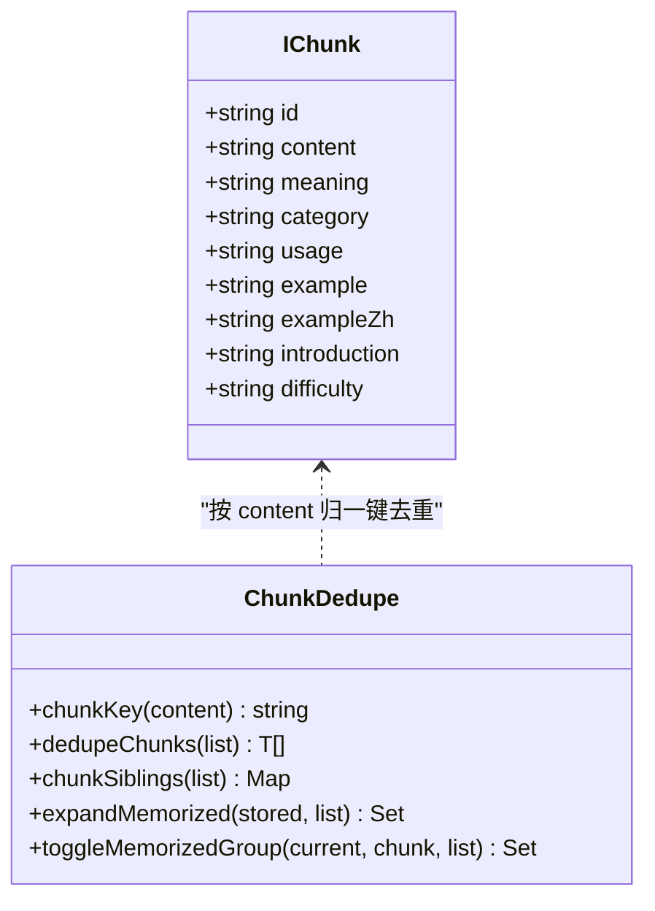

**图表来源**
- [chunks.ts:1-15](file://src/data/chunks.ts#L1-L15)
- [chunk-dedupe.ts:1-76](file://src/lib/chunk-dedupe.ts#L1-L76)

### 接龙判定逻辑

语块接龙在语块训练页中实现，流程大致如下：

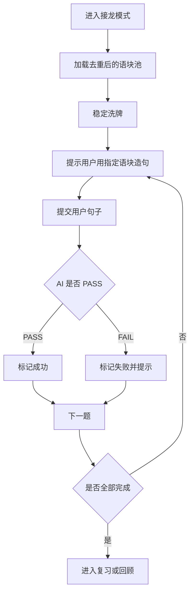

**图表来源**
- [ChunkTrainingPage.tsx:600-720](file://src/pages/ChunkTrainingPage/ChunkTrainingPage.tsx#L600-L720)
- [chunks.ts:1-15](file://src/data/chunks.ts#L1-L15)

接龙的关键约束来自文档和页面实现：

- 用户必须使用当前题目指定的语块内容造句。
- 判定由 AI 执行，返回 PASS 或 FAIL。
- 答错会触发即时巩固：错误语块会在间隔若干张后再次出现。
- 每轮复习打分会调用学习统计，计入模块学习时长。

### 去重与兄弟关系

语块存在同一短语登记多次的问题，例如同一个短语同时属于“日常”和“职场”。代码选择**读取层去重**而非删除源数据，原因是：

- 删除条目会让已记的 `id` 失效。
- 删除会丢失另一条例句。
- 删除会破坏分类筛选语义。

去重逻辑集中在 `chunk-dedupe.ts`：

| 函数 | 作用 |
|---|---|
| `chunkKey` | 将短语归一化为小写、压缩空白、统一撇号后的键 |
| `dedupeChunks` | 保留首次出现的同义短语 |
| `chunkSiblings` | 把同一短语的所有 `id` 映射成兄弟列表 |
| `expandMemorized` | 把历史已记集合扩展为兄弟 `id` |
| `toggleMemorizedGroup` | 切换一个语块时同步所有兄弟 `id` |

**章节来源**
- [chunks.ts:1-15](file://src/data/chunks.ts#L1-L15)
- [chunks-extra.ts:1-93](file://src/data/chunks-extra.ts#L1-L93)
- [chunk-dedupe.ts:1-76](file://src/lib/chunk-dedupe.ts#L1-L76)
- [ChunkTrainingPage.tsx:600-720](file://src/pages/ChunkTrainingPage/ChunkTrainingPage.tsx#L600-L720)

## 思维模式（think-patterns）模型

### 十二种模式与三层难度

思维模式的核心类型是 `IThinkPattern`，每个模式描述一种从中文思维到英语表达的转换规则。它包含以下结构：

| 字段 | 含义 |
|---|---|
| `id` | 模式标识 |
| `layer` | 能力维度 |
| `name` | 模式名称 |
| `oneLiner` | 一句话总结 |
| `contrast` | 中文思维、地道表达、注释 |
| `cues` | 判断线索 |
| `recognition` | 识别选择题 |
| `transfer` | 表达迁移题 |

模式分为四个能力维度：

| 维度 | 含义 |
|---|---|
| `structure` | 信息结构：谁在前、什么在后、指代是否补全 |
| `verb` | 动词与焦点：动作由谁承担、结果如何落在句子里 |
| `clarity` | 逻辑与信息：关系是否明说、断言力度、细节是否足够 |
| `pragmatics` | 语域与语用：正式度、面子、请求拒绝赞美等默认脚本 |

目前仓库中至少包含“让主语站出来”“把动作还给动词”等模式，每个模式配有多个识别题和迁移题。

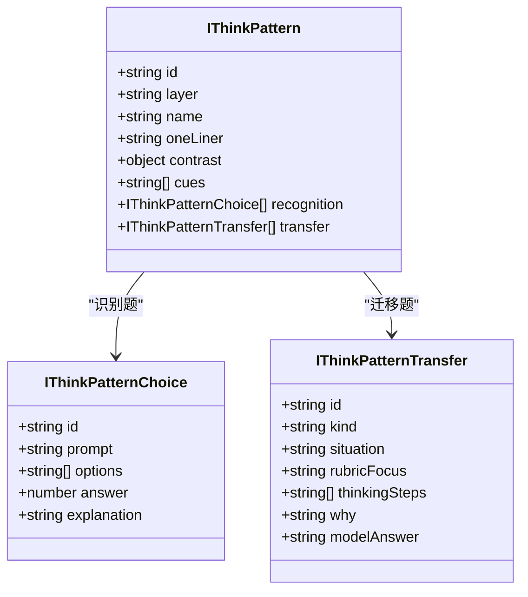

**图表来源**
- [think-patterns.ts:1-70](file://src/data/think-patterns.ts#L1-L70)

### 三层难度体系

虽然 `IThinkPattern` 本身没有 `difficulty` 字段，但应用整体仍沿用初学、中级、高级的难度语义：

- **初学**：适合刚接触英语母语表达习惯的用户，侧重主语位置、基础动词驱动。
- **中级**：需要识别从句、名词化和更复杂的语用差异。
- **高级**：涉及语域、语用策略和复杂语境下的自然表达。

这个难度通常由外部学习系统或 UI 展示层决定，而不是由模式对象自身声明。

### 识别与迁移

每个模式提供两类练习：

1. **识别题**：给出中文意图，让用户从三个英文选项中选最自然的表达。
2. **迁移题**：给出中文情境，要求用户写出地道英文，并可结合 AI 反馈。

迁移题还包含 `thinkingSteps`，引导用户先想“谁做动作”“动作是什么”“对象和时间”，再组织英文句子。

**章节来源**
- [think-patterns.ts:1-200](file://src/data/think-patterns.ts#L1-L200)

## 句子学习（sentence-lab）模型

### 语料结构

句子学习的核心类型是 `ISentenceLabItem`，表示一句带标注的长句：

| 字段 | 含义 |
|---|---|
| `id` | 句子标识 |
| `en` | 英文原句 |
| `zh` | 中文翻译 |
| `source` | 出处，如书籍名或演讲名 |
| `level` | 难度等级 |
| `tip` | 阅读提示 |
| `backboneGloss` | 主干释义 |
| `auto` | 是否自动生成 |
| `segments` | 意群切分 |

每个意群是 `ISentenceSegment`，包含：

| 字段 | 含义 |
|---|---|
| `t` | 原文片段 |
| `r` | 角色：主干、修饰、连接 |
| `note` | 揭晓时显示的语法说明 |

语料由三部分合并：

| 来源 | 数量 | 说明 |
|---|---:|---|
| `SENTENCE_LAB_BOOKS` | 24 句 | 手写标注，来自公版书 |
| `SENTENCE_LAB_EXTRA` | 12 句 | 手写标注，来自演讲 |
| `SENTENCE_LAB_AUTO` | 122 句 | 脚本生成，自动标注 |

总计约 158 句。

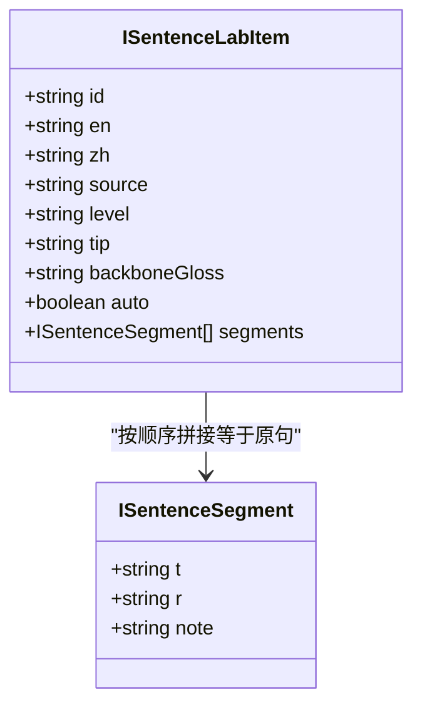

**图表来源**
- [sentence-lab.ts:1-40](file://src/data/sentence-lab.ts#L1-L40)

### 意群标注与三步读句法

句子学习强调“先抓主干，再把修饰挂回去”。三步读句法定义为：

1. **找动词**：找出谓语动词，判断有几个小句子。
2. **定主干**：回答“谁做了什么”，其余都是修饰。
3. **切意群**：按介词短语、从句、非谓语等边界切分。

运行时，页面根据 `segments` 逐块定位字符区间，而不是直接拼接文本，因为拼接会丢失标点归属和空格。

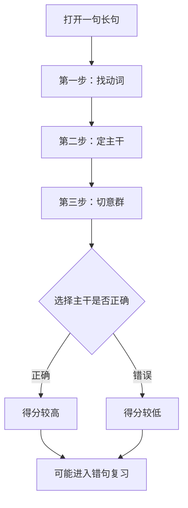

**图表来源**
- [sentence-lab.ts:1-40](file://src/data/sentence-lab.ts#L1-L40)
- [sentence-lab-auto.ts:1-80](file://src/data/sentence-lab-auto.ts#L1-L80)

### 自动生成语料的校验

自动标注语料由生成脚本产出，不能手改。生成器对每条语料进行结构校验：

- 每个意群必须能在原句中按顺序逐字定位。
- 必须有主干。
- 译文和阅读提示齐全。
- 原文未经模型改写。

校验失败的句子不会写入自动语料。

**章节来源**
- [sentence-lab.ts:1-200](file://src/data/sentence-lab.ts#L1-L200)
- [sentence-lab-auto.ts:1-80](file://src/data/sentence-lab-auto.ts#L1-L80)
- [sentence-lab-extra.ts:1-80](file://src/data/sentence-lab-extra.ts#L1-L80)

## 影子跟读（shadowing）模型

### 题库结构

影子跟读的核心类型是 `IShadowingMaterial` 和 `IShadowingSentence`：

| 字段 | 含义 |
|---|---|
| `id` | 材料标识 |
| `title` | 标题 |
| `category` | 类别：日常、演讲、故事 |
| `difficulty` | 难度 |
| `accent` | 口音：美式、英式 |
| `totalDuration` | 总时长 |
| `description` | 描述 |
| `sentences` | 句子数组 |

句子字段：

| 字段 | 含义 |
|---|---|
| `id` | 句子标识 |
| `text` | 原文 |
| `annotatedText` | 带重读标注的原文 |
| `translation` | 中文翻译 |
| `duration` | 预估时长 |

题库覆盖日常对话、商务邮件、看病预约、问路、租房、银行开户、励志演讲、TED、新闻播报、毕业典礼等场景。

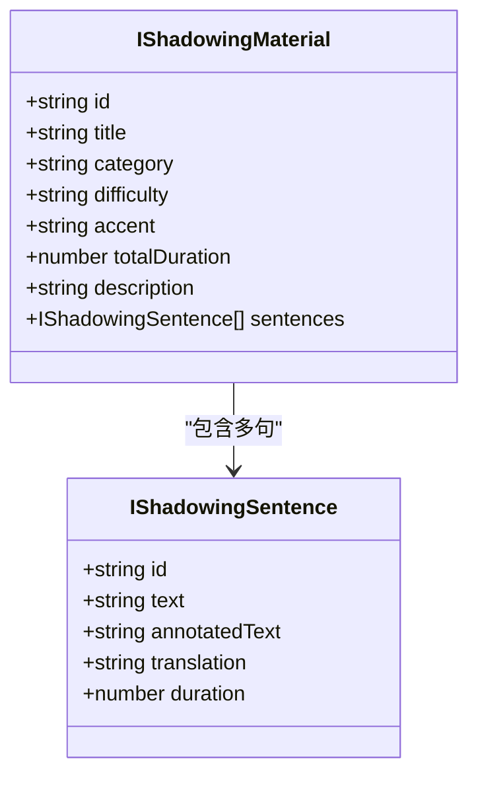

**图表来源**
- [shadowing.ts:1-15](file://src/data/shadowing.ts#L1-L15)

### 评分标准

影子跟读评分采用两条路线：

| 路线 | 方式 | 输出 |
|---|---|---|
| 在线词级 | 录音转 WAV → ASR 转写 → 比对原文 | 命中率、漏词、语速 |
| 本地兜底 | 离线波形分析 | 语速、音量、爆音、停顿、音高趋势 |

评分不声称音素发音评测；界面明确说明评分基于转写文本。

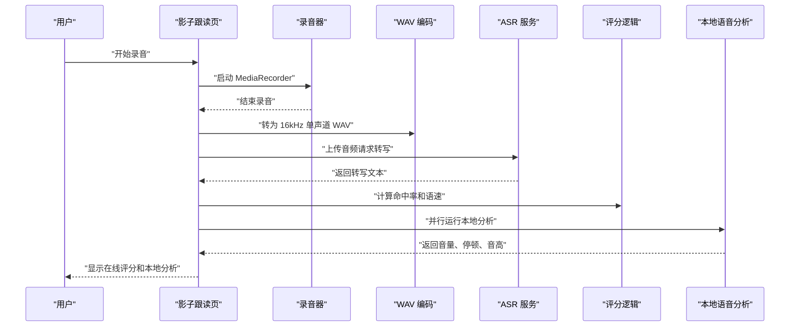

**图表来源**
- [shadowing.ts:1-125](file://src/data/shadowing.ts#L1-L125)
- [speech-analysis.ts:1-120](file://src/lib/speech-analysis.ts#L1-L120)

### 完成标记与索引问题

影子跟读的最大风险之一是“合并数组索引”和“追加句本地索引”不一致。解决方式是抽取纯函数 `shadowing-progress.ts`：

| 函数 | 作用 |
|---|---|
| `shadowingCompletionKey` | 构造 `${语料id}-${合并索引}` 的完成键 |
| `parseCompletionIndex` | 从键解析出数字索引 |
| `countCompletedForCorpus` | 只统计某语料的完成数 |
| `isSentenceCompleted` | 判断某句是否已完成 |
| `shiftCompletionAfterDelete` | 删除句后平移后续完成键 |
| `extrasLocalIndex` | 合并索引换算为追加句本地索引 |

**章节来源**
- [shadowing.ts:1-125](file://src/data/shadowing.ts#L1-L125)
- [shadowing-progress.ts:1-85](file://src/lib/shadowing-progress.ts#L1-L85)
- [speech-analysis.ts:1-120](file://src/lib/speech-analysis.ts#L1-L120)

## 模型关联与数据流转

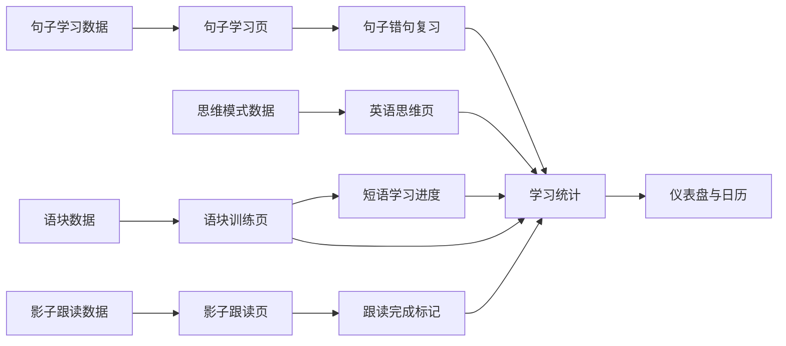

**图表来源**
- [chunks.ts:1-15](file://src/data/chunks.ts#L1-L15)
- [think-patterns.ts:1-70](file://src/data/think-patterns.ts#L1-L70)
- [sentence-lab.ts:1-40](file://src/data/sentence-lab.ts#L1-L40)
- [shadowing.ts:1-15](file://src/data/shadowing.ts#L1-L15)
- [storage-and-stats.md:1-40](file://docs/modules/storage-and-stats.md#L1-L40)

各模型之间的关联不是强外键关系，而是通过页面行为和学习统计形成弱耦合：

- 语块、思维、句子、影子四个模块都向学习统计写入分钟数。
- 语块和句子学习共享 SM-2 类复习机制。
- 句子学习和影子跟读共用离线语音分析。
- 影子跟读完成标记依赖统一的索引函数。
- 语块在读取层去重，避免重复短语污染练习队列。

**章节来源**
- [storage-and-stats.md:40-138](file://docs/modules/storage-and-stats.md#L40-L138)

## CRUD 操作示例与查询模式

由于这些模型主要是静态数据加页面状态，这里的“CRUD”更接近“创建、读取、更新、删除”的使用范式，而不是数据库 API。

### 语块

| 操作 | 示例 | 说明 |
|---|---|---|
| 创建 | 新增一条 `IChunk` 到 `chunks-extra.ts` | 主库由脚本重写，扩容库独立维护 |
| 读取 | 按分类、难度、关键词过滤 | 过滤后再去重 |
| 更新 | 标记已记、收藏、复习打分 | 写进短语学习进度 |
| 删除 | 删除自定义语块 | 影响练习池和复习队列 |

查询模式：

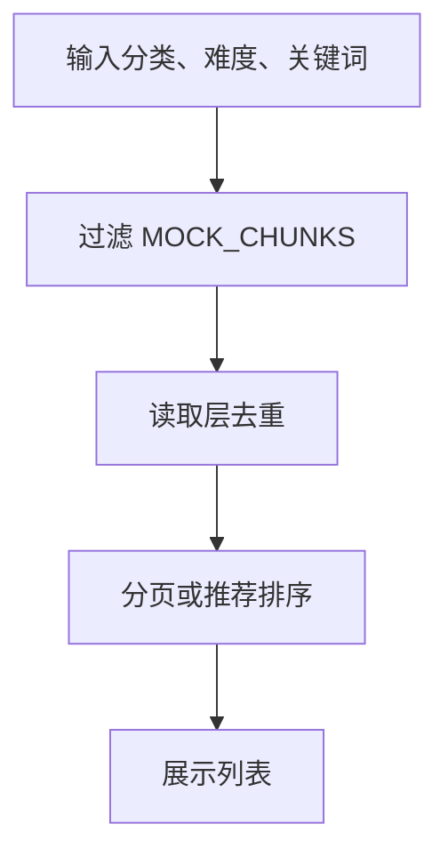

**图表来源**
- [chunks.ts:1-15](file://src/data/chunks.ts#L1-L15)
- [chunk-dedupe.ts:1-76](file://src/lib/chunk-dedupe.ts#L1-L76)
- [ChunkTrainingPage.tsx:600-720](file://src/pages/ChunkTrainingPage/ChunkTrainingPage.tsx#L600-L720)

### 思维模式

| 操作 | 示例 | 说明 |
|---|---|---|
| 创建 | 新增一个 `IThinkPattern` | 含识别题和迁移题 |
| 读取 | 按 `layer` 筛选 | 结构、动词、逻辑、语用 |
| 更新 | 记录答题结果 | 通常用于复习和统计 |
| 删除 | 移除某个模式 | 会影响该模式的识别和迁移题 |

查询模式：

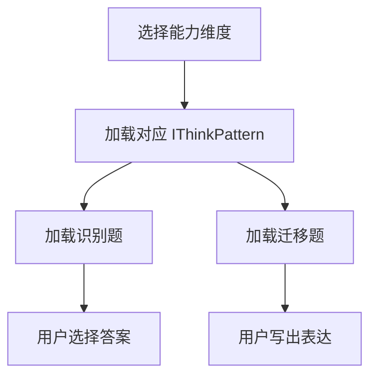

**图表来源**
- [think-patterns.ts:1-200](file://src/data/think-patterns.ts#L1-L200)

### 句子学习

| 操作 | 示例 | 说明 |
|---|---|---|
| 创建 | 手写 `ISentenceLabItem` | 需保证意群可逐字定位 |
| 读取 | 按 `level` 或来源筛选 | 书籍、演讲、自动生成 |
| 更新 | 推进三步读句法状态 | split → backbone → reveal |
| 删除 | 一般不删除 | 自动生成语料禁止手改 |

查询模式：

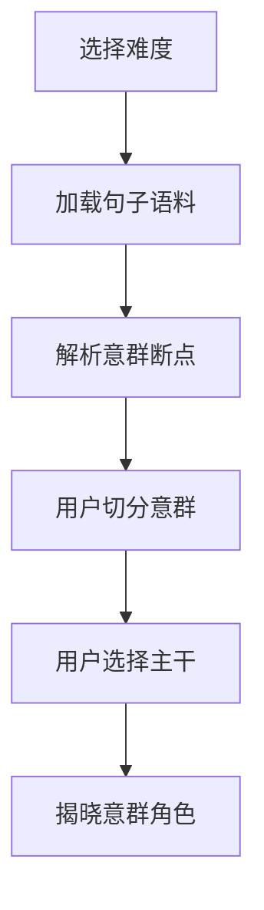

**图表来源**
- [sentence-lab.ts:1-200](file://src/data/sentence-lab.ts#L1-L200)
- [sentence-lab-auto.ts:1-80](file://src/data/sentence-lab-auto.ts#L1-L80)

### 影子跟读

| 操作 | 示例 | 说明 |
|---|---|---|
| 创建 | 新增 `IShadowingMaterial` | 由填充脚本整体重写 |
| 读取 | 按 `category`、`difficulty`、`accent` 筛选 | 日常、演讲、故事 |
| 更新 | 标记完成、记录录音评分 | 写完成标记和学习统计 |
| 删除 | 删除 AI 追加句 | 必须走合并索引换算 |

查询模式：

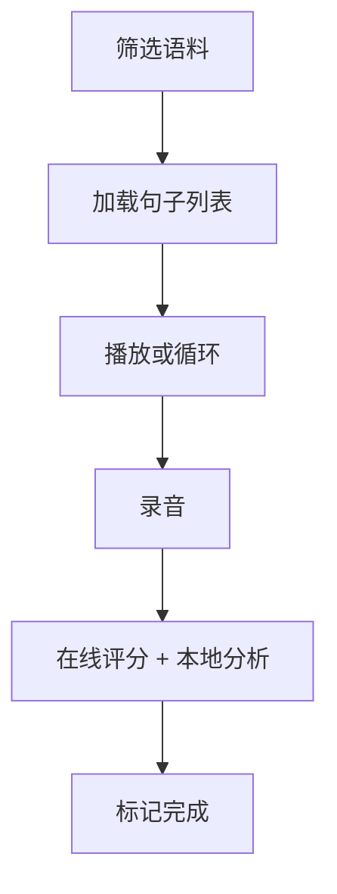

**图表来源**
- [shadowing.ts:1-125](file://src/data/shadowing.ts#L1-L125)
- [shadowing-progress.ts:1-85](file://src/lib/shadowing-progress.ts#L1-L85)

**章节来源**
- [chunks.ts:1-15](file://src/data/chunks.ts#L1-L15)
- [think-patterns.ts:1-200](file://src/data/think-patterns.ts#L1-L200)
- [sentence-lab.ts:1-200](file://src/data/sentence-lab.ts#L1-L200)
- [shadowing.ts:1-125](file://src/data/shadowing.ts#L1-L125)

## 学习进度持久化与状态管理

### 存储分层

学习相关数据主要分布在三类存储：

| 存储 | 用途 | 特点 |
|---|---|---|
| safeStorage / localStorage | 用户学习数据、设置、进度 | 有前缀、可同步、容量有限 |
| IndexedDB | 词库缓存、书籍全文、译文、TTS 模型 | 大容量、异步 |
| capped-cache | 累积型缓存 | FIFO 封顶，纯函数 |

安全存储支持平台内和用户匿名两种前缀，并具备自愈机制：当引导键丢失但已有数据存在时，尝试从既有键反解匿名 ID。

### 学习统计

学习统计模块负责：

- 今日学习分钟数。
- 连续学习天数。
- 上次学习日期。
- 总学习天数。
- 每日目标分钟数。
- 各模块进度。
- 日历打卡记录。

每次学习时长增加时，模块进度按分钟乘以 0.5 累加，上限为 100。跨零点时今日分钟数归零，连续天数只在昨天也学习过时增加。

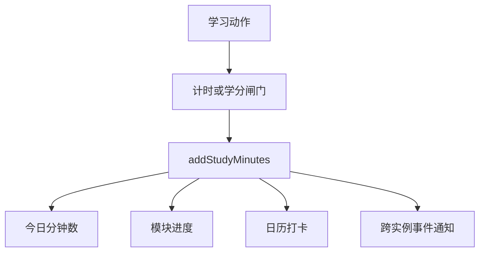

**图表来源**
- [storage-and-stats.md:40-138](file://docs/modules/storage-and-stats.md#L40-L138)

### 断点续学

不同模块的断点键遵循约定格式：

| 模式 | 键格式 |
|---|---|
| 词汇复习 | `__nativethink_vocab_session_<level>` |
| 每日学习 | `__nativethink_daily_session_<level>` |
| 快速闪卡 | `__nativethink_quickcard_session_<level>` |
| 语块复习 | `__nativethink_chunk_review_session` |
| 句子拼写 | 全局键，只能记住一本的位置 |

**章节来源**
- [storage-and-stats.md:40-138](file://docs/modules/storage-and-stats.md#L40-L138)

## 数据质量检查方法

### 语块质量

- 主库由生成脚本整体写入。
- 扩容库独立维护，构建期与主库去重。
- 读取层按短语内容去重。
- 守卫检查：

| 检查项 | 目的 |
|---|---|
| 条目总数 | 防止意外增删 |
| 唯一性 | 防止未处理重复 |
| 字段完整性 | 防止缺少必要字段 |
| 例句可用性 | 防止空例句 |
| 分类可筛性 | 防止分类筛选为空 |
| 行闭合 | 防止 JSON 或 TS 结构损坏 |

### 句子学习质量

- 自动生成语料由脚本生成。
- 生成器校验意群能否按序逐字定位。
- 必须存在主干。
- 译文和提示齐全。
- 页面守卫覆盖意群定位、断点丢弃、主干候选同源、坏数据不计分。

### 影子跟读质量

- 题库由填充脚本整体重写。
- 完成标记通过纯函数统一处理。
- 在线评分验证 WAV 编码、ASR provider 顺序、响应归一。
- 本地语音分析验证音量、停顿、音高、语速。

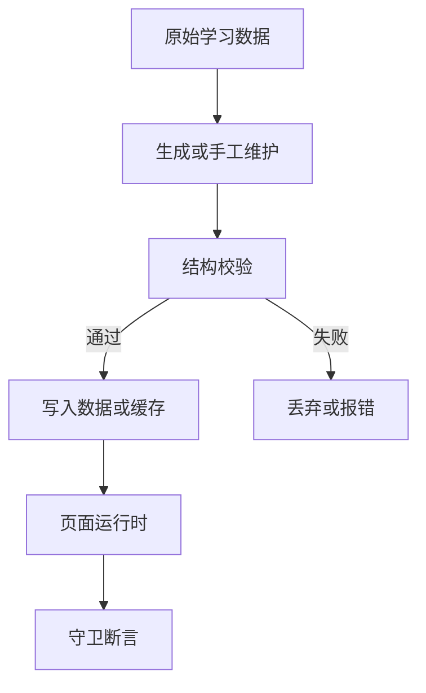

**图表来源**
- [sentence-lab-auto.ts:1-80](file://src/data/sentence-lab-auto.ts#L1-L80)
- [storage-and-stats.md:100-138](file://docs/modules/storage-and-stats.md#L100-L138)

**章节来源**
- [chunks.ts:1-15](file://src/data/chunks.ts#L1-L15)
- [sentence-lab-auto.ts:1-80](file://src/data/sentence-lab-auto.ts#L1-L80)
- [storage-and-stats.md:100-138](file://docs/modules/storage-and-stats.md#L100-L138)

## 异常数据处理方案

### 语块异常

- 重复短语：读取层去重，不删源数据。
- 兄弟已记状态：读入时扩展兄弟 `id`，切换时一次写全组。
- 自定义语块与内置语块合并后仍可区分来源。
- 翻页和洗牌使用稳定池，避免 AI 生成或删除导致题目漂移。

### 句子学习异常

- 意群定位失败：当作数据问题，不判分也不计入复习队列。
- 主干候选与断点列表同源：修复了旧版本中按钮数组与评分数组长度不一致的问题。
- 自动生成语料不可手改：避免破坏逐字定位。
- 录音路径释放麦克风和解码上下文，防止资源泄漏。

### 影子跟读异常

- 删除 AI 追加句：必须使用合并索引，本地索引换算集中在纯函数。
- ASR 失败：保留录音可回听，不假装打分。
- 本地分析失败：仍显示可用指标，不阻断回放。
- 存储超限：完成标记按最新 2000 条或 64KB 裁剪；用户创作数据不裁剪，仅拒绝新增并提示。

### 学习统计异常

- 模块进度键不存在：静默不生效，因此新增模块需要同步路由、侧边栏、常量表和类型。
- 日期计算：统一使用本地日期格式化，避免东八区凌晨错位。
- 多实例状态：以 storage 为权威源，并通过事件广播同步。

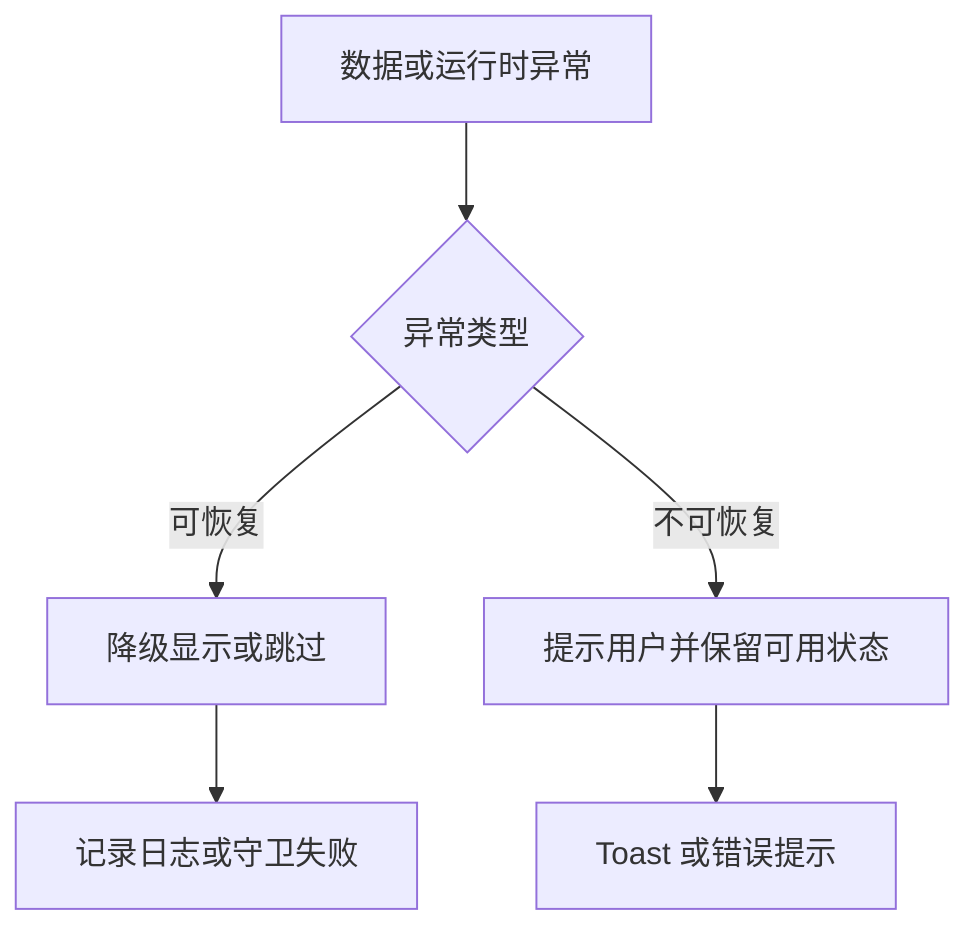

**图表来源**
- [chunk-dedupe.ts:1-76](file://src/lib/chunk-dedupe.ts#L1-L76)
- [sentence-lab.ts:1-200](file://src/data/sentence-lab.ts#L1-L200)
- [shadowing-progress.ts:1-85](file://src/lib/shadowing-progress.ts#L1-L85)
- [storage-and-stats.md:100-138](file://docs/modules/storage-and-stats.md#L100-L138)

**章节来源**
- [chunk-dedupe.ts:1-76](file://src/lib/chunk-dedupe.ts#L1-L76)
- [sentence-lab.ts:1-200](file://src/data/sentence-lab.ts#L1-L200)
- [shadowing-progress.ts:1-85](file://src/lib/shadowing-progress.ts#L1-L85)
- [storage-and-stats.md:100-138](file://docs/modules/storage-and-stats.md#L100-L138)

## 性能与可维护性建议

### 语块

- 已实现读取层去重和稳定洗牌池，避免重复短语和随机漂移。
- 建议继续限制 AI 例句、短语例句等累积缓存的键数和每键条目数。
- 分类视图应优先使用已过滤数据，减少无意义计算。

### 思维模式

- 模式数量增长时，建议按 `layer` 建立索引，避免每次渲染扫描全部模式。
- 迁移题若接入 AI，应加入 AbortController 和幂等重试。

### 句子学习

- 长句断点列表计算复杂度较高，应避免在高频渲染路径中重复计算。
- 意群定位失败时应尽早短路，不让坏数据进入评分或复习队列。

### 影子跟读

- 左右两栏均为全量渲染，DOM 节点较多但尚未达到必须虚拟化的规模。
- 录音评分应继续维持“在线为主、本地兜底”的双通道设计。
- 完成标记索引必须保持单一入口，禁止在页面中多处手写键名。

**章节来源**
- [chunk-dedupe.ts:1-76](file://src/lib/chunk-dedupe.ts#L1-L76)
- [shadowing.ts:1-125](file://src/data/shadowing.ts#L1-L125)
- [storage-and-stats.md:100-138](file://docs/modules/storage-and-stats.md#L100-L138)

## 结论

NativeThink 的学习数据模型以四个模块为核心：语块、思维模式、句子学习和影子跟读。它们的共同点是：

- 数据以 TypeScript 接口和常量数组形式定义。
- 交互逻辑由页面组件驱动。
- 学习进度通过本地存储持久化，并汇总到学习统计。
- 异常情况采取“尽量降级、尽量可见、尽量不丢用户资产”的策略。

未来改进的重点应是：

1. 保持数据生成与页面逻辑解耦，避免手动修改被脚本覆盖。
2. 统一累积缓存的上限策略，防止 localStorage 被撑爆。
3. 继续收敛索引键构造逻辑，尤其是跨数组索引的场景。
4. 扩大自动化守卫覆盖面，减少纯手动测试遗漏。
5. 在语块、思维、句子、影子四个模块之间保持清晰的数据契约，不要引入隐式耦合。