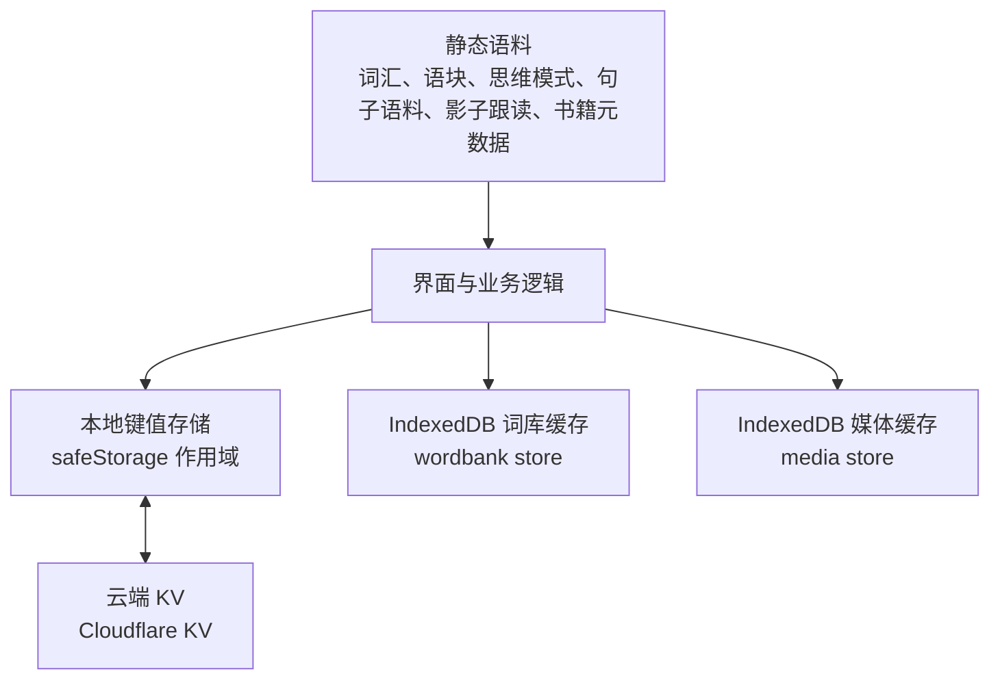
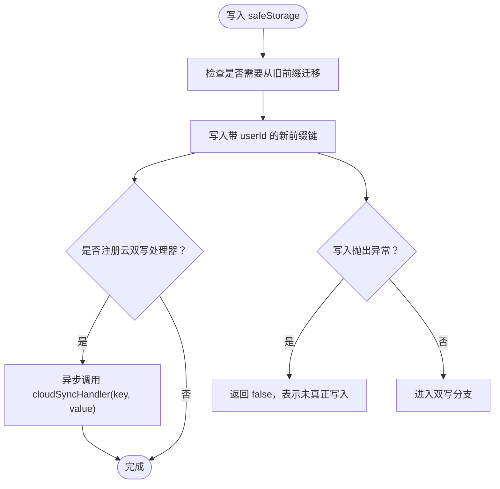
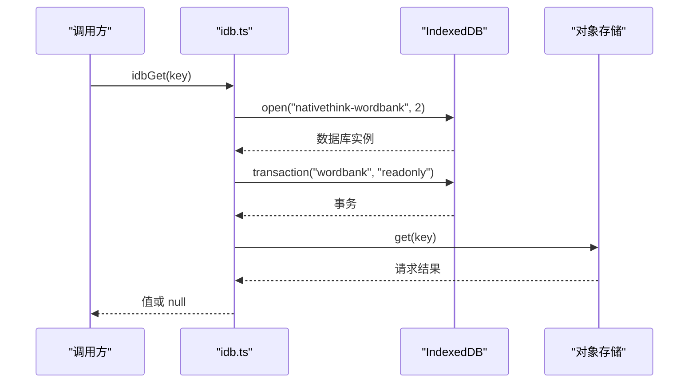
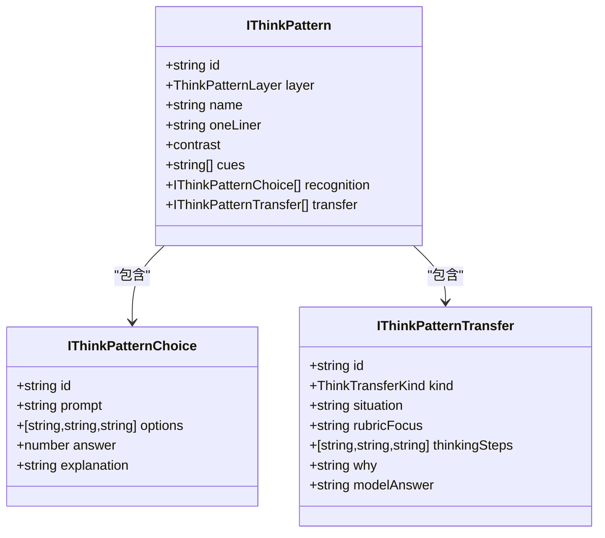
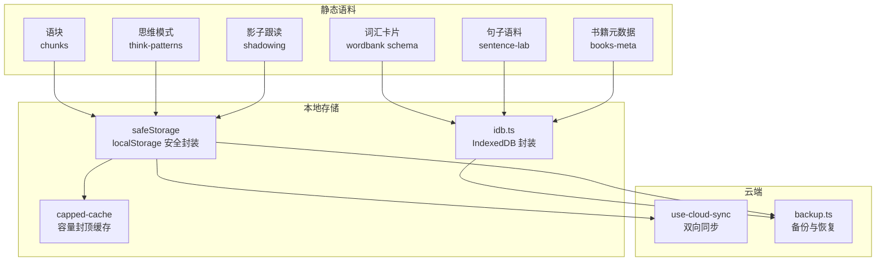
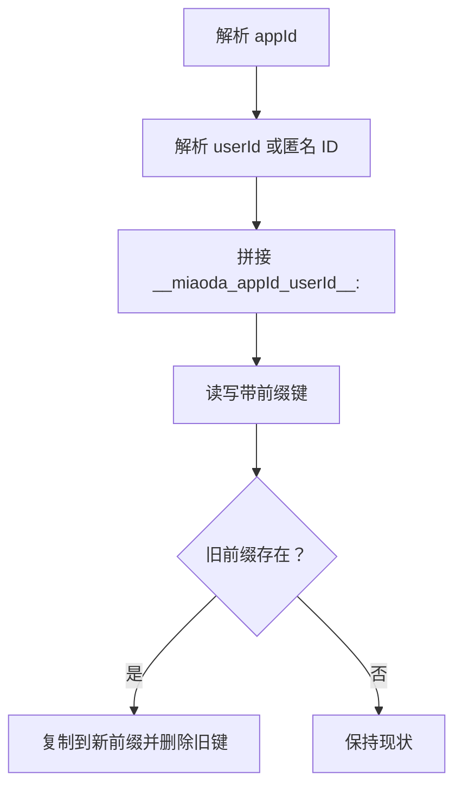
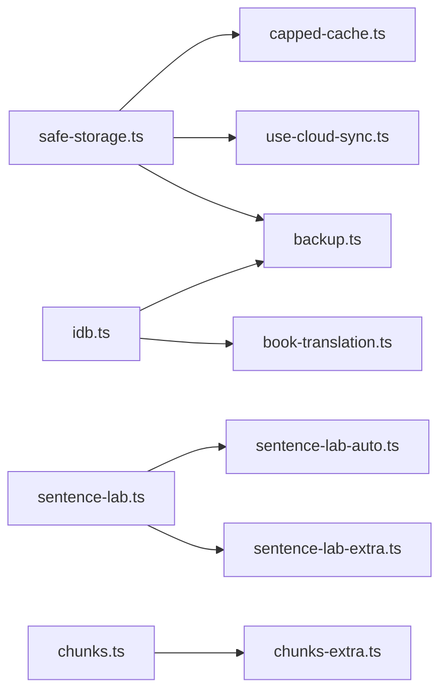
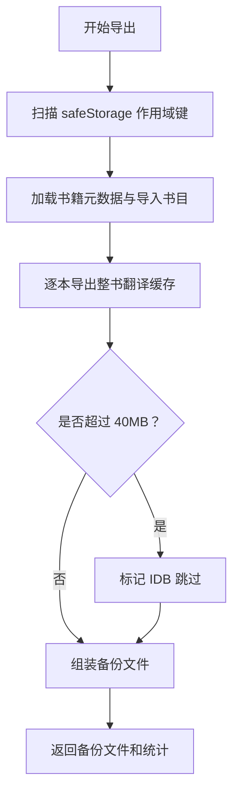
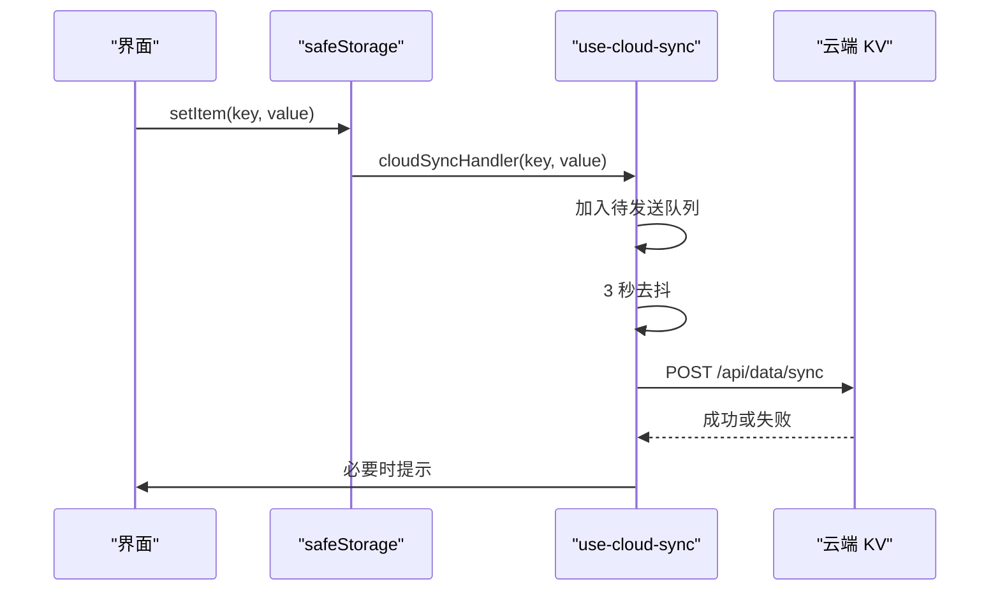

# 数据存储与模型

<cite>
**本文引用的文件**   
- [safe-storage.ts](file://src/lib/safe-storage.ts)
- [idb.ts](file://src/lib/idb.ts)
- [schema.ts](file://src/data/wordbank/schema.ts)
- [chunks.ts](file://src/data/chunks.ts)
- [chunks-extra.ts](file://src/data/chunks-extra.ts)
- [think-patterns.ts](file://src/data/think-patterns.ts)
- [sentence-lab.ts](file://src/data/sentence-lab.ts)
- [sentence-lab-auto.ts](file://src/data/sentence-lab-auto.ts)
- [sentence-lab-extra.ts](file://src/data/sentence-lab-extra.ts)
- [shadowing.ts](file://src/data/shadowing.ts)
- [books-meta.ts](file://src/data/books-meta.ts)
- [book-translation.ts](file://src/data/book-translation.ts)
- [backup.ts](file://src/lib/backup.ts)
- [capped-cache.ts](file://src/lib/capped-cache.ts)
- [use-cloud-sync.ts](file://src/lib/use-cloud-sync.ts)
</cite>

## 目录

1. [引言](#引言)
2. [项目结构与数据分层](#项目结构与数据分层)
3. [核心存储封装](#核心存储封装)
4. [主要数据模型](#主要数据模型)
5. [架构总览](#架构总览)
6. [详细组件分析](#详细组件分析)
7. [依赖关系分析](#依赖关系分析)
8. [数据访问模式与缓存策略](#数据访问模式与缓存策略)
9. [索引优化与性能特性](#索引优化与性能特性)
10. [版本迁移、备份与恢复](#版本迁移备份与恢复)
11. [数据验证、业务约束与完整性检查](#数据验证业务约束与完整性检查)
12. [序列化与同步](#序列化与同步)
13. [故障排查指南](#故障排查指南)
14. [结论](#结论)

## 引言

NativeThink 的数据层围绕“离线优先”设计：用户学习进度、自定义条目、AI 生成内容等轻量键值数据落在 `localStorage`，由安全封装 `safeStorage` 提供作用域隔离和云双写；词库、整书对照翻译、视频媒体等大体积或可重生产物落在 `IndexedDB`；静态教学语料（词汇卡片、语块、思维模式、句子语料、影子跟读、书籍元数据）以模块常量形式打包，部分通过脚本构建。

文档面向两类读者：

- **前端开发者**：需要了解 `safeStorage` 的 per-user key 前缀、`idb.ts` 的事务包装、备份还原流程和同步回声抑制。
- **产品/测试人员**：需要理解词汇卡片、语块、思维模式、句子语料、影子跟读题库、书籍元数据各自的字段含义、来源和校验规则。

## 项目结构与数据分层

数据源大致分为四层：

| 层级 | 内容 | 典型文件 | 持久化目标 |
|---|---|---|---|
| 静态语料层 | 词汇、语块、思维模式、句子语料、影子跟读、书籍元数据 | `data/wordbank/schema.ts`、`data/chunks.ts`、`data/think-patterns.ts`、`data/sentence-lab.ts`、`data/shadowing.ts`、`data/books-meta.ts` | 应用包 / 模块常量 |
| 可重生产物缓存层 | 按词加载的搭配、例句、深度解释；整书对照翻译 | `data/wordbank/*`、`data/book-translation.ts` | IndexedDB `wordbank` store |
| 用户状态层 | 学习进度、笔记、收藏、写作历史、自定义词条 | `lib/capped-cache.ts` 调用方、各业务 hook | `safeStorage`（`localStorage`） |
| 大体积资产层 | 视频精听媒体、字幕 blob | `lib/idb.ts` 中 `media` store | IndexedDB `media` store |

**图表来源**  
- [safe-storage.ts:1-216](file://src/lib/safe-storage.ts#L1-L216)
- [idb.ts:1-213](file://src/lib/idb.ts#L1-L213)
- [use-cloud-sync.ts:1-191](file://src/lib/use-cloud-sync.ts#L1-L191)

**章节来源**  
- [safe-storage.ts:1-216](file://src/lib/safe-storage.ts#L1-L216)
- [idb.ts:1-213](file://src/lib/idb.ts#L1-L213)
- [books-meta.ts:1-50](file://src/data/books-meta.ts#L1-L50)

## 核心存储封装

### safeStorage：带 per-user 前缀的 localStorage 安全封装

`safeStorage` 的核心职责是：

1. **多应用隔离**：基于 `window.appId` 或全局标识生成应用级前缀。
2. **多用户隔离**：优先使用平台 `_userInfo.user_id` 或 `__PLATFORM_USER__.user_id`，否则回退到浏览器稳定的匿名 ID。
3. **键前缀统一**：所有读写都经过 `prefixKey`，避免不同应用或用户互相污染。
4. **旧格式迁移**：从不带 `userId` 的旧前缀自动复制到新前缀，并删除旧键。
5. **云双写钩子**：可选注册 `setCloudSyncHandler`，每次写入把键值推送给云端同步逻辑。
6. **静默失败但诚实返回**：`setItem` 在配额满或隐私模式下不抛错，而是返回 `false`，让调用方判断是否真的写成功。

关键行为总结：

| 方法 | 行为 | 返回值 |
|---|---|---|
| `getItem(key)` | 先尝试迁移旧键，再读取带前缀的键 | `string \| null` |
| `setItem(key, value)` | 写入带前缀键，触发云双写，捕获配额异常 | `boolean` |
| `removeItem(key)` | 删除新键，也清理旧键，通知云端删除 | `void` |
| `getPrefixedKey(key)` | 调试用，返回真实存储键 | `string` |
| `getCurrentUserId()` | 调试用，返回当前用户标识 | `string` |

**图表来源**  
- [safe-storage.ts:60-120](file://src/lib/safe-storage.ts#L60-L120)
- [safe-storage.ts:140-216](file://src/lib/safe-storage.ts#L140-L216)

**章节来源**  
- [safe-storage.ts:1-216](file://src/lib/safe-storage.ts#L1-L216)

### idb.ts：IndexedDB 缓存封装

`idb.ts` 维护两个对象存储：

| 存储名 | keyPath | 用途 | 特点 |
|---|---|---|---|
| `wordbank` | `key` | 词库缓存、整书对照翻译片段 | KV 形状 `{ key, value, timestamp }` |
| `media` | `id` | 视频精听的元数据、字幕、媒体 blob | 可能包含几百 MB 二进制，只进 IDB，不进 localStorage |

数据库名称为 `nativethink-wordbank`，当前版本为 `2`。`openDB` 使用单例缓存 `dbInstance`，避免重复打开；`onupgradeneeded` 负责创建缺失的 store。

核心 API：

| API | 参数 | 返回 | 说明 |
|---|---|---|---|
| `idbGet<T>(key)` | 字符串键 | `Promise<T \| null>` | 从 `wordbank` store 取缓存 |
| `idbSet<T>(key, value)` | 键 + 任意值 | `Promise<void>` | 写入 KV 记录并带时间戳 |
| `idbDelete(key)` | 字符串键 | `Promise<void>` | 删除缓存项 |
| `idbHas(key)` | 字符串键 | `Promise<boolean>` | 检查是否存在 |
| `idbClear()` | 无 | `Promise<void>` | 清空 `wordbank` store |
| `idbMediaPut(record)` | 带 `id` 的记录 | `Promise<boolean>` | 写媒体记录，失败返回 false |
| `idbMediaGet(id)` | 媒体 id | `Promise<T \| null>` | 读媒体记录 |
| `idbMediaAll()` | 无 | `Promise<T[]>` | 列出全部媒体记录 |
| `idbMediaDelete(id)` | 媒体 id | `Promise<boolean>` | 删除媒体记录 |

事务包装器 `withStore` 统一处理 open 失败、事务错误、事务中止和 abort 场景，使上层 API 对大多数底层错误保持“失败即空结果”的容错风格。

**图表来源**  
- [idb.ts:1-110](file://src/lib/idb.ts#L1-L110)
- [idb.ts:110-213](file://src/lib/idb.ts#L110-L213)

**章节来源**  
- [idb.ts:1-213](file://src/lib/idb.ts#L1-L213)

## 主要数据模型

### 词汇卡片：wordbank schema

词汇模型定义在 `schema.ts`，核心是 `IWordEntry`：

| 字段 | 类型 | 含义 |
|---|---|---|
| `word` | `string` | 英文单词 |
| `phonetic` | `string` | 音标 |
| `partOfSpeech` | `string` | 词性 |
| `meaning` | `string` | 中文释义 |
| `level` | 枚举 | 等级：中考、高考、四六级、雅思、托福、考研、专业、进阶、自定义 |
| `frequencyRank` | `number` | COCA 词频排名，越小越常用 |
| `collocations` | `string[]` | 搭配；detail 未加载时为空数组 |
| `examples` | `IExample[]` | 例句；detail 未加载时为空数组 |
| `synonyms` | `string[]` | 同义词 |
| `antonyms` | `string[]` | 反义词 |
| `wordFamily` | `string[]` | 派生词族 |
| `register` | 枚举 | 语域：正式、中性、非正式 |
| `emotion` | 枚举 | 情感色彩：积极、中性、消极 |
| `topics` | `string[]` | 主题分类 |
| `hasNoChineseEquivalent` | `boolean` | 是否有中文无对应概念标记 |
| `hasCollocations` | `boolean` | 快捷标志：等价于存在搭配 |
| `deepExplanation` | `string` | 深度解释；detail 未加载时为空字符串 |

查询接口 `IWordQuery` 支持按等级、主题、关键词、频率范围、语域、词性排序和分页。

**章节来源**  
- [schema.ts:1-61](file://src/data/wordbank/schema.ts#L1-L61)

### 语块：chunks

`IChunk` 描述一个英语语块：

| 字段 | 类型 | 含义 |
|---|---|---|
| `id` | `string` | 主库用 `c1`…`c748`，扩容用 `cx*` |
| `content` | `string` | 语块原文 |
| `meaning` | `string` | 中文含义 |
| `category` | 枚举 | 日常、职场、社交、情绪、旅行、学习、科技、美食、健康、购物、运动 |
| `usage` | `string` | 用法说明 |
| `example` | `string` | 英文例句 |
| `exampleZh` | 可选 `string` | 例句中文翻译 |
| `introduction` | 可选 `string` | 语块背景介绍 |
| `difficulty` | 枚举 | 初级、中级、高级 |

主库来自 `chunks.ts`，额外分类来自 `chunks-extra.ts`，两者合并后统一导出。扩容文件专门补齐旅行、学习、科技等原本空的分类，并在构建期做去重校验。

**章节来源**  
- [chunks.ts:1-98](file://src/data/chunks.ts#L1-L98)
- [chunks-extra.ts:1-93](file://src/data/chunks-extra.ts#L1-L93)

### 思维模式：think-patterns

思维模式用于帮助用户从中文表达习惯迁移到更自然的英文表达。核心结构：

| 模型 | 关键字段 | 含义 |
|---|---|---|
| `IThinkPatternChoice` | `prompt`、`options`、`answer`、`explanation` | 识别练习题：给出提示，三选一，附带解释 |
| `IThinkPatternTransfer` | `kind`、`situation`、`rubricFocus`、`thinkingSteps`、`why`、`modelAnswer` | 迁移练习：场景、评判重点、思考三步、为什么自然、参考表达 |
| `IThinkPatternLayerMeta` | `id`、`name`、`description` | 维度元数据：信息结构、动词与焦点、逻辑与信息、语域与语用 |
| `IThinkPattern` | `layer`、`name`、`oneLiner`、`contrast`、`cues`、`recognition`、`transfer` | 一个思维模式单元 |

维度包括：

- `structure`：信息结构，谁在前、什么在后、指代是否补全。
- `verb`：动词与焦点，少名词化，直接用动词。
- `clarity`：逻辑与信息，关系是否明说、断言力度、细节是否足够。
- `pragmatics`：语域与语用，正式度、面子、请求拒绝赞美脚本。

迁移练习还支持 `scenario` 与 `wording` 两种类型，兼容历史老数据。

**图表来源**  
- [think-patterns.ts:1-200](file://src/data/think-patterns.ts#L1-L200)

**章节来源**  
- [think-patterns.ts:1-200](file://src/data/think-patterns.ts#L1-L200)

### 句子语料：sentence-lab

句子语料强调“母语者读长句不是逐词翻译，而是先抓主干，再把修饰挂回去”。每个条目由若干意群组成：

| 字段 | 类型 | 含义 |
|---|---|---|
| `id` | `string` | 句子编号 |
| `en` | `string` | 英文原句 |
| `zh` | `string` | 中文翻译 |
| `source` | `string` | 出处，如书名或演讲名 |
| `level` | 枚举 | 入门、进阶、高级 |
| `tip` | `string` | 一句话阅读提示 |
| `backboneGloss` | `string` | 压成简单句的主干释义 |
| `auto` | 可选 `boolean` | 是否由脚本自动标注 |
| `segments` | `ISentenceSegment[]` | 意群列表 |

`ISentenceSegment` 中：

- `t`：原文片段，顺序拼接应等于整句。
- `r`：`core` 主干、`mod` 修饰、`conn` 连接。
- `note`：揭晓时才显示的语法说明。

语料来源分三类：

- `sentence-lab.ts`：站内公版书全文，人工核验。
- `sentence-lab-extra.ts`：30 篇演讲原文。
- `sentence-lab-auto.ts`：由脚本生成并由结构校验器过滤。

**章节来源**  
- [sentence-lab.ts:1-200](file://src/data/sentence-lab.ts#L1-L200)
- [sentence-lab-extra.ts:1-195](file://src/data/sentence-lab-extra.ts#L1-L195)
- [sentence-lab-auto.ts:1-200](file://src/data/sentence-lab-auto.ts#L1-L200)

### 影子跟读题库：shadowing

影子跟读题库描述一段材料及其句子：

| 模型 | 关键字段 | 含义 |
|---|---|---|
| `ISentence` | `id`、`text`、`annotatedText`、`translation`、`duration` | 单个句子、发音标注文本、翻译、时长 |
| `IMaterial` | `id`、`title`、`category`、`difficulty`、`accent`、`totalDuration`、`sentences`、`description` | 一组材料，例如咖啡店对话、TED 演讲 |

分类包括日常、演讲、故事；口音区分美式和英式；难度分初、中、高。

**章节来源**  
- [shadowing.ts:1-125](file://src/data/shadowing.ts#L1-L125)

### 书籍元数据：books

书籍元数据由脚本从正文数据生成，不直接手写。它只放卡片展示所需字段和预计算计数，目的是让书单列表不必下载 22 本书的完整正文。

| 字段 | 类型 | 含义 |
|---|---|---|
| `id` | `string` | 项目 Gutenberg 编号或内部编号 |
| `title` | `string` | 英文书名 |
| `zhTitle` | `string` | 中文书名 |
| `author` | `string` | 作者英文名 |
| `zhAuthor` | `string` | 作者中文名 |
| `topic` | `string` | 主题：文学、哲学、科学、商业等 |
| `difficulty` | 枚举 | 入门、进阶、高级 |
| `totalWords` | `number` | 预估字数 |
| `pageCount` | `number` | 节选页数，用于进度百分比 |
| `gutenbergId` | 可选 `number` | 对应 Gutenberg 编号 |

此外还导出按 id 查表的映射 `BOOK_META_BY_ID`。

**章节来源**  
- [books-meta.ts:1-50](file://src/data/books-meta.ts#L1-L50)

## 架构总览

整体数据流如下：

**图表来源**  
- [schema.ts:1-61](file://src/data/wordbank/schema.ts#L1-L61)
- [chunks.ts:1-98](file://src/data/chunks.ts#L1-L98)
- [think-patterns.ts:1-200](file://src/data/think-patterns.ts#L1-L200)
- [sentence-lab.ts:1-200](file://src/data/sentence-lab.ts#L1-L200)
- [shadowing.ts:1-125](file://src/data/shadowing.ts#L1-L125)
- [books-meta.ts:1-50](file://src/data/books-meta.ts#L1-L50)
- [safe-storage.ts:1-216](file://src/lib/safe-storage.ts#L1-L216)
- [capped-cache.ts:1-114](file://src/lib/capped-cache.ts#L1-L114)
- [idb.ts:1-213](file://src/lib/idb.ts#L1-L213)
- [use-cloud-sync.ts:1-191](file://src/lib/use-cloud-sync.ts#L1-L191)
- [backup.ts:1-105](file://src/lib/backup.ts#L1-L105)

## 详细组件分析

### safeStorage 的密钥与作用域

`safeStorage` 根据环境决定用户标识和应用标识：

1. 优先从 `window._userInfo.user_id` 获取平台用户 ID。
2. 其次从 `window.__PLATFORM_USER__.user_id` 获取。
3. 最后使用稳定匿名 ID，该 ID 保存在特殊引导键中，并提供自愈机制：如果引导键丢失，会扫描已有 `__miaoda___global____<anonId>__:...` 键恢复匿名 ID，避免历史数据被误判为“隐身”。

应用 ID 来自 `window.appId`，不存在时用 `__global__`。最终键形如：

- 平台环境：`__miaoda_<appId>_<userId>__:<key>`
- 独立环境：`__miaoda___global____<anonId>__:<key>`

旧前缀不带 `userId`，迁移逻辑会把旧键复制到新键并删除旧键。

**图表来源**  
- [safe-storage.ts:15-60](file://src/lib/safe-storage.ts#L15-L60)
- [safe-storage.ts:60-110](file://src/lib/safe-storage.ts#L60-L110)
- [safe-storage.ts:110-140](file://src/lib/safe-storage.ts#L110-L140)

**章节来源**  
- [safe-storage.ts:1-216](file://src/lib/safe-storage.ts#L1-L216)

### IndexedDB 事务与错误处理

`idb.ts` 把所有 IndexedDB 操作收敛到少量函数，并通过 `withStore` 统一事务语义：

- 成功：`tx.oncomplete` 才认为落盘成功。
- 失败：`tx.onerror`、`tx.abort`、try/catch 均返回 `ok: false`。
- 媒体存储单独暴露 `idbMediaPut`、`idbMediaGet`、`idbMediaAll`、`idbMediaDelete`，因为媒体记录有自增 `id`，不是 KV 形状。
- `idbMediaAll` 使用游标遍历，但注释明确媒体记录可能很大，因此更推荐按需读取，而不是把整个媒体库拉入内存。

**章节来源**  
- [idb.ts:1-213](file://src/lib/idb.ts#L1-L213)

### capped-cache：localStorage JSON 缓存的统一上限

`capped-cache.ts` 解决“按词累积的 AI 例句、搭配、解析缓存把 localStorage 撑爆”的问题。它提供：

| 函数 | 用途 | 上限策略 |
|---|---|---|
| `readJson` | 安全反序列化 | 解析失败返回 fallback |
| `persistJson` | 安全序列化写入 | 返回是否写入成功 |
| `warnStorageFull` | 提示存储空间不足 | 60 秒去抖 |
| `appendCapped` | 追加不可重算清单 | 超过上限就截断新增部分，不删已有 |
| `cappedPut` | 键值对封顶 | FIFO 淘汰最早键 |
| `trimOldest` | 滚动窗口双封顶 | 保最新，按条数和字节估算丢弃最旧 |
| `migrateStorageKey` | 迁移旧键到新键 | 新键已有则不动，搬完删旧键 |

注意：FIFO 淘汰要求键是非纯数字字符串，因为 JS 对象会把纯数字键按数值排序，破坏插入序。

**章节来源**  
- [capped-cache.ts:1-114](file://src/lib/capped-cache.ts#L1-L114)

## 依赖关系分析

**图表来源**  
- [safe-storage.ts:1-216](file://src/lib/safe-storage.ts#L1-L216)
- [capped-cache.ts:1-114](file://src/lib/capped-cache.ts#L1-L114)
- [use-cloud-sync.ts:1-191](file://src/lib/use-cloud-sync.ts#L1-L191)
- [backup.ts:1-105](file://src/lib/backup.ts#L1-L105)
- [idb.ts:1-213](file://src/lib/idb.ts#L1-L213)
- [book-translation.ts:1-200](file://src/data/book-translation.ts#L1-L200)
- [sentence-lab.ts:1-200](file://src/data/sentence-lab.ts#L1-L200)
- [sentence-lab-auto.ts:1-200](file://src/data/sentence-lab-auto.ts#L1-L200)
- [sentence-lab-extra.ts:1-195](file://src/data/sentence-lab-extra.ts#L1-L195)
- [chunks.ts:1-98](file://src/data/chunks.ts#L1-L98)
- [chunks-extra.ts:1-93](file://src/data/chunks-extra.ts#L1-L93)

**章节来源**  
- [safe-storage.ts:1-216](file://src/lib/safe-storage.ts#L1-L216)
- [idb.ts:1-213](file://src/lib/idb.ts#L1-L213)
- [capped-cache.ts:1-114](file://src/lib/capped-cache.ts#L1-L114)
- [use-cloud-sync.ts:1-191](file://src/lib/use-cloud-sync.ts#L1-L191)
- [backup.ts:1-105](file://src/lib/backup.ts#L1-L105)
- [book-translation.ts:1-200](file://src/data/book-translation.ts#L1-L200)
- [sentence-lab.ts:1-200](file://src/data/sentence-lab.ts#L1-L200)
- [chunks.ts:1-98](file://src/data/chunks.ts#L1-L98)

## 数据访问模式与缓存策略

### 静态语料的访问模式

词汇、语块、思维模式、句子语料、影子跟读、书籍元数据都是模块常量。它们不参与运行时动态查询，而是由页面导入后直接渲染或配合轻量筛选逻辑使用。这样做的优点是：

- 不需要启动数据库即可展示基础语料。
- 构建期可以校验、拆分、去重。
- 运行时内存占用可控。

缺点是对大量数据的初始包体有影响，因此书籍元数据刻意分离出仅卡片字段，正文仍归 books 模块或随包静态资源。

### 词库与翻译缓存的访问模式

词库 detail、整书对照翻译属于“可重生产物”，适合放在 IndexedDB：

- 初次加载可能较慢。
- 后续刷新可直接命中。
- 可以清理坏缓存自愈。
- 可以增量续传，不会因网络中断丢失已翻译章节。

`book-translation.ts` 使用 `booktrans-<bookId>-ch<chapterIdx>` 保存章节译文，使用 `booktrans-<bookId>-index` 保存章节清单和统计。

### 用户创作数据的访问模式

用户创作数据（自定义题目、AI 生成句子、写作历史、跟读已完成句等）通常走 `capped-cache.ts` 的 `persistJson`，并通过 `safeStorage` 落盘。这类数据有两个重要特征：

- 不可重算：不能因为 localStorage 满了就悄悄替用户丢弃。
- 必须封顶：否则长期积累会撑爆本地存储。

**章节来源**  
- [capped-cache.ts:1-114](file://src/lib/capped-cache.ts#L1-L114)
- [book-translation.ts:1-200](file://src/data/book-translation.ts#L1-L200)

## 索引优化与性能特性

### IndexedDB 索引现状

当前实现没有显式创建复合索引，主要依赖：

- `wordbank` store 的 `keyPath: 'key'`。
- `media` store 的 `keyPath: 'id'`。
- 按业务键前缀做逻辑分组，例如 `booktrans-<bookId>-ch<chapterIdx>`。

这意味着高效查询依赖调用方传入精确键，不适合复杂条件检索。若未来需要对词库做按 level、topic、frequency 的数据库级查询，应考虑新建专用 object store 或增加索引。

### 媒体读取优化

`idbMediaAll` 虽然能列出全部媒体，但注释明确指出媒体记录可能包含几百 MB 的 blob，不应轻易一次性拉入内存。推荐：

- 先读轻量索引。
- 只在用户打开某个视频时再 `idbMediaGet` 具体记录。
- 删除不再需要的媒体。

### localStorage 容量管理

`capped-cache.ts` 通过 FIFO 和双封顶控制大小；`safeStorage.setItem` 返回 `false` 时调用方可提示用户空间不足；`warnStorageFull` 做了 60 秒去抖，避免频繁弹窗。

### 批量与并发

- 词库 detail 加载采用渐进预加载，避免一次拉全量。
- 整书翻译使用批处理和章内并发，默认每批 3-5 个段落，并发 2，全书串行。
- 云同步将多次 `safeStorage` 写入合并为 3 秒延迟的批量请求。

**章节来源**  
- [idb.ts:1-110](file://src/lib/idb.ts#L1-L110)
- [book-translation.ts:1-200](file://src/data/book-translation.ts#L1-L200)
- [capped-cache.ts:1-114](file://src/lib/capped-cache.ts#L1-L114)
- [use-cloud-sync.ts:1-191](file://src/lib/use-cloud-sync.ts#L1-L191)

## 版本迁移、备份与恢复

### safeStorage 迁移

`safeStorage` 自带两阶段迁移：

1. **匿名 ID 自愈**：如果引导键丢失，扫描既有键恢复匿名 ID。
2. **per-user 前缀迁移**：首次读取旧前缀键时复制到新前缀，并删除旧键。

这解决了用户清理部分 localStorage 或导入备份后首次打开时数据“隐身”的问题。

### IndexedDB 版本管理

数据库名为 `nativethink-wordbank`，版本为 `2`。`onupgradeneeded` 负责创建缺失的对象存储。当前代码中没有显式的跨版本 schema 升级逻辑，新增字段或结构变更建议：

- 升级 `DB_VERSION`。
- 在 `onupgradeneeded` 中检测旧版本并迁移数据。
- 对不可逆结构变更保留迁移脚本和回滚策略。

### 备份与恢复

`backup.ts` 提供两个入口：

| 功能 | 输入 | 输出 | 覆盖范围 |
|---|---|---|---|
| `exportBackup()` | 无 | 备份文件对象和统计 | 全部 safeStorage 作用域数据 + 最多 40MB 的整书翻译缓存 |
| `importBackup(file)` | 备份文件 | 恢复条数 | safeStorage 数据 + 以 `booktrans-` 开头的 IndexedDB 缓存 |

备份文件格式：

| 字段 | 类型 | 含义 |
|---|---|---|
| `app` | `'NativeThink'` | 应用标识 |
| `version` | `2` | 备份格式版本 |
| `exportedAt` | ISO 时间字符串 | 导出时间 |
| `data` | 字符串映射 | 去掉内部前缀后的 safeStorage 键值 |
| `idb` | 可选映射 | 整书翻译缓存 |

恢复时，单键写入失败不会阻断整体恢复；IDB 恢复跳过不符合前缀的记录。

**图表来源**  
- [backup.ts:1-105](file://src/lib/backup.ts#L1-L105)

**章节来源**  
- [safe-storage.ts:1-216](file://src/lib/safe-storage.ts#L1-L216)
- [idb.ts:1-213](file://src/lib/idb.ts#L1-L213)
- [backup.ts:1-105](file://src/lib/backup.ts#L1-L105)

## 数据验证、业务约束与完整性检查

### 词汇卡片

- `level`、`register`、`emotion` 使用 TS 字面量联合类型约束。
- `hasCollocations` 作为 `collocations.length > 0` 的快捷标志，避免 UI 依赖 detail 加载时机。
- 查询接口支持 level、topic、search、frequencyMin、frequencyMax、register、pos、sortBy、limit、offset。

### 语块

- `category` 限定为 11 个固定分类。
- `difficulty` 限定为 beginner、intermediate、advanced。
- 扩容文件按分类补齐旅行、学习、科技等分类，并与主库去重。

### 思维模式

- `layer` 限定为四种思维维度。
- `kind` 默认 `scenario`，兼容老迁移项。
- `recognition` 选项固定三元组，答案限定为 `0 | 1 | 2`。
- `thinkingSteps` 固定三元组，体现“先想三步”的教学法。

### 句子语料

- `segments.t` 顺序拼接应等于整句。
- `segments.r` 必须是 `core`、`mod`、`conn`。
- 自动标注数据需通过结构校验：每块能在原句定位、必须有主干、译文和读法提示齐全。
- 手动标注与自动标注共存，`auto` 字段区分来源。

### 影子跟读

- 句子含原文、标注文本、翻译、时长。
- 材料含标题、分类、难度、口音、总时长、描述。

### 书籍元数据

- `difficulty` 限定入门、进阶、高级。
- `pageCount` 用于进度百分比，避免每次计算长度。
- `gutenbergId` 可为空。

### 数据完整性检查建议

现有仓库中已有多个校验脚本，例如检查重复、校验语料、校验云同步卫生、校验词汇卡片等。建议在新增数据模型时补充：

- 构建期校验必填字段。
- 枚举值白名单校验。
- 句子语料切分完整性校验。
- 备份文件 schema 校验。
- IDB 迁移前后一致性校验。

**章节来源**  
- [schema.ts:1-61](file://src/data/wordbank/schema.ts#L1-L61)
- [chunks.ts:1-98](file://src/data/chunks.ts#L1-L98)
- [chunks-extra.ts:1-93](file://src/data/chunks-extra.ts#L1-L93)
- [think-patterns.ts:1-200](file://src/data/think-patterns.ts#L1-L200)
- [sentence-lab.ts:1-200](file://src/data/sentence-lab.ts#L1-L200)
- [sentence-lab-auto.ts:1-200](file://src/data/sentence-lab-auto.ts#L1-L200)
- [shadowing.ts:1-125](file://src/data/shadowing.ts#L1-L125)
- [books-meta.ts:1-50](file://src/data/books-meta.ts#L1-L50)

## 序列化与同步

### 序列化与反序列化

- `capped-cache.ts` 使用 `JSON.stringify` 和 `JSON.parse` 读写 localStorage。
- `safeStorage` 本身只存字符串，所有结构化数据都由调用方序列化。
- `backup.ts` 导出时把 safeStorage 值作为字符串存入 `data`，把 IDB 值作为任意对象存入 `idb`。
- `book-translation.ts` 的章节译文是字符串数组，manifest 是结构化对象。

### 云同步

`use-cloud-sync.ts` 在用户登录后注册 `safeStorage` 的双写处理器：

- 本地写入 → 3 秒去抖 → 批量 POST `/api/data/sync`。
- 云端下拉 → 通过 `safeStorage.setItem` 落地 → 触发同步事件。
- 防止回声：下行期间设置 `applyingRemoteRef.current = true`，阻止刚下载的键再次上云。
- 失败重试：离线时把 pending 写入合并回队列，下次网络可用时重试。
- 全量补推：若有未落云写入或同步失败，周期任务可触发全量 `syncUp`。

**图表来源**  
- [use-cloud-sync.ts:1-191](file://src/lib/use-cloud-sync.ts#L1-L191)
- [safe-storage.ts:140-216](file://src/lib/safe-storage.ts#L140-L216)

**章节来源**  
- [capped-cache.ts:1-114](file://src/lib/capped-cache.ts#L1-L114)
- [backup.ts:1-105](file://src/lib/backup.ts#L1-L105)
- [book-translation.ts:1-200](file://src/data/book-translation.ts#L1-L200)
- [use-cloud-sync.ts:1-191](file://src/lib/use-cloud-sync.ts#L1-L191)
- [safe-storage.ts:140-216](file://src/lib/safe-storage.ts#L140-L216)

## 故障排查指南

### localStorage 写入失败

现象：用户自定义内容刷新后丢失，或出现“本机存储空间不足”提示。

排查步骤：

1. 检查 `safeStorage.setItem` 返回值是否为 `false`。
2. 检查是否在隐私模式或设备配额已满。
3. 检查调用方是否消费了返回值并提示用户。
4. 检查是否触发了 `warnStorageFull`，确认去抖逻辑正常。

相关位置：

- [safe-storage.ts:140-180](file://src/lib/safe-storage.ts#L140-L180)
- [capped-cache.ts:20-60](file://src/lib/capped-cache.ts#L20-L60)

### IndexedDB 读取返回 null

现象：词库缓存或整书翻译缓存未命中。

排查步骤：

1. 确认键是否正确，例如 `booktrans-<bookId>-ch<chapterIdx>`。
2. 检查 `idbGet` 是否被 try/catch 吞掉错误。
3. 检查 `idbClear` 是否被调用过。
4. 对媒体记录，确认是否使用了 `idbMediaGet` 而不是 KV 接口。

相关位置：

- [idb.ts:110-213](file://src/lib/idb.ts#L110-L213)
- [book-translation.ts:1-200](file://src/data/book-translation.ts#L1-L200)

### 云同步反复上传

现象：登录后即使没做任何改动，也周期性地把全量数据来回搬运。

原因：下行写入时未屏蔽回声，导致 `safeStorage.setItem` 再次触发双写处理器。

修复要点：

- 下行期间设置 `applyingRemoteRef.current = true`。
- 双写处理器检查该守卫，跳过来自 syncDown 的写入。

相关位置：

- [use-cloud-sync.ts:40-120](file://src/lib/use-cloud-sync.ts#L40-L120)
- [safe-storage.ts:160-180](file://src/lib/safe-storage.ts#L160-L180)

### 备份恢复不完整

现象：重装后部分学习数据恢复，但整书对照翻译缺失。

原因：早期备份逻辑只扫描 localStorage，而 `booktrans-*` 实际存在于 IndexedDB。

修复要点：

- 导出时按书籍元数据和导入书目逐个 dump 翻译缓存。
- 限制最大体积 40MB，超出时标记 `idbSkipped`。
- 恢复时只接受以 `booktrans-` 开头的前缀。

相关位置：

- [backup.ts:1-105](file://src/lib/backup.ts#L1-L105)
- [book-translation.ts:1-200](file://src/data/book-translation.ts#L1-L200)

**章节来源**  
- [safe-storage.ts:140-216](file://src/lib/safe-storage.ts#L140-L216)
- [capped-cache.ts:20-60](file://src/lib/capped-cache.ts#L20-L60)
- [idb.ts:110-213](file://src/lib/idb.ts#L110-L213)
- [use-cloud-sync.ts:40-120](file://src/lib/use-cloud-sync.ts#L40-L120)
- [backup.ts:1-105](file://src/lib/backup.ts#L1-L105)
- [book-translation.ts:1-200](file://src/data/book-translation.ts#L1-L200)

## 结论

NativeThink 的数据系统以“静态语料 + 本地键值 + IndexedDB 缓存 + 云端 KV”的分层方式实现离线优先、可扩展、可恢复的学习体验：

- `safeStorage` 解决了多应用、多用户的 localStorage 隔离问题，并为云同步提供统一写入点。
- `idb.ts` 把词库缓存、整书翻译、媒体资产与 UI 解耦，提供事务包装和错误兜底。
- 数据模型以 TypeScript 接口约束业务语义，静态语料由脚本构建，可重生产物由运行时缓存。
- 备份恢复覆盖了 localStorage 和关键 IndexedDB 缓存，但体积受限，需要关注超大媒体资产的外部归档。
- 性能方面，当前依赖键级直查和调用方分页；若未来需要复杂查询，应扩展 IndexedDB 索引或引入专用数据表。
- 同步方面，回声抑制、去抖批量、失败重试和全量补推共同保证多端一致性，但仍需警惕存储空间不足导致的单项写入失败。