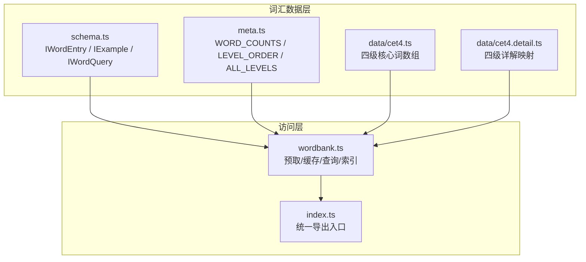
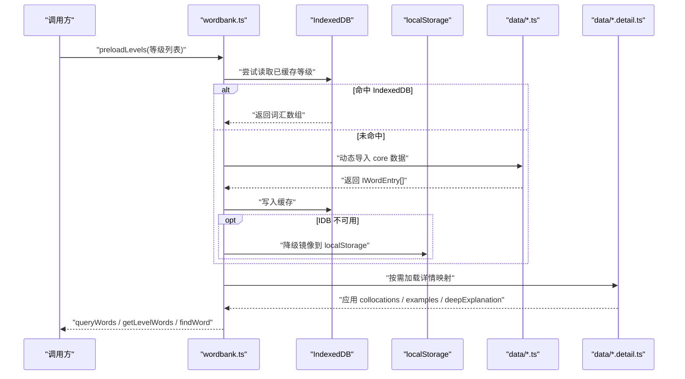
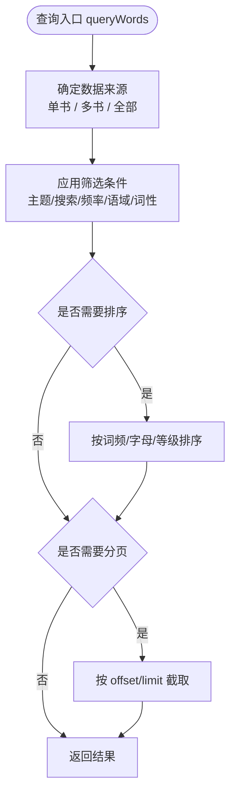
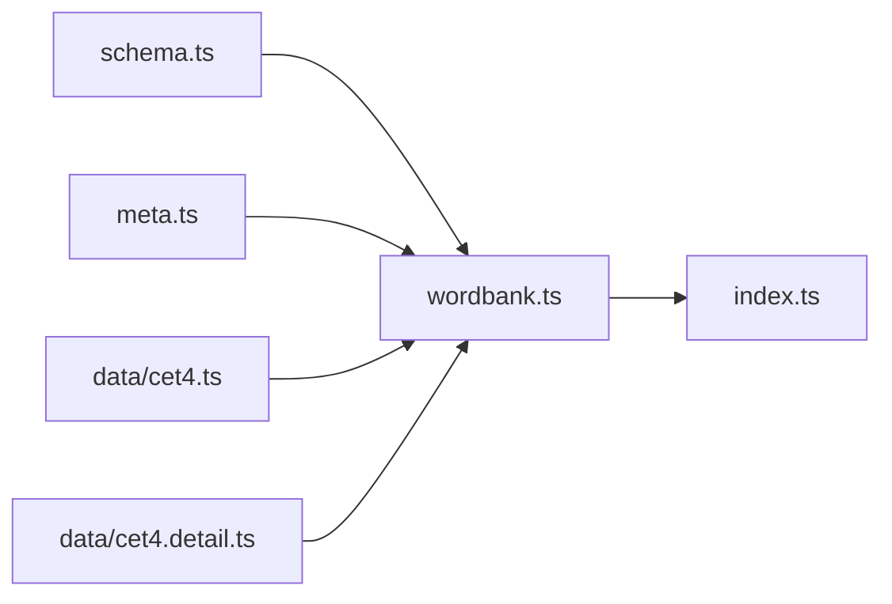

# 词汇模型

<cite>
**本文引用的文件**   
- [schema.ts](file://src/data/wordbank/schema.ts)
- [wordbank.ts](file://src/data/wordbank/wordbank.ts)
- [meta.ts](file://src/data/wordbank/meta.ts)
- [index.ts](file://src/data/wordbank/index.ts)
- [cet4.ts](file://src/data/wordbank/data/cet4.ts)
- [cet4.detail.ts](file://src/data/wordbank/data/cet4.detail.ts)
- [gen-wordbank.mjs](file://scripts/gen-wordbank.mjs)
- [generate-wordbank.ts](file://scripts/generate-wordbank.ts)
</cite>

## 目录
1. [引言](#引言)
2. [项目结构](#项目结构)
3. [核心数据模型](#核心数据模型)
4. [架构总览](#架构总览)
5. [详细组件分析](#详细组件分析)
6. [依赖关系分析](#依赖关系分析)
7. [导入、导出与迁移](#导入导出与迁移)
8. [性能优化建议](#性能优化建议)
9. [故障排查指南](#故障排查指南)
10. [结论](#结论)

## 引言
本文件为 NativeThink 应用的词汇数据模型文档，聚焦 `src/data/wordbank` 下的词汇库实现。内容覆盖：

- 词汇卡片的数据结构与验证约束；
- 词汇查询接口（筛选、排序、分页、随机抽样）；
- 元数据管理（版本、统计、级别标签与颜色）；
- 词汇数据的加载、缓存、预取机制；
- 导入导出格式及数据迁移脚本；
- 添加新词、更新词义与管理学习进度的实践路径；
- 批量插入、索引设计、内存管理等性能建议。

## 项目结构
词汇模块位于 `src/data/wordbank`，采用“类型定义 + 查询引擎 + 元数据 + 分等级数据文件”的组织方式：

**图表来源**
- [schema.ts:1-61](file://src/data/wordbank/schema.ts#L1-L61)
- [meta.ts:1-94](file://src/data/wordbank/meta.ts#L1-L94)
- [wordbank.ts:1-200](file://src/data/wordbank/wordbank.ts#L1-L200)
- [index.ts:1-10](file://src/data/wordbank/index.ts#L1-L10)

**章节来源**
- [schema.ts:1-61](file://src/data/wordbank/schema.ts#L1-L61)
- [meta.ts:1-94](file://src/data/wordbank/meta.ts#L1-L94)
- [wordbank.ts:1-200](file://src/data/wordbank/wordbank.ts#L1-L200)
- [index.ts:1-10](file://src/data/wordbank/index.ts#L1-L10)

## 核心数据模型
词汇模型由三类核心类型构成：词汇条目、例句、详情映射与查询参数。

### 词汇条目字段说明
| 字段 | 类型 | 含义 | 业务约束 |
|---|---|---|---|
| `word` | `string` | 英文单词 | 作为去重键使用，查询时按小写匹配 |
| `phonetic` | `string` | 音标 | 参与搜索 |
| `partOfSpeech` | `string` | 词性 | 可包含多词性组合，用于按词性过滤 |
| `meaning` | `string` | 中文释义 | 参与搜索 |
| `level` | 枚举字符串 | 词书等级 | 取值限定为中考、高考、四级、六级、四六级高频、四六级高分、雅思、托福、考研、专业、高阶、自定义 |
| `frequencyRank` | `number` | COCA 词频排名 | 数值越小越常用；可用于频率区间过滤与排序 |
| `collocations` | `string[]` | 搭配短语 | 未加载 detail 时为空数组；`hasCollocations` 提供不依赖 detail 的快捷判断 |
| `examples` | `IExample[]` | 中英例句对 | 未加载 detail 时为空数组 |
| `synonyms` | `string[]` | 同义词 | 可选扩展字段 |
| `antonyms` | `string[]` | 反义词 | 可选扩展字段 |
| `wordFamily` | `string[]` | 派生词族 | 可选扩展字段 |
| `register` | 枚举字符串 | 语域 | 正式、中性、非正式三选一 |
| `emotion` | 枚举字符串 | 情感色彩 | 积极、中性、消极三选一 |
| `topics` | `string[]` | 主题分类 | 支持按主题筛选 |
| `hasNoChineseEquivalent` | `boolean` | 无对应中文概念标记 | 辅助展示语义差异 |
| `hasCollocations` | `boolean` | 是否有搭配 | 等价于搭配数组非空，避免依赖 detail 是否加载 |
| `deepExplanation` | `string` | 深度解释 | 未加载 detail 时为空字符串 |

### 例句与详情映射
- `IExample` 表示一对中英文例句。
- `IWordDetail` 聚合搭配、例句、深度解释三个按需加载字段。
- `IWordDetailMap` 以小写单词为键，指向对应详情对象。

### 查询参数
`IWordQuery` 支持以下查询维度：

| 参数 | 类型 | 行为 |
|---|---|---|
| `level` | 字符串或字符串数组 | 指定单本书或多本书；`all` 触发跨书合并 |
| `topic` | 字符串 | 按主题过滤 |
| `search` | 字符串 | 在单词、释义、音标中模糊匹配 |
| `frequencyMin` / `frequencyMax` | 数字 | 按 COCA 词频范围过滤 |
| `register` | 字符串 | 按语域过滤 |
| `pos` | 字符串 | 按词性过滤 |
| `sortBy` | 枚举字符串 | 按词频、字母顺序、等级顺序排序 |
| `limit` / `offset` | 数字 | 分页截取 |

**章节来源**
- [schema.ts:1-61](file://src/data/wordbank/schema.ts#L1-L61)

## 架构总览
词汇访问层围绕“懒加载 + 双缓存 + 惰性索引”构建：

**图表来源**
- [wordbank.ts:1-200](file://src/data/wordbank/wordbank.ts#L1-L200)
- [wordbank.ts:201-558](file://src/data/wordbank/wordbank.ts#L201-L558)

## 详细组件分析

### 词汇数据访问接口
`wordbank.ts` 暴露预取、状态检查、查询、随机抽样、主题收集等能力，并通过 `index.ts` 统一导出。

#### 预取与就绪状态
| 接口 | 用途 | 关键行为 |
|---|---|---|
| `preloadLevels(levels)` | 预取多个等级的核心与详情 | 并发预取，每个等级内部串行保证稳定 |
| `preloadCoreOnly(levels)` | 仅预取核心字段 | 适合搜索、查词场景，跳过详情加载 |
| `preloadDetail(levels)` | 单独加载详情 | 幂等、并发安全、失败静默 |
| `preloadAll()` | 预取全部等级 | 串行加载，避免同时导入大量数据导致内存峰值 |
| `preloadProgressive(onLevelLoaded?)` | 渐进式预取 | 先加载用户当前等级与相邻等级，再后台加载其余等级 |
| `isLevelReady(level)` | 检查某等级是否已加载 | 基于内部已加载集合 |
| `isAllReady()` | 检查是否全部加载完成 | 全部等级加载成功后置位 |
| `isDetailReady(level)` | 检查详情是否已加载 | 基于详情加载集合 |

#### 查询与索引
| 接口 | 返回值 | 行为要点 |
|---|---|---|
| `getLevelWords(level)` | `IWordEntry[]` | 返回该书缓存词表；未预取时返回空数组 |
| `getAllWords()` | `IWordEntry[]` | 返回全局去重后的词表 |
| `getTotalLearnableCount()` | `number` | 返回“全部”模式的可学唯一词数，而非各书相加 |
| `getWordCounts()` | `Record<string, number>` | 每本书的池子大小（书内去重），与闪卡出卡口径一致 |
| `queryWords(params)` | `IWordEntry[]` | 支持 level、topic、search、频率区间、语域、词性、排序、分页 |
| `getRandomWords(count, level?)` | `IWordEntry[]` | 从池中采样；大数据集使用索引抽样降低内存压力 |
| `findWord(word)` | `IWordEntry | undefined` | 按小写单词查找，使用内部单词索引 |
| `getAllTopics()` | `string[]` | 收集所有主题并排序 |
| `getWordsByLevel()` | `Record<string, IWordEntry[]>` | 按等级分组输出 |

#### 缓存策略
- 版本号常量控制缓存兼容；当前版本处理了坏字符清理问题。
- 主存储优先使用 IndexedDB，容量更大；localStorage 仅在 IndexedDB 不可用时作为兜底。
- 详情映射也采用同样的 IndexedDB 优先、localStorage 兜底策略。
- 旧版无条件双写的 localStorage 镜像会在探测 IndexedDB 可用后逐步清理，避免占用配额。

#### 索引机制
- `_levelIndex`：每本书的词表，按“书内去重”构建，保证词书卡片显示数量与闪卡池一致。
- `_allWordsCache`：全局唯一词表，用于“全部”模式和随机抽样。
- `_wordIndex`：单词到对象的映射，提升查找性能。
- 索引在首次需要时构建，并在任何等级加载后失效重建。

**图表来源**
- [wordbank.ts:300-420](file://src/data/wordbank/wordbank.ts#L300-L420)

**章节来源**
- [wordbank.ts:1-200](file://src/data/wordbank/wordbank.ts#L1-L200)
- [wordbank.ts:201-558](file://src/data/wordbank/wordbank.ts#L201-L558)
- [index.ts:1-10](file://src/data/wordbank/index.ts#L1-L10)

### 元数据管理
`meta.ts` 提供轻量级元数据，不引入实际词汇数据，适合用于计数、标签、颜色等界面展示。

| 类别 | 名称 | 含义 |
|---|---|---|
| 可学词数 | `WORD_COUNTS` | 每本书可学的去重单词数，必须与查询池大小一致 |
| 原始词条数 | `WORD_ENTRIES` | 数据文件中含重复词性的原始条目总数 |
| 总计 | `TOTAL_ENTRIES` | 所有书原始词条之和 |
| 唯一词总数 | `TOTAL_UNIQUE_WORDS` | “全部”模式的真实池子大小 |
| 级别标签 | `LEVEL_LABELS` | 各级别中文名称 |
| 级别列表 | `ALL_LEVELS` | 受支持的词书等级顺序 |
| 级别顺序 | `LEVEL_ORDER` | 用于按等级排序 |
| 级别颜色 | `LEVEL_COLORS` | 各级别的视觉标识色 |

注意：
- 可学词数与原始词条数不同，前者用于进度分母和闪卡池，后者仅用于规模说明。
- “全部”模式不应将各书可学词数相加，而应使用唯一词总数或运行时查询结果。

**章节来源**
- [meta.ts:1-94](file://src/data/wordbank/meta.ts#L1-L94)

### 数据文件组织
词汇数据按等级拆分为核心数组与详情映射两个文件：

- 核心数据：例如 `data/cet4.ts`，导出一个包含 `IWordEntry[]` 的命名常量。
- 详情数据：例如 `data/cet4.detail.ts`，导出一个 `IWordDetailMap`，包含搭配、例句、深度解释。

这种拆分带来以下好处：

1. 核心数据可独立加载，适合快速预览和搜索。
2. 详情数据按需加载，减少首屏体积。
3. 详情通过就地修改已加载的核心对象，使索引中的引用自动获得详情。
4. 新增等级只需新增一对核心文件和详情文件，并注册到加载器。

**章节来源**
- [cet4.ts](file://src/data/wordbank/data/cet4.ts)
- [cet4.detail.ts](file://src/data/wordbank/data/cet4.detail.ts)

## 依赖关系分析
词汇模块内部依赖关系如下：

**图表来源**
- [schema.ts:1-61](file://src/data/wordbank/schema.ts#L1-L61)
- [meta.ts:1-94](file://src/data/wordbank/meta.ts#L1-L94)
- [wordbank.ts:1-200](file://src/data/wordbank/wordbank.ts#L1-L200)
- [index.ts:1-10](file://src/data/wordbank/index.ts#L1-L10)

### 耦合与内聚
- `schema.ts` 是纯类型契约，被查询层和数据生成脚本共同引用，内聚度高。
- `meta.ts` 与查询层解耦，只暴露静态元数据，避免引入大体积词汇数据。
- `wordbank.ts` 集中管理加载、缓存、索引和查询，是模块的内核。
- 数据文件通过动态导入与查询层解耦，便于增量加载。

### 外部依赖
- 本地持久化依赖 `idbGet`、`idbSet`、`idbHas`、`idbDelete`，用于 IndexedDB 与 localStorage 操作。
- 数据生成脚本依赖 Node.js 文件系统与网络请求。

**章节来源**
- [wordbank.ts:1-200](file://src/data/wordbank/wordbank.ts#L1-L200)
- [meta.ts:1-94](file://src/data/wordbank/meta.ts#L1-L94)

## 导入、导出与迁移

### 导入格式
仓库中存在两类数据生成脚本：

1. **传统手写示例脚本**：`scripts/gen-wordbank.mjs`  
   - 使用工具函数构造词汇条目，直接写出 `IWordEntry[]` 数组。
   - 适合少量样例或测试数据。

2. **远程数据生成脚本**：`scripts/generate-wordbank.ts`  
   - 从外部 JSON 源拉取词汇，转换为 `IWordEntry[]` 并写入 `src/data/wordbank/data/{level}.ts`。
   - 会自动推导词性、释义、搭配、例句、主题等字段。

推荐流程：

- 如果已有结构化词表，优先使用远程数据生成脚本模板，将其适配到目标等级。
- 如果只需要补充少量词条，可在现有等级文件中追加，但需注意同形词去重规则。

### 导出格式
- 核心数据导出为 TypeScript 模块，导出名为 `{LEVEL}_WORDS` 的 `IWordEntry[]`。
- 详情数据导出为 TypeScript 模块，导出名为 `{LEVEL}_DETAIL` 的 `IWordDetailMap`。
- 运行时的标准导出入口是 `index.ts`，对外暴露查询与预取 API。

### 数据迁移
- 缓存版本常量用于处理数据格式变化，例如清理坏字符后需保持版本一致，避免旧缓存屏蔽新数据。
- 旧版 localStorage 镜像会在 IndexedDB 健康时被清理，防止配额耗尽影响用户数据。
- 新增等级时，应同步更新：
  - 核心数据文件；
  - 详情数据文件；
  - 加载器中的等级分支；
  - 元数据中的级别标签、顺序、颜色；
  - 可学词数与唯一词统计。

**章节来源**
- [gen-wordbank.mjs:1-54](file://scripts/gen-wordbank.mjs#L1-L54)
- [generate-wordbank.ts:1-120](file://scripts/generate-wordbank.ts#L1-L120)
- [wordbank.ts:1-200](file://src/data/wordbank/wordbank.ts#L1-L200)
- [meta.ts:1-94](file://src/data/wordbank/meta.ts#L1-L94)

## 性能优化建议

### 批量插入
- 不建议在运行时频繁向 `IWordEntry[]` 中逐个追加词条，应优先在数据生成阶段拼接完整数组。
- 如需扩展词库，建议在脚本中批量生成新的等级文件或合并现有文件，然后重新计算统计值。

### 索引设计
- 利用已有的 `_levelIndex`、`_allWordsCache`、`_wordIndex`，避免每次查询都扫描全量数据。
- 按等级查询时使用 `getLevelWords` 或 `queryWords({ level })`，避免遍历全部词表。
- 按单词查找时使用 `findWord`，而不是在结果中线性搜索。

### 内存管理
- 预取全部等级时采用串行加载，避免同时导入大量模块造成内存峰值。
- 详情数据按需加载，搜索、查词等轻量场景使用 `preloadCoreOnly`。
- 随机抽样在大池中小样本时使用索引抽样算法，减少复制开销。

### 缓存策略
- 优先使用 IndexedDB 缓存，避免 localStorage 配额限制。
- 确保缓存版本与数据清洗逻辑保持一致，避免因版本不匹配导致旧缓存污染。
- 定期清理不再使用的旧等级缓存，防止存储膨胀。

### 排序与分页
- 只在显式请求排序时才进行排序，避免不必要的数组拷贝。
- 分页应在排序之后执行，以保证页面对应的是最终有序结果。

**章节来源**
- [wordbank.ts:201-558](file://src/data/wordbank/wordbank.ts#L201-L558)

## 故障排查指南

### 词书卡片数量与闪卡数量不一致
可能原因：

- 使用了原始词条数而不是去重后可学词数。
- 跨书重复词被错误分配给“先加载的那本书”。
- 使用了错误的总数口径。

处理方式：

- 使用 `getWordCounts()` 获取每本书的去重池大小。
- 使用 `getTotalLearnableCount()` 获取“全部”模式的可学词数。
- 不要将各书可学词数相加作为“全部”总数。

**章节来源**
- [wordbank.ts:300-420](file://src/data/wordbank/wordbank.ts#L300-L420)
- [meta.ts:1-94](file://src/data/wordbank/meta.ts#L1-L94)

### 详情字段为空
可能原因：

- 尚未调用详情预取接口。
- 详情加载失败，但核心数据仍可用。
- 详情缓存版本不匹配。

处理方式：

- 对详情页或需要搭配的界面调用 `preloadDetail`。
- 检查详情 IndexedDB 或 localStorage 是否存在损坏缓存。
- 确认缓存版本与数据清洗逻辑一致。

**章节来源**
- [wordbank.ts:201-360](file://src/data/wordbank/wordbank.ts#L201-L360)

### 存储空间不足
可能原因：

- 旧版 localStorage 镜像占满配额。
- IndexedDB 不可用，降级到 localStorage 后触发配额异常。

处理方式：

- 让应用正常启动，以便触发旧镜像清理逻辑。
- 清除浏览器站点数据或应用缓存。
- 避免在低配额环境中长期双写大型词书数据。

**章节来源**
- [wordbank.ts:1-200](file://src/data/wordbank/wordbank.ts#L1-L200)

## 结论
NativeThink 的词汇模型以清晰的类型定义为基础，通过懒加载、分层缓存和惰性索引实现了高性能的词汇查询体验。`schema.ts` 定义了词汇卡片结构，`wordbank.ts` 提供了完整的访问接口，`meta.ts` 提供轻量元数据，数据文件按等级拆分以实现按需加载。在实际使用中，应优先使用官方预取与查询接口，避免直接操作内部缓存；在扩展词库时，应遵循脚本生成规范并同步更新元数据与统计值。