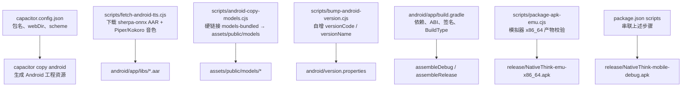
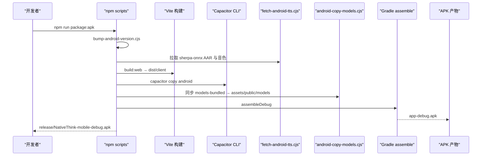
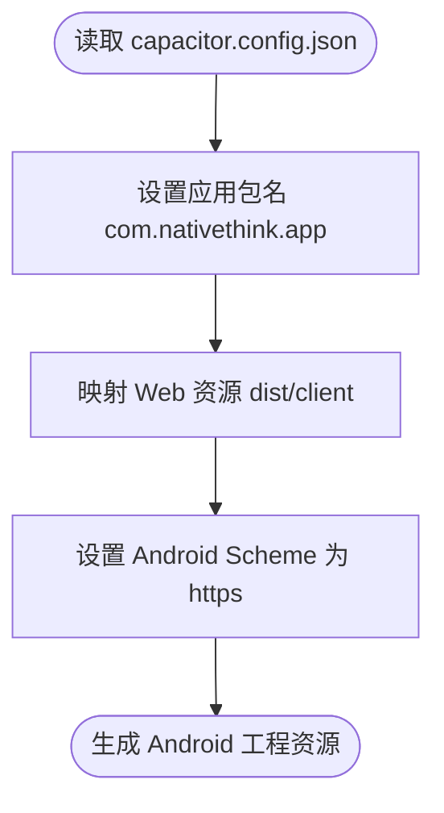
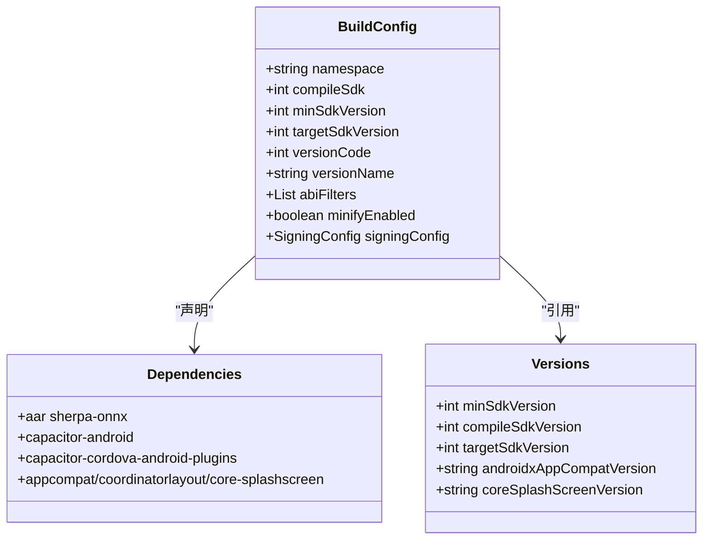
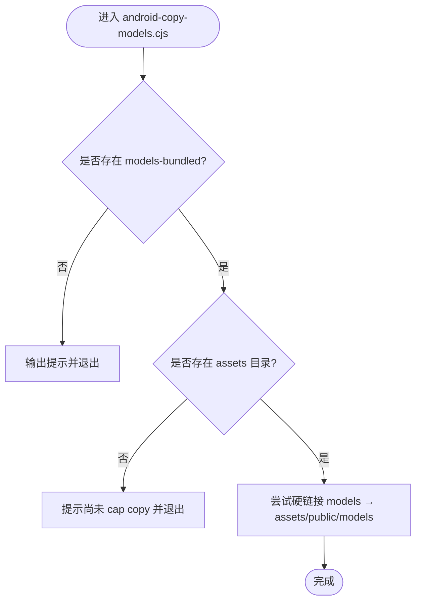
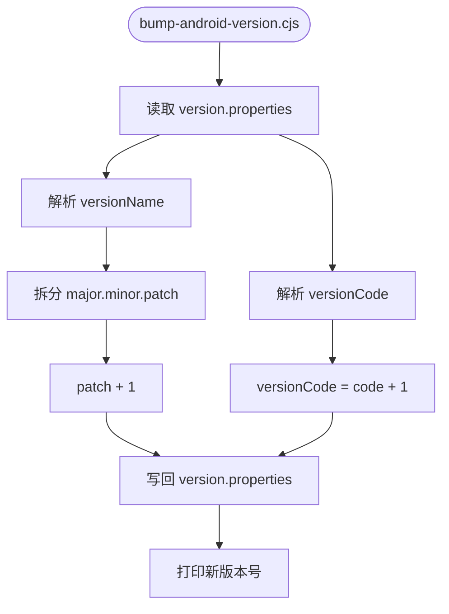
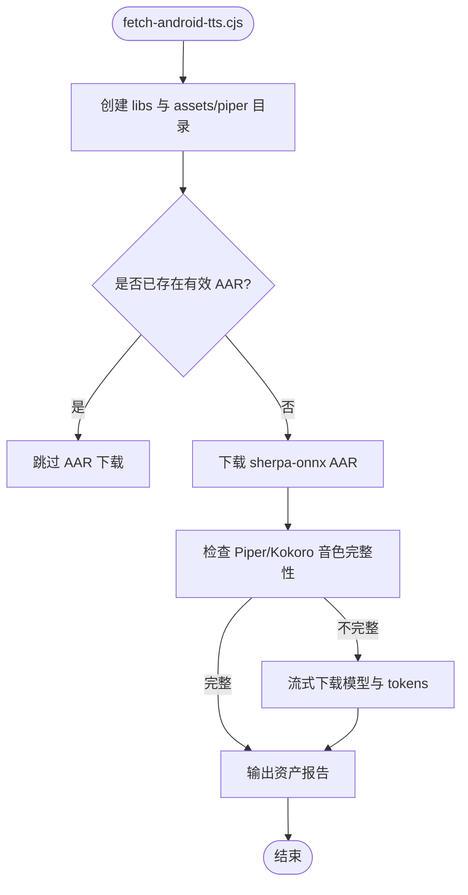
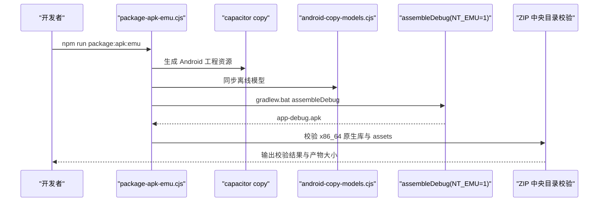
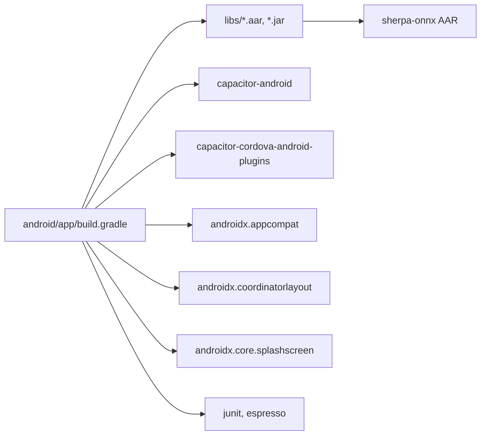
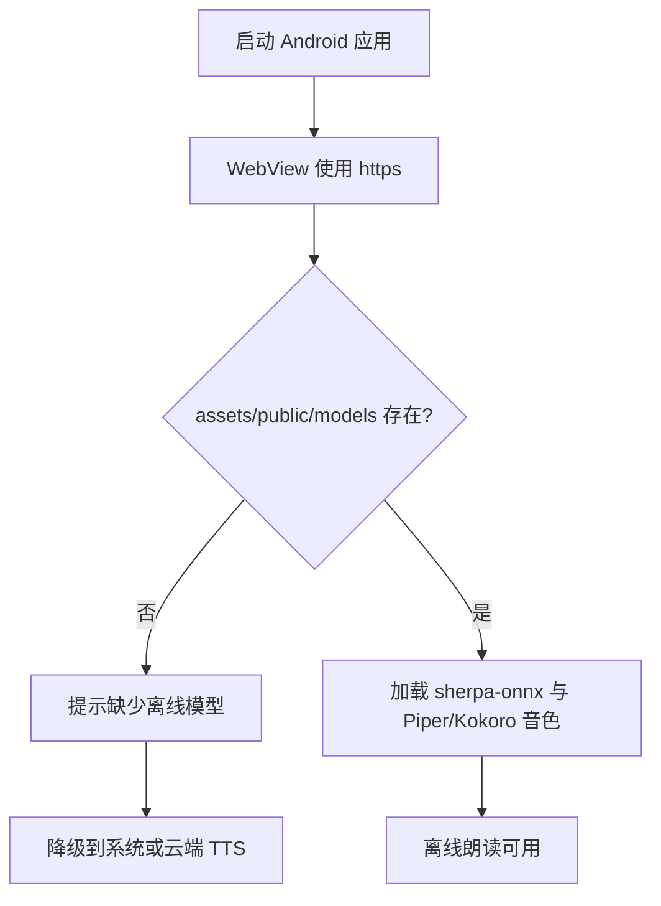

# Android 应用打包

<cite>
**本文引用的文件**   
- [capacitor.config.json](file://capacitor.config.json)
- [android/app/build.gradle](file://android/app/build.gradle)
- [android/app/capacitor.build.gradle](file://android/app/capacitor.build.gradle)
- [android/app/proguard-rules.pro](file://android/app/proguard-rules.pro)
- [android/variables.gradle](file://android/variables.gradle)
- [android/version.properties](file://android/version.properties)
- [android/gradle.properties](file://android/gradle.properties)
- [scripts/android-copy-models.cjs](file://scripts/android-copy-models.cjs)
- [scripts/bump-android-version.cjs](file://scripts/bump-android-version.cjs)
- [scripts/fetch-android-tts.cjs](file://scripts/fetch-android-tts.cjs)
- [scripts/package-apk-emu.cjs](file://scripts/package-apk-emu.cjs)
- [package.json](file://package.json)
- [src/lib/sherpa-tts.ts](file://src/lib/sherpa-tts.ts)
</cite>

## 目录
1. [简介](#简介)
2. [项目结构](#项目结构)
3. [核心组件](#核心组件)
4. [架构总览](#架构总览)
5. [详细组件分析](#详细组件分析)
6. [依赖关系分析](#依赖关系分析)
7. [性能与内存优化](#性能与内存优化)
8. [调试与离线适配](#调试与离线适配)
9. [APK/AAB 构建、签名与发布](#apkab-构建签名与发布)
10. [故障排查](#故障排查)
11. [结论](#结论)

## 简介
本文面向使用 Capacitor 将 NativeThink Web 前端打包为 Android 应用的开发者，聚焦 Android 端打包链路：Capacitor 配置、Gradle 构建、sherpa-onnx 离线朗读模型拷贝、版本管理与脚本流水线，并给出 APK 构建、签名与发布到 Google Play Store 的完整流程、常见问题及优化建议。

## 项目结构
Android 相关代码主要分布在三个位置：
- 根级 Capacitor 配置：`capacitor.config.json`
- Android Gradle 工程：`android/` 下包含 `app/`、`gradle/`、`version.properties`、`variables.gradle`、`gradle.properties` 等
- 构建辅助脚本：`scripts/` 下的 `android-copy-models.cjs`、`bump-android-version.cjs`、`fetch-android-tts.cjs`、`package-apk-emu.cjs`
- 前端 TTS 逻辑：`src/lib/sherpa-tts.ts`

**图表来源**
- [capacitor.config.json:1-11](file://capacitor.config.json#L1-L11)
- [scripts/fetch-android-tts.cjs:1-274](file://scripts/fetch-android-tts.cjs#L1-L274)
- [scripts/android-copy-models.cjs:1-23](file://scripts/android-copy-models.cjs#L1-L23)
- [scripts/bump-android-version.cjs:1-27](file://scripts/bump-android-version.cjs#L1-L27)
- [android/app/build.gradle:1-95](file://android/app/build.gradle#L1-L95)
- [scripts/package-apk-emu.cjs:1-85](file://scripts/package-apk-emu.cjs#L1-L85)
- [package.json:1-130](file://package.json#L1-L130)

**章节来源**
- [capacitor.config.json:1-11](file://capacitor.config.json#L1-L11)
- [android/app/build.gradle:1-95](file://android/app/build.gradle#L1-L95)
- [android/variables.gradle:1-16](file://android/variables.gradle#L1-L16)
- [android/version.properties:1-2](file://android/version.properties#L1-L2)
- [android/gradle.properties:1-25](file://android/gradle.properties#L1-L25)
- [scripts/android-copy-models.cjs:1-23](file://scripts/android-copy-models.cjs#L1-L23)
- [scripts/bump-android-version.cjs:1-27](file://scripts/bump-android-version.cjs#L1-L27)
- [scripts/fetch-android-tts.cjs:1-274](file://scripts/fetch-android-tts.cjs#L1-L274)
- [scripts/package-apk-emu.cjs:1-85](file://scripts/package-apk-emu.cjs#L1-L85)
- [package.json:1-130](file://package.json#L1-L130)

## 核心组件
本节按打包关键职责梳理核心文件及其作用。

| 组件 | 作用 | 关键点 |
|---|---|---|
| capacitor.config.json | 定义 Capacitor 应用标识、Web 资源目录、Android Scheme | 包名 `com.nativethink.app`；webDir 指向 `dist/client`；server.androidScheme 为 `https` |
| android/app/build.gradle | Gradle 应用构建入口 | 版本号来自 `version.properties`；ABI 过滤；签名配置；依赖声明 |
| android/app/capacitor.build.gradle | Capacitor 自动生成的扩展构建脚本 | Java 21 兼容；引入社区 TTS 插件 |
| android/variables.gradle | 集中 SDK 与第三方库版本 | compileSdk/targetSdk/minSdk 均为 Android 平台版本；AppCompat、CoordinatorLayout、Core SplashScreen 等 |
| android/version.properties | 语义化版本与内部构建号 | `versionCode` 递增；`versionName` 采用 `major.minor.patch` |
| scripts/bump-android-version.cjs | 每次构建前自增 `versionCode` 和 `patch` | 不修改 major/minor，仅 patch+1 |
| scripts/fetch-android-tts.cjs | 拉取 sherpa-onnx AAR 与 Piper/Kokoro 音色资产 | 通过 hf-mirror 镜像；支持流式下载大模型 |
| scripts/android-copy-models.cjs | 将 `models-bundled` 同步到 `assets/public/models` | 优先硬链接，失败回退真实复制 |
| scripts/package-apk-emu.cjs | 生成仅供模拟器的 x86_64 产物并自检 | 不改动仓库版本线；检查 zip 中央目录条目 |
| package.json scripts | 编排完整打包流水线 | `package:apk`、`package:apk:emu`、`package:web` 串联各步骤 |
| src/lib/sherpa-tts.ts | 前端侧 Sherpa-TTS 调用封装 | 本地语音选择、预热身、并发控制、降级策略 |

**章节来源**
- [capacitor.config.json:1-11](file://capacitor.config.json#L1-L11)
- [android/app/build.gradle:1-95](file://android/app/build.gradle#L1-L95)
- [android/app/capacitor.build.gradle:1-19](file://android/app/capacitor.build.gradle#L1-L19)
- [android/variables.gradle:1-16](file://android/variables.gradle#L1-L16)
- [android/version.properties:1-2](file://android/version.properties#L1-L2)
- [scripts/bump-android-version.cjs:1-27](file://scripts/bump-android-version.cjs#L1-L27)
- [scripts/fetch-android-tts.cjs:1-274](file://scripts/fetch-android-tts.cjs#L1-L274)
- [scripts/android-copy-models.cjs:1-23](file://scripts/android-copy-models.cjs#L1-L23)
- [scripts/package-apk-emu.cjs:1-85](file://scripts/package-apk-emu.cjs#L1-L85)
- [package.json:1-130](file://package.json#L1-L130)
- [src/lib/sherpa-tts.ts:1-278](file://src/lib/sherpa-tts.ts#L1-L278)

## 架构总览
NativeThink 的 Android 打包链路由 Node 脚本与 Gradle 共同完成：Node 负责资源准备与版本管理，Gradle 负责编译打包。

**图表来源**
- [package.json:21-33](file://package.json#L21-L33)
- [scripts/bump-android-version.cjs:1-27](file://scripts/bump-android-version.cjs#L1-L27)
- [scripts/fetch-android-tts.cjs:1-274](file://scripts/fetch-android-tts.cjs#L1-L274)
- [scripts/android-copy-models.cjs:1-23](file://scripts/android-copy-models.cjs#L1-L23)
- [android/app/build.gradle:1-95](file://android/app/build.gradle#L1-L95)

## 详细组件分析

### Capacitor 配置
`capacitor.config.json` 是 Capacitor 工程的元数据入口，决定 Android 应用的基本行为：
- `appId`：Android 包名 `com.nativethink.app`，与 Gradle 中 `applicationId` 一致
- `appName`：显示名称 `NativeThink`
- `webDir`：Web 输出目录 `dist/client`，对应 Vite 构建产物
- `android.allowMixedContent`：禁止混合内容，提升安全
- `server.androidScheme`：强制 HTTPS scheme，避免 WebView 在调试或发布时因 HTTP 被限制

**图表来源**
- [capacitor.config.json:1-11](file://capacitor.config.json#L1-L11)

**章节来源**
- [capacitor.config.json:1-11](file://capacitor.config.json#L1-L11)

### Gradle 构建配置
Gradle 构建集中在 `android/app/build.gradle`，核心要点如下：

| 维度 | 配置说明 |
|---|---|
| 命名空间与应用 ID | `namespace` 与 `applicationId` 均使用 `com.nativethink.app` |
| SDK 版本 | `compileSdk`、`targetSdkVersion`、`minSdkVersion` 取自 `variables.gradle` |
| 版本号 | `versionCode` 与 `versionName` 从 `version.properties` 读取 |
| ABI 过滤 | 默认只打 `arm64-v8a` 与 `armeabi-v7a`；设置环境变量 `NT_EMU=1` 时只打 `x86_64` |
| 资源忽略模式 | `aaptOptions.ignoreAssetsPattern` 调整默认忽略规则 |
| 签名配置 | 若存在 `keystore.properties`，则启用 release 签名；debug 也复用同一把密钥以避免覆盖安装冲突 |
| BuildType | release 启用 ProGuard 但关闭代码压缩（`minifyEnabled false`）；debug 保留调试能力 |
| 依赖 | 包括本地 `libs` 中的 AAR/JAR、Capacitor 主模块、Cordova 插件模块、AndroidX 基础库、测试框架 |

**图表来源**
- [android/app/build.gradle:1-95](file://android/app/build.gradle#L1-L95)
- [android/variables.gradle:1-16](file://android/variables.gradle#L1-L16)

**章节来源**
- [android/app/build.gradle:1-95](file://android/app/build.gradle#L1-L95)
- [android/variables.gradle:1-16](file://android/variables.gradle#L1-L16)

### ProGuard 混淆规则
当前 `proguard-rules.pro` 以注释形式提供示例规则，实际构建中 `minifyEnabled` 为 `false`，因此默认不会执行混淆。如需开启混淆，需要：
- 将 `build.gradle` 中 `minifyEnabled` 改为 `true`
- 根据 WebView JS Interface、Sherpa-TTS 原生桥接类添加 `-keep` 规则
- 打开行号保留注释以便定位崩溃堆栈

**章节来源**
- [android/app/proguard-rules.pro:1-21](file://android/app/proguard-rules.pro#L1-L21)
- [android/app/build.gradle:58-75](file://android/app/build.gradle#L58-L75)

### Android 资源与模型拷贝
`scripts/android-copy-models.cjs` 用于在 `capacitor copy android` 之后，将 `models-bundled` 中的离线模型复制到 `android/app/src/main/assets/public/models`。该脚本的关键设计：
- 如果 `models-bundled` 不存在，跳过并提示 APK 不含离线模型
- 如果尚未执行 `cap copy`，跳过等待资源目录生成
- 优先使用硬链接实现“瞬间同步”，减少磁盘占用；不支持硬链接时回退真实复制
- 借助 `lib/link-copy.cjs` 提供的 `copyTree` 函数进行递归处理

**图表来源**
- [scripts/android-copy-models.cjs:1-23](file://scripts/android-copy-models.cjs#L1-L23)

**章节来源**
- [scripts/android-copy-models.cjs:1-23](file://scripts/android-copy-models.cjs#L1-L23)

### 版本管理逻辑
`scripts/bump-android-version.cjs` 负责在每次打包前更新 `android/version.properties`：
- 读取现有 `versionCode` 与 `versionName`
- `versionCode` 自增 1，保证升级安装不被拒绝
- `versionName` 保持 `major.minor.patch` 格式，仅对 `patch` 加 1
- 若未找到 `version.properties`，使用默认值 `versionCode=1`、`versionName=2.0.0`

**图表来源**
- [scripts/bump-android-version.cjs:1-27](file://scripts/bump-android-version.cjs#L1-L27)

**章节来源**
- [scripts/bump-android-version.cjs:1-27](file://scripts/bump-android-version.cjs#L1-L27)
- [android/version.properties:1-2](file://android/version.properties#L1-L2)

### 离线朗读引擎与模型获取
`scripts/fetch-android-tts.cjs` 负责拉取 Android 端离线 TTS 所需二进制与音色：
- sherpa-onnx Android AAR：静态链接 ONNX Runtime，避免符号冲突
- Piper 英文音色：VITS/ONNX 模型与 espeak-ng 数据
- Kokoro 多语言模型：int8 量化，多说话人，复用 Piper 的 espeak-ng-data
- 所有资源从 hf-mirror 拉取，避免国内访问 GitHub 问题
- 支持断点续传、并发下载、大小校验、流式下载大模型

**图表来源**
- [scripts/fetch-android-tts.cjs:1-274](file://scripts/fetch-android-tts.cjs#L1-L274)

**章节来源**
- [scripts/fetch-android-tts.cjs:1-274](file://scripts/fetch-android-tts.cjs#L1-L274)
- [android/app/build.gradle:83-90](file://android/app/build.gradle#L83-L90)

### 模拟器专用构建脚本
`scripts/package-apk-emu.cjs` 专门为 AVD 模拟器生成 x86_64 的 debug APK，并与正式发布 APK 完全分线：
- 不自增 `versionCode`，不影响仓库版本线
- 设置 `NT_EMU=1`，让 Gradle 只打 `x86_64`
- 产物输出到 `release/NativeThink-emu-x86_64.apk`，不覆盖手机 debug APK
- 构建完成后直接读取 APK 的 zip 中央目录，校验是否存在：
  - `lib/x86_64/libsherpa-onnx-jni.so`
  - `assets/public/index.html`
  - `assets/public/books/`、`assets/piper/`、`assets/tts/`
- 同时确认没有混入 arm 架构

**图表来源**
- [scripts/package-apk-emu.cjs:1-85](file://scripts/package-apk-emu.cjs#L1-L85)

**章节来源**
- [scripts/package-apk-emu.cjs:1-85](file://scripts/package-apk-emu.cjs#L1-L85)

### 前端 Sherpa-TTS 集成
`src/lib/sherpa-tts.ts` 在前端侧封装了 Sherpa-TTS 调用逻辑，包括：
- 本地语音识别与选择
- 发音预热身，降低首次合成延迟
- 并发请求计数与去重缓存
- 在线或系统 TTS 降级路径

它与 Android 端 sherpa-onnx 的关系是：Android 层提供原生离线合成能力，前端层通过 Capacitor 插件或桥接机制调用。

**章节来源**
- [src/lib/sherpa-tts.ts:1-278](file://src/lib/sherpa-tts.ts#L1-L278)

## 依赖关系分析
Gradle 依赖主要由以下部分组成：
- 本地文件树：`libs` 目录下的 AAR 与 JAR，其中 AAR 由 `fetch-android-tts.cjs` 拉取
- Capacitor 主模块：`project(':capacitor-android')`
- Cordova 插件模块：`project(':capacitor-cordova-android-plugins')`
- AndroidX 基础库：AppCompat、CoordinatorLayout、Core SplashScreen
- 测试框架：JUnit、Espresso

**图表来源**
- [android/app/build.gradle:83-95](file://android/app/build.gradle#L83-L95)

**章节来源**
- [android/app/build.gradle:83-95](file://android/app/build.gradle#L83-L95)
- [android/variables.gradle:1-16](file://android/variables.gradle#L1-L16)

## 性能与内存优化
- ABI 过滤：默认只打包 `arm64-v8a` 与 `armeabi-v7a`，可显著减小 APK 体积；模拟器单独使用 `NT_EMU=1` 生成 x86_64 产物
- 资源忽略模式：通过 `aaptOptions.ignoreAssetsPattern` 排除不必要的资源
- 代码压缩：当前 release 构建 `minifyEnabled=false`；如需进一步减小体积，可开启 ProGuard 并补充必要 keep 规则
- Gradle JVM 参数：`gradle.properties` 中设置了较大的堆内存，有助于大型项目构建稳定
- 模型加载：sherpa-onnx 与 Kokoro/Piper 模型较大，建议在启动阶段按需预加载，避免阻塞 UI

**章节来源**
- [android/app/build.gradle:22-44](file://android/app/build.gradle#L22-L44)
- [android/gradle.properties:1-25](file://android/gradle.properties#L1-L25)
- [scripts/package-apk-emu.cjs:1-85](file://scripts/package-apk-emu.cjs#L1-L85)

## 调试与离线适配
- WebView Scheme：强制 `https`，避免混合内容导致页面无法加载
- Debug 签名：若存在 keystore，debug 与 release 共用同一把密钥，避免互相覆盖安装要求卸载
- 离线模型：必须确保 `models-bundled` 存在并在 `cap copy` 后执行 `android-copy-models.cjs`，否则 APK 不包含离线模型
- 离线朗读：Android 端内置 sherpa-onnx，前端通过 `sherpa-tts.ts` 选择本地语音；如模型缺失或初始化失败，会降级到系统或云端 TTS

**图表来源**
- [capacitor.config.json:1-11](file://capacitor.config.json#L1-L11)
- [scripts/android-copy-models.cjs:1-23](file://scripts/android-copy-models.cjs#L1-L23)
- [src/lib/sherpa-tts.ts:1-278](file://src/lib/sherpa-tts.ts#L1-L278)

**章节来源**
- [capacitor.config.json:1-11](file://capacitor.config.json#L1-L11)
- [android/app/build.gradle:46-75](file://android/app/build.gradle#L46-L75)
- [scripts/android-copy-models.cjs:1-23](file://scripts/android-copy-models.cjs#L1-L23)
- [src/lib/sherpa-tts.ts:1-278](file://src/lib/sherpa-tts.ts#L1-L278)

## APK/AAB 构建、签名与发布

### 构建命令
- 开发调试 APK：`npm run package:apk`
  - 自增版本
  - 拉取 TTS 资源
  - 构建 Web 前端
  - 执行 `capacitor copy android`
  - 同步离线模型
  - 调用 Gradle `assembleDebug`
  - 输出 `release/NativeThink-mobile-debug.apk`
- 模拟器 APK：`npm run package:apk:emu`
  - 不改变仓库版本
  - 生成 x86_64 产物 `release/NativeThink-emu-x86_64.apk`
  - 自动校验 ZIP 中央目录条目

**章节来源**
- [package.json:21-33](file://package.json#L21-L33)
- [scripts/package-apk-emu.cjs:1-85](file://scripts/package-apk-emu.cjs#L1-L85)

### 签名配置
- 若存在 `android/keystore.properties`，Gradle 会在 release 构建中使用固定密钥库
- 建议将 `keystore.properties` 加入 `.gitignore`，避免泄露凭据
- Debug 构建也可复用 release 密钥，避免调试与发布之间覆盖安装冲突

### 发布到 Google Play Store
Google Play 要求上传 AAB（Android App Bundle），而当前脚本链主要生成 APK。推荐步骤：
1. 准备签名密钥库与 `keystore.properties`
2. 在 `android/app/build.gradle` 中启用 `minifyEnabled true` 并完善 ProGuard 规则
3. 使用 Gradle 命令生成 AAB：`./gradlew bundleRelease`
4. 上传 `app-release.aab` 到 Google Play Console
5. 填写应用信息、隐私政策、分级问卷、截图等
6. 选择发布渠道：Internal Testing、Closed Testing、Open Testing 或 Production
7. 监控审核状态与用户反馈

注意：当前仓库未提供 AAB 打包脚本，需手动执行 Gradle 任务；若需要自动化，可在 `package.json` 中新增 `bundle:release` 脚本。

**章节来源**
- [android/app/build.gradle:46-75](file://android/app/build.gradle#L46-L75)
- [package.json:21-33](file://package.json#L21-L33)

## 故障排查

| 现象 | 可能原因 | 解决建议 |
|---|---|---|
| 安装时报“应用已存在，请先卸载” | debug/release 使用不同签名或 `versionCode` 未递增 | 使用统一签名；确保 `bump-android-version.cjs` 已运行 |
| 离线朗读无声音 | `assets/public/models` 缺失或未执行 `android-copy-models.cjs` | 在 `cap copy` 后重新执行脚本；确认 `models-bundled` 存在 |
| 模拟器装不上或闪退 | 使用了 arm ABI 的发布 APK | 使用 `package-apk-emu.cjs` 生成 x86_64 产物 |
| 构建速度慢 | Gradle JVM 堆过小或并行构建不稳定 | 调整 `gradle.properties` 中 `org.gradle.jvmargs` |
| 构建报 AAR 缺失 | 未执行 `fetch-android-tts.cjs` | 先运行 `npm run package:web` 或手动执行脚本 |
| WebView 白屏 | Scheme 不是 https 或混合内容被拦截 | 检查 `capacitor.config.json` 中 `server.androidScheme` |
| 混淆后功能异常 | ProGuard 误删 WebView JS Interface 或原生桥类 | 补充 `-keep` 规则并保留行号 |

**章节来源**
- [scripts/bump-android-version.cjs:1-27](file://scripts/bump-android-version.cjs#L1-L27)
- [scripts/android-copy-models.cjs:1-23](file://scripts/android-copy-models.cjs#L1-L23)
- [scripts/package-apk-emu.cjs:1-85](file://scripts/package-apk-emu.cjs#L1-L85)
- [scripts/fetch-android-tts.cjs:1-274](file://scripts/fetch-android-tts.cjs#L1-L274)
- [capacitor.config.json:1-11](file://capacitor.config.json#L1-L11)
- [android/app/proguard-rules.pro:1-21](file://android/app/proguard-rules.pro#L1-L21)

## 结论
NativeThink 的 Android 打包体系围绕 Capacitor 与 Gradle 展开，并通过 Node 脚本串联版本管理、TTS 资源拉取、模型同步与模拟器构建。其特点包括：
- 清晰的资源准备与构建分线：正式发布 APK 与模拟器 APK 互不影响
- 强化的离线能力：sherpa-onnx 与 Kokoro/Piper 模型内嵌，减少对网络依赖
- 稳定的版本管理：`versionCode` 自动递增，`versionName` 语义化维护
- 可扩展的发布流程：当前以 APK 为主，可按需增加 AAB 构建与 Play Store 自动化

建议在后续迭代中：
- 完善 ProGuard 规则并评估开启代码压缩的收益
- 补充 AAB 构建脚本以适配 Google Play 发布规范
- 对模型加载与 TTS 初始化做更细粒度的错误上报与降级策略
- 在 CI 中加入 APK/AAB 产物校验，防止残缺包进入发布通道