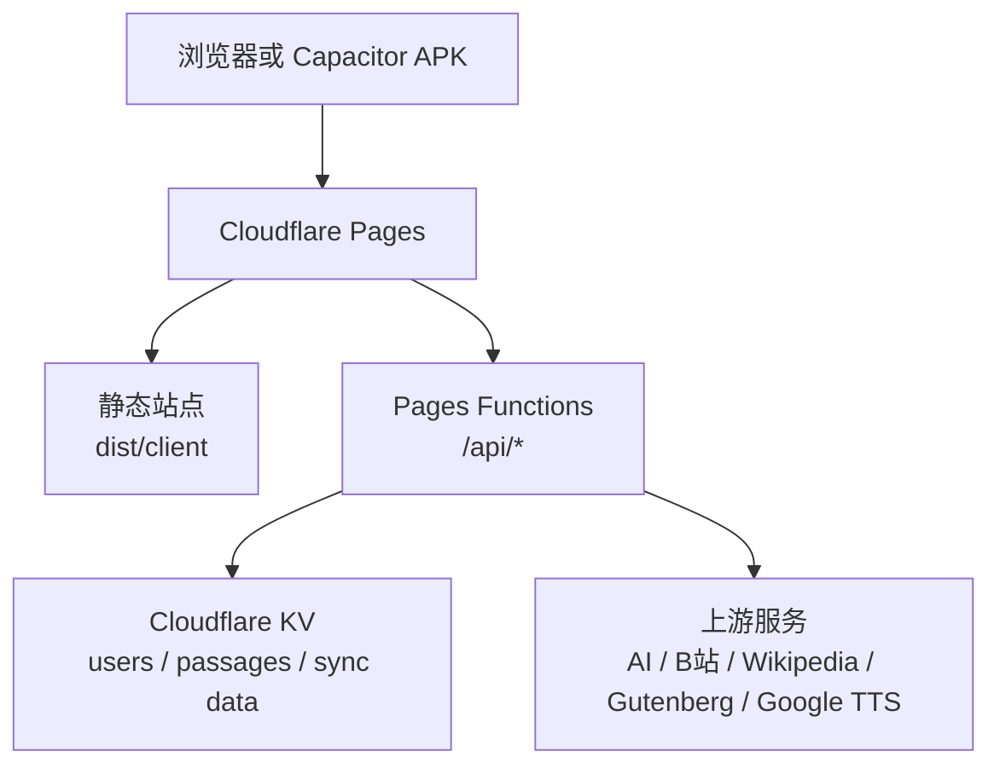
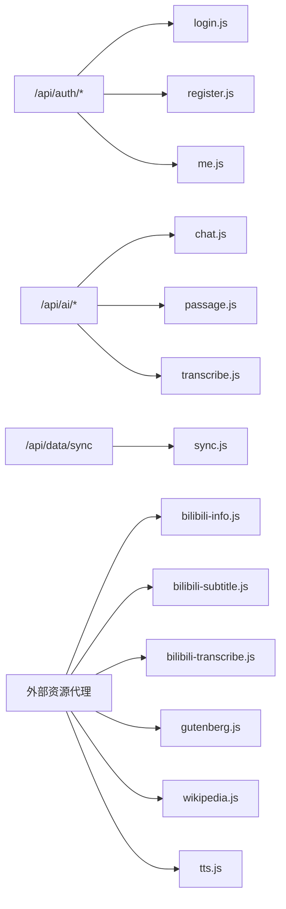
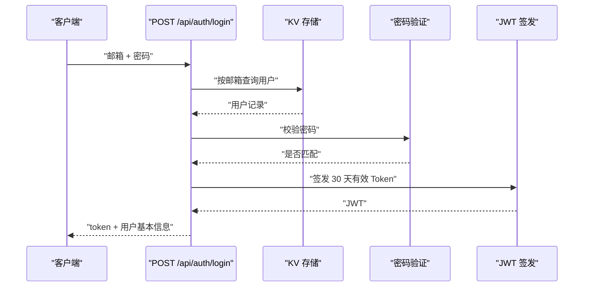
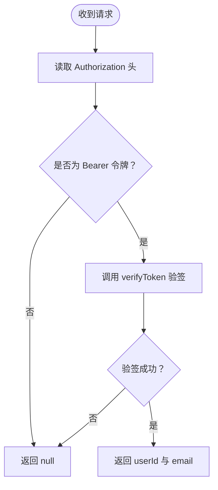
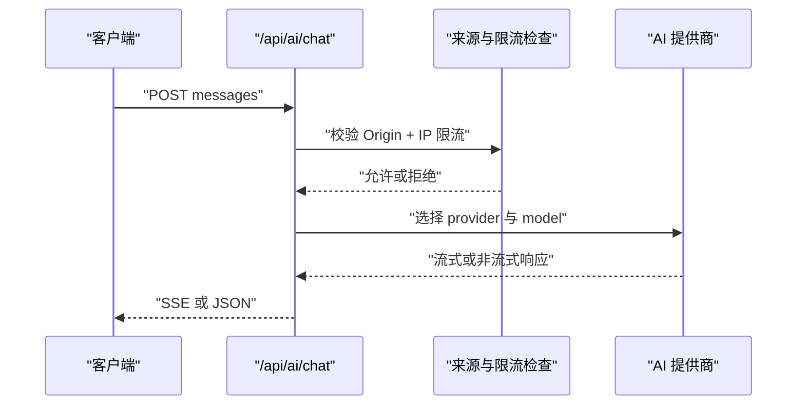
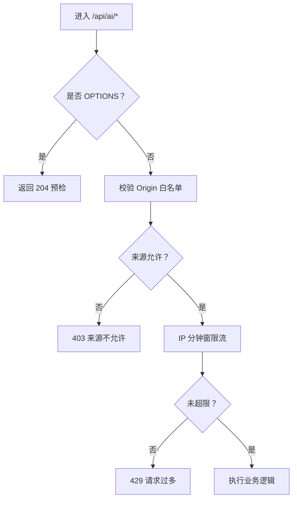
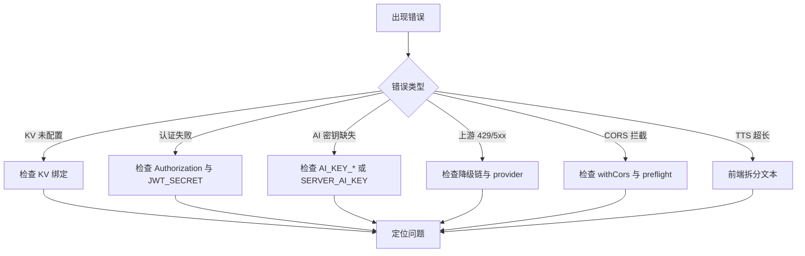

# Cloudflare Pages 部署

<cite>
**本文引用的文件**   
- [wrangler.toml](file://wrangler.toml)
- [package.json](file://package.json)
- [functions/_lib/auth.js](file://functions/_lib/auth.js)
- [functions/_lib/jwt.js](file://functions/_lib/jwt.js)
- [functions/_lib/kv.js](file://functions/_lib/kv.js)
- [functions/_lib/cors.js](file://functions/_lib/cors.js)
- [functions/_lib/guard.js](file://functions/_lib/guard.js)
- [functions/_lib/crypto.js](file://functions/_lib/crypto.js)
- [functions/api/auth/login.js](file://functions/api/auth/login.js)
- [functions/api/auth/register.js](file://functions/api/auth/register.js)
- [functions/api/auth/me.js](file://functions/api/auth/me.js)
- [functions/api/ai/chat.js](file://functions/api/ai/chat.js)
- [functions/api/ai/passage.js](file://functions/api/ai/passage.js)
- [functions/api/ai/transcribe.js](file://functions/api/ai/transcribe.js)
- [functions/api/data/sync.js](file://functions/api/data/sync.js)
- [functions/api/bilibili-info.js](file://functions/api/bilibili-info.js)
- [functions/api/bilibili-subtitle.js](file://functions/api/bilibili-subtitle.js)
- [functions/api/bilibili-transcribe.js](file://functions/api/bilibili-transcribe.js)
- [functions/api/gutenberg.js](file://functions/api/gutenberg.js)
- [functions/api/wikipedia.js](file://functions/api/wikipedia.js)
- [functions/api/tts.js](file://functions/api/tts.js)
</cite>

## 目录
1. [简介](#简介)
2. [项目结构与构建产物](#项目结构与构建产物)
3. [Cloudflare Pages 与 Wrangler 配置](#cloudflare-pages-与-wrangler-配置)
4. [API 网关架构](#api-网关架构)
5. [认证与 JWT 流程](#认证与-jwt-流程)
6. [KV 存储集成模式](#kv-存储集成模式)
7. [AI 服务与外部资源代理](#ai-服务与外部资源代理)
8. [限流、来源白名单与缓存策略](#限流来源白名单与缓存策略)
9. [环境变量与安全最佳实践](#环境变量与安全最佳实践)
10. [部署流水线与本地开发调试](#部署流水线与本地开发调试)
11. [监控、日志与排错指南](#监控日志与排错指南)
12. [性能特征与优化建议](#性能特征与优化建议)
13. [结论](#结论)

## 简介
本仓库是 NativeThink 的 Web 应用，前端使用 React 19 和 Vite，后端通过 Cloudflare Pages Functions 暴露 REST API。核心目标包括：用户认证、基于 KV 的数据同步、多厂商 AI 对话代理、音频转写、B站视频信息/字幕代理、古腾堡公版书全文代理、维基百科英文接口代理，以及 TTS 音频边缘缓存。

Cloudflare Pages 负责静态站点部署；`functions/` 下的每个文件是一个独立的 Pages Function，由路由路径自动映射为 HTTP 端点。运行时绑定一个 KV 命名空间用于用户数据、会话凭证及复习段落等持久化存储。

## 项目结构与构建产物
- `src/`：React 前端源码，Vite 构建输出到 `dist/client`。
- `functions/`：Cloudflare Pages Functions，按 URL 前缀路由分发。
- `scripts/`：构建、数据生成、打包脚本。
- `wrangler.toml`：Pages 项目元数据、构建输出目录与 KV 绑定。
- `package.json`：提供构建命令、预览命令与依赖声明。



**图表来源**
- [wrangler.toml:1-9](file://wrangler.toml#L1-L9)
- [functions/api/auth/login.js:1-49](file://functions/api/auth/login.js#L1-L49)
- [functions/api/data/sync.js:1-63](file://functions/api/data/sync.js#L1-L63)

**章节来源**
- [wrangler.toml:1-9](file://wrangler.toml#L1-L9)
- [package.json:1-130](file://package.json#L1-L130)

## Cloudflare Pages 与 Wrangler 配置
`wrangler.toml` 当前定义了以下关键项：

| 配置项 | 含义 | 当前值或要求 |
|---|---|---|
| `name` | Pages 项目名 | `nativethink` |
| `compatibility_date` | Workers 兼容日期 | `2024-12-01` |
| `pages_build_output_dir` | Pages 静态构建输出目录 | `dist/client` |
| `[[kv_namespaces]]` | KV 命名空间绑定 | 绑定名为 `KV`，需替换为实际命名空间 ID |

需要注意：
- 当前配置只声明了一个 KV namespace，没有显式声明环境变量（如 `JWT_SECRET`、`SERVER_AI_KEY`、`OPENAI_API_KEY`、`BILIBILI_COOKIE`）。这些变量应通过 Cloudflare Pages 项目的 **Settings > Environment Variables** 注入，而不是写入代码。
- 多个 handler 在运行时会检查 `env.KV`，因此如果 KV 未绑定，会返回“存储服务未配置”的错误。
- `pages_build_output_dir = "dist/client"` 与 `package.json` 中 `build:web` 的输出目录一致，说明 Pages 默认使用 Vite 构建结果作为静态站点。

**章节来源**
- [wrangler.toml:1-9](file://wrangler.toml#L1-L9)
- [functions/api/auth/login.js:8-15](file://functions/api/auth/login.js#L8-L15)
- [functions/api/auth/register.js:10-17](file://functions/api/auth/register.js#L10-L17)
- [functions/api/data/sync.js:10-17](file://functions/api/data/sync.js#L10-L17)
- [package.json:1-130](file://package.json#L1-L130)

## API 网关架构
`functions/api/` 下采用“按功能目录 + 单个 handler 文件”的组织方式。Cloudflare Pages Functions 将文件路径映射为 URL 路径：

| 目录或文件 | 路由 | 职责 |
|---|---|---|
| `functions/api/auth/login.js` | `POST /api/auth/login` | 邮箱密码登录，返回 JWT |
| `functions/api/auth/register.js` | `POST /api/auth/register` | 注册并创建用户 |
| `functions/api/auth/me.js` | `GET /api/auth/me` | 校验 Token 并返回当前用户 |
| `functions/api/ai/chat.js` | `POST /api/ai/chat` | 多厂商 AI 对话代理，支持流式响应 |
| `functions/api/ai/passage.js` | `POST /api/ai/passage` | 根据单词生成复习段落 |
| `functions/api/ai/transcribe.js` | `POST /api/ai/transcribe` | 音频转写，支持上传与 B站链接两种输入 |
| `functions/api/data/sync.js` | `POST /api/data/sync`、`GET /api/data/sync` | 批量上传/下载用户 KV 数据 |
| `functions/api/bilibili-info.js` | `GET /api/bilibili-info` | 代理 B站视频信息 |
| `functions/api/bilibili-subtitle.js` | `GET /api/bilibili-subtitle` | 获取 B站中英双语字幕 |
| `functions/api/bilibili-transcribe.js` | `GET /api/bilibili-transcribe` | 从 B站音频调用 Whisper 类 ASR |
| `functions/api/gutenberg.js` | `GET /api/gutenberg` | 代理古腾堡公版书全文 |
| `functions/api/wikipedia.js` | `GET /api/wikipedia` | 代理英文维基百科搜索与页面提取 |
| `functions/api/tts.js` | `GET /api/tts` | 代理 Google TTS 并做 CDN 级音频缓存 |

所有函数统一通过 `_lib/cors.js` 处理跨域，使 Capacitor APK、Electron 和本地开发环境能正常访问云端函数。



**图表来源**
- [functions/api/auth/login.js:1-49](file://functions/api/auth/login.js#L1-L49)
- [functions/api/auth/register.js:1-81](file://functions/api/auth/register.js#L1-L81)
- [functions/api/auth/me.js:1-22](file://functions/api/auth/me.js#L1-L22)
- [functions/api/ai/chat.js:1-192](file://functions/api/ai/chat.js#L1-L192)
- [functions/api/ai/passage.js:1-77](file://functions/api/ai/passage.js#L1-L77)
- [functions/api/ai/transcribe.js:1-200](file://functions/api/ai/transcribe.js#L1-L200)
- [functions/api/data/sync.js:1-63](file://functions/api/data/sync.js#L1-L63)
- [functions/api/bilibili-info.js:1-68](file://functions/api/bilibili-info.js#L1-L68)
- [functions/api/bilibili-subtitle.js:1-158](file://functions/api/bilibili-subtitle.js#L1-L158)
- [functions/api/bilibili-transcribe.js:1-200](file://functions/api/bilibili-transcribe.js#L1-L200)
- [functions/api/gutenberg.js:1-45](file://functions/api/gutenberg.js#L1-L45)
- [functions/api/wikipedia.js:1-107](file://functions/api/wikipedia.js#L1-L107)
- [functions/api/tts.js:1-69](file://functions/api/tts.js#L1-L69)

**章节来源**
- [functions/api/auth/login.js:1-49](file://functions/api/auth/login.js#L1-L49)
- [functions/api/auth/register.js:1-81](file://functions/api/auth/register.js#L1-L81)
- [functions/api/auth/me.js:1-22](file://functions/api/auth/me.js#L1-L22)
- [functions/api/ai/chat.js:1-192](file://functions/api/ai/chat.js#L1-L192)
- [functions/api/ai/passage.js:1-77](file://functions/api/ai/passage.js#L1-L77)
- [functions/api/ai/transcribe.js:1-200](file://functions/api/ai/transcribe.js#L1-L200)
- [functions/api/data/sync.js:1-63](file://functions/api/data/sync.js#L1-L63)
- [functions/api/bilibili-info.js:1-68](file://functions/api/bilibili-info.js#L1-L68)
- [functions/api/bilibili-subtitle.js:1-158](file://functions/api/bilibili-subtitle.js#L1-L158)
- [functions/api/bilibili-transcribe.js:1-200](file://functions/api/bilibili-transcribe.js#L1-L200)
- [functions/api/gutenberg.js:1-45](file://functions/api/gutenberg.js#L1-L45)
- [functions/api/wikipedia.js:1-107](file://functions/api/wikipedia.js#L1-L107)
- [functions/api/tts.js:1-69](file://functions/api/tts.js#L1-L69)

## 认证与 JWT 流程
认证相关逻辑集中在三个文件和一组共享库：

- `functions/_lib/auth.js`：从 `Authorization: Bearer <token>` 中提取 token 并调用验证。
- `functions/_lib/jwt.js`：使用 `jose` 库进行 HS256 签名与验证，Token 有效期为 30 天。
- `functions/_lib/crypto.js`：使用 Cloudflare Workers 原生 `crypto.subtle` 实现 PBKDF2 密码哈希。
- `functions/_lib/kv.js`：定义用户数据 KV key 前缀。
- `functions/api/auth/login.js`：登录。
- `functions/api/auth/register.js`：注册。
- `functions/api/auth/me.js`：读取当前用户。



**图表来源**
- [functions/api/auth/login.js:1-49](file://functions/api/auth/login.js#L1-L49)
- [functions/_lib/auth.js:1-8](file://functions/_lib/auth.js#L1-L8)
- [functions/_lib/jwt.js:1-26](file://functions/_lib/jwt.js#L1-L26)
- [functions/_lib/crypto.js:1-26](file://functions/_lib/crypto.js#L1-L26)

注册流程还会：
- 校验邮箱格式和密码长度。
- 在 KV 中检查邮箱是否已存在。
- 使用 PBKDF2 生成密码哈希。
- 生成用户 ID、创建时间和 email。
- 把用户写入 KV。
- 立即签发 JWT。

鉴权中间件仅做最薄一层：读取请求头、判断是否以 `Bearer ` 开头、再交给 `verifyToken`。错误场景下返回 `null`，上层 handler 将其视为未认证。



**图表来源**
- [functions/_lib/auth.js:1-8](file://functions/_lib/auth.js#L1-L8)
- [functions/_lib/jwt.js:1-26](file://functions/_lib/jwt.js#L1-L26)

**章节来源**
- [functions/_lib/auth.js:1-8](file://functions/_lib/auth.js#L1-L8)
- [functions/_lib/jwt.js:1-26](file://functions/_lib/jwt.js#L1-L26)
- [functions/_lib/crypto.js:1-26](file://functions/_lib/crypto.js#L1-L26)
- [functions/_lib/kv.js:1-6](file://functions/_lib/kv.js#L1-L6)
- [functions/api/auth/login.js:1-49](file://functions/api/auth/login.js#L1-L49)
- [functions/api/auth/register.js:1-81](file://functions/api/auth/register.js#L1-L81)
- [functions/api/auth/me.js:1-22](file://functions/api/auth/me.js#L1-L22)

## KV 存储集成模式
KV 在此项目中承担两类角色：

1. **用户身份与密码存储**  
   - 登录和注册通过 `users:email:<email>` 键读写用户记录。
   - 用户记录包含 id、email、passwordHash、createdAt。

2. **用户数据同步与复习内容**  
   - 同步接口使用 `users:data:<userId>:<key>` 作为统一前缀，便于批量列出和删除。
   - 复习段落使用 `passages:<userId>:<passageId>` 存储。

KV helper 只暴露 key 构造方法，避免 handler 直接拼接字符串产生不一致。

```mermaid
erDiagram
  USER_EMAIL {
    string users:email:<email> PK
    string id
    string email
    string passwordHash
    number createdAt
  }

  USER_DATA {
    string users:data:<userId>:<key> PK
    any value
  }

  PASSAGES {
    string passages:<userId>:<passageId> PK
    string title
    string content
    array words
    number createdAt
  }

  USER_EMAIL ||--o{ USER_DATA : "用户数据"
  USER_EMAIL ||--o{ PASSAGES : "用户复习段落"
```

**图表来源**
- [functions/_lib/kv.js:1-6](file://functions/_lib/kv.js#L1-L6)
- [functions/api/auth/login.js:1-49](file://functions/api/auth/login.js#L1-L49)
- [functions/api/auth/register.js:1-81](file://functions/api/auth/register.js#L1-L81)
- [functions/api/ai/passage.js:1-77](file://functions/api/ai/passage.js#L1-L77)
- [functions/api/data/sync.js:1-63](file://functions/api/data/sync.js#L1-L63)

**章节来源**
- [functions/_lib/kv.js:1-6](file://functions/_lib/kv.js#L1-L6)
- [functions/api/data/sync.js:1-63](file://functions/api/data/sync.js#L1-L63)
- [functions/api/ai/passage.js:1-77](file://functions/api/ai/passage.js#L1-L77)

## AI 服务与外部资源代理

### AI 对话代理 `/api/ai/chat`
该接口是多厂商 LLM 的统一入口，支持 deepseek、doubao、qwen、factory、glm、siliconflow、moonshot、groq 等 provider。主要行为：

- 支持 GET 查询当日工厂 Key 用量快照。
- POST 请求体包含 provider、model、messages、max_tokens、temperature、stream、apiKey、thinking、task。
- 优先使用客户端传入 apiKey；否则回退到服务端环境变量 `AI_KEY_<PROVIDER>` 或 `SERVER_AI_KEY`。
- 对 glm/factory 免费模型启用候选模型降级链，缓解 429 限流。
- 当 stream 为 true 时，返回 `text/event-stream` 流式响应。
- 使用 Origin 白名单和 IP 分钟窗限流防止滥用。



**图表来源**
- [functions/api/ai/chat.js:1-192](file://functions/api/ai/chat.js#L1-L192)
- [functions/_lib/guard.js:1-89](file://functions/_lib/guard.js#L1-L89)

### 复习段落生成 `/api/ai/passage`
- 接收单词列表，调用 DeepSeek 或其他可配置 AI 接口生成英文短文。
- 如果返回非 JSON，则尝试正则提取对象。
- 若用户已登录，将段落保存到 KV。
- 支持 `mode=client` 让前端走本地或替代生成路径。

### 音频转写 `/api/ai/transcribe`
- 支持 multipart 上传音频，也支持 JSON 传入 B站 bvid/cid 或 audioUrl。
- 内部实现 WBI 签名、Whisper 兼容 ASR 提供商、转录结果归一化。
- 限制最大上传体积，并解析不同厂商返回结构。

### B站相关代理
- `bilibili-info.js`：获取视频标题、分集、时长、频道。
- `bilibili-subtitle.js`：获取 B站字幕，轮询等待 AI 字幕生成，过滤英文轨道。
- `bilibili-transcribe.js`：通过 WBI 签名拿到播放地址，下载音频后调用 OpenAI 兼容 Whisper。

### 其他外部资源代理
- `gutenberg.js`：代理古腾堡公版书文本。
- `wikipedia.js`：代理英文维基百科搜索与纯文本页面提取。
- `tts.js`：代理 Google Translate TTS，并以 `public, max-age=31536000, immutable` 长期缓存音频。

**章节来源**
- [functions/api/ai/chat.js:1-192](file://functions/api/ai/chat.js#L1-L192)
- [functions/api/ai/passage.js:1-77](file://functions/api/ai/passage.js#L1-L77)
- [functions/api/ai/transcribe.js:1-200](file://functions/api/ai/transcribe.js#L1-L200)
- [functions/api/bilibili-info.js:1-68](file://functions/api/bilibili-info.js#L1-L68)
- [functions/api/bilibili-subtitle.js:1-158](file://functions/api/bilibili-subtitle.js#L1-L158)
- [functions/api/bilibili-transcribe.js:1-200](file://functions/api/bilibili-transcribe.js#L1-L200)
- [functions/api/gutenberg.js:1-45](file://functions/api/gutenberg.js#L1-L45)
- [functions/api/wikipedia.js:1-107](file://functions/api/wikipedia.js#L1-L107)
- [functions/api/tts.js:1-69](file://functions/api/tts.js#L1-L69)

## 限流、来源白名单与缓存策略

### 来源白名单
`_lib/guard.js` 维护允许的 Origin 集合，并额外放行带端口的 localhost 形式。目的是阻止第三方网页把 Functions 当作免费 AI 中继；Electron 通过本地 server 不走 Cloudflare Functions，所以无需加入白名单。

### IP 限流
- 使用 isolate 内存中的 Map 维护每 IP 每分钟请求计数。
- 默认窗口 60 秒，上限 30 次。
- 当 Map 超过 5000 项时清理过期条目，防止隔离区内存无限增长。
- 不使用 KV 做限流状态，因为免费档 KV 每日写入配额很低。

### 消息体校验
- 限制消息数组长度不超过 80。
- 每条消息 role 和 content 必须是字符串。
- 总字符数不超过 64000。

### TTS 缓存
- `functions/api/tts.js` 设置 `Cache-Control: public, max-age=31536000, immutable`。
- 同一文本的音频由 Cloudflare CDN 长期缓存，首调走上游，后续从边缘缓存返回。

### CORS 策略
- 所有 handler 统一通过 `_lib/cors.js` 追加跨域响应头。
- 支持 OPTIONS 预检请求，返回 204。
- 允许 `Content-Type` 与 `Authorization` 请求头。



**图表来源**
- [functions/_lib/cors.js:1-29](file://functions/_lib/cors.js#L1-L29)
- [functions/_lib/guard.js:1-89](file://functions/_lib/guard.js#L1-L89)
- [functions/api/tts.js:1-69](file://functions/api/tts.js#L1-L69)

**章节来源**
- [functions/_lib/guard.js:1-89](file://functions/_lib/guard.js#L1-L89)
- [functions/_lib/cors.js:1-29](file://functions/_lib/cors.js#L1-L29)
- [functions/api/tts.js:1-69](file://functions/api/tts.js#L1-L69)

## 环境变量与安全最佳实践
当前代码依赖的环境变量包括：

| 变量名 | 用途 | 安全建议 |
|---|---|---|
| `JWT_SECRET` | JWT HS256 密钥 | 必须强随机、足够长度，不可提交到仓库 |
| `KV` | KV 命名空间绑定 | 已在 `wrangler.toml` 绑定，但建议同时用分支环境隔离测试与生产 |
| `SERVER_AI_KEY` | AI 代理通用密钥回退 | 不要暴露给前端；仅在未传 clientApiKey 时使用 |
| `AI_KEY_<PROVIDER>` | 特定 AI 提供商密钥 | 按 provider 区分，降低单点泄露影响 |
| `SERVER_AI_ENDPOINT` | passage 自定义 AI 端点 | 可选，默认 DeepSeek |
| `SERVER_AI_MODEL` | passage 自定义 AI 模型 | 可选，默认 deepseek-chat |
| `OPENAI_API_KEY` | B站音频转写 Whisper 密钥 | 仅限需要 whisper 能力的部署 |
| `OPENAI_BASE_URL` | OpenAI 兼容基础 URL | 可选 |
| `BILIBILI_COOKIE` | B站登录态 Cookie | 谨慎使用，避免泄露 |

安全要点：
- JWT_SECRET 缺失时，`jwt.js` 会抛出错误；应在部署环境中始终配置。
- 密码哈希使用 PBKDF2 + SHA-256，迭代次数较高，适合一次性注册场景，但不适合高频登录热路径。
- KV 数据只存必要字段，不存明文密码。
- 外部密钥优先通过环境变量注入，不在代码中硬编码。
- 对于出厂 Key 使用，`guard.js` 通过结构化日志记录 provider、model、IP 和日期，方便审计。

**章节来源**
- [functions/_lib/jwt.js:1-26](file://functions/_lib/jwt.js#L1-L26)
- [functions/_lib/crypto.js:1-26](file://functions/_lib/crypto.js#L1-L26)
- [functions/_lib/guard.js:1-89](file://functions/_lib/guard.js#L1-L89)
- [functions/api/ai/chat.js:1-192](file://functions/api/ai/chat.js#L1-L192)
- [functions/api/ai/passage.js:1-77](file://functions/api/ai/passage.js#L1-L77)
- [functions/api/bilibili-transcribe.js:1-200](file://functions/api/bilibili-transcribe.js#L1-L200)
- [functions/api/bilibili-info.js:1-68](file://functions/api/bilibili-info.js#L1-L68)

## 部署流水线与本地开发调试

### 构建命令
`package.json` 中与 Web 构建相关的命令如下：

- `npm run build:web`：执行 Vite 构建，输出到 `dist/client`，并把 `index.html` 复制为 `404.html`，用于 SPA 路由回退。
- `npm run build`：调用 `scripts/build.sh`。
- `npm run dev`：调用 `scripts/dev.mjs`。
- `npm run preview`：使用 Vite 预览 `dist/client`。

Cloudflare Pages 通常会在后台拉取仓库后执行默认构建。由于 `wrangler.toml` 指定了 `pages_build_output_dir = "dist/client"`，只要构建产物存在于该目录，Pages 即可识别静态站点。

### 本地开发调试 Cloudflare Functions
推荐方式：

1. 安装 Wrangler：`npm install -D wrangler`（若尚未安装）。
2. 配置环境变量：
   - 在项目根目录创建 `.dev.vars`，写入 `JWT_SECRET`、`SERVER_AI_KEY`、`OPENAI_API_KEY`、`BILIBILI_COOKIE` 等。
   - 或在 Cloudflare Pages 后台配置对应环境变量的生产/分支版本。
3. 启动 Pages Functions 本地服务器：
   - `npx wrangler pages dev dist/client --binding KV=<KV_NAMESPACE_ID>`
   - 如果需要在本地模拟环境变量，可使用 `--env` 或 `.dev.vars`。
4. 调试日志：
   - 使用 `wrangler pages deployment tail` 查看实时日志。
   - 使用 `wrangler tail` 查看 Worker/Function 的 console.log。
5. 调试 KV：
   - 使用 `wrangler kv:key list --namespace <KV_NAMESPACE_ID>` 查看键。
   - 使用 `wrangler kv:key get --namespace <KV_NAMESPACE_ID> <key>` 读取具体值。
   - 使用 `wrangler kv:key delete --namespace <KV_NAMESPACE_ID> <key>` 清理测试数据。

常见问题排查：
- 登录/注册返回“存储服务未配置”：确认 Pages 已绑定 KV 且绑定名称为 `KV`。
- 移动端无法调用 API：确认 `functions/_lib/cors.js` 生效，且 APK 内源为 `https://localhost` 时不被拦截。
- AI 接口返回 403：检查 Origin 是否来自允许域名或 localhost；检查 Cloudflare 防火墙规则。
- AI 接口返回 429：检查上游提供商限流，或减少并发、切换 provider。
- TTS 返回 400：检查 text 是否超过 200 字符。
- B站接口失败：检查网络可达性、Cookie 是否失效、WBI 签名是否正常。

**章节来源**
- [package.json:1-130](file://package.json#L1-L130)
- [wrangler.toml:1-9](file://wrangler.toml#L1-L9)
- [functions/_lib/cors.js:1-29](file://functions/_lib/cors.js#L1-L29)
- [functions/api/tts.js:1-69](file://functions/api/tts.js#L1-L69)

## 监控、日志与排错指南

### 日志位置
- Cloudflare Pages 控制台 Real-time Logs。
- `wrangler pages deployment tail`。
- `wrangler tail`。
- `console.log`、`console.error` 输出。

### 结构化监控
`guard.js` 对出厂 Key 使用记录结构化日志，字段包括 type、day、provider、model、ip。可通过关键字 `ai_factory_usage` 检索。

### 常见错误对照表

| 现象 | 可能原因 | 排查步骤 |
|---|---|---|
| 登录返回“存储服务未配置” | KV 未绑定或绑定名不是 `KV` | 检查 Pages 后台 KV 绑定 |
| 注册返回“该邮箱已注册” | KV 中已有相同邮箱 | 检查 `users:email:<email>` |
| 登录返回“邮箱或密码错误” | 用户不存在或密码哈希不匹配 | 检查 KV 用户记录与 PBKDF2 参数 |
| AI 聊天返回“Server AI key not configured” | 未配置 `AI_KEY_<PROVIDER>` 或 `SERVER_AI_KEY` | 检查环境变量 |
| AI 聊天返回“Too many requests” | IP 限流触发 | 降低频率或检查异常流量 |
| TTS 返回“Text too long” | 文本超过 200 字符 | 前端拆分文本 |
| B站字幕为空 | B站 AI 字幕尚未生成或无英文轨道 | 重试、检查 `lan=en` |
| Wikipedia 返回“条目不存在” | 页面标题不存在 | 检查前端搜索词 |
| 移动端请求被拦截 | 缺少 CORS 或预检失败 | 检查 `withCors` 与 `isPreflight` |



**图表来源**
- [functions/_lib/guard.js:1-89](file://functions/_lib/guard.js#L1-L89)
- [functions/_lib/cors.js:1-29](file://functions/_lib/cors.js#L1-L29)
- [functions/api/tts.js:1-69](file://functions/api/tts.js#L1-L69)
- [functions/api/auth/login.js:1-49](file://functions/api/auth/login.js#L1-L49)
- [functions/api/ai/chat.js:1-192](file://functions/api/ai/chat.js#L1-L192)

**章节来源**
- [functions/_lib/guard.js:1-89](file://functions/_lib/guard.js#L1-L89)
- [functions/_lib/cors.js:1-29](file://functions/_lib/cors.js#L1-L29)
- [functions/api/auth/login.js:1-49](file://functions/api/auth/login.js#L1-L49)
- [functions/api/ai/chat.js:1-192](file://functions/api/ai/chat.js#L1-L192)
- [functions/api/tts.js:1-69](file://functions/api/tts.js#L1-L69)

## 性能特征与优化建议

### 当前特征
- KV 读操作频繁用于登录、注册、同步；写操作集中在注册、同步和段落保存。
- AI 对话使用流式响应，有助于降低前端首字延迟。
- TTS 音频使用一年期 CDN 缓存，重复播放成本极低。
- 限流使用内存 Map，不写 KV，避免打满免费配额。
- B站字幕接口有轮询重试，增加单次请求延迟但提高成功率。

### 优化建议
1. **KV 写入频率控制**  
   同步接口目前每次同步都会逐个 put/delete。如果前端一次上传大量 key，应考虑批量写入或合并更新，减少 KV 调用次数。

2. **KV 读取热点**  
   登录路径先查 `users:email:<email>`，再解析 JSON。可将常用字段设计得更紧凑，减少序列化开销。

3. **AI 请求缓存**  
   对相同 prompt 的短期结果可在 KV 或 Cloudflare Cache API 中缓存，但需注意隐私和时效性。

4. **B站字幕重试间隔**  
   当前最多重试 5 次、间隔约 1200ms，最长约 6 秒。可根据业务需求调整为更短超时或更早返回空结果，让前端改用 AI 补充。

5. **TTS 文本校验前置**  
   当前已在服务端拒绝超 200 字符的请求，这是正确做法；前端也应提前截断，避免无效网络请求。

6. **Worker 内存清理**  
   `guard.js` 的 rateMap 会定期清理，但仍建议关注长时间运行的 isolate 中 Map 大小，必要时引入定时清理或限制上限。

[本节为通用性能讨论，不直接分析具体文件行号]

## 结论
NativeThink 的 Cloudflare Pages 部署以 `wrangler.toml` 为核心入口，结合 `functions/_lib` 中的认证、CORS、限流、KV 辅助库，构建了清晰的前端-后端-外部服务分层。认证使用 JWT，数据存储使用 KV，AI 能力通过多厂商代理抽象，外部资源通过代理绕过 CORS 和网络限制。

部署时需要重点完成三件事：
1. 在 Cloudflare Pages 绑定 KV 命名空间并命名为 `KV`。
2. 配置 `JWT_SECRET` 及必要的 AI、OpenAI、B站 Cookie 等环境变量。
3. 使用 `wrangler pages dev` 和 `wrangler tail` 进行本地调试与线上日志追踪。

当前实现已经具备生产可用骨架，但在高并发、大规模同步、敏感密钥轮换和外部服务稳定性方面仍有扩展空间。建议在正式上线前引入环境变量模板、分支环境隔离、结构化指标上报和灰度发布机制。